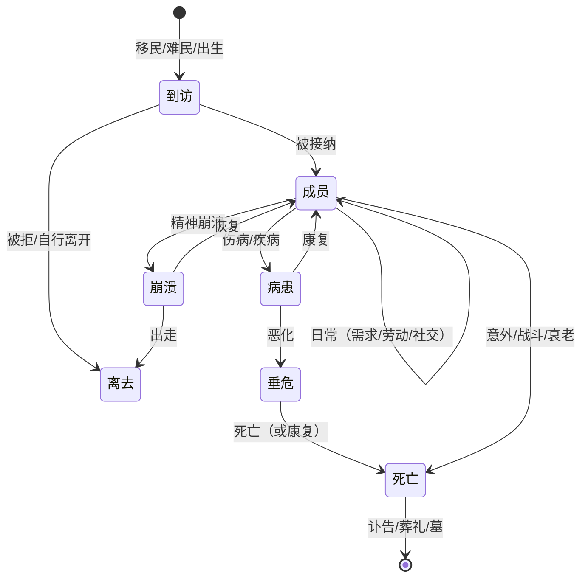

# 殖民地与居民

```
状态：草稿
负责人：设计
最后更新：2026-10-17
上游依据：docs/design/01-vision-and-pillars.md（P2 人味、P5 失败即内容）、docs/design/02-benchmark.md
下游影响：PRD-001（需求、情绪与记忆）、PRD-008（关系与社交）、PRD-009（世代与传承）
```

> 这是本项目**最重要**的一份纲要：支柱 P2「每个人都是一个故事」全部落在这里。
> 目标不是把居民做成需要照顾的宠物，而是让**每个居民成为一台小型叙事发生器**。

---

## 1. 设计目标

| 编号 | 目标 | 可判定信号 |
| --- | --- | --- |
| G1 | 玩家能说出至少 3 名居民的名字与处境 | 试玩观察 |
| G2 | 情绪变化永远可以追溯到具体原因 | UI 里能列出「高兴/不高兴的原因清单」 |
| G3 | 居民的行为差异来自**人**（性格/偏好/记忆/关系），不是随机数 | 同岗位两名居民的日行为可观察地不同 |
| G4 | 死亡有重量 | 讣告 + 葬礼 + 关系人的记忆变化 + 墓碑 |
| G5 | 长期依恋 | 玩家会为了救一个人而改变计划 |
| G6 | 复杂度不压垮引擎 | 需求/情绪按「日」与「事件」结算，不逐 tick |

**反目标**：不做一个「所有人都在闹情绪」的游戏（情绪必须大部分时间是背景，偶尔成为事件）。

---

## 2. 居民生命周期



| 阶段 | 说明 | 玩家可干预 |
| --- | --- | --- |
| 到访（Visitor） | 途径殖民地、寻求加入 | 接纳/拒绝/暂留 |
| 成员（Member） | 完整参与劳动与生活 | 职业、作息、禁限区、优先级、个人指令 |
| 病患（Patient) | 受伤/生病，劳动受限 | 指派照料、用药、隔离 |
| 垂危（Dying） | 濒死，可能留下遗言 | 陪伴（影响他人记忆） |
| 崩溃（Broken） | 精神阈值被突破 | 安抚、放假、隔离、药物 |
| 离去（Departed） | 出走/被放逐 | 挽留或放行 |
| 死亡（Dead） | 结束 | 葬礼安排、遗体处理 |

---

## 3. 属性模型

### 3.1 分类总览

| 类别 | 内容 | 变化频率 | 来源参考 |
| --- | --- | --- | --- |
| **需求（Needs）** | 默认核心集 8 条（饥饿、休息、温暖、安全、社交、美感、意义、**户外**）+ 变体/成瘾/专属需求（[PRD-001](../prd/PRD-001-needs-mood-memory.md) 数据驱动注册表） | 分钟级衰减、日级结算；汇入**专注度 Focus** | RimWorld + 矮人要塞 |
| **情绪（Mood）** | 一个标量 + 一份「原因清单」 | 事件驱动 + 日结算 | RimWorld |
| **性格（Traits）** | 2–4 条性格标签（勤奋/懒散/乐观/悲观/洁癖/嗜酒/勇敢/怯懦…） | 固定（终生） | DF + RimWorld |
| **偏好（Preferences）** | 喜欢的食物/材质/颜色/活动；厌恶项 | 固定 | DF |
| **技能与职业** | 每种职业的等级与经验；职业倾向 | 劳动时增长 | 基底已有（`Xp`/`Vocation`） |
| **专长（Perks）** | 随等级获得的能力（基底已有 `Perk`） | 里程碑式 | 基底已有 |
| **健康（Health）** | 伤口、感染、疾病、后遗症、营养状态 | 事件驱动 | RimWorld |
| **关系（Relations）** | 对每个他人的好感度 + 关系标签 | 事件驱动 | RimWorld + DF |
| **记忆（Memories）** | 带情绪权重的往事，会衰减但不消失 | 事件驱动 | DF + RimWorld |
| **身世（Backstory）** | 出身、来处、过去职业（影响初始技能与性格） | 固定 | RimWorld |
| **财产与作品** | 拥有的物品、制作的物品（署名） | 事件驱动 | Stonehearth + DF |

### 3.2 需求系统（草案）

| 需求 | 满足来源 | 未满足后果 | 权重 | 备注 |
| --- | --- | --- | --- | --- |
| **饥饿 Hunger** | 食物（质量影响满足度） | 体弱 → 疾病 → 死亡 | 高 | 食物质量是叙事素材（吃得好会留记忆） |
| **休息 Rest** | 床（质量影响恢复）、小憩 | 效率下降 → 倒地 → 疾病 | 高 | 基底已有睡眠行为 |
| **温暖 Warmth** | 火源、衣物、密闭建筑 | 生病 → 死亡 | 中高 | 与季节耦合 |
| **安全 Safety** | 无威胁、有防御、有民兵 | 恐惧 → 拒绝外出 → 崩溃 | 中高 | 基底已有 fear 机制 |
| **社交 Social** | 与关系良好者相处、聊天、共餐、节庆 | 孤独 → 情绪下降 → 崩溃 | 中 | 与关系系统耦合 |
| **美感 Beauty** | 装饰、整洁、光线、景色 | 长期低落 | 低中 | 让建筑不只是功能 |
| **意义 Meaning** | 信仰/仪式/成就/作品署名/被认可 | 长期低落、怠工 | 低中 | 时代与宗教后期接入 |
| **户外 Outdoors** | 在露天/非屋顶下活动、景色 | 长期在室内 → 低落 | 低中 | **可与「室内」互换**（穴居者特质替换：变体需求，[PRD-001](../prd/PRD-001-needs-mood-memory.md) 注册表） |

> **2026-10-18 更新**：本表是**默认核心集**（8 条），不再是"固定 7 条"。需求系统已改为**数据驱动注册表**（[PRD-001 §4.3](../prd/PRD-001-needs-mood-memory.md)）：核心集可被**变体替换**（如「室内」替换「户外」）、可**新增成瘾类需求**（成瘾形成后才出现）、可有**专属需求**（儿童「学习」、婴儿「玩耍」、机械族「能量」= 电力）；**如厕**是**计量式需求**（膀胱/肠道 + 失禁 + 卫生压力），**口渴/氧气/体温是 vitals 不进需求栏**（PRD-001 R-NM-8 / R-NM-16）。需求满足度汇入**专注度 Focus**，构成效率修正的落点。

**规则**
| 编号 | 规则 |
| --- | --- |
| R-N-1 | 需求**不逐 tick 结算**：按游戏日（或小时）结算，个别（饥饿）按小时。 |
| R-N-2 | 每条需求都必须有**至少两种满足路径**（例如饥饿：自煮 / 共餐 / 购买 / 乞讨）。 |
| R-N-3 | 需求的 UI 呈现必须能区分「即将出问题」与「已经出问题」（预警而非震惊）。 |
| R-N-4 | 需求可被数据包新增/覆盖（对应 [自由度](11-freedom-design.md) 的 D2 级）。 |

### 3.3 情绪模型（草案）

```
情绪值 Mood ∈ [-100, +100]（默认 0）

Mood = clamp(
    基线（性格 + 身世）                          // 例：乐观 +10，悲观 -10
  + Σ 需求修正（每条需求的满足/缺失贡献）          // 例：饿了 -15
  + Σ 记忆修正（每条记忆的情绪权重 × 衰减系数）    // 例：亲人去世 -40，衰减 ×0.9/日
  + 环境修正（温度、光照、拥挤、脏乱、美景）        // 例：黑暗 -8，拥挤 -5，花园 +5
  + 关系修正（附近的人关系好/差）                  // 例：挚友同在 +5，仇人同在 -10
  + 事件修正（近期发生的事）                       // 例：被袭击 -20（持续 N 天）
)
```

| 阈值 | 状态 | 行为 |
| --- | --- | --- |
| ≥ +40 | 愉悦（Elated） | 效率加成、更愿社交、可能自发庆祝 |
| +10 ~ +40 | 满意（Content） | 正常 |
| -10 ~ +10 | 一般（Fine） | 正常 |
| -30 ~ -10 | 不满（Unhappy） | 效率下降、抱怨、可能拒绝部分工作 |
| -60 ~ -30 | 痛苦（Miserable） | 有概率拒绝工作、争吵、酗酒、出走 |
| < -60 | 濒临崩溃（Breaking） | 触发崩溃事件（见下） |

**崩溃类型**（对应叙事素材，不是随机的「发疯」）：

| 类型 | 触发倾向 | 表现 | 恢复 |
| --- | --- | --- | --- |
| 暴怒（Berserk） | 高怒意/低社交 | 攻击最近的人或破坏物品 | 时间 + 安抚 |
| 痛哭（Despair） | 高悲伤 | 停工、卧倒 | 社交安慰 |
| 出走（Flight） | 低安全 + 怯懦 | 离开殖民地（可能一去不返） | 追回/挽留 |
| 酗酒/暴食（Indulgence） | 有相关偏好 | 消耗资源、情绪短暂回升 | 时间 |
| 痴迷（Obsession） | 高意义缺失 | 反复做无意义的事 | 仪式/目标 |
| 麻木（Withdrawal） | 长期低落 | 工作效率大幅下降但不闹事 | 重大好转（婚礼/胜利/节庆） |

**R-MOOD-1**：崩溃必须**可预防**（玩家能看到情绪下行趋势与原因）。
**R-MOOD-2**：崩溃必须**可恢复**，且恢复过程本身产生故事（谁安慰了谁、谁因此建立了关系）。
**R-MOOD-3**：情绪原因清单必须可展开查看，并且每条都指向可定位的人/事/物。

---

## 4. 关系与社交

### 4.1 关系类型

| 关系 | 如何形成 | 效果 |
| --- | --- | --- |
| 好感/恶感（Opinion） | 日常互动、事件 | 影响协作、社交需求、情绪 |
| 师徒（Mentor） | 长期同一职业、教学 | 技能增长加速 |
| 挚友（Friend） | 好感超阈值 + 共同经历 | 情绪加成、死亡时巨大打击 |
| 恋人/配偶（Lover/Spouse） | 好感 + 交流 + 条件满足 | 同居、生育、情绪强耦合 |
| 亲属（Kin） | 生育/剧本设定 | 死亡影响强烈、继承 |
| 救命恩人/仇人（Savior/Rival） | 关键事件 | 长期情绪与行为影响 |
| 债主/欠债（Debt） | 经济往来 | 影响信任与交易 |

### 4.2 社交行为（由居民自主发起，与基底规划器协同）

| 行为 | 触发 | 效果 |
| --- | --- | --- |
| 闲聊（Chat） | 空闲 + 附近有人 | 好感 ±、社交需求 + |
| 共餐（Meal together） | 同一时段进食 | 社交 +、好感 + |
| 争执（Argument） | 恶感 + 压力 | 好感 -、情绪 -、可能升级 |
| 教导（Teach） | 师徒/高技能相邻 | 技能经验转移 |
| 照料（Tend） | 对方病患/垂危 | 好感 ++、记忆 |
| 安慰（Comfort） | 对方情绪低 | 好感 ++、情绪 + |
| 庆祝（Celebrate） | 节庆/喜事 | 群体情绪 +、记忆 |
| 悼念（Mourn） | 有人死亡 | 群体情绪 -、记忆、可能建立关系 |

**R-REL-1**：社交行为必须**由基线劳动系统排队**（占用居民的「休息/社交」时段），不能另开一套 tick。具体接入点待 `research/01` 确认。
**R-REL-2**：关系变化必须有可读的日志（传说页/人物页可查「他们之间发生过什么」）。

---

## 5. 世代与成长

| 阶段 | 年龄（见下 R-GEN-3 的刻度） | 能力 | 玩法 |
| --- | --- | --- | --- |
| 幼儿（Toddler） | 0–3 | 不能劳动 | 需要照料；情绪与记忆开始积累 |
| 儿童（Child） | 4–12 | 可做轻活（跑腿/采集/照看） | 教育选择、玩伴关系 |
| 少年（Teen） | 13–17 | 可学徒、可做大部分工作 | 师徒、专精方向 |
| 成年（Adult） | 18–55 | 全能力 | 主力劳动、婚育 |
| 老年（Elder） | 56+ | 效率下降、经验高 | 传承、教导、自然死亡 |

| 机制 | 说明 |
| --- | --- |
| 生育 | 配偶 + 条件（住房/食物/情绪）+ 概率；孕期与产后照料 |
| 教育 | 儿童随成人学习或上「学堂」；决定初始技能倾向 |
| 传承 | 父母死亡时，子女继承物品/记忆/理念（部分） |
| 技能衰减 | 长期不用会缓慢降低（可选，需仔细平衡） |
| 人口自然曲线 | 出生/死亡/移民共同决定人口；玩家可选择鼓励生育或引进移民 |

**R-GEN-1**：儿童不得因为玩家疏忽而「无理由死亡」——死亡必须有可追溯链条。
**R-GEN-2**：世代是长期依恋的来源，因此**至少要有第二代的成长可见**（在 30 小时目标内）。
**R-GEN-3（2026-10-18 定，ADR-014；同日修订为三层可配）**：**衰老绝不写死**，由三层共同决定——
① **全局衰老速度** `ticks_per_age_year`（默认 24000 = **1 游戏日 ≈ 1 岁**；若按历法年计（一年 = 32 游戏日），18 岁成年需约 192 现实小时，R-GEN-2 永远达不成）；
② **时代寿命加成**：每进入一个新时代，期望寿命默认 **+15%**（可调）——科技越强人越长寿，**高属性居民不该"刚培养好就老死"**；
③ **个体体质 / 长寿特质**：个体差异让少数人显著更长寿（传承与依恋的来源）。
`aging_enabled` 默认**开**。默认刻度下约 6 小时成年、18.7 小时进入老年，**30 小时里程碑内可看到出生→成长→老死与第三代开端**。落地规格见 [PRD-009](../prd/PRD-009-generations-and-legacy.md)（其 §18 OQ 已按此收口）。

---

## 6. 死亡、葬礼与记忆

| 环节 | 内容 |
| --- | --- |
| 死亡原因 | 记录在讣告：战死、病死、饿死、意外、衰老（这本身就是叙事） |
| 讣告（Obituary） | 基底已有 `ResidentObituary`；扩展为「生平 + 关系人 + 关键记忆」 |
| 遗体处理 | 掩埋（墓）/火化/（后期）其他；不同文化不同 |
| 葬礼 | 需要墓地与仪式；参与者情绪变化、建立关系 |
| 墓碑 | 世界中可见的方块，记录姓名与年份 |
| 遗产 | 物品、未完成的作品、技能传授给徒弟 |
| 他人记忆 | 关系人获得负向记忆，强度与关系深度相关 |
| 传说页 | 自动写入人物条目与事件年表 |

**R-DEATH-1**：每个死亡必须留下至少一条可读记录（墓碑/讣告/传说条目）。
**R-DEATH-2**：玩家永远可以选择「不打仗」，但不能选择「没有死亡」。

---

## 7. 加入、离去与人口流动

| 途径 | 触发 | 玩家选择 |
| --- | --- | --- |
| 移民（Migrant） | 殖民地声望/繁荣/时代 | 接纳/拒绝（影响声望） |
| 难民（Refugee） | 外部事件（战争/灾荒） | 接纳（消耗资源）/拒绝（声望损失）/暂留 |
| 出生（Birth） | 居民内部 | 自动 |
| 招募（Recruit） | 从外邦/俘虏（后期） | 需要说服/条件 |
| 出走（Leave） | 低情绪、低安全、被放逐 | 挽留（消耗资源） |
| 驱逐（Exile） | 玩家决定 | 影响他人情绪与声望 |

**R-POP-1**：人口增长必须有**上限压力**（食物、住房、卫生、情绪），否则没有决策。
**R-POP-2**：人口的质与量应当存在取舍（引来更多人也意味着更多嘴与更多矛盾）。

---

## 8. 群体结构（后期）

| 结构 | 内容 | 时代 |
| --- | --- | --- |
| 家庭（Household） | 配偶 + 子女 + 共同住所 | 农耕 |
| 氏族（Clan） | 血缘 + 共同姓氏 + 内部好感加成 | 铜石 |
| 阶层（Class） | 平民/工匠/贵族/（契约劳工，谨慎表达） | 工业 |
| 信仰（Faith） | 共同仪式与意义来源 | 铁器 |
| 派系（Faction） | 殖民地内部的政治分歧（可选） | 工业 |

**R-GRP-1**：群体结构提供**新的冲突与新的凝聚**，而不是只加数值加成。
**R-GRP-2**：涉及伦理敏感内容（奴役、种姓）时，采用抽象化表达并默认关闭。

---

## 9. 与基底（Folkways）的关系

| 我们需要的 | 基底已提供（待 `research/01`/`02` 确认） | 需要新增 |
| --- | --- | --- |
| 居民实体与外观 | `ResidentEntity`、`ResidentLooks`、姓名池、模型系统 | 身世/性格/偏好数据 |
| 需求与欲望 | `LivingNeed`、`SettlerNeed`、`Urge`/`UrgeSource`（已有一套「欲望驱动」骨架） | 需求的扩展与统一模型 |
| 情绪 | 无 | 全新（Mood + 原因清单） |
| 记忆 | 无 | 全新（Memory） |
| 关系 | 无（待确认） | 全新（Relations） |
| 技能与职业 | `Vocation`、`Xp`、`Perk` | 专精方向、教学 |
| 恐惧 | `plugins/person/fear` | 与安全需求整合 |
| 睡眠/进食 | `plugins/person/living` | 与需求整合、质量影响 |
| 讣告 | `ResidentObituary` | 生平扩展、葬礼、墓 |
| 身体状态 | `BodyState`、`Keenness`、`Licence` | 伤病/后遗症/营养 |
| 居民种类 | `ResidentKind`（Modular Golems 已作为第二类居民） | 种族/文化 |

**关键判断（写进 PRD-001 的前提）**：基底已有 `Urge`/`Need` 骨架，**必须优先复用它**，不要另建一套与它并行、互相打架的需求系统。具体接入点由 `docs/research/01-core-engine.md` 给出。

---

## 10. 数据与性能

| 项 | 策略 |
| --- | --- |
| 需求 | 每居民 7 个浮点数（或定点数），按小时结算 |
| 情绪 | 每居民 1 个标量 + 原因列表（上限 N 条，超出合并） |
| 记忆 | 上限（如 20 条），超出按「权重 × 新鲜度」淘汰或合并 |
| 关系 | 稀疏表（只存有交集的），上限（如 30 人） |
| 结算节拍 | 需求/情绪/关系按「日」结算；事件即时结算 |
| 性能红线 | 不得逐 tick 遍历全体居民做情绪计算 |

**R-PERF-1**：情绪/记忆/关系的计算必须是**按需 + 定期**，且复杂度与「事件数」相关，不与「居民数 × 居民数」相关（避免 O(n²) 关系网）。

---

## 11. 开放问题

| 编号 | 问题 | 影响 | 何时定 |
| --- | --- | --- | --- |
| OQ-P-1 | 需求的条数与粒度（7 条是否太多？） | 影响 UI 与平衡 | PRD-001 起草时 |
| OQ-P-2 | 情绪标量 vs 多维情绪（愤怒/悲伤/恐惧分开） | 影响崩溃类型与叙事质感 | PRD-001 起草时（倾向：标量 + 主导情绪标签） |
| OQ-P-3 | 儿童与生育是否进入 M1？ | 影响人口曲线与工作量 | M1 前 |
| OQ-P-4 | 关系表的上限与衰减策略 | 性能与真实感 | PRD-008 起草时 |
| OQ-P-5 | 基底的 `Urge` 骨架能承载多少我们的需求模型？（需读代码确认） | 决定是否需要新框架 | 阶段三前 |