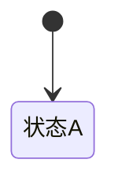
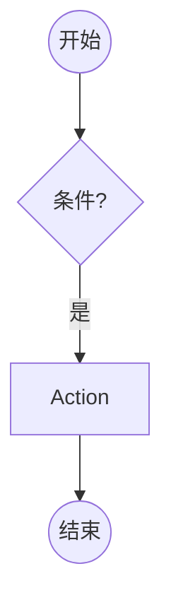

# PRD-NNN · <系统名称>

```
状态：发散 | 草稿PRD | PRD定稿 | 计划中 | 实现中 | 测试中 | 人工评审 | 已发布 | 已废弃
负责人：<人类 / 设计 agent / 实现 agent>
最后更新：YYYY-MM-DD
优先级：P0 | P1 | P2 | P3        里程碑：M1 | M2 | M3 | M4
上游依据：<设计纲要链接>、<对标分析条目编号>
关联文档：<相关 PRD、research、pack 文档>
基底依赖：<用到的 Folkways API / 数据包货架 / 集成 mod>
```

> **模板使用说明**
> 1. 本模板改写自 tyk 的《修建系统 PRD》（CC BY 4.0），保留其结构：术语表 → 状态机 → 交互 → 反馈 → 规则 → 流程 → 验收检查。
> 2. **每个表格都要填满或明确写「不适用」**，不允许留空——留空是 agent 自由发挥的入口。
> 3. 「验收检查」的每一条都必须能判定真假，并尽量能翻译成测试。
> 4. 「待细化」是诚实清单，不是垃圾桶；写了就要在变更记录里跟踪。
> 5. 单向依赖：本 PRD 只定义**本系统**的行为。通用机制（如任务/动作框架、事件框架、需求框架）请在对应 PRD 定义后交叉引用，不要重复定义。

---

## 0. 一句话

> 用一句玩家能听懂的话说明这个系统让玩家**能做什么**或**世界会怎么变**。禁止出现实现名词。

---

## 1. 概述

> 3–8 行。回答：
> - 玩家在什么情境下遇到这个系统？
> - 它解决什么体验问题（对应哪条设计支柱）？
> - 它产生什么**新的决策**（没有新决策的系统不允许立项）？
> - 它在多大程度上是「玩家的选择」而非「系统的自动过程」？

---

## 2. 设计目标与非目标

### 2.1 目标（Goals）

| 编号 | 目标 | 可判定信号 |
| --- | --- | --- |
| G1 | | |
| G2 | | |

### 2.2 非目标（Non-Goals，本次不做）

| 编号 | 不做的事 | 理由 | 何时可能做 |
| --- | --- | --- | --- |
| N1 | | | |

> **非目标清单不得为空**。空清单意味着范围未收敛，PRD 不予通过。

---

## 3. 术语

### 3.1 本系统局部术语

| 术语（英文） | 中文 | 说明 | 与全局术语的关系 |
| --- | --- | --- | --- |
| | | | |

### 3.2 与既有术语的冲突检查

| 冲突项 | Folkways 既有含义 | 本系统含义 | 解决方式 |
| --- | --- | --- | --- |
| 例：Order | 保持某容器内某物品数量的订单 | 本系统不使用该词，改用 Directive | 改名 |

> 全局术语以 [全局术语表](../design/03-glossary.md) 为准。凡新增全局术语，必须同时更新该表。

---

## 4. 概念模型

### 4.1 实体

| 实体 | 中文 | 说明 | 生命周期 | 玩家可见 |
| --- | --- | --- | --- | --- |
| | | | | |

### 4.2 实体之间的关系

> 用列表或 mermaid 图说明：谁引用谁、谁拥有谁、谁的变更会级联到谁。

---

## 5. 状态机

### 5.1 状态定义

| 状态 | 中文 | 说明 |
| --- | --- | --- |
| | | |

### 5.2 事件定义

| 事件 | 中文 | 说明 | 触发方 |
| --- | --- | --- | --- |
| E1: | | | 玩家 / 居民 / 系统 / 世界 |

### 5.3 扩展变量（系统状态）

| 变量 | 中文 | 类型 | 默认值 | 取值范围/单位 | 说明 |
| --- | --- | --- | --- | --- | --- |
| | | | | | |

### 5.4 守卫条件依赖

| 变量 | 中文 | 类型 | 来源 |
| --- | --- | --- | --- |
| | | | |

### 5.5 状态转移表

| 源状态 | 事件 | 守卫条件 | 动作 | 任务/副作用 | 目标状态 |
| --- | --- | --- | --- | --- | --- |
| | | | | | |

### 5.6 状态图



### 5.7 超时与中断

| 情形 | 处理 | 恢复后行为 |
| --- | --- | --- |
| 玩家离开/断线 | | |
| 目标消失（方块被拆、容器被搬空） | | |
| 居民死亡/失去能力 | | |
| 区块卸载 | | |

---

## 6. 交互

### 6.1 入口与快捷键

| 操作 | 按键/手势 | 前置条件 | 结果 |
| --- | --- | --- | --- |
| | | | |

> 约定：沿用 Folkways 的持握/潜行/滚轮/左右键语义时，必须显式引用其现有行为，不要重新发明。

### 6.2 操作模式状态机

> 仅描述本系统**专属**的操作模式；全局 UI 框架层面的 tab/菜单导航不在此定义。

| 状态 | 中文 | 说明 |
| --- | --- | --- |
| | | |

| 事件 | 中文 | 说明 | 触发方 |
| --- | --- | --- | --- |
| | | | |

| 源状态 | 事件 | 守卫条件 | 目标状态 | 动作 |
| --- | --- | --- | --- | --- |
| | | | | |

### 6.3 右键菜单 / 面板动作

| 上下文 | 按钮 | 操作 | 触发事件 | 是否可撤销 |
| --- | --- | --- | --- | --- |
| | | | | |

### 6.4 命令

| 命令 | 权限 | 说明 | 输出 |
| --- | --- | --- | --- |
| `/folkways ...` | | | |

---

## 7. 反馈

> 按触发源组织，三张表都要填。空表示「本系统在此情形下无反馈」，需显式写「—」。

### 7.1 操作模式反馈（玩家交互时）

| 检查条件 | 音效 | Toast/文案键 | 视觉反馈 | 系统行为 |
| --- | --- | --- | --- | --- |
| | | | | |

### 7.2 实体状态反馈（持续显示）

| 检查条件 | 图标/颜色 | 悬停信息 | 系统行为 |
| --- | --- | --- | --- |
| | | | |

### 7.3 系统事件反馈（非玩家触发）

| 事件 | 音效 | 通知文案键 | 视觉 | 系统行为 |
| --- | --- | --- | --- | --- |
| | | | | |

### 7.4 可诊断性（管理者的要求）

| 玩家可能的疑问 | 系统必须能回答 | 呈现位置 |
| --- | --- | --- |
| 「为什么没人干这个活？」 | | |
| 「他为什么不高兴？」 | | |
| 「东西为什么没送到？」 | | |

---

## 8. 规则

> 用 R 编号，逐条可判定。区分 **必须 / 禁止 / 级联 / 优先级**。

| 编号 | 类型 | 规则 | 违反时的行为 |
| --- | --- | --- | --- |
| R1 | 必须 | | |
| R2 | 禁止 | | |
| R3 | 级联 | | |
| R4 | 优先级 | | |

---

## 9. 流程（与基底引擎对齐）

### 9.1 工作类型与任务

| 项 | 内容 |
| --- | --- |
| 工作类型（Vocation/Trade） | |
| 任务（Task/Doing） | |
| 参与的居民种类 | |
| 需要的工具/许可（Tool/Licence） | |

### 9.2 执行流程



### 9.3 Action 说明

| Action | 说明 | 失败/拒绝理由（Refusal） |
| --- | --- | --- |
| | | |

### 9.4 生成与分配条件

| 侧 | 条件 | 说明 |
| --- | --- | --- |
| 任务侧 | | |
| 居民侧 | | |
| 资源侧 | | |

### 9.5 计算逻辑

> 公式写清楚变量与单位。示例：`实际每 tick 工作贡献 = 基准 × 技能等级系数 × 状态惩罚`

| 计算项 | 公式 | 变量说明 | 取值范围 |
| --- | --- | --- | --- |
| | | | |

### 9.6 数值配置

| 参数 | 默认值 | 范围 | 可被数据包/配置覆盖？ | 备注 |
| --- | --- | --- | --- | --- |
| | | | 是/否 | |

---

## 10. 数据与存档

| 项 | 内容 |
| --- | --- |
| 新增持久化字段 | |
| 存储位置（实体/NBT/全局数据） | |
| 存档版本影响 | 需要迁移？是/否 |
| 迁移策略 | |
| 旧存档降级行为 | |
| 回滚（卸载本 mod）行为 | |

---

## 11. 网络与多人

| 项 | 内容 |
| --- | --- |
| 权威端 | 服务端 / 客户端（默认服务端权威） |
| 需同步的状态 | |
| 同步频率与方式 | |
| 权限（谁能操作） | |
| 多人并发冲突处理 | |
| 断线/重连行为 | |

---

## 12. i18n（双语：`zh_cn` + `en_us`）

| 键 | en_us | zh_cn |
| --- | --- | --- |
| | | |

> **语言口径（[ADR-017](../../docs/00-charter.md)）**：**我们新增的键只做 `zh_cn` + `en_us` 两种**；**基底（上游 Folkways）既有的四语言文件（`en_us`/`zh_cn`/`zh_hk`/`zh_tw`）保留不动**，我们新增的键在 `zh_hk`/`zh_tw` 缺失时**回退 `en_us`**。
> 其余规则继承基底：翻译文本在到达客户端前保持 `Component`；翻译参数用 `%s`（重排时用 `%1$s`）；字面百分号用 `%%`。

---

## 13. 性能预算

| 项 | 估算 | 依据 | 上限 |
| --- | --- | --- | --- |
| 每 tick 额外耗时（常态） | | | |
| 每 tick 额外耗时（峰值） | | | |
| 每 tick 分配对象数 | | | |
| 内存增量（每居民/每实体） | | | |
| 网络包增量 | | | |

> 尽量复用基底的规划器/调度器，不新增独立 tick 循环。超预算必须在本节说明取舍。

---

## 14. 与基底 API 的关系

| 需求 | 用到的 Folkways 扩展点 | 是否已有 | 备注 |
| --- | --- | --- | --- |
| | | | |

> 具体类/方法引用 `docs/research/01-core-engine.md`、`docs/research/04-content-and-modding.md`。
> **只允许依赖 `core/api` 与 `front/api`**；若必须触及内部实现，在此显式标注风险并说明理由。

---

## 15. 可改写性（数据包 / 脚本 / 配置）

| 内容 | 是否可被数据包覆盖 | 货架/路径 | 玩家可否热重载 |
| --- | --- | --- | --- |
| | | | |

---

## 16. 验收检查（Acceptance Criteria）

> 每条都要能判定真假。编号 AC-n，尽量标注「可自动化 / 需人工」。

### 16.1 交互

- [ ] AC-1 …
- [ ] AC-2 …

### 16.2 反馈

- [ ] AC-…

### 16.3 规则

- [ ] AC-…

### 16.4 流程与数值

- [ ] AC-…

### 16.5 状态、数据与边界

- [ ] AC-… （存档往返、卸载 mod、极端输入、并发）

### 16.6 性能与多人

- [ ] AC-…

---

## 17. 测试计划（TDD）

| 测试 | 类型（单元/无头/e2e/人工） | 覆盖的 AC | 备注 |
| --- | --- | --- | --- |
| | | | |

> 关注系统交界点：API 边界、存档读写、状态迁移、跨系统影响。不要为内部实现细节写测试。

---

## 18. 待细化 / 开放问题

| 编号 | 问题 | 影响 | 何时必须定 | 谁定 |
| --- | --- | --- | --- | --- |
| | | | | |

---

## 19. 变更记录

| 日期 | 状态 | 变更 | 操作者 |
| --- | --- | --- | --- |
| | | | |