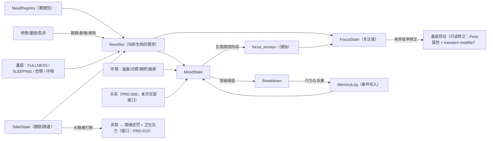
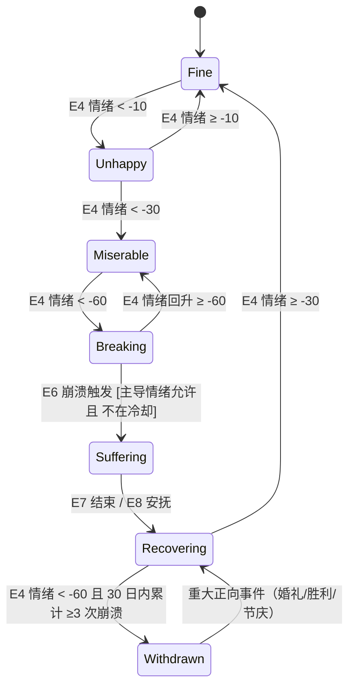
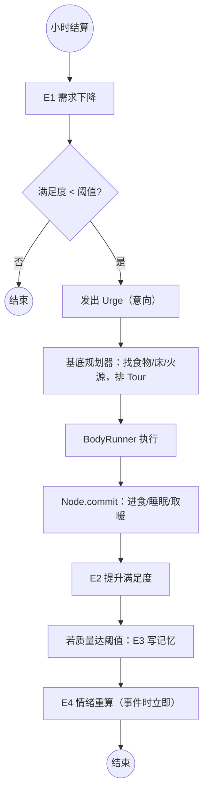
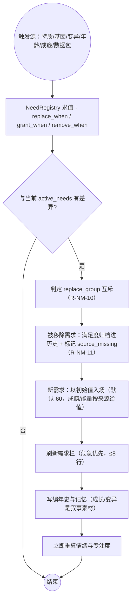

# PRD-001 · 需求、情绪与记忆

```
状态：草稿PRD
负责人：设计（人类定稿）
最后更新：2026-10-18（**需求系统改为数据驱动注册表 + 专注度 + 如厕**，见 §4.3 / §8.2 / §9.6）
优先级：P0          里程碑：M2（M1 子集含默认核心集与专注度，见 §2.3）
上游依据：docs/design/05-settlement-and-residents.md（属性模型 / 人格特质 / 生命周期）、docs/design/01-vision-and-pillars.md（P2）
关联文档：PRD-008（关系与社交）、PRD-009（世代与教育：儿童「学习」「玩耍」需求的来源）、PRD-002（事件与叙述者）、
         PRD-003（vitals：口渴/氧气，与本 PRD 的边界见 §2.4）、PRD-012（权限：诊断可见性=全员只读）、
         PRD-013（[医疗、伤病与手术](PRD-013-medical-and-surgery.md)：失禁的卫生后果、疼痛与成瘾的生理侧接入点）、docs/research/01-core-engine.md、03-front-and-interaction.md
基底依赖：Declaring.urges / UrgeSource / Urge、Declaring.colony(ColonyContext)、ColonyContext.share/tick/closed、Colony.keep、
         ResidentEntity 的 transient attribute modifier（`ResidentEntity.java:288-296`）、基底 `Perk`/`Xp`/`Vocation`、
         front/api Inlay + Bay.RESIDENT + Nook、RegisteringUi.page、Board/Line、Scenes.folder、Cadence.Cron
决策依据：ADR-009（7 条需求 → **默认核心集**，可被特质/基因/变异替换或移除）、ADR-012（术语：殖民地/殖民书）、
         ADR-013（一切必须驱动居民本身）、ADR-007（已 fork，注册表可直接扩展 `Shelves`）
```

---

## 0. 一句话

> 每个居民有自己的需要和心情——需求决定他的**专注度**，专注度决定他今天干得好不好；心情崩了会闹、会停工、会出走，而你能在界面上看到「他为什么变成这样」。

---

## 1. 概述

玩家已经在基底里看到「居民会饿、会困、会怕」（`FULLNESS` / `SLEEPING` meter 与恐惧行为）。本系统把这件事**从一个数值扩展成一个人**：

- 居民有**默认核心需求集**（食物、床、火、安全、同伴、美感、意义、**户外**，共 8 条），会随时间衰减，需要被真实地满足；但需求**不再写死**：它们来自一张**需求注册表**，可以被特质/基因/变异**替换**（如穴居者把「户外」换成「室内」）、**新增**（如成瘾、儿童的学习与玩耍、机械族的能量）或**移除**（见 §4.3）。
- 需求满足度合成为**专注度 Focus**（矮人要塞式）：专注度高则干活快而稳，长期被打断/负面想法侵蚀则专注度下滑 → 工作表现下降；需求优先级由**人格特质**加权（同一件事，勤奋者与懒散者在意程度不同）。
- 满足与缺失、加上经历（记忆）、环境、关系、事件，合成为一个**情绪值**与一份**原因清单**。
- 有一条**计量式需求「如厕」**（膀胱/肠道两条计量）：长期被打断会**失禁**，产生情绪惩罚与卫生后果。
- 情绪突破阈值时触发**精神崩溃**：暴怒、痛哭、出走、酗酒、痴迷、麻木。崩溃是叙事，不是惩罚。
- 一切都会留下**记忆**：被救、被袭击、吃到好东西、亲人去世。记忆衰减但不消失，并持续影响情绪。

**它产生的新的决策**：
- 要不要为一个情绪低落的工匠停工一天？（产能 vs 人）
- 严冬里把人集中到一处取暖，还是分散？（情绪 vs 火灾风险）
- 收了难民，老人的死亡率会上升，值得吗？（人口 vs 情感债）
- 是否为「意义需求」建一座神庙/纪念碑？（纯消耗 vs 长期稳定）

**它在多大程度上是玩家的选择**：需求的**满足方式**由玩家建造与规则决定（吃什么、住哪、有没有火）；情绪与崩溃是系统涌现的结果，玩家只能通过改善处境来影响。

---

## 2. 设计目标与非目标

### 2.1 目标

| 编号 | 目标 | 可判定信号 |
| --- | --- | --- |
| G1 | 玩家能说出至少 3 名居民的名字与处境 | 试玩观察（对齐 d05 G1） |
| G2 | 情绪永远可追溯到具体原因 | 居民窗口能列出原因清单，每条可定位到人/事/物 |
| G3 | 崩溃有前兆、有过程、有恢复 | 崩溃前情绪已连续下行 ≥1 日；有可见告警 |
| G4 | 需求满足方式至少两种 | 每条需求 ≥2 条满足路径 |
| G5 | 系统在常态下是背景 | 60 居民时维持/日结算成本 ≤0.5% tick（见 §13） |
| G6 | **需求是数据而非代码** | 默认核心集也走注册表；不改 Java 能新增/替换/移除一条需求并生效（对齐 d11 D2） |
| G7 | 需求能塑造「这个人是谁」 | 至少 3 类变体可演示：替换型（户外↔室内）、获得型（成瘾）、专属型（儿童学习/机械能量） |
| G8 | 专注度可解释、可干预 | 专注度折扣的每一项都能在居民窗口逐条查看；玩家可通过满足需求/减少打断把它拉回来 |
| G9 | 工作优先级有可见语义 | 低优先级任务可被殖民地任务取消；高优先级不可取消并带感叹号标记 |

### 2.2 非目标（本次不做）

| 编号 | 不做 | 理由 | 何时可能做 |
| --- | --- | --- | --- |
| N1 | 婚育、家庭、儿童 | 属于 PRD-009 世代系统 | M3 |
| N2 | 完整关系网与社交事件 | 属于 PRD-008 | M2 后期 |
| N3 | 疫病、伤病、手术 | 属于健康系统 | M3 |
| N4 | 性格生成与身世池的完整内容 | 先做最小 6 种性格、留数据包扩展 | M3 |
| N5 | 多维情绪（愤怒/悲伤/恐惧分列成独立标量） | **已裁决**：保持「标量 + 主导情绪标签」（[d05 OQ-P-2](../design/05-settlement-and-residents.md)，见 §18） | 不再评估（除非崩溃叙事需要） |
| N6 | 情绪/专注度影响生产速率的**长尾**平衡 | 只做有界的档位修正，且**总乘数必须夹取**（§9.6 R-NM-19） | M3 |
| N7 | 宗教/信仰/仪式内容 | 只提供「意义」需求的接口 | M3 |
| N8 | 基因/异种/义体**内容本体**（杀戮饱和、死眠、血原质…） | 本 PRD 只做**注册表与接口**（能挂、能替换、能存档），内容与获取途径归 [PRD-011](PRD-011-progression-knowledge-and-space.md) 与后续系统 | M3+ |
| N9 | 伤口、感染、手术、卫生细节 | 归医疗系统 [PRD-013](PRD-013-medical-and-surgery.md)；本 PRD 只输出「失禁 → 卫生压力」这一条因果入口 | M3+ |

### 2.3 M1 子集（2026-10-18 更新：**默认核心集 + 专注度 + 如厕**）

M1 做：**默认核心集全部 8 条需求**（走注册表，见 §4.3）**+ 如厕（两条计量）+ 专注度 + 情绪标量 + 3 种崩溃（痛哭/暴怒/出走）+ 居民窗口状态块**。

> **注意（2026-10-18）**：为了让「室内」有可替换的对象，默认核心集在原有 7 条之外**新增「户外」**（RimWorld 式的"想出去透透气"）→ 默认集共 **8 条**，正好填满 8 行需求栏（R-NM-21）。「户外」的满足方式复用「美感」的环境采样，边际成本≈0。此变更见 §18 OQ-1（已裁决）与 §19 变更记录。

| 需求 | 来源与类别 | M1 实现程度 | 满足方式（M1） |
| --- | --- | --- | --- |
| 饥饿 / 休息 / 温暖 | 核心集（状态式） | 完整 | 复用基底进食/睡眠 + 我们的取暖 |
| 安全 | 核心集 | 完整（威胁来自 PRD-004 的前兆与战斗） | 躲避、围墙内、疏散 |
| 社交 | 核心集 | **简化**：与任意居民共处/共餐即可（完整关系网在 [PRD-008](PRD-008-relationships-and-social.md)） | 主动靠近同伴（低频，注意出行预算） |
| 美感 | 核心集 | 完整（环境扫描，日结算） | 装饰、整洁、光照、空间 |
| 意义 | 核心集 | **简化**：完成工作、被认可、参与事件即可（完整仪式/信仰在 M3） | 事件与成就 |
| **户外** | 核心集（**新增**） | 完整（复用美感的环境采样，判定"是否长期待在室内"） | 外出、劳作、露天活动 |
| **如厕** | 核心集（**计量式**，膀胱/肠道） | 完整（含失禁与卫生压力出口） | 走到厕所/马桶（**优先用 PoopSkyMod 的方块；缺失时自建茅厕/基底容器**）（[ADR-019](../00-charter.md)） |
| 变体需求（室内/化学渴望/成瘾/学习/玩耍/杀戮饱和/死眠/血原质/能量） | 注册表（替换/获得/专属） | **仅留注册表与 1 条演示性变体**（建议：穴居特质的「室内」替换） | 按各自定义 |

**里程碑归属（2026-10-18 裁决）**

| 内容 | 里程碑 |
| --- | --- |
| 默认核心集（8 条）+ 如厕 + 专注度 + 情绪/崩溃 | **M1** |
| 成瘾 / 化学渴望 / 「室内」替换演示 | **M2** |
| **机械族（机器人 `ResidentKind`）与其「能量（电力）」需求** | **M3** |
| 基因/异种专属需求（杀戮饱和/死眠/血原质）、学习/玩耍（随 [PRD-009](PRD-009-generations-and-legacy.md)） | **M3** |

**理由**：核心集是支柱 P2 的骨架，缺一条就会让"人"变得单薄；但**社交与意义**的满足方式可以先简化。**如厕**进 M1 是因为它是最低成本的"被打断"来源——没有被打断，专注度就只是个摆设。
**风险提示**：社交需求是核心集里唯一**必然消耗出行预算**（8 ms/tick，多殖民地共享）的一条；如厕若被规划到远处厕所也会消耗同一预算 → M1 必须实测（见 §13 与 [性能预算](../pack/03-performance-budget.md)）。

### 2.4 三层划分：需求（状态式）/ 需求（计量式）/ 维生计量（vitals）

基底既有 `饥饿`（`Hunger`）是**计量式**的，我们的核心集是**状态式**的，而 PRD-003 的口渴/氧气是 **vitals**——三者不要混为一谈：

| 层 | 成员 | 进需求栏？ | 影响情绪？ | 影响专注度？ | 能否致死 |
| --- | --- | --- | --- | --- | --- |
| **需求（状态式）** | 核心集 8 条（含温暖与户外） | ✅ | ✅ 直接 | ✅ | ❌（只能间接：饥饿→健康恶化） |
| **需求（计量式）** | **如厕**（膀胱/肠道）、**成瘾**（形成后）、**能量**（机械族，**电力/FE、可充能**，M3） | ✅ | ✅ 直接（机械族除外） | ✅（机械族除外） | 成瘾戒断**可致命**（R-NM-12）；如厕不直接致死；机械族能量耗尽 → **停机** |
| **维生计量（vitals）** | 饥饿（基底）、**口渴（PRD-003）**、**氧气（太空，[r09 §3.4](../research/09-space-endgame.md)）** | ❌ | ❌ 间接（只通过「痛苦」这一情绪原因） | ❌ | ✅ |

**R-NM-8（2026-10-18 修订）**：**vitals 不是需求**——不进需求栏、不直接产生情绪，只产生生存压力与对应 `Urge` 的权重（照基底 `Hunger` 范式：每人计量 + 阈值 + `Urge` + 存档）。**但计量式需求（如厕/成瘾/能量）是需求**：进需求栏、影响情绪与专注度。二者的判别标准只有一条：**它是否是一个"个人的、可被满足的、影响心情的状态"**。

---

## 3. 术语

### 3.1 局部术语

| 术语（英文） | 中文 | 说明 | 全局术语表 |
| --- | --- | --- | --- |
| `need` | 需求 | 必须被满足的状态 | 已登记（d03 §2.1） |
| `satisfaction` | 满足度 | 0–100，需求被满足的程度 | 新增 |
| `decay` | 衰减 | 随时间下降的速率（点/游戏小时） | 新增 |
| `mood` | 情绪 | -100~+100 的标量 | 已登记 |
| `mood_reason` | 情绪原因 | 一条带权重的情绪来源 | 已登记 |
| `memory` | 记忆 | 带权重的往事条目 | 已登记 |
| `memory_kind` | 记忆类别 | 记忆的分类（丧亲/被救/盛宴/受袭…） | 新增 |
| `breakdown` | 精神崩溃 | 情绪阈值被突破后的行为事件 | 已登记 |
| `dominant_feeling` | 主导情绪 | 当前最强的原因类别（悲伤/愤怒/恐惧…） | 新增 |
| `need_registry` | 需求注册表 | 全部需求种类的定义集合（默认集 + 变体 + 专属） | 新增 |
| `need_kind` | 需求种类 | `core` 核心 / `variant` 变体 / `acquired` 获得 / `exclusive` 专属 | 新增 |
| `replacement` | 替换 | 某需求在**同槽位**上顶替另一条（如「室内」顶替「户外」），**不是共存** | 新增 |
| `source_trait` | 来源特质 | 这条需求因哪些特质/基因/变异而出现（或消失） | 新增（复用 d05 的性格标签） |
| `trait_weight` | 特质加权 | 人格特质对某需求重要性的乘数（决定优先级与专注度影响） | 新增 |
| `focus` | 专注度 | 0–100：需求满足度 + 特质加权 − 负面想法侵蚀的合成结果 | 新增 |
| `focus_erosion` | 专注侵蚀 | 持续负面原因对专注度的**每日**侵蚀量（累积项） | 新增 |
| `bladder` / `bowel` | 膀胱 / 肠道 | 如厕需求的两条计量（0–100） | 新增 |
| `incontinence` | 失禁 | 长期被打断后的状态：随地大小便 + 情绪惩罚 + 卫生后果 | 新增 |
| `addiction` | 成瘾 | 形成后作为**独立需求**出现在需求栏的状态 | 新增 |
| `cessation` | 戒断 | 成瘾需求长期未满足后的阶段（**可致命**）；成功后该需求消失 | 新增（**刻意避开** `Withdrawal`，见 §3.2） |
| `duty_priority` | 职责优先级 | 两级：`Low` 可被殖民地任务取消 / `High` 不可取消（带感叹号） | 新增 |

### 3.2 与既有术语的冲突检查

| 冲突项 | 基底含义 | 本系统含义 | 解决方式 |
| --- | --- | --- | --- |
| `Urge`（冲动） | 居民「想做什么」 | 本系统**用它表达**需求驱动的行为意向，但「需求」本身是状态 | 严格区分：`Need` 是状态，`Urge` 是行为意向 |
| `FULLNESS` / `SLEEPING` | 基底 person/living 的两个 meter | 本系统的「饥饿/休息」**必须建立在它们之上**，不另建同名 meter | 复用；只做映射与扩展 |
| `Balk`（拒绝标记） | 居民对某事的持久抗拒 | 崩溃后的「罢工」状态用新的数据结构，不复用 `Balk`（避免污染基底的失败退避语义） | 新数据结构 `Withdrawal` |
| `Withdrawal`（麻木） | 本 PRD §9.5 的崩溃类型之一（长期低落后的钝化） | **戒断**也常被译作"withdrawal" → 两者会撞名 | ⚠️ **已解决**：崩溃类型的 `Withdrawal`（麻木）**保持不变**（已在 §5.3/§9.5 使用）；成瘾戒断一律用 **`Cessation`（戒断）**，禁止在代码与文案里把二者混用 |
| `Perk`（专长） | 基底随等级获得的能力 | 我们用 `Perk` 承载**专注度/效率**的一部分加成来源（R-NM-19） | 复用，不新建第二套熟练度 |
| `Urge` 的 `focus` 字段 | 基底 `NodeSpec.Builder` 已有 `focus` | 那是**节点**的属性（工作聚焦），与本 PRD 的**居民专注度 Focus** 不是一回事 | ⚠️ 代码侧我们的类型一律加前缀（`NeedFocus`），禁止直接复用 `focus` 这个名字 |
| **`addiction`（成瘾）** | [PRD-013](PRD-013-medical-and-surgery.md) 把 `addiction` 定义为**生理依赖计量（vitals）** | 本 PRD 按 2026-10-18 裁决把成瘾实现为**计量式需求**：形成后进入需求栏、影响情绪与专注度、戒断可致命、戒断成功后需求消失 | ✅ **已对齐（PRD-013 已回填）**：分工而非二选一——PRD-013 拥有**生理依赖计量与医学后果**（耐受、剂量、器官损伤）；本 PRD 拥有**需求栏呈现 + 情绪/专注度影响 + 戒断阶段机**；**触发源是同一份计量**（`addiction_level` 越阈值 → 触发本 PRD 事件 E11）。见 §18 OQ-13 |

---

## 4. 概念模型

### 4.1 实体

| 实体 | 中文 | 说明 | 生命周期 | 玩家可见 |
| --- | --- | --- | --- | --- |
| `NeedSet` | 需求集 | 一名居民**当前生效**的需求（默认集经过替换/新增/移除后的结果，条数可变） | 与居民同生共死 | 居民窗口 |
| `NeedRegistry` | 需求注册表 | 全部需求种类的定义（殖民地/世界级，数据包可改） | 与会话/数据包同生共死 | 知识页式的清单（只读） |
| `FocusState` | 专注度状态 | 专注度值 + 侵蚀累积 + 逐项折扣来源 | 与居民同生共死 | 居民窗口 |
| `MoodState` | 情绪状态 | 情绪值 + 原因清单 + 主导情绪 | 同上 | 居民窗口 |
| `MemoryLog` | 记忆簿 | 最多 20 条记忆，按权重淘汰 | 同上 | 居民窗口（可展开） |
| `Breakdown` | 崩溃实例 | 一次崩溃的类型、开始、预计结束、诱因 | 事件期间 | 世界内图标 + 通知 |
| `ToiletState` | 如厕状态 | 膀胱/肠道计量 + 失禁计数 + 上次如厕时间 | 与居民同生共死 | 居民窗口 |
| `AddictionState` | 成瘾状态 | 成瘾种类、形成时间、阶段（使用/依赖/戒断） | 与居民同生共死（戒断成功后释放） | 居民窗口 |
| `DutyPreference` | 职责偏好 | 某工作的两级优先级（`Low`/`High`） | 玩家可改 | 居民窗口 / 工作页 |
| `MoodTrend` | 情绪趋势 | 殖民地级聚合（用于总览页与统计） | 长期 | 总览页 |

### 4.2 关系



### 4.3 需求注册表（数据结构，2026-10-18 新增）

注册表是**唯一来源**：连默认核心集也以数据形式存在于表中（R-NM-9），代码里不得出现按需求硬编码的分支。

| 字段 | 类型 | 说明 | 例 |
| --- | --- | --- | --- |
| `id` | 字符串 | 需求 id（`folkways:outdoors`） | `folkways:hunger` |
| `kind` | 枚举 | `core` / `variant` / `acquired` / `exclusive` | `core` |
| `form` | 枚举 | `state`（状态式）/ `meter`（计量式，可多条计量） | `state` |
| `meters` | 列表 | 仅 `meter` 用：该需求的计量条（如 `bladder`/`bowel`） | `[]` |
| `decay` | 曲线 | 点/游戏小时；可为常数或依环境（温度、威胁） | `100/36h ≈ 2.8` |
| `mood_map` | 四段映射 | 满足度 → 情绪项（四档阈值） | `0–15 → -25` |
| `focus_map` | 四段映射 | 满足度 → 专注度项（与情绪映射**分开**，因为"不难受"≠"很专注"） | `0–15 → -12` |
| `default_weight` | 整数 | 全局默认优先级权重（1–5） | `4` |
| `trait_weight` | 映射 | 特质 → 权重乘数（覆盖默认值） | `{懒散: ×0.5, 勤奋: ×1.3}` |
| `replace_group` | 字符串 | **同槽位组**：同组内互斥，后者**顶替**前者（R-NM-10） | `outdoor_group` |
| `replace_when` | 条件 | 何时发生替换（特质/基因/变异/时代） | `has_trait: cave_dweller` |
| `grant_when` | 条件 | 何时**新增**（获得型：成瘾、儿童的学习） | `age_stage: child` |
| `remove_when` | 条件 | 何时**移除**（戒断成功、变异被移除） | `cessation_success` |
| `satisfiers` | 列表 | ≥2 条满足路径（R8 由数据保证） | `[eat:*, eat:cooked]` |
| `refusal_keys` | 列表 | 拒绝理由键（自动拼 `folkways.refusal.<Area>.<CONST>`） | `no_toilet` |
| `icon` | 资源 | 需求条图标 | `folkways:textures/need/hunger.png` |

**变体需求示例（写入注册表，内容本体归后续里程碑）**

| 需求 | kind | 与默认集的关系 | 触发条件 | 备注 |
| --- | --- | --- | --- | --- |
| **室内 Indoor** | `variant` | **替换「户外」并反转其语义**（穴居者觉得地底舒服、露天难受） | `has_trait: cave_dweller` 或等价的意识形态等价物 | 与「户外」互斥（同属 `outdoor_group`），**不允许共存** |
| **化学渴望 Chemical desire** | `acquired` | 仅出现在有对应特质者身上 | `has_trait: chemical_interest` | 满足源为药物/酒；未满足 → 情绪下滑 → 可发展为成瘾 |
| **成瘾 Addiction** | `acquired` | 形成后作为**独立需求**进入需求栏 | 物质使用超阈值（R-NM-12） | 未满足 → `cessation`（可致命）；戒断成功 → 需求消失 |
| **学习 Learning** | `exclusive` | 仅儿童/少年 | `age_stage ∈ {child, teen}` | 满足源为学堂/师徒/玩具（过程归 [PRD-009](PRD-009-generations-and-legacy.md)） |
| **玩耍 Play** | `exclusive` | 仅婴幼儿 | `age_stage = toddler` | 与「学习」不同槽位，可共存 |
| **杀戮饱和 Kill saturation** | `exclusive` | 基因/异种类 | `gene: kill_saturation` | 未满足 → 情绪剧烈下滑（内容本体待后续系统） |
| **死眠 Deathrest** | `exclusive` | 基因/异种类 | `gene: deathrest` | 周期性的长时间休眠需求 |
| **血原质 Hemogen** | `exclusive` | 基因/异种类 | `gene: hemogen` | 未满足 → 虚弱 → 可致死（走 vitals 式伤害，但仍进需求栏） |
| **能量 Energy** | `exclusive` | **机械族**（我方注册的 `ResidentKind` 机器人，见 [PRD-011](PRD-011-progression-knowledge-and-space.md) R-AG-17） | `kind: machine` | **M3**。**它就是电网电力**：统一用 NeoForge Energy（FE）作单位，是**可充能的需求**（在充电站/插座处补电，不是生物式随时间衰减）；电量归零 → **强制停机/休眠**（不闹情绪、不崩溃）。⚠️ **我们的 mod 不得依赖任何能源 mod**（Create/Mekanism 等都只是可选增强）：**没有它们时，我们自己最基础的发电设备也必须能给它充电**，否则该需求无法满足 |

**成瘾物质注册表（沿用 `addiction` 货架；单条记录类型 = `addiction_substance`；2026-10-18 定）**

> 权威边界：**成瘾只有一个数据源 `addiction_level`**——[PRD-013](PRD-013-medical-and-surgery.md) 管生理计量、耐受与戒断的**医学后果**；本 PRD 管**需求栏、情绪、专注度与戒断阶段**。**外部 mod 只提供"物质与配方"，不提供成瘾规则**。

| 字段 | 含义 | 示例 |
| --- | --- | --- |
| `kind` | 物质类别 | `alcohol` / `stimulant` / `sedative` / `hallucinogen` / `sugar` / `nicotine_like` |
| `dose` | 一次使用带来的成瘾进度增量 | `1.0`（烈酒 `1.5`） |
| `tolerance_rate` | 每单位时间的耐受增长（效果递减） | `0.05/日` |
| `withdrawal_curve` | 戒断曲线（强度 / 时间 / 峰值） | `峰值 1 日、衰减 3 日` |
| `overdose_threshold` | 过量阈值（**可致死**） | `5 次/日` |
| `mood_effects` | 使用 / 依赖 / 戒断三段的情绪修正 | `+8 / −4 / −25` |
| `work_effects` | 效率与失误率修正（**必须对冲**） | `效率 +10%、失误率 ×1.5` |
| `source_mod` | 提供该物质的 mod（空 = 自建） | `create-big-pharma` |
| `fallback_when_absent` | **该 mod 缺失时**的降级 | `unobtainable`（不报错，只标记"来源缺失"） |

**物质来源清单（用户裁决，2026-10-18）**

| 来源 | 许可 | 结论 |
| --- | --- | --- |
| **自建**：发酵桶 / 蒸馏（酒）、草药与简易药 | 我们自己的 MIT | **必须有**——否则"纯净档"（不装任何酿酒 mod）里成瘾系统是死的（ADR-013） |
| Create Big Pharma（`create-big-pharma`） | **Apache-2.0** | **可打包**：制药链 |
| Create Pop（`create-pop`） | **MIT** | **可打包**：工业化饮品 |
| CustomBrewRecipes（`Emafire003/CustomBrewRecipes`，分支 `1.21-neoforge`） | **CC0-1.0** | **可打包但需实测**：2025-03 停更、1 star |
| Create: Addictives（CF） | 许可字段为空 → **按 ARR** | **不打包、不 fork**，只作内容灵感（其补丁仓 `create-addictives-patcher` 亦无许可、0 star） |
| Kaleidoscope Tavern | **NOASSERTION（许可不明）** | **默认不打包**，除非核实出明确许可 |

**R-NM-27（物质来源与缺失降级）**：每支外部 mod **必须可整体删除**（ADR-010）。缺失时物质条目降级为**"不可获得"**（不是报错、不是崩溃），且**已有成瘾者的戒断曲线照常生效**——**绝不允许因为删 mod 让居民凭空痊愈**。
**R-NM-28（纯净档闭环）**：不装**任何**外部内容 mod 时，成瘾系统仍必须完整可玩（自建酒/药 + 完整戒断链）——这是内容验收硬门槛。
**R-NM-29（平衡红线）**：成瘾**不得成为效率作弊**：任何"醉酒/兴奋"的产出加成都必须与**失误率、健康代价、戒断反噬**对冲（`work_effects` 不得为空）；**儿童不得获得任何成瘾物质**（硬规则，不做成配置项）。

---

## 5. 状态机

### 5.1 需求状态（每项需求各自一个）

| 状态 | 中文 | 说明 | 阈值（满足度） |
| --- | --- | --- | --- |
| `Full` | 充足 | 无需关注 | 70–100 |
| `Declining` | 下降 | 正在变差，UI 用中性色 | 40–70 |
| `Urgent` | 急需 | 居民会主动去满足（发 `Urge`） | 15–40 |
| `Critical` | 危急 | 开始产生健康/情绪伤害 | 0–15 |

### 5.2 情绪状态（整个居民一个）

| 状态 | 中文 | 情绪值 | 行为效果 |
| --- | --- | --- | --- |
| `Elated` | 愉悦 | ≥ +40 | 效率 +10%，自发庆祝/社交 |
| `Content` | 满意 | +10 ~ +40 | 正常 |
| `Fine` | 一般 | -10 ~ +10 | 正常 |
| `Unhappy` | 不满 | -30 ~ -10 | 效率 -10%，偶发抱怨 |
| `Miserable` | 痛苦 | -60 ~ -30 | 效率 -25%，可能拒绝工作、争吵 |
| `Breaking` | 濒临崩溃 | < -60 | 触发崩溃（按主导情绪选择类型） |

### 5.3 崩溃状态机

| 状态 | 中文 | 说明 |
| --- | --- | --- |
| `None` | 无 | 正常 |
| `Suffering` | 发作中 | 崩溃行为进行中 |
| `Recovering` | 恢复中 | 行为结束，情绪有临时加成，效率未恢复 |
| `Withdrawn` | 麻木 | 长期低落后的钝化（不闹事但效率 -40%） |

> 上面的四档阈值对**所有需求形式**通用：状态式（核心集）与计量式（如厕/成瘾/能量）都映射到 `Full/Declining/Urgent/Critical`，只是计量式**多一条计量条**（如膀胱与肠道各自独立进入 `Urgent`）。

### 5.3.1 专注度状态机（每居民一个，2026-10-18 新增）

| 状态 | 中文 | 专注度 | 工作表现 | 说明 |
| --- | --- | --- | --- | --- |
| `Focused` | 专注 | ≥ 75 | 效率 +8% | 需求被照顾好、特质加权被满足 |
| `Steady` | 平常 | 45–75 | 无修正 | 默认区间（多数时间应在此） |
| `Strained` | 分心 | 20–45 | 效率 -8%，偶发中断手头工作 | 有 1–2 条需求长期 `Declining` |
| `Spent` | 涣散 | < 20 | 效率 -18%，容易放弃任务 | 多条需求 `Critical`，且负面原因持续侵蚀 |

| 事件 | 中文 | 说明 | 触发方 |
| --- | --- | --- | --- |
| F1 | 专注度重算 | 每日结算 + 需求跨档时立即 | 系统 |
| F2 | 侵蚀累积 | 每条负面情绪原因按权重增加 `focus_erosion` | 系统 |
| F3 | 侵蚀消退 | 情绪 ≥ `Content` 时按日消退（比累积慢，形成"恢复期"） | 系统 |
| F4 | 跨档 | 专注度进入更差/更好档 | 系统 |

**R-NM-17**：专注度的**每一项折扣来源必须可列出**（哪条需求扣了多少、哪条负面原因在侵蚀），禁止只给一个数字。

### 5.3.2 如厕状态机（每居民一个，2026-10-18 新增）

| 状态 | 中文 | 条件 | 行为 |
| --- | --- | --- | --- |
| `Clean` | 干净 | 两计量均 ≥ 60 | 无 |
| `Need` | 想去 | 任一计量 35–60 | 若无手头任务，顺路解决 |
| `Urgent` | 很急 | 任一计量 15–35 | 发 `Urge`（权重高于普通需求） |
| `Critical` | 憋不住 | 任一计量 < 15 | 打断当前工作（除非 `duty_priority = High` 且在战斗/救援） |
| `Accident` | 失禁 | `Critical` 且被打断 ≥ `toilet_interrupt_limit`（默认 2）次，或计时超限 | 就地解决 → 情绪惩罚 + 卫生压力 + `incontinence_count++` |

**R-NM-14**：失禁**不得直接致死**；它通过「情绪惩罚 + 卫生压力（→ 疾病，接口在 [PRD-013](PRD-013-medical-and-surgery.md) 与 [PRD-003](PRD-003-season-temperature-thirst-nutrition.md)）」间接产生后果，死亡原因必须可追溯。
**R-NM-15**：`duty_priority = High`（不可取消）的任务**允许**让居民憋着——但**必须**在 UI 上给出「这个人快憋不住了」的告警，让玩家自己承担这个权衡（P3：可预防）。

### 5.3.3 成瘾状态机（每居民可多个，2026-10-18 新增）

| 状态 | 中文 | 条件 | 行为 |
| --- | --- | --- | --- |
| `Clean` | 未接触 | 无 | — |
| `Using` | 使用中 | 用过对应物质 | 增加成瘾进度（不显示为需求） |
| `Dependent` | 依赖 | 成瘾进度 ≥ 阈值（默认 5 次/7 日） | **需求栏出现该成瘾需求**；未满足 → 情绪下滑 |
| `Cessation` | 戒断 | 成瘾需求 `Critical` 持续 ≥ `cessation_onset_days`（默认 1 日） | 剧烈情绪下滑、工作效率 -30%、**可致死**（有前兆与处置窗口） |
| `Relapsed` | 复吸 | 戒断期间再次使用 | 回 `Dependent`，成瘾进度 +50%（更难戒） |
| `Recovered` | 已戒 | 通过戒断或治疗 | **该需求从需求栏消失**（注册表 `remove_when: cessation_success`） |

**R-NM-12**：成瘾**必须**是"形成后才出现的独立需求"，不是从出生就有的默认需求；戒断**可致命**但**必须有前兆**（≥0.5 日的可见恶化）与至少两条应对路径（隔离断供 / 提供替代满足 / 治疗，其中治疗的医学实现归 [PRD-013](PRD-013-medical-and-surgery.md)）。

**物质从哪来（2026-10-18 定）**：成瘾物质由**自建的最基础酒/药（兜底）+ 可选内容 mod**（Create Big Pharma / Create Pop / CustomBrewRecipes）共同提供；**成瘾规则只在本 PRD 与 [PRD-013](PRD-013-medical-and-surgery.md) 里**，外部 mod 只提供物品与配方。完整字段与来源清单见 §4.3 的「成瘾物质注册表」。

### 5.3.4 能量（电力）状态机（机械族专用，**M3**，2026-10-18 新增）

> 机械族的「能量」**不是**生物式需求：它以 **FE（NeoForge Energy）** 计量，只会**放电与充电**，不会"随时间自然衰减到不满"。它唯一的失败形态是**停机**，不是崩溃。

| 状态 | 中文 | 电量 | 行为 |
| --- | --- | --- | --- |
| `Powered` | 满电 | ≥ 80% | 正常工作（不参与情绪/专注度） |
| `Draining` | 放电中 | 30–80% | 正常工作；低于 50% 时**自行规划**去充电站（若手头无 `High` 优先级任务） |
| `LowPower` | 低电 | 10–30% | 工作速度衰减（走同一个 transient modifier 通道）；UI 告警 |
| `Depleted` | 耗尽 | < 10% | **强制停机/休眠**：中止当前任务、原地待机、可被搬运至充电站；**不产生情绪、不崩溃** |
| `Charging` | 充电中 | 上升 | 停在充电站/插座处补电；充满后回到 `Powered` |

| 事件 | 说明 | 触发方 |
| --- | --- | --- |
| EN1 | 耗电 | 工作时按 `energy_drain` 扣 FE |
| EN2 | 开始充电 | 到达充电站且站内有电（FE 由站的储能/发电供给） |
| EN3 | 充电中断 | 电源被拆/断电/被更高优先占用 → 回到 `Draining` |
| EN4 | 停机 | 电量 < `shutdown_threshold` → 中止任务、待机 |
| EN5 | 复电 | 被充到 `revive_threshold` → 恢复工作 |

**R-NM-24（2026-10-18）**：机械族的「能量」**必须**以 **FE** 为统一单位、**必须**可通过充电站补充，且**不得依赖任何能源 mod**——我们自己的最基础发电设备（例如一台自建的基础发电机，具体内容归后续系统）**必须**能在没有任何能源 mod 的环境里给它充电。没有可充电源时，该需求**无法满足**，这只允许表现为**停机**，不允许表现为"崩溃/发疯"。
**R-NM-25**：机械族**不参与**情绪、崩溃与专注度系统（R-NM-23）；它只有电能一个状态维度，因此**不得**为它复用 `MoodState`。
**R-NM-26（2026-10-18）**：机械族与「能量」需求归 **M3** 里程碑（见 §2.3 的里程碑归属表），**不得**提前到 M1/M2。

### 5.4 事件定义

| 事件 | 中文 | 说明 | 触发方 |
| --- | --- | --- | --- |
| E1 | 需求下降 | 按小时结算，满足度降低 | 系统 |
| E2 | 需求满足 | 进食/睡眠/取暖等完成 | 居民（由基底 `Node.commit` 落地） |
| E3 | 记忆写入 | 某事件产生记忆 | 系统/其它插件 |
| E4 | 情绪重算 | 按日（及事件时）重算 | 系统 |
| E5 | 越过阈值 | 情绪跌入更低档 | 系统 |
| E6 | 崩溃触发 | 进入 `Breaking` 且主导情绪满足类型条件 | 系统 |
| E7 | 崩溃结束 | 时长到 / 被安抚 / 条件消失 | 系统/玩家 |
| E8 | 召回/安抚 | 玩家或他人介入 | 玩家/居民 |
| E9 | 死亡/受伤 | 需求系统停止（居民结束） | 系统 |
| E10 | **需求生效变更** | 注册表的 `replace_when`/`grant_when`/`remove_when` 命中（特质获得、长大、戒断成功） | 系统（特质/基因/变异/时代） |
| E11 | **成瘾形成** | 使用次数/频率越过阈值 | 系统 |
| E12 | **戒断开始/结束** | 成瘾需求进入 `Critical` / 戒断成功 | 系统 |
| E13 | **失禁** | 如厕计量 `Critical` 且被打断超限 | 系统 |
| E14 | **专注度重算** | 每日 + 需求跨档 + 负面原因变化 | 系统 |
| E15 | **工作被打断** | 高优先任务插入、战斗、掉线重排 | 系统/玩家 |
| E16 | **卫生压力上升** | 失禁后累积（出口到卫生/疾病） | 系统 |

### 5.5 扩展变量

| 变量 | 中文 | 类型 | 默认 | 范围 | 说明 |
| --- | --- | --- | --- | --- | --- |
| `satisfaction[need]` | 满足度 | 0–100 整数 | 逐需求 | 0–100 | 定点整数，避免浮点漂移 |
| `mood` | 情绪 | -100–100 整数 | 0 | -100–100 | 定点 |
| `mood_reasons` | 原因清单 | 列表（≤10） | 空 | 10 条 | 超出时合并最低权重项 |
| `memories` | 记忆 | 列表（≤20） | 空 | 20 条 | 超出时按 `权重 × 新鲜度` 淘汰 |
| `dominant_feeling` | 主导情绪 | 枚举 | Neutral | 8 类 | 悲伤/愤怒/恐惧/疲惫/孤独/厌恶/满足/中性 |
| `breakdown_type` | 崩溃类型 | 枚举 | None | 6 类 | 见 §9.5 |
| `breakdown_until` | 崩溃结束时刻 | 游戏刻 | 0 | — | 用于时长与恢复 |
| `focus` | 专注度 | 0–100 整数 | 50 | 0–100 | 定点 |
| `focus_erosion` | 专注侵蚀 | 0–100 整数（×10 存两位小数） | 0 | 0–100 | 每日结算 |
| `bladder` / `bowel` | 膀胱 / 肠道 | 0–100 整数 | 100 | 0–100 | 计量式需求 |
| `incontinence_count` | 失禁次数 | 整数 | 0 | 0–999 | 长期记忆与卫生压力的来源 |
| `toilet_interrupts` | 被打断次数 | 整数 | 0 | 0–`toilet_interrupt_limit` | 触发失禁的计数 |
| `addictions[]` | 成瘾列表 | 列表（≤4） | 空 | 4 条 | id + 进度 + 阶段 |
| `duty_priority[work]` | 职责优先级 | 枚举 | `Low` | `Low`/`High` | 玩家可改 |
| `active_needs[]` | 生效需求 | 列表（≤`need_bar_cap`） | 默认核心集 | ≤8 显示 / ≤12 生效 | 替换/新增/移除后的结果 |
| `need_registry_version` | 注册表版本 | 整数 | 1 | — | 数据包变更时用于迁移 |
| `trait_weights` | 特质加权 | 映射（特质 → 乘数） | 空（用默认权重） | — | 来自 d05 的性格标签 |

### 5.6 状态转移表（需求 → 情绪 → 崩溃，主链）

| 源状态 | 事件 | 守卫条件 | 动作 | 目标状态 |
| --- | --- | --- | --- | --- |
| 任意需求 `Full/Declining` | E1 需求下降 | 满足度进入下一档 | 更新 S、写原因 | 更差档 |
| 任意需求 `Urgent` | — | 该需求可被满足（有食物/床/火/可达） | 发 `Urge`（交给基底规划器） | 保持 `Urgent` |
| 任意需求 `Urgent/Critical` | E2 需求满足 | 行为完成 | 满足度提升、写记忆（若质量高） | 更好档 |
| 情绪 `Fine` 及以上 | E4 情绪重算 | 重算后 < -10 | 更新、记录趋势 | `Unhappy` |
| 情绪 `Unhappy` | E4 | < -30 | 更新 | `Miserable` |
| 情绪 `Miserable` | E4 | < -60 | 更新、触发 E6 | `Breaking` |
| `Breaking` | E6 | 主导情绪 ∈ 允许集合 且 未在冷却 | 创建 `Breakdown` | `Suffering` |
| `Suffering` | E7/E8 | 时长到 / 安抚 / 条件消失 | 结束、写记忆、情绪临时加成 | `Recovering` |
| `Recovering` | E4 | 情绪 > -30 | 解除加成 | 按情绪档 |
| `Dependent`（成瘾） | E12 | 成瘾需求 `Critical` ≥1 日 | 进入戒断、写记忆、告警 | `Cessation` |
| `Cessation` | E12 | 戒断成功 | 移除该需求、情绪回正、写记忆 | `Recovered` |
| `Cessation` | — | 戒断期间再次使用 | 进度 +50% | `Relapsed` → `Dependent` |
| `Urgent`（如厕） | E13 | 被打断 ≥ 上限 且仍 `Critical` | 失禁、情绪 -15、卫生压力 +1 | `Accident` → `Clean`（计量清零） |
| 任意专注档 | E14 | 重算后跨档 | 更新、记录原因 | 新档 |

### 5.7 状态图



### 5.8 超时与中断

| 情形 | 处理 | 恢复后行为 |
| --- | --- | --- |
| 玩家离开/断线 | 系统继续按日结算 | 正常 |
| 供给消失（食物被抢光） | 满足度继续下降，`Urge` 无法满足 | 进入更差档；产生「食物短缺」原因 |
| 目标方块被拆（床/火被拆） | 需求回到未满足 | 重新发 `Urge` |
| 居民死亡 | 停止结算；关系人写入记忆（PRD-008 接口） | — |
| 区块卸载 | 按日结算仍进行（不依赖区块加载）；只跳过环境扫描 | 重新加载后补算环境项 |
| 崩潰期间死亡 | 结束崩溃，写讣告（含「在崩溃中」标记） | — |
| **如厕需求被长期打断**（高优先任务/战斗/掉线） | 打断计数累加；超过 `toilet_interrupt_limit` → 失禁（R-NM-15） | 卫生压力留在世界上（需清理），情绪惩罚写入记忆 |
| **数据包移除了一条正在生效的需求** | 该需求**不静默消失**：读入时标记 `source_missing`，满足度归档进历史，UI 显示「来源缺失」 | 玩家可见，可恢复（重新装上数据包即恢复） |
| **成瘾物质断绝（商队中断/库存耗尽）** | 成瘾需求继续下降 → 进入戒断（E12） | 有前兆与处置窗口；断供本身是叙事素材 |
| **特质/基因被移除（义体取出、变异消退）** | 逆替换：注册表 `replace_when` 反向命中，恢复原需求；被替换期间的历史保留 | 需求栏与 UI 立即刷新 |

---

## 6. 交互

### 6.1 入口与快捷键

| 操作 | 按键/手势 | 前置条件 | 结果 |
| --- | --- | --- | --- |
| 查看某人状态 | 打开居民窗口 | 手持殖民书 / 面板居民页 | 居民窗口出现「状态」块（需求条 + 情绪 + 原因） |
| 展开原因清单 | 点击情绪条 | 同上 | 展开至多 8 行原因（按 `Rows` 规范） |
| 展开记忆 | 在状态块点「记忆」 | 同上 | 弹出 `Window`，列出记忆（≤ 20 条，分页） |
| 查看殖民地心绪 | 面板新增页「心绪」 | 手持殖民书 | 列出当前最不稳的居民（列表 → 详情窗） |
| 查看专注度明细 | 居民详情 → 专注度条 | 同上 | 展开逐项折扣（哪条需求扣多少、哪条原因在侵蚀） |
| 切换职责优先级 | 居民详情 → 工作行 → 「设为高优先级」 | 同上 | 该工作变为不可取消（带感叹号） |
| 查看成瘾/戒断 | 居民详情 → 需求条的成瘾项 | 同上 | 阶段、进度、处置建议（隔离断供/替代满足/治疗） |
| 覆盖层：情绪 | 面板「心绪」页的图层开关 | 同上 | 世界内按情绪着色（复用基底 `Layer` 俯瞰机制） |
| 安抚/干预 | 详情窗中的动作 | 同上 | 见 §6.3 |

**R-UI-1（沿用基底）**：不新增自有按键（基底全模组只有 1 个自有键，见 r03 §1.4）；一切入口复用殖民书与面板。
**R-UI-2（2026-10-18 新增）**：需求栏**最多显示 8 行**（`need_bar_cap = 8`，对应 8 行/卡硬预算）。生效需求多于 8 条时：**危急项永远优先显示**，其余折叠到「更多」；禁止为了塞下所有需求而缩小行高或自造条形图（**没有图表组件**，计量条只能用既有组件做动态条）。

### 6.2 操作模式状态机

> 本系统**不引入新的世界内操作模式**（无新增手势）。

| 状态 | 说明 |
| --- | --- |
| `Normal` | 无特殊模式 |

### 6.3 面板动作（`Board.Act` 的既有五类之内）

| 上下文 | 按钮 | 操作 | 触发事件 | 是否可撤销 |
| --- | --- | --- | --- | --- |
| 居民详情 | 「放假一日」 | 当日不派工，情绪 +8 | E8 | 是（再次点击取消） |
| 居民详情 | 「安抚」 | 由与其关系最好的居民发起一次安慰（占用其休息时段） | E8 | 否（行动已发生） |
| 居民详情 | 「查看记忆」 | 打开记忆窗 | — | — |
| 居民详情 | 「专注度明细」 | 展开逐项折扣（`Open` 类） | — | — |
| 居民详情 | 「设为高优先级」/「取消高优先级」 | 该工作变为不可取消/可取消（`Edit` 类） | E15 | 是 |
| 居民详情 | 「隔离断供」（戒断时） | 禁止该居民获取该物质，强行进入戒断 | E12 | 是（可解除） |
| 居民详情 | 「定位」 | 在世界中高亮该居民（Ping 类） | — | — |
| 心绪页行 | 「定位」 | 同上 | — | — |

> **限制说明**（r03 §6.1）：`Board.Act` 只有 Do/Edit/Open/Ping/Admit 五类，因此「放假/安抚」必须落在 `Do` 类动作上，并需要新的动作分类（这与 PRD-005 的命令通道是同一处改造）。

### 6.4 命令

| 命令 | 权限 | 说明 | 输出 |
| --- | --- | --- | --- |
| `/folkways need <居民> set <需求> <值>` | gamemaster | 调试用 | 修改后的值 |
| `/folkways mood <居民>` | gamemaster | 打印情绪与原因清单 | 文本 |
| `/folkways mood colony` | gamemaster | 打印殖民地情绪分布 | 文本 |

---

## 7. 反馈

### 7.1 操作模式反馈

| 检查条件 | 音效 | Toast/文案键 | 视觉反馈 | 系统行为 |
| --- | --- | --- | --- | --- |
| — | — | — | — | 本系统无世界内操作模式，故此表不适用 |

### 7.2 实体状态反馈（持续显示）

| 检查条件 | 图标/颜色 | 悬停信息 | 系统行为 |
| --- | --- | --- | --- |
| 任一需求 ≤ `Urgent` | 头顶图标（对应需求） | 「急需：食物」 | 居民主动去满足 |
| 任一需求 ≤ `Critical` | 头顶图标（红色闪烁，低频） | 「危急：食物」 | 开始健康/情绪伤害 |
| 情绪 ≤ `Unhappy` | 头顶小图标 | 「不满」 | 效率 -10% |
| 情绪 ≤ `Miserable` | 头顶小图标 | 「痛苦」+ 主导情绪 | 可能拒绝工作 |
| 崩溃中 | 头顶图标 + 行为动画 | 「崩溃中：痛哭」 | 见 §9.5 |
| 如厕 ≤ `Urgent` | 头顶图标（低频） | 「很急：如厕」 | 优先去解决 |
| 如厕 `Critical` 且高优先任务在身 | 头顶图标 + 面板告警 | 「他快憋不住了（当前任务：%s）」 | 玩家可取消该任务或承担后果（R-NM-15） |
| 刚失禁 | 短时图标 + 地面标记 | 「%s 失禁了」 | 卫生压力 +1，情绪惩罚 |
| 成瘾 `Dependent` | 需求条图标 | 「成瘾：%s」 | 未满足会下滑 |
| 戒断中 | 头顶图标（持续）+ 面板行变黄 | 「戒断中：%s（已 %s）」 | 有处置窗口 |
| 专注度 ≤ `Strained` | 面板行微标记（不占头顶） | 「分心（-%s%%）」 | 效率下降 |

**R-F-1**：头顶图标必须**低频闪动、不遮挡**，避免 60 人时满屏噪声；同一时刻每居民最多 1 个图标（按最严重项显示）。

### 7.3 系统事件反馈

| 事件 | 音效 | 通知文案键 | 视觉 | 系统行为 |
| --- | --- | --- | --- | --- |
| 情绪跌入 `Miserable` | 低沉提示音 | 「%s 心情很差」 | 心绪页行变黄 | 记录到编年史（PRD-002 接口） |
| 崩溃触发 | 显著提示音 | 「%s 崩溃了：%s」 | 世界内标记 + 高亮 | 暂停可选（配置） |
| 崩溃结束 | 舒缓提示音 | 「%s 平静下来了」 | — | 解除 |
| 居民死亡（情绪相关） | 钟声 | 「%s 死于%s」 | 墓碑 | 讣告（基底 `ResidentObituary` 扩展） |
| 成瘾形成 | 低沉提示音 | 「%s 对%s上了瘾」 | 需求条新增一项 | 写入编年史与记忆 |
| 戒断开始 | 显著提示音 | 「%s 开始戒断：%s」 | 面板行变黄 | 处置窗口开始计时 |
| 失禁 | 轻微提示音 | 「%s 失禁了」 | 地面标记 | 卫生压力 +1、情绪惩罚、记忆 |
| 专注度跌至 `Spent` | 低沉提示音 | 「%s 已经涣散了」 | 面板行变红 | 效率 -18%，建议干预 |
| 需求生效变更（替换/新增/移除） | 中性提示音 | 「%s 的需求发生了变化：%s」 | 需求栏刷新 | 写编年史（成长/变异是叙事素材） |
| 首例崩溃（教学） | — | 提示可查看心绪页 | 指向按钮 | 一次性 |

**R-F-2**：崩溃通知**必须**带原因摘要（例如「父亲去世后持续低落」），不允许只报「崩溃了」。

### 7.4 可诊断性

| 玩家可能的疑问 | 系统必须能回答 | 呈现位置 |
| --- | --- | --- |
| 他为什么不高兴？ | 情绪原因清单（每条带权重与来源对象） | 居民窗口状态块 |
| 为什么他吃不到饭？ | 走基底诊断链（无食物/不可达/被规则挡住/被更高优先占用） | 悬停需求条 |
| 为什么他一直在哭？ | 崩溃类型 + 诱因记忆 + 剩余时长 | 崩溃图标悬停 |
| 为什么全城情绪一起掉了？ | 殖民地趋势 + 共同原因（严冬/袭击/丧亲） | 心绪页顶部 |
| 为什么放假没用？ | 说明哪些原因无法通过放假解决（例如亲人去世） | 放假动作的确认文案 |
| 为什么他干活变慢了？ | 专注度逐项分解（哪条需求扣了多少、哪条负面原因在侵蚀、当前档位与效率修正） | 居民窗口专注度条 |
| 为什么他随地大小便？ | 失禁计数 + 打断来源（哪个高优先任务/战斗占住了他） | 失禁图标悬停 + 诊断卡 |
| 为什么他戒不掉？ | 成瘾阶段、进度、复吸次数、可用处置路径 | 成瘾项展开 |
| 为什么这条需求不见了？ | 生效变更原因（特质/基因/变异/年龄/数据包缺失）+ 何时发生 | 需求栏「更多」里的灰显行 |

---

## 8. 规则

| 编号 | 类型 | 规则 | 违反时的行为 |
| --- | --- | --- | --- |
| R1 | 必须 | 情绪变化必须至少有一条原因（清单不为空） | 断言失败 → 日志 + 兜底原因「未知」 |
| R2 | 必须 | 需求/情绪/记忆按**小时/日**结算，不逐 tick | 性能验收不通过 |
| R3 | 必须 | 崩溃必须有前兆（情绪连续 ≤`Miserable` ≥1 游戏日） | 不触发崩溃 |
| R4 | 必须 | 记忆一旦写入不可修改（只能衰减权重） | — |
| R5 | 禁止 | 关系/社交计算不得为 O(n²)（本次只留接口，上限见 PRD-008） | 性能验收不通过 |
| R6 | 禁止 | 不得把「缺少工具/许可」当作需求未满足的理由（基底视其为计划 bug，r01 §4.3） | 由规划器报结构性无解 → 视为缺陷 |
| R7 | 禁止 | 情绪**不得直接致死**（只能通过需求危急 → 健康恶化间接导致） | 死亡原因必须可追溯 |
| R8 | 必须 | 每条需求 ≥2 条满足路径 | PRD 评审不通过 |
| R9 | 必须 | 所有玩家可见原因文案必须**双语（zh_cn + en_us，2026-10-18 裁决）**且可定位到具体对象名；缺键回退 `en_us` | i18n 检查 |
| R10 | 级联 | 居民死亡时，其 `NeedSet`/`MoodState` 归档进讣告概要后释放 | — |
| R11 | 优先级 | 需求驱动的 `Urge` 权重低于基底的紧急事务（如逃跑） | 逃跑优先 |
| R12 | 必须 | 崩溃类型必须由**主导情绪**决定，不允许纯随机 | — |

### 8.2 新增规则（2026-10-18：数据驱动 + 专注度 + 如厕）

| 编号 | 类型 | 规则 | 违反时的行为 |
| --- | --- | --- | --- |
| R-NM-9 | 必须 | **注册表是唯一来源**：所有需求（含默认核心集）都来自 `NeedRegistry`；代码中不得出现按需求 id 硬编码的分支 | PRD 评审不通过 |
| R-NM-10 | 必须 | **变体是替换语义**：`replace_group` 内互斥，新需求**顶替**旧需求（如「室内」顶替「户外」），**禁止共存** | 评审不通过 |
| R-NM-11 | 必须 | 替换/新增/移除**不得静默丢进度**：被移除需求的满足度归档进历史，缺失来源标记 `source_missing` 并在 UI 可见 | 视为缺陷 |
| R-NM-12 | 必须 | 成瘾**形成后**才作为独立需求出现；戒断**可致命但必须有前兆**（≥0.5 日可见恶化）与 ≥2 条应对路径 | 缺陷 |
| R-NM-13 | 必须 | **如厕是计量式需求**（膀胱/肠道双计量）：进需求栏、产生情绪项与专注度项 | 评审不通过 |
| R-NM-14 | 必须 | 长期被打断 → **失禁**；失禁**不得直接致死**，只通过情绪惩罚 + 卫生压力（→ 疾病）间接产生后果 | 死亡原因必须可追溯 |
| R-NM-15 | 必须 | `duty_priority = High` 的任务**允许**让居民憋着，但**必须**有 UI 告警（玩家的权衡必须可见、可预防） | 视为缺陷（P3 违反） |
| R-NM-16 | 必须 | **vitals（口渴/氧气/基底饥饿）不进需求栏、不直接产生情绪**（回指 R-NM-8）；计量式需求（如厕/成瘾/能量）进需求栏 | 评审不通过 |
| R-NM-17 | 必须 | **专注度必须逐项可解释**：哪条需求贡献多少、哪条负面原因在侵蚀，都要能列出 | 与 R1 同级的断言 |
| R-NM-18 | 必须 | 需求优先级由**人格特质加权**（`trait_weight`，特质来自 [d05 §3.1](../design/05-settlement-and-residents.md)）；禁止全局统一权重 | 评审不通过 |
| R-NM-19 | 禁止 | **教育不得新增独立效率乘数**——教育只决定**初始熟练度与上限**（过程归 [PRD-009](PRD-009-generations-and-legacy.md)），避免与专注度/义体互相乘出天文数字 | 评审不通过 |
| R-NM-20 | 必须 | 效率修正只走基底 `Perk`/属性 + **我们自己的 transient attribute modifier**（写法照 `ResidentEntity.java:288-296`：先 remove 再 add、固定 `ResourceLocation`）；**禁止修改 `BodyRunner` 的速度契约**；总乘数必须**夹取在 [0.55, 1.20]** | 性能/平衡验收不通过 |
| R-NM-21 | 必须 | 需求栏显示上限 8 行（`need_bar_cap`），**危急项永远优先显示**，其余折叠（R-UI-2） | UI 评审不通过 |
| R-NM-22 | 必须 | 职责优先级只有两级且语义可见：`Low` 可被殖民地任务取消；`High` 不可取消并带感叹号 | — |
| R-NM-23 | 必须 | 机械族（我方注册的 `ResidentKind` 机器人）**不参与情绪/崩溃系统**，但其「能量」需求照常生效（停机而非崩溃） | 评审不通过 |

---

## 9. 流程（与基底引擎对齐）

### 9.1 工作类型与任务

| 项 | 内容 |
| --- | --- |
| 工作类型（Vocation） | **不新增工种**（需求满足是个人事务，不走职业排序） |
| 任务（Node） | 新增：`EatNode`（若基底 person/living 的进食不可直接复用）、`SeekWarmthNode`、`SocializeNode`（低频）、`RestNode`（复用基底睡眠）、**`ToiletNode`（如厕，2026-10-18 新增）**；变体需求各自带 Node（`PlayNode`/`StudyNode` 归 [PRD-009](PRD-009-generations-and-legacy.md)，`RechargeNode` 归机械族） |
| 参与的居民种类 | 所有具身居民（`ResidentKind` 需 `Participation` 为 ALWAYS/OPTIONAL） |
| 工具/许可 | 无（进食不需要许可）；`SeekWarmthNode` 可能需要燃料（走基底 `NodeSpec.needs`） |

**R-FLOW-1**：**优先复用**基底 person/living 已有的进食与睡眠行为；本 PRD 只在它们之上加「质量、记忆、情绪后果」，不重写行为。具体可复用程度由实现阶段的 Plan 确认（原型验证，见 r06 R1）。

### 9.2 执行流程（需求满足的统一形状）



### 9.3 Action 说明与拒绝理由

| Action | 说明 | 失败/拒绝理由（Refusal） |
| --- | --- | --- |
| 进食 | 取食物 → 吃 | 无食物 / 食物被规则禁取 / 不可达 / 被更高优先占用 |
| 睡眠 | 走到床 → 睡 | 无空床 / 床被占 / 不可达 / 恐惧不敢去 |
| 取暖 | 走到火源 → 停留 | 无火源 / 无燃料 / 不可达 |
| 社交 | 走到某人附近 → 互动 | 无合适对象 / 关系不允许 / 不可达 / 出行预算不足 |
| 仪式（意义） | 走到场所 → 参与 | 无场所 / 无主持者 / 时间冲突 |
| **如厕** | 走到厕所/马桶 → 使用 | 无厕所 / 被占用 / 不可达 / **被高优先任务占住**（后者允许憋着，见 R-NM-15） |
| **戒断处置** | 隔离断供 / 提供替代满足 / 等待 | 无可用替代 / 该居民正在执行不可取消任务 |

**R-FLOW-2**：所有拒绝必须落到基底 `RefusalKind.Named`（自动拼 `folkways.refusal.<Area>.<CONST>`），并出现在 §7.4 的诊断里。

### 9.4 生成与分配条件

| 侧 | 条件 | 说明 |
| --- | --- | --- |
| 任务侧 | 需求满足度 < `Urgent` 且该需求可满足 | 由 `UrgeSource` 返回意向 |
| 居民侧 | 该居民未被更高优先行为占用（逃跑/战斗） | R11 |
| 资源侧 | 存在可达的食物/床/火源/对象 | 走基底既有链 |

**R-FLOW-3**：`UrgeSource` 的实现必须是**纯函数**（只吃快照，不访问 level/实体），因为 `urges` 之外的 `Refinement`/`Sizing` 会在 weave 线程调用（r01 §3.2）。
→ **需求状态必须在服务端线程结算并存入快照**，`UrgeSource` 只读快照。

### 9.5 崩溃行为表

| 类型 | 主导情绪 | 行为 | 时长 | 恢复方式 |
| --- | --- | --- | --- | --- |
| 痛哭 `Despair` | 悲伤 | 原地停工、卧倒 | 0.5–1.5 日 | 时间 / 有人安慰 |
| 暴怒 `Berserk` | 愤怒 | 破坏附近物品、攻击最近的人 | 0.25–0.5 日 | 时间 / 被制服 |
| 出走 `Flight` | 恐惧 | 离开殖民地边界，可能不再回来 | 直到被追回或离图 | 追回 / 挽留 |
| 酗酒 `Indulgence` | 厌恶/疲惫 | 消耗酒/食物，情绪短暂 +20 | 0.25 日 | 时间（有宿醉惩罚） |
| 痴迷 `Obsession` | 孤独 | 反复做无意义的事（绕圈/堆东西） | 1–2 日 | 仪式 / 目标 / 时间 |
| 麻木 `Withdrawal` | 中性/疲惫 | 长期状态：不闹事但效率 -40% | ≥3 日 | 重大正向事件 |

**R-FLOW-4**：`Flight` 必须给玩家**追回的窗口**（≥0.5 日），且追回有代价（占用人力）。
**R-FLOW-5**：崩溃期间**不得**让居民因无法工作而饿死（崩溃行为应包含基本生存：仍会吃）。

### 9.6 计算逻辑

```
满足度（每小时，按注册表逐条结算；如厕按两条计量各算一次）：
  S[n] = clamp(S[n] - decay[n] × 小时数 × trait_weight[n] + Σ satisfy_events, 0, 100)

情绪（每日 + 事件时立即）：
  mood = clamp(
      trait_baseline                                  // 乐观 +10 / 悲观 -10 / 中立 0
    + Σ need_term(S[n])                               // 见下表；只含**当前生效**的需求
    + Σ memory_term(m.weight × 0.9^days_since)        // 记忆衰减
    + env_term(temp, light, crowding, beauty)         // 环境
    + rel_term(附近关系，PRD-008 接口，本次可为 0)      // 关系
    + event_term(近期事件)                            // 事件修正
    , -100, 100)

专注度（每日 + 需求跨档时立即；2026-10-18 新增）：
  focus = clamp(
      50
    + Σ focus_term(S[n]) × trait_weight[n]            // 需求 → 专注（与情绪映射分开）
    + perk_focus_bonus                                // 基底 Perk / 专长
    − focus_erosion                                   // 持续负面想法的累积侵蚀
    , 0, 100)

  侵蚀：每条负面情绪原因按权重贡献 erosion_rate（默认 0.5/日/点）
        情绪 ≥ Content 时按 settle_rate（默认 0.3/日）消退 —— 恢复比侵蚀慢（R-NM-17）

效率修正（只读，交给基底；必须夹取）：
  focus_effect(focus) = Focused +0.08 / Steady 0 / Strained -0.08 / Spent -0.18
  mood_effect(mood)   = Elated +0.10 / Unhappy -0.10 / Miserable -0.25 / Withdrawn -0.40
  work_multiplier = clamp(1.0 + mood_effect + focus_effect + perk_effect, 0.55, 1.20)   // R-NM-20

教育（只影响起点，不参与上面的相乘；R-NM-19）：
  初始熟练度 = f(教育)            // 由 PRD-009 的养育/教育过程决定
  熟练度上限 = f(教育, 天赋)      // 教育只抬上限，不产生独立乘数

机械族能量（**不走上面的衰减式结算**；M3，R-NM-24）：
  energy(t) = clamp(energy(t-1) − energy_drain × 工作时长 + charge_rate × 充电时长, 0, energy_capacity)
  低于 drain_target(默认 50%) → 发 `Urge` 去充电站；低于 shutdown_threshold → 强制停机/休眠
  energy 单位 = FE（NeoForge Energy）；**不得依赖任何能源 mod**
```

| 需求 | `kind`/`form` | `decay`（点/游戏小时） | `need_term`（满足度 → 情绪）+ | `focus_term`（满足度 → 专注） | 备注 |
| --- | --- | --- | --- | --- | --- |
| 饥饿 | core / state | 100 / 36 小时 ≈ 2.8 | 0–15 → -25；15–40 → -12；40–70 → -4；≥70 → +2 | 0–15 → -12；…；≥70 → +2 | 与基底 FULLNESS 映射 |
| 休息 | core / state | 100 / 16 小时醒着 ≈ 6.2 | 同上比例 | 0–15 → -14；…；≥70 → +1 | 与基底 SLEEPING 映射 |
| 温暖 | core / state | 依温度（-15℃ 时 ≈ 4） | 0–15 → -20；…；≥70 → +1 | 0–15 → -8；…；≥70 → +1 | 环境驱动 |
| 安全 | core / state | 由威胁强度驱动（非时间） | 0–15 → -30；…；≥70 → +3 | 0–15 → -10；…；≥70 → +2 | 与基底恐惧耦合 |
| 社交 | core / state | 100 / 48 小时 ≈ 2.1 | 0–15 → -15；…；≥70 → +5 | 0–15 → -6；…；≥70 → +2 | 需 PRD-008 对象 |
| 美感 | core / state | 100 / 72 小时 ≈ 1.4 | 0–15 → -8；…；≥70 → +4 | 0–15 → -4；…；≥70 → +3 | 环境扫描（低频） |
| 意义 | core / state | 100 / 168 小时（一周）≈ 0.6 | 0–15 → -10；…；≥70 → +6 | 0–15 → -3；…；≥70 → +5 | 事件/仪式驱动 |
| **户外** | core / state | 100 / 48 小时 ≈ 2.1（待在室内时） | 0–15 → -8；…；≥70 → +3 | 0–15 → -4；…；≥70 → +2 | **新增**；复用美感的环境采样；被「室内」替换（穴居者） |
| **如厕** | core / **meter**（bladder+bowel） | 膀胱 100/5 小时 = 20；肠道 100/12 小时 ≈ 8.3 | 0–15 → -15；…；≥70 → 0 | 0–15 → -10；…；≥70 → 0 | 打断是主要压力源（§5.3.2） |
| **成瘾**（形成后） | acquired / meter | 100 / 24 小时 ≈ 4.2 | 0–15 → -25；…；≥70 → +2 | 0–15 → -15；…；≥70 → 0 | 戒断期情绪项翻倍（R-NM-12） |
| **能量**（机械族，**M3**） | exclusive / meter（**可充能**） | **不按时间衰减**：工作时按 `energy_drain` 扣 FE；低于 50% 自行去充电 | —（无情绪） | 0–15 → -20；…；≥70 → +2 | 未满足 → **强制停机/休眠**（不是崩溃）；单位 = FE；**不依赖任何能源 mod**（R-NM-24） |

| 计算项 | 公式 | 变量说明 |
| --- | --- | --- |
| 记忆权重 | `w × 0.9^days` | `w` 为记忆写入时的情绪权重（-40 ~ +30） |
| 崩溃冷却 | `max(3 游戏日, 上一次崩溃时长 × 2)` | 防止连续崩溃 |
| 幸福趋势 | 7 日滑动平均 | 用于总览页与统计 |

### 9.7 数值配置

| 参数 | 默认 | 范围 | 可被数据包/配置覆盖 | 备注 |
| --- | --- | --- | --- | --- |
| `need_count` | 7（**默认核心集**；注册表实际生效条数以当前需求为准） | 3–12 | 是（新增/替换需求） | 数据包扩展（R-NM-9） |
| `need_bar_cap` | 8 | 4–8 | 否（UI 硬预算） | 需求栏显示行数上限（R-NM-21） |
| `decay[*]` | 见上表 | 0–100 | 是 | 难度旋钮 |
| `mood_thresholds` | -10/-30/-60/+10/+40 | — | 是 | 难度旋钮 |
| `breakdown_enabled` | true | — | 是（配置） | 和平模式可关 |
| `breakdown_cooldown_days` | 3 | 0–30 | 是 | — |
| `memory_cap` | 20 | 5–50 | 是 | 性能相关 |
| `memory_decay_per_day` | 0.9 | 0.7–1.0 | 是 | — |
| `requirement_settlement_period` | 1 游戏小时 | 固定 | 否 | 性能契约 |
| `mood_recompute_period` | 1 游戏日 | 固定 | 否 | 性能契约 |
| `focus_recompute_period` | 1 游戏日（跨档立即） | 固定 | 否 | 性能契约 |
| `focus_erosion_rate` | 0.5/日/点 | 0–3 | 是 | 专注度压力旋钮 |
| `focus_settle_rate` | 0.3/日 | 0–3 | 是 | 恢复速度（应 < 侵蚀，形成恢复期） |
| `efficiency_cap` | 0.55–1.20 | — | 是 | **总效率乘数的夹取区间**（R-NM-20） |
| `toilet_decay_bladder` | 20/小时 | 5–50 | 是 | 如厕节奏 |
| `toilet_decay_bowel` | ≈8.3/小时 | 2–30 | 是 | 如厕节奏 |
| `toilet_interrupt_limit` | 2 | 0–5 | 是 | 0 = 从不失禁（无障碍友好档） |
| `incontinence_mood_hit` | -15 | -40–0 | 是 | 失禁的情绪惩罚 |
| `addiction_threshold` | 5 次/7 日 | 1–30 | 是 | 成瘾形成 |
| `cessation_onset_days` | 1 | 0.5–5 | 是 | 戒断开始（须有前兆） |
| `cessation_mortality` | true | — | 是 | 关掉则戒断只伤不杀 |
| `energy_capacity` | 10 000 FE | 1 000–1 000 000 | 是 | 机械族电量上限（**M3**） |
| `energy_drain` | 8 FE/秒（工作时） | 0–1 000 | 是 | 耗电速率 |
| `energy_drain_idle` | 1 FE/秒 | 0–100 | 是 | 待机耗电 |
| `charge_rate` | 40 FE/秒 | 1–10 000 | 是 | 充电站补电速率 |
| `drain_target` | 50% | 10–90 | 是 | 自行去充电的阈值 |
| `shutdown_threshold` | 10% | 0–50 | 是 | 强制停机/休眠 |
| `revive_threshold` | 30% | 10–100 | 是 | 复电阈值 |
| `energy_mod_required` | **false（硬性）** | — | 否 | 恒为 false：**不得依赖任何能源 mod**（R-NM-24） |
| `efficiency_penalty` | 见 §9.6 | — | 是 | 难度旋钮 |

### 9.8 生效需求的变更流程（替换 / 新增 / 移除，2026-10-18 新增）



| 触发源 | 例子 | 结果 |
| --- | --- | --- |
| 特质获得/失去 | 拿到「穴居者」特质 | 「户外」→「室内」（替换，同槽位互斥） |
| 基因/变异 | 植入杀戮饱和基因 | 新增「杀戮饱和」需求（`exclusive`） |
| 年龄阶段 | 婴幼儿 → 儿童 | 移除「玩耍」、新增「学习」（[PRD-009](PRD-009-generations-and-legacy.md)） |
| 成瘾 | 用药超阈值 | 新增该成瘾需求；戒断成功后移除 |
| 居民种类 | 注册为机械族 | 新增「能量」、关闭情绪系统（R-NM-23） |
| 数据包变更 | 移除一条需求定义 | 保留历史 + 标 `source_missing`，不静默丢弃 |

**R-FLOW-6**：生效变更必须**立即**重算情绪与专注度（不允许等到下一个日结算），否则玩家会看到"需求变了但心情没变"的割裂感。

---

## 10. 数据与存档

| 项 | 内容 |
| --- | --- |
| 新增持久化字段 | 每居民：`NeedSet`（**当前生效需求的可变条数**）、`mood`、`mood_reasons`（≤10 条）、`memories`（≤20 条）、`dominant_feeling`、`breakdown`（类型/起止）、**`focus` + `focus_erosion`**、**`bladder`/`bowel` + `incontinence_count`**、**`addictions[]`（≤4）**、**`duty_priority[]`**、**`active_needs[]` + `need_registry_version`**；殖民地/世界级：注册表版本与来源缺失标记 |
| 需求注册表本身 | **不进存档**（随数据包加载）；存档只记 `need_registry_version` 与每条需求的来源标记，用于检测"数据包变了" |
| 存储位置 | **优先 body attachment**（基底已有 `FolkwaysAttachments`）；殖民地级趋势与历史走 `Colony.keep(owner, CompoundTag)` |
| 存档版本影响 | 需要。基底 `SaveVersion.CURRENT = 1` 且版本不可读会**静默只读**（r01 §4.8）→ 我们的数据必须**自管版本号**并同时写一个可读的诊断标记 |
| 迁移策略 | 缺失字段取默认值（老居民获得满满足度 + 中性情绪）；字段重命名走显式迁移表；迁移失败时保留原始 NBT 并记录日志 |
| 旧存档降级 | 无我们的字段 → 视为新系统初始状态（不崩） |
| 回滚（卸载本插件）行为 | 存档必须能加载；我们的 NBT 保留但不解读（基底的静默只读风险需在文档中提示玩家） |
| 只读可见性（补基底缺陷） | 若检测到殖民地进入只读，UI **必须**显示警告（不允许静默） |

**R-DATA-1**：数据必须**定点整数**（不用浮点），避免长期漂移与跨版本不一致。
**R-DATA-2**：每居民状态 ≤ 2 KB（对应 [性能预算](../pack/03-performance-budget.md) §5）。本次新增字段（focus 2 + 如厕 3 + 成瘾 ≤8 + 优先级 ≤4 + 生效需求 ≤12）合计 **≤ 0.3 KB**，预算仍然成立。
**R-DATA-3（2026-10-18）**：**生效需求的变更必须可迁移**——被替换/移除需求的满足度归档进 `NeedHistory`（不进 UI 主表，但保留在存档里），并记录变更原因；**禁止**因数据包变化而静默删除居民状态（R-NM-11）。

---

## 11. 网络与多人

| 项 | 内容 |
| --- | --- |
| 权威端 | 服务端 |
| 需同步的状态 | 居民状态块（需求条/情绪/原因/记忆）**按需**（打开窗口时）；头顶图标（变化时推送）；崩溃事件（广播） |
| 同步频率与方式 | 打开窗口时拉取 + 变化时推送；同类包合并；最小间隔 0.5 秒 |
| 权限 | **查看：全员（只读）**——需求/情绪/专注度/记忆/成瘾的诊断信息对所有成员只读可见（[PRD-012](PRD-012-multiplayer-and-permissions.md) §3.4 收口：私密信息=👁 只读降级，不得空白）；`放假/安抚/设高优先级/隔离断供`：成员（可配置为需更高权限） |
| 多人并发冲突 | 「放假」同日多人设置取**并集**（多数决不需要，只要有人设了就生效，显示设置者）；**职责优先级取更严者**（有人设为 `High` 即 `High`，并显示是谁设的，见 [PRD-012](PRD-012-multiplayer-and-permissions.md) 的确定性裁决算法） |
| 断线/重连行为 | 状态在服务端，重连后重新拉取；不影响模拟 |

**R-MP-1**：不得逐 tick 广播任何需求/情绪数据。
**R-MP-2（2026-10-18）**：诊断可见性为**全员只读**（[PRD-012](PRD-012-multiplayer-and-permissions.md)）：任何成员都能看到某居民"为什么不舒服"，但**只有具权限者能施加干预动作**；只读降级**不得是空白**（看不到原因的界面等于没有诊断）。

---

## 12. i18n（**双语** zh_cn + en_us）

> **2026-10-18 裁决**：本 PRD 只维护 **zh_cn + en_us** 两种语言；基底既有的四语言文件（`en_us`/`zh_cn`/`zh_hk`/`zh_tw`）**保留不动**，缺键**回退 `en_us`**。新增键只写前两列。

| 键 | en_us | zh_cn |
| --- | --- | --- |
| `folkways.need.hunger` | Hunger | 饥饿 |
| `folkways.need.rest` | Rest | 休息 |
| `folkways.need.warmth` | Warmth | 温暖 |
| `folkways.need.safety` | Safety | 安全 |
| `folkways.need.social` | Company | 社交 |
| `folkways.need.beauty` | Beauty | 美感 |
| `folkways.need.meaning` | Meaning | 意义 |
| `folkways.need.outdoors` | Outdoors | 户外 |
| `folkways.need.indoors` | Indoors | 室内 |
| `folkways.need.toilet` | Toilet | 如厕 |
| `folkways.need.bladder` | Bladder | 膀胱 |
| `folkways.need.bowel` | Bowel | 肠道 |
| `folkways.need.chemical` | Chemical desire | 化学渴望 |
| `folkways.need.addiction` | Addiction | 成瘾 |
| `folkways.need.learning` | Learning | 学习 |
| `folkways.need.play` | Play | 玩耍 |
| `folkways.need.energy` | Energy (power) | 能量（电力） |
| `folkways.need.hemogen` | Hemogen | 血原质 |
| `folkways.need.deathrest` | Deathrest | 死眠 |
| `folkways.need.kill_saturation` | Kill saturation | 杀戮饱和 |
| `folkways.need.source_missing` | Source missing | 来源缺失 |
| `folkways.focus.focused` | Focused | 专注 |
| `folkways.focus.steady` | Steady | 平常 |
| `folkways.focus.strained` | Strained | 分心 |
| `folkways.focus.spent` | Spent | 涣散 |
| `folkways.focus.erosion` | Eroded by: %s | 正在侵蚀：%s |
| `folkways.toilet.urgent` | Needs the toilet | 很急：如厕 |
| `folkways.toilet.accident` | %s had an accident | %s 失禁了 |
| `folkways.addiction.formed` | %s became addicted to %s | %s 对%s上了瘾 |
| `folkways.addiction.cessation` | %s is in withdrawal: %s | %s 开始戒断：%s |
| `folkways.addiction.recovered` | %s has recovered from %s | %s 成功戒除%s |
| `folkways.energy.charging` | Charging (%s%%) | 充电中（%s%%） |
| `folkways.energy.depleted` | %s ran out of power | %s 电量耗尽 |
| `folkways.energy.shutdown` | %s shut down until charged | %s 已停机，等待充电 |
| `folkways.energy.charger` | Charger | 充电站 |
| `folkways.duty.high` | High priority | 高优先级 |
| `folkways.duty.low` | Low priority | 低优先级 |
| `folkways.mood.elated` | Elated | 愉悦 |
| `folkways.mood.content` | Content | 满意 |
| `folkways.mood.fine` | Fine | 一般 |
| `folkways.mood.unhappy` | Unhappy | 不满 |
| `folkways.mood.miserable` | Miserable | 痛苦 |
| `folkways.mood.breaking` | Breaking | 濒临崩溃 |
| `folkways.breakdown.despair` | Despair | 痛哭 |
| `folkways.breakdown.berserk` | Berserk | 暴怒 |
| `folkways.breakdown.flight` | Flight | 出走 |
| `folkways.breakdown.indulgence` | Indulgence | 酗酒 |
| `folkways.breakdown.obsession` | Obsession | 痴迷 |
| `folkways.breakdown.withdrawal` | Withdrawal | 麻木 |
| `folkways.mood.reason.*` | （每类原因一条，含 `%s` 对象名） | 例：「%s 去世」 |
| `folkways.page.mood` | Mood | 心绪 |
| `folkways.action.mood.day_off` | Day off | 放假一日 |
| `folkways.action.mood.comfort` | Comfort | 安抚 |
| `folkways.refusal.needs.no_food` | No food | 没有食物 |
| `folkways.refusal.needs.no_hearth` | No fire | 没有火源 |
| `folkways.refusal.needs.no_toilet` | No toilet | 没有厕所 |
| `folkways.refusal.needs.no_charger` | No charger / no power | 没有充电站或电源 |
| `folkways.refusal.needs.unreachable` | Unreachable | 到不了 |

---

## 13. 性能预算

| 项 | 估算 | 依据 | 上限 |
| --- | --- | --- | --- |
| 每 tick 额外耗时（常态） | ≈ 0%（无逐 tick 工作） | 小时/日结算 | <0.5% |
| 峰值（日结算一小时一次，60 居民） | 60 × 7 次整数运算 + 60 次情绪重算 ≈ 微秒级 | 无容器/方块访问 | <1% |
| 每 tick 分配对象数 | 0（结算用预分配数组/定点） | — | 0 |
| 内存增量（每居民） | ≈ 0.6 KB（需求 7 + 原因 10 + 记忆 20 + 崩溃） | 定点与短 ID | ≤ 2 KB |
| 网络包增量 | 打开窗口时一次性；变化推送 ≤ 0.5 次/秒/居民 | — | — |
| 环境扫描（美感/温暖/户外） | 按日、稀疏（每居民取脚下/所在房间），复用基底 `Grounds` 快照 | 不逐方块 | <0.5% |
| **专注度重算（2026-10-18 新增）** | 每日一次 + 需求跨档时立即；60 居民 × (≤12 需求) 整数运算 ≈ 微秒级 | 无容器访问 | <0.3% |
| **如厕结算** | 每小时一次，2 条计量/人；与需求结算同批 | 定点 | <0.1% |
| **成瘾结算** | 每日一次，仅对有成瘾者（≤4 条/人） | 稀疏 | ≈0% |

**R-PERF-1**：不得访问区块/方块实体做逐 tick 判断；环境项只在日结算时取样。
**R-PERF-2**：必须提交探针（小时结算耗时、日结算耗时、崩溃事件数），用于 [性能预算](../pack/03-performance-budget.md) §7 的验证。
**R-PERF-3（2026-10-18）**：复杂度必须**随生效需求条数线性**——`O(pop × active_needs)`，且 `active_needs ≤ 12` 为硬上限；禁止任何"两两需求比较"或按需求种类平方展开的实现。
**R-PERF-4**：专注度与如厕的结算必须复用既有小时/日节拍（`Cadence` 错相位），**不得新增独立 tick 循环**。

---

## 14. 与基底 API 的关系

| 需求 | 用到的扩展点 | 是否已有 | 备注 |
| --- | --- | --- | --- |
| 注册需求与欲望来源 | `Declaring.urges(owner, UrgeSource)`、`Urge` | 已有（r01 §3.1） | 主要入口 |
| 每殖民地状态与节拍 | `Declaring.colony` + `ColonyContext.share/tick/closed` | 已有 | 结算调度（配合 `Cadence.Cron` 错相位） |
| 玩家可画区域（若需要「取暖区/仪式场」） | `Registering.enrollment(new Enrollment(delegations, schema, pages))`、`Shape.Volume`、`Schema.Setting` | 已有 | 见 PRD-005 的 `Schema` 瓶颈 |
| 面板页 | `RegisteringUi.event.page(...)` + `PageKind.boarded(...)` | 已有（r03 §7.1） | 心绪页 |
| 居民窗口内嵌控件 | `Inlay` + `Bay.RESIDENT` + `Nook` | 已有 | 状态块的最佳落点 |
| 行/卡呈现 | `Rows`、`Board`/`Line`、`Notice` | 已有 | 遵守 32 行 / 4 动作 / 8 行卡上限 |
| 教学 | `Scenes.folder(...)` | 已有 | 必须配一课 |
| 持久化 | body attachment（`FolkwaysAttachments`）或 `Colony.keep(owner, CompoundTag)` | 已有 | 自管版本号 |
| 世界改用 | 本次不需要直接改世界（进食/睡眠由基底落地） | — | 若需自定义 `Node`：`Colony.submit(Grown)` + `Node.commit` |
| 效率修正 | 基底 `Perk`/属性 + **我们自己的 transient attribute modifier**（写法照 `ResidentEntity.java:288-296`：先 remove 再 add、固定 `ResourceLocation`） | ⚠️ 需确认读点是否公开（**OQ-2 已裁决走此路线**） | 若基底读点为包私有 → **L2**（提升为公开只读）；**禁止改 `BodyRunner` 的速度契约**（R-NM-20） |
| **需求注册表（2026-10-18 新增）** | 扩基底 `Shelves` 注册 `need` 货架（含变体/替换元数据） | 需 fork（ADR-007） | **L2**；数据包定义，`/reload` 可热更 |
| **如厕需求** | 新 `Node`（`ToiletNode`）+ 既有 `Urge` 通道 | **联动 PoopSkyMod 的方块**（`poopsky`，代码 MIT）；缺失时自建茅厕 | **L2 集成**（识别外部厕所方块 → 映射到 `ToiletNode`）；自建降级方案才是 **L1**（新方块，基底不注册任何方块） |
| **专注度与效率** | `Perk`/属性 + transient modifier | 部分已有 | **L1/L2**（按上一条的读点结论） |
| **卫生后果出口** | 输出到卫生/疾病系统 | 已存在：[PRD-013](PRD-013-medical-and-surgery.md)（感染/疾病） | 本 PRD 只输出因果入口（失禁 → 卫生压力），**不实现疾病** |
| **机械族能量（M3）** | **NeoForge Energy（FE）** capability + 我们自建的充电站/基础发电设备 | FE 是 NeoForge 既有能力；**发电与充电设备需自建** | **L1 为主**（新方块/新 `Node`：`RechargeNode`）；**禁止**依赖 Create/Mekanism 等能源 mod（R-NM-24） |

**R-API-1（fork 后更新）**：我们**已 fork Folkways 本体**（[ADR-007](../00-charter.md)）：需求/情绪/记忆**直接做进 fork**（新插件 + 必要时引擎层改动），不再受"只依赖 `core/api`"限制。改动仍须分层登记（[fork 策略](../design/12-fork-strategy.md)：L1 优先、L2 次之、L3 需评审），并加 `// PLA:` 标记。
**R-API-2**：`UrgeSource` 及相关计划侧实现必须是纯函数（R-FLOW-3）。

---

## 15. 可改写性（数据包 / 脚本 / 配置）

| 内容 | 可被数据包覆盖 | 货架/路径 | 热重载 |
| --- | --- | --- | --- |
| 需求定义（名称、`kind`/`form`、衰减、情绪映射、专注映射、图标、满足路径） | 是（**新货架** `need`） | `data/<ns>/folkways/need/*.json` + `<game>/folkways/need/` | 是（`/reload`，沿用基底 `Shelves` 机制） |
| **需求变体与替换**（`replace_group`/`replace_when`/`grant_when`/`remove_when`/`source_trait`/`trait_weight`） | 是（`need` 货架的元数据字段） | 同上 | 是 |
| **成瘾物质与阈值**（`addiction` 货架，记录类型 `addiction_substance`：`kind`/`dose`/`tolerance_rate`/`withdrawal_curve`/`overdose_threshold`/`mood_effects`/`work_effects`/`source_mod`/`fallback_when_absent`） | 是 | `data/<ns>/folkways/addiction/*.json` | 是 |
| **专注度修正来源**（`focus_source`，**新增货架**） | 是 | `data/<ns>/folkways/focus_source/*.json` | 是 |
| **职责优先级默认**（`duty_priority`，**新增货架**） | 是 | `data/<ns>/folkways/duty_priority/*.json` | 是 |
| **机械族能量参数**（容量/耗电/充电速率/阈值；**M3**） | 是（`need` 元数据 + serverconfig） | 同上 + 我们的 serverconfig | 是 |
| 记忆类别与权重 | 是（新货架 `memory`） | 同上 | 是 |
| 崩溃类型与阈值 | 是（新货架 `breakdown`） | 同上 | 是 |
| 原因文案 | 是（**双语目录** zh_cn + en_us；基底四语言文件保留不动） | `assets/<ns>/lang/` | 是 |
| 数值（衰减/阈值/上限/夹取区间） | 是（配置 + 货架） | 我们的 serverconfig + 货架默认值 | 部分 |

> **登记提醒（本 PRD 不改 pack/02）**：新增的三个货架 `addiction` / `focus_source` / `duty_priority` **必须登记进 [pack/02 §4.2 的货架清单](../pack/02-config-and-datapack.md)**（当前清单为 20 个，需补为 23 个）。

**R-MOD-1（fork 后更新）**：新增货架（`need`/`memory`/`breakdown`）**直接在 fork 内扩展 `Shelves` 实现**（[fork 策略](../design/12-fork-strategy.md) L2 改动），复用 `/reload` 与 `/folkways library` 自检。原"第三方书架名不可扩展"的风险已随 ADR-007 消除。

---

## 16. 验收检查（Acceptance Criteria）

### 16.1 交互

- [ ] AC-1 居民窗口中能看到**当前生效的**需求条（默认集 8 条）与情绪值；有变体需求时条数随之变化（可自动化：面板渲染测试）
- [ ] AC-2 点击情绪可展开原因清单，最多 8 行，超出分页
- [ ] AC-3 记忆窗能列出 ≥20 条记忆（含时间与对象名）
- [ ] AC-4 「心绪」页列出当前最不稳的居民，并可定位到人（人工）
- [ ] AC-5 「放假一日」可用、可取消，并在当天不派工（可自动化：gametest）
- [ ] AC-6 「安抚」会占用安抚者的休息时段（可自动化：gametest）

### 16.2 反馈

- [ ] AC-7 需求 ≤ `Urgent` 时头顶显示图标；同一居民同时最多 1 个图标
- [ ] AC-8 崩溃通知包含原因摘要（如「父亲去世后持续低落」）
- [ ] AC-9 情绪原因清单每条可定位到具体对象（人/物/地点）
- [ ] AC-10 殖民地只读状态在 UI 有可见警告（补基底静默缺陷）
- [ ] AC-11 首例崩溃触发一次性教学提示

### 16.3 规则

- [ ] AC-12 情绪变化时原因清单非空（日志断言）
- [ ] AC-13 崩溃前情绪已连续 ≥1 游戏日处于 `Miserable`
- [ ] AC-14 记忆写入后不可被修改（只有权重衰减）
- [ ] AC-15 情绪不直接致死（死亡原因链中不出现「情绪」为直接死因）
- [ ] AC-16 每条需求 ≥2 条满足路径（按 §9.1 复核）
- [ ] AC-17 崩溃类型由主导情绪决定（同种子同情绪 → 同类型）

### 16.4 流程与数值

- [ ] AC-18 饥饿满足度按 100/36 小时衰减（±5%）
- [ ] AC-19 进食完成后满足度提升且（若质量达标）写入一条记忆
- [ ] AC-20 情绪公式的各分项可被 `/folkways mood` 逐项打印
- [ ] AC-21 效率修正按档位生效，且**总乘数夹取在 [0.55, 1.20]**（Elated +10% / Unhappy -10% / Miserable -25% / Withdrawn -40% / 专注度 ±8%/±18%）

### 16.5 状态、数据与边界

- [ ] AC-22 存档往返：需求/情绪/记忆/崩溃状态完全一致
- [ ] AC-23 旧存档（无本系统数据）加载后居民获得默认状态，无崩溃
- [ ] AC-24 卸载插件后存档可加载（不崩）
- [ ] AC-25 居民死亡后其状态被归档且不再结算
- [ ] AC-26 区块卸载时按日结算仍进行（不因未加载而停滞）
- [ ] AC-27 崩溃中的居民仍会进食，不会饿死
- [ ] AC-28 `Flight` 崩溃提供 ≥0.5 日的追回窗口

### 16.6 性能与多人

- [ ] AC-29 60 居民场景下本系统常态 tick 占用 <0.5%（探针实测）
- [ ] AC-30 打开居民窗口不产生每秒轮询（抓包/日志验证）
- [ ] AC-31 两名玩家同时对同一居民放假/取消，状态一致且可见设置者

### 16.7 可改写性

- [ ] AC-32 不改 Java，用数据包新增一条需求并生效（若 15 节风险成立则改为：通过我们的注册表目录）
### 16.8 需求注册表与变体（2026-10-18 新增；AC-33~35 属 M1/M2，AC-36~38 属 M2）

- [ ] AC-33 **需求全部来自注册表**：从注册表移除 `hunger` 定义后，居民不再有饥饿需求且不崩（可自动化）
- [ ] AC-34 **变体替换**：给居民加上「穴居者」特质后，「户外」被「室内」**替换**（同槽位互斥，两者不同时出现在需求栏）
- [ ] AC-35 **逆替换与历史**：移除该特质后恢复「户外」，且被替换期间的满足度历史仍可查（R-NM-11）
- [ ] AC-36 **成瘾形成**：物质使用越过 `addiction_threshold` 后，需求栏**新出现**该成瘾需求（此前不存在）
- [ ] AC-37 **戒断有前兆**：进入戒断后先有 ≥0.5 游戏日的可见恶化，未处置才致死（可自动化：状态机时序断言）
- [ ] AC-38 **戒断成功**：该需求从需求栏消失、情绪回正、写入一条记忆
### 16.9 如厕与失禁（2026-10-18 新增）

- [ ] AC-39 **如厕双计量**：膀胱与肠道各自独立衰减并在各自阈值发 `Urge`（两条计量不同步）
- [ ] AC-40 **失禁**：连续被打断 ≥ `toilet_interrupt_limit` 次后失禁，情绪 -15、卫生压力 +1
- [ ] AC-41 **失禁不直接致死**：死亡原因链中不出现「失禁」为直接死因（日志断言）
- [ ] AC-42 **高优先任务憋着必须有告警**：`duty_priority = High` 且如厕 `Critical` 时，UI 出现告警（R-NM-15）
### 16.10 专注度与效率（2026-10-18 新增）

- [ ] AC-43 **专注度影响工作表现**：同一居民同一工作，`Focused` 与 `Spent` 两档的完成时间差 ≥ 20%（可自动化：长时 gametest）
- [ ] AC-44 **专注度可解释**：逐项折扣之和等于总折扣（±1），且每项可定位到需求或原因（R-NM-17）
- [ ] AC-45 **侵蚀与恢复**：持续负面原因使专注度下降；情绪转好后按 `settle_rate` 回升，且回升慢于侵蚀
- [ ] AC-46 **特质加权**：同一需求在勤奋/懒散特质居民上的 `trait_weight` 不同，并影响满足顺序（R-NM-18）
- [ ] AC-47 **教育只影响起点**：两名同龄同职业居民，教育不同 → 初始熟练度与上限不同，但**没有**额外效率乘数（效率差只来自专注度/Perk/属性）（R-NM-19）
- [ ] AC-48 **乘数夹取**：极端 Perk + 极端情绪 + 极端专注度叠加后，总乘数仍在 [0.55, 1.20]（R-NM-20）
### 16.11 复杂度与边界（2026-10-18 新增；机械族相关 AC 属 **M3**）

- [ ] AC-49 **线性复杂度**：生效需求从 8 条增至 12 条时，结算耗时增长 < 60%；`active_needs` 硬上限 12 生效（R-PERF-3）
- [ ] AC-50 **需求栏上限**：生效需求 > 8 时只显示 8 行，且**危急项必在其中**（R-NM-21）
- [ ] AC-51 **数据包移除需求定义**：不崩、满足度归档、UI 显示「来源缺失」（R-NM-11 / R-DATA-3）
- [ ] AC-52 **机械族（M3）**：注册为机械族的居民无情绪与崩溃，其「能量」以 **FE** 计量、可在充电站补充、耗尽时**强制停机/休眠**而非崩溃（R-NM-23/24/25）
- [ ] AC-53 **无能源 mod 也能充电（M3）**：在**不安装任何能源 mod**（无 Create/Mekanism 等）的环境里，用**我们自建的最基础发电设备 + 充电站**即可把机械族充满（R-NM-24；构建矩阵必须覆盖"无能源 mod"一档）
- [ ] AC-54 **物质缺失降级**：移除某提供物质的 mod 后，其物质条目变为「不可获得」，**已有成瘾者的戒断曲线照常生效**，不崩、不报错、不"凭空痊愈"（R-NM-27）
- [ ] AC-55 **纯净档成瘾闭环**：不装任何外部内容 mod 时，用自建酒/药可走完「使用 → 依赖 → 戒断（可致命）→ 恢复 / 复吸」全链（R-NM-28）
- [ ] AC-56 **平衡红线与儿童禁令**：成瘾带来的效率加成必须伴随失误率/健康代价（`work_effects` 非空且**对冲**），且**儿童无法获得**任何成瘾物质（R-NM-29）

---

## 17. 测试计划（TDD）

| 测试 | 类型 | 覆盖 AC | 备注 |
| --- | --- | --- | --- |
| 需求衰减速率与档位切换 | 单元（纯逻辑） | AC-18 | 定点数学，跨 100 小时无漂移 |
| 情绪公式分项与 clamp | 单元 | AC-20、AC-12 | 含空原因清单断言 |
| 记忆衰减与淘汰策略 | 单元 | AC-3、AC-14 | 21 条记忆 → 淘汰最低 `权重×新鲜度` |
| 崩溃触发与类型选择 | 单元 | AC-13、AC-17 | 同种子确定性 |
| 进食 → 满足度 → 记忆 | gametest | AC-19 | 真实世界中的食物与容器 |
| 放假动作 | gametest | AC-5 | 当日不派工 |
| 安抚占用休息时段 | gametest | AC-6 | 跨系统交界（社会 × 劳动） |
| 存档往返（含迁移） | gametest / 手动 | AC-22、AC-23、AC-24 | 含卸载插件场景 |
| 居民窗口渲染与原因清单 | e2e（Linux） | AC-1~AC-3 | 需 Blockwright |
| 头顶图标不超载 | e2e / 视觉 | AC-7 | 60 居民场景截图 |
| **跨系统交界：饥荒 → 情绪 → 生产下降** | gametest（长时） | AC-21、AC-29 | 本 PRD 的关键交界测试（R-T-2） |
| 性能探针（日结算耗时） | bench（Linux） | AC-29 | 60 居民场景 |
| **注册表驱动的需求结算（含变体）** | 单元 | AC-33、AC-34、AC-49 | 8→12 条线性度断言 |
| **替换/新增/移除与迁移** | 单元 + gametest | AC-34、AC-35、AC-51 | 含"数据包被移除"场景与历史归档 |
| **成瘾形成 → 戒断 → 恢复全路径** | 单元 + gametest（长时） | AC-36、AC-37、AC-38 | 时序断言（前兆 ≥0.5 日） |
| **如厕双计量与失禁** | 单元 + gametest | AC-39~AC-42 | 含"高优先任务占住他"的告警断言 |
| **专注度公式与夹取** | 单元 | AC-43、AC-44、AC-45、AC-48 | 逐项求和校验 + 极端叠加夹取 |
| **特质加权与教育边界** | 单元 | AC-46、AC-47 | 教育**不产生**乘数（负向断言） |
| **机械族需求** | 单元 | AC-52 | 无情绪、能量照常、停机 |
| **成瘾物质来源与降级** | 单元 + 构建矩阵 | AC-54、AC-55、AC-56 | 覆盖"删 mod 不痊愈""无内容 mod 也能成瘾"两档 |

---

## 18. 待细化 / 开放问题

| 编号 | 问题 | 影响 | 何时必须定 | 谁定 |
| --- | --- | --- | --- | --- |
| OQ-1 | ~~7 条需求是否太多？是否合并「美感/意义」？~~ | **已裁决（2026-10-18）**：**不再写死条数**——默认核心集共 **8 条**（原 7 条 + 新增「户外」，用于给「室内」变体提供替换对象，正好填满 8 行需求栏），真正生效的条数由**需求注册表 + 特质/年龄/成瘾**决定，`active_needs ≤ 12` 为硬上限 | ✅ 已定 | 人类 |
| OQ-2（原） | ~~基底是否有公开的「居民效率修正」读点？~~ | **已裁决（2026-10-18）**：优先用基底 `Perk`/属性 + **我们自己的 transient attribute modifier**（写法照 `ResidentEntity.java:288-296`：先 remove 再 add、固定 `ResourceLocation`）；**禁止改 `BodyRunner` 的速度契约**；总乘数夹取 [0.55, 1.20]（R-NM-20）。若基底读点为包私有 → **L2**（提升为公开只读） | ✅ 已定（读点是否公开仍需实现 agent 确认） | 人类 + 实现 agent |
| **OQ-P-1**（[d05](../design/05-settlement-and-residents.md) 导入） | 需求的条数与粒度（7 条是否太多） | **已裁决**：见 OQ-1 —— 数据驱动 + 默认 8 条 + 上限 12；**不再通过"砍需求"来控制复杂度**，而是通过注册表与 `need_bar_cap` 控制呈现 | ✅ 已定（2026-10-18） | 人类 |
| **OQ-P-2**（[d05](../design/05-settlement-and-residents.md) 导入） | 情绪标量 vs 多维情绪 | **已裁决**：保持**标量 + 主导情绪标签**（本 PRD §5.2/§9.5 已按此实现）；多维情绪不引入，除非崩溃叙事出现表达缺口 | ✅ 已定（2026-10-18） | 人类 |
| OQ-3 | 基底 person/living 的进食/睡眠能否直接复用，还是需要我们的 `Node`？ | 工作量与风险（r06 R1） | 原型验证后 | 实现 agent + 人类 |
| OQ-4 | ~~新货架能否不 fork 基底实现？~~ | **已定：fork 内扩 `Shelves`**（ADR-007，L2 改动）；本次新增 `addiction`/`focus_source`/`duty_priority` 三个货架**待登记进 [pack/02 §4.2](../pack/02-config-and-datapack.md)** | ✅ 已定（2026-10-18） | 实现 agent |
| OQ-5 | 「放假」是落在 `Board.Act` 的 `Do` 类，还是等 PRD-005 的命令通道？ | 交互设计 | PRD-005 同步 | 人类 |
| OQ-6 | 崩溃期间的生存行为（AC-27）与基底规划器如何协调（崩溃是否暂停其 Urge）？ | 行为正确性 | 阶段三前 | 实现 agent |
| OQ-7 | 数值平衡（衰减、阈值、权重、专注度侵蚀/消退速率）需要多少轮试玩？ | 手感 | M2 期间 | 人类 |
| OQ-8 | ~~厕所是自建方块还是复用基底容器？~~ | **已裁决（2026-10-18，ADR-019）：联动 PoopSkyMod**——代码 **MIT**（`LICENSE-CODE`，2025 Altnoir）、**美术资源 CC BY-NC 4.0**（`LICENSE-ASSETS`）、1.21.1 / NF 21.1.248 / `poopsky` 2.2.1、默认分支即 `1.21.1-NeoForge`。**分工**：它提供厕所/马桶方块与相关物品，**如厕计量、失禁、卫生后果仍由本 PRD 自研**（外部 mod 不提供需求）。**缺失时降级**：自建简易茅厕 + 复用基底容器做粪桶。⚠️ **NC 约束**：整合包必须**免费发布**并保留署名；要商业化必须先替换该 mod | ✅ 已定（2026-10-18） |
| OQ-9 | 失禁的**卫生后果**接到 [PRD-013](PRD-013-medical-and-surgery.md) 的哪个接口（脏污方块 / 感染概率 / 疾病）？ | 因果链完整性 | 与 PRD-013 对齐时 | 人类 |
| OQ-13 | **[PRD-013](PRD-013-medical-and-surgery.md) 的 R-MED-29 与 AC-23（"成瘾走 vitals、不得新增需求""断言需求数为 7"）与本 PRD 的裁决冲突** | 两份文档必须一致 | 立即（回填 PRD-013） | 人类 + 实现 agent |
| OQ-14 | **基础发电设备与充电站的内容**归哪个系统？（本 PRD 只定义"必须能充电"这条硬规则，不定义发电机） | 内容归属与方块注册 | M3 前 | 人类 |
| OQ-15 | 机械族的**电网拓扑**要做多细（无线充电 / 线缆 / 仅相邻插座）？ | 建造复杂度与性能 | M3 前 | 人类 |
| OQ-16 | 机械族是否参与**社交/关系**（现在只定义"无情绪 + 有能量需求"）？ | 与 PRD-008 的边界 | PRD-008 定稿后 | 人类 |
| OQ-10 | ~~成瘾物质（酒/药）由哪个系统提供？~~ | **已裁决（2026-10-18）**：**自建最基础酒/药为兜底**（纯净档必须能成瘾）+ 可选打包 `create-big-pharma`（Apache-2.0）/ `create-pop`（MIT）/ `CustomBrewRecipes`（CC0-1.0）；`Create: Addictives`（ARR）与 `Kaleidoscope Tavern`（许可不明）**只作灵感、不打包**；**成瘾规则不外包**（R-NM-27/28/29；字段见 §4.3） | ✅ 已定 |
| OQ-11 | 基因/异种需求（杀戮饱和/死眠/血原质）的**获取途径**归哪个系统？ | 内容量 | M3+ | 人类 |
| OQ-12 | 机械族是否参与**社交/关系**（现在只定义了"无情绪 + 有能量需求"）？ | 与 PRD-008 的边界 | PRD-008 定稿后 | 人类 |

---

## 19. 变更记录

| 日期 | 状态 | 变更 | 操作者 |
| --- | --- | --- | --- |
| 2026-10-17 | 草稿PRD | 首次起草（基于 r01/r02/r03/r04 调研事实） | 设计 agent |
| 2026-10-18 | 草稿PRD | **需求系统改为数据驱动 + 专注度 + 如厕**：① 废除"写死 7 条"，改为 `NeedRegistry`（默认核心集 8 条 = 原 7 条 + 户外），支持被特质/基因/变异**替换**、**新增**、**移除**（R-NM-9~11）；② 新增变体需求（室内/化学渴望/成瘾/学习/玩耍/杀戮饱和/死眠/血原质/能量）；③ 新增**计量式需求「如厕」**（膀胱/肠道双计量 + 失禁）与**成瘾即需求**（戒断可致命）；④ 新增**专注度 Focus**（需求 → 专注度 → 有界效率修正，负面想法持续侵蚀，特质加权优先级）；⑤ 如厕与 vitals 的三层划分写清（R-NM-8 修订 / R-NM-16）；⑥ OQ-1、OQ-2、OQ-P-1、OQ-P-2 裁决；⑦ AC 32 → **52 条**；⑧ 效率修正落点定为 Perk/属性 + transient modifier（禁改 `BodyRunner`，总乘数夹取）；⑨ 教育只影响初始熟练度与上限 | 设计 agent |
| 2026-10-18 | 草稿PRD | **追加裁决并入**：① 机械族「能量」= **电网电力（FE）**，写成**可充能需求**（充电站/插座补电；归零 → **强制停机/休眠**，非生物式衰减，不崩溃）——新增 §5.3.4 状态机、R-NM-24~26、AC-52/53；② 机械族与能量需求**里程碑 = M3**（§2.3 新增里程碑归属表，AC-52/53 标注 M3）；③ i18n **收敛为双语 zh_cn + en_us**（§12，基底既有四语言文件保留不动、缺键回退 `en_us`），新增充电/停机/如厕拒绝等键；④ 硬规则：**不得依赖任何能源 mod**，我们自建的最基础发电设备必须能充电（AC-53 的构建矩阵含"无能源 mod"一档） | 设计 agent |