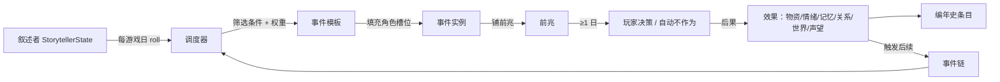
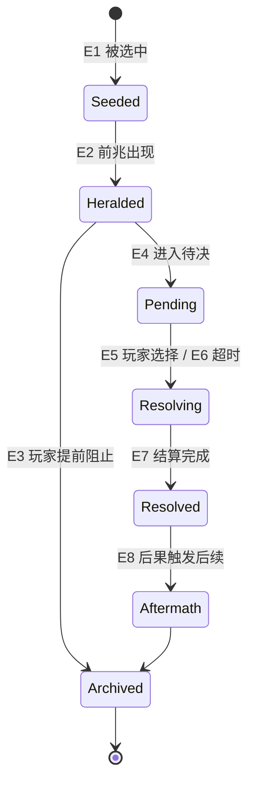
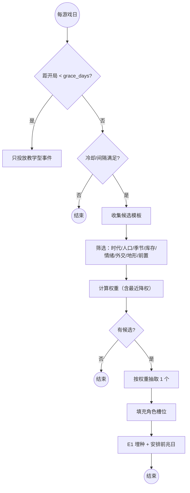

# PRD-002 · 事件与叙述者

```
状态：草稿PRD
负责人：设计（人类定稿）
最后更新：2026-10-17
优先级：P0          里程碑：M2（M1 只做「前兆 + 观察型事件」子集，见 §2.3）
上游依据：docs/design/07-threats-and-narrative.md、docs/design/04-world-and-simulation.md、docs/design/01-vision-and-pillars.md（P3、P5）
关联文档：PRD-001（需求情绪记忆）、PRD-004（威胁与袭击）、PRD-010（商队与贸易）、docs/research/07-mc-landscape.md
基底依赖：Cadence.Cron、Declaring.colony(ColonyContext)、Colony.keep、Colony.submit/Grown（若事件需要居民劳动）、
         front/api Board/Row/Act、Notice、RegisteringUi.page、Scenes.folder、RefusalKind
```

---

## 0. 一句话

> 世界会主动来找你：有前兆、有选择、有后果，而每次发生的事都会被记进这个殖民地的编年史。

---

## 1. 概述

基底提供的是一个**自洽运转的殖民地**：居民自己找活干、自己运货、自己造房子。它没有「外部世界」，因此也没有压力与故事。

本系统是**压力的调度中枢**：它按叙述者的节奏挑选事件，给事件铺前兆、找合适的当事人、让玩家做选择、把结果写回世界与人的记忆，并把发生过的事记进编年史。

**它产生的新的决策**：
- 要不要为一场可能发生的掠夺者袭击提前放弃扩张？（防御 vs 发展）
- 收留这批难民（多几张嘴、多几个矛盾）还是关上门（声望损失）？
- 隔离病人（自由受限、情绪大跌）还是赌一把？
- 用粮食换取邻邦的停战，还是留着过冬？

**它在多大程度上是玩家的选择**：事件**本身**不由玩家决定（世界有它自己的意志）；玩家决定的是**应对**，以及通过叙述者设置决定「世界有多吵」。

---

## 2. 设计目标与非目标

### 2.1 目标

| 编号 | 目标 | 可判定信号 |
| --- | --- | --- |
| G1 | 每个事件都有「前兆 → 应对窗口 → 结果 → 余波」 | 前兆必定先于事件 ≥1 游戏日出现 |
| G2 | 事件不重复 | 同一模板在同存档内不出现相同上下文（R-N-1~5） |
| G3 | 事件服务于人 | 80% 的事件挑选具体居民作为当事人/受害者/见证者 |
| G4 | 可被数据包扩展 | 不改 Java 能新增一个事件模板并生效（受 §15 风险约束） |
| G5 | 玩家可控 | 叙述者 4 档 + 参数；任一模块可关闭 |
| G6 | 不压垮引擎 | 日结算，常态 tick 成本 ≈0 |

### 2.2 非目标（本次不做）

| 编号 | 不做 | 理由 | 何时可能做 |
| --- | --- | --- | --- |
| N1 | 外部势力与外交（使节、条约、朝贡） | 属于 `realms`（PRD-010 前后） | M3 |
| N2 | 袭击的实体战斗实现 | 属于 PRD-004 | M2 |
| N3 | 商队的经济结算 | 属于 PRD-010 | M3 |
| N4 | 事件卡 UI 的完整美术与动画 | 先用面板 + 通知 | M3 |
| N5 | 剧情主线 / 固定叙事 | 与涌现叙事支柱冲突 | 永不做（反支柱） |
| N6 | 传说页的完整实现（家族树/导出） | 属于 `lore`（先做编年史条目） | M2 后期 |

### 2.3 M1 最小子集

M1 只做：**事件调度器 + 前兆 + 观察型/简单选择型事件（≥8 个模板）+ 编年史条目 + 通知**。
不做：arc 事件链、角色槽位的高级筛选、事件百年数值平衡、决策暂停。

---

## 3. 术语

### 3.1 局部术语

| 术语（英文） | 中文 | 说明 |
| --- | --- | --- |
| `incident` | 事件 | 一次由模板生成的世界扰动（全局术语 d03 §2.2） |
| `incident_template` | 事件模板 | 数据包定义的事件定义（条件、权重、选项、后果） |
| `herald` | 前兆 | 事件发生前玩家可见的信号（全局术语） |
| `option` | 选项 | 玩家在事件中的选择（含「不作为」） |
| `effect` | 后果 | 选项产生的效果条目（物资/情绪/记忆/关系/世界/后续） |
| `slot` | 角色槽位 | 模板中需要填充的角色（当事人/受害者/见证者/受益人） |
| `narrator` | 叙述者 | 控制事件频率与强度的导演（全局术语） |
| `arc` | 事件链 | 有前后因果的事件序列 |
| `cooldown` | 冷却 | 同模板/同类事件的最小间隔 |
| `chronicle_entry` | 编年史条目 | 写入编年史的一行记录 |
| `weight` | 权重 | 模板被选中的相对概率 |

### 3.2 冲突检查

| 冲突项 | 基底含义 | 本系统含义 | 解决方式 |
| --- | --- | --- | --- |
| `Cadence.Cron` | 基底周期任务（相位以 lcm/gcd 错开） | 本系统**复用它**做日调度 | 复用，不另起计时器 |
| `Notice` | 基底通知（≤4 参） | 事件通知用它 | 复用；长文本走面板 |
| `Refusal` | 拒绝理由 | 事件不会用 Refusal（事件不是工作） | 不混用 |
| 「任务」(Doing) | 居民当前行为 | 本系统不引入新 Doing | 若事件要求居民做事，走 `Colony.submit` + 既有 Doing |

---

## 4. 概念模型

### 4.1 实体

| 实体 | 中文 | 说明 | 生命周期 | 玩家可见 |
| --- | --- | --- | --- | --- |
| `IncidentTemplate` | 事件模板 | 数据包/代码定义的定义体 | 常驻（注册期加载） | 图鉴（可选） |
| `IncidentInstance` | 事件实例 | 一次具体的待决/已决事件（含填充好的角色与选项） | 日级 | 面板 + 通知 |
| `HeraldState` | 前兆状态 | 某事件的前兆在世界中的存在 | 1–N 游戏日 | 世界内标记 + 通知 |
| `StorytellerState` | 叙述者状态 | 风格、参数、冷却表、最近事件记录 | 与存档同生 | 设置页 |
| `ArcState` | 事件链状态 | 当前进行中的链与阶段 | 数日–数年 | 编年史 |
| `ChronicleEntry` | 编年史条目 | 「时间+主体+事件+结果」 | 永久 | 传说页 |

### 4.2 关系



---

## 5. 状态机

### 5.1 事件实例状态

| 状态 | 中文 | 说明 |
| --- | --- | --- |
| `Seeded` | 已埋种 | 模板已选中，前兆尚未出现 |
| `Heralded` | 已前兆 | 前兆已出现在世界中，玩家可提前行动 |
| `Pending` | 待决 | 需要玩家选择（或等待自动不作为） |
| `Resolving` | 结算中 | 后果正在应用 |
| `Resolved` | 已决 | 后果已全部应用，等待余波 |
| `Aftermath` | 余波 | 后续事件条件生效中 |
| `Archived` | 已归档 | 写入编年史，状态释放 |

### 5.2 事件定义（触发/选择/结算）

| 事件 | 中文 | 说明 | 触发方 |
| --- | --- | --- | --- |
| E1 | 被选中 | 调度器按权重选中模板 | 系统（叙述者） |
| E2 | 前兆出现 | 世界中出现信号 | 系统 |
| E3 | 玩家提前行动 | 玩家在前兆期就做出应对（例：提前加固、提前议和） | 玩家 |
| E4 | 进入待决 | 决策窗口打开 | 系统 |
| E5 | 玩家选择 | 选定一个选项 | 玩家 |
| E6 | 超时 | 窗口结束未选 | 系统 |
| E7 | 结算完成 | 全部 effect 应用成功 | 系统 |
| E8 | 后果触发后续 | 满足 arc 条件 | 系统 |
| E9 | 玩家关闭模块 | 叙述者或模块被关闭 | 玩家 |
| E10 | 前兆被打断 | 玩家在前兆期消除了条件（例：把病人隔离了） | 玩家 |

### 5.3 扩展变量

| 变量 | 中文 | 类型 | 默认 | 范围 | 说明 |
| --- | --- | --- | --- | --- | --- |
| `narrator_style` | 叙述者风格 | 枚举 | Standard | Peaceful/Standard/Harsh/Custom | 全局 |
| `event_frequency_days` | 事件基础间隔 | 整数 | 4 | 1–30 | 天 |
| `event_intensity` | 事件强度 | 定点 | 1.0 | 0.25–3.0 | 倍率 |
| `peak_cooldown_days` | 峰值最小间隔 | 整数 | 3 | 0–30 | 天 |
| `grace_days` | 开局保护 | 整数 | 5 | 0–30 | 天 |
| `lethal_min_population` | 致命事件人口门槛 | 整数 | 8 | 0–100 | 人 |
| `template_cooldowns` | 模板冷却表 | 表 | 空 | — | 每模板最近发生日 |
| `category_cooldowns` | 类别冷却表 | 表 | 空 | — | 每类别（食物/安全/社会/环境…） |
| `recent_incidents` | 最近事件 | 列表（≤10） | 空 | 10 | 用于降权与「不重复」 |
| `chronicle` | 编年史 | 列表（可增长，归档到 lore） | 空 | — | 需要分页存储 |

### 5.4 状态转移表

| 源状态 | 事件 | 守卫条件 | 动作 | 目标状态 |
| --- | --- | --- | --- | --- |
| — | E1 被选中 | 通过全部筛选 | 填充角色槽位、计算前兆日 | `Seeded` |
| `Seeded` | E2 前兆出现 | 到达前兆日 且 条件仍成立 | 生成前兆标记 + 通知 | `Heralded` |
| `Heralded` | E3 玩家提前行动 | 行动消除触发条件 | 取消事件、写编年史「被阻止」 | `Archived` |
| `Heralded` | E4 进入待决 | 到达事件日 | 打开决策窗口 | `Pending` |
| `Pending` | E5 玩家选择 | 选项可选（前置满足） | 应用 `effect` | `Resolving` |
| `Pending` | E6 超时 | 到达窗口结束 | 应用默认选项（不作为） | `Resolving` |
| `Resolving` | E7 结算完成 | 全部 effect 应用成功 | 广播结果、写编年史 | `Resolved` |
| `Resolved` | E8 后续 | arc 条件满足 | 埋入下一个模板 | `Aftermath` |
| `Aftermath` | — | 余波期结束 | 释放状态 | `Archived` |
| 任意 | E9 关闭模块 | 玩家关闭 | 当前实例按默认选项结案 | `Archived` |

### 5.5 状态图



### 5.6 超时与中断

| 情形 | 处理 | 恢复后行为 |
| --- | --- | --- |
| 玩家未在窗口内选择 | 应用默认（不作为）选项，并记录「无人回应」 | 正常 |
| 全部玩家离线 | 窗口顺延到有玩家在线（可配置；默认为顺延，至多 1 游戏日） | 正常 |
| 当事人死亡（前兆期内） | 重新填充角色槽位；若无合适人选则取消事件 | 写编年史「未发生」 |
| 触发条件消失（粮食被吃完） | 取消事件或降级（例如「索贡」变为「抢夺」） | 视模板配置 |
| 服务器重启 | 从存档恢复实例状态（含前兆剩余日） | 正常 |
| 模块被关闭 | 未决实例按默认选项结案 | 不再产生新实例 |

---

## 6. 交互

### 6.1 入口与快捷键

| 操作 | 按键/手势 | 前置条件 | 结果 |
| --- | --- | --- | --- |
| 查看前兆 | 观察世界内标记 / 通知 | — | 提示「可能发生什么」与剩余时间 |
| 打开事件 | 点击通知 / 面板「事件」页 | 有待决事件 | 打开事件窗（选项 + 后果预览） |
| 做选择 | 事件窗中的按钮 | `Pending` | 应用后果 |
| 查看编年史 | 面板「传说」页 | — | 时间线（分页） |
| 调整叙述者 | 面板「设置」页 | 权限：成员（可配置） | 改变频率/强度/风格 |

**R-UI-1**：事件窗**不阻塞**世界（默认）；可选「触发时暂停」（单人与房主可设）。

### 6.2 操作模式状态机

| 状态 | 说明 |
| --- | --- |
| `Normal` | 无特殊模式（本系统不引入世界内手势） |

### 6.3 面板动作

| 上下文 | 按钮 | 操作 | 触发事件 | 是否可撤销 |
| --- | --- | --- | --- | --- |
| 事件窗 | 选项按钮（2–4 个） | 选择 | E5 | **否**（不可撤销，需确认文案） |
| 事件窗 | 「稍后决定」 | 关闭窗口（保留 `Pending`） | — | 是 |
| 前兆标记 | 「前往」 | 相机/定位到前兆位置 | — | — |
| 传说页 | 「展开」 | 查看条目详情（参与人、结果、后续） | — | — |
| 设置页 | 叙述者选择 | 改变风格 | — | 是 |

**R-UI-2**：每个事件窗必须显示**「不作为」会发生什么**（后果预览），避免玩家因害怕而无法决定。

### 6.4 命令

| 命令 | 权限 | 说明 | 输出 |
| --- | --- | --- | --- |
| `/folkways incident list` | gamemaster | 列出当前实例与冷却状态 | 文本 |
| `/folkways incident fire <模板id>` | gamemaster | 立即触发指定模板（调试/测试） | 文本 |
| `/folkways incident cancel` | gamemaster | 取消当前实例 | 文本 |
| `/folkways narrator <style>` | 成员/管理员 | 切换叙述者 | 文本 |

---

## 7. 反馈

### 7.1 操作模式反馈

| 检查条件 | 音效 | Toast/文案键 | 视觉反馈 | 系统行为 |
| --- | --- | --- | --- | --- |
| — | — | — | — | 不适用（无操作模式） |

### 7.2 实体状态反馈

| 检查条件 | 图标/颜色 | 悬停信息 | 系统行为 |
| --- | --- | --- | --- |
| 前兆存在 | 世界内标记（烟/足迹/信使/咳嗽图标） | 「可能：掠夺者来袭（约 2 天后）」 | 玩家可提前行动 |
| 事件待决 | 面板与通知角标 | 「有一件事等你决定」 | 等待 |
| 事件已决 | 编年史新增条目标记 | 摘要 | 归档 |

### 7.3 系统事件反馈

| 事件 | 音效 | 通知文案键 | 视觉 | 系统行为 |
| --- | --- | --- | --- | --- |
| 前兆出现 | 低沉提示音 | 「%s」（按模板） | 世界标记 | 开始倒计时 |
| 事件待决 | 显著提示音 | 「%s 需要你的决定」 | 面板角标 | 打开窗口（可选暂停） |
| 事件结算 | 视性质 | 「%s」结果摘要 | 世界变化 | 写编年史 |
| 事件被阻止 | 正向提示音 | 「你们避开了%s」 | — | 写编年史 |
| 余波开始 | 无 | 「%s 的余波」 | — | 等待后续 |

**R-F-1**：通知必须包含**主体与时间**（谁、何时、还有多久），不允许只报事件名。
**R-F-2**：同一事件的前兆、待决、结算三个阶段的通知必须可区分（提示音与图标不同）。

### 7.4 可诊断性

| 玩家可能的疑问 | 系统必须能回答 | 呈现位置 |
| --- | --- | --- |
| 为什么世界一直在找我麻烦？ | 叙述者设置 + 最近事件列表 + 触发条件（财富/声望/时代） | 「事件」页顶部 |
| 为什么这个事件会发生在我身上？ | 触发条件的可读解释（例：「你们的存粮被注意到了」） | 事件窗「为什么」折叠块 |
| 为什么我不能选某个选项？ | 选项前置条件不满足的具体原因 | 选项按钮悬停 |
| 我刚才做了什么决定？ | 编年史条目（含选项与后果） | 传说页 |
| 这次和上次有什么不同？ | 同一模板的实例会标注「与上次的差异」（当事人/结果不同） | 传说页条目 |

---

## 8. 规则

| 编号 | 类型 | 规则 | 违反时的行为 |
| --- | --- | --- | --- |
| R1 | 必须 | 每个事件必须有前兆，且前兆早于事件 ≥1 游戏日 | 不触发该事件（记日志） |
| R2 | 必须 | 峰值事件之间有最小间隔（默认 3 游戏日 + 上次冲击系数） | 跳过本次 roll |
| R3 | 必须 | 人口 < `lethal_min_population` 时不投放致命事件 | 过滤 |
| R4 | 必须 | 每个事件至少提供 1 条「不作为」路径 | 模板校验失败（注册期报错） |
| R5 | 必须 | 同一模板在同存档不出现相同上下文（角色/条件） | 权重降 90% 或跳过 |
| R6 | 禁止 | 事件调度不得逐 tick 运行 | 性能验收不通过 |
| R7 | 禁止 | 不得生成虚构历史（编年史只记录真实发生的事） | 评审不通过 |
| R8 | 必须 | 事件强度受玩家设置约束（`event_intensity`） | 按设置缩放 |
| R9 | 必须 | 事件不得绕过需求/情绪系统直接「杀掉」居民（致命必须经过健康/战斗链） | 评审不通过 |
| R10 | 必须 | 每个 effect 必须在应用前完成校验（目标仍存在、物资仍足够） | 部分失败时降级并记录 |
| R11 | 级联 | 事件涉及居民死亡 → 触发讣告与关系人记忆（PRD-001/008 接口） | — |
| R12 | 优先级 | 已有 `Pending` 事件未决时，不再投放新的 `Pending` 事件 | 排队到解决之后 |
| R13 | 必须 | 关闭模块后，不得再产生新实例；已有实例按默认结案 | — |
| R14 | 必须 | 事件文本与选项必须**双语齐全（`zh_cn` + `en_us`）**，且引用具体对象名 | i18n 检查 |

---

## 9. 流程

### 9.1 与基底的对接

| 项 | 内容 |
| --- | --- |
| 工作类型 | 不新增工种（事件不是工作） |
| 任务 | 若选项要求居民做事（例：紧急抢收、修墙），则**提交一个真实的 `Grown`** 给 `Colony.submit`，不伪造结果 |
| 参与的居民种类 | 所有（统计与筛选） |
| 工具/许可 | 无 |

**R-FLOW-1**：事件**不得**直接改变世界方块或物资，除非通过（a）真实的居民劳动提交，（b）明确的世界事件效果（例：火灾、洪水），后者必须记录在模板中并受效果白名单约束。

### 9.2 调度流程



### 9.3 权重公式

```
weight(template) =
    base_weight
  × era_factor            // 时代越高，强事件权重越高
  × pop_factor            // 人口越多，规模类事件越可能
  × resource_factor       // 库存极低 → 饥荒类；极富 → 掠夺类
  × mood_factor           // 情绪低迷 → 内部/社会类事件
  × season_factor         // 季节相关（冬季寒冷/夏季火灾）
  × narrator_factor       // 叙述者强度
  × recency_penalty       // 同模板/同类别最近发生过 → ×0.1
  × arc_gate              // 事件链未到阶段 → 0
```

| 计算项 | 公式 | 说明 |
| --- | --- | --- |
| 玩家应对倾向 | `aggression_bias = (抵抗次数 - 妥协次数) / 总次数` | 叙述者 memory：倾向强硬的玩家会遇到更强硬的对手 |
| 冲击系数 | `impact = Σ |effect 权重|` | 用于峰值冷却：`cooldown = max(3, impact × 0.5)` |
| 前兆提前量 | `herald_days = clamp(template.herald_days × (2 - intensity), 1, 5)` | 强度越高，前兆越短（更难） |

### 9.4 数值配置

| 参数 | 默认 | 范围 | 可覆盖 | 备注 |
| --- | --- | --- | --- | --- |
| `event_frequency_days` | 4 | 1–30 | 是（配置/剧本） | 主旋钮 |
| `event_intensity` | 1.0 | 0.25–3.0 | 是 | 主旋钮 |
| `herald_days`（模板级） | 2 | 1–10 | 是（数据包） | — |
| `decision_window_days` | 1 | 0.25–5 | 是 | 决策窗口 |
| `recent_incident_memory` | 10 | 3–50 | 是 | 降权依据 |
| `template_count_initial` | ≥40 | — | — | M2 目标 |
| `chronicle_page_size` | 32 | 固定 | 否 | 面板上限 |

### 9.5 后果（effect）白名单

| 类别 | 例 | 校验 |
| --- | --- | --- |
| 物资 | 增减物品（通过基底 `Stash`/`Delivery`） | 数量/存在性 |
| 居民状态 | 情绪修正、记忆写入、受伤 | 居民仍存在 |
| 关系 | 好感/关系标签变化（PRD-008） | 双方仍存在 |
| 世界 | 火灾、洪水、建筑损坏、矿脉暴露 | 坐标有效、区块策略 |
| 声望/外交 | 关系值变化（`realms`） | — |
| 后续 | 埋入 arc 的下一阶段 | 阶段合法 |

---

## 10. 数据与存档

| 项 | 内容 |
| --- | --- |
| 新增持久化字段 | `StorytellerState`（风格/参数/冷却表/最近事件）、未决实例（含前兆剩余日）、`ArcState`、`ChronicleEntry`（分页） |
| 存储位置 | `Colony.keep(owner, CompoundTag)`（殖民地级）；编年史可分离存储并按需分页 |
| 存档版本影响 | 需要。我们自管版本号（基底 `SaveVersion=1` 且静默只读，见 r01 §4.8） |
| 迁移策略 | 缺失字段取默认；模板 id 消失时，相关实例取消并记录「模板已移除」；冷却表按 id 清理 |
| 旧存档降级 | 无我们的数据 → 叙述者取默认（标准） |
| 回滚行为 | 可加载；实例与编年史保留但不解读 |
| 编年史增长 | 分页 + 归档（超过 N 条时按年压缩为摘要，原文导出到 `lore` 的导出功能） |

**R-DATA-1**：冷却表与最近事件列表必须有上限（防无限增长）。
**R-DATA-2**：模板 id 是存档的一部分 → **重命名模板 id 等于破坏存档**，必须在迁移表中显式映射。

---

## 11. 网络与多人

| 项 | 内容 |
| --- | --- |
| 权威端 | 服务端（事件评估会访问世界/实体，**必须在服务端线程**，见 r01 §3.2） |
| 需同步的状态 | 待决事件（选项与后果预览）、前兆标记、编年史分页 |
| 同步频率 | 事件驱动（出现/解决时）；打开面板时拉取 |
| 权限 | 做选择：任何成员（可配置为仅管理者）；改叙述者：管理者 |
| 多人并发冲突 | 第一个提交的选择生效；其他人收到「已由 X 决定」；窗口关闭 |
| 断线/重连 | 待决事件在服务端保留；重连后可见 |
| 暂停设置 | 单人：可设「事件出现时暂停」；多人：仅房主可设，且默认不暂停 |

**R-MP-1**：多人下不得因等待某人决策而阻塞世界（默认不暂停）。
**R-MP-2**：选项必须服务端校验（防止客户端伪造不可能的选择）。

---

## 12. i18n（双语：`zh_cn` + `en_us`）

| 键 | 说明 |
| --- | --- |
| `folkways.incident.<id>.name` | 事件名 |
| `folkways.incident.<id>.desc` | 描述 |
| `folkways.incident.<id>.herald` | 前兆文案（含剩余天数参数） |
| `folkways.incident.<id>.why` | 「为什么会发生」 |
| `folkways.incident.<id>.option.<key>` | 选项文案 |
| `folkways.incident.<id>.option.<key>.preview` | 后果预览（不作为必须写明） |
| `folkways.incident.<id>.result.<key>` | 结果文案（含对象名参数） |
| `folkways.narrator.<style>` | 叙述者风格名 |
| `folkways.narrator.<style>.desc` | 风格说明 |
| `folkways.page.incident` | 页名「事件」 |
| `folkways.chronicle.entry.<kind>` | 编年史条目模板（必须支持 `%s` 人名/地名/物名） |

**R-I18N-1**：编年史条目模板必须支持**变量化主体**（用 `%s`），否则「谁做了什么」无法本地化。
**R-I18N-2**：**我们新增的键只做 `zh_cn` + `en_us`**（[ADR-017](../../docs/00-charter.md)）；基底既有的 `zh_hk` / `zh_tw` 文件保留不动，若我们要**改动上游既有键**，仍须按各地区 Minecraft 术语核对，不得做简繁直转。

---

## 13. 性能预算

| 项 | 估算 | 依据 | 上限 |
| --- | --- | --- | --- |
| 每 tick 额外耗时 | ≈0% | 无逐 tick 工作 | <0.1% |
| 日结算（60 居民） | 候选筛选 + 权重（模板数 × 常量）+ 槽位填充（居民扫描一次） | O(模板数 + 居民数) | <2%（见 [性能预算](../pack/03-performance-budget.md)：事件 ≤2% 常态 / ≤5% 峰值） |
| 峰值（事件结算瞬间） | effect 应用（物资/记忆/世界） | 与 effect 数线性 | ≤5% |
| 每 tick 分配 | 0 | 日结算是唯一入口 | 0 |
| 内存 | 编年史（每条约 100 B）+ 冷却表（每模板 1 整数） | 归档压缩 | 编年史 ≤ 1 MB/存档 |
| 网络 | 事件驱动，少量 | — | — |

**R-PERF-1**：日调度必须复用基底 `Cadence.Cron` 并与其错相位（避免与需求/情绪结算撞在同一 tick）。
**R-PERF-2**：必须提交探针（日调度耗时、单次结算耗时、编年史条目数）。

---

## 14. 与基底 API 的关系

| 需求 | 用到的扩展点 | 是否已有 | 备注 |
| --- | --- | --- | --- |
| 日调度 | `Cadence.Cron`（lcm/gcd 错相位） | 已有 | 不新起计时器 |
| 殖民地状态 | `Declaring.colony` + `ColonyContext.share/tick/closed` | 已有 | 叙述者与实例 |
| 持久化 | `Colony.keep(owner, CompoundTag)` | 已有 | 自管版本 |
| 面板 | `RegisteringUi.event.page` + `PageKind.boarded` + `Board/Row/Act` | 已有 | 「事件」页与「传说」页 |
| 通知 | `Notice`（≤4 参）+ `Pages.text` | 已有 | 长文本走面板 |
| 教学 | `Scenes.folder` | 已有 | 「事件系统」一课 |
| 世界标记 | `Placard` / `Ghost` / `Layer` | 已有（r03 §7.1） | 前兆标记 |
| 居民劳动 | `Colony.submit(Grown)` | 已有 | 选项要求居民做事时 |
| 线程约束 | 事件评估访问实体 → **服务端线程**；不得放入 `Refinement`/`Sizing` | 约束 | r01 §3.2 |

**R-API-1（fork 后更新）**：我们**已 fork Folkways 本体**（[ADR-007](../00-charter.md)）：事件系统作为 fork 内的新插件实现，新货架直接扩 `Shelves`（[fork 策略](../design/12-fork-strategy.md) L2 改动 + `// PLA:` 标记）。
**R-API-2**：事件评估与结算必须在服务端线程完成（与 PRD-001 的纯函数要求相反，注意区分）。

---

## 15. 可改写性

| 内容 | 可被数据包覆盖 | 路径 | 热重载 |
| --- | --- | --- | --- |
| 事件模板 | 是（**新货架** `incident`） | `data/<ns>/folkways/incident/*.json` | 是（若货架可扩展） |
| 前兆定义 | 是（模板内） | 同上 | 是 |
| 叙述者预设 | 是（新货架 `narrator`） | 同上 | 是 |
| 编年史文案 | 是（语言目录） | `assets/*/lang` | 是 |
| 参数 | 是（配置/剧本） | serverconfig + 剧本 | 部分 |

**格式参照**：`Pillager Caravans` / `Better Caravans` 完全用数据包定义编队、货物、生成规则、冷却与交易表（[r07](../research/07-mc-landscape.md)），与本货架目标同构，可直接借鉴其 schema 风格。

**✅ 已解决（2026-10-18，ADR-007）**：我们已 fork 本体，直接在 fork 内扩展 `Shelves`（[fork 策略](../design/12-fork-strategy.md) L2 改动），复用基底 `/reload` 与 `/folkways library` 自检。**不再需要"自建加载器"兜底**（F2 不采用）。

---

## 16. 验收检查（Acceptance Criteria）

### 16.1 交互
- [ ] AC-1 前兆出现时，玩家能在世界与通知中看到它，并知道大概还有多久
- [ ] AC-2 待决事件在面板中可见，能打开事件窗并看到 2–4 个选项
- [ ] AC-3 事件窗显示「不作为会发生什么」的预览
- [ ] AC-4 编年史页能按时间列出条目，可展开查看参与人与结果

### 16.2 反馈
- [ ] AC-5 前兆/待决/结算三个阶段的音效与图标可区分
- [ ] AC-6 通知含主体与时间信息
- [ ] AC-7 事件窗有「为什么发生在我身上」的解释块
- [ ] AC-8 不可选的选项给出具体原因

### 16.3 规则
- [ ] AC-9 前兆必定早于事件 ≥1 游戏日（抽取 100 次验证）
- [ ] AC-10 峰值事件间隔 ≥ `peak_cooldown_days`
- [ ] AC-11 人口 <8 时不出现致命事件
- [ ] AC-12 每模板至少一条不作为路径（注册期校验）
- [ ] AC-13 同模板不出现相同上下文（角色/条件）——抽 200 次无重复上下文
- [ ] AC-14 已有 `Pending` 事件时不再投放新的 `Pending` 事件
- [ ] AC-15 关闭模块后不再产生新实例，已有实例按默认结案

### 16.4 流程与数值
- [ ] AC-16 权重公式的各因子可被命令打印（调试）
- [ ] AC-17 玩家倾向（aggression_bias）会改变后续事件强度（可复现）
- [ ] AC-18 角色槽位填充遵守筛选条件（例：「有亲属」的人被选中时确实有亲属）
- [ ] AC-19 effect 校验失败时降级并记录，不产生半完成状态

### 16.5 状态、数据与边界
- [ ] AC-20 存档往返后未决实例与前兆剩余日一致
- [ ] AC-21 服务器重启后可恢复待决事件
- [ ] AC-22 模板被移除（数据包更新）后，相关存档可加载
- [ ] AC-23 全部玩家离线时决策窗口顺延（不超过 1 游戏日）
- [ ] AC-24 当事人死亡时角色重新填充或取消
- [ ] AC-25 编年史条目只记录真实发生的事（无虚构）

### 16.6 性能与多人
- [ ] AC-26 60 居民场景日调度耗时 <2%（探针）
- [ ] AC-27 与需求/情绪结算不在同一 tick 撞车（相位验证）
- [ ] AC-28 多人并发选择时，只有第一个生效，其他人收到提示

### 16.7 可改写性
- [ ] AC-29 不改 Java 能新增一个事件模板并生效（或按 §15 风险降级方案生效）

---

## 17. 测试计划（TDD）

| 测试 | 类型 | 覆盖 AC | 备注 |
| --- | --- | --- | --- |
| 权重计算与筛选（含降权、arc 门控） | 单元 | AC-13、AC-16 | 固定种子可复现 |
| 前兆提前量与冷却 | 单元 | AC-9、AC-10 | — |
| 模板注册期校验（选项/不作为/文案键） | 单元 | AC-12 | 与 i18n 检查联动 |
| 角色槽位筛选 | 单元 | AC-18 | 构造居民夹具 |
| effect 校验与降级 | 单元 | AC-19 | 缺物资/目标消失 |
| 状态机全路径 | 单元（状态机测试） | AC-1~AC-15 | 覆盖 5.4 每一行 |
| 存档往返与重启恢复 | gametest | AC-20、AC-21 | 含模板移除 |
| 事件 → 记忆/情绪（跨系统交界） | gametest | AC-11、AC-24 | **本 PRD 的关键交界测试** |
| 事件要求居民做事 → 真实劳动提交 | gametest | 流程 §9.1 | 验证不是伪造结果 |
| 事件窗渲染与选项禁用原因 | e2e（Linux） | AC-2、AC-3、AC-8 | — |
| 编年史分页与归档 | 单元 + gametest | AC-25 | 长历史压缩 |
| 日调度探针 | bench（Linux） | AC-26、AC-27 | 60 居民 |

---

## 18. 待细化 / 开放问题

| 编号 | 问题 | 影响 | 何时必须定 | 谁定 |
| --- | --- | --- | --- | --- |
| OQ-1 | ~~新增货架（`incident`）能否不 fork 基底实现？~~ | **已定：fork 内扩 `Shelves`**（ADR-007，L2 改动） | ✅ 已定（2026-10-18） | 实现 agent |
| OQ-2 | ~~首批 40 个模板的清单与优先级？~~ | **已裁决（2026-10-18）**：清单见 [k06 首批 40 条事件模板](../pack/06-incident-templates.md)（环境 8 / 社会 9 / 威胁 8 / 机会 8 / 神秘 7；早期 12 / 中期 15 / 后期 13；id `plaa:inc_*` 稳定、键族 `folkways.incident.<id>.*`）；**时代门控是硬规则**，数量以本 PRD 的 `template_count_initial ≥ 40` 为准 | ✅ 已定 |
| OQ-3 | 决策窗口默认时长（1 游戏日）是否合适？ | 手感 | M2 试玩 | 人类 |
| OQ-4 | 是否引入「叙述者记忆」调整对手强度？（可能被视为不公平） | 体验与公平感 | M2 前 | 人类 |
| OQ-5 | 编年史容量与归档策略（每年压缩为摘要？导出？） | 存档大小与可读性 | M2 后 | 设计 |
| OQ-6 | 事件是否允许中断玩家正在进行的建造/操作？（例：火灾） | 打扰感 | M2 前 | 人类 |

---

## 19. 变更记录

| 日期 | 状态 | 变更 | 操作者 |
| --- | --- | --- | --- |
| 2026-10-17 | 草稿PRD | 首次起草（已并入 r07 的商队数据包格式与诊断证据） | 设计 agent |