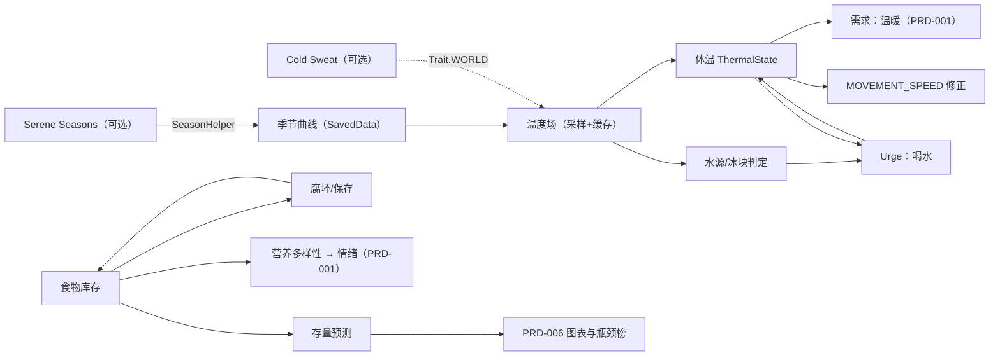
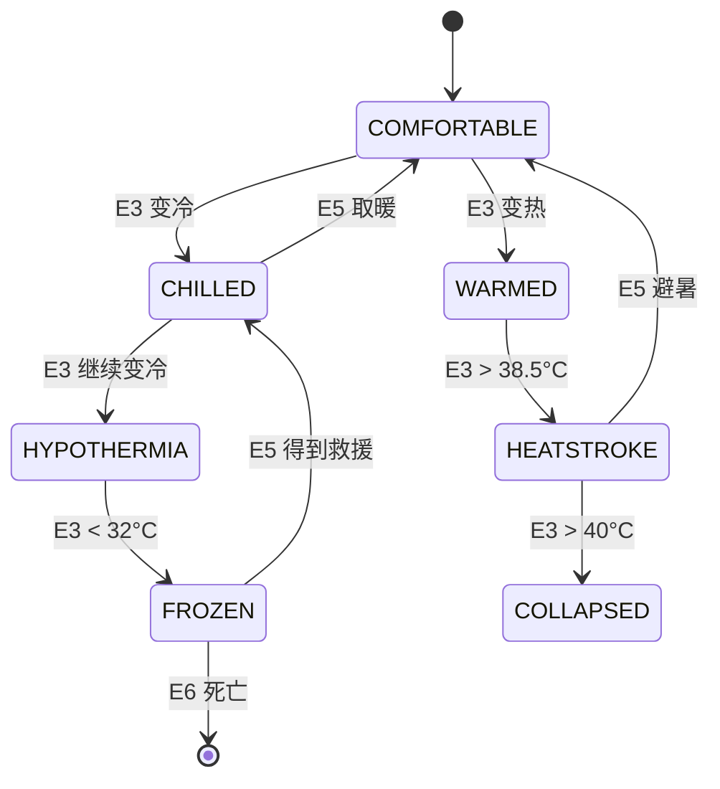
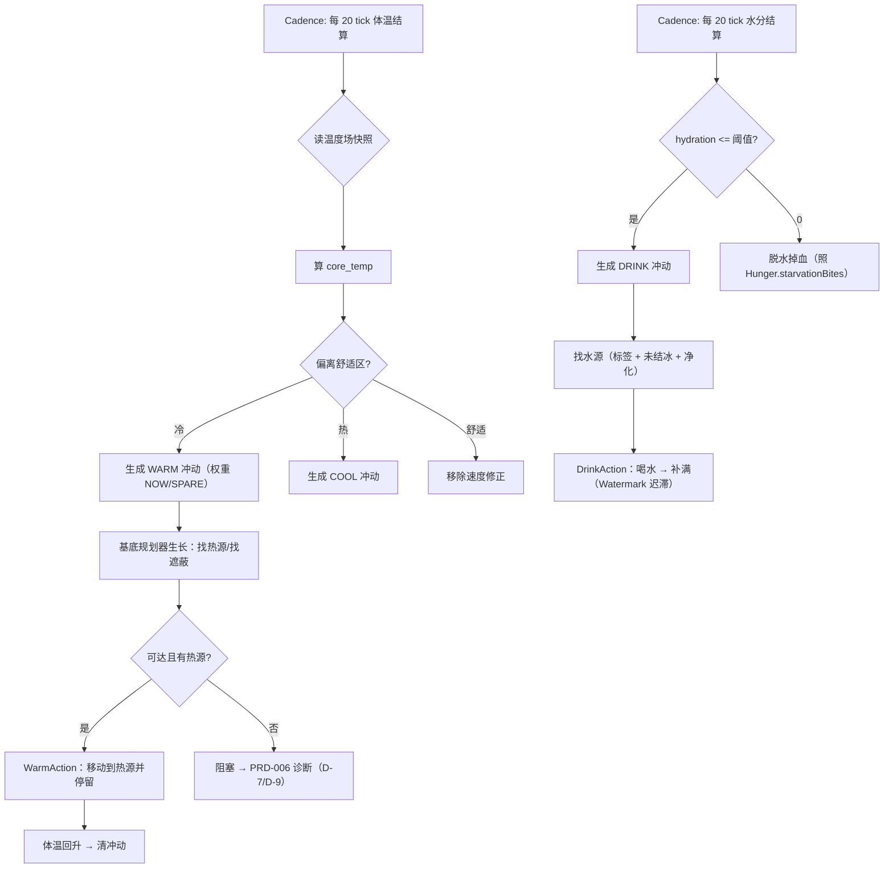

# PRD-003 · 季节、温度、口渴与营养

```
状态：草稿PRD
负责人：设计（人类定稿）
最后更新：2026-10-18
优先级：P0        里程碑：M2（M1 子集见 §2.3；太空氧气部分归 M4/PRD-011）
上游依据：docs/design/04-world-and-simulation.md（§2 时间模型、§4 气候季节天气）、docs/design/06-economy-and-logistics.md（§4.2 库存规则、§6 需求预测）
关联文档：PRD-001（需求与情绪：温暖是第 4 条需求）、PRD-002（事件：寒潮/干旱/歉收）、PRD-005（指令：备冬策略）、PRD-006（存量预测是本 PRD 的前置接口，R-FLOW-8）、PRD-011（时代：太空生命维持）
基底依赖：ColonyContext / Declaring.colony / Contributions.urges、LivingContent + LivingPresence + Hunger + Watermark（计量范式）、
         FolkwaysAttachments / Colony.keep（持久化）、LocalGround（世界读取层）、Cadence（分相位结算）、
         wares 的熔炉/烟熏炉工位（保存手段）、Grounds/Survey（取样）、Urge/Worker/ColonyView
外部调研：docs/research/08-temperature-thirst-integration.md（A 级证据：Cold Sweat / Serene Seasons / TAN / TWT / Folkways 接入面）、
         docs/research/09-space-endgame.md §3.4（氧气与太空生命维持同构）
决策依据：ADR-010（世界数据层 + 外部 mod 只作传感器）、ADR-013（一切必须驱动居民本身）、ADR-007（已 fork，可直接改造）
```

---

## 0. 一句话

> 冬天、热浪、口渴和「吃来吃去就那几样」都会让小人自己想办法——而你能提前知道这个冬天到底够不够。

---

## 1. 概述

**玩家在什么时候遇到它**：第一个冬天到来时；把殖民地建在沙漠或雪原时；远行与远征时；干旱/寒潮事件来临时；最后在太空站里（氧气与温度）。

**它解决什么体验问题**：设计纲领 [d04 §4](../design/04-world-and-simulation.md) 承诺「季节、温度、天气是主要压力」，但基底**没有任何环境感知**——全仓库 grep `isRaining|isThundering|getBiome().getTemperature` **零命中**（[r08 §4.4](../research/08-temperature-thirst-integration.md)），引擎里连"今天冷不冷"都没有。于是冬天只是贴图变化，不带任何决策重量。对应支柱 **P3（世界会回应）**。

**它产生的新决策**：
- 把殖民地建在河边/温泉旁（取水与取暖近）还是山口（防御好、冷）？
- 冬天烧什么？柴、炭、煤，还是把人挤进一间屋子（体热 + 密闭）？
- 食物怎么过冬：地窖（靠低温慢腐坏）还是烟熏/腌制（把口粮换成工位工时）？
- 单一作物高产但吃腻（营养单一），还是多种几样（占地、费工）？
- 干旱时把水优先给谁：居民喝、牲畜喝、还是浇地？

**它在多大程度上是玩家的选择**：**环境是系统的，应对是玩家的**。季节与天气不由玩家决定（可配置、可被剧本覆盖）；取暖、取水、保存、种植结构、储存规则**全部由玩家决定**。

### 1.1 「自研季节/温度难在哪」——诚实拆解

调研结论是"居民侧必须自研、外部 mod 只能当传感器"（[r08 §5.3](../research/08-temperature-thirst-integration.md)）。难度必须分开看：

| 部分 | 难度 | 依据 / 为什么 |
| --- | --- | --- |
| **维生计量范式**（口渴、体温、氧气都是"一个计量 + 逐 tick 结算 + 存档"） | **低（有现成范式可抄）** | `Hunger` 就是完整范本：`foodLevel/saturation/exhaustion` + `stepVitals` 回血/饿伤 + `save/load`（`Hunger.java:9-127`，尤其 `:29-101,107-122`）；阈值门有 `Watermark`（`Watermark.java:15-43`）；声明入口有 `LivingContent.declare` 的 `scope.share/urges/tick/closed`（`LivingContent.java:66-73`）。**口渴 ≈ 把 `Hunger` 复制一份改字段名**（[r08 §4.3](../research/08-temperature-thirst-integration.md)） |
| **行为后果**（冷了走慢、渴了去喝水） | **低** | 速度用 `MOVEMENT_SPEED` 的 transient modifier（基底自己就这么做：`ResidentEntity.java:288-296`，含"先 remove 再 add、固定 ResourceLocation"的正确姿势）；行为用新 `Urge`（`LivingPresence.java:166-184` 的 eating/sleeping 是范本，两档权重 `Urge.NOW/SPARE`） |
| **持久化** | **低** | 两条路都现成：`Colony.keep(owner, CompoundTag)`（`Colony.java:47`）或自注册 `AttachmentType`（基底自己在用：`FolkwaysAttachments.java:19-46`）。**注意**：`BodyState`/`BODY_STATE`/`Body.state()` 是包私有（`BodyState.java:14`、`FolkwaysAttachments.java:29`），第三方塞不进去——fork 后可提为 public（L2 改动，[d12 §5](../design/12-fork-strategy.md)） |
| **季节本身** | **低** | 本质是 `dayTime` 的算术：一天 24000 tick（[d04 §2](../design/04-world-and-simulation.md)），基底已有 `getDayTime()` 的读取先例（`PersonPresence.java:49`）；Serene Seasons 的做法也就是一个 `SavedData` 里的 `seasonCycleTicks`（`SeasonSavedData.java`，[r08 §2.1](../research/08-temperature-thirst-integration.md)） |
| **温度场（真正的难点 1）** | **中高** | 温度 = 生物群系基温 + 季节 + 昼夜 + 天气 + 海拔 + 遮蔽 + 方块热源 + 活动产热；**不能逐方块、也不能逐 tick 全量重算**，且要处理缓存失效（方块变化、天气、昼夜翻页）与 NPC 降频（Cold Sweat 对非玩家系统性降到 1/40，官方自认高级实体气候"大量实体时可能性能有问题"，`EntitySettingsConfig.java:123-128`）。好在世界读取层已有：`LocalGround implements Ground, LevelReader` 已暴露群系/光照/方块（`LocalGround.java:333-341`），**只是没人算温度**（[r08 §4.4](../research/08-temperature-thirst-integration.md)）→ 必须在快照层加"某格环境温度"并缓存；几十~上百居民的开销**必须实测**（[r08 §6 #7](../research/08-temperature-thirst-integration.md)） |
| **内容量（难点 3，最容易被低估）** | **高** | 模型不难，**内容难**：保温衣物识别、热源方块标签、温度计、冰火方块、隔热材料——Cold Sweat 在这上面投入了成千小时（[r08 §5.2](../research/08-temperature-thirst-integration.md)）。我们的对策是"骨架自研 + 有 Cold Sweat 时复用其方块热源/装备保温数据" |
| **体感平衡（难点 4）** | **高** | 温度/口渴最容易被玩家骂"烦"。必须：默认温和、可配置、有前兆（[d04 R-CL-4/R-CL-5](../design/04-world-and-simulation.md)）、生存压力永远高于效率惩罚（§8 R-CL-11） |
| **多人一致性与存档（难点 5）** | **中** | 季节必须是**世界级**（不是玩家级，`SeasonSavedData` 也是世界级），否则多人各看各的季节；存档自管版本号 + 迁移（§10） |
| **与光影/其它温度 mod 的冲突（难点 6）** | **中** | 双季节源打架（[k01](../pack/01-modlist.md) 已警告）；Cold Sweat 用**反射**写 `CommonHooks.FORGE_ATTRIBUTES`（`AddTempAttributes.java:48-58`），NeoForge 内部字段随时可能变（[r08 §5.5](../research/08-temperature-thirst-integration.md)） |

**结论**：**难的不是"季节/温度/口渴"这三个概念，而是"温度场的性能与失效"+"内容量"+"体感"**。前者有明确的工程路径（采样 + 缓存 + 分相位），后者只能靠默认温和 + 可配置 + 逐步补内容。

---

## 2. 设计目标与非目标

### 2.1 目标

| 编号 | 目标 | 可判定信号 |
| --- | --- | --- |
| G1 | 季节真实影响玩法 | 冬季/夏季下，作物、取暖、取水、出行至少各有一项可测量的行为差异 |
| G2 | 温度可被建造与衣物解决 | 火源/密闭/衣物三类手段各自能显著改变居民体温（对照实验） |
| G3 | 口渴会驱动居民 | 口渴到阈值时居民自主去喝水（`Urge` 驱动，玩家不干预也能活） |
| G4 | 食物会腐坏，也能被保存 | 生鲜在常温下若干天腐坏，烟熏/腌制/地窖显著延长（可测量） |
| G5 | 营养多样性有来回 | 长期单一饮食与多样饮食在情绪/效率上有可测差异 |
| G6 | 一切可预测 | 游戏内可查「食物/水/燃料还够 X 天」与未来 N 天温度预报 |
| G7 | 性能可控 | 60 居民 + 全系统时 TPS ≥20，本系统常驻 ≤3% tick（§13） |
| G8 | 无外部 mod 也完整可玩 | 不装 Cold Sweat / Serene Seasons 时功能**降级但不缺失**（R-CL-7） |
| G9 | 太空复用同一模型 | 氧气/太空温度用同一 vitals 机制接入，不另造一套（G-同构，[r09 §3.4](../research/09-space-endgame.md)） |

### 2.2 非目标（Non-Goals）

| 编号 | 不做的事 | 理由 | 何时可能做 |
| --- | --- | --- | --- |
| N1 | 逐方块温度可视化（全图热力） | 性能与可读性双输 | 不做 |
| N2 | 湿冷/风寒/湿度三层叠加模型 | 复杂度爆炸，玩家看不出差别 | M4 之后评估 |
| N3 | 疾病/瘟疫系统（受寒→肺炎的完整病理） | 属另一系统（尚未立项） | 见 OQ-8 |
| N4 | 排泄/卫生（硬核生存） | [章程 §5.2](../00-charter.md) 明确拒绝 | 不做 |
| N5 | 水质化验/微生物学 | 见 OQ-3（先只做"净化/未净化"二分） | 视 OQ-3 结论 |
| N6 | fork 外部 mod（Cold Sweat / Serene Seasons / TAN） | 许可：Cold Sweat 四份声明打架、SS 是 ARR、TAN 停更 2024-10（[r08 §1.4/§2.3/§3](../research/08-temperature-thirst-integration.md)） | 不做 |
| N7 | 把口渴/温度做成**第 8、9 条需求** | ADR-009：**vitals 不进需求栏**；需求集是数据驱动的默认核心集 + 变体/成瘾/专属需求（[PRD-001](PRD-001-needs-mood-memory.md)），与条数无关 | 不做 |
| N8 | 玩家侧口渴（TAN/TWT 那套） | 居民侧才是本系统的主战场；玩家侧可选装 | 玩家自选 |
| N9 | 太空氧气的第一版实现 | 归 M4/PRD-011；本 PRD 只定**同构契约** | M4 |

> 非目标不为空。

### 2.3 M1 最小子集

M1 做：**季节曲线（世界级）+ 环境温度快照（采样 + 缓存）+ 温度接入「温暖」需求 + 口渴计量与喝水冲动 + 食物腐坏与地窖/烟熏保存 + 存量预测（依赖 PRD-006）**。

| 子项 | M1 | M2 | M3/M4 |
| --- | --- | --- | --- |
| 季节曲线 + 温度场 + 预报 | ✅ | | |
| 体温 → 温暖需求（PRD-001） | ✅ | | |
| 口渴 + 喝水 `Urge` | ✅ | | |
| 腐坏 + 保存（生鲜/地窖/烟熏三档） | ✅ | 腌制/风干/冷藏 | |
| 营养多样性 · 衣物保温 · 进阶天气（寒潮/干旱） | — | ✅（天气与 PRD-002 联动） | |
| 水质与净化 | — | 视 OQ-3 | |
| 太空氧气/站内温度 | — | — | ✅（M4，见 [d08 §5.1](../design/08-progression-and-ages.md) 与 [r09 §3.4](../research/09-space-endgame.md)） |

**门槛**：M1 的**预测部分**依赖 [PRD-006](PRD-006-stock-rules-and-diagnosis.md) 的存量预测（其 R-FLOW-8 已声明"必须先于 PRD-003 完成"）。若 PRD-006 未就绪，M1 降级为"当前库存显示"，不带预测。

---

## 3. 术语

### 3.1 本系统局部术语

| 术语（英文） | 中文 | 说明 | 与全局术语的关系 |
| --- | --- | --- | --- |
| `season` | 季节 | 春/夏/秋/冬，世界级，默认 8 游戏日一季 | 新增（d04 §2 已用） |
| `climate` | 气候档案 | 一套季节曲线 + 温度修正 + 作物日历（数据包） | 新增 |
| `temperature_field` | 温度场 | 世界坐标 → 环境温度的**采样 + 缓存**结果 | 新增 |
| `vitals` | 维生计量 | 口渴、体温、氧气、饥饿（基底已有）这一层的统称 | **新增（关键概念）** |
| `hydration` | 水分 | 0–20 的计量，与 `Hunger.foodLevel` 同构 | 新增 |
| `core_temp` | 体温 | 摄氏度计量，正常 36.5–37.5 | 新增 |
| `oxygen` | 氧气 | 太空用计量，M4；本 PRD 只定契约 | 新增 |
| `spoilage` | 腐坏 | 食物按类别与仓储条件损失的速率 | 新增 |
| `preservation` | 保存 | 烟熏/腌制/风干/冷藏/密封等手段 | 新增 |
| `food_group` | 食物类别 | 谷物/蛋白/蔬果/乳脂/甜食（营养多样性用） | 新增 |
| `forecast` | 预测 | 「还够 X 天」「未来 N 天温度」 | 新增（与 PRD-006 共用概念） |

### 3.2 与既有术语的冲突检查

| 冲突项 | Folkways 既有含义 | 本系统含义 | 解决方式 |
| --- | --- | --- | --- |
| `LivingNeed` | 基底枚举 `BED/FOOD`（`LivingNeed.java:7-24`），带翻译键与图标 | 我们**不扩这个枚举**；需求体系归 [PRD-001](PRD-001-needs-mood-memory.md) | 不碰，行为冲动用 `Urge` |
| `Hunger` | 基底居民生理计量（`Hunger.java:9`） | 我们的口渴/体温/氧气与它**同构但不同类** | 命名上区分：`Thirst`/`Thermal`/`Oxygen` |
| 「需求」 | PRD-001 的 7 条长期状态（含温暖） | 口渴/体温**不是需求**，是 vitals | **必须在文案与文档里分清**（R-CL-4） |
| 「温度」 | 原版 `Biome.getBaseTemperature()`（MC 单位：0.8 = 温和） | 我们的内部单位是 °C，MC 单位只是**输入之一** | 提供映射表；装 Cold Sweat 时对齐其 `Trait` 语义（[r08 §7.9](../research/08-temperature-thirst-integration.md)） |
| `Sweep` | 基底的定期清理/刷新机制（`LivingPresence.java:94`） | 我们复用同一机制做状态清理 | 复用 |
| 「季节」 | 基底**没有**季节 | 本系统引入，且**我们自己是唯一权威源**（ADR-010）；Serene Seasons 最多作可整套删除的可选传感器（R-CL-9） | 新增 |

---

## 4. 概念模型

### 4.1 实体

| 实体 | 中文 | 说明 | 生命周期 | 玩家可见 |
| --- | --- | --- | --- | --- |
| `SeasonState` | 季节状态 | 世界级：当前季节、第几天、季节进度、年计数 | 持久（`SavedData`） | 气候页 + HUD |
| `ClimateProfile` | 气候档案 | 数据包定义：季节曲线、温度修正、作物日历 | 数据包加载 | 气候页（只读） |
| `TemperatureField` | 温度场 | 采样 + 缓存的坐标→温度映射（含失效） | 运行期（不存档） | 温度覆盖层 |
| `ThermalState` | 体温状态 | 每居民：`core_temp` + 舒适度 + 状态档 | 持久（附件或 keep） | 居民卡 Meter |
| `ThirstState` | 水分状态 | 每居民：`hydration` + 衰竭 | 持久 | 居民卡 Meter |
| `OxygenState` | 氧气状态 | 每居民（太空）：`oxygen` | 持久（M4） | 居民卡 Meter（M4） |
| `Freshness` | 鲜度 | 每个仓储点 × 每个食物类别的堆龄与腐坏率 | 持久 | 仓储页/气候页 |
| `NutritionLog` | 营养日志 | 每居民近 N 天的食物类别计数 | 持久（环形） | 居民卡 |
| `CoverForecast` | 存量预测 | 食物/水/燃料的"还够 X 天" | 运行期（日结算） | 气候页（PRD-006 图表） |
| `ThermalSource` | 热源 | 方块/物品标签：火、熔炉、岩浆、温泉、体热 | 数据包标签 | 温度覆盖层 |

### 4.2 五层模型（**本 PRD 的核心结构**）

| 层 | 职责 | 谁消费它 | 不允许做的事 |
| --- | --- | --- | --- |
| ① **环境层** | 季节曲线、温度场、天气、气候档案 | ② 与 UI | 不做决策、不碰实体 |
| ② **维生计量层（vitals）** | 口渴、体温、氧气（与基底 `Hunger` 同构） | ③ 需求层、UI | **不产生新的"需求"**；只产生生存压力与死亡风险，并**提高对应 urge 权重** |
| ③ **需求层** | 体温只作为 [PRD-001](PRD-001-needs-mood-memory.md)「温暖」需求的**输入**；口渴驱动"喝水"冲动 | 基底规划器（`Urge`） | 不改 `BodyRunner` 契约 |
| ④ **食物层** | 腐坏、保存、营养多样性 | ③ 与仓储规则 | 不改变基底 `StoreRule` 语义（PRD-006 R9） |
| ⑤ **预测层** | 「还够 X 天」、温度预报 | 玩家、PRD-006 图表 | 不写世界状态 |



### 4.3 关系

- `SeasonState` **拥有** 季节进度；`ClimateProfile` 定义它；温度场**读**二者。
- `ThermalState`/`ThirstState` **挂载于居民**（附件或 colony keep），**不依赖**任何外部 mod。
- `Freshness` **挂载于仓储点**；`NutritionLog` 挂载于居民。
- 温度场是**只读快照**，可被计划侧纯函数消费（R-CL-2）。
- 一切预测**只读**，不写世界。
- **温度场的权威归属（2026-10-18 定，ADR-016 的落地口径）**：**对外只有一个门面 `TemperatureFacade`**，本 PRD 的所有消费方（居民体温、播报、UI、作物/储藏）**只准读门面**，不准自己扫世界。**门面背后分两期**：
  - **M2 期**：门面背后是**本 PRD 自带的采样器**（`field_sample_radius` / `field_cache_ttl` 仍生效）——因为气体层此时只预埋接口（M3）且完整实现在 M4，M2 不能依赖 M4；
  - **M4 起**：门面背后切换为 [d13](../design/13-gases-pollution-and-cycles.md) 的**分区池 + 边界梯度**温度场（此时本 PRD 的采样器降级为"无气体层时的兜底实现"，可被整套移除）。
  **判定标准**：切换前后，门面的**接口与语义不变**；任何直接调用采样器的代码都是缺陷（[PRD-014](../prd/PRD-014-atmosphere-and-pollution.md) §14.2 列了回改清单）。

---

## 5. 状态机

### 5.1 状态定义

**体温（每居民）**

| 状态 | 中文 | 阈值 | 后果 |
| --- | --- | --- | --- |
| `COMFORTABLE` | 舒适 | 36.5–37.5 °C | 无 |
| `CHILLED` | 发冷 | <36.5 | 轻微减速；产生 `WARM` 冲动 |
| `HYPOTHERMIA` | 失温 | <35.0 | 明显减速 + 持续掉血 |
| `FROZEN` | 濒危 | <32.0 | 重伤倒地，需救援 |
| `WARMED` | 燥热 | >37.5 | 轻微减速；产生 `COOL` 冲动 |
| `HEATSTROKE` | 中暑 | >38.5 | 减速 + 掉血 |
| `COLLAPSED` | 热衰竭 | >40.0 | 倒地，需救援 |

**水分（每居民）**

| 状态 | 中文 | 阈值 | 后果 |
| --- | --- | --- | --- |
| `HYDRATED` | 充足 | >12 | 无 |
| `THIRSTY` | 口渴 | ≤12 | 产生 `DRINK` 冲动（`Urge.SPARE`） |
| `PARCHED` | 干渴 | ≤3 | 冲动变紧急（`Urge.NOW`） |
| `DEHYDRATING` | 脱水 | =0 | 周期掉血（照 `Hunger.starvationBites` 的难度规则） |

**食物鲜度（每仓储点 × 类别）**

| 状态 | 中文 | 阈值 | 后果 |
| --- | --- | --- | --- |
| `FRESH` | 新鲜 | 腐坏 0–24% | 无 |
| `AGING` | 临期 | 25–74% | UI 预警 + 建议 |
| `SPOILING` | 腐坏中 | ≥75% | 即将损失 |
| `SPOILED` | 已腐坏 | 100% | 结算损失（可选产出堆肥/腐肉） |

### 5.2 事件

| 事件 | 中文 | 说明 | 触发方 |
| --- | --- | --- | --- |
| E1 | 日结算 | 每游戏日：季节推进、腐坏结算、营养滚动、预测更新 | 系统（`Cadence.Cron`） |
| E2 | 温度场刷新 | 采样点过期/世界变更 → 重算该点 | 系统 |
| E3 | 居民体温结算 | 每 20 tick 对每居民结算一次体温 | 系统 |
| E4 | 居民喝水 | 到达水源/取用携带水后补满 | 居民（`Urge`） |
| E5 | 取暖/避暑 | 靠近热源/进入遮蔽/换衣 | 居民或玩家 |
| E6 | 进入极端状态 | 失温/中暑/脱水 | 系统 |
| E7 | 天气变化 | 雨/雷暴/暴雪/干旱 | 世界（PRD-002 联动） |
| E8 | 季节切换 | 进入下一季 | 世界 |
| E9 | 保存加工 | 烟熏/腌制/地窖入库 | 居民（wares 工位） |
| E10 | 吃下某类食物 | 更新营养日志 | 居民 |
| E11 | 存量低于阈值 | 触发预测预警 | 系统 |

### 5.3 扩展变量（系统状态）

| 变量 | 中文 | 类型 | 默认值 | 取值范围/单位 | 说明 |
| --- | --- | --- | --- | --- | --- |
| `season_length_days` | 季节长度 | 整数 | 8 | 4–24 游戏日 | 难度的主要旋钮（[d04 R-CL-1](../design/04-world-and-simulation.md)） |
| `year_length_days` | 年长度 | 整数 | 32 | 4×季节 | 派生 |
| `field_sample_radius` | 采样半径 | 整数 | 64 | 16–128 格 | 不逐方块 |
| `field_cache_ttl` | 缓存寿命 | 整数 | 1200 | 200–6000 tick | 过期重算 |
| `thermal_interval` | 体温结算间隔 | 整数 | 20 | 10–100 tick | 与 `LivingPresence.VITALS_INTERVAL=10` 同法 |
| `spoilage_interval` | 腐坏结算间隔 | 整数 | 24000 | 1 游戏日 | 日结算，与其它系统同节拍（[d04 R-TIME-4](../design/04-world-and-simulation.md)） |
| `hydration_max` | 水分上限 | 整数 | 20 | 20 | 与 `Hunger.MAX_FOOD_LEVEL` 对齐 |
| `hydration_per_day` | 每日水分消耗 | 小数 | 20.0 | 1–40 | 基线 |
| `core_temp_comfort_low/high` | 舒适区间 | 小数 | 36.5 / 37.5 | °C | 阈值 |
| `core_temp_hypothermia` | 失温阈值 | 小数 | 35.0 | °C | |
| `core_temp_heatstroke` | 中暑阈值 | 小数 | 38.5 | °C | |
| `forecast_days` | 预报天数 | 整数 | 3 | 0–7 | 预报准确率可作进程解锁（[d04 R-CL-2](../design/04-world-and-simulation.md)） |
| `nutrition_window_days` | 营养窗口 | 整数 | 7 | 3–30 | 环形计数 |

### 5.4 守卫条件依赖

| 变量 | 中文 | 类型 | 来源 |
| --- | --- | --- | --- |
| `world_temp_c` | 环境温度 | 小数（°C） | 温度场（缓冲/缓存） |
| `shelter_insulation` | 遮蔽/保温 | 小数 | 温度场（有顶/有墙/有门 + 方块） |
| `clothing_insulation` | 衣物保温 | 小数 | 装备/物品标签 |
| `heat_source_near` | 附近热源 | 布尔/强度 | 热源标签 + 距离 |
| `water_available` | 可饮用水 | 布尔 | 水源标签 + 是否结冰 + 净化状态 |
| `food_groups_eaten` | 已吃类别 | 集合 | 营养日志 |
| `store_temperature` | 仓储温度 | 小数 | 温度场（仓储点位置） |

### 5.5 状态转移表（体温；水分/鲜度同构）

| 源状态 | 事件 | 守卫条件 | 动作 | 任务/副作用 | 目标状态 |
| --- | --- | --- | --- | --- | --- |
| `COMFORTABLE` | E3 | `core_temp < 36.5` 持续 ≥1 结算 | 生成 `WARM` 冲动 | 速度修正开始累积 | `CHILLED` |
| `CHILLED` | E3 | `< 35.0` | 提高冲动权重为 `Urge.NOW` | 减速 + 掉血计时开始 | `HYPOTHERMIA` |
| `CHILLED` | E5 | 取暖成功且 `≥36.5` | 清冲动 | 移除修正 | `COMFORTABLE` |
| `HYPOTHERMIA` | E3 | `< 32.0` | 严重伤 | 需他人救援（搀扶/送医） | `FROZEN` |
| `FROZEN` | E5 | 得到救援且回暖 | 解除濒危 | 恢复计时 | `CHILLED` |
| `FROZEN` | E6 | 持续到掉血上限 | 死亡 | 讣告「冻死」（PRD-002/PRD-001 记忆） | 居民移除 |
| `COMFORTABLE` | E3 | `core_temp > 37.5` | 生成 `COOL` 冲动 | 速度修正 | `WARMED` |
| `WARMED` | E3 | `> 38.5` | 提高权重 | 减速 + 掉血 | `HEATSTROKE` |
| `HEATSTROKE` | E3 | `> 40.0` | 倒地 | 需救援 | `COLLAPSED` |
| `WARMED`/`HEATSTROKE` | E5 | 避暑成功 | 清冲动 | 移除修正 | `COMFORTABLE` |

### 5.6 状态图



### 5.7 超时与中断

| 情形 | 处理 | 恢复后行为 |
| --- | --- | --- |
| 玩家离开/断线 | 季节与温度照常推进（世界级，不因玩家离线暂停） | 无影响 |
| 水源方块消失/结冰 | `DRINK` 冲动重算；无水源时降级为"去远处水源"或"融雪"（若已解锁） | 重新寻源 |
| 目标热源被拆 | `WARM` 冲动重算，可能升级为紧急 | 重新寻源 |
| 居民死亡/被掳 | 状态随之清理（`Sweep`/`retain` 同法，`LivingPresence.java:98-111`） | — |
| 区块卸载 | 温度场缓存按维度+区块失效；居民不在场时不结算体温 | 回归时按当前环境重算，并给一次性"过渡"宽限（避免瞬冻） |
| 仓储点被拆除 | 其 `Freshness` 记录清理；未结算的腐坏在拆除时结清 | — |
| 服务器重启 | 季节从 `SavedData` 恢复；`Freshness`/`NutritionLog` 从存档恢复 | 一次性结算（最多 1 日的补算，避免长时间停机造成巨额腐坏） |

---

## 6. 交互

### 6.1 入口与快捷键

| 操作 | 按键/手势 | 前置条件 | 结果 |
| --- | --- | --- | --- |
| 打开「气候」页 | 面板页签 | 手持殖民书 | 季节进度、当前温度、预报、存量预测、腐坏风险 |
| 查看居民体温/水分 | 居民页（新增 Meter） | 同上 | 两条计量条 + 当前状态 |
| 世界内查看格子温度 | 殖民书的「查看」用途（同「为什么」模式） | 同上 | 显示该格环境温度与构成（逐项） |
| 切换温度覆盖层 | 气候页的图层开关 | 同上 | 世界内着色（默认关，遵 [PRD-006 R4](PRD-006-stock-rules-and-diagnosis.md)） |
| 编辑食物类别/保存规则 | 气候页 / 仓储页 | 同上 | 存进库存规则（PRD-006 §9.1） |
| 查看营养多样性 | 居民页 | 同上 | 近 N 天吃过的类别与多样性分数 |

> 沿用基底持握/潜行/滚轮/右键语义，不重新发明。

### 6.2 操作模式状态机

| 状态 | 中文 | 说明 |
| --- | --- | --- |
| `Normal` | 常态 | — |
| `Probing` | 测温 | 指向方块显示该格温度构成（复用 PRD-006 的「为什么」交互模式） |

| 事件 | 中文 | 说明 | 触发方 |
| --- | --- | --- | --- |
| S1 | 选择「查看温度」用途 | 进入测温 | 玩家 |
| S2 | 指向方块 | 更新读数 | 玩家 |
| S3 | 丢弃/切换用途 | 退出 | 玩家 |

| 源状态 | 事件 | 守卫条件 | 目标状态 | 动作 |
| --- | --- | --- | --- | --- |
| `Normal` | S1 | 手持殖民书 | `Probing` | 高亮并准备读数 |
| `Probing` | S2 | 目标为方块 | `Probing` | 显示温度构成 |
| `Probing` | S3 | — | `Normal` | 清除 |

### 6.3 面板动作（`Board.Act` 五类之内）

| 上下文 | 按钮 | 操作 | 触发事件 | 是否可撤销 |
| --- | --- | --- | --- | --- |
| 气候页 / 季节 | 「查看预报」（`Open`） | 打开未来 N 天曲线 | — | — |
| 气候页 / 存量 | 「定位」（`Ping`） | 高亮相关仓储点 | — | — |
| 气候页 / 腐坏风险 | 「添加保存规则」（`Edit`） | 打开仓储规则并预填该类别 | — | 是 |
| 气候页 / 居民 | 「为什么这么冷？」（`Do`） | 打开 PRD-006 诊断卡（温度构成 + 阻塞） | — | — |
| 仓储页 / 类别 | 「设为地窖/冷藏」（`Edit`） | 修改仓储点属性 | — | 是 |

### 6.4 命令

| 命令 | 权限 | 说明 | 输出 |
| --- | --- | --- | --- |
| `/<ns> climate` | gamemaster | 当前季节/日/年、当前温度场摘要 | 文本 |
| `/<ns> climate probe <pos>` | gamemaster | 打印该格温度构成（逐项） | 文本 |
| `/<ns> climate set <season> [day]` | gamemaster | 强制设置季节（测试/剧本） | 确认 |
| `/<ns> thirst <resident>` | gamemaster | 打印某居民水分/体温状态 | 文本 |
| `/<ns> forecast <what>` | gamemaster | 打印存量预测与依据（`what` = 物品 id / `water` / `fuel`） | 文本 |
| `/<ns> spoilage audit` | gamemaster | 打印各仓储点腐坏率排行 | 文本 |

---

## 7. 反馈

### 7.1 操作模式反馈（玩家交互时）

| 检查条件 | 音效 | Toast/文案键 | 视觉反馈 | 系统行为 |
| --- | --- | --- | --- | --- |
| 进入 `Probing` | 轻微 | `<ns>.hint.probe` | 准星目标高亮 | 等待 |
| 读数成功 | 无 | `<ns>.probe.line`（温度+构成） | 侧边读数 | 显示 |
| 目标不可测（未加载区块） | 低沉 | `<ns>.probe.unloaded` | 灰显 | 拒绝 |
| 设置季节（命令） | 确认 | `<ns>.season.set` | 气候页刷新 | 生效并广播 |

### 7.2 实体状态反馈（持续显示）

| 检查条件 | 图标/颜色 | 悬停信息 | 系统行为 |
| --- | --- | --- | --- |
| 体温偏离舒适区 | 蓝（冷）/橙（热）温度计图标 | 「体温 36.1°C（发冷）」 | 生成冲动 |
| 水分 ≤12 | 水滴图标（空） | 「口渴（8/20）」 | 生成冲动 |
| 水分 =0 | 红色水滴 | 「脱水（掉血中）」 | 掉血 |
| 营养单一 | 餐具图标（灰） | 「近 7 天只吃了谷物」 | 情绪原因 |
| 附近热源 | 无形（覆盖层可选） | — | 影响体温 |
| 命中极端状态 | 头顶状态图标 | 「失温/中暑」 | 掉血 + 需救援 |

> 居民卡的 Meter 直接复用基底做法：`Meter` + 图标 + 颜色（`LivingContent.java:49-53` 的 `FULLNESS`/`ALERTNESS` 是范本）。

### 7.3 系统事件反馈（非玩家触发）

| 事件 | 音效 | 通知文案键 | 视觉 | 系统行为 |
| --- | --- | --- | --- | --- |
| 季节切换 | 环境音变化 | `<ns>.season.change`（%s 来了） | HUD 标签 | 更新曲线 |
| 首次霜降/酷暑 | 提示音 | `<ns>.warn.frost` / `.heat` | 气候页角标 | 启用相应压力 |
| 存量低于阈值 | 提示音 | `<ns>.warn.cover`（%s 还够 %s 天） | 气候页高亮 | 生成建议（PRD-006 §9.4） |
| 腐坏即将发生 | 低沉 | `<ns>.warn.spoilage`（%s 将在 %s 天内腐坏） | 仓储点标记 | 建议保存/食用 |
| 居民失温/中暑 | 提示音 | `<ns>.warn.hypothermia` / `.heatstroke` | 头顶图标 | 掉血 + 建议 |
| 居民脱水 | 提示音 | `<ns>.warn.dehydrated` | 头顶图标 | 掉血 + 建议（找水） |
| 干旱（PRD-002） | 环境 | 由 PRD-002 提供 | 世界内 | 影响水源与作物 |

### 7.4 可诊断性（管理者的要求）

| 玩家可能的疑问 | 系统必须能回答 | 呈现位置 |
| --- | --- | --- |
| 「他为什么冻着？」 | 体温构成：环境温度 + 遮蔽 + 衣物 + 热源 + 活动，以及为什么没去取暖（走不到？没火？被更高优先占用？） | PRD-006 诊断卡（四段链） |
| 「他为什么不喝水？」 | 水源是否存在/可达/结冰/未净化；`DRINK` 冲动权重与阻塞 | PRD-006 诊断卡 |
| 「东西为什么烂了？」 | 该仓储点的温度、类别、堆龄、腐坏率与估算损失 | 仓储页 + 气候页 |
| 「为什么这个冬天不够吃？」 | 存量预测的构成：库存 × 日耗 × 季节修正 × 腐坏预期 | 气候页（PRD-006 图表） |
| 「为什么作物不长？」 | **累积生长温度**是否在涨（当前 Σ / 需要的 Σ，§9.7）+ 是否被霜冻/热浪暂停 + 光照 + 水分 + 污染（§9.8） | 气候页/区域诊断 |
| 「为什么他吃腻了？」 | 近 N 天食物类别计数与多样性分数 | 居民页 |

**R-F-1**：所有温度相关数字必须能**拆成构成项**（照 [PRD-006](PRD-006-stock-rules-and-diagnosis.md) 的阻塞分类精神）；「今天很冷」不是可诊断的答案。

---

## 8. 规则

| 编号 | 类型 | 规则 | 违反时的行为 |
| --- | --- | --- | --- |
| R-CL-1 | 必须 | 环境层只提供**数据**，不产生行为或决策 | 评审拒绝（代码层不出现决策逻辑） |
| R-CL-2 | 必须 | 计划侧（`Refinement`/`Sizing`/`Ways`/`Passage`）拿到的季节/温度必须是**纯快照**，不得访问 level/实体 | 违反即缺陷（线程契约，[r06 §3 #4](../research/06-gap-analysis.md)） |
| R-CL-3 | 禁止 | 逐方块、逐 tick 全量重算温度 | 采样 + 缓存 + `Cadence` 分相位（`Cadence.java:12,54,59`；`BuildPresence.java:95,99`） |
| R-CL-4 | 禁止 | 把口渴/体温/氧气做成新的「需求」（第 8/9 条） | 它们是 **vitals**，**不进需求栏**（ADR-009；与需求集条数无关） |
| R-CL-5 | 必须 | 体温只作为 PRD-001「温暖」需求的**输入**（一个 0–100 的量） | 不得直接改情绪（除通过 PRD-001 的规则） |
| R-CL-6 | 禁止 | 改 `BodyRunner` 的速度契约（`BodyRunner.java:520` 的 `PACE * spec().pace()`） | 只用 `MOVEMENT_SPEED` 属性 modifier（照 `ResidentEntity.java:288-296`） |
| R-CL-7 | 必须 | **所有外部 mod 桥接可整体缺失**：无 Cold Sweat / Serene Seasons 时功能降级但完整可玩 | 缺任一桥接导致功能缺失即缺陷（G8） |
| R-CL-8 | 必须 | 许可纪律：Cold Sweat 按 **GPL-3.0-or-later** 保守处理（仅 `compileOnly` + 运行期可选，**不 fork**）；Serene Seasons / Tough As Nails 是 **ARR**（仅 `compileOnly`，禁止拷贝代码/资源/打包） | 构建脚本检查：桥接类单独 source set，可整体剔除编译 |
| R-CL-9 | 必须 | **自研季节是唯一权威源**（ADR-010）：无论是否安装 Serene Seasons，季节推进一律由我们决定；装了 SS 时它**最多**作为可整套删除的**传感器**（读它的季节用于画面/兼容表现），**不得**反向接管推进 | 与 SS 不同步时以我们为准（AC-14） |
| R-CL-10 | 优先级 | 生存压力 > 工作效率 > 舒适偏好 | 冲突时先满足生存（危机需求可中断工作） |
| R-CL-11 | 禁止 | 腐坏产生负数、超量损失、或与库存不一致的数字 | 结算必须 clamp 到 [0, 实际库存]（AC 可测） |
| R-CL-12 | 必须 | 新增持久化字段必须自管版本号 + 迁移 | 缺失字段取默认；不得因旧存档崩溃 |
| R-CL-13 | 必须 | 玩家可见文本**新增键双语（`zh_cn` + `en_us`）** | i18n 检查失败即 CI 失败 |
| R-CL-14 | 级联 | 体温 → 温暖需求 → 情绪 → 崩溃（PRD-001）；腐坏 → 库存 → 预测 → 事件（PRD-002） | 级联链必须在诊断里可见 |
| R-CL-15 | 必须 | 太空（氧气/站内温度）复用同一 vitals 模型 | 不得另造第二套计量（G9，[r09 §3.4](../research/09-space-endgame.md)） |
| R-CL-16 | 必须 | **作物按「累积生长温度」成熟（TFC 式）**，不是"长在生长季里"：跨季生长、霜冻/热浪**中断而非清零**、必须储粮过冬；模型与参数见 §9.7 | 缺储粮则冬季必然歉收（可测） |
| R-CL-17 | 必须 | **季节长度保持 8 游戏日/季**（不靠缩短季节提升难度）；难度由作物模型、储粮压力与持续时长产生 | 配置 `season_length_days` 仍可调 |
| R-CL-18 | 必须 | **气体/污染是自研的世界数据层**（不采用 Pollution of the Realms：CC-BY-ND + 性能差），且**必须**能被疾病与作物读取；与 `docs/design/13-gases-pollution-and-cycles.md`（并行撰写中，尚未落地）对接 | 影响缺失即缺陷（AC-47） |
| R-CL-19 | 禁止 | 作物/疾病不得**各自**维护一套污染数据（唯一来源在污染层，本 PRD 只读） | 双写即缺陷 |

---

## 9. 流程（与基底引擎对齐）

### 9.1 工作类型与任务

| 项 | 内容 |
| --- | --- |
| 工作类型（Vocation/Trade） | **不新增工种**。取水/取暖是**冲动行为**（`Urge`），不是职业；保存加工走基底 `wares` 的工位（`Stations.java:20-21` 已有 `SMOKER`/`BLAST_FURNACE`） |
| 任务（Task/Doing） | `DrinkAction`（到水源喝水）、`WarmAction`/`CoolAction`（移动到热源/阴凉并停留）、保存加工（复用 wares 配方） |
| 参与的居民种类 | 人形居民（默认）；非人形（傀儡/牲畜）按 `ResidentKind` 决定是否有 vitals（牲畜有口渴，傀儡无） |
| 需要的工具/许可（Tool/Licence） | 喝水**不需要**工具（M1）；容器（水袋/水桶）在 M2 提升效率；取暖不需要工具 |

### 9.2 执行流程



**迟滞设计（照 `Watermark`）**：口渴用 `new Watermark(12, 3, 20)`、体温用双向阈值（`CHILLED` 进入、`COMFORTABLE` 退出），避免在阈值上反复抖动（`Watermark.java:15-43` 正是为此而生，含"restoreTo 必须大于 urgentAt"的自检）。

### 9.3 Action 说明

| Action | 说明 | 失败/拒绝理由（Refusal） |
| --- | --- | --- |
| `DrinkAction` | 走到水源并饮用（M1：直接饮用方块水源） | 无水源（`Shortfall.LACKING` 类比）/不可达/已结冰/未净化（M2） |
| `WarmAction` | 走到热源或遮蔽处停留至回温 | 无热源/不可达/被更高优先占用 |
| `CoolAction` | 走到阴凉/水边/冰处停留 | 无阴凉/不可达 |
| `PreserveAction`（wares） | 烟熏/腌制/入库 | 缺料/无工位/无空间 |

**R-F-2**：这些 Action 的失败**必须**走基底既有的 `Shortfall`/`RefusalKind` 语义，不得新造"优雅等待"（[r06 §3 #3](../research/06-gap-analysis.md)：结构性无解是 bug）。

### 9.4 生成与分配条件

| 侧 | 条件 | 说明 |
| --- | --- | --- |
| 任务侧 | 居民 `hydration ≤ hold` 或体温偏离舒适区 | 由 `urges()` 产出，不提交长期工作 |
| 居民侧 | 参与 `living` 派工的居民（`LivingContent.looksAfter`，`LivingContent.java:101-103`） | 非居民/无派工者不产冲动 |
| 资源侧 | 存在可达水源/热源；仓储点存在且可入库 | 缺失时转为诊断阻塞 |

### 9.5 计算逻辑

| 计算项 | 公式 | 变量说明 | 取值范围 |
| --- | --- | --- | --- |
| 环境温度 | `T_env = C(biome_base) + season_delta + diurnal + weather + elevation + shelter + heat_sources + occupancy` | `C()` 是 MC 单位→°C 的映射（默认 `C = mc × 25 − 4`）；各项均来自数据包/标签 | −40…60 °C |
| 体温变化 | `dT/dt = (T_env_effective − T_core) × k_exchange − T_activity` | `k_exchange` 受遮蔽/衣物；`T_activity` 是工作产热（照 `WorkExertion` 的工作量，`OnFoot.java:103`） | 每结算 ±0.4 °C |
| 温暖需求值（给 PRD-001） | `warmth = clamp(100 − abs(T_core − 37) × 40, 0, 100)` | 舒适 = 100 | 0–100 |
| 速度修正（冷/热） | `mul = 1 − penalty(state)`；`penalty` 冷/热各按档位取（默认 0.05/0.15/0.30/0.50） | 走 `MOVEMENT_SPEED` modifier，加法式 `ADD_MULTIPLIED_TOTAL` | 0.5–1.0 |
| 水分衰减 | `dH/dt = H_per_day × temp_mul × exertion_mul × health_mul` | `temp_mul` 高温 1.5、寒冷 0.9（冷天少出汗但更需热量）；`exertion_mul` 由 `WorkExertion` 决定 | 每日 10–40 |
| 脱水伤害 | 每 `DEHYDRATION_INTERVAL`（默认 80 tick）掉 1 HP，若 `health > 10` 或有难度（照 `Hunger.starvationBites`） | `Hunger.java:97-101` 是原样范例 | — |
| 腐坏速率 | `loss = count × rate(category) × store_mul × dt_days` | `store_mul`：常温 1.0、地窖 0.25、冷藏 0.1、密封 0.5、腌制 0.05 | 每日 0–100% |
| 保鲜期 | `shelf_life = base(category) / store_mul` | 生鲜 2 天、耐存 8 天、腌熏 30 天、干粮 ∞ | — |
| 营养多样性 | `variety = count(eaten_groups ∩ all_groups) / count(all_groups)`（近 N 天） | 默认 5 类 | 0–1 |
| 存量预测 | `days = stock / (avg_daily_consumption × season_mul)`；另算腐坏预期 | **与 [PRD-006 §9.5](PRD-006-stock-rules-and-diagnosis.md) 共用同一实现**（不得两套） | ≥0 天 |

**R-F-3**：`days` 的算法只有**一份实现**（PRD-006 与 PRD-003 共用）；重复实现即缺陷。

### 9.6 数值配置

| 参数 | 默认值 | 范围 | 可被数据包/配置覆盖？ | 备注 |
| --- | --- | --- | --- | --- |
| `season_length_days` | 8 | 4–24 | 是（配置 + 剧本） | 「谁需要它」：想更硬核的玩家（[d04 R-CL-1](../design/04-world-and-simulation.md)） |
| `season_curve` | 见 `climate` 货架 | — | 是（数据包） | 内容制作者 |
| `hydration_per_day` | 20 | 1–40 | 是 | 讨厌口渴的玩家可调到 1（近乎关闭） |
| `spoilage_enabled` | true | — | 是 | 想专注建造的玩家 |
| `spoilage_rate_mul` | 1.0 | 0–3 | 是 | 全局倍率 |
| `store_temperature_mul` | 地窖 0.25 / 冷藏 0.1 | — | 是（标签 + 配置） | — |
| `nutrition_enabled` | true | — | 是 | M2 |
| `nutrition_effect` | 情绪为主 + 效率 5% | — | 是 | 见 OQ-4 |
| `cold_sweat_bridge` | false | — | 是 | 见 OQ-5（默认是否入包） |
| `forecast_days` | 3 | 0–7 | 是 | 预报准确率可作解锁内容 |
| `field_sample_radius` | 64 | 16–128 | 是 | 性能旋钮 |
| `gdd_enabled` | true | — | 是 | 想沿用"生长季门"简化农业的玩家/剧本（§9.7） |
| `frost_threshold` / `frost_kill_days` / `heat_kill_days` | 0 °C / 2 / 3 | −5…5 / 0–10 / 0–10 | 是（数据包 + 配置） | 农业难度；0 = 只暂停不致死 |
| `pollution_enabled` | true | — | 是 | 不想处理污染的玩家；关闭时 `pollution_factor ≡ 1.0`（§9.8） |

**R-F-4（R-F8 对齐）**：每个数值必须在表里写明默认值与"谁需要它"；无消费者的旋钮不得添加。

### 9.7 作物生长模型：累积生长温度（TFC 式，2026-10-18 裁决）

**为什么不是"缩短季节"**：把一季从 8 天压到 4 天能让冬天更频繁，但会同时毁掉三件东西——① 玩家**提前规划**的窗口（[d04 G1](../design/04-world-and-simulation.md)：世界必须可被规划）② 30 小时里程碑里的世代节奏（[PRD-009](PRD-009-generations-and-legacy.md) 的年龄刻度与季节各自独立）③ 储粮/保存/贸易的**决策深度**（冬天来得太频繁会退化成"重复的补货循环"）。因此**季节长度保持 8 游戏日**（R-CL-17），难度改由**作物模型**产生：作物按累积热量长，冬天自然长不动。

**模型（每块地按日结算，不逐格逐 tick）**

```
每日（与 PRD-001 的日结算同批）：
  T_mean = 当日温度场在该地块的日均值（§9.5 的温度场，取日均而非瞬时）
  gdd_day = clamp(T_mean − T_base(crop), 0, T_cap − T_base(crop))     // 低于基点不累积
  季节/霜冻判定：
    若 T_mean < frost_threshold(默认 0 °C) 或出现霜冻事件
        → 累积**暂停**（不清零）；连续霜冻 > frost_kill_days(默认 2) 且作物耐寒低 → 受损/死亡
    若 T_mean > T_max(crop)（热浪/高温）
        → 累积暂停；持续 > heat_kill_days(默认 3) → 枯萎
  成熟：Σ gdd_day ≥ gdd_required(crop)   // **跨季、跨年累积**（状态随作物存档持久化）
  产量：yield = base_yield × f_gdd(达标度) × water_factor × nutrient_factor × pollution_factor
```

| 概念 | 含义 | 默认/范围 |
| --- | --- | --- |
| `T_base(crop)` | 生长基点温度（低于此完全不累积） | 小麦 5 °C、稻 10 °C、根茎 4 °C…（`climate` 货架） |
| `T_cap(crop)` | 累积上限（超过按上限计，避免极端热浪"跳级"） | 30–35 °C |
| `gdd_required(crop)` | 成熟所需累积量 | 生长期 2–3 季的作物 ≈ 400–900 °C·日 |
| `frost_threshold` | 霜冻阈值 | 0 °C（可配 −5…5） |
| `frost_kill_days` / `heat_kill_days` | 连续恶劣天气的致死天数 | 2 / 3（0 = 不致死，只暂停） |
| `pollution_factor` | 污染对产量的折减（§9.8） | 1.0 → 0.2 |

**这套模型解锁的玩法**（每条都必须能在游戏里演示，G1）：
1. **秋播/春播**有真实取舍：秋播抢时间但可能被初霜打断；春播安全但可能赶不上秋收。
2. **温室/供暖**成为真实可建造目标：把 `T_mean` 抬过 `T_base` 就能冬季续长——这是"建造解决环境"（G2）在农业上的体现。
3. **储粮**从"可选优化"变成"过冬必需"（与 [PRD-006](PRD-006-stock-rules-and-diagnosis.md) 的存量预测直接联动）。
4. **耐寒/耐热品种**成为内容与育种空间（同 `climate` 货架的作物档案）。

**性能**：累积在**地块级**做（`plot` 聚合一日一次），只有种植/收获/查看时才落到具体方块；**不得**为每个作物方块每 tick 计算。

### 9.8 气体与污染接口（自研，2026-10-18 裁决）

**不采用 Pollution of the Realms**：许可是 **CC-BY-ND**（禁止改作与打包改造）且其社区反馈的性能代价高；我们需要的是一个**能被疾病与作物读取的世界数据层**。

| 项 | 设计 |
| --- | --- |
| 归属 | **权威在污染层**（`docs/design/13-gases-pollution-and-cycles.md`，并行撰写中、尚未落地）；本 PRD **只读**（R-CL-19） |
| 采样 | 复用温度场的采样/缓存机制（同一 `field_sample_radius`、同一维度级缓存、同一失效规则），**不新建第二套采样器** |
| 来源（示例） | 冶炼/窑炉/作坊烟尘、密集居住、腐败物、**未安葬的遗体**（[PRD-009 R-GEN-10](PRD-009-generations-and-legacy.md) 的疾病接入口）、沼泽与矿井气 |
| 汇（示例） | 植被吸收、通风/开窗、降雨、水洗 |
| 本 PRD 的消费者 | ① **作物产量** `pollution_factor` ② **疾病**（污水/污染水源 → 生病，与 `docs/prd/PRD-013-medical-and-surgery.md` 对接）③ 居民健康/体感（长期高污染 → 健康与情绪下降） |
| 边界 | 本 PRD **不定义**气体种类与扩散公式，只定义"读什么、怎么用、缺了怎么降级" |
| 降级 | 污染层缺失或未启用时 `pollution_factor ≡ 1.0`、疾病不因污染触发——**功能降级但完整可玩**（与 R-CL-7 同一红线） |

---

## 10. 数据与存档

| 项 | 内容 |
| --- | --- |
| 新增持久化字段 | ① 世界级：季节进度（`SavedData`，字段形如 `seasonCycleTicks`，参考 `SeasonSavedData`）② 每居民：`ThermalState`/`ThirstState`/`NutritionLog` ③ 每仓储点：`Freshness` |
| 存储位置（实体/NBT/全局数据） | 季节 → `SavedData`（世界级，多人一致）；居民状态 → **新附件**（`AttachmentType.serializable`，同 `FolkwaysAttachments.java:19-46` 做法）或 `Colony.keep(owner, CompoundTag)`（`Colony.java:47`）；`Freshness` → 殖民地 keep blob（按仓储点 key） |
| 存档版本影响 | 需要迁移（自管版本号，ADR-013 与 [fork 策略 §6](../design/12-fork-strategy.md)） |
| 迁移策略 | 缺失字段取默认（体温 = 37.0、水分 = 满、鲜度 = 新鲜）；`Freshness` 引用的仓储点消失 → 丢弃该条；季节字段缺失 → 从 `dayTime` 推导 |
| 旧存档降级行为 | 无字段 → 等同新开局初始化；不崩、不重复结算 |
| 回滚（卸载本 mod）行为 | 存档可加载（其余系统照常）；本系统数据成为孤儿但无害；**降级到上游 Folkways 明确拒绝**（fork 改过格式，[k00 §7](../pack/00-pack-spec.md)） |
| 停机补算 | 最多补算 1 日（避免长时间停机造成巨额腐坏，§5.7） |

**R-DATA-1**：温度场**不存档**（纯运行期缓存）；只有季节进度、居民 vitals、鲜度存档。
**R-DATA-2**：附件与 keep blob 的键名必须带命名空间与版本（例 `plaa:body_thermals`），避免与上游冲突。

---

## 11. 网络与多人

| 项 | 内容 |
| --- | --- |
| 权威端 | **服务端**（季节、温度场、vitals、腐坏全部服务端权威） |
| 需同步的状态 | 季节与日期（广播，低频）；每居民 vitals（按需，居民卡打开时拉取）；温度覆盖层（按需 + 限流）；预报与预测（按需） |
| 同步频率与方式 | 季节切换/日切时广播；vitals 变化只在**阈值跨越**时推送（不是每 tick） |
| 权限（谁能操作） | 查看：所有成员；改季节/改配置/`climate set`：gamemaster |
| 多人并发冲突处理 | 季节是世界级单一来源，无冲突；`Freshness` 结算在服务端日切时串行执行 |
| 断线/重连行为 | 重连后重新拉取季节与自己的居民卡视图；不补发历史 tick |
| 玩家离线时 | 季节与腐坏照常推进（[C7 单人优先但世界不因离线冻结](../00-charter.md)） |

**R-MP-1**：温度场**按世界（维度）缓存一份**，不得为每个玩家单独计算。
**R-MP-2**：多人下季节必须一致（同一 `SavedData`），不允许"各看各的季节"。

---

## 12. i18n（双语：`zh_cn` + `en_us`）

> **口径（[ADR-017](../00-charter.md)）**：我们新增的键只做两份；基底既有四语言文件保留不动，缺键回退 `en_us`。

| 键 | en_us | zh_cn |
| --- | --- | --- |
| `<ns>.page.climate` | Climate | 气候 |
| `<ns>.season.spring` / `.summer` / `.autumn` / `.winter` | Spring / Summer / Autumn / Winter | 春 / 夏 / 秋 / 冬 |
| `<ns>.season.change` | %s has come | %s 来了 |
| `<ns>.meter.thermal` | Body heat | 体温 |
| `<ns>.meter.thirst` | Drink | 水分 |
| `<ns>.thermal.chilled` / `.hypothermia` / `.heatstroke` | Chilled / Hypothermia / Heatstroke | 发冷 / 失温 / 中暑 |
| `<ns>.thirst.thirsty` / `.dehydrated` | Thirsty / Dehydrated | 口渴 / 脱水 |
| `<ns>.warn.cover` | %s will last %s more days | %s 还够 %s 天 |
| `<ns>.warn.spoilage` | %s will spoil within %s days | %s 将在 %s 天内腐坏 |
| `<ns>.food.group.grain` | Grain | 谷物 |
| `<ns>.food.group.protein` | Protein | 蛋白 |
| `<ns>.food.group.produce` | Produce | 蔬果 |
| `<ns>.food.group.dairy` | Dairy | 乳脂 |
| `<ns>.food.group.sweet` | Sweets | 甜食 |
| `<ns>.probe.line` | %s°C (%s) | %s°C（%s） |

规则继承基底：玩家可见文本**新增键为双语（`zh_cn` + `en_us`）**；翻译文本在到达客户端前保持 `Component`；参数用 `%s`（重排时用 `%1$s`）；字面百分号用 `%%`。
**R-I18N-1**：温度/水分的状态词与计量条**必须**复用同一组键（避免文案爆炸）。

---

## 13. 性能预算

| 项 | 估算 | 依据 | 上限 |
| --- | --- | --- | --- |
| 每 tick 额外耗时（常态） | ≈0（体温每 20 tick 一次、腐坏每日一次） | 照 `LivingPresence.VITALS_INTERVAL=10` 的节流思路（`LivingPresence.java:59,128`） | <0.1% |
| 每 tick 额外耗时（峰值：60 居民体温结算） | 60 × O(1) 查缓存 | 温度场命中缓存时是查表 | ≤1% |
| 温度场重算（缓存失效时） | 采样 ≤N 点 × O(1) | 采样半径 64、不逐方块（R-CL-3） | 单次 ≤5 ms |
| 腐坏/营养/预测（日结算） | O(仓储点 × 类别) + O(居民) | 与 PRD-001/002/006 同日节拍（[d04 R-TIME-4](../design/04-world-and-simulation.md)） | ≤1%，与其它系统错相位 |
| 每 tick 分配对象数 | ≈0（常态无分配） | 状态在 map 里复用 | — |
| 内存增量（每居民） | ≤0.3 KB（体温+水分+营养环形） | 照 [性能预算](../pack/03-performance-budget.md) ≤2KB/居民 的总额 | — |
| 内存增量（每仓储点） | ≤0.2 KB | — | — |
| 网络包增量 | 阈值跨越时推送（非每 tick） | 低频 | ≤2 KB/s/玩家 |
| **出行预算**（新增占用） | 取水/取暖会产生出行，与物流**共享** `travelCeilingMicros = 8000`（`FolkwaysConfig.java:257`） | [r08 §4.2](../research/08-temperature-thirst-integration.md)、[性能预算](../pack/03-performance-budget.md) | 本系统 ≤10% 的出行预算 |

**R-PERF-1**：必须提交探针（温度场重算次数/耗时、体温结算耗时、取水引发的出行量、腐坏结算耗时）——**没有探针的系统不许合并**（[性能预算 R-PB-7](../pack/03-performance-budget.md)）。
**R-PERF-2**：本系统在 8ms 共享出行预算里的占用必须**显式记账**，并在 bench 里可见（`budget=` 行）。

---

## 14. 与基底 API 的关系

| 需求 | 用到的扩展点 | 是否已有 | fork 层级 | 备注 |
| --- | --- | --- | --- | --- |
| 声明维生模块 | `Declaring.colony(ID, scope -> share/urges/tick/closed)` | 已有 | **L1（新文件）** | 范本：`LivingContent.java:66-73`；容器：`ColonyContext.java:11-23` |
| 产出行为冲动 | `ColonyContext.urges(...)` → `Contributions.urges`（`Contributions.java:19-26`） | 已有 | L1 | `Urge(id, weight, hold, action)`，权重用 `Urge.NOW/SPARE`（`LivingPresence.java:180-183`） |
| 计量 + 结算 + 存档 | `Writer`/`Reader`（`Hunger.java:107-122`）、`Watermark`（`Watermark.java:15-43`）、新 `AttachmentType.serializable`（同 `FolkwaysAttachments.java:19-46`）或 `Colony.keep`（`Colony.java:47`） | 已有/部分 | **L1 优先** | **照抄范式**，不新建框架；`BodyState`/`BODY_STATE` 是包私有（`BodyState.java:14`、`FolkwaysAttachments.java:29`）→ 若塞进 BodyState 需 **L2 提为 public** |
| 速度/效率修正 | `MOVEMENT_SPEED` transient modifier（`ResidentEntity.java:288-296`） | 已有 | L1 | **不得**改 `BodyRunner.java:520`（R-CL-6） |
| 世界读取（群系/光照/方块） | `LocalGround implements Ground, LevelReader`（`LocalGround.java:48,329-341`） | 已有 | L1 优先；若需契约扩展则 **L2** | [r08 §4.4](../research/08-temperature-thirst-integration.md) 指这是最省事的挂点；`Ground.java` 契约是否可承载"温度快照"**未验证**（[r08 §6 #8](../research/08-temperature-thirst-integration.md)） |
| 昼夜/日推进 + 分相位结算 | `level.getDayTime()`（先例 `PersonPresence.java:49`）；`Cadence.claim/Cron`（`Cadence.java:12,54,59`；`BuildPresence.java:95,99`） | 已有 | L1 | 季节用 `SavedData` 存进度；与其它系统错相位 |
| 面板/HUD/覆盖层/教学 | `RegisteringUi.page/inlay`、`Board/Sentence/Meter`（`Meter` 范本 `LivingContent.java:49-53`）、`Layer`（PRD-006 §7.2）、`Scenes.folder` | 已有 | L1 | 气候页 + 居民卡 Meter + 默认关闭的覆盖层 + 一课「怎么过冬」 |
| 保存加工（烟熏/熔炼） | `wares` 的 `Stations`（`Stations.java:20-21`：`SMOKER`/`BLAST_FURNACE`） | 已有 | L1 | 复用配方与工位 |
| 季节/气候内容 | 新货架 `season`/`climate`（扩 `Shelves`） | **需改** | **L2** | [pack/02 §4.2](../pack/02-config-and-datapack.md) 已把该书架列入计划；`Shelves` 扩展是 L2 改动（[d12 §5](../design/12-fork-strategy.md)） |
| 水源/热源/食物类别 | 标签 + 数据包（`ItemFilter`/`Goods` 语义） | 已有 | L0/L1 | 走数据包，不改代码 |
| 诊断 | PRD-006 的四段链 + 阻塞分类（新增「环境不满足」类） | 需扩展 | L1 | [PRD-006 §9.3](PRD-006-stock-rules-and-diagnosis.md) 的 12 类需要加"冷不冷/有没有水"这一类 |
| 外部桥接（可选） | Cold Sweat：`EnableTemperatureEvent.setEnabled(true)`（`AddTempAttributes.java:85-89`）+ `Temperature.get(entity, Trait.WORLD)` + `Temperature.add`；Serene Seasons：`SeasonHelper.getSeasonState(Level)`；TAN：`TemperatureHelper.getTemperatureAtPos(Level, BlockPos)` | 外部 | **独立 source set（可整体剔除）** | 见 R-CL-7/R-CL-8；**禁止 fork**（N6） |

**R-API-1**：本 PRD 的实现以 **L1（新文件）为主**；只有三处需要 L2：① 扩 `Shelves` 支持 `season`/`climate` 货架；② 视 OQ 结论把 `BodyState`/`FolkwaysAttachments.BODY_STATE` 提为 public（若选择"塞进 BodyState"方案）；③ 若 `Ground` 契约无法承载温度快照，需在 `LocalGround` 层加读点。**L3 不做**（不需要改规划器逻辑或调度器）。
**R-API-2**：桥接代码必须放在**独立包/独立 source set**，用 `ModList.get().isLoaded(...)` 门控 + `try/catch` 降级（[r08 §7.7](../research/08-temperature-thirst-integration.md)）。

---

## 15. 可改写性（数据包 / 脚本 / 配置）

| 内容 | 是否可被数据包覆盖 | 货架/路径 | 玩家可否热重载 |
| --- | --- | --- | --- |
| 季节曲线与季节长度 | 是 | `season` 货架 + 配置 | 是（`/reload` + 配置重载） |
| 气候档案（各群系的温度修正） | 是 | `climate` 货架 | 是 |
| 热源方块标签 | 是 | 方块标签 `#<ns>:heat_sources` | 是 |
| 水源方块标签 | 是 | 方块标签 `#<ns>:water_sources` | 是 |
| 食物类别映射 | 是 | `food_group` 货架 / 物品标签 | 是 |
| 保鲜期与腐坏率 | 是 | `food_group` 货架字段 + 配置倍率 | 是 |
| 保温衣物 | 是 | 物品标签 `#<ns>:insulating` + 数值 | 是 |
| vitals 阈值与数值 | 部分 | 配置（不能改公式） | 是（配置） |
| 预言/预报准确率 | 是 | 配置 + 剧本覆盖（PRD-007） | 是 |

**R-MOD-1**：`season`/`climate` 货架必须与 `/folkways library` 自检同级可诊断（列出条目、来源、被拒原因）——遵 [pack/02 R-CD-8](../pack/02-config-and-datapack.md)。

---

## 16. 验收检查（Acceptance Criteria）

### 16.1 交互

- [ ] AC-1 「气候」页显示季节、日期、当前温度、预报、存量预测与腐坏风险（可自动化：截图对比 / e2e）
- [ ] AC-2 居民页显示体温与水分两条 Meter，状态词随状态变化（可自动化：e2e）
- [ ] AC-3 「查看温度」用途可指向方块并给出**温度构成分解**（可自动化：e2e + 文本断言）
- [ ] AC-4 温度覆盖层默认关闭、可切换、带图例（可自动化：e2e）
- [ ] AC-5 可把某仓储点设为地窖/冷藏（可自动化：gametest + 存档断言）
- [ ] AC-6 可从气候页跳到「为什么这么冷」诊断卡（可自动化：e2e）

### 16.2 反馈

- [ ] AC-7 季节切换有通知与 HUD 变化（可自动化：e2e）
- [ ] AC-8 首次霜降/酷暑有警告（可自动化：gametest 触发 + 断言事件）
- [ ] AC-9 存量低于阈值时通知含「还够 X 天」与建议（可自动化）
- [ ] AC-10 腐坏临近时通知指名物品与天数（可自动化）
- [ ] AC-11 居民失温/中暑/脱水时头顶图标 + 通知（可自动化）
- [ ] AC-12 温度读数可拆成 ≥5 个构成项（可自动化：命令输出断言）

### 16.3 规则

- [ ] AC-13 无 Cold Sweat / Serene Seasons 时功能完整（模拟测试：禁用桥接跑通全部主流程）→ R-CL-7
- [ ] AC-14 装 Serene Seasons 时**我们仍是季节权威**：两套不同步时以我们为准，SS 只作传感器（可自动化：构造不同步并断言）→ R-CL-9
- [ ] AC-15 口渴/体温**没有**注册为新需求（静态检查：需求货架只有 7 条 + 基底 `LivingNeed` 未扩展）→ R-CL-4
- [ ] AC-16 体温变化只通过 PRD-001 的规则影响情绪（可自动化：隔离测试）→ R-CL-5
- [ ] AC-17 `BodyRunner` 未改（静态检查：该文件不在改动登记表的 L3 项里）→ R-CL-6
- [ ] AC-18 腐坏结算不产生负数或超量（单元：极端输入 fuzz）→ R-CL-11
- [ ] AC-19 桥接类可整体剔除后编译通过（构建验证：不带外部 mod profile）→ R-CL-8
- [ ] AC-20 生存压力优先于工作效率（单元：冲突场景下居民先取暖再上班）→ R-CL-10

### 16.4 流程与数值

- [ ] AC-21 冬季/夏季下作物、取暖、取水、出行各有可测差异（gametest 对照）→ G1
- [ ] AC-22 火源/密闭/衣物三类手段各自显著改变体温（gametest 对照，各 ≥3°C 差异）→ G2
- [ ] AC-23 口渴到阈值时居民自主去喝水并补满（gametest：无人干预下存活 ≥5 日）→ G3
- [ ] AC-24 生鲜在常温下按期腐坏；地窖/烟熏显著延长（单元 + gametest）→ G4
- [ ] AC-25 单一饮食与多样饮食在情绪上有可测差异（单元 + gametest）→ G5
- [ ] AC-26 「食物/水/燃料还够 X 天」与实际消耗率误差 ≤10%（单元，固定场景）→ G6、[PRD-006 AC-20](PRD-006-stock-rules-and-diagnosis.md)
- [ ] AC-27 存量预测与 PRD-006 是**同一实现**（静态检查：只有一处算法）→ R-F-3
- [ ] AC-28 温度场命中缓存时无重算（单元：计数探针断言）

### 16.5 状态、数据与边界

- [ ] AC-29 存档往返后季节、体温、水分、鲜度、营养日志一致（gametest: save/load）
- [ ] AC-30 旧存档（无字段）加载不崩，字段取默认（gametest）
- [ ] AC-31 停机 10 日后重载，腐坏补算不超过 1 日（单元 + gametest）→ §5.7
- [ ] AC-32 仓储点被拆除后其鲜度记录被清理且无残留（单元）
- [ ] AC-33 区块卸载/回归不会造成瞬间冻死（gametest：宽限期生效）→ §5.7
- [ ] AC-34 卸载本 mod 后存档可加载（gametest）

### 16.6 性能与多人

- [ ] AC-35 60 居民时本系统常驻 ≤3% tick，TPS ≥20（bench，Linux runner）→ §13
- [ ] AC-36 温度场按维度缓存一份，不为每个玩家单独计算（探针断言）→ R-MP-1
- [ ] AC-37 多人下两名玩家看到同一季节与同一日期（e2e 双客户端）→ R-MP-2
- [ ] AC-38 取水/取暖在 bench 的 `budget=` 行可见，占用 ≤10% 出行预算（bench）→ R-PERF-2

### 16.7 i18n

- [ ] AC-39 新增键**双语（`zh_cn` + `en_us`）**键集一致，无缺失（CI 检查）
- [ ] AC-40 温度/水分文案复用同一组键（静态检查：无重复语义键）→ R-I18N-1

### 16.8 可改写性

- [ ] AC-41 不改 Java，仅用数据包即可新增一个 `season` 曲线并生效（gametest + `/reload`）
- [ ] AC-42 `season`/`climate` 货架的加载失败能给出条目、来源与原因（命令输出断言）→ R-MOD-1
- [ ] AC-43 **跨季累积**：秋播作物在冬季暂停累积、次年春季继续，最终成熟（单元 + gametest 长模拟）→ R-CL-16
- [ ] AC-44 **霜冻/热浪中断**：暂停不清零；连续超阈值 `frost_kill_days`/`heat_kill_days` 天才致死（单元边界测试）→ R-CL-16
- [ ] AC-45 **过冬必需储粮**：不储粮的对照殖民地冬季必然歉收/挨饿；储粮/腌制/地窖的对照组存活（gametest 对照）→ R-CL-16
- [ ] AC-46 **温室可冬季续长**：把 `T_mean` 抬过 `T_base` 的供暖/温室方案能实测地在冬季继续累积（gametest 对照）→ G2
- [ ] AC-47 **污染影响作物与疾病**：污染升高时产量下降（`pollution_factor`），并触发污染相关疾病路径；污染层缺失时两者降级但功能完整（单元 + gametest）→ R-CL-18/R-CL-19
- [ ] AC-48 **季节权威与缺省**：`gdd_enabled=false` 时回到简化农业模型且不崩；Serene Seasons 缺失/存在都不改变我们推进季节（e2e）→ R-CL-9/R-CL-17

**合计 48 条 AC。**

---

## 17. 测试计划（TDD）

| 测试 | 类型（[w03](../workflow/03-test-and-acceptance.md) 分层） | 覆盖的 AC | 备注 |
| --- | --- | --- | --- |
| 体温/水分/腐坏公式与阈值边界（含迟滞不抖动）；存量预测与 PRD-006 共用实现的契约测试 | 单元（层 0） | AC-18、AC-23、AC-24、AC-26~AC-28 | 纯函数优先做；一处算法 |
| 季节/气候货架解析与拒绝原因；新增键双语（`zh_cn` + `en_us`）与占位符一致性 | 单元（层 0） | AC-39~AC-42 | 复用基底 i18n 检查 |
| 桥接缺失时的降级路径（模拟无外部 mod） | 单元 + gametest（层 0/1） | AC-13、AC-19 | 关键红线 |
| 冬夏对照：取暖/取水/出行/作物差异；无人干预下 5 日生存 | gametest（层 1） | AC-20~AC-23 | 固定种子；行为闭环 |
| 存档往返（含鲜度与营养）、卸载、停机补算上限 | gametest（层 1） | AC-29~AC-34 | 含时间跳跃 |
| 气候页、居民 Meter、覆盖层、温度探针 | e2e（层 2，Linux） | AC-1~AC-7、AC-11 | 视觉门禁 |
| 60 居民性能与出行预算 | bench（层 2，Linux） | AC-35、AC-38 | 探针 + `budget=` |
| 作物累积生长温度（跨季/霜冻/热浪/温室） | 单元 + gametest（层 0/1） | AC-43~AC-46 | 长模拟：两个游戏年 |
| 污染接口（产量折减 + 疾病路径 + 降级） | 单元 + gametest | AC-47 | 交界污染层（纯文本提及） |
| 双客户端季节一致性 | 多人 e2e（层 2，Linux） | AC-37 | — |

> 关注系统交界点：与 PRD-001 的需求接口、PRD-006 的预测/诊断接口、PRD-002 的天气事件接口、`Ground` 契约、存档读写。

---

## 18. 待细化 / 开放问题

| 编号 | 问题 | 影响 | 何时必须定 | 谁定 |
| --- | --- | --- | --- | --- |
| OQ-1 | ~~**季节长度默认值**是否合适？~~ | **已裁决：保持一季 8 游戏日**（≈2.7 小时，一年 ≈10.7 小时）；难度**不靠缩短季节**，改由累积生长温度的作物模型、储粮压力与持续时间产生（R-CL-17） | ✅ 已定（2026-10-18） | 人类 |
| OQ-2 | ~~**温度是否影响作物生长速度，还是只影响"能否生长"**？~~ | **已裁决：累积生长温度（TFC 式）**——跨季累积、霜冻/热浪**中断不清零**、必须储粮过冬；温室/供暖可冬季续长（§9.7，R-CL-16） | ✅ 已定（2026-10-18） | 人类 |
| OQ-3 | **是否存在水质/净化**（M1 只做"水源/是否结冰"，M2 是否加"未净化水→生病"）？ | 引入疾病系统（N3）的边界 | M2 前 | 人类 |
| OQ-4 | **营养多样性走情绪还是走健康**？（本 PRD 暂定情绪为主 + 效率 5%，健康留 M3） | 与 PRD-001 的耦合深度；是否引入营养不良疾病 | M2 前 | 人类 |
| OQ-5 | **Cold Sweat 桥是否进默认包**？（默认 `cold_sweat_bridge=false`；进包则方块热源/装备保温内容省几千小时，但引入 GPL 保守处理与反射风险） | 内容量 vs 依赖风险 | M2 前 | 人类 |
| OQ-6 | **NPC 温度性能实测**：几十~上百居民下 Cold Sweat 基础/高级实体气候的真实开销（[r08 §6 未验证项 #7](../research/08-temperature-thirst-integration.md)） | 决定桥接的可用规模；也决定我们自研温度场的采样预算 | M1 实现期（bench） | 实现 agent |
| OQ-7 | ~~是否**同时装 Serene Seasons**？~~ | **已裁决**：**自研季节是唯一权威源**（ADR-010）；装了 SS 也**最多**作可整套删除的可选传感器，不得反向接管（R-CL-9） | ✅ 已定（2026-10-18） | 人类 |
| OQ-8 | 疾病/受寒生病的完整系统是否立项（当前为 N3 非目标）？ | 与 PRD-001 的"安全"需求、医疗工作耦合；现由 `docs/prd/PRD-013-medical-and-surgery.md`（并行撰写中）承接 | M3 前 | 人类 |
| OQ-9 | 口渴对**玩家**是否也生效（复用 TAN/TWT 或自研玩家侧）？ | 玩家体验一致性；TAN 停更（2024-10）、TWT 是 MIT | M2 前 | 人类 |
| OQ-10 | `Ground` 契约能否承载"温度快照"（[r08 §6 #8](../research/08-temperature-thirst-integration.md) 未验证）？ | 决定是 L1 还是 L2 改动 | M1 实现第一步 | 实现 agent |
| OQ-11 | 太空氧气第一版走"抽象 hasOxygen"还是密封房间检测？ | M4 工作量（[r09 §3.4](../research/09-space-endgame.md) 给了三条路） | PRD-011 立项时 | 人类 + 实现 agent |
| OQ-12 | 各作物的 `T_base`/`T_cap`/`gdd_required` 具体取值（生长期跨 2–3 季是否合适）？ | 农业节奏与内容量 | M2 前（需试玩） | 人类 + 内容作者 |
| OQ-13 | 污染层（`docs/design/13-gases-pollution-and-cycles.md`）的气体种类与阈值，与本 PRD 的疾病/产量折减如何对齐？ | 跨系统边界；决定疾病系统是否依赖污染 | 与 d13 定稿同步 | 设计 |

---

## 19. 变更记录

| 日期 | 状态 | 变更 | 操作者 |
| --- | --- | --- | --- |
| 2026-10-18 | 草稿PRD | 首次起草：按 [r08](../research/08-temperature-thirst-integration.md) 推荐的混合路线 C（居民侧自研、外部 mod 只作传感器）；确定五层概念模型（环境/vitals/需求/食物/预测）；把口渴与氧气定为 vitals 而非第 8/9 条需求；15 条规则、42 条 AC、11 条开放问题 | 设计 agent |
| 2026-10-18 | 草稿PRD | **用户裁决落地（R-CL-16..19 + AC-43..48）**：① 作物改**累积生长温度**模型（跨季累积、霜冻/热浪中断不清零、过冬必需储粮、温室可续长）并新增 §9.7；② **季节长度保持 8 游戏日**，难度不靠缩短季节；③ 新增 §9.8 **自研气体/污染接口**（不采用 Pollution of the Realms：CC-BY-ND + 性能差），只读污染层、影响产量与疾病，缺失时降级可玩；④ **季节权威裁决**：自研为唯一权威源，Serene Seasons 最多可整套删除的传感器（R-CL-9 反转 + AC-14 反转）。OQ-1/2/7 标记已裁决，新增 OQ-12/13 | 设计 agent |