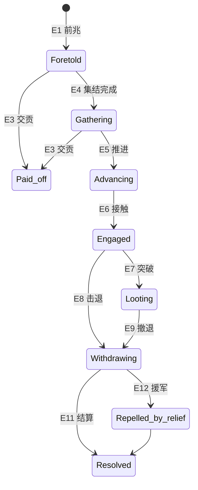

# PRD-004 · 威胁、袭击与防卫

```
状态：草稿PRD
负责人：设计（人类定稿）
最后更新：2026-10-17
优先级：P0          里程碑：M2（M1 只做「威胁存在 + 逃跑 + 前兆」子集，见 §2.3）
上游依据：docs/design/07-threats-and-narrative.md、docs/design/04-world-and-simulation.md、docs/design/01-vision-and-pillars.md（P3、P5）
关联文档：PRD-002（事件与叙述者）、PRD-001（需求：安全/情绪）、PRD-005（指令：警戒/集结）、PRD-006（诊断）
基底依赖：patrol 插件（Beats/Wards/WatchNode/StrikeNode）、`folkways:fighting` 行为与逃跑逻辑、
         ResidentKind/Locomotion（**非人形必须自带**）、Vocation/PerkPool、Colony.submit、Cadence.Cron、
         Closures/Keepouts（门与禁区）、Node/NodeSpec、RefusalKind、front/api Board/Notice/Layer/Sentence
外部调研：docs/research/07-mc-landscape.md（袭击类 mod 可用性、Guard Villagers、敌人来源空缺）
```

---

## 0. 一句话

> 危险会来，但你总能提前知道、提前准备；就算输了，故事也还没结束。

---

## 1. 概述

基线状态（[r02 §2.8](../research/02-plugin-inventory.md)、[r03 §6.5](../research/03-front-and-interaction.md)）：基底只有**巡逻**（一条路径 + 一个工种）与**被动战斗**（遭遇敌人自动进入 `folkways:fighting`，被攻击或着火自动逃跑，傀儡不主动索敌）。**没有**攻击指令、守卫点、编队、警戒等级，也没有任何「敌人为什么会来」的因果。

本系统把危险变成**可预期、可准备、可承受、可讲述**的四段体验：

| 段 | 内容 |
| --- | --- |
| **可预期** | 威胁始终有前兆（侦察兵、足迹、远方狼烟），并说明**为什么来**（你富了 / 你占了它的地 / 你拒了它的贡） |
| **可准备** | 围墙、门、哨塔、巡逻路线、民兵编制、避难所；玩家能通过 [PRD-005](PRD-005-intent-and-micro-control.md) 的「警戒/集结/疏散」策略把准备变成行动 |
| **可承受** | 战斗有明确上限（实体数、性能预算）、有撤退与投降的可能、不会「一夜灭村」 |
| **可讲述** | 谁受伤、谁死、谁救了谁、哪面墙被撞开 —— 全部写进 [编年史](PRD-002-incidents-and-narrator.md) 与 [记忆](PRD-001-needs-mood-memory.md) |

**它产生的新的决策**：
- 围墙开口做贸易门（方便）还是全封（安全）？
- 把最强壮的人编入民兵（战时能打、平时少一个劳力）还是全员生产（打起来靠逃）？
- 提前向掠夺者交贡（损失物资）还是加固（损失工时 + 风险）？
- 被掳走的居民要不要冒险去救（可能再损失人手）？

**它在多大程度上是玩家的选择**：**准备方式完全由玩家决定**；袭击的**到来与强度**由叙述者与你的财富/声望/邻邦关系决定（你无法取消它，只能改变它的规模与后果）。

---

## 2. 设计目标与非目标

### 2.1 目标

| 编号 | 目标 | 可判定信号 |
| --- | --- | --- |
| G1 | 危险可预期 | 每次袭击都有前兆，且前兆到袭击 ≥1 游戏日 |
| G2 | 准备有意义 | 至少 3 种准备手段能显著改变结果（围墙/民兵/避难） |
| G3 | 失败不等于结束 | 失败后殖民地仍可继续（人口下限保护、可重建、可救人） |
| G4 | 战斗有故事 | 伤亡者有具名讣告与关系人记忆（PRD-001/002 接口） |
| G5 | 性能可控 | 30 个敌人场景下 TPS ≥20（[性能预算](../pack/03-performance-budget.md) 峰值 ≤15%） |
| G6 | 不引入第二套居民 | 外邦/敌人实体与 Folkways 居民严格隔离（r07 的 Millénaire/MCA 教训） |

### 2.2 非目标

| 编号 | 不做 | 理由 |
| --- | --- | --- |
| N1 | 编队/阵型/技能释放/战术暂停 | A-max 内容（OQ-F1）；默认不做 |
| N2 | 逐居民逐攻击目标的微观指挥 | 反支柱（居民是自主的人） |
| N3 | PVP / 竞技 | 章程明确非目标 |
| N4 | 大规模战场（50+ 实体同屏） | 超出性能与设计范围 |
| N5 | 自研敌人模型与动画（首期） | 先用现成生物/整合包 mod（见 §14） |
| N6 | 攻城器械/载具战斗 | M3 之后评估 |
| N7 | 奴隶市场/买卖人口经济 | **不做**（2026-10-18 修订：**关押、劳役、赎金与处置要做**，见 [PRD-015](PRD-015-captivity-and-prisoners.md)；但**不做**把人口当商品的市场与买卖链路） |

### 2.3 M1 最小子集

M1 只做：**逃跑行为的可靠性 + 威胁前兆（侦察/狼烟）+ 人口下限保护 + 讣告/记忆联动**。
不做：民兵编制、实体战斗实现、围墙/门的防卫逻辑、俘虏与营救。
理由：M1 的目标是「危险存在且不毁档」，而不是「打起来好看」。

### 2.4 战斗实现的三条路线（OQ-TH-1）

| 选项 | 做法 | 优点 | 缺点 |
| --- | --- | --- | --- |
| **A. 逐实体战斗** | 每个敌人是真实实体，逐次攻击/伤害/死亡 | 表现最好、最「像环世界」 | 寻路与 AI 成本最高（出行预算 8 ms/tick 全局共享，r01 §4.6）；非人形需自带 `Locomotion`（r01 §4.7） |
| **B. 抽象结算** | 袭击是一组抽象的「强度值」，按阶段结算伤亡与损失，世界内只做少量表现 | 成本最低、可控、可测试 | 表现弱，玩家难以「看到」自己准备的作用 |
| **C. 混合（推荐）** | **先发布 B**（抽象结算 + 少量实体代表），**再按威胁类型逐步升级为 A**（小型劫掠者→实体；大军→抽象） | 先能玩、可测、再逐步加表现 | 两套逻辑需共享同一份「强度 ↔ 结果」模型 |

**R-TH-0（决策）**：本 PRD 按 **C** 编写：**M2 交付 B 的完整形态**，同时把「强度 → 伤亡/破坏/击退」的唯一模型抽出来，供后续 A 复用。若人类改选 A，§9 的实体部分需要重写。
> 该决策同时影响 [OQ-TH-1](../design/07-threats-and-narrative.md) 与 [OQ-PB-3](../pack/03-performance-budget.md)。

---

## 3. 术语

| 术语 | 中文 | 说明 | 全局表 |
| --- | --- | --- | --- |
| `threat` | 威胁 | 对殖民地安全/存续的压迫来源（全局术语） | 已登记 |
| `raid` | 袭击 | 敌对势力的一次进攻（全局术语） | 已登记 |
| `militia` | 民兵 | 平日工作、战时应召的居民（全局术语） | 已登记 |
| `threat_level` | 威胁等级 | 0–5 的当前压力档（由财富/声望/邻邦关系/时代决定） | 新增 |
| `defence_score` | 防御值 | 围墙/门/哨塔/民兵/地形的合计防御能力 | 新增 |
| `raid_strength` | 袭击强度 | 本次袭击的抽象强度（用于 B 的结算） | 新增 |
| `phase` | 阶段 | 袭击的阶段（集结/推进/劫掠/撤退） | 新增 |
| `watchpost` | 哨塔 | 提供预警范围与防御值的建筑（复用图案机制） | 新增 |
| `shelter` | 避难所 | 疏散时居民前往的安全区（复用 PRD-005 的集结） | 新增 |
| `casualty` | 伤亡 | 受伤/死亡/被掳的居民记录 | 新增 |
| `ransom` | 赎金/交贡 | 用物资换取撤军 | 新增 |
| `captive` | 被掳者 | 被带走的居民（可营救） | 新增 |

### 3.1 冲突检查

| 冲突项 | 基底含义 | 本系统含义 | 解决 |
| --- | --- | --- | --- |
| `folkways:fighting` | 基底遭遇敌人时的行为 | 本系统**复用**它，不新造战斗行为（除非需要民兵的进攻行为） | 复用 + 扩展 |
| `patrol` | 巡逻路线 + 工种 | 本系统把巡逻作为**预警与防御**的一部分，不重新实现 | 复用 |
| `Balk`（拒绝标记） | 居民对某事的持久抗拒 | 恐惧导致的拒绝用**需求/情绪**表达（PRD-001），不污染 `Balk` | 不复用 |
| `Vocation` | 工种 | 民兵**是**一个工种（战时应召），不是新职业体系 | 新增 `militia` 工种 |
| 「俘虏」 | — | 三类主体分开：`captive`（我方**被掳者**，可营救）/ `detainee`（我方**关押**的敌方个体，[PRD-015](PRD-015-captivity-and-prisoners.md)）/ `hostage`（被势力扣下的**人质**，[PRD-010](PRD-010-diplomacy-and-trade.md)）。本 PRD 只管 `captive` 的产生与营救 | 见 N7 |

---

## 4. 概念模型

| 实体 | 中文 | 说明 | 玩家可见 |
| --- | --- | --- | --- |
| `ThreatState` | 威胁状态 | 威胁等级、来源势力、最近袭击、冷却 | 防御页顶部 |
| `RaidInstance` | 袭击实例 | 一次袭击的完整状态（阶段、强度、目标、伤亡） | 世界内 + 面板 |
| `DefenceProfile` | 防御档案 | 围墙覆盖率、门、哨塔、民兵、避难所 | 防御页（数值 + 覆盖层） |
| `MilitiaRoster` | 民兵名册 | 谁在民兵、装备、训练度 | 防御页 |
| `Watchpost` | 哨塔 | 预警范围与视野 | 世界内 + 覆盖层 |
| `CasualtyRecord` | 伤亡记录 | 受伤/死亡/被掳 + 原因 + 见证者 | 讣告/编年史 |
| `FactionStance` | 势力态度 | 与敌对/中立/友好势力的关系值（**权威存储与唯一写入入口在 [PRD-010](PRD-010-diplomacy-and-trade.md) 的 `Factions.adjust`**；本 PRD 只读投影） | 防御页 |

### 4.1 关系


---

## 5. 状态机

### 5.1 袭击实例状态

| 状态 | 中文 | 说明 |
| --- | --- | --- |
| `Foretold` | 已预告 | 前兆出现，倒计时中 |
| `Gathering` | 集结 | 敌方在集结点聚集（可被提前打击/被交贡阻止） |
| `Advancing` | 推进 | 向殖民地移动 |
| `Engaged` | 交战 | 与我方接触（B：抽象结算窗口；A：实体战斗） |
| `Looting` | 劫掠 | 突破后在内部掠夺/破坏 |
| `Withdrawing` | 撤退 | 带着战利品/俘虏离开 |
| `Repelled` | 已被击退 | 我方胜利 |
| `Paid off` | 已交贡 | 用物资换取撤军 |
| `Repelled by relief` | 被援军击退 | 邻邦/雇佣兵援助（PRD-010） |
| `Resolved` | 已结算 | 全部后果应用完毕 |

### 5.2 事件

| 事件 | 说明 | 触发方 |
| --- | --- | --- |
| E1 | 前兆出现 | 叙述者（PRD-002） |
| E2 | 玩家准备（加固/编民兵/疏散） | 玩家 |
| E3 | 交贡 | 玩家 |
| E4 | 集结完成 | 敌人 |
| E5 | 推进开始 | 敌人 |
| E6 | 接触（进入交战） | 双方 |
| E7 | 突破（防线失效） | 敌人 |
| E8 | 击退 | 我方 |
| E9 | 撤退 | 敌人 |
| E10 | 俘虏居民 | 敌人 |
| E11 | 结算完成 | 系统 |
| E12 | 援军到达 | 外部（PRD-010） |

### 5.3 变量

| 变量 | 类型 | 默认 | 范围 | 说明 |
| --- | --- | --- | --- | --- |
| `threat_level` | 整数 0–5 | 1 | 0–5 | 由财富/声望/关系/时代合成 |
| `raid_strength` | 定点 | — | 0–∞ | 抽象强度 |
| `defence_score` | 定点 | — | 0–∞ | 合计防御 |
| `phase_timer` | 游戏刻 | — | — | 每阶段时长 |
| `max_enemies` | 整数 | 30 | 0–64 | 实体上限（A 路线） |
| `casualty_cap` | 百分比 | 40% | 10–90% | 单次袭击的死亡上限（人口比例） |
| `warning_days` | 小数 | 1.5 | 0.5–5 | 前兆到袭击 |
| `ransom_cost` | 定点 | — | — | 交贡代价（随强度） |
| `captives[]` | 列表 | 空 | — | 被掳者与位置 |
| `relief_available` | 布尔 | 依关系 | — | 是否有援军 |

### 5.4 状态转移表

| 源 | 事件 | 守卫 | 动作 | 目标 |
| --- | --- | --- | --- | --- |
| — | E1 前兆 | 叙述者选中 且 未超冷却 且 人口 ≥ 下限 | 生成前兆、通知、倒计时 | `Foretold` |
| `Foretold` | E2 准备 | 玩家行动 | 更新 `defence_score` | 保持 |
| `Foretold` | E3 交贡 | 物资足够 且 敌方接受（依关系） | 扣物资、结束 | `Paid off` |
| `Foretold` | E4 集结完成 | 倒计时到 | 敌方就位（A：生成实体） | `Gathering` |
| `Gathering` | E5 推进 | — | 向目标移动 | `Advancing` |
| `Gathering` | E3 交贡 | 同上 | — | `Paid off` |
| `Advancing` | E6 接触 | 与我方或防线接触 | 进入结算/战斗 | `Engaged` |
| `Engaged` | E8 击退 | `defence_score` ≥ `raid_strength` 持续 ≥1 阶段 | 敌方撤退 | `Withdrawing` |
| `Engaged` | E7 突破 | `defence_score` < `raid_strength` | 突破防线 | `Looting` |
| `Looting` | E9 撤退 | 劫掠够了 / 我方反攻 / 超时 | 带战利品离开 | `Withdrawing` |
| `Looting` | E10 俘虏 | 满足俘虏条件（有居民在危险区） | 记录被掳者 | 保持 |
| `Withdrawing` | E12 援军 | 援军到达 | 敌方加速撤退/被截击 | `Repelled by relief` |
| `Withdrawing` | E11 结算 | 敌方离图 | 应用全部后果 | `Resolved` |
| `Engaged` | E11 | 已击退 | 应用后果 | `Repelled` → `Resolved` |

### 5.5 状态图



### 5.6 超时与中断

| 情形 | 处理 |
| --- | --- |
| 玩家离线（单人） | 袭击仍然发生（世界不该因离线而暂停）；默认自动按「疏散 + 民兵应战」结算 |
| 全部玩家离线（多人） | 可配置：顺延（默认，至多 1 游戏日）或照常发生 |
| 敌方目标消失（建筑被拆/居民全撤） | 提前进入 `Withdrawing` |
| 服务器重启 | 从存档恢复阶段与倒计时 |
| 殖民地被放弃 | 袭击目标转为掠夺物资后撤 |
| 我方全灭（极端） | 触发「余烬」流程：幸存者/外部救援，不允许游戏无法继续（G3） |
| 性能超限（A 路线实体过多） | 降级为抽象结算（§6.5 降级表），并告知玩家 |

---

## 6. 交互

### 6.1 入口与快捷键

| 操作 | 按键/手势 | 前置条件 | 结果 |
| --- | --- | --- | --- |
| 打开「防御」页 | 面板页签 | 手持殖民书 | 威胁等级、防御档案、民兵名册、前兆、最近袭击 |
| 查看前兆 | 世界内标记 / 通知 | — | 「谁、从哪来、还有多久」 |
| 编民兵 | 防御页 / 居民页 | 权限：成员 | 指定民兵与装备 |
| 画巡逻路线 | 基底已有的巡逻用途 | 同上 | 预警与拦截 |
| 放置哨塔 | 建造（图案/蓝图） | 同上 | 预警范围 + 防御值 |
| 设避难所 | 防御页 / PRD-005 的集结 | 同上 | 疏散目标 |
| 交贡 | 前兆期的通知动作 | 物资足够 | 换取撤军 |
| 营救被掳者 | 防御页的「营救」 | 有被掳者 | 派遣队伍（占用人力与时间） |

**R-UI-1**：民兵编制必须能批量操作（全选/按条件选），否则 60 人时点不完。

### 6.2 操作模式状态机

| 状态 | 说明 |
| --- | --- |
| `Normal` | 无 |
| `Posting` | 选「设哨位」后指向位置，右键放置哨位/哨塔标记 |

### 6.3 面板动作（`Board.Act` 五类内）

| 上下文 | 按钮 | 操作 | 可撤销 |
| --- | --- | --- | --- |
| 防御页 / 民兵行 | 「入编/退编」 | 切换民兵 | 是 |
| 防御页 / 前兆行 | 「交贡」 | 支付并结束袭击 | 否（需确认） |
| 防御页 / 前兆行 | 「疏散」 | 生效 PRD-005 的疏散策略 | 是 |
| 防御页 / 被掳行 | 「营救」 | 派出营救队 | 否 |
| 防御页 / 覆盖层 | 「防御覆盖」 | 世界内显示防御值/预警范围 | 是 |

### 6.4 命令

| 命令 | 权限 | 说明 |
| --- | --- | --- |
| `/<ns> raid status` | gamemaster | 当前袭击状态与阶段 |
| `/<ns> raid start <强度>` | gamemaster | 立即触发测试袭击 |
| `/<ns> raid end` | gamemaster | 强制结束 |
| `/<ns> threat level <0-5>` | gamemaster | 设置威胁等级 |
| `/<ns> defence report` | gamemaster | 打印防御值构成（用于调参） |

### 6.5 降级与限流

| 情形 | 降级 | 玩家感知 |
| --- | --- | --- |
| 敌人实体数 > `max_enemies` | 超出部分改为抽象强度（B） | 通知「敌军规模过大，已简化为战略结算」 |
| 寻路预算持续超限 | 敌人决策频率降低（LOD） | 表现为移动略慢，不通知 |
| TPS < 15 持续 10 秒 | 进入抽象结算 | 通知（对应 [性能预算](../pack/03-performance-budget.md) R-PB-5 的「必须告知」） |

**R-TH-3**：任何影响玩法保真度的降级**必须告知**（[R-PB-6](../pack/03-performance-budget.md)）。

---

## 7. 反馈

### 7.1 操作模式反馈

| 检查条件 | 音效 | 文案 | 视觉 | 系统行为 |
| --- | --- | --- | --- | --- |
| 进入 `Posting` | 轻微 | 「选择哨位」 | 有效位置高亮 | 等待 |
| 放置成功 | 确认 | 「已设哨位」 | 标记 | 生效 |
| 位置无效 | 低沉 | 原因 | 红色 | 拒绝 |

### 7.2 实体/区域状态反馈

| 检查条件 | 图标/颜色 | 悬停信息 | 系统行为 |
| --- | --- | --- | --- |
| 前兆存在 | 世界标记（足迹/狼烟/侦察兵） | 「掠夺者正在接近（约 %s 天后）」 | 倒计时 |
| 敌方推进中 | 世界内标记 + 距离提示 | 「%s 从 %s 方向接近」 | 移动 |
| 交战 | 居民头顶战斗图标 | 「交战中」 | 战斗 |
| 居民恐惧 | 头顶图标（PRD-001） | 「恐惧」 | 逃跑/拒战 |
| 民兵应召 | 头顶标识 | 「民兵」 | 前往 |
| 哨塔预警 | 范围圈（覆盖层，默认关） | 「预警范围 %s 格」 | — |

**R-F-1**：敌方提示必须给**方向与时间**，否则玩家无法准备（G1）。

### 7.3 系统事件反馈

| 事件 | 音效 | 通知文案 | 视觉 | 系统行为 |
| --- | --- | --- | --- | --- |
| 前兆出现 | 警报（低沉） | 「%s 正在接近：预计 %s 天后抵达」 | 世界标记 + 防御页角标 | 开始倒计时 |
| 袭击开始 | 警报（强） | 「袭击开始：%s」 | 世界内 | 阶段推进 |
| 防线被突破 | 警报（强） | 「防线被突破：%s」 | 破坏痕迹 | 劫掠 |
| 击退 | 正向 | 「袭击已被击退（伤亡 %s）」 | — | 结算 |
| 交贡成功 | 中性 | 「已交贡 %s，他们撤走了」 | — | 结束 |
| 有居民被掳 | 警报 | 「%s 被掳走了」 | 标记 | 营救窗口 |
| 有居民死亡 | 钟声 | 「%s 死于%s」 | 墓碑 | 讣告 + 记忆 |
| 援军到达 | 正向 | 「%s 的援军到达」 | 世界内 | 联合作战 |

**R-F-2**：袭击结束的总结必须列出**伤亡名单与损失清单**（玩家需要知道代价），并写入编年史。

### 7.4 可诊断性

| 玩家可能的疑问 | 系统必须能回答 | 呈现位置 |
| --- | --- | --- |
| 为什么打不过？ | 防御值构成 vs 袭击强度（逐项对比） | 防御页「本次对比」 |
| 为什么他们绕过了围墙？ | 缺口/门/未封闭路径的可视化 | 覆盖层 + 诊断 |
| 为什么民兵不去战斗？ | 恐惧/无装备/被更高优先占用（复用 PRD-006 阻塞） | 诊断卡 |
| 为什么他死了？ | 死因链（伤 → 失血 → 无人救治） | 讣告 |
| 为什么这次袭击这么强？ | 威胁等级构成（财富/声望/关系/时代） | 防御页「为什么」 |
| 为什么我不能交贡？ | 物资不足 / 对方不接受（关系太低） | 按钮悬停 |

---

## 8. 规则

| 编号 | 规则 | 说明 |
| --- | --- | --- |
| R1 | 前兆必在袭击前 ≥1 游戏日出现 | 与 PRD-002 R1 一致 |
| R2 | 人口 < `lethal_min_population`（默认 8）时不发生致命袭击 | 防灭村（G3） |
| R3 | 单次袭击死亡人数 ≤ 人口 × `casualty_cap`（默认 40%） | 上限保护 |
| R4 | 必须存在至少一条**非战斗解法**（交贡/迁徙/加固/援军） | [R-TH-11](../design/07-threats-and-narrative.md) |
| R5 | 敌方行为必须**可理解**（财富/关系/饥荒导致），不允许纯随机 | R-TH-12 |
| R6 | 敌人实体必须**自带 `Locomotion`**（非人形不得沿用类人判断） | r01 §4.7 |
| R7 | 敌我实体总数受 `max_enemies` 约束，超限转抽象 | 性能门禁 |
| R8 | 居民**不被迫参战**：恐惧/性格可导致拒绝，但要给出原因 | 反支柱 |
| R9 | 战斗不得绕过**需求与死亡链**（死亡必须有可追溯的伤/病/饿） | PRD-001 R7 |
| R10 | 被掳者必须**可营救**（有窗口与代价），不得静默消失 | P5 |
| R11 | 战斗中的居民**仍满足基本生存**（会吃、会躲） | 与 PRD-001 R-FLOW-5 一致 |
| R12 | 外邦/敌人实体**不得**进入我们的居民名册 | G6（r07 教训） |
| R13 | 从 A/B/C 模型中，**强度→结果**必须只有一份实现 | R-TH-0 |
| R14 | 一切降级必须告知玩家 | R-PB-6 |
| R15 | 袭击的**受害者与见证者**必须写入记忆与编年史 | G4 |

---

## 9. 流程

### 9.1 威胁等级（威胁从哪来）

```
threat_level = clamp(
    wealth_term + renown_term + relation_term + age_term + era_pressure
  , 0, 5)

wealth_term    // 库存/建筑价值越高，越被惦记（这是「富起来就要挨打」的可解释化）
renown_term    // 声望越高，越强的势力会注意到你
relation_term  // 与某势力关系越差，越可能被针对
age_term       // 时代越高，威胁种类越多（PRD-011 的 burden）
era_pressure   // 叙述者强度修正（PRD-002 narrator_factor）
```

**R-FLOW-1**：`threat_level` 的**每一项都必须能在 UI 中单独查看**（「为什么这次这么强」），这是 G1 与可诊断性的核心。

### 9.2 防御值（准备有什么用）

```
defence_score =
    wall_coverage      // 围墙包围率（按关键方向采样，不逐方块）
  + gate_control       // 门是否可控（能关/能封）
  + watchposts         // 哨塔数量 × 覆盖范围（提供预警与拦截）
  + militia_score      // Σ(民兵 × 装备 × 训练度 × 情绪状态)
  + terrain_bonus      // 地形（山脊/水面/狭窄入口）
  + patrol_coverage    // 巡逻路线对接近路径的覆盖
  - fear_penalty       // 全城恐惧程度（PRD-001 安全需求）
```

**R-FLOW-2**：`wall_coverage` 必须**采样**（关键方向 + 最近接近路径），不得逐方块扫描。
**R-FLOW-3**：`militia_score` 必须包含**情绪项**：情绪崩溃的民兵战力显著下降（把 PRD-001 与战斗连起来）。

### 9.3 袭击结算（B 路线的抽象模型，A 复用同一模型）

```
每阶段（默认 1 阶段 = 0.25 游戏日）：
  raid_strength' = raid_strength × (1 - attrition)        // 敌方损耗
  defence_score' = defence_score × (1 - damage)           // 我方损耗
  if defence_score' ≥ raid_strength':  向「击退」推进
  else:                                向「突破」推进

突破后的劫掠：
  损失 = min(可达物资 × loot_ratio, 强度剩余 × loot_factor)
  破坏 = 按目标优先级（仓房 > 工坊 > 住所）
  俘虏 = 若危险区内有居民且强度足够 → 记录 captive
```

| 计算项 | 公式 | 说明 |
| --- | --- | --- |
| 强度 | `raid_strength = base(威胁等级) × wealth_factor × narrator_intensity` | 最多 3 个乘数，便于解释 |
| 交贡 | `ransom_cost = raid_strength × 单位价值 × relation_discount` | 关系越好越便宜 |
| 冷却 | `cooldown_days = max(3, 强度 × 0.5)` | 与 PRD-002 峰值冷却一致 |
| 营救窗口 | `rescue_window_days = 2` | 超时则被掳者永久离开（写讣告） |

### 9.4 民兵（与基底工种体系对接）

| 项 | 内容 |
| --- | --- |
| 工种 | 新增 `militia`（战时应召） |
| 平日 | 民兵可以有自己的日常工种（民兵是一种**附加授权**，不是全职） |
| 装备 | 走基底 `Kit`/工具门槛（剑/弓/盾） |
| 训练 | 用基底 `Perk`/`Keenness` 表达（训练度影响战力与反应） |
| 应召 | 由 PRD-005 的「警戒/集结」触发，或用基底 `Urge` 在袭击时提升权重 |
| 拒绝 | 恐惧（情绪）或缺乏装备 → 走 `RefusalKind` + 诊断（PRD-006） |

**R-FLOW-4**：民兵**不得**变成新职业体系；它必须是「附加授权 + 战时权重提升」，否则会与基底 `Vocation` 冲突。

### 9.5 数值配置

| 参数 | 默认 | 范围 | 谁需要它（R-F8） |
| --- | --- | --- | --- |
| `threat_base_by_level` | 表 | — | 难度设计 |
| `warning_days` | 1.5 | 0.5–5 | 想更从容/更紧张的玩家 |
| `max_enemies` | 30 | 0–64 | 低配机与服务器管理员 |
| `casualty_cap` | 40% | 10–90% | 硬核玩家想调到 90% |
| `ransom_enabled` | true | — | 纯净玩法 |
| `captives_enabled` | true | — | 讨厌俘虏机制的玩家 |
| `raid_forced_abstract` | false | — | 低配/服务器 |
| `militia_perk_effect` | 表 | — | 平衡 |
| `relief_enabled` | true | — | 外交系统（PRD-010）开关 |

---

## 10. 数据与存档

| 项 | 内容 |
| --- | --- |
| 新增持久化字段 | `ThreatState`、进行中的袭击（阶段/强度/倒计时）、民兵名册、哨位/哨塔登记、被掳者清单、最近袭击历史 |
| 存储位置 | `Colony.keep(owner, CompoundTag)`；被掳者含坐标 → 注意 `Keeps` 迁移（r01 §5.7） |
| 存档版本影响 | 需要（自管版本号） |
| 迁移 | 缺失字段取默认；进行中的袭击加载后**重置到最近的安全阶段**（避免半途状态不一致导致崩） |
| 旧存档 | 无数据 → 威胁等级按默认计算 |
| 回滚 | 可加载；袭击状态丢弃（敌方实体按普通生物处理） |
| 实体清理 | 卸载插件后遗留在世界中的敌方实体必须能被正常处理（不崩、不永久残留） |

**R-DATA-1**：**战斗中不存档**是常见做法，但我们必须支持「存档时正在战斗」→ 加载后要么恢复到 `Gathering`，要么直接结束袭击并给结果，**不允许**半状态。
**R-DATA-2**：敌方实体的持久化必须显式处理（不要让它们变成"流浪的孤儿实体"）。

---

## 11. 网络与多人

| 项 | 内容 |
| --- | --- |
| 权威端 | 服务端 |
| 同步 | 前兆与阶段（广播）；敌方实体（原版实体同步）；伤亡与结算（广播）；民兵名册（按需） |
| 权限 | 编民兵/交贡/疏散/营救：需权限（默认成员，可收紧）；查看：所有成员 |
| 并发 | 交贡/疏散等决策**先到先得**并广播决策者；多人同时点「营救」合并为一次 |
| 断线 | 袭击继续；重连后可见状态 |
| 单人离线 | 默认照常发生（可配置顺延） |
| 分头行动 | 袭击只针对**殖民地**，不针对玩家个人位置（避免多人分裂时的歧义） |

**R-MP-1**：多人下不得因等待某人决策而阻塞袭击推进（阶段计时继续）。
**R-MP-2**：战斗结果对所有玩家一致（同一结算源）。

---

## 12. i18n（双语：`zh_cn` + `en_us`）

| 键族 | 例（zh_cn） |
| --- | --- |
| `<ns>.page.defence` | 防御 |
| `<ns>.threat.level` | 威胁等级 |
| `<ns>.threat.reason.wealth` / `.renown` / `.relation` / `.age` | 你们太富了 / 名声在外 / 关系恶化 / 时代压力 |
| `<ns>.raid.phase.gathering` / `.advancing` / `.engaged` / `.looting` / `.withdrawing` | 集结 / 推进 / 交战 / 劫掠 / 撤退 |
| `<ns>.raid.herald` | %s 正在接近：预计 %s 天后抵达 |
| `<ns>.raid.result.repelled` / `.looted` / `.paid_off` / `.relief` | 已击退 / 遭到劫掠 / 已交贡 / 援军解围 |
| `<ns>.raid.summary` | 伤亡 %s，损失 %s |
| `<ns>.defence.term.wall` / `.gate` / `.watch` / `.militia` / `.terrain` / `.patrol` / `.fear` | 围墙 / 门 / 哨塔 / 民兵 / 地形 / 巡逻 / 恐惧 |
| `<ns>.action.enlist` / `.pay_off` / `.evacuate` / `.rescue` / `.post` | 入编 / 交贡 / 疏散 / 营救 / 设哨位 |
| `<ns>.captive.taken` | %s 被掳走了 |
| `<ns>.captive.rescued` / `.lost` | %s 被救回 / %s 再也没回来 |
| `<ns>.death.cause.raid` | 死于袭击 |

**R-I18N-1**：死因、被掳、营救这三类文案必须带**人名与地点**参数（用于编年史与讣告）。

---

## 13. 性能预算

| 项 | 估算 | 依据 | 上限 |
| --- | --- | --- | --- |
| 常态每 tick | ≈0（无袭击时只有日结算） | — | <0.1% |
| 峰值（30 敌人 × 实体 AI + 寻路） | 主要花在寻路（共享 8 ms/tick 预算） | r01 §4.6 | ≤15%（[性能预算](../pack/03-performance-budget.md) 峰值项） |
| 抽象结算（B） | 每阶段一次，O(阶段数) | — | <1% |
| 防御值计算 | 采样（关键方向 + 最近路径） | 不逐方块 | 单次 ≤20 ms |
| 实体内存 | 复用原版实体成本 × ≤30 | — | — |
| 网络 | 阶段广播 + 实体同步 | — | — |

**R-PERF-1**：`max_enemies` 是硬阀；超出即转抽象（R7）。
**R-PERF-2**：敌方的寻路必须**复用**基底的预算机制，不得自建并行寻路（避免双倍占用）。
**R-PERF-3**：必须提交探针（阶段耗时、实体数、寻路预算占用、抽象/实体降级次数）。

---

## 14. 与基底/生态的关系

| 需求 | 用到的扩展点 / 外部 mod | 状态 | 备注 |
| --- | --- | --- | --- |
| 巡逻与预警 | 基底 `patrol`（`Beats`/`Wards`/`WatchNode`/`StrikeNode`） | 已有 | 直接复用 |
| 遭遇战行为 | 基底 `folkways:fighting` 与逃跑 | 已有 | 复用于非民兵 |
| 民兵工种 | `Declaring.vocation` + `PerkPool` | 已有 | 新工种 |
| 非人形敌人 | 必须自带 `Locomotion` | 约束 | r01 §4.7；否则被当人形 |
| 门/禁区 | `Closures` / `Keepouts` | 已有 | 关门与禁区 |
| 面板 | `RegisteringUi.page` + `Board`/`Sentence` | 已有 | 防御页 |
| 覆盖层 | `Layer` | 已有 | 防御覆盖 |
| 敌人来源（可选整合） | `raided` / `the-hordes` / `more-raids` | ⚠️ 未核实（[k01 §4.6](../pack/01-modlist.md)） | 需验证是否攻击 Folkways 居民实体 |
| 外邦守卫（不可代替民兵） | `guard-villagers` | ⚠️ 未核实 | 只做外邦 |
| 大型威胁生物空缺 | `ice-and-fire` 无 1.21.1 → 用 `mowzies-mobs`/`borninchaos` 或自研 | 见 [k01 §3](../pack/01-modlist.md) | — |

**R-TH-API-1（fork 后更新）**：若基底不公开 `folkways:fighting` 的可配置面（民兵需要「主动应战」而非「遇敌自动」），**直接在 fork 内改造该行为**（[fork 策略](../design/12-fork-strategy.md) L3 改动，需评审 + 登记 + `// PLA:` 标记）。
**R-TH-API-2**：整合袭击类 mod 时，敌方必须被我们的威胁系统**接管或忽略**，不允许「两套袭击同时发生」导致不可理解的局面。

---

## 15. 可改写性

| 内容 | 数据包 | 配置 |
| --- | --- | --- |
| 袭击模板（阶段/强度/目标优先级） | 是（货架 `threat_profile`） | 默认值 |
| 敌人阵容（用哪些生物） | 是 | — |
| 防御建筑（哨塔/围墙图案） | 是（基底 `pattern`/`blueprint`） | — |
| 数值（强度/上限/窗口） | 部分 | 是 |
| 文案 | 是（语言目录） | — |

**R-MOD-1**：袭击模板必须能被 PRD-002 的叙述者引用（事件触发袭击），两套货架共享 id 空间规则。

---

## 16. 验收检查

### 16.1 交互
- [ ] AC-1 「防御」页显示威胁等级、防御值构成、民兵名册、当前前兆与最近袭击
- [ ] AC-2 能批量编入/退出民兵
- [ ] AC-3 能设置避难所并触发疏散（联动 PRD-005）
- [ ] AC-4 能交贡并立即结束（在允许的阶段）
- [ ] AC-5 能查看并派出营救队（有被掳者时）
- [ ] AC-6 能切换防御覆盖层（默认关）

### 16.2 反馈与诊断
- [ ] AC-7 前兆提示含**方向 + 预计天数 + 原因**（谁、为什么来）
- [ ] AC-8 袭击总结列出伤亡名单与损失清单
- [ ] AC-9 「为什么打不过」显示防御值 vs 强度的逐项对比
- [ ] AC-10 「为什么民兵没去」走 PRD-006 统一诊断
- [ ] AC-11 死亡者有可追溯的死因链
- [ ] AC-12 任何降级（实体→抽象）都告知玩家

### 16.3 规则
- [ ] AC-13 前兆早于袭击 ≥1 游戏日
- [ ] AC-14 人口 <8 时不发生致命袭击
- [ ] AC-15 单次袭击死亡 ≤ 人口 × 40%（测试用例：60 人最多 24 死）
- [ ] AC-16 存在至少一条非战斗解法（交贡或援军）可用
- [ ] AC-17 `threat_level` 每一项可在 UI 单独查看
- [ ] AC-18 恐惧/无装备的民兵会拒绝并给出原因
- [ ] AC-19 被掳者有营救窗口与代价，超时才永久离开
- [ ] AC-20 战斗中居民仍会进食/躲避（不饿死）
- [ ] AC-21 外邦/敌人实体不会进入居民名册

### 16.4 流程与数值
- [ ] AC-22 `defence_score` 各项可被命令打印
- [ ] AC-23 围墙/门/哨塔/民兵的增加会显著提升 `defence_score`（三种手段各自可验证）
- [ ] AC-24 情绪崩溃的民兵战力下降（PRD-001 联动可测量）
- [ ] AC-25 抽象（B）与实体（A）在同一输入下结果一致（共享模型的验证）

### 16.5 状态、数据与边界
- [ ] AC-26 存档往返后袭击状态一致（或按 R-DATA-1 安全重置）
- [ ] AC-27 敌人实体不会变成孤儿实体
- [ ] AC-28 卸载插件后存档可加载，遗留实体可被正常处理
- [ ] AC-29 全部玩家离线时按配置处理（顺延/照常）
- [ ] AC-30 我方近乎全灭时仍有可继续的路径（余烬流程）

### 16.6 性能与多人
- [ ] AC-31 30 敌人场景 TPS ≥20，玩家侧探针峰值 ≤15%
- [ ] AC-32 敌方寻路复用基底预算，不出现双倍占用（bench `budget=` 行）
- [ ] AC-33 多人并发决策（交贡/疏散）先到先得并广播决策者
- [ ] AC-34 战斗结果对所有玩家一致

### 16.7 可改写性
- [ ] AC-35 不改 Java 能新增一个袭击模板并生效

---

## 17. 测试计划（TDD）

| 测试 | 类型 | 覆盖 AC |
| --- | --- | --- |
| 威胁等级与防御值计算（含各项边界） | 单元 | AC-17、AC-22、AC-23 |
| 强度→结果模型（阶段推进/劫掠/俘虏） | 单元 | AC-15、AC-19、AC-25 |
| 抽象与实体两条路径同结果 | 单元（共享模型） | AC-25 |
| 死亡上限与人口下限 | 单元 | AC-14、AC-15 |
| 袭击状态机全路径 | 单元 | AC-13~AC-21 |
| 存档往返（含战斗中） | gametest | AC-26、AC-27 |
| 民兵应召与拒绝（含恐惧） | gametest | AC-18、AC-24 |
| 战斗中生存（吃/躲） | gametest | AC-20 |
| 被掳与营救 | gametest | AC-19 |
| 防御页与覆盖层渲染 | e2e（Linux） | AC-1、AC-6 |
| 袭击性能（30 实体） | bench（Linux） | AC-31、AC-32 |
| 多人并发决策 | e2e（双客户端） | AC-33、AC-34 |

---

## 18. 待细化 / 开放问题

| 编号 | 问题 | 影响 | 何时定 | 谁定 |
| --- | --- | --- | --- | --- |
| OQ-1 | **OQ-TH-1：A / B / C 哪条？**（本 PRD 按 C 编写） | 全篇实现方式 | **立即** | 人类 |
| OQ-2 | 基底 `folkways:fighting` 是否公开可配置（民兵主动应战）？ | AC-18 | 阶段三前 | 实现 agent |
| OQ-3 | 敌人用哪些现成生物（`mowzies-mobs`/`borninchaos`/袭击 mod）还是自研？ | 内容与依赖 | M2 前 | 人类 |
| OQ-4 | 是否允许玩家「主动出击」攻打敌方营地？（可能超出范围） | 玩法边界 | M3 | 人类 |
| OQ-5 | 被掳者超时后是「死亡」还是「永久离开」？ | 情感体验与 P5 | M2 前 | 人类 |
| OQ-6 | 是否引入「雇佣兵」（花钱买战力）？ | 与经济/外交耦合 | M3 | 人类 |

---

## 19. 变更记录

| 日期 | 状态 | 变更 | 操作者 |
| --- | --- | --- | --- |
| 2026-10-17 | 草稿PRD | 首次起草（按选项 C 编写：先抽象结算、后逐类型升级；已并入 r01 的 Locomotion/出行预算约束与 r07 的袭击 mod 可用性） | 设计 agent |