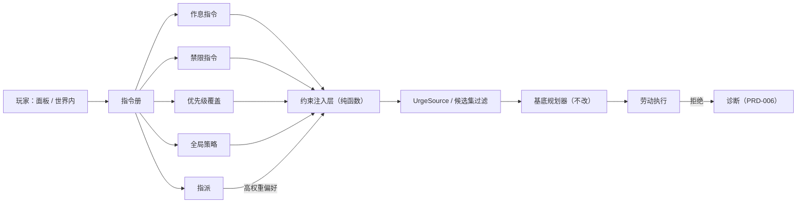
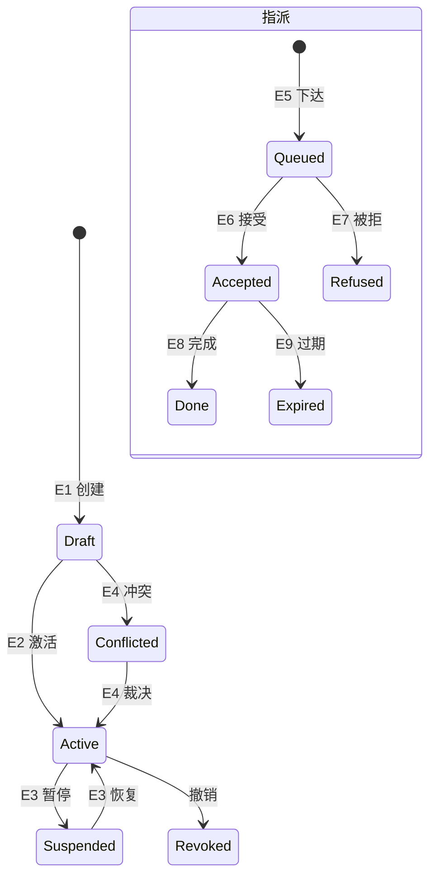
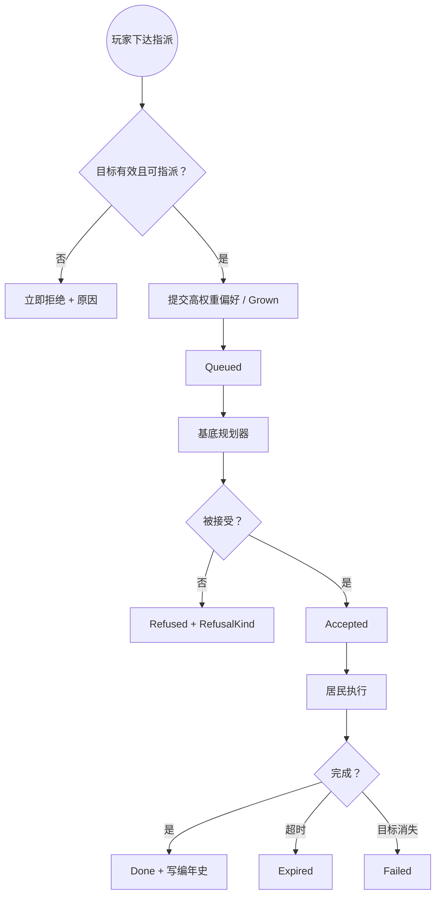

# PRD-005 · 意图与微观控制（调度层）

```
状态：草稿PRD
负责人：设计（人类定稿）
最后更新：2026-10-17
优先级：P0          里程碑：M1（只做「禁限区 + 作息表」子集，见 §2.3）
上游依据：docs/design/11-freedom-design.md（L0–L3、R-F0~R-F8、OQ-F1）、docs/design/09-interaction-and-ui.md
关联文档：PRD-006（仓储规则与因果诊断）、PRD-002（事件）、PRD-004（威胁）
基底依赖：Registering.enrollment（Enrollment/Delegation/Shape.Volume/Schema.Setting）、Registering.facing、
         Declaring.urges(UrgeSource)、Licences/Keenness（工种允许与优先级）、Colony.submit(Grown)、
         Cadence.Cron、Colony.keep、front/api Board/Row/Act、Rows、ItemPicker、Layer、Scenes.folder
硬约束：R-F2 —— 一切控制都是「约束/偏好注入」，**不得替代基底的规划器**
```

---

## 0. 一句话

> 你不再是一个个点着居民干活的工头，而是一个**写下规则、然后看他们按规则自己生活**的领导者。

---

## 1. 概述

基底的哲学是「玩家表达意图，居民自己安排劳动」。现状（[r03 §6](../research/03-front-and-interaction.md)）是玩家能表达的只有四样：区域用途、路径用途、订单、工种允许/禁止 + 优先级 1–4。没有作息、没有禁限区、没有手动指派、没有全局策略。

本系统补上**四层控制的中间两层**（L1 策略层、L2 覆盖层），并且**只写约束**：

| 层 | 内容 | 是否本 PRD |
| --- | --- | --- |
| L0 默认意图层 | 区域用途、订单、图案、蓝图 | 基底已有 |
| **L1 策略层** | **作息表、禁限区、全局策略（备冬/警戒/集结）、库存规则（见 PRD-006）** | ✅ 本 PRD |
| **L2 覆盖层** | **手动指派（一次命令）、个人指定（床/工具/餐食）、优先级细化** | ✅ 本 PRD |
| L3 直接控制 | 逐居民逐动作点选（RTS 式） | ❌ 明确不做（反支柱：居民是自主的人） |

**它产生的新的决策**：
- 让所有人一天干 14 小时以赶上工期，还是留出社交时间以维持情绪？
- 把儿童和老人限制在围墙内（安全），还是让他们自由活动（效率）？
- 把「修那面墙」直接压给某个人（快），还是调优先级等着（不打扰他）？
- 袭击前集结全村（损失一上午工时）还是分散自保？

**它在多大程度上是玩家的选择**：**这就是玩家最能施加意志的地方** —— 但每一次施加都会产生代价（效率、情绪、信任），因为居民**仍然可以拒绝**，而系统必须告诉他们为什么。

---

## 2. 设计目标与非目标

### 2.1 目标

| 编号 | 目标 | 可判定信号 |
| --- | --- | --- |
| G1 | 四种控制（作息/禁限/优先级/指派）都能被玩家表达 | 面板可完成，无需命令 |
| G2 | 任何控制被拒绝时都有原因 | 悬停即可看到（对齐 PRD-006） |
| G3 | 控制不破坏「居民自主」 | 计划仍由基底规划器生成（R-F2 可验证：关闭本插件后世界仍运转） |
| G4 | 控制有代价 | 强度越高，情绪/效率代价越明显（可测量） |
| G5 | 不制造「结构性无解」 | 不出现 `Unassigned.structural()`（r01 §4.3） |
| G6 | 可被剧本与数据包改写 | 剧本可改默认（PRD-007） |

### 2.2 非目标

| 编号 | 不做 | 理由 |
| --- | --- | --- |
| N1 | ~~逐居民逐动作的 RTS 式点选~~ → **改为**：默认不干预（居民自主），仅在玩家**显式接管**某居民时才逐动作指挥，且接管是临时、可见、有代价的（A-max 的 L3，见 §2.4） | 支柱 1 要求「居民是人」；接管是**例外**，不是常态 |
| N2 | 技能释放/主动技能系统 | PRD-004 讨论；默认不做 |
| N3 | 自动化的规则引擎（if-then 脚本） | 复杂度爆炸；用「策略预设 + 编队模板」代替 |
| N4 | 绕过基底自制规划器（常态） | 明确禁止（R-F2）；接管态是**临时挂起**规划器调度，不是替换它 |
| N5 | 条件式/曲线式区域设置的通用引擎 | 先做扩展后的固定类型（时段/对象选择器），不做通用脚本 |

### 2.3 M1 最小子集

M1 只做：**禁限区（Allowed Area）+ 作息表（工作/用餐/休息三个时段，**默认不启用**）+ 对应的面板与反馈**。
理由：这两项是**纯约束注入**，不动优先级与命令通道，风险最低（d11 §3.4 的实施顺序 2）。
L2 覆盖层（手动指派）留到 M2，L3 接管式指挥留到 M3（它需要引擎层的调度挂起机制）。

### 2.4 档位裁决：**已选 A-max**（2026-10-18，ADR-008）

| 层 | A-max 包含的内容 | 实现方式 | 里程碑 |
| --- | --- | --- | --- |
| **L1 策略层** | 作息表、禁限区、全局策略（备冬/警戒/集结/疏散/扩张）、库存规则 | 约束注入（权重/过滤） | M1 |
| **L2 覆盖层** | 手动指派（一次命令）、个人指定（床/工具/餐食）、优先级覆盖（在基底 1–4 之上细化） | 高权重偏好 + `Colony.submit(Grown)` | M2 |
| **L3 接管层** | ① **战斗指挥**：编队、警戒等级、指定防守点/撤退线（与 [PRD-004](PRD-004-threats-and-defence.md) 联动）；② **临时接管**：把某个居民从规划器手里接管，直接命令其执行一个动作，完成后交还 | **临时挂起该居民的调度**（引擎层 L3 改动），不替换规划器 | M3 |

**A-max 的三条边界（不可越）**：
1. **接管必须是显式且有代价**：接管期间该居民不走规划器；结束即交还；被频繁摆布的居民产生情绪代价（「被当工具」），并写进 [PRD-001](PRD-001-needs-mood-memory.md) 的情绪原因。
2. **接管不破坏生存**：被接管的居民仍会满足危急需求（可中断接管）。
3. **默认零接管**：玩家若从不使用 L2/L3，游戏与基底行为一致（G3 可验证）。

**R-ST-0**：本 PRD 按 **A-max** 编写。A-min/A-mid 的子集仍保留为"可裁剪范围"（若出现工期风险，按 L1 → L2 → L3 的顺序削减）。

---

## 3. 术语

| 术语 | 中文 | 说明 | 全局表 |
| --- | --- | --- | --- |
| `directive` | 指令 | 玩家下达的约束或偏好（统称） | 已登记 |
| `schedule` | 作息表 | 一天中各时段的倾向（**默认不启用**：不设作息 = 基底自然行为） | 已登记 |
| `band` | 时段 | 作息表的最小单位（例：休息 22:00–06:00） | 新增 |
| `allowed_area` | 禁限区 | 限制某（些）居民活动范围的区域 | 已登记 |
| `priority_override` | 优先级覆盖 | 对基底工种优先级的细化或单次置顶 | 新增 |
| `assignment` | 指派 | 一次针对具体目标的手动命令 | 新增 |
| `strategy` | 全局策略 | 殖民地级方针（备冬/警戒/集结/疏散） | 新增 |
| `standing_directive` | 长期指令 | 持续生效直到撤销的指令（禁限区/作息/策略） | 新增 |
| `one_shot_directive` | 一次性指令 | 完成后自动失效（指派） | 新增 |

### 3.1 冲突检查

| 冲突项 | 基底含义 | 本系统含义 | 解决 |
| --- | --- | --- | --- |
| `priority` | 居民页的工种优先级 1–4（正负号表允许/禁止） | 本系统的「优先级覆盖」是在其**之上**的细化 | 不修改基底语义；覆盖只在我们的求值层 |
| `Order`（订单） | 保持库存量的长期目标 | 本系统的指令**不是**订单 | 指令不产生物资目标 |
| `Enrollment`/`Delegation` | 玩家画的区域用途 | 禁限区**用同一机制**实现（新 Delegation） | 复用，不新造手势 |
| `Urge` | 居民想做什么 | 作息通过**抑制/提升** urge 生效 | 只调权重，不改规划器 |

---

## 4. 概念模型

| 实体 | 中文 | 说明 | 生命周期 | 玩家可见 |
| --- | --- | --- | --- | --- |
| `DirectiveRegistry` | 指令册 | 该殖民地全部生效指令 | 与存档同生 | 「计划」页 |
| `ScheduleDirective` | 作息指令 | 24 小时 × 若干时段 × 若干居民组 | 长期 | 作息表编辑器 |
| `AllowedAreaDirective` | 禁限指令 | 区域（复用 Delegation）+ 适用居民 + 允许/禁止 | 长期 | 「计划」页 + 世界内显示 |
| `PriorityOverride` | 优先级覆盖 | 居民 × 工种 → 权重修正 | 长期 | 居民页扩展 |
| `Assignment` | 指派 | 目标 + 期望动作 + 发起人 + 状态 | 一次性 | 世界内标记 + 通知 |
| `StrategyState` | 策略状态 | 当前生效的殖民地方针（可同时多个） | 长期 | 「计划」页顶部 |
| `ResidentGroup` | 居民分组 | 指令的作用对象（全城/自定义/按职业/按年龄） | 长期 | 分组编辑器 |

### 4.1 关系



---

## 5. 状态机

### 5.1 长期指令状态

| 状态 | 中文 | 说明 |
| --- | --- | --- |
| `Draft` | 草稿 | 玩家正在编辑（未生效） |
| `Active` | 生效 | 正在影响求值 |
| `Suspended` | 暂停 | 玩家临时停用（保留内容） |
| `Conflicted` | 冲突 | 与其它指令冲突（需玩家裁决） |
| `Revoked` | 已撤销 | 删除 |

### 5.2 指派（一次性）状态

| 状态 | 中文 | 说明 |
| --- | --- | --- |
| `Queued` | 待派 | 已下达，等待规划器接受 |
| `Accepted` | 已接受 | 已生成真实工作 |
| `Refused` | 被拒 | 基底拒绝（附原因） |
| `Done` | 完成 | 工作完成 |
| `Failed` | 失败 | 目标消失/不可达/被更高优先抢占 |
| `Expired` | 过期 | 超过时限自动失效（默认 1 游戏日） |

### 5.3 事件

| 事件 | 说明 | 触发方 |
| --- | --- | --- |
| E1 | 创建指令 | 玩家 |
| E2 | 激活 | 玩家（或剧本自动） |
| E3 | 暂停/恢复 | 玩家 |
| E4 | 冲突检测 | 系统（保存或激活时） |
| E5 | 指派下达 | 玩家 |
| E6 | 指派被接受 | 基底规划器 |
| E7 | 指派被拒 | 基底（附 `RefusalKind`） |
| E8 | 指派完成 | 居民 |
| E9 | 指派过期 | 系统 |
| E10 | 策略切换 | 玩家 / 事件（PRD-002） |
| E11 | 剧本覆盖 | 剧本加载 |

### 5.4 变量

| 变量 | 类型 | 默认 | 范围 | 说明 |
| --- | --- | --- | --- | --- |
| `bands[]` | 列表 | 见 §9.3 | ≤6 段 | 时段定义 |
| `band_kind` | 枚举 | — | Work/Meal/Rest/Social/Free | 时段类型 |
| `area_mode` | 枚举 | — | Allow/Forbid | 禁限模式 |
| `applies_to` | 引用 | 全城 | 分组/职业/个人 | 作用对象 |
| `priority_delta` | 整数 | 0 | -2..+2 | 覆盖强度（在基底 1–4 之上） |
| `assignment_deadline` | 游戏刻 | 1 日 | 0.25–5 日 | 过期 |
| `max_active_directives` | 整数 | 64 | 1–256 | 性能阀 |
| `strategy_set` | 集合 | 空 | ≤4 同时 | 全局策略 |

### 5.5 状态转移表（长期指令）

| 源 | 事件 | 守卫 | 动作 | 目标 |
| --- | --- | --- | --- | --- |
| — | E1 创建 | 参数合法 | 存为草稿 | `Draft` |
| `Draft` | E2 激活 | 无未裁决冲突 且 未超指令上限 | 加入求值 | `Active` |
| `Draft`/`Active` | E4 冲突 | 与其它指令作用域重叠且语义相反 | 标记冲突、双方暂停 | `Conflicted` |
| `Active` | E3 暂停 | 玩家 | 移出求值 | `Suspended` |
| `Suspended` | E3 恢复 | 无冲突 | 加入求值 | `Active` |
| `Conflicted` | E4 裁决 | 玩家选择保留其一 | 保留者 `Active`，另一者 `Suspended` | — |
| 任意 | E1 撤销 | 玩家 | 移除 | `Revoked` |

### 5.6 状态转移表（指派）

| 源 | 事件 | 守卫 | 动作 | 目标 |
| --- | --- | --- | --- | --- |
| — | E5 下达 | 目标有效 且 玩家有权限 | 提交高权重偏好 | `Queued` |
| `Queued` | E6 接受 | 规划器生成工作 | 绑定工作 id | `Accepted` |
| `Queued` | E7 被拒 | 基底拒绝 | 通知原因 | `Refused` |
| `Accepted` | E8 完成 | 工作完成 | 通知、写编年史 | `Done` |
| `Accepted` | E9 过期 | 超时 | 取消偏好、通知 | `Expired` |
| `Queued`/`Accepted` | — | 目标被摧毁 | 通知 | `Failed` |

### 5.7 状态图



### 5.8 超时与中断

| 情形 | 处理 |
| --- | --- |
| 指派目标所在区块卸载 | 保持 `Queued`（不失败），回来后重试 |
| 被指派的居民死亡/离职 | 指派回到 `Queued`，可重新指派（或超时） |
| 指令引用的分组为空 | 指令保持 `Active` 但无效果，并在面板显示「当前无人适用」 |
| 玩家离线 | 长期指令继续生效（它们是世界规则）；指派继续 |
| 剧本覆盖时 | 剧本指令优先，玩家指令被标记 `Conflicted`（需玩家裁决，见 §9.6） |
| 达到 `max_active_directives` | 拒绝新指令并说明原因 |

---

## 6. 交互

### 6.1 入口与快捷键

| 操作 | 按键/手势 | 前置条件 | 结果 |
| --- | --- | --- | --- |
| 打开「计划」页 | 面板页签 | 手持殖民书 | 策略 / 作息 / 禁限 / 指派列表 |
| 画禁限区 | 手势 = 圈地（沿用基底 `Shape.Volume`） | 手持殖民书且已选该用途 | 区域生成，可设「允许/禁止」与作用对象 |
| 编辑作息 | 计划页内的作息编辑器 | 同上 | 24 小时条带，拖拽设时段 |
| 下达指派 | 世界内对目标按键（见 §6.2） | 手持殖民书 + 目标可被指派 | 弹出可用动作列表 |
| 取消指派 | 指派行上的动作 / 世界内标记 | 同上 | 取消偏好 |
| 切换策略 | 计划页顶部的策略开关 | 权限：成员（可配置） | 立即生效 |

**R-UI-1**：不新增自有按键（基底只有 1 个自有键，r03 §1.4）；一切走殖民书 + 面板。世界内指派复用基底「潜行/修饰键 + 右键」的既有语义习惯。

### 6.2 操作模式状态机（世界内指派）

| 状态 | 进入 | 说明 | 退出 |
| --- | --- | --- | --- |
| `Normal` | 默认 | 无 | 选中「指派」用途 |
| `Assigning` | 在计划页选「下达指派」 | 鼠标指向可指派目标时高亮，右键选择目标 | 完成 / 按丢弃键 / 右键空白 |

| 转换 | 条件 | 效果 |
| --- | --- | --- |
| `Normal → Assigning` | 选择指派用途 | 显示所有可指派目标（低强度高亮） |
| `Assigning → Normal` | 丢弃键 / 放开 | 不产生指令 |
| `Assigning → Assigning` | 选择另一个目标 | 更新预览 |

**R-UI-2**：可指派目标必须是**基底能做成的事**（能生成真实 `Node` 的行为），例如：修这个方块、砍这棵树、把这份食物搬去那里、去治疗那个人。**不允许**发明基底做不到的动作（否则必然被拒，见 R-ST-6）。

### 6.3 面板动作（`Board.Act` 既有五类内）

| 上下文 | 按钮 | 操作 | 触发 | 可撤销 |
| --- | --- | --- | --- | --- |
| 计划页 / 指令行 | 「启用/暂停」 | 切换状态 | E2/E3 | 是 |
| 计划页 / 指令行 | 「编辑」 | 打开编辑器 | — | — |
| 计划页 / 指令行 | 「删除」 | 撤销 | E1 撤销 | 否（需确认） |
| 计划页 / 指派行 | 「定位」 | 高亮目标 | — | — |
| 计划页 / 指派行 | 「取消」 | 取消偏好 | — | 否（可重新下达） |
| 居民详情 | 「作息」 | 指定该居民使用的作息 | — | 是 |
| 居民详情 | 「禁限」 | 指定该居民的禁限区 | — | 是 |

**R-UI-3**：`Board` 硬上限为**每页 32 行、每行 4 动作**（r03 §6.11）。指令列表必须采用「列表 → 详情」模式，不能平铺所有指令的所有属性。

### 6.4 命令

| 命令 | 权限 | 说明 |
| --- | --- | --- |
| `/<ns> directive list` | gamemaster | 列出指令与状态 |
| `/<ns> directive off` | gamemaster | 停用全部指令（调试/救急） |
| `/<ns> assign <目标类型> <坐标>` | gamemaster | 命令行下达指派（测试） |
| `/<ns> steering why <居民>` | gamemaster | 打印该居民当前的约束与拒绝原因（对接 PRD-006） |

---

## 7. 反馈

### 7.1 操作模式反馈

| 检查条件 | 音效 | Toast/文案键 | 视觉 | 系统行为 |
| --- | --- | --- | --- | --- |
| 进入 `Assigning` | 轻微提示音 | 「选择要指派的目标」 | 可指派目标低强度高亮 | 等待 |
| 悬停有效目标 | 无 | 「可指派：修理」 | 目标描边 | 可右键确认 |
| 悬停无效目标 | 低沉音 | `folkways.refusal.<…>` 原因 | 目标红色描边 | 不可确认 |
| 确认指派 | 确认音 | 「已下达：修理」 | 标记出现 | `Queued` |
| 取消/丢弃 | 取消音 | 「已取消」 | 高亮消失 | — |

### 7.2 实体/区域状态反馈

| 检查条件 | 图标/颜色 | 悬停信息 | 系统行为 |
| --- | --- | --- | --- |
| 指派进行中 | 目标上方标记 | 「%s 正在做：修理」 | 正常 |
| 指派被拒 | 标记变红 + 短促提示 | 拒绝原因 | 等待玩家处理 |
| 禁限区生效 | 区域边界（基底的区域绘制）+ 按模式的色调 | 「此区域内：禁止通行」 | 居民绕行 |
| 作息生效 | 「计划」页当前时段高亮 | 「现在：休息」 | 求值改变 |
| 策略生效 | 面板顶部标识 + 世界内提示（集结点为旗帜） | 「警戒中」 | 相关系统参数变化 |

**R-F-1**：世界内的区域绘制必须复用基底 `Layer`/选区渲染，**不要**自绘像素级提示（r03 §7.2 规则 5）。

### 7.3 系统事件反馈

| 事件 | 音效 | 通知文案键 | 视觉 | 系统行为 |
| --- | --- | --- | --- | --- |
| 指派被拒 | 低沉音 | 「无法完成：%s（%s）」 | 目标红标 | 保留 `Refused` 供查看 |
| 指令冲突 | 提示音 | 「指令冲突：%s 与 %s」 | 计划页对应行黄标 | 双方暂停 |
| 策略切换 | 视策略 | 「全城：%s」 | 顶部标识 | 生效 |
| 达到指令上限 | 低沉音 | 「指令已达上限（%s）」 | — | 拒绝 |

### 7.4 可诊断性（本 PRD 的核心）

| 玩家可能的疑问 | 系统必须能回答 | 呈现位置 |
| --- | --- | --- |
| 为什么他不去做我指派的事？ | 拒绝链：无许可 / 无工具 / 不可达 / 被更高优先占用 / 无空间 / 目标已变 | 指派行悬停 + 「为什么」折叠块 |
| 为什么他还在工作，我设了休息？ | 说明是哪个更高优先级的约束压过了作息（需求危急/安全/指派） | `steering why` + 居民详情 |
| 为什么他跑出了禁限区？ | 逃命/更高优先行为（R-ST-3 的例外） | 居民详情 |
| 为什么这条指令没效果？ | 作用对象为空 / 被冲突暂停 / 目标区域无相关工作 | 指令行标记 |
| 我改了优先级，为什么没变化？ | 优先级是**偏好**不是命令；说明当前竞争关系 | 居民详情「分工」块 |

**R-F-2**：本系统的诊断输出**必须**复用 PRD-006 的统一诊断视图，不得自建第二套。

---

## 8. 规则

| 编号 | 规则 | 说明 |
| --- | --- | --- |
| R-ST-1 | **只写约束**：不得绕过基底规划器生成工作（R-F2 的实现要求） | 关闭本插件后世界仍照常运转 |
| R-ST-2 | **约束必须纯函数**：约束求值只读快照，不访问 level/实体（r01 §3.2 线程契约） | 保证 weave 线程安全 |
| R-ST-3 | **安全优先**：逃跑、火灾、战斗、需求 `Critical` 可压过任何玩家指令 | 防止玩家把居民困死 |
| R-ST-4 | **不制造结构性无解**：不得通过指令造成 `NO_LICENCE/NO_TOOL/PACK_FULL` 等结构性拒绝 | 若会发生，改为显式提示玩家补许可/工具 |
| R-ST-5 | **代价可见**：任何提高强度的指令必须显示预期代价（效率/情绪） | 例：「休息时段压缩将降低情绪」 |
| R-ST-6 | **可指派集合封闭**：可指派动作必须是基底能生成的 `Node` 白名单 | 白名单随基底版本评审 |
| R-ST-7 | **优先级是偏好**：优先级覆盖不得让居民「必须」做某事 | 极限情况仍可被安全/需求压过 |
| R-ST-8 | **指令有上限**：`max_active_directives` 保护求值成本 | 超限拒绝并说明 |
| R-ST-9 | **冲突显式**：冲突必须让玩家裁决，不允许系统静默择一 | 见 §9.6 |
| R-ST-10 | **作息不得饿死居民**：休息时段不阻止进食与取暖 | 与 PRD-001 一致 |
| R-ST-11 | **剧本可覆盖**：剧本指令优先，玩家指令进入 `Conflicted` | 见 §9.6 |
| R-ST-12 | **多人权限**：改变全局策略/作息需权限；个人指派可为所有成员 | 见 §11 |
| R-ST-13 | **i18n**：所有指令名称、时段、拒绝理由**双语（`zh_cn` + `en_us`）** | — |

---

## 9. 流程

### 9.1 约束注入模型（本 PRD 的技术核心）

> 基底的求值链是：`Urge/Intent` → `Refinement` 展开 → `Weaver` 生长供方 → `Scheduler` 排线。
> 我们**只能在两个位置插手**：① 提供/过滤 `Urge`（候选集与权重）；② 通过基底公开的 `Colony.submit(Grown)` 提交显式工作。

| 控制类型 | 注入方式 | 具体手段 | 不改基底的部分 |
| --- | --- | --- | --- |
| 作息表 | 抑制/提升 `Urge` 权重 | 时段类型决定哪些 urge 被抑制（休息时段抑制除进食/取暖/安全外的所有工作 urge） | 规划器、排线 |
| 禁限区 | 候选集过滤 | 位于「禁止」区域内的候选工作在 `UrgeSource`/求值层被丢弃 | 规划器 |
| 优先级覆盖 | 权重修正 | 对源自某工种的 urge 乘系数（在基底 keenness 之外） | 基底优先级语义 |
| 手动指派 | 显式提交 | `Colony.submit(Grown)` 提交高权重工作，并在求值层给同目标候选加权 | 规划器 |
| 全局策略 | 参数修正 | 修改我们自己的系统参数（巡逻/储备/集结/需求权重），**不改基底配置** | 基底 |

**R-FLOW-1**：约束求值必须是**纯函数**（R-ST-2），输入为快照 + 指令册，输出为「候选权重/过滤结果」。禁止在其中读容器、实体、区块。
**R-FLOW-2**：若某项控制**无法**用上述两种方式表达，则该控制**不做**（而不是去改基底）。

### 9.2 执行流程（指派）



### 9.3 作息表默认值：**默认不设作息**（2026-10-18 用户裁决）

**默认 = 没有作息表**：殖民地在开局时**不使用任何作息约束**，居民完全按基底的自然行为生活（饿了吃、困了睡、没事闲逛）。作息是一个**显式开关**（`schedule_enabled`，默认 **false**），玩家想管节奏时才打开。

**为什么默认关**（OQ-4 的裁决理由）：① 基底的核心体验就是"居民自己安排"，默认塞一张作息表等于**替玩家做了决定**，违反 ADR-008 的零接管默认；② 新玩家第一次进游戏时，"什么都没配也能正常运转"比"先读懂 24 小时条带"重要得多（P7 低门槛）；③ 关掉时我们的行为与基底**完全一致**，是可验证的基线（AC-21），也避免"装了模组反而别扭"（R-FLOW-3）。

**打开后的推荐预设（`balanced`，只是预设之一，不是默认值）**：

| 时段 | 预设 | 抑制 | 提升 |
| --- | --- | --- | --- |
| 睡眠 | 22:00–06:00 | 全部工作 urge | 睡眠需求 |
| 早餐 | 06:00–07:00 | 工作 urge（低） | 进食 |
| 工作 | 07:00–12:00 | — | 工作 urge |
| 午餐 | 12:00–13:00 | 工作 urge（低） | 进食、社交 |
| 工作 | 13:00–18:00 | — | 工作 urge |
| 晚间 | 18:00–22:00 | 工作 urge（低） | 社交、美感、意义 |

**R-FLOW-3**：**默认（未启用）状态必须与基底行为一致**——不是"接近"，而是可对照断言的一致（AC-21）。
**R-FLOW-4**：作息的作用是**倾向**（权重），不是硬门禁；`R-ST-3` 的安全与 `R-ST-10` 的生存豁免始终有效（启用后同样有效）。
**R-FLOW-3b**：启用/停用作息必须**随时可逆**且**立即生效**，切换时不得打断进行中的生存行为（吃饭/取暖/逃生）。

### 9.4 优先级覆盖的计算

```
effective_weight(resident, vocation, work) =
    base_weight(work)
  × keenness_factor(resident, vocation)          // 基底：熟练度
  × allow_factor(resident, vocation)             // 基底：允许/禁止（正负号）
  × priority_factor(resident, vocation)          // 基底：1–4 档
  × our_override_factor(resident, vocation)      // 本系统：-2..+2 → ×[0.25, 4.0]
  × schedule_factor(now, work)                   // 本系统：时段抑制/提升
  × area_factor(work.position)                   // 本系统：禁限区（0 = 丢弃）
  × safety_factor(global)                        // 基底：逃跑/战斗时全局压制
```

**R-FLOW-5**：`our_override_factor` 必须**有界**（≤4.0），不得让玩家把某一项抬到「无限优先」而饿死其它工作。
**R-FLOW-6**：`area_factor = 0`（丢弃）不得作用于**生存必需**工作（进食/取暖/逃命）在区内无替代方案的情况，否则会造成结构性无解（R-ST-4）。

### 9.5 全局策略

| 策略 | 效果 | 代价 | 冲突 |
| --- | --- | --- | --- |
| **备冬** | 提高食物/燃料储备目标；优先收割与储藏；降低扩张 | 生产力转向储备，情绪（劳动强度）略降 | 与「扩张」冲突 |
| **警戒** | 提高巡逻优先级；集结民兵；限制居民远离居所 | 停工损失；情绪 | 与「备冬」可共存但压力叠加 |
| **集结** | 指定集结点，居民在该点附近活动 | 交通时间、拥堵（出行预算，r01 §4.6） | 与「正常生产」冲突 |
| **疏散** | 居民撤入安全区并暂停非必要工作 | 全面停工 | 与所有生产冲突 |
| **扩张** | 优先建造与开采 | 防御与储备被压低 | 与「备冬/警戒」冲突 |

**R-FLOW-7**：策略必须**成对定义代价**，不允许有纯收益的策略（R-ST-5）。
**R-FLOW-8**：策略涉及「集结/疏散」时，必须考虑出行预算（`travelCeilingMicros = 8000`，多殖民地共享）→ 大规模移动必须分批或限速，并在 bench 中验证 `budget=` 行（r01 §5.10）。

### 9.6 冲突裁决

```
冲突判定：两条长期指令作用域相交 且 语义相反
  （例：A 居民 ∈ 禁限区 X 的「允许」，同时 ∈ 禁限区 Y 的「禁止」；
    或剧本要求「扩张」而玩家要求「备冬」）

裁决顺序（默认，可被玩家覆盖）：
  1. 剧本指令（若有）
  2. 更具体的作用域（个人 > 分组 > 全城）
  3. 更晚创建者
  → 落败者进入 Suspended，并在计划页高亮 + 通知
```

**R-FLOW-9**：默认裁决只用于**避免系统无法运行**；必须在 UI 上显式告知玩家「哪条压过了哪条」，不允许静默（R-ST-9）。

### 9.7 数值配置

| 参数 | 默认 | 范围 | 谁需要它（R-F8） |
| --- | --- | --- | --- |
| `schedule_enabled` | **false** | — | 想管节奏的玩家（**默认关 = 基底自然行为**；打开即用 `balanced` 预设，OQ-4 已裁决） |
| `bands_default` | 见 §9.3（`balanced` 预设） | 2–6 段 | 打开作息后的默认分段 |
| `schedule_switch_instant` | true | — | 期望"改了立刻生效"的玩家（R-FLOW-3b；改 false 则下一个时段生效） |
| `area_mode_default` | Forbid | — | 想限制居民范围的玩家 |
| `priority_override_max` | ±2 | 0–4 | 想精细调度的高级玩家 |
| `assignment_deadline_days` | 1 | 0.25–5 | 多人（防止挂着的指派） |
| `max_active_directives` | 64 | 1–256 | 服务器管理员（性能） |
| `strategy_cost_multiplier` | 1.0 | 0.5–2.0 | 难度调节 |
| `directive_permission` | member | member/op | 服务器管理员 |

---

## 10. 数据与存档

| 项 | 内容 |
| --- | --- |
| 新增持久化字段 | 指令册（各指令类型 + 作用域 + 参数）、指派记录（含目标坐标与状态）、分组定义、策略状态 |
| 存储位置 | `Colony.keep(owner, CompoundTag)`（殖民地级，含 `WorldPos` 时注意 `Keeps` 迁移，r01 §5.7） |
| 存档版本影响 | 需要（我们自管版本号） |
| 迁移策略 | 缺失字段取默认；作用域引用的居民/分组已不存在 → 指令保留但标记「无适用对象」；坐标失效 → 指派 `Failed` |
| 旧存档 | 无指令册 → 空册（不启用任何约束，行为等同基底） |
| 回滚行为 | 可加载；指令保留但不解读 |
| 上限 | `max_active_directives` 与指派数量必须有硬上限（防存档膨胀） |

**R-DATA-1**：**卸载本插件后，世界必须回到基底的默认行为**（这是我们「只写约束」哲学的可验证推论）。

---

## 11. 网络与多人

| 项 | 内容 |
| --- | --- |
| 权威端 | 服务端（指令册与求值全在服务端） |
| 同步 | 打开面板时拉取指令册；变化时推送；世界内标记与区域绘制按需 |
| 权限 | 个人指派：所有成员；作息/优先级的**个人**设置：成员；**全局**策略与作息：需 `directive_permission`（默认成员，可收紧为 op）；撤销他人指令：需权限 |
| 并发冲突 | 同一指令被两人编辑 → 后写入者生效并广播「X 修改了指令」；同一指派重复下达 → 合并（幂等） |
| 断线/重连 | 指令在服务端；重连后可见（含他人创建的，标注创建者） |
| 只读/观察者 | 权限不足者只能查看不能修改（按钮禁用并说明原因） |

**R-MP-1**：指令册是**殖民地共享**的 → 必须有「谁改了什么」的记录（至少最近 20 条），避免多人协作中的互相覆盖（这补上了基底权限模型很薄的问题，r03 §6.9）。

---

## 12. i18n（双语：`zh_cn` + `en_us`）

> **口径（[ADR-017](../00-charter.md)）**：我们新增的键只做 `zh_cn` + `en_us` 两份；基底既有四语言文件保留不动，新增键缺其它语言时回退 `en_us`。

| 键族 | 例（zh_cn） |
| --- | --- |
| `<ns>.page.plan` | 计划 |
| `<ns>.band.sleep` / `.meal` / `.work` / `.social` / `.free` | 睡眠 / 用餐 / 工作 / 社交 / 自由 |
| `<ns>.area.allow` / `.forbid` | 允许 / 禁止 |
| `<ns>.strategy.winter` / `.alert` / `.rally` / `.evacuate` / `.expand` | 备冬 / 警戒 / 集结 / 疏散 / 扩张 |
| `<ns>.action.assign` / `.cancel` / `.toggle` | 指派 / 取消 / 启用 |
| `<ns>.assign.<kind>` | 修好这里 / 砍掉这棵 / 搬到这里 / 去治疗 |
| `<ns>.refusal.steering.<CONST>` | 「他不具备该工种许可」「他手里没有工具」「到不了那里」 |
| `<ns>.notice.assignment_refused` | 无法完成：%s（%s） |
| `<ns>.notice.directive_conflict` | 指令冲突：%s 与 %s |
| `<ns>.why.*` | 诊断文案（与 PRD-006 共用） |

**R-I18N-1**：诊断类文案必须支持「主体 + 原因 + 建议」三段式参数，不能只给一句结论。

---

## 13. 性能预算

| 项 | 估算 | 依据 | 上限 |
| --- | --- | --- | --- |
| 每 tick | ≈0（约束在 urge 求值/候选过滤时求值，非逐 tick 全量） | — | <0.5% |
| 每次求值（每居民 × 每候选） | 常数级整数运算（几条指令的匹配） | 指令数受 `max_active_directives` 限制 | — |
| 峰值（大量指派下达） | 提交工作瞬间 | 与指派数线性 | ≤1% |
| 内存 | 指令册（每条 ≈ 200 B）+ 指派（每条 ≈ 100 B） | 上限保护 | ≤ 256 KB/殖民地 |
| 网络 | 面板拉取 + 变化推送 | — | — |

**R-PERF-1**：约束求值必须避免「每居民遍历全部指令 × 全部工作」；用**作用域索引**（按分组/区域预筛）把复杂度降到接近 O(1)。
**R-PERF-2**：必须提交探针（求值耗时、指令数、指派被拒率）——**被拒率是诊断质量的指标**（对应 r05 §5 的「拒绝覆盖率」思路）。
**R-PERF-3**：`集结/疏散` 必须与出行预算联动限速（R-FLOW-8）。

---

## 14. 与基底 API 的关系

| 需求 | 扩展点 | 状态 | 备注 |
| --- | --- | --- | --- |
| 禁限区（区域） | `Registering.enrollment(new Enrollment(delegations, schema, pages))` + `Shape.Volume` | 已有 | 复用基底手势与绘制 |
| 禁限区设置项（允许/禁止、作用对象） | `Schema.Setting`（Flag/Choice/Items） | 已有，但**密封** | 作用对象需要「选择分组」→ 需要新 Setting 类型或改用页面内的选择器（见下） |
| 作息表 UI | `RegisteringUi.event.page` + 自写 `Draw`（绕开 `DomainPage` 的 32 行/4 动作限制） | 部分已有 | **24 小时条带不是 `Board` 能表达的** → 必须自绘（r03 §7.3 的结论） |
| 指令页 | `PageKind.boarded` + `Board/Row/Act` | 已有 | 列表 → 详情模式 |
| 手动指派的世界内通道 | `Facing.act(page, actionKey, at, view)` + 世界内目标选择 | **缺动作分类**（`Board.Act` 只有 5 类，r03 §6.1） | **本 PRD 的最大改造点**：需要新的动作语义，或把指派包装为 `Do` + 目标参数 |
| 约束注入 | `Declaring.urges(owner, UrgeSource)` + 求值层 | 已有 | 纯函数（R-ST-2） |
| 显式工作提交 | `Colony.submit(Grown)` + `NodeSpec` | 已有 | 指派落地 |
| 持久化 | `Colony.keep(owner, CompoundTag)` | 已有 | — |
| 教学 | `Scenes.folder` | 已有 | 必配一课（「怎么下达指令」） |
| **`Schema.Setting` 扩展** | 新增 Setting 类型（「参与对象选择器」「时段」） | **fork 内直接实现（L3 改动）** | 影响 `Schema`、`SettingsPage.control`、`DomainPage.rowTag`、`ZoneSettings` 四处（r03 §7.3）→ **阶段三第一个改造任务**，见 [fork 策略](../design/12-fork-strategy.md) |
| **L3 接管：调度挂起** | 让某居民临时不参与规划器调度，接收直接命令 | **需 fork 内引擎层改动（L3，最高风险）** | 必须与 `ColonyLabor`/`BodyRunner` 的状态机对齐；接管结束要能安全交还（PRD-005 §2.4） |

**R-API-1（fork 后更新）**：我们**已 fork Folkways 本体**（[ADR-007](../00-charter.md)），因此 `Schema.Setting` 扩展、新动作类型、诊断数据公开、调度挂起**都在 fork 内完成**（分层登记：L2 优先，L3 需评审 + `// PLA:` 标记）。不再走上游 PR。
**R-API-2**：即便如此，**优先选择更低的层**：能用新页面/新窗口解决的（`Windows.add`/`LonePanel`）就不要改 `Schema`；能用约束注入解决的（L1）就不要做接管（L3）。

---

## 15. 可改写性

| 内容 | 数据包 | 配置 | 剧本 |
| --- | --- | --- | --- |
| 作息预设（例：两班倒、夜班） | 是（货架 `schedule_preset`，可选） | 是（默认值） | 是 |
| 禁限区模板 | 否（玩家手画） | 默认模式 | 是（预置区域） |
| 策略定义（效果与代价） | 部分（数值） | 是 | 是 |
| 可指派动作白名单 | 否（需 Java） | 是（开关） | 否 |

**R-MOD-1**：策略与作息预设必须能被剧本引用（PRD-007），否则剧本无法描述「一个军事化的殖民地」。

---

## 16. 验收检查

### 16.1 交互
- [ ] AC-1 能在面板中创建/编辑/暂停/删除一条禁限指令
- [ ] AC-2 能用基底手势圈出禁限区并设置允许/禁止与作用对象
- [ ] AC-3 能编辑 24 小时作息（至少 3 段），并看到当前时段高亮
- [ ] AC-4 能对世界中的目标下达指派，并看到「可指派/不可指派」预览
- [ ] AC-5 能取消/过期处理指派
- [ ] AC-6 能切换全局策略并看到顶部标识

### 16.2 反馈与诊断
- [ ] AC-7 指派被拒时给出具体原因（拒绝链可读）
- [ ] AC-8 环境/区域内世界内绘制复用基底渲染（不做像素自绘）
- [ ] AC-9 冲突指令在 UI 上双高亮并说明「谁压过谁」
- [ ] AC-10 提高强度的指令显示预期代价
- [ ] AC-11 `steering why <居民>` 能列出该居民当前的约束来源与压制关系

### 16.3 规则
- [ ] AC-12 **关闭本插件后世界照常运转**（R-ST-1 验证）
- [ ] AC-13 约束求值不访问 level/实体（静态检查 + `solveThreads=1/N` 结果一致，r01 §5.4）
- [ ] AC-14 居民在禁限区内**仍会在区内解决生存需求**（不出现饿死/冻死）
- [ ] AC-15 不出现 `Unassigned.structural()`（连续 3 游戏日无结构性拒绝）
- [ ] AC-16 优先级覆盖有界（≤4.0，不会饿死其它工作）
- [ ] AC-17 作息不阻止进食与取暖
- [ ] AC-18 达到指令上限时给出明确拒绝
- [ ] AC-19 剧本指令优先于玩家指令（玩家指令进入 `Conflicted`）

### 16.4 数值与流程
- [ ] AC-20 `effective_weight` 的每个因子可被命令打印
- [ ] AC-21 **默认（`schedule_enabled=false`）下居民行为与基底基线一致**（同日同种子对比，LaborCensus 无显著差异）；打开 `balanced` 预设后差异**可测**（gametest 双跑）
- [ ] AC-22 指派能生成**真实**的基底工作（可在 LaborCensus 的 `submitted/planned` 中看到变化）

### 16.5 状态、数据与边界
- [ ] AC-23 存档往返后指令册与指派状态一致
- [ ] AC-24 分组为空时指令保留并显示「无适用对象」
- [ ] AC-25 目标坐标失效时指派变为 `Failed`（不崩）
- [ ] AC-26 卸载插件后存档可加载且行为回到基底默认
- [ ] AC-27 指令册有硬上限（存档不膨胀）

### 16.6 性能与多人
- [ ] AC-28 64 条指令 + 120 居民下求值 <0.5%（探针）
- [ ] AC-29 `集结/疏散` 不导致出行预算持续超限（bench 的 `budget=` 行稳定）
- [ ] AC-30 多人并发编辑同一指令时状态一致，且能看到「谁改了什么」
- [ ] AC-31 权限不足时按钮禁用并说明原因

### 16.7 可改写性
- [ ] AC-32 剧本能覆盖默认作息与策略，并在 UI 中可见
- [ ] AC-33 作息开关可随时启用/停用并立即生效，不打断进食/取暖/逃生等生存行为（gametest）

---

## 17. 测试计划（TDD）

| 测试 | 类型 | 覆盖 AC | 备注 |
| --- | --- | --- | --- |
| 约束求值（时段/区域/优先级组合） | 单元（纯函数） | AC-20、AC-14 | 快照夹具，无世界 |
| 权重公式边界（有界性、零丢弃豁免） | 单元 | AC-14、AC-16 | 生存豁免用例 |
| 冲突裁决顺序 | 单元 | AC-9、AC-19 | 个人 > 分组 > 全城；剧本优先 |
| 指令册序列化与迁移 | 单元 | AC-23、AC-27 | 上限、空分组 |
| 作息默认 = 基底基线 | gametest（对比） | AC-21 | 同种子双跑对比 LaborCensus |
| 指派生成真实工作 | gametest | AC-22 | 验证 `submitted/planned` 变化 |
| 禁限区 + 生存需求 | gametest | AC-14、AC-15 | **关键交界测试**：限制区域内的食物/火源 |
| 卸载插件后行为回退 | gametest / 手动 | AC-12、AC-26 | 哲学验证 |
| 24 小时条带编辑器 | e2e（Linux） | AC-3 | 自绘 UI，需视觉门禁 |
| 世界内指派流程 | e2e（Linux） | AC-4 | 手势 + 高亮 |
| 求值性能探针 | bench（Linux） | AC-28 | 64 指令 × 120 居民 |
| 出行预算（集结） | bench（Linux） | AC-29 | `budget=` 行 |

---

## 18. 待细化 / 开放问题

| 编号 | 问题 | 影响 | 何时定 | 谁定 |
| --- | --- | --- | --- | --- |
| OQ-1 | ~~做到 A-min / A-mid / A-max 哪一档？~~ | **已裁决：A-max**（ADR-008，2026-10-18） | ✅ 已定 |
| OQ-2 | ~~`Schema.Setting` 扩展走上游 PR 还是自建页面？~~ | **已裁决：fork 内扩 `Schema.Setting`**（L3 改动，优先于自建页面） | ✅ 已定（2026-10-18） |
| OQ-3 | 可指派动作白名单的最终集合？（必须由基底可生成的 `Node` 决定） | AC-4、AC-22 | 原型验证后 | 实现 agent |
| OQ-4 | ~~作息表默认值是否需要「不设作息 = 基底行为」的显式开关？~~ | **已裁决：需要，且默认就是"不设作息"**——`schedule_enabled` 默认 **false**，居民按基底自然行为生活；打开后使用 `balanced` 预设（§9.3，R-FLOW-3/3b） | ✅ 已定（2026-10-18） | 人类 |
| OQ-5 | 优先级覆盖是否应允许 ±3/±4（更极端）？ | 平衡 | M2 试玩 | 人类 |
| OQ-6 | 多人下「谁改了什么」记录保留多久？ | 存档与协作体验 | M2 前 | 设计 |

---

## 19. 变更记录

| 日期 | 状态 | 变更 | 操作者 |
| --- | --- | --- | --- |
| 2026-10-17 | 草稿PRD | 首次起草（按 A-mid 编写；已标注 `Schema.Setting` 与动作通道两处需改基底） | 设计 agent |
| 2026-10-18 | 草稿PRD | **用户裁决落地**：作息表**默认不设**（`schedule_enabled` 默认 false = 基底自然行为：吃饭/睡觉/闲逛），改为**显式开关**，打开后使用 `balanced` 预设；新增 R-FLOW-3b（随时可逆、立即生效、不打断生存行为）与 AC-33；AC-21 改为"默认与基底基线一致 + 启用后差异可测"；OQ-4 标记已裁决 | 设计 agent |