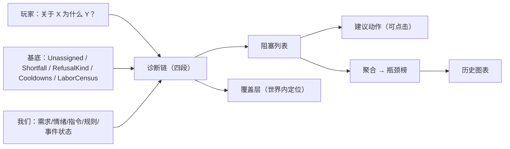
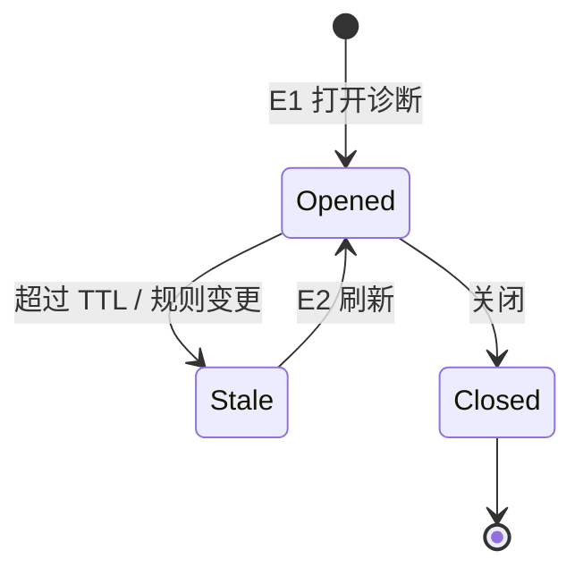

# PRD-006 · 仓储规则与因果诊断

```
状态：草稿PRD
负责人：设计（人类定稿）
最后更新：2026-10-17
优先级：P0（**r07 判定为最高性价比，建议最先原型化**）      里程碑：M1（诊断核心 + 仓储规则扩展都进 M1）
上游依据：docs/design/09-interaction-and-ui.md（§5 覆盖层、§7.4 可诊断性）、docs/design/06-economy-and-logistics.md
关联文档：PRD-005（指令与调度）、PRD-001（情绪）、PRD-002（事件）、PRD-003（季节与食物安全）
基底依赖：StoreRule/Stores/Stash/Containers、Order(into, what, low, high, standing)、Delivery/Carry、
         LaborCensus/Readout/Diagnosis、Unassigned/Why/Shortfall/RefusalKind/Cooldowns、PastDay、
         front/api Board/Row/Act、Line/Sentence/Notice、Layer、Rows、ItemPicker、RegisteringUi.page
外部证据：MineColonies issue #11384「Alert Fatigue」（红图标同时表示停工与幸福抱怨 → 一片红海）
```

---

## 0. 一句话

> 当有人说「他们为什么不去干活」，这个模组必须能回答——并且给出**一键修好它**的按钮。

---

## 1. 概述

基底已经做了大量诊断工作：`Unassigned`（未派工理由）、`Why`、`Shortfall`（缺料/无空间）、`RefusalKind`（拒绝原因）、`Cooldowns`（失败退避）、`LaborCensus`（只读统计）、heartbeat（`solving for Ns` 警告）。这些是**引擎级**的、面向开发者的数据。

**玩家仍然看不懂**，原因有三：
1. 数据分散：想知道「为什么没粮」，得同时看订单、库存、区域、居民分工、拒绝日志。
2. 缺可视化：基底**几乎没有图表与历史**（`MetricsPage` 只有实时库存网格 + 4 个数字；唯一时间窗 `PastDay` 只当一行文字用）。
3. 很少有「下一步做什么」：玩家知道出了问题，但不知道怎么修。

MineColonies 的 [`#11384`](https://github.com/ldtteam/minecolonies/issues/11384) 证明这是公认痛点：它的红图标同时表示「停工」与「幸福抱怨」，玩家面对的是一片红而无法定位。

本 PRD 做两件事：
- **A. 仓储规则扩展**：让玩家能表达「这类东西放这里、留这么多不许动、住得近的先拿」。
- **B. 因果诊断**：一个统一的「为什么？」入口 + 阻塞原因分类 + 建议动作 + 覆盖层 + 瓶颈榜 + 历史图表。

第一部分与第二部分是配套的：**规则越多，越需要诊断**（每加一条规则就多一种「为什么没生效」）。

**它产生的新的决策**：
- 要不要为过冬预留 20% 的粮食不许动（导致日常制作停工，还是用尽最后一口）？
- 把仓房放在工业区（搬运近、美感差）还是住宅区（美感好、搬运远）？
- 看到一个「缺料」瓶颈时，是扩产、改配方，还是改预留规则？

**它在多大程度上是玩家的选择**：这是**纯粹的增强**（不改世界规则），但它是玩家所有其它决策的**前提**——没有它，前面所有系统都无法被有效使用。

---

## 2. 设计目标与非目标

### 2.1 目标

| 编号 | 目标 | 可判定信号 |
| --- | --- | --- |
| G1 | 任何「没发生的事」都能被解释 | 拒绝/阻塞的**覆盖率 ≥95%**（有名字 + **双语文案（`zh_cn` + `en_us`）** + 原因对象） |
| G2 | 解释能落到具体对象 | 每条原因可定位到居民/物品/方块的**具体实例** |
| G3 | 诊断能给出下一步 | 每条常见原因配一个**可点击的建议动作** |
| G4 | 玩家不用翻日志 | 面板内完成全部诊断；命令仅作兜底 |
| G5 | 诊断成本低 | 按需计算，常态 tick ≈0 |
| G6 | 规则更强但不失控 | 仓储规则扩展不破坏基底的 Reserve/Admit/Slots 语义 |

### 2.2 非目标

| 编号 | 不做 | 理由 |
| --- | --- | --- |
| N1 | 自动修复/自动调度 | 那是「替代规划器」，违反 R-F2 |
| N2 | 完整的数据可视化平台（可拖拽仪表盘） | 先用固定视图（瓶颈榜 + 4 张图） |
| N3 | 逐 tick 实时热力图 | 按需 + 快照 |
| N4 | 覆盖基底自身的调试命令 | 我们新增，不改基底 |
| N5 | 全局经济预测（多殖民地） | 先做单殖民地；跨殖民地留到 PRD-010 |
| N6 | 导出到外部文件/网页 | M3 之后 |

### 2.3 M1 最小子集

M1 做：**统一诊断入口 + 阻塞原因分类（≥8 类）+ 建议动作 + 劳动/库存两个覆盖层 + 瓶颈榜**。
不做：历史图表（M2）、预留规则的高级形式（M2）、可达性热力图（M2）。

---

## 3. 术语

| 术语 | 中文 | 说明 | 全局表 |
| --- | --- | --- | --- |
| `diagnosis` | 诊断 | 回答「为什么没按我想的来」的因果视图（全局术语） | 已登记 |
| `blocker` | 阻塞 | 使某事不发生的一个具名原因 | 新增 |
| `blocker_kind` | 阻塞类别 | 阻塞的分类（无许可/无工具/缺料/无空间/无路/被占用/被规则挡/退避中…） | 新增 |
| `advice` | 建议动作 | 针对某阻塞的可点击修复入口 | 新增 |
| `coverage` | 覆盖率 | 有文案与对象的阻塞占比（质量指标） | 新增 |
| `overlay` | 覆盖层 | 世界内的可视化图层 | 新增 |
| `bottleneck_rank` | 瓶颈榜 | 按影响排序的阻塞统计 | 新增 |
| `reserve_rule` | 预留规则 | 「不少于 N 不许动」 | 新增 |
| `quota` | 配额 | 对某类别/某区域的总量约束 | 新增 |
| `affinity` | 就近偏好 | 「住得近的先拿」类规则 | 新增 |

### 3.1 冲突检查

| 冲突项 | 基底含义 | 本系统含义 | 解决 |
| --- | --- | --- | --- |
| `StoreRule` | Reserve / Admit / Slots 三态 | 我们在其上**叠加**规则，不改其语义 | 叠加层独立求值 |
| `Order(into, what, low, high, standing)` | 每容器一条上下限 | 我们的 `quota` 是**类别/区域级**，与既有 Order 正交 | 明确优先级（§9.1） |
| `Shortfall` | LACKING / NO_ROOM | 我们**复用**它作为两种阻塞类别 | 不新造同义概念 |
| 「诊断」命令 | 基底无诊断命令 | 我们新增 `/<ns> why` | 不覆盖基底命令 |

---

## 4. 概念模型

| 实体 | 中文 | 说明 | 玩家可见 |
| --- | --- | --- | --- |
| `DiagnosisRequest` | 诊断请求 | 「关于 X，为什么 Y 没发生」 | 触发入口 |
| `BlockerView` | 阻塞视图 | 一个阻塞的完整解释（类别 + 主体 + 原因对象 + 建议） | 诊断卡 |
| `DiagnosisChain` | 诊断链 | 从意图到执行的四段视图（意图→计划→资源→执行） | 诊断卡主体 |
| `OverlayLayer` | 覆盖层 | 世界内图层（劳动/库存/可达/情绪/需求） | 世界内 |
| `BottleneckReport` | 瓶颈报告 | 24 游戏小时内的阻塞统计与排序 | 「诊断」页 |
| `HistorySeries` | 历史序列 | 日聚合时间序列（人口/生产/消费/情绪/死亡） | 图表 |
| `StoreRuleExt` | 仓储规则扩展 | 预留/配额/就近/品质门槛等附加规则 | 「库存」页 |

### 4.1 关系



---

## 5. 状态机

### 5.1 诊断请求状态

| 状态 | 说明 |
| --- | --- |
| `Opened` | 已打开（快照已取） |
| `Stale` | 快照超过阈值时长（默认 5 秒）→ 提示可刷新 |
| `Closed` | 关闭 |

### 5.2 事件

| 事件 | 说明 | 触发方 |
| --- | --- | --- |
| E1 | 打开诊断 | 玩家（面板/世界内/命令） |
| E2 | 快照刷新 | 玩家 / 自动（超过阈值且窗口可见） |
| E3 | 点击建议动作 | 玩家 |
| E4 | 执行建议动作 | 系统（在服务端校验后） |
| E5 | 刷新覆盖层 | 玩家（切换图层/移动范围） |
| E6 | 生成瓶颈报告 | 系统（每 24 游戏小时） |
| E7 | 规则变更 | 玩家（改仓储规则） → 使相关诊断失效 |

### 5.3 变量

| 变量 | 类型 | 默认 | 范围 | 说明 |
| --- | --- | --- | --- | --- |
| `snapshot_ttl_seconds` | 整数 | 5 | 1–60 | 快照新鲜度 |
| `max_blockers_shown` | 整数 | 16 | 4–32 | 每张诊断卡上限（遵守 32 行） |
| `bottleneck_window_hours` | 整数 | 24 | 24–168 | 瓶颈统计窗口 |
| `overlay_sample_radius` | 整数 | 64 | 16–128 | 覆盖层采样半径（不逐方块） |
| `history_retention_days` | 整数 | 60 | 7–365 | 历史保留 |
| `history_bucket` | 枚举 | Day | Hour/Day | 图表粒度 |
| `coverage_threshold` | 百分比 | 95 | — | 发布门禁（§16.3） |

### 5.4 状态转移表

| 源 | 事件 | 守卫 | 动作 | 目标 |
| --- | --- | --- | --- | --- |
| — | E1 | 玩家有权限且目标可见 | 取快照、计算阻塞 | `Opened` |
| `Opened` | E2 | 玩家刷新 / 自动 | 重算 | `Opened` |
| `Opened` | — | 超过 TTL | 标记 | `Stale` |
| `Stale` | E2 | — | 重算 | `Opened` |
| `Opened` | E3 | 建议动作仍可执行 | 服务端校验 → 执行 | 保持（显示结果） |
| `Opened` | E7 | 规则变更影响本诊断 | 标记 `Stale` | `Stale` |
| 任意 | — | 玩家关闭 | 释放快照 | `Closed` |

### 5.5 状态图



### 5.6 超时与中断

| 情形 | 处理 |
| --- | --- |
| 快照期间目标消失 | 阻塞列表重算，标注「目标已不存在」 |
| 玩家切维度/远离 | 世界内覆盖层按距离限制；面板照常 |
| 建议动作执行失败 | 显示新的拒绝原因（诊断套诊断，最多 1 层） |
| 无权限查看某对象 | 显示「无权查看」而不是空列表 |
| 服务器繁忙 | 诊断计算限流（同一玩家每 5 秒最多 1 次全量计算） |

---

## 6. 交互

### 6.1 入口与快捷键

| 操作 | 按键/手势 | 前置条件 | 结果 |
| --- | --- | --- | --- |
| 打开「诊断」页 | 面板页签 | 手持殖民书 | 瓶颈榜 + 图表 + 覆盖层开关 |
| 问「为什么」 | 面板内任意行/卡上的「为什么」动作 | 同上 | 打开诊断卡（该对象的因果链） |
| 世界内问「为什么」 | 对居民/方块/区域使用殖民书的「为什么」用途 | 同上 | 打开该对象的诊断卡 |
| 切换覆盖层 | 诊断页的图层开关 | 同上 | 世界内图层 |
| 点击建议动作 | 诊断卡内的按钮 | 权限足够 | 直接跳到修复入口（打开对应页/预填表单） |
| 命令兜底 | `/folkways why …`（我们的命令） | — | 文本诊断（服务器排障） |

**R-UI-1**：「为什么」必须是**统一入口**（同一种视觉与结构），不允许每个系统各做一套（R-F-2 of PRD-005）。

### 6.2 操作模式状态机

| 状态 | 说明 |
| --- | --- |
| `Normal` | 无 |
| `Inspecting` | 选了「为什么」用途，指向对象时高亮，右键打开诊断 |

| 转换 | 条件 | 效果 |
| --- | --- | --- |
| `Normal → Inspecting` | 选择「为什么」用途 | 可诊断对象高亮 |
| `Inspecting → Inspecting` | 指向另一对象 | 更新预览 |
| `Inspecting → Normal` | 丢弃键 | 退出 |

### 6.3 面板动作（`Board.Act` 五类之内）

| 上下文 | 按钮 | 操作 |
| --- | --- | --- |
| 诊断卡 | 「刷新」（`Do`） | 重算 |
| 诊断卡 | 「定位」（`Ping`） | 世界内高亮原因对象 |
| 诊断卡 | 「建议：%s」（`Do`） | 执行建议动作或打开对应页面 |
| 诊断卡 | 「查看相关」（`Open`） | 打开相关对象页（居民/区域/订单） |
| 仓储规则行 | 「编辑」（`Edit`） | 编辑规则 |

**R-UI-2**：诊断卡必须遵守 **32 行 / 4 动作**上限；阻塞超过 16 条时用「列表 → 详情」模式（r03 §6.11）。

### 6.4 命令

| 命令 | 权限 | 说明 |
| --- | --- | --- |
| `/<ns> why colony` | **member（全体成员）** | 全殖民地阻塞统计 —— **只读**，与面板同源（§11 已定诊断默认全员只读；**"界面能看、命令不能看"是 bug**） |
| `/<ns> why resident <id>` | **member** | 该居民为何空闲/被拒 |
| `/<ns> why item <item>` | **member** | 该物品的库存/物流链状态 |
| `/<ns> why zone <pos>` | **member** | 该区域为何没在做某事 |
| `/<ns> diag coverage` | gamemaster | 打印阻塞覆盖率报告（发布门禁用） |
| `/<ns> diag dump` | gamemaster | 导出诊断快照（用于缺陷报告） |

**R-6.4.1（2026-10-18 定）**：`why` 系列**必须与面板逐字同源**（同一份诊断文本生成器），且权限与面板一致（**member 只读**）；`diag coverage`/`diag dump` 属于**排障与发布工具**，保留 `gamemaster`。任何"UI 可见但命令拒绝"的差异都算一致性缺陷（[d16](../design/16-diagnosis-ui-prototype.md) §8）。

---

## 7. 反馈

### 7.1 操作模式反馈

| 检查条件 | 音效 | Toast | 视觉 | 系统行为 |
| --- | --- | --- | --- | --- |
| 进入 `Inspecting` | 轻微 | 「指向要调查的对象」 | 可诊断对象高亮 | 等待 |
| 悬停可诊断对象 | 无 | 对象名 + 一句现状 | 描边 | — |
| 确认 | 确认音 | 「正在调查 %s」 | 打开诊断卡 | `Opened` |

### 7.2 实体/区域状态反馈（覆盖层）

| 图层 | 显示 | 数据来源 | 更新 |
| --- | --- | --- | --- |
| **劳动** | 按「有无活/是否被阻塞」着色的居民 | `LaborCensus`（standing 的 idle/stalled） | 按需快照 |
| **库存** | 储物点的占用率与「被预留」标记 | `Stores`/`Stash` | 按需 |
| **可达** | 近期寻路失败点/不可达区域 | `Searches`/`PathfindingLoad`（若可读） | 按需 |
| **需求** | 需求危急的居民分布 | PRD-001 | 按需 |
| **情绪** | 情绪档位分布 | PRD-001 | 按需 |

**R-F-1**：覆盖层必须**采样**（半径内抽样）而不是逐方块着色；切换图层不产生持续 tick 成本。
**R-F-2**：覆盖层的配色必须有图例，且**不得**只用红色表示一切（这正是 MineColonies 的教训）。

### 7.3 系统事件反馈

| 事件 | 音效 | 通知文案 | 视觉 | 系统行为 |
| --- | --- | --- | --- | --- |
| 出现新的高影响阻塞 | 提示音 | 「生产受阻：%s（%s）」 | 诊断页角标 | 生成建议 |
| 覆盖率低于阈值（开发/发布） | — | 日志 + `diag coverage` 报错 | — | CI 失败 |
| 建议动作执行成功 | 确认音 | 「已处理：%s」 | 阻塞从列表消失 | — |
| 建议动作执行失败 | 低沉音 | 新的拒绝原因 | 保持 | — |

**R-F-3**：警告类通知必须**带上建议**（「缺粮」不够，要给「打开订单页/降低预留」）。

### 7.4 可诊断性（本 PRD 即「可诊断性」本身）

| 玩家可能的疑问 | 系统必须能回答 | 呈现位置 |
| --- | --- | --- |
| 为什么没人做这件事？ | 阻塞链（无许可/无工具/被占用/无路/退避中…） | 诊断卡 |
| 为什么这里没收到货？ | 物流链四段：有无来源 → 有无订单 → 有无搬运者 → 有无空间 | 诊断卡（物品维度） |
| 为什么他不高兴？ | 情绪原因清单（PRD-001） | 居民诊断卡 |
| 为什么这条指令没生效？ | 指令冲突/作用域为空/被更高优先压制（PRD-005） | 指令诊断卡 |
| 为什么产能突然掉了？ | 趋势图 + 当日阻塞榜对比 | 诊断页 |
| 我该先做什么？ | 瓶颈榜（按影响排序，附建议） | 诊断页顶部 |

---

## 8. 规则

| 编号 | 规则 | 说明 |
| --- | --- | --- |
| R1 | **覆盖率门禁**：所有阻塞/拒绝必须有具名类别 + **双语文案（`zh_cn` + `en_us`）** + 原因对象，覆盖率 ≥95% | CI 检查（§16.3） |
| R2 | **可定位**：每条阻塞必须能定位到具体实例（居民/物品/坐标/区域） | 无实例的阻塞视为缺陷 |
| R3 | **有建议**：每个常见阻塞类别（Top 8）必须配一个建议动作 | 缺建议视为缺陷 |
| R4 | **不遮挡**：覆盖层默认关闭，必须玩家主动打开 | 避免满屏颜色（MineColonies 教训） |
| R5 | **不逐 tick**：诊断按需计算，限流（同一玩家每 5 秒 ≤1 次全量） | 性能验收 |
| R6 | **不自动修复**：建议动作只**跳转/预填**，真正执行仍由玩家确认 | 防止「AI 替你玩」 |
| R7 | **只读**：诊断不得改变世界状态（除非玩家点击建议动作） | — |
| R8 | **规则诊断双向**：新增任一仓储规则必须同时提供「为什么没生效」的诊断 | 配套要求 |
| R9 | **仓储规则叠加而非替换**：不得改变基底 `StoreRule`(Reserve/Admit/Slots) 语义 | 兼容性 |
| R10 | **预留规则不得造成死锁**：预留量 ≥ 实际存量时，必须给出「无法满足预留」的阻塞与建议 | 防「什么都不动」的困惑 |
| R11 | **历史数据上限**：保留期与分桶受 `history_retention_days` 约束 | 存档大小 |
| R12 | **多人一致**：诊断结果对所有玩家一致（同一快照数据源） | — |
| R13 | **i18n**：诊断文案**双语（`zh_cn` + `en_us`）**，且**支持变量化对象名** | — |
| R14 | **结论先行**：每张诊断卡的第一个元素必须是文字结论 + 关键数字；图表次之 | §9.5.1 原则①；违反即缺陷 |
| R15 | **可视化从属**：结论、原因与建议必须**仅用文字与数字**也能完整表达；图表可有可无 | §9.5.1 原则⑥/⑦ + R-FLOW-10 |

---

## 9. 流程

### 9.1 仓储规则扩展（Part A）

**基底现状**（[r03 §6.4](../research/03-front-and-interaction.md)）：每容器一条 `Order(into, what, low, high, standing)`，下限/上限各 1–9999，另有槽位范围；**没有**全局配额、没有按类别储备、没有「某区域专用库存」。

我们在**其上叠加**四类规则（不改基底语义）：

| 规则 | 表达 | 例 | 与基底的关系 |
| --- | --- | --- | --- |
| `reserve_rule` 预留 | 「某物品/类别不少于 N 不许动用」 | 过冬粮 200 不许动 | 叠加：高于 `Order.low` 的保护层 |
| `quota` 配额 | 「某类别在某区域的总量上限/下限」 | 工业区原料 ≤ 500 | 正交：类别 × 区域维度 |
| `affinity` 就近偏好 | 「优先从距离近的取 / 往近的放」 | 厨房优先取最近的粮仓 | 修正搬运候选权重（不改基底算法） |
| `quality_gate` 品质门槛 | 「只用/只存某品质以上」 | 医院只用良好以上食物 | 需品质系统（PRD-006 依赖项，见 §18 OQ-3） |

**求值顺序（权威性）**：

```
基底 Order.low/high（保持存量）
  → quota（类别/区域总量）
  → reserve_rule（不许动用）
  → quality_gate（过滤候选）
  → affinity（排序候选）
  → 基底 Carry/Delivery 执行
```

**R-FLOW-1**：每一步都必须能单独诊断（R8）。
**R-FLOW-2**：规则冲突时以「更具体」为优先（区域 > 全局；物品 > 类别），并在 UI 显示裁决结果（沿用 PRD-005 §9.6 的机制）。

### 9.2 诊断链（Part B 的核心）

任何一个「没发生的事」都按**四段**解释：


| 段 | 检查项 | 数据来源 | 典型阻塞 |
| --- | --- | --- | --- |
| ① 意图 | 是否存在对应区域/订单/指令？作用域是否包含目标？是否被暂停/冲突？ | 我们的指令册 + 基底 Enrollment/Order | 无意图 / 意图为空作用域 / 指令冲突 |
| ② 计划 | 是否提交？是否进入 phases？是否 `unassigned`？ | `LaborCensus`(submitted/phases/planned/unassigned) + heartbeat | 未提交 / 未生长出供方 / 未派工（无手/无许可/优先级不足） |
| ③ 资源 | 缺料（LACKING）？无空间（NO_ROOM）？无工具？无许可？规则过滤掉了？ | `Shortfall`、`Licences`、我们的规则层 | 缺料 / 无空间 / 无工具 / 无许可 / 被预留挡住 / 被品质门槛挡住 |
| ④ 执行 | 有人在做吗？在走？退避中（Cooldowns）？卡住（solving for Ns）？ | Doing/Tours/`Cooldowns`/`solving for Ns` 警告 | 路上 / 被抢占 / 失败退避（**20→640 刻的"粘滞"**，r01 §4.9） / 卡死 |

**R-FLOW-3**：诊断链必须**从最后一段往前**给结论（玩家最关心「为什么现在没动」），但完整四段都要可展开。
**R-FLOW-4**：`Cooldowns` 的粘滞必须显式解释（「上次失败，%s 秒后重试」），否则玩家会以为系统坏了 —— 这是基底最容易让人误解的行为（r01 §4.9）。

### 9.3 阻塞类别（初版 12 类）

| # | 类别 | 判定依据 | 建议动作 |
| --- | --- | --- | --- |
| D-1 | 没有意图 | 无区域/订单/指令覆盖目标 | 「为此处添加用途」 |
| D-2 | 意图被暂停/冲突 | 指令状态 | 「打开计划页裁决」 |
| D-3 | 没有许可 | `Licences` 不允许该工种 | 「为该居民开放工种」 |
| D-4 | 没有工具 | 工具门槛不满足 | 「打开工具设置」 |
| D-5 | 缺料 | `Shortfall.LACKING` | 「查看该物品来源」/「调整订单」 |
| D-6 | 没有空间 | `Shortfall.NO_ROOM` | 「添加储物点」/「提高配额」 |
| D-7 | 到不了 | 寻路失败/无路 | 「定位障碍」/「开一条路」 |
| D-8 | 被更高优先占用 | 该居民在做更高权重的事 | 「查看该居民」/「调整优先级」 |
| D-9 | 被规则挡住 | 我们的 reserve/quota/quality/area 过滤 | 「查看规则」/「临时放宽」 |
| D-10 | 失败退避中 | `Cooldowns` | 「等待（%s 后重试）」/「强制重试」 |
| D-11 | 计划卡住 | heartbeat `solving for Ns` / 超时未派 | 「导出诊断」/「减少同时工作数」 |
| D-12 | 结构性无解 | `Unassigned.structural()`（基底视作 bug） | 「报告缺陷」（**不得**包装成正常状态，r01 §4.3） |
| D-13 | 关系不合 | 搭档/共事对象的 `grudge` 超阈值 → `SocietyRefusal`（[PRD-008](PRD-008-relationships-and-social.md)） | 「查看两人关系」/「安排调停」 |
| D-14 | 社交枯竭 | 社交需求长期未满足（无可用对象/无场合） | 「设置集会点」/「调整作息以错开」 |
| D-15 | 哀悼期 | 关系人死亡后的哀悼期，部分工作被拒 | 「查看丧事」/「安排葬礼」（[PRD-009](PRD-009-generations-and-legacy.md)） |
| D-16 | 照料占用 | 被幼儿/伤病者照料占用（居民被指派为照料者） | 「安排照料者轮换」/「建托儿/医疗场所」 |
| D-17 | 无医生 | 有伤/病但无可用医生（[PRD-013](PRD-013-medical-and-surgery.md)） | 「指派医生」/「降低该医生的其他工种权重」 |
| D-18 | 缺药 | 药品不足或品类不对（[PRD-013](PRD-013-medical-and-surgery.md)） | 「查看药柜」/「下生产订单」/「外购」 |
| D-19 | 病房不足 | 病床/手术台被占满（[PRD-013](PRD-013-medical-and-surgery.md)） | 「加床」/「出院排序」/「建第二间病房」 |
| D-20 | 通风不足 | 分区换气率低于阈值（[d13](../design/13-gases-pollution-and-cycles.md)） | 「开通风口」/「装风机」/「扩大分区」 |
| D-21 | 缺氧 | 分区 O₂ 低于安全阈值（[d13](../design/13-gases-pollution-and-cycles.md)） | 「供氧」/「撤离」/「封闭分区」 |
| D-22 | 中毒被困 | 污染/CO 超限且居民在内（[d13](../design/13-gases-pollution-and-cycles.md)） | 「撤离」/「戴面具」/「净化」 |
| D-23 | 滤芯耗尽 | 过滤/洗涤耗材见底（[d13](../design/13-gases-pollution-and-cycles.md)） | 「换滤芯」/「下订单」/「旁通（会恶化空气）」 |
| D-24 | 无看守 | 有被关押者但无 `warden` 在岗（[PRD-015](PRD-015-captivity-and-prisoners.md)） | 「指派看守」/「缩小关押规模」 |
| D-25 | 牢房或口粮不足 | 牢房容量/囚犯口粮不足（[PRD-015](PRD-015-captivity-and-prisoners.md)） | 「加牢房」/「调整口粮」/「释放」 |
| D-26 | 囚犯不劳役 | 劳役未发生（**必须带具体原因**：受伤/绝食/反抗/无活可干）（[PRD-015](PRD-015-captivity-and-prisoners.md)） | 「查看原因」/「换工」/「改善顺从度」 |
| D-27 | 越狱或骚动风险高 | `unrest` 超阈值（前兆）（[PRD-015](PRD-015-captivity-and-prisoners.md)） | 「加派看守」/「分开关押」/「谈判」 |
| D-28 | 无电可用 | 设备/机器人所在电网无可用功率（[d15](../design/15-power-and-mechanical-residents.md) §11.5） | 「接线」/「加发电机」/「查断路」 |
| D-29 | 电网过载 | 超出电压/应力/线缆容量（[d15](../design/15-power-and-mechanical-residents.md)） | 「分流」/「换粗线」/「错峰」 |
| D-30 | 机器停机待修 | 磨损/部件故障导致停机（[d15](../design/15-power-and-mechanical-residents.md)） | 「维修」/「换件」/「停用该机」 |
| D-31 | 人造子宫条件不足 | 缺能量/部件/许可/并发已占用（[d15](../design/15-power-and-mechanical-residents.md)） | 「补条件」/「排队」/「查许可」 |

> **编号纪律（2026-10-18 定）**：D-17 起为新增类别——**医疗 17–19 / 气体 20–23 / 关押 24–27 / 能源与机械族 28–31**，编号唯一、**不再重排**；D-1..D-16 保持不变。新增类别必须同样满足「具名类别 + 双语文案 + 原因对象」。D-20~D-27 在 **M3 只注册、M4 随对应系统一起生效**（气体 D-20~23 属 [d13](../design/13-gases-pollution-and-cycles.md) 的接口预埋清单；关押 D-24~27 随 [PRD-015](PRD-015-captivity-and-prisoners.md) 在 M3 生效）；**D-28~D-31 随 [d15](../design/15-power-and-mechanical-residents.md) 在 M3 生效**。

**R-FLOW-5**：D-12 必须**明确告知这是缺陷**并引导报告，而不是伪装成「居民不想做」。

### 9.4 建议动作（advice）

| 类型 | 例 | 行为 |
| --- | --- | --- |
| 跳转 | 「打开订单页」 | 打开对应页/窗口 |
| 预填 | 「为此处添加用途」 | 打开对应面板并预填目标坐标 |
| 一次修改 | 「临时放宽预留」 | 修改一条规则（需确认） |
| 定位 | 「定位障碍」 | 世界内高亮 |
| 导出 | 「导出诊断」 | 生成缺陷报告文本（可复制） |

**R-FLOW-6**：建议动作**不得**直接执行破坏性变更（删除区域/订单/居民设置）——一律需要确认。
**R-FLOW-7**：一键优化（「自动修复全部」）**不做**（违反 R-F2，见 §2.2 N1）。

### 9.5 瓶颈榜与历史

| 视图 | 内容 | 数据 |
| --- | --- | --- |
| 瓶颈榜 | 过去 `bottleneck_window_hours` 内按「影响 = 受影响工作量 × 持续时长」排序的阻塞类别 | 日聚合 |
| 人口趋势 | 人口、出生、死亡（含死因分布） | 日聚合 |
| 生产/消费 | 关键品类（食物/燃料/建材）的产量与消耗，附**存量预测**（还够几天） | 日聚合（可复用 `PastDay` 思路） |
| 情绪趋势 | 平均情绪 + 各档人数 | PRD-001 |
| 阻塞趋势 | 每类阻塞的日曲线 | 日聚合 |

**R-FLOW-8**：存量预测（「食物还够 X 天」）是**本 PRD 与 PRD-003（季节与食物安全）的接口**，必须先于 PRD-003 完成。
**R-FLOW-9**：历史数据必须能在面板内以图表呈现 —— 而基底**没有图表组件** → 需要自绘（`Rows` 之外），或复用 `Line`/`Sentence` 做简化条形/折线（见 §9.5.1）。

### 9.5.1 数据可视化原则（2026-10-18 裁决，取代 OQ-2）

用户裁决：**结论先行；图表只在"需要比较"时出现；必须随数据动态更新、准确、清晰简洁、不堆砌；基底没有图表组件 → 允许轻量自绘，但必须遵守 UI 预算与 i18n。**

| 原则 | 具体要求 | 违反示例（视为缺陷） |
| --- | --- | --- |
| **① 结论先行** | 每张卡**第一行必须是一句结论**（例：「食物将在 4 天后见底」），紧跟 **2–3 个关键数字**与趋势方向；图表排在结论之后 | 打开诊断页先看到一堆曲线，得自己读出来 |
| **② 只在需要比较时画图** | 图表仅用于**跨时间**（趋势）或**跨类别**（对比）场景（§9.5 列出的五个视图）；单点数值**只用数字** | 一个数字也画成柱子 |
| **③ 必须动态更新** | 打开/刷新即重算，并显示"截至 %s"；数据陈旧必须标注（`stale` 而非静默） | 显示上次打开时的旧快照 |
| **④ 必须准确** | 图表与数字**同源**（一份实现，禁止两套算法）；标注单位、时间窗与聚合粒度；条形从 0 起、折线必须说明窗口 | 折线省略窗口、条形截断纵轴制造"暴涨"错觉 |
| **⑤ 清晰简洁** | 每卡**≤1 张图、≤3 条序列**；无装饰性图元；文字标签不写进图形（走 i18n 键） | 彩虹配色、图例挤满一行、图形里烤死英文 |
| **⑥ 不堆砌** | 每页图表**≤2 张**，其余全部用数字/列表；**数字视图必须始终可读**（图表是补充不是替代） | 每张卡都塞迷你图，页面变成仪表盘墙 |
| **⑦ 数据不足要有话说** | 历史不足 `min_history_days` 时显示「数据不足（还需 %s 天）」，**不画空图** | 画一条空白曲线让人以为是 bug |
| **⑧ 轻量自绘的边界** | 允许用绘制原语做**动态条形/迷你趋势线**；必须遵守 UI 预算（32 行/页、8 行/卡）与**双语（`zh_cn` + `en_us`）**；绘制失败或客户端不支持时**降级为数字表** | 自绘控件溢出卡片、压住按钮、破坏分页 |

**R-FLOW-10**：可视化是**诊断的从属**，不得反过来让"没图就没法诊断"——所有结论与建议必须**仅用文字与数字**也能完整表达（可访问性与 i18n 的底线）。
**R-FLOW-11**：图表实现只有**一份**（与 §9.5 的数据源共用），禁止每个视图各画一套。

### 9.6 数值配置

| 参数 | 默认 | 范围 | 谁需要它（R-F8） |
| --- | --- | --- | --- |
| `diagnosis_enabled` | true | — | 极简主义者 |
| `snapshot_ttl_seconds` | 5 | 1–60 | — |
| `bottleneck_window_hours` | 24 | 24–168 | 长期规划玩家 |
| `history_retention_days` | 60 | 7–365 | 服务器管理员（存档大小） |
| `overlay_default_on` | false | — | 视觉清晰度（R4） |
| `advice_enabled` | true | — | 想纯探索的玩家 |
| `coverage_threshold` | 95 | — | 开发/CI |
| `max_blockers_shown` | 16 | 4–32 | UI 上限 |

---

## 10. 数据与存档

| 项 | 内容 |
| --- | --- |
| 新增持久化字段 | 仓储规则扩展（reserve/quota/affinity/quality）、日聚合历史（分桶）、瓶颈统计 |
| 存储位置 | `Colony.keep(owner, CompoundTag)`；历史可按时间分片存储（避免单 tag 过大） |
| 存档版本影响 | 需要（自管版本号） |
| 迁移 | 缺失字段取默认；规则引用的物品/区域消失 → 规则保留并标记「目标缺失」；历史按保留期裁剪 |
| 旧存档 | 无规则 → 无扩展（等同基底）；无历史 → 图表从当前开始累积 |
| 回滚 | 可加载；规则不解读；历史保留 |
| 大小保护 | 历史保留期 + 分桶 + 上限（R11） |

**R-DATA-1**：诊断**快照不存档**（纯运行时）；只有规则与聚合历史存档。
**R-DATA-2**：历史数据的存档体积必须有上限（每殖民地 ≤ 512 KB），超限按最旧裁剪。

---

## 11. 网络与多人

| 项 | 内容 |
| --- | --- |
| 权威端 | 服务端（全部诊断与历史） |
| 同步 | 诊断卡按需拉取（打开/刷新）；覆盖层按需 + 限流；瓶颈榜与图表按需 |
| 权限 | **查看诊断：默认所有成员可看全部诊断（只读）**——诊断是**防挫败工具**，看不到只会被玩家误判成 bug（2026-10-18 裁决，OQ-6）；**执行建议动作**：按对应动作的权限（与 PRD-005/PRD-012 一致）。私密信息（居民私密情绪/记忆）走**只读降级**（`👁`）而非隐藏。 |
| 并发 | 同一诊断被多人打开 → 各自独立快照；建议动作走服务端校验 |
| 断线/重连 | 快照丢弃，重连后重新拉取 |
| 存档共享 | 历史与规则是殖民地共享的 |

**R-MP-1**：覆盖层推送必须限流（每玩家每秒 ≤ 1 次），且**不得**为每个玩家单独全量计算（共享同一份聚合）。
**R-MP-2**：若权限收紧为「仅管理者」，普通成员必须看到**降级版本**（只显示自己的与公开的阻塞），而不是空白。

---

## 12. i18n（双语：`zh_cn` + `en_us`）

> **口径（[ADR-017](../00-charter.md)）**：我们新增的键只做两份；基底既有四语言文件保留不动，缺键回退 `en_us`。

| 键族 | 例（zh_cn） |
| --- | --- |
| `<ns>.page.diagnosis` | 诊断 |
| `<ns>.diag.segment.intent` / `.plan` / `.resource` / `.execute` | 意图 / 计划 / 资源 / 执行 |
| `<ns>.blocker.no_intent` | 这里没有布置任何用途 |
| `<ns>.blocker.no_licence` | %s 没有「%s」的许可 |
| `<ns>.blocker.no_tool` | 缺少工具：%s |
| `<ns>.blocker.lacking` | 缺 %s（还差 %s） |
| `<ns>.blocker.no_room` | %s 没有空间存放 %s |
| `<ns>.blocker.unreachable` | 到不了 %s |
| `<ns>.blocker.preempted` | %s 正在做更要紧的事（%s） |
| `<ns>.blocker.blocked_by_rule` | 被规则挡住：%s |
| `<ns>.blocker.backoff` | 上次失败，%s 后重试 |
| `<ns>.blocker.stalled` | 计划卡住了（已 %s） |
| `<ns>.blocker.structural` | **这是缺陷**：计划无法生长（%s），请报告 |
| `<ns>.advice.<kind>` | 为该居民开放工种 / 添加储物点 / 打开订单页 / 定位障碍 / 导出诊断 |
| `<ns>.overlay.labour` / `.stock` / `.reach` / `.need` / `.mood` | 劳动 / 库存 / 可达 / 需求 / 情绪 |
| `<ns>.chart.stock_forecast` | %s 还够 %s 天 |

**R-I18N-1**：阻塞文案**必须**支持至少两个变量（主体 + 原因对象），不允许硬编码整句。
**R-I18N-2**：同一条阻塞在不同语境（居民/区域/物品）下必须复用同一键，靠参数变化表达（避免文案爆炸）。

---

## 13. 性能预算

| 项 | 估算 | 依据 | 上限 |
| --- | --- | --- | --- |
| 每 tick | ≈0 | 无逐 tick 工作 | <0.1% |
| 单次全量诊断（60 居民 + 200 存储 + 50 工作） | 扫描一次快照 + 指令/规则匹配 | O(对象数 × 规则数) | 单次 ≤50 ms |
| 覆盖层（采样 64 半径） | 只读快照 + 抽样 | O(样本数) | 单次 ≤20 ms |
| 日聚合（历史） | 与 PRD-001/002 的日结算同批处理 | O(品类数) | <0.5% |
| 内存 | 规则 ≤ 256 KB；历史 ≤ 512 KB/殖民地 | 见 §10 | — |
| 网络 | 按需 + 限流 | — | ≤20 KB/s/玩家 |

**R-PERF-1**：诊断必须**限流**（每玩家 5 秒 1 次全量）+ **共享聚合**（多人共用一份瓶颈统计）。
**R-PERF-2**：必须提交探针（诊断耗时、覆盖率、单次阻塞数）——**覆盖率是发布门禁**。

---

## 14. 与基底 API 的关系

| 需求 | 扩展点 | 状态 | 备注 |
| --- | --- | --- | --- |
| 读未派工/拒绝原因 | `Unassigned`、`Why`、`Shortfall`、`RefusalKind`、`Cooldowns` | 已有（引擎内部，需确认公开读点） | ⚠️ 部分可能在包私有层（r01 §3.2）→ Plan 阶段确认可读面 |
| 读统计 | `LaborCensus.of(level, colony)`、`Readout`、heartbeat | 已有 | `submitted/phases/planned/unassigned/missing/standing` |
| 读寻路负载 | `PathfindingLoad`、`Searches` | 已有（部分） | 可达层需要 |
| 读历史 | `PastDay`（24000 tick、1200 分桶、按格子产出/消耗） | 已有 | 可复用做产能曲线，但只有一格粒度 |
| 读仓储 | `Stores`/`Stash`/`StoreRule` | 已有 | 规则叠加的基础 |
| 面板 | `RegisteringUi.event.page` + `Board/Row/Act` + `Rows` | 已有 | 诊断页 |
| 图表 | **无组件** | ❌ 缺 | 轻量自绘（动态条形/迷你趋势线）或 `Line`/`Sentence` 简化；须遵守 §9.5.1 的八条原则与 UI 预算 |
| 覆盖层 | `Layer`（俯瞰图层） | 已有 | 复用 |
| 自检命令 | `LibraryCommand` 风格 | 已有风格可循 | 我们新增 `/<ns> why/diag` |
| 教学 | `Scenes.folder` | 已有 | 「怎么看懂为什么」一课 |

**R-API-1（fork 后更新）**：关键诊断数据（`Unassigned`/`Cooldowns`/`Why`）若在包私有层，**直接在 fork 内提升为公开只读访问**（[fork 策略](../design/12-fork-strategy.md) L2 改动，加 `// PLA:` 标记并登记改动表）。不再需要"上游 PR 或绕行"。
**R-API-2**：本 PRD 的实现优先级取决于 §14 的可读面 —— **Plan 阶段第一件事就是列清「哪些诊断数据今天就能读」**（这决定 M1 能交付多少）。

---

## 15. 可改写性

| 内容 | 数据包 | 配置 |
| --- | --- | --- |
| 阻塞类别的文案与建议 | 是（语言目录） | — |
| 建议动作的目标页（跳转映射） | 部分（可配置映射） | 是 |
| 历史保留与分桶 | 否 | 是 |
| 仓储规则（预留/配额） | 否（玩家手设） | 是（默认值/上限） |
| 覆盖层默认与配色 | 资源包 | 是（默认开关） |

---

## 16. 验收检查

### 16.1 交互
- [ ] AC-1 面板有「诊断」页，含瓶颈榜 + 至少 2 张图 + 覆盖层开关
- [ ] AC-2 任意居民/区域/物品/订单行上有「为什么」入口，打开统一诊断卡
- [ ] AC-3 诊断卡按四段（意图/计划/资源/执行）展开，结论在最后一段
- [ ] AC-4 每条阻塞可「定位」到世界中的具体对象
- [ ] AC-5 建议动作可点击，能跳到修复入口或预填表单
- [ ] AC-6 覆盖层可切换且默认关闭

### 16.2 反馈与诊断
- [ ] AC-7 覆盖层有图例，且不使用「一律红色」的表达
- [ ] AC-8 警告通知带建议（不只是「缺粮」）
- [ ] AC-9 D-10（失败退避）显式显示剩余等待时间
- [ ] AC-10 D-12（结构性无解）明确标注为缺陷并给导出入口
- [ ] AC-11 存量预测显示「%s 还够 %s 天」

### 16.3 规则（质量门禁）
- [ ] AC-12 **阻塞覆盖率 ≥95%**（`diag coverage` 报告 + CI 静态检查）
- [ ] AC-13 每条阻塞有具名类别、**双语文案（`zh_cn` + `en_us`）**、原因对象、可定位
- [ ] AC-14 Top 8 阻塞类别都有建议动作
- [ ] AC-15 诊断不改变世界状态（除玩家点击建议动作后）
- [ ] AC-16 新增仓储规则时同时提供其诊断（R8；评审项）
- [ ] AC-17 预留量 ≥ 存量时给出「无法满足预留」的阻塞与建议

### 16.4 流程与数值
- [ ] AC-18 仓储规则求值顺序符合 §9.1，且每步可单独诊断
- [ ] AC-19 规则冲突时以「更具体」优先，并在 UI 显示裁决
- [ ] AC-20 存量预测与实际消耗率误差 ≤10%（测试固定场景）

### 16.5 状态、数据与边界
- [ ] AC-21 存档往返后规则与历史一致
- [ ] AC-22 历史超限按最旧裁剪，存档不膨胀（≤512 KB/殖民地）
- [ ] AC-23 规则目标消失（物品/区域）后不崩，标记「目标缺失」
- [ ] AC-24 快照期间目标消失时列表重算并标注
- [ ] AC-25 卸载插件后存档可加载（回到基底行为）

### 16.6 性能与多人
- [ ] AC-26 单次全量诊断 ≤50 ms（60 居民 + 200 存储 + 50 工作）
- [ ] AC-27 覆盖层单次 ≤20 ms，且无持续 tick 成本
- [ ] AC-28 多人同时打开诊断时，瓶颈统计共享一份（不重复计算）
- [ ] AC-29 权限收紧时普通成员看到降级版本而非空白

### 16.7 可改写性
- [ ] AC-30 阻塞文案与建议可通过语言文件修改（不改 Java）
- [ ] AC-31 **结论先行**：每张诊断卡首元素为文字结论 + 2–3 个关键数字（e2e 视觉门禁 + 结构断言）→ §9.5.1 原则①
- [ ] AC-32 **图表只在比较时出现**：单点数值不出现图表；每卡 ≤1 图、≤3 序列、每页 ≤2 图（e2e 结构断言）→ 原则②/⑤/⑥
- [ ] AC-33 **动态与准确**：刷新后数值与图表同步更新并显示"截至 %s"；图表与数字同源（静态检查 + 单元）→ 原则③/④ + R-FLOW-11
- [ ] AC-34 **数据不足提示**：历史不足时显示「数据不足（还需 %s 天）」且不画空图（e2e）→ 原则⑦
- [ ] AC-35 **文字可完整替代**：关闭图表后结论/原因/建议全部仍可读（e2e + 评审）→ R-FLOW-10 / R15

---

## 17. 测试计划（TDD）

| 测试 | 类型 | 覆盖 AC | 备注 |
| --- | --- | --- | --- |
| 覆盖率静态检查（遍历全部 RefusalKind/Shortfall/Unassigned） | 单元（静态） | AC-12、AC-13 | **发布门禁**，进 CI |
| 新增键双语（`zh_cn` + `en_us`）与占位符一致性 | 单元 | AC-13 | 复用基底 i18n 检查思路 |
| 诊断链判定（每类阻塞的构造夹具） | 单元 | AC-2、AC-3 | 12 类各一个夹具 |
| 建议动作可执行性 | 单元 | AC-5 | 每类建议至少 1 条路径 |
| 仓储规则求值顺序与冲突 | 单元 | AC-18、AC-19 | 规则矩阵测试 |
| 预留 ≥ 存量 的死锁诊断 | 单元 | AC-17 | — |
| 存量预测精度 | 单元（固定场景） | AC-20 | 已知消耗率 |
| 缺料场景端到端（真实世界） | gametest | AC-3、AC-12 | 造一个缺料殖民地，验证诊断能识别 |
| 失败退避可见性 | gametest | AC-9 | 制造一次失败，验证倒计时 |
| 诊断卡与覆盖层渲染 | e2e（Linux） | AC-1、AC-6、AC-7 | 视觉门禁 |
| 诊断性能探针 | bench（Linux） | AC-26、AC-27 | 60 居民 |
| 多人并发诊断 | e2e（Linux，双客户端） | AC-28、AC-29 | — |

---

## 18. 待细化 / 开放问题

| 编号 | 问题 | 影响 | 何时定 | 谁定 |
| --- | --- | --- | --- | --- |
| OQ-1 | **哪些基底诊断数据今天可从 API 读取？**（`Unassigned`/`Cooldowns`/`Why` 可能包私有） | M1 交付范围（**最关键**） | 阶段三第一件事 | 实现 agent |
| OQ-2 | ~~图表用什么实现？~~ | **已裁决**：**结论先行；图表只在需要比较时出现；基底无图表组件 → 允许轻量自绘（动态条形/迷你趋势线），受 §9.5.1 八条原则 + UI 预算（32 行/页、8 行/卡、每页 ≤2 图）+ i18n 约束**；必须随数据动态更新、准确、简洁、不堆砌 | ✅ 已定（2026-10-18） |
| OQ-3 | 品质门槛（`quality_gate`）依赖的品质系统何时有？（PRD-006 与经济扩展的依赖） | Part A 范围 | M2 前 | 人类 |
| OQ-4 | 是否需要「强制重试」（跳过 `Cooldowns`）？可能被滥用 | 平衡 | M2 前 | 人类 |
| OQ-5 | 历史是否应导出到文件（便于分享/排障）？ | 体验 | M3 | 设计 |
| OQ-6 | ~~普通成员的诊断权限默认值（all vs manager）？~~ | **已裁决：默认所有成员可看全部诊断（只读）**——诊断是**防挫败工具**（2026-10-18）；执行建议动作仍按权限；私密信息走只读降级而非隐藏 | ✅ 已定（2026-10-18） |
| OQ-7 | 自绘迷你图在小窗口/大 GUI 缩放下是否仍清晰（渲染成本实测）？ | 视觉与性能 | M2 前（实现期） | 实现 agent |

---

## 19. 变更记录

| 日期 | 状态 | 变更 | 操作者 |
| --- | --- | --- | --- |
| 2026-10-17 | 草稿PRD | 首次起草（依据 r07 建议把本系统列为最高性价比，采用 MineColonies #11384 作为设计证据） | 设计 agent |
| 2026-10-18 | 草稿PRD | **用户裁决落地**：① 新增 §9.5.1 **数据可视化原则**（结论先行 / 只在需要比较时画图 / 必须动态更新 / 准确同源 / 清晰简洁 / 不堆砌 / 数据不足要有话说 / 轻量自绘的边界）+ R-FLOW-10/11；② §8 新增 R14/R15；③ §11 **诊断可见性默认 = 所有成员可看全部诊断（只读）**，动作按权限，私密信息走只读降级而非隐藏；④ 新增 AC-31..35（结论先行、图表节制、动态准确、数据不足、文字可替代），OQ-2/OQ-6 标记已裁决，新增 OQ-7 | 设计 agent |