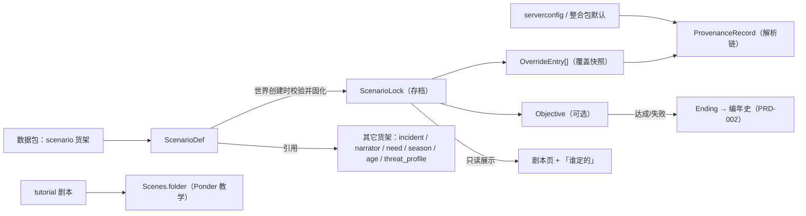
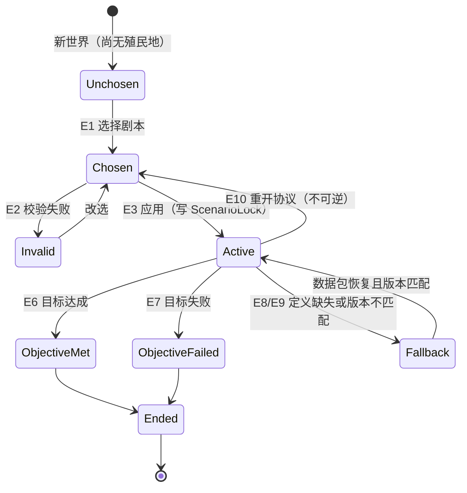
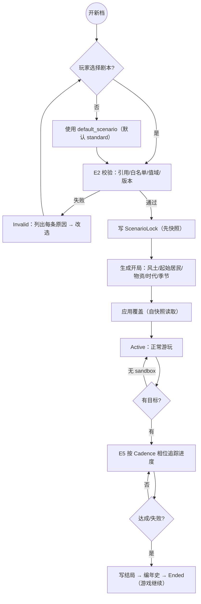

# PRD-007 · 剧本（开局与规则覆盖）

```
状态：草稿PRD
负责人：设计（人类定稿）
最后更新：2026-10-18
优先级：P1          里程碑：M2（M1 只做「教程剧本 + 标准剧本 + 覆盖链 + 来源可查」，见 §2.3）
上游依据：docs/design/01-vision-and-pillars.md（P3 世界会回应、P5 失败长出故事、P6 一切可被改写）、
         docs/design/04-world-and-simulation.md（G4 世界必须可改写、§3 三层世界、§4 气候）、
         docs/design/08-progression-and-ages.md（§2 七个时代、§3.1 三段式推进）、
         docs/design/11-freedom-design.md（§6 D1/D2/D3 改写层级）
关联文档：PRD-002（事件与叙述者：剧本只**选择**叙述者）、PRD-003（季节/温度/维生：被覆盖的数值来源）、
         PRD-005（指令与微观控制：剧本不定义指令）、PRD-006（因果诊断：复用于「这个值是谁定的」）、
         PRD-011（时代进程：起始时代与推进门槛）、PRD-012（多人权限：**尚未撰写，涉及权限处标注待对齐**）
基底依赖：`Shelves`（新增 `scenario` 货架，fork L2 改动）、world 级持久化（自建 SavedData）、
         `Colony.submit(Grown)`、`Cadence.Cron`、`RegisteringUi.page` + `Board/Row/Act`、`Scenes.folder`（Ponder）
配置层级：**剧本 > serverconfig > 整合包默认**（[pack/02 §2](../pack/02-config-and-datapack.md) R-CD-1/R-CD-3）
```

---

## 0. 一句话

> 同样是「从一块空地开始」，你可以选择生在天寒地冻的北境、荒无人烟的孤岛、还是刚被烧成灰烬的废墟里——规则会跟着变，故事也会。

---

## 1. 概述

玩家在**开新档**的那一刻遇到这个系统：一个剧本选择界面，决定他要面对的世界是什么样。

它解决的体验问题是**重复开局的疲劳**：整合包一旦玩过一轮，第二个档就是"同样的冬天、同样的掠夺者、同样的节奏"。剧本让同一个模拟内核产出**不同的开局处境**，而这不是靠增加新系统，是靠**重新分配已有的旋钮**。

所在的支柱：
- **P3 世界会回应**：严寒、荒漠、孤岛、边陲——世界先给你一个处境，你再回应它。
- **P5 失败长出故事**：「灾后重建」把"你输了"变成"你接手了一个残局"。
- **P6 一切可被改写**：剧本是最上层的数据包内容（D2），玩家社区可以自己写。

**它产生的新决策**：
- 这一局我要挑战极限（严寒/灾后）还是放松建造（富饶）？
- 剧本给的目标值得追吗，还是我要无视它当沙盒玩？
- 起始的稀缺物资优先投在吃、住、还是防御上？

**它在多大程度上是玩家的选择**：**开局完全由玩家选**（或接受标准剧本）；**规则一旦选定就在本档固化**，不能局中更换（§5.7、R-SC-3）——这是为了让"处境"成为真实约束，而不是随时可调的难度滑条。

**一句话划界**：剧本**只做三件事**——① 决定**开局条件**；② **覆盖规则默认值**；③ 声明**可选的目标与结局**。它**不是**第二个事件系统、不是任务 mod、不是新游戏（R-SC-4）。

---

## 2. 设计目标与非目标

### 2.1 目标

| 编号 | 目标 | 可判定信号 |
| --- | --- | --- |
| G1 | 开局差异**可感** | ≥8 个剧本，且任意两个剧本的前 30 游戏分钟体验可被描述出 ≥2 处不同 |
| G2 | 覆盖**可解释** | 任何被覆盖的数值都能回答「这个值是谁定的」（来源链） |
| G3 | 剧本**不膨胀** | 剧本不重复定义事件/需求/指令/叙述者机制（评审项） |
| G4 | 开局**可复现** | 同 `seed` + 同剧本 id + 同版本 → 相同的开局断言（自动化测试） |
| G5 | 与叙述者**解耦** | 剧本选 `narrator_style` 与参数，事件算法仍归 [PRD-002](PRD-002-incidents-and-narrator.md) |
| G6 | 新手**有路径** | 存在教程剧本（`tutorial`）+ **教程书** + **渐进引导**，内容由 Ponder 教学承载；**不强制**，仅在列表中推荐 |
| G7 | 加成**落在人身上** | 剧本的一切加成/减益作用于居民或殖民地系统，不得只给玩家（[ADR-013](../00-charter.md)） |
| G8 | 存档**不依赖数据包** | 开局覆盖值固化进存档；删掉数据包后已开档行为不变 |
| G9 | D2 可写 | 数据包作者不改 Java 即可新增一个完整剧本（[d11 §6](../design/11-freedom-design.md)） |

### 2.2 非目标（Non-Goals）

| 编号 | 不做的事 | 理由 | 何时可能做 |
| --- | --- | --- | --- |
| N1 | 重写事件、叙述者、需求、指令任何机制 | 剧本是**上层覆盖**，不是第二套系统（R-SC-4） | 永不做 |
| N2 | 剧本内嵌任意脚本语言（if-then 规则引擎） | 复杂度爆炸；覆盖项是**白名单键值** | 永不做（[PRD-005](PRD-005-intent-and-micro-control.md) N3 同款判断） |
| N3 | 局中更换剧本（切换处境） | 会让"处境"变成随时可逃的东西，违反 G3/§1 | M4 之后只考虑"重开协议"（OQ-8） |
| N4 | 多人各玩各的剧本 | 剧本是**存档级**世界规则，不是玩家个人规则 | 不做 |
| N5 | 胜利条件 / 排行榜 / 成就分数 | 与"失败长出故事"（P5）冲突 | M4 之后评估（OQ-3） |
| N6 | 剧本自带世界生成器（自定义地形/结构生成代码） | 需要 D3，且会与整合包的地形 mod 打架 | 不排除（OQ-4），但只允许**引用现有生成**（生物群系/结构/风土档案） |
| N7 | 剧本要求额外的必需 mod | 会让剧本清单变成依赖地狱 | 永不做（R-SC-6） |
| N8 | 剧本自动修复玩家的问题（补粮/补房/救火） | 与 [PRD-006](PRD-006-stock-rules-and-diagnosis.md) §2.2 N1 一致：我们只诊断，不代玩 | 永不做 |

### 2.3 M1 子集

M1 只做：**`standard` + `tutorial` 两个剧本** + **覆盖链（剧本 > serverconfig > 默认）** + **「这个值是谁定的」来源查询** + **剧本页（只读展示）**。

| M1 做 | M1 不做（M2 起） |
| --- | --- |
| 剧本货架 + 校验 + 固化 | 8 个完整剧本 |
| 覆盖链与来源查询 | 目标/结局系统 |
| 教程剧本（Ponder 引导） | 世界创建界面的可视化选择器（M1 用命令/配置兜底，见 §6.1） |
| 标准剧本（= 现状默认值） | 特殊风土开局（荒漠/孤岛/北境的实际生成差异） |

**理由**：M1 的目标是"骨架能跑"。剧本机制真正的风险在**覆盖链的正确性与可解释性**（一旦玩家看不懂"谁改了我的值"，整套系统就失去信任），所以先把它做扎实；内容（8 个剧本）是 M2 的批量生产。

---

## 3. 术语

### 3.1 本系统局部术语

| 术语（英文） | 中文 | 说明 | 与全局术语的关系 |
| --- | --- | --- | --- |
| `scenario` | 剧本 | 一套开局条件 + 规则覆盖 + 可选目标的具名组合 | **新增全局术语**（已登记方向：[d03](../design/03-glossary.md)） |
| `scenario_id` | 剧本 id | 如 `plaa:severe_winter` | 与其它货架 id 同规则 |
| `opening` | 开局 | 世界创建时的一次性处境设定（风土、居民、物资、起始时代/季节） | 新增 |
| `flavor` | 风土 | 开局所在地的气候/地貌档案（引用现有生物群系与世界生成） | 沿用章程用语（"不同风土、不同剧本、不同灾祸"） |
| `override` | 覆盖项 | 剧本对某个**可覆盖配置键**的赋值 | 新增 |
| `overridable` | 可覆盖 | 某配置键被声明为"允许剧本覆盖" | 新增 |
| `provenance` | 来源 | 某生效值的决定者（剧本 / serverconfig / 整合包默认） | 新增 |
| `objective` | 目标 | 剧本可选声明的追求（如"让 20 人活过第一个冬天"） | 新增；**不叫**「指令」（那是 [PRD-005](PRD-005-intent-and-micro-control.md) 的 `directive`） |
| `ending` | 结局 | 目标达成/失败后的收束（写进编年史），**不终止游戏** | 新增 |
| `scenario_lock` | 剧本锁定 | 存档创建时固化的剧本 id + 版本 + 覆盖快照 | 新增 |
| `tutorial_scenario` | 教程剧本 | 带 Ponder 引导链的开局 | 新增 |

### 3.2 与既有术语的冲突检查

| 冲突项 | Folkways 既有含义 | 本系统含义 | 解决方式 |
| --- | --- | --- | --- |
| 「剧本」 | 无 | 开局+覆盖+目标 | 新术语；**禁止**用它指代任务 mod 的「任务线」（§3.3） |
| `Order` | 保持容器内物品数量的订单 | 本系统不使用该词 | 不引入 |
| `Directive`（我们的） | [PRD-005](PRD-005-intent-and-micro-control.md) 的玩家指令 | 本系统的 `objective` **不是**指令：目标不改居民行为，只被追踪 | 明确区分（R-SC-4） |
| `narrator_style` | [PRD-002](PRD-002-incidents-and-narrator.md) 的叙述者风格（`Peaceful/Standard/Harsh/Custom`） | 剧本**选择**它，不重定义它 | 单一来源：PRD-002 |
| 「覆盖」 | 配置层级中的上级覆盖（[pack/02 §2](../pack/02-config-and-datapack.md)） | 本系统即该层级的**最上层** | 沿用 |

### 3.3 易混词禁止表（补充 [d03](../design/03-glossary.md)）

| 禁止用法 | 应当用法 | 理由 |
| --- | --- | --- |
| 把 FTB Quests 的任务线叫「剧本」 | 「任务线」/「引导任务」 | 两者机制不同（剧本改规则，任务线给目标与奖励） |
| 把剧本目标叫「胜利条件」 | 「目标（objective）」 | 我们没有胜负（N5） |
| 把剧本叫「模式（mode）」 | 「剧本」 | 基底的 `mode` 是单/多线程配置，会撞名 |

---

## 4. 概念模型

### 4.1 实体

| 实体 | 中文 | 说明 | 生命周期 | 玩家可见 |
| --- | --- | --- | --- | --- |
| `ScenarioDef` | 剧本定义 | 数据包里的 JSON（开局条件 + 覆盖项 + 目标） | 随数据包加载/重载 | 选择界面 |
| `ScenarioLock` | 剧本锁定 | 存档中固化的 id + 版本 + **覆盖快照** | 世界创建时写入，永不改（除重开协议） | 剧本页 |
| `OverrideEntry` | 覆盖项实例 | 一条生效的覆盖（键、值、来源、是否被更高层改写） | 随锁定存在 | 剧本页/「谁定的」 |
| `ProvenanceRecord` | 来源记录 | 某键的解析链（默认值 → serverconfig → 剧本） | 常驻 | 「谁定的」弹窗 |
| `Objective` | 目标 | 剧本可选声明的可判定追求（进度 0–100%） | 达成/失败后归档 | 剧本页 + 编年史 |
| `Ending` | 结局 | 目标结束时的收束文本与后续标记 | 一次性 | 编年史 |
| `TutorialStep` | 教程步骤 | 教程剧本里的 Ponder 引导链节点 | 教程剧本内 | Ponder 场景 |

### 4.2 实体之间的关系



**级联要点**：
- `ScenarioDef` 引用其它货架（叙述者、季节曲线、事件模板、时代门槛）→ **引用完整性必须校验**（[pack/02 §7](../pack/02-config-and-datapack.md) 第 5 步）。
- `ScenarioLock` 一旦写入即**自足**：即使被引用的数据包被删除，已开档仍按快照运行（G8）。
- `Objective` 只**读**殖民地状态（居民、库存、时代、事件），**不写**世界（R-SC-7）。

---

## 5. 状态机

### 5.1 状态定义

| 状态 | 中文 | 说明 |
| --- | --- | --- |
| `Unchosen` | 未选择 | 世界已创建但尚无剧本（仅命令/配置兜底路径会出现） |
| `Chosen` | 已选择 | 玩家/管理员选定剧本，尚未生成开局 |
| `Applying` | 应用中 | 校验 + 生成开局 + 固化覆盖（一次性，不可中断） |
| `Active` | 生效中 | 正常游玩；覆盖值自快照读取 |
| `ObjectiveMet` | 目标达成 | 目标进度 = 100%（游戏继续） |
| `ObjectiveFailed` | 目标失败 | 目标被判定失败（游戏继续） |
| `Ended` | 已结束 | 结局已写入编年史；剧本进入只读展示 |
| `Fallback` | 降级为已固化快照 | 剧本定义缺失/版本不匹配 → 用快照继续 + 警告（R-SC-9） |
| `Invalid` | 无效 | 校验失败（引用缺失/键不可覆盖/值越界）→ 拒绝应用 |

### 5.2 事件定义

| 事件 | 中文 | 说明 | 触发方 |
| --- | --- | --- | --- |
| E1 | 选择剧本 | 世界创建界面选择 / 命令 / 配置默认 | 玩家 / 管理员 |
| E2 | 校验剧本 | 引用完整性、可覆盖白名单、值域 | 系统 |
| E3 | 应用剧本 | 生成开局 + 写 `ScenarioLock` | 系统 |
| E4 | 查询来源 | 玩家点「这个值是谁定的」 | 玩家 |
| E5 | 目标进度更新 | 按 `Cadence.Cron` 相位检查 | 系统 |
| E6 | 目标达成 | 判定为真 | 系统 |
| E7 | 目标失败 | 判定为假且过期（若剧本声明了期限） | 系统 |
| E8 | 数据包重载 | `/reload` | 系统 |
| E9 | 存档加载 | 打开世界 | 系统 |
| E10 | 重开协议 | 管理员显式执行（不可逆，需二次确认） | 管理员 |
| E11 | 首次成立殖民地 | 玩家用殖民书成立第一个殖民地 | 玩家 |

### 5.3 扩展变量（系统状态）

| 变量 | 中文 | 类型 | 默认值 | 取值范围/单位 | 说明 |
| --- | --- | --- | --- | --- | --- |
| `scenario_id` | 剧本 id | 资源位置 | `plaa:standard` | 已注册的剧本 | 存档级 |
| `scenario_version` | 剧本版本 | 整数 | 1 | ≥1 | 不匹配 → `Fallback` |
| `seed_record` | 种子记录 | 长整数 | 世界种子 | — | 复现用（G4） |
| `chosen_by` | 选择者 | UUID | — | — | 多人审计 |
| `chosen_at` | 选择时间 | 游戏刻 + 真实时间 | — | — | 复现与审计 |
| `override_snapshot` | 覆盖快照 | 映射 | 空 | ≤256 项 | 固化值（G8） |
| `provenance_enabled` | 来源可查 | 布尔 | 是 | 是/否 | 玩家的透明度开关 |
| `objective_id` / `objective_progress` | 目标 / 进度 | 可选 + 0–1 | 无 / 0 | — | 沙盒剧本无目标 |
| `tutorial_progress` | 教程进度 | 整数 | 0 | 0–N | 仅教程剧本 |
| `second_colony_opening` | 后续殖民地开局 | 枚举 | `standard` | `standard` / `current` | 见 R-SC-11 |

### 5.4 守卫条件依赖

| 变量 | 中文 | 类型 | 来源 |
| --- | --- | --- | --- |
| `colonies_exist` | 是否已有殖民地 | 布尔 | `ColonyRegistry`（基底） |
| `world_age_ticks` | 世界年龄 | 长整数 | 基底时钟（`SimulationClock`） |
| `current_age` | 当前时代 | 枚举 | [PRD-011](PRD-011-progression-knowledge-and-space.md)（未撰写 → M1 用常量"落脚"） |
| `population` | 人口 | 整数 | [PRD-001](PRD-001-needs-mood-memory.md)/基底名册 |
| `stock_levels` | 库存水平 | 映射 | [PRD-006](PRD-006-stock-rules-and-diagnosis.md)/基底 `Stores` |
| `narrator_style` | 叙述者风格 | 枚举 | [PRD-002](PRD-002-incidents-and-narrator.md) |

### 5.5 状态转移表

| 源状态 | 事件 | 守卫条件 | 动作 | 任务/副作用 | 目标状态 |
| --- | --- | --- | --- | --- | --- |
| — | E9 加载存档 | 存档无 `ScenarioLock` | 视为隐式 `standard`（不写档） | 剧本页显示「标准（隐式）」 | `Unchosen` |
| — | E9 加载存档 | 存档有 `ScenarioLock` 且定义存在且版本匹配 | 读快照 | — | `Active` |
| — | E9 加载存档 | 定义缺失 / 版本不匹配 | 警告 + 只读快照 | 通知玩家 | `Fallback` |
| `Unchosen` | E1 选择 | 尚无殖民地（`colonies_exist=false`） | 记录选择 | — | `Chosen` |
| `Unchosen` | E1 选择 | 已有殖民地 | 拒绝（R-SC-3） | 「本档已开始，剧本不可更换」 | `Unchosen` |
| `Chosen` | E2 校验 | 引用完整 + 键可覆盖 + 值在域内 | — | — | `Chosen` |
| `Chosen` | E2 校验 | 失败 | 列出每条原因 | 拒绝应用 | `Invalid` |
| `Chosen` | E3 应用 | 校验通过 | 生成开局 + 写快照 + 写 `chosen_by/at` | 若剧本有教程 → 挂 Ponder | `Active` |
| `Active` | E11 首次立寨 | 剧本定义了开局物资 | 生成初始物资（§9.1 的合规方式） | 通知 | `Active` |
| `Active` | E5 进度 | 有目标 | 重算进度（日/时相位） | 更新剧本页 | `Active` |
| `Active` | E6 达成 | 进度 = 1 | 写结局、通知、入编年史 | 目标归档 | `ObjectiveMet` |
| `Active` | E7 失败 | 剧本声明期限且超期 | 写结局、通知 | 目标归档 | `ObjectiveFailed` |
| `ObjectiveMet` / `ObjectiveFailed` | — | — | 游戏继续（沙盒） | — | `Ended` |
| `Active` | E8 重载 | 定义被改/删 | 已开档**不受影响**（用快照） | 剧本页标注 | `Active` / `Fallback` |
| `Active` / `Fallback` | E10 重开协议 | 管理员 + 二次确认 + 无殖民地或在新增的"重开"世界 | 覆盖快照替换、标记不可逆 | 审计日志 | `Chosen` → `Applying` |
| `Invalid` | E1 选择 | 换一个剧本 | — | — | `Chosen` |

### 5.6 状态图



### 5.7 超时与中断

| 情形 | 处理 | 恢复后行为 |
| --- | --- | --- |
| 玩家在世界创建界面取消 | 不写任何状态 | 保持 `Unchosen`（隐式 `standard`） |
| `Applying` 期间崩溃/断电 | `ScenarioLock` 采用**先写快照后生成**的顺序，且带"未完成"标记 | 加载时检测到未完成 → 进入 `Active` 但**不重复生成开局**，并提示"开局生成未完成，请检查初始物资"（宁可少给，不可双给） |
| 数据包在局中被删除 | 已开档按快照运行 | `Fallback` + 剧本页标注「剧本定义缺失，使用固化值」 |
| 数据包被改（同名不同内容） | 已开档不变（G8） | 新档使用新内容；剧本页显示版本差异提示 |
| 玩家离开/断线（多人） | 选择需权限；生效后与玩家在线无关 | 重连后可见剧本页 |
| 目标引用对象消失（例：目标 NPC 死亡） | 目标判定为**失败**并写结局，不悬挂 | 目标归档 |
| 殖民地被放弃（目标主体消失） | 若有目标 → 失败；无目标 → 无事 | — |
| 区块卸载 | 剧本不依赖区块 | 无影响 |
| 教程剧本中途退出 | 教程进度持久化 | 从上次步骤继续（可跳过） |

---

## 6. 交互

### 6.1 入口与快捷键

| 操作 | 按键/手势 | 前置条件 | 结果 |
| --- | --- | --- | --- |
| 选择剧本（首选路径） | 世界创建界面的「剧本」页 | 新世界 | 写入选择并准备应用 |
| 选择剧本（M1 兜底） | `/<ns> scenario apply <id>` | 管理员 + 无殖民地 | 立即应用 |
| 默认剧本（无交互） | `default_scenario` 配置项 | 玩家未选择 | 使用配置值（默认 `standard`） |
| 查看当前剧本 | 殖民书面板 → 「剧本」页 | 手持殖民书 | 显示剧本、目标、覆盖清单 |
| 查看「这个值是谁定的」 | 剧本页任一覆盖行的「为什么」动作 | 同上 | 打开来源链弹窗 |
| 跳转教程 | 剧本页的「教程」动作 | 教程剧本 | 打开 Ponder 场景（`Scenes.folder`） |
| 查看结局 | 剧本页 → 「结局」行 | 已结束 | 显示结局文本（并链接编年史） |

> **R-UI-1**：「剧本」页必须能从**殖民书**进入（基底世界操作都需要手持殖民书，[r03](../research/03-front-and-interaction.md)），不得引入新的独立 GUI 键。
> **待验证（OQ-1）**：世界创建界面的可视化选择器需要 NeoForge 的世界创建预设编辑器事件（`RegisterPresetEditorsEvent`，**21.1.233 是否可用未验证**）。M1 **不依赖**它：先走命令 + `default_scenario` 配置；验证通过后再补 UI。这条是本 PRD 唯一的"可能做不到"项，已列为 OQ-1。

### 6.2 操作模式状态机

**不适用**：本系统**不引入**世界内的操作模式（选择剧本发生在世界创建界面或命令中，不需要指向世界选东西），因此"操作模式状态 / 模式事件 / 模式转移"三张表均记为 **不适用**（模板允许显式写不适用，见 [模板使用说明](../prd/00-prd-template.md) 第 2 条）。
若将来补上世界创建界面选择器（OQ-1），它仍是 GUI 表单而非世界内手势，本节依旧不适用。

### 6.3 面板动作（`Board.Act` 五类之内）

| 上下文 | 按钮 | 操作 | 触发事件 | 是否可撤销 |
| --- | --- | --- | --- | --- |
| 剧本页 / 覆盖行 | 「为什么」 | 打开来源链 | E4 | 是（只读） |
| 剧本页 / 目标行 | 「详情」（`Open`） | 打开目标详情 | — | 是 |
| 剧本页 / 教程行 | 「教程」（`Open`） | 打开 Ponder | — | 是 |
| 剧本页 / 结局行 | 「编年史」（`Open`） | 跳到编年史条目 | — | 是 |
| 剧本页 / 覆盖行（管理员） | 「定位来源」（`Ping`） | 高亮对应界面位置 | — | 是 |

**R-UI-2**：剧本页遵守 UI 硬预算（32 行/页、4 动作/行）；覆盖项多时使用「列表 → 详情」两级（[r03 §6.11](../research/03-front-and-interaction.md)）。

### 6.4 命令

| 命令 | 权限 | 说明 | 输出 |
| --- | --- | --- | --- |
| `/<ns> scenario list` | 所有玩家 | 列出已加载剧本（含来源数据包） | 文本列表 |
| `/<ns> scenario show` | 所有玩家 | 显示当前剧本 + 目标 + 覆盖项数 | 文本 |
| `/<ns> scenario provenance <key>` | 所有玩家 | 显示某键的来源链 | 文本（UI 同款数据） |
| `/<ns> scenario apply <id>` | 管理员 | 应用剧本（仅无殖民地时） | 成功/拒绝原因 |
| `/<ns> scenario validate` | 管理员 | 校验所有剧本（引用完整性、白名单、值域） | 每条问题一行 |
| `/<ns> scenario reopen` | 管理员 | 重开协议（不可逆） | 需二次确认 |
| `/<ns> scenario export` | 管理员 | 导出当前 `ScenarioLock` 快照（排障/复现） | JSON 文本 |

---

## 7. 反馈

### 7.1 操作模式反馈（玩家交互时）

| 检查条件 | 音效 | Toast/文案键 | 视觉反馈 | 系统行为 |
| --- | --- | --- | --- | --- |
| 选择剧本 | 确认音 | 「剧本：%s」 | 高亮选中项 | 记录选择 |
| 选择被拒绝（已有殖民地） | 低沉音 | 「本档已开始，剧本不可更换」 | 红色 | 保持 |
| 应用开始 | 提示音 | 「正在准备这个世界……」 | 进度提示 | `Applying` |
| 应用成功 | 正向 | 「%s 已生效」 | 剧本页刷新 | `Active` |
| 校验失败 | 低沉音 | 「剧本无效：%s」 | 错误列表 | `Invalid` |
| 重开协议确认 | 强烈提示 | 「这会改变本档的全部规则，且不可撤销」 | 二次确认 | 等确认 |

### 7.2 实体状态反馈（持续显示）

| 检查条件 | 图标/颜色 | 悬停信息 | 系统行为 |
| --- | --- | --- | --- |
| 剧本页常驻 | 面板行 | 「剧本：%s（%s）」 | — |
| 覆盖项存在 | 行尾标记 | 「被剧本覆盖（默认 %s → 现 %s）」 | — |
| 目标进行中 | 进度条 | 「%s：%s%%」 | E5 更新 |
| 已结束 | 灰色 | 「结局：%s」 | 归档 |
| `Fallback` | 警告色 | 「剧本定义缺失，使用固化值」 | 警告 |
| 教程进行中 | 步骤标记 | 「%s（%s/%s）」 | — |

### 7.3 系统事件反馈（非玩家触发）

| 事件 | 音效 | 通知文案键 | 视觉 | 系统行为 |
| --- | --- | --- | --- | --- |
| 开局生成完成 | 正向 | 「%s 的开局已就绪」 | — | `Active` |
| 目标达成 | 钟声 | 「目标达成：%s」 | 编年史条目 | 写结局 |
| 目标失败 | 低沉 | 「目标失败：%s」 | 编年史条目 | 写结局 |
| 剧本定义加载失败 | 警告 | 「剧本 %s 未加载：%s」（`/folkways library` 同款） | — | 跳过该剧本 |
| 已开档的剧本定义缺失 | 警告 | 「剧本定义缺失，使用固化值」 | 剧本页标记 | `Fallback` |

**R-F-1**：警告类通知必须**给出下一步**（例：「定义缺失 → `/folkways library` 查看原因 / 换回数据包」），沿用 [PRD-006 §7.3](PRD-006-stock-rules-and-diagnosis.md) 的规则。

### 7.4 可诊断性（管理者的要求）

| 玩家可能的疑问 | 系统必须能回答 | 呈现位置 |
| --- | --- | --- |
| 「这个值是谁定的？」 | 完整解析链：默认值 → serverconfig → 剧本（含剧本 id） | 「为什么」弹窗 / `scenario provenance` |
| 「为什么这个剧本没出现在列表里？」 | 加载失败原因（引用缺失/键不可覆盖/值越界/JSON 错误） | 剧本页 + `/folkways library` |
| 「为什么我的目标没进度？」 | 目标条件的当前值与阈值（逐条对比） | 目标详情 |
| 「为什么我改不了剧本？」 | 「本档已开始」（R-SC-3）+ 重开协议的说明 | Toast + 剧本页 |
| 「为什么这个开局和我记忆里不一样？」 | 剧本版本 + `seed_record` + 固化时间 | 剧本页「本档信息」 |
| 「为什么教程没出现？」 | 教程条件（仅教程剧本、且未跳过） | 教程行 |

---

## 8. 规则

| 编号 | 类型 | 规则 | 违反时的行为 |
| --- | --- | --- | --- |
| R-SC-1 | 优先级 | 生效值 = **剧本 > serverconfig > 整合包默认**；同一键只能有一个剧本值 | 解析链必须唯一；出现二义即缺陷 |
| R-SC-2 | 必须 | 每个被覆盖的键都必须能给出 `ProvenanceRecord`（谁定的） | 缺来源即评审拒绝（AC-13） |
| R-SC-3 | 禁止 | 局中更换剧本（有殖民地后）；唯一例外是显式的「重开协议」且不可逆 | 拒绝 + 说明 |
| R-SC-4 | 必须 | 剧本**只做**三件事：开局条件 / 规则覆盖 / 目标声明 | 评审拒绝（例如剧本里出现事件权重算法即违规） |
| R-SC-5 | 必须 | 覆盖值在应用时**固化**为 `ScenarioLock` 快照；此后不依赖数据包 | 数据包缺失后行为变化即缺陷（G8） |
| R-SC-6 | 禁止 | 剧本要求额外的必需 mod 依赖 | 校验期拒绝加载 |
| R-SC-7 | 必须 | 剧本的加成/减益必须作用于居民或殖民地系统（需求/情绪/生产/库存/事件/时代门槛） | 只给玩家 buff 即评审拒绝（ADR-013） |
| R-SC-8 | 必须 | 同 `seed` + 同剧本 id + 同版本 → 同开局（可断言） | 不可复现即缺陷（G4） |
| R-SC-9 | 必须 | 剧本版本不匹配 → `Fallback`（用快照 + 警告），**不得**崩溃或静默改行为 | 崩溃即缺陷 |
| R-SC-10 | 必须 | 目标/结局是**可选**的；无目标的剧本必须显式声明 `"sandbox": true` | 校验期拒绝未声明的无目标剧本 |
| R-SC-11 | 必须 | 剧本的世界级规则覆盖对**全部**殖民地生效；**开局条件**只作用于**第一个**殖民地；后续殖民地按 `second_colony_opening`（默认 `standard`） | 不一致即缺陷 |
| R-SC-12 | 必须 | 覆盖键必须**白名单化**：只有声明为 `overridable` 的键可被覆盖 | 校验期拒绝，并列出违规键 |
| R-SC-13 | 禁止 | 覆盖引擎级/安全项：线程数、`mode`、存档版本、预算上限、诊断开关、i18n | 校验期拒绝（硬编码黑名单） |
| R-SC-14 | 必须 | 剧本引用的其它货架 id（事件/叙述者/需求/季节/时代/威胁）必须通过引用完整性校验 | 校验期拒绝 + `/folkways library` 报因 |
| R-SC-15 | 必须 | 玩家可见文本**新增键双语（`zh_cn` + `en_us`）** | i18n 检查失败即 CI 失败 |
| R-SC-16 | 级联 | 剧本 → 覆盖链 → 各系统默认值；剧本 → 叙述者 → 事件权重；剧本 → 目标 → 编年史 | 级联必须在诊断中可见 |
| R-SC-17 | 必须 | 接班架构：**M1 的开局物资由世界创建阶段直接放置**（属世界生成，非运行时世界操作）；M2 起改为由居民执行的"卸货"工作（`Grown`），以符合"改世界必须走 `submit`" | M2 未改即记为技术债（AC-30） |
| R-SC-18 | 必须 | 多人：剧本为存档级；选择与重开协议需权限（**待 [PRD-012](PRD-012-multiplayer-and-permissions.md) 对齐**）；所有玩家共享同一剧本 | 不一致即缺陷 |
| R-SC-19 | 必须 | 教程剧本必须存在且**可跳过**；教程内容用 `Scenes.folder`，且**不得**自动修复玩家问题。**教程一律不得强制**（2026-10-18 裁决，OQ-5）：首次进入的新玩家不被塞进教程，**只在剧本列表中标注为推荐** | 缺失即评审拒绝（G6 + N8）；强制即缺陷（AC-41） |
| R-SC-20 | 禁止 | 在 `Applying` 阶段重复生成开局（崩溃恢复后不得双给物资） | 重复即缺陷（AC-32） |

---

## 9. 流程（与基底引擎对齐）

### 9.1 工作类型与任务

| 项 | 内容 |
| --- | --- |
| 工作类型（Vocation/Trade） | **无新增工种**。剧本不引入职业；它只改开局与规则 |
| 任务（Task/Doing） | 开局物资：M1 为世界创建阶段放置（R-SC-17）；M2 为一次性 `Grown`（"卸货"），可被拒绝（无手/无空间） |
| 参与的居民种类 | 仅基底既有的（`Declaring.residentKind` 既有集合）；剧本可**点名**起始居民的技能倾向（通过名册池/属性），但不新增种类 |
| 需要的工具/许可（Tool/Licence） | 沿用基底；剧本可通过覆盖项调整"起始许可"，但**不得**制造结构性无解（[r01 §4.3](../research/01-core-engine.md)） |

### 9.2 执行流程



### 9.3 Action 说明

| Action | 说明 | 失败/拒绝理由（Refusal） |
| --- | --- | --- |
| `SCENARIO_APPLY` | 应用剧本（校验 + 固化 + 生成） | 已有殖民地 / 校验失败 / 权限不足 / 已应用 |
| `OVERRIDE_RESOLVE` | 解析某键的生效值（读时解析，写时固化） | 键不存在 / 键不可覆盖 / 黑名单 |
| `OBJECTIVE_CHECK` | 重算目标进度 | 目标不存在 / 主体已消失（→ 失败） |
| `PROVENANCE_QUERY` | 生成来源链 | 键不存在 |
| `TUTORIAL_ADVANCE` | 推进教程步骤 | 非教程剧本 / 已跳过 |

### 9.4 生成与分配条件

| 侧 | 条件 | 说明 |
| --- | --- | --- |
| 任务侧 | 剧本有 `opening.shipment`（M2） | 生成一次性 `Grown`（卸货）；M1 不生成任务 |
| 居民侧 | 起始居民从名册池抽取，且满足剧本的 `resident_bias`（技能倾向/性格） | 抽取必须由 `seed` 决定（G4） |
| 资源侧 | 起始物资清单（物品 + 数量 + 品质门槛可选） | 数量必须在白名单与值域内；不得给"未解锁时代"的物品（R-SC-14 级联） |
| 世界侧 | 风土（生物群系/气候档案）必须能由**现有世界生成**提供 | 不能找到合适风土 → 拒绝该剧本并给原因（不改生成器，N6） |

### 9.5 计算逻辑

| 计算项 | 公式 | 变量说明 | 取值范围 |
| --- | --- | --- | --- |
| 生效值 | `effective(key) = first_defined( scenario_snapshot[key], serverconfig[key], defaults[key] )` | `first_defined` 取第一个存在者 | 键的值域 |
| 来源判定 | `provenance(key) = scenario_snapshot ? "scenario:"+id : (serverconfig_set ? "serverconfig" : "default")` | 需要区分"serverconfig 显式设置"与"未设置" | 三值 |
| 目标进度 | `progress = Σ_i ( w_i × sat_i( current ) ) / Σ_i w_i` | `sat_i` = 单条件满足度（0/1 或连续量）；`w_i` = 权重 | 0–1 |
| 开局抽取 | `pick(seed, pool, n)` | 确定性抽取（同一 `seed` 同结果） | — |
| 覆盖项上限 | `count(overrides) ≤ 256` | 与基底 `Refining.LIMIT` 无关，但保持同量级便于审查 | 0–256 |
| 教程步骤 | 全部为**可判定**的布尔条件（"放下第一块田地"） | 不允许模糊条件 | 0–N |

**R-FLOW-1**：`effective()` 必须是**纯读函数**（可被计划侧安全调用）；写只发生在 `Applying`。
**R-FLOW-2**：「serverconfig 是否显式设置」必须能被区分（否则来源链会把默认值误报为玩家设置）。

### 9.6 数值配置

| 参数 | 默认值 | 范围 | 可被数据包/配置覆盖？ | 备注 |
| --- | --- | --- | --- | --- |
| `default_scenario` | `plaa:standard` | 已注册剧本 | 配置（serverconfig）——但**不可被剧本覆盖**（自指） | 无交互路径时的兜底 |
| `scenario_overrides_max` | 256 | 0–256 | 否（引擎） | R-SC-12 上限 |
| `provenance_enabled` | true | 是/否 | 配置 | 透明度开关 |
| `objective_cadence` | 每 1 游戏小时 | 10 分钟–1 天 | 配置 | 目标检查相位（`Cadence.Cron`） |
| `objective_expiry_default` | 无 | 无 / N 天 | 剧本 | 期限默认不设 |
| `tutorial_enabled` | true | 是/否 | 配置 | 教程剧本**可用**（≠强制） |
| `tutorial_forced` | **false** | 是/否 | 配置 | **硬编码默认 false**；本 PRD 不提供"强制教程"路径（R-SC-23，OQ-5 已裁决） |
| `tutorial_guide_enabled` | true | 是/否 | 配置 | 渐进引导开关（关掉后只留教程书） |
| `tutorial_guide_max_active` | 1 | 1–3 | 否（设计约束） | 同时最多几条引导（R-SC-24） |
| `second_colony_opening` | `standard` | `standard`/`current` | 配置（**不可被剧本覆盖**，避免自指） | 见 R-SC-11 |
| `reopen_requires_confirm` | true | 是/否 | 否（安全） | 重开协议二次确认 |
| `fallback_warn` | true | 是/否 | 配置 | `Fallback` 是否弹警告 |
| `scenario_seed_from_world` | true | 是/否 | 配置 | 开局抽取是否用世界种子 |

### 9.7 首批 8 个示例剧本（**内容，不是引擎**）

> 全部以**纯数据包**形式提供（R-SC-21）：我们自带这 8 个，但第三方用同样的 JSON 能写出等价或更好的剧本。
> 「覆盖项」列只列**声明为可覆盖**的键（R-SC-12）；键名是示例写法，最终以实现时的 `overridable` 注册表为准。

| id | 一句话 | 开局差异 | 主要覆盖项 | 目标（可选） |
| --- | --- | --- | --- | --- |
| `plaa:standard` | 温带落脚，一切按默认来 | 温带平原，4 名居民，基础物资，**落脚**时代，夏初 | **无覆盖**（等于整合包默认；作为"默认值基线"的活文档） | 沙盒（`"sandbox": true`） |
| `plaa:severe_winter` | 你来得太晚了——冬天只剩十几天 | 北境/雪山，**晚秋**开局，第一个冬天在 ~12 天后；起始物资**多燃料少食物** | `season.length_days=6`、`climate.temperature_offset=-8`、`fuel.demand_multiplier=1.3`、`opening.season=late_autumn`、`opening.shipment`（燃料↑食物↓）、`narrator.style=Harsh` | 「让**全部**居民活过第一个冬天」（不允许减员） |
| `plaa:desert` | 水比金子贵，一整天都在找荫凉 | 干旱群系，降雨极少、木材稀缺；白天酷热、夜晚寒冷 | `needs.thirst.multiplier=1.5`、`crop.growth_multiplier=0.7`、`weather.rain_frequency=0.15`、`opening.flavor=arid`、`opening.shipment`（含少量水与遮阳材料） | 「建起第一处稳定水源」（蓄水/引水），且期间死亡 0 人 |
| `plaa:island` | 四面是海，没有人会来救你 | 海洋孤岛，**无陆地商队**、移民稀少；鱼类丰富，矿物与木材受限 | `trade.caravan_frequency=0`、`migration.rate=0.5`、`opening.flavor=island`、`resources.ore_abundance=0.6` | 「自给自足 N 天」（N 默认 24 游戏日，期间不得依赖任何外部输入） |
| `plaa:frontier` | 你搬到了别人的地盘上 | 紧邻敌对势力，附近有遗迹；袭击更频繁更强 | `threat.base_level=+1`、`raid.cooldown_multiplier=0.7`、`raid.strength_multiplier=1.4`、`opening.shipment`（少量武器）、`narrator.style=Harsh` | 「活过 3 次袭击」 |
| `plaa:abundant` | 一片好地，慢慢把家建起来 | 肥沃温和之地，资源丰富、袭击罕见、移民更愿意来 | `threat.base_level=-1`、`resources.abundance_multiplier=1.5`、`season.severity_multiplier=0.7`、`migration.rate=1.3`、`events.frequency=0.8` | 沙盒 **或**可选「建成 N 座建筑」（剧本二选一） |
| `plaa:aftermath` | 上一批人没能撑过去，现在轮到你们 | **残局**：3 名幸存者、库存近零、建筑成废墟、附近有旧殖民地残骸；幸存者带着**创伤记忆** | `opening.residents=3`、`opening.shipment≈0`、`needs.meaning.multiplier=1.4`、`mood.initial_penalty`、`memory.seed`（"那场火"注入，走 [PRD-001](PRD-001-needs-mood-memory.md)）、`build.ruins_density` | 「让殖民地重新站起来」（人口 ≥8 且平均情绪回到中性以上） |
| `plaa:tutorial` | 第一次玩？跟着走一遍就会了 | 温和群系、**无袭击**、物资充足、事件频率低；带 Ponder 引导链 | `threat.base_level=0`、`season.severity_multiplier=0.5`、`events.frequency=0.5`、`opening.shipment`（足量）、`tutorial.enabled=true` | 「完成教程步骤」（立寨 → 划第一块田 → 建储物 → 设作息 → 做第一次过冬准备） |

**每个剧本都必须声明的字段**（校验期强制，缺失即拒绝加载）：

| 字段 | 说明 |
| --- | --- |
| `id` / `version` | 身份与版本（R-SC-9） |
| `sandbox` | 无目标时必须 `true`（R-SC-10） |
| `opening` | 风土 / 起始居民 / 起始物资 / 起始时代 / 起始季节 |
| `overrides` | 覆盖项映射（≤256，全部键必须在白名单） |
| `refs` | 引用的其它货架 id（叙述者/季节/事件/时代/威胁），用于引用完整性校验（R-SC-14） |
| `i18n` | 名称/描述/结局的翻译键（新增键双语 `zh_cn` + `en_us`，R-I18N-2） |

**R-SC-21**：示例剧本**不得**享受引擎特权——它们与第三方剧本走完全相同的加载、校验、固化路径（AC-40 的孪生要求）。若某个剧本需要改 Java 才能生效，视为引擎缺功能而非"特例"。
**R-SC-22**：剧本的"一句话"必须能在**选择界面**里被新手读懂（禁止出现实现名词），并且与 [d03](../design/03-glossary.md) 术语一致。

### 9.8 教程与渐进引导（2026-10-18 裁决，取代"强制教程"）

**裁决：教程不强制。** 首次进入的新玩家**不会**被塞进教程——直接进自己选的剧本（默认 `plaa:standard`）；`plaa:tutorial` 在剧本列表里**置顶并标注「推荐」**，但点不点是玩家的自由（OQ-5）。

**为什么**：① 强制教程会拦住"我就是想自己摸索"的老玩家（[d06](../design/09-interaction-and-ui.md) 的低摩擦原则）；② 我们的目标用户（DF/RimWorld/SoS 玩家）**习惯边玩边学**，一段必须先看完的引导反而是流失点；③ 教程本身是剧本（`tutorial_scenario`），强制它等于**替玩家选了剧本**，与 ADR-008 的零接管默认冲突。

**教程载体三件套**（缺一不可）：

| 载体 | 内容 | 何时出现 | 约束 |
| --- | --- | --- | --- |
| **① 教程书** | 分章的图文手册（立寨 / 划第一块田 / 储物 / 设作息 / 第一次过冬 / 第一次诊断）；可随时打开、任意跳章、可标记"已读" | 玩家主动打开（殖民书里的一页 + 起始物品） | 不弹窗、不锁 UI |
| **② 渐进引导** | 基底 `Scenes.folder`（Ponder）场景，按"**第一次遇到某事**"触发（第一次放下田地、第一次有人快饿死、第一次入冬、第一次出现阻塞） | 触发时**角落提示**，可点开看，也可忽略 | 同时最多 **1 条**；同一条不重复弹（记 `seen`）；玩家关闭后不再自动弹（可在教程书里重新打开） |
| **③ 殖民书一行建议** | 把"当前最推荐的下一步"写成一行（与 [PRD-006](PRD-006-stock-rules-and-diagnosis.md) 的"结论先行"同风格） | 常驻 | 只是建议，**绝不**替玩家执行（R6/R-SC-19） |

**R-SC-23**：教程与引导**不得强制、不得阻塞、不得锁定 UI**；任何"必须先完成 X 才能操作 Y"的设计都违反本 PRD。
**R-SC-24**：渐进引导必须有**触发条件、单条上限、去重记录与关闭开关**；关闭状态持久化到存档（不是只活在本局客户端）。
**R-SC-25**：教程内容必须**仅用文字也能读懂**（Ponder 场景可省；文案与步骤条件必须文字可读、可键盘操作），且与 [d03](../design/03-glossary.md) 术语一致。

---

## 10. 数据与存档

| 项 | 内容 |
| --- | --- |
| 新增持久化字段 | `ScenarioLock`（id、版本、`seed_record`、`chosen_by/at`、`override_snapshot`、`objective_*`、`tutorial_progress`、`applied_complete` 标记） |
| 存储位置（实体/NBT/全局数据） | **世界级 SavedData**（自建一张 `plaa_scenarios` 表，范式照基底 `ColonyRegistry`，[r01](../research/01-core-engine.md)）；不放进殖民地（剧本是世界级） |
| 存档版本影响 | 需要迁移？**是**（自管版本号，独立于基底 `SaveVersion.CURRENT=1`） |
| 迁移策略 | 缺失字段取默认；无 `ScenarioLock` 的旧档 → 隐式 `standard`（**不写档**，避免污染）；有快照但缺新键 → 用默认补齐 |
| 旧存档降级行为 | 旧档打开 → 剧本页显示「标准（隐式）」；无任何行为变化 |
| 回滚（卸载本 mod）行为 | 存档可加载；`plaa_scenarios` 表被忽略（**不得崩溃**）；已固化的覆盖值失效 → 回到 serverconfig/默认（这正是"卸载即回到基底行为"的预期） |
| 数据包缺失 | `Fallback`：快照继续生效（G8） |
| 存档体积 | `override_snapshot` ≤256 项 ≈ 数十 KB 上限；目标与教程极小 |

**R-DATA-1**：`ScenarioLock` 必须**先写后生成**（§5.7），且带 `applied_complete` 标记，用于崩溃恢复时避免重复生成。
**R-DATA-2**：`ScenarioLock` 一旦写入**只能被重开协议替换**，任何其它代码路径不得写它（可加开发期断言）。

---

## 11. 网络与多人

| 项 | 内容 |
| --- | --- |
| 权威端 | 服务端 |
| 需同步的状态 | 剧本 id/版本、目标与进度、覆盖项数（详情按需拉取）、`Fallback` 警告 |
| 同步频率与方式 | 登录时全量（小包）；目标变更时推送；剧本页打开时按需 |
| 权限（谁能操作） | 查看：所有玩家；选择/应用/重开：管理员（**待 [PRD-012](PRD-012-multiplayer-and-permissions.md) 对齐**）；教程跳过：玩家自己 |
| 多人并发冲突处理 | 选择/应用**先到先得**，成功后广播选择者（`chosen_by`）；重开协议需二次确认且占用独占锁 |
| 断线/重连行为 | 剧本与目标状态从服务端重取；教程进度服务端权威 |
| 单人离线 | 无影响（剧本不依赖在线玩家） |
| 服务器配置文件 | `default_scenario` 可在服务器配置里锁定，防止玩家自选（服务器管理员常见需求） |

**R-MP-1**：剧本选择**不得**因等待某个玩家而阻塞世界创建（同时只能有一个 `Applying`）。
**R-MP-2**：所有玩家看到的剧本、目标、覆盖链必须一致（同一份服务端数据）。

---

## 12. i18n（双语：`zh_cn` + `en_us`）

> **口径（[ADR-017](../00-charter.md)）**：我们新增的键只做两份；基底既有四语言文件保留不动，缺键回退 `en_us`。

键族（示例以 `zh_cn` 给出；**新增键 `zh_cn` + `en_us` 必须齐全**）：

| 键族 | 例（zh_cn） |
| --- | --- |
| `<ns>.page.scenario` | 剧本 |
| `<ns>.scenario.name.<id>` | 标准 / 严冬 / 荒漠 / 孤岛 / 边陲 / 富饶 / 灾后重建 / 教程 |
| `<ns>.scenario.desc.<id>` | 一句话描述（选择界面用） |
| `<ns>.scenario.sandbox` | 沙盒（无目标） |
| `<ns>.scenario.locked` | 本档已开始，剧本不可更换 |
| `<ns>.scenario.fallback` | 剧本定义缺失，使用固化值 |
| `<ns>.scenario.reopen.warn` | 这会改变本档的全部规则，且不可撤销 |
| `<ns>.provenance.title` | 这个值是谁定的 |
| `<ns>.provenance.default` / `.serverconfig` / `.scenario` | 整合包默认 / 世界配置 / 剧本：%s |
| `<ns>.objective.progress` | %s：%s%% |
| `<ns>.objective.met` / `.failed` | 目标达成：%s / 目标失败：%s |
| `<ns>.tutorial.step.<n>` | 教程步骤文案 |
| `<ns>.cmd.scenario.list` 等 | 命令输出（含每行来源 pack） |

**R-I18N-1**：来源链文案必须支持**至少两个参数**（键名 + 决定者），不允许硬编码整句。
**R-I18N-2**：剧本的名称/描述/结局文本必须**由数据包提供翻译键**，缺翻译时回退到 `en_us` 并在 `/folkways library` 中报缺（[pack/02 §7](../pack/02-config-and-datapack.md)）。

---

## 13. 性能预算

| 项 | 估算 | 依据 | 上限 |
| --- | --- | --- | --- |
| 每 tick 额外耗时（常态） | ≈0（只在目标相位检查时有工作） | `Cadence.Cron` 相位 | <0.1%（[性能预算](../pack/03-performance-budget.md)） |
| 每 tick 额外耗时（峰值） | 应用剧本时一次性 O(覆盖项 + 起始居民 + 物资) | 世界创建阶段 | ≤1%（非稳态） |
| 每 tick 分配对象数 | 0（常驻数据为不可变快照） | 快照为只读映射 | 0 |
| 内存增量（每居民/每实体） | 0（剧本不按居民存状态） | — | — |
| 内存增量（世界级） | 快照 ≤256 项 + 目标 + 教程 ≈ 数十 KB | — | ≤512 KB |
| 网络包增量 | 登录 1 小包 + 目标变更时 | — | ≤2 KB/s |

**R-PERF-1**：目标检查必须复用 `Cadence.Cron` 并与需求/事件/季节结算**错相位**（避免同日同 tick 撞车）。
**R-PERF-2**：必须提交探针（应用耗时、目标检查耗时、覆盖项数）——沿用 [PRD-006 §13](PRD-006-stock-rules-and-diagnosis.md) 的做法。

---

## 14. 与基底 API 的关系

> **fork 后分层纪律（[d12 §5](../design/12-fork-strategy.md)）**：本 PRD **只允许 L1（新文件）与 L2（小改上游文件）**，**不得出现 L3/L4**。若某项被判定必须 L3，则升级为独立评估并回写本节。

| 需求 | 用到的 Folkways 扩展点 | 层 | 备注 |
| --- | --- | --- | --- |
| 新增 `scenario` 货架 | `Shelves` 注册表扩展（[pack/02 §4.2](../pack/02-config-and-datapack.md)） | **L2** | 复用 `/reload` 与 `/folkways library` 自检（R-CD-8/R-CD-11）；登记改动表 + `// PLA:` 标记 |
| 世界级持久化 | 自建 `SavedData`（范式照 `ColonyRegistry`） | **L1** | 不碰基底类 |
| 读取 serverconfig 值 | 基底 serverconfig 读点（需确认公开性，[r04 §4](../research/04-content-and-modding.md)） | **L1/L2** | 若读点包私有 → L2 提升只读访问；必须在 Plan 阶段确认 |
| 面板页 | `RegisteringUi.event.page` + `Board/Row/Act` | L1 | 剧本页 |
| 来源链弹窗 | [PRD-006](PRD-006-stock-rules-and-diagnosis.md) 的诊断卡承载（不另造 UI） | L1 | R-SC-2 的实现载体 |
| 教程 | `Scenes.folder`（Ponder） | L1 | 教程剧本 |
| 目标检查节奏 | `Cadence`（`Cron`/`claim`） | L1 | 与其它系统错相位 |
| 开局物资（M2） | `Colony.submit(Grown)` + `NodeSpec` | L1 | 居民卸货（R-SC-17） |
| 起始居民抽取 | 基底名册池/移民机制（`Registering.admission` 等） | **L2** | 若要按剧本指定技能倾向，可能需扩展入场参数 → 若被迫 L3 则降级为"用既有随机池 + 覆盖项调概率"（OQ-2 相关） |
| 世界创建界面选择器 | NeoForge 预设编辑器事件（`RegisterPresetEditorsEvent`） | L1 | **待验证**（OQ-1）；M1 不依赖 |
| 编年史写入 | [PRD-002](PRD-002-incidents-and-narrator.md) 的编年史接口 | L1 | 结局 → 编年史 |

**R-SC-API-1**：若「起始居民技能倾向」必须改动基底入场逻辑（L3），则**降级**为"只调概率不改结构"，并把该限制写入 §18 OQ——不允许为了剧本动核心入场流程。

---

## 15. 可改写性（数据包 / 脚本 / 配置）

| 内容 | 是否可被数据包覆盖 | 货架/路径 | 玩家可否热重载 |
| --- | --- | --- | --- |
| 剧本定义（开局/覆盖/目标） | **是**（D2） | `data/<ns>/folkways/scenario/<id>.json` | 是（`/reload`；**只影响新档**，已开档用快照） |
| 剧本名称/描述/结局文案 | 是 | 语言目录 `assets/<ns>/lang/` | 是 |
| 可覆盖键白名单 | 否（引擎，需改 Java） | — | — |
| 覆盖项上限 / 相位 / 兜底剧本 | 否（配置） | `serverconfig` | 部分 |
| 教程步骤 | 是（引用 Ponder 场景 id） | `scenario` + `Scenes` | 是（新档） |
| 起始物资清单 | 是 | `scenario` | 是（新档） |
| 风土（生成） | **否**（N6；只允许引用现有生物群系/结构标签） | — | — |

**D 层归属**：剧本本身是 **D2**（数据包作者可写完整剧本，[d11 §6](../design/11-freedom-design.md)）；只有"新增可覆盖键""新增目标条件类型"才是 **D3**。
**R-MOD-1**：新增**目标条件类型**必须先在文档里定义语义，再实现；不允许剧本写任意表达式（N2）。

---

## 16. 验收检查（Acceptance Criteria）

> 每条可判定；标注「可自动化」或「需人工」。

### 16.1 交互

- [ ] AC-1 殖民书能打开「剧本」页，显示剧本名、版本、目标、覆盖项数（可自动化）
- [ ] AC-2 剧本页有「为什么」入口，能打开来源链（可自动化）
- [ ] AC-3 教程剧本有「教程」入口，能打开 Ponder 场景（可自动化）
- [ ] AC-4 有殖民地时执行 `scenario apply` 被拒绝并给出原因（可自动化）
- [ ] AC-5 `scenario list` 列出所有已加载剧本及来源 pack（可自动化）
- [ ] AC-6 已结束的剧本能在剧本页看到结局文本并跳到编年史（可自动化）

### 16.2 反馈

- [ ] AC-7 选择/应用/失败/重开各有独立文案（**双语齐全 `zh_cn` + `en_us`**）（可自动化：i18n 检查）
- [ ] AC-8 `Fallback` 状态在剧本页以警告色显示（可自动化）
- [ ] AC-9 加载失败的剧本在 `/folkways library` 中能看到原因（可自动化）
- [ ] AC-10 目标进度实时显示百分比，且详情逐条列出条件当前值（需人工 + 截图）
- [ ] AC-11 警告类通知必须包含下一步（文本检查）（可自动化）

### 16.3 规则

- [ ] AC-12 覆盖优先级为 剧本 > serverconfig > 默认（构造三档冲突用例）（可自动化）
- [ ] AC-13 每个被覆盖键都能给出来源链，且与解析结果一致（可自动化）
- [ ] AC-14 不可覆盖键（含黑名单：`mode`/线程数/存档版本/预算/i18n）被拒绝并列出（可自动化）
- [ ] AC-15 引用不存在的货架 id 的剧本被拒绝加载（可自动化）
- [ ] AC-16 无目标剧本必须 `"sandbox": true`，否则被拒绝（可自动化）
- [ ] AC-17 局中改剧本被拒绝（AC-4）；重开协议需二次确认（需人工）
- [ ] AC-18 剧本加成只作用于居民/殖民地系统（无"仅玩家 buff"字段；schema 检查）（可自动化）
- [ ] AC-19 剧本要求额外必需 mod 时被拒绝（可自动化）
- [ ] AC-20 同 seed + 同剧本 + 同版本 → 相同开局抽取（可自动化）
- [ ] AC-21 世界级覆盖对第二个殖民地同样生效，且第二个殖民地开局为 `standard`（可自动化）
- [ ] AC-22 教程内容不得自动修复玩家问题（评审检查：无"补粮/补房"动作）（需人工）

### 16.4 流程与数值

- [ ] AC-23 `effective()` 为纯读函数，可在计划侧安全调用（线程断言测试）（可自动化）
- [ ] AC-24 覆盖项 >256 时被拒绝（可自动化）
- [ ] AC-25 目标进度公式在固定输入下结果确定（单元测试）（可自动化）
- [ ] AC-26 `default_scenario` 与 `second_colony_opening` **不可**被剧本覆盖（自指防护）（可自动化）
- [ ] AC-27 起始物资不得包含"未解锁时代"的物品（时代门槛校验）（可自动化）

### 16.5 状态、数据与边界

- [ ] AC-28 存档往返后 `ScenarioLock`（含快照）逐字段一致（可自动化：gametest）
- [ ] AC-29 删除数据包后已开档行为不变（快照继续生效）（可自动化）
- [ ] AC-30 M2 起开局物资由居民 `Grown` 完成；M1 为世界生成直接放置且有文档标注（需人工/评审）
- [ ] AC-31 卸载本 mod 后存档可加载，不崩，剧本行为回到默认（可自动化）
- [ ] AC-32 `Applying` 中途中断后重新加载不会重复生成开局（可自动化）
- [ ] AC-33 目标主体消失（殖民地被放弃）→ 目标判失败并写结局，不悬挂（可自动化）
- [ ] AC-34 版本不匹配 → `Fallback` + 警告，绝不崩溃或静默改行为（可自动化）
- [ ] AC-35 旧档（无 `ScenarioLock`）打开后不写档、行为不变（可自动化）

### 16.6 性能与多人

- [ ] AC-36 常态 tick 增量 <0.1%，目标检查与其它 Cadence 相位不撞（bench 探针）（可自动化）
- [ ] AC-37 双客户端：剧本、目标、覆盖链一致；并发选择先到先得并广播选择者（可自动化：多人 e2e）
- [ ] AC-38 权限：非管理员不能选择/重开；查看不受限（**待 PRD-012 对齐后定稿**）（可自动化）

### 16.7 i18n

- [ ] AC-39 剧本相关新增键在**双语（`zh_cn` + `en_us`）**中齐全且占位符一致（可自动化）

### 16.8 可改写性

- [ ] AC-40 不改 Java，仅用一个 JSON 新增一个可用剧本（D2 成立）（可自动化：内容校验 + gametest）

---

## 17. 测试计划（TDD）

| 测试 | 类型（单元/无头/e2e/人工） | 覆盖的 AC | 备注 |
| --- | --- | --- | --- |
| 覆盖解析（三档冲突矩阵 + 来源链） | 单元 | AC-12/13/26 | 纯函数，最易测 |
| 白名单与黑名单校验 | 单元 | AC-14/15/16/19/24/27 | 构造非法剧本夹具 |
| 覆盖快照序列化/反序列化 | 单元 | AC-28 | 字段级 |
| 目标进度公式 | 单元 | AC-25 | 固定输入 |
| 确定性开局抽取 | 单元 | AC-20 | 同 seed 同结果 |
| 世界创建 + 剧本应用 | gametest | AC-1/6/21/28/35 | 断言开局状态与快照 |
| 崩溃恢复（`applied_complete`） | gametest（模拟"先写后生成"中断） | AC-32 | 关键边界 |
| 数据包删除后继续运行 | gametest | AC-29/34 | 删除 `scenario` 目录后加载 |
| 卸载 mod 后加载 | gametest | AC-31 | 与 [d12 §9](../design/12-fork-strategy.md) 发布回滚一致 |
| 剧本页与来源链渲染 | e2e（Linux） | AC-1/2/3/8/10 | 视觉门禁 |
| 多人并发选择/权限 | e2e（Linux，双客户端） | AC-37/38 | 待 PRD-012 |
| 性能探针 | bench（Linux） | AC-36 | 常态与峰值 |
| 内容校验（8 个剧本全加载 + 引用完整性 + 新增键双语） | CI（静态） | AC-9/39/40 | 纳入发布门禁 |

---

## 18. 待细化 / 开放问题

| 编号 | 问题 | 影响 | 何时必须定 | 谁定 |
| --- | --- | --- | --- | --- |
| OQ-1 | 世界创建界面的可视化选择器（NeoForge `RegisterPresetEditorsEvent` 在 21.1.233 是否可用）？不可用则永久用命令 + 配置 | 新手体验与 G1 | **M2 前（Plan 第一件事）** | 实现 agent |
| OQ-2 | 是否允许管理员"软覆盖"（局中改个别值，如季节长度）？当前禁止（R-SC-3） | 服务器运营弹性 vs 处境真实性 | M2 前 | 人类 |
| OQ-3 | 目标/结局是否引入"胜利条件"与传说页汇总？当前只有目标+结局，无胜负（N5） | 终局体验 | M3 前 | 人类 |
| OQ-4 | 剧本是否可带自定义地图/结构（引用现成生成 vs 自带生成器，N6）？ | 荒漠/孤岛的实际差异强度 | M2 前 | 人类 + 实现 agent |
| OQ-5 | ~~教程剧本是否对首次进入的新玩家**强制**？~~ | **已裁决：不强制**——`plaa:tutorial` 在剧本列表**置顶标注「推荐」**，但玩家可自由选择；教程由**教程书 + 渐进引导（Ponder）+ 殖民书一行建议**三件套承载（§9.8，R-SC-19/23/24/25） | ✅ 已定（2026-10-18） | 人类 |
| OQ-6 | 与任务 mod（FTB Quests）的关系：剧本目标与任务线互操作（事件互通）还是互斥？ | 整合包一体化程度 | M2 前 | 人类 |
| OQ-7 | 剧本版本迁移策略：跨大版本（如我们 0.x → 1.0）如何迁移 `override_snapshot`？ | 长期存档兼容 | M3 前 | 实现 agent |
| OQ-8 | 「重开协议」到底做不做（它违反 N3 的精神，但服务器运营需要）？ | 是否保留 E10 | M2 前 | 人类 |
| OQ-9 | 「起始居民技能倾向」能否不升到 L3 实现（R-SC-API-1）？ | 剧本差异化深度 | M2 前 | 实现 agent |

---

## 19. 变更记录

| 日期 | 状态 | 变更 | 操作者 |
| --- | --- | --- | --- |
| 2026-10-18 | 草稿PRD | 首次起草：确立「剧本只做三件事」的边界、剧本 > serverconfig > 默认的三级覆盖与来源可查、开局固化（删数据包不影响已开档）、8 个示例剧本、5 组 R-SC 规则族（20 条）、40 条 AC；明确 L1/L2 分层与两处待验证项（世界创建 UI、serverconfig 读点） | 设计 agent |