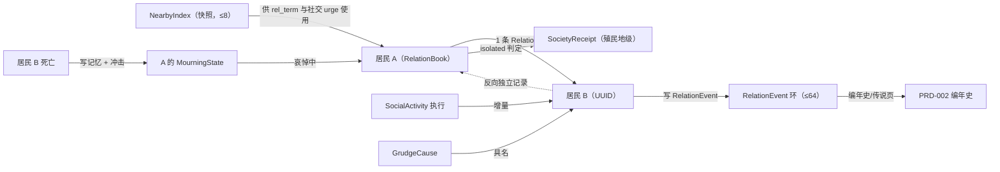
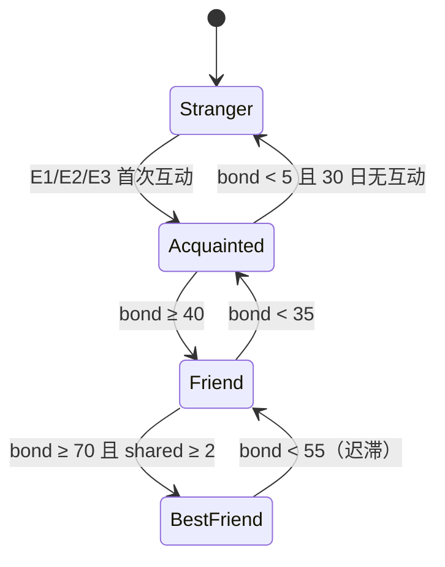
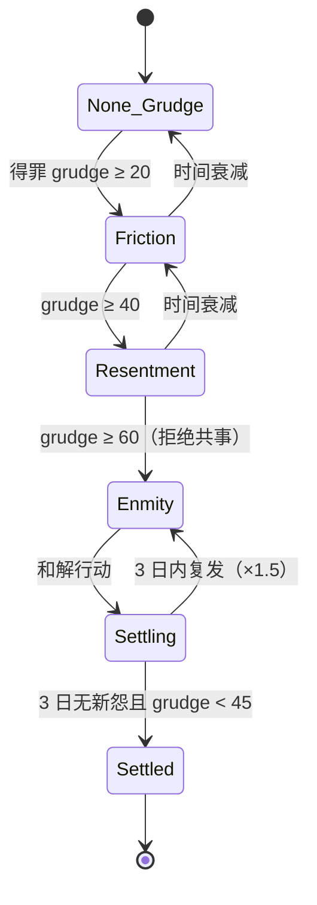
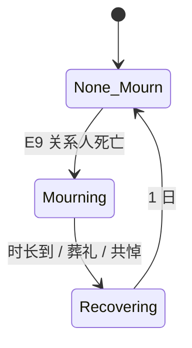
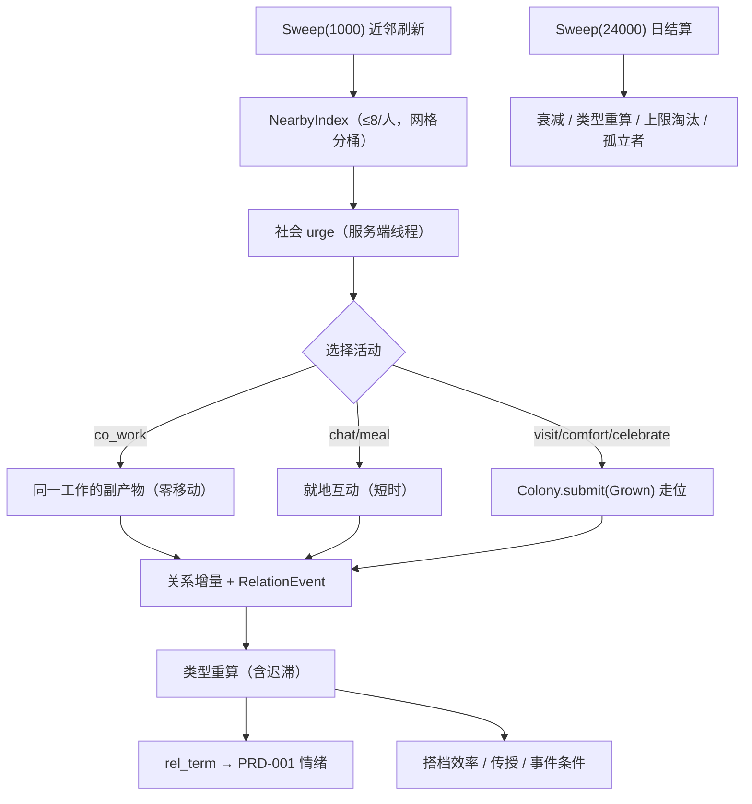
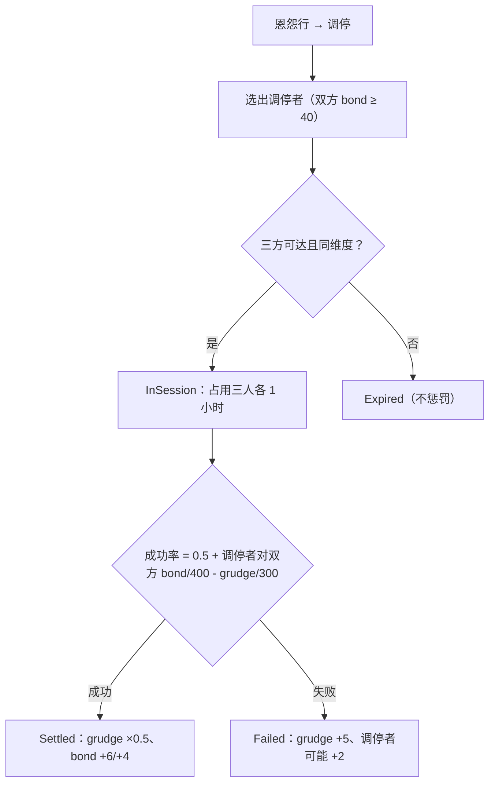

# PRD-008 · 关系与社交

```
状态：草稿PRD
负责人：设计（人类定稿）
最后更新：2026-10-18
优先级：P0          里程碑：M2（M1 子集见 §2.3；PRD-001 的社交需求在 M1 就需要"对象"）
上游依据：docs/design/05-settlement-and-residents.md（§4 关系与社交、§6 死亡与葬礼、R-PERF-1、OQ-P-4）、
         docs/design/01-vision-and-pillars.md（P2 每个人都是一个故事、P5 失败长出故事）、
         docs/research/07-mc-landscape.md（§关系：跨居民关系网/恩怨/师徒/血亲**无现成通用件** → 自研）
关联文档：PRD-001（需求/情绪/记忆：社交需求、`rel_term`、记忆上限 20、R5 禁止 O(n²)）、
         PRD-002（事件：关系标签变化）、PRD-004（伤亡 → 关系人记忆/哀悼）、PRD-006（因果诊断）、
         PRD-009（世代与传承：婚育/葬礼/家户 —— **尚未撰写，此处只留接口**）、
         PRD-011（知识与太空：§9.2「传授」需要师徒关系）、PRD-012（多人：私密信息可见性降级）、
         docs/design/12-fork-strategy.md（改动分层）、docs/pack/03-performance-budget.md（§2 关系预算 ≤8% 总额）
基底依赖（均为**已核实**的公开扩展点，见 §14 与依据列）：
         `Declaring.colony/urges` + `ColonyContext.share/urges/tick/closed`、`Colony.residents()`、
         `ColonyView.residents()`/`rankOf`、`Colony.service`、`Colony.keep`、`Sweep`、`Cadence.Cron`、
         `Urge`/`UrgeSource`（服务端线程）、`RefusalKind`（**接口**，可自定义）、`Balk`、
         `Stake`/`Participations`、`core/api/persist` 的 `Reader`/`Writer`/`Entries`、
         `front/api` 的 `Facing`/`Enrollment`/`Schema`/`Notice`/`Sentence`/`Line`/`Meter`/`Board`/
         `RegisteringUi`/`Inlay`/`Bay.RESIDENT`/`Nook`/`Outline`/`Scenes`
```

> **依据约定**：本文所有「基底事实」都带 `文件:行号`。`Folkways*` 路径相对 `reference/folkways-master/src/main/java/io/github/izakyl/folkways/`（本次直读，A 级证据）；标注「⚠️ 待确认」的是尚未核实的假设，必须在 Plan 阶段核实后回填。

---

## 0. 一句话

> 你的居民会**记住彼此**：谁救过他、他欠谁、他为什么不肯和某个人一起干活——而这些都会改变化石的日常。

---

## 1. 概述

玩家在什么情境下遇到这个系统：两名居民在同一个工坊里干活，速度明显变快；两个人一见面就绕开；一个人死了，另外三个人停工两天；一个老手带着学徒，知识传下去了。

**它解决什么体验问题**：基底的居民是**没有过去的人**——他们一起劳作、一起吃饭，但彼此之间不留痕迹。[r01 §4.1](../research/01-core-engine.md) 的结论是事实：`core/api` 里**不存在**关系模型；[r07 §关系](../research/07-mc-landscape.md) 进一步确认**跨居民的关系网/恩怨/师徒/血亲链条在 MC 生态里没有现成通用件**。没有关系，[d05 §4](../design/05-settlement-and-residents.md) 的「每个人都是一个故事」与 [PRD-001](PRD-001-needs-mood-memory.md) 的社交需求（100/48 小时的衰减曲线已经写好，但**没有对象**）都无法成立。本系统服务支柱 **P2（每个人都是一个故事）** 与 **P5（失败长出故事）**。

**它产生的新的决策**（没有新决策的系统不允许立项）：

| 决策 | 代价面 |
| --- | --- |
| 让谁和谁搭档（效率 +8%，还是要绕开一段恩怨） | 人事安排变成有内容的选择，而不是纯数值 |
| 要不要花人力/物资去**调停**一段会影响生产的恩怨（道歉、送礼、请人斡旋） | 立刻的成本 vs 长期的合作效率 |
| 让老手带学徒（产出下降几天）还是继续满负荷生产 | 与 [PRD-011](PRD-011-progression-knowledge-and-space.md) 的知识传授直接耦合 |
| 出了人命之后，是先安抚（停一部分工）还是压着继续干 | 与 [PRD-001](PRD-001-needs-mood-memory.md) 的崩溃、[PRD-004](PRD-004-threats-and-defence.md) 的伤亡串联 |
| 要不要让两个互相看不顺眼的人共用一间工坊/一张桌子 | 空间规划带上人际关系 |

**它在多大程度上是玩家的选择**：关系的**形成与演变由居民自己完成**（玩家不能直接编辑两个人的好恶）；玩家能做的是**创造条件**（安排搭档、共餐、调停、送礼、办葬礼）与**利用条件**（人事、传授、分工）。这条边界是 [d11 R-F2](../design/11-freedom-design.md) 在人际层面的同一原则——**我们不替居民决定喜欢谁**。

---

## 2. 设计目标与非目标

### 2.1 目标（Goals）

| 编号 | 目标 | 可判定信号 |
| --- | --- | --- |
| G1 | 关系是**稀疏、有上限、随事件生长**的 | 每人 ≤ `relation_cap`（默认 30）条；无交互则无关系；上限淘汰规则可测 |
| G2 | 好感与怨恨**是两个维度**，不得压成一个数 | `bond` 与 `grudge` 独立存储；「爱恨交织」是可表达的状态（60/70 并存） |
| G3 | 关系改变**玩法**，且可测量 | 至少 4 条：搭档效率、`rel_term`、事件条件、知识传授、哀悼（§9.3） |
| G4 | 社交**就地 + 低频**，不抢出行预算 | 8 类活动中 5 类零新增移动；社交出行压力 ≤5%（自适应降频闸门，§9.4） |
| G5 | 恩怨有**前兆、原因与和解路径** | 每次 grudge 增量都有 `cause`；≥5 条和解路径（道歉/送礼/共同经历/调停/时间） |
| G6 | 死亡有重量 | 关系人获得按关系深度缩放的记忆与情绪冲击 + 哀悼状态；讣告含关系人 |
| G7 | 复杂度与人口**线性**相关 | 边数 `O(pop × cap)`；日结算耗时随人口线性；禁止任何 O(pop²) 遍历（AC-34~AC-38） |
| G8 | 一切可被诊断 | 「为什么这两个人不肯一起干活」有统一诊断卡（接 [PRD-006](PRD-006-stock-rules-and-diagnosis.md)） |

### 2.2 非目标（Non-Goals，本次不做）

| 编号 | 不做的事 | 理由 | 何时可能做 |
| --- | --- | --- | --- |
| N1 | 恋爱/婚姻/生育/遗传的完整机制 | 属于 [PRD-009](PRD-009-generations-and-legacy.md)（世代与传承，尚未撰写）；本 PRD 只提供「伴侣」关系类型与接口 | PRD-009 |
| N2 | 家族/王朝/贵族/政治派系 | 同上，且与 [PRD-010](PRD-010-diplomacy-and-trade.md) 的外交层重叠 | PRD-009/010 |
| N3 | 犯罪、审判、惩罚、流放的政治流程 | 与「居民是自主的人」张力冲突；玩家有的是「调停」而不是「审判」 | 不计划 |
| N4 | 关系图/曲线图/谱系图等可视化 | 基底**没有图表组件**（r03 §6.11）；本节一律用**列表 + 标签 + 两条计量条** | 不计划 |
| N5 | 玩家与居民之间的恋爱/婚姻 | 玩家不是居民实体（关系是**居民之间**的，§11）；玩家只有行动（送礼/调停） | 不计划 |
| N6 | 逐 tick 的社会模拟 | 出行预算 8 ms/tick 是公共资源（[r01 §4.6](../research/01-core-engine.md)）；社交是**日结算 + 事件增量** | 不计划 |
| N7 | 由 LLM/文本生成驱动的对话内容 | 内容必须可被数据包改写与**双语翻译**（`zh_cn` + `en_us`，P6）；不做不可审计的动态文本 | 不计划 |
| N8 | 玩家直接编辑两个人之间的好恶 | 违反「不替居民决定喜欢谁」（§1）；只提供**创造条件**的行动 | 不计划 |
| N9 | 强迫婚配/指定伴侣 | 与 N8 同源；伴侣必须是**双方互认**（§9.2） | 见 OQ-2 |

> **非目标清单不为空**，范围已收敛。

### 2.3 M1 子集（因为 PRD-001 的社交需求在 M1 就需要对象）

| 项 | M1 做 | M1 不做 |
| --- | --- | --- |
| 存储 | `RelationBook`（**仅 `bond` 轴**），每人 ≤ 30 条 | `grudge` 轴、`debt`、`flags` |
| 类型 | 3 类派生标签：`acquaintance`（相识）/`friend`（朋友）/`best_friend`（挚友，仅阈值，不需共同经历） | 亲属/伴侣/师徒/同袍/对手/仇敌/恩人/债主 |
| 活动 | `co_work`（零移动）/`chat`（就地）/`meal_together`（零移动） | 探访/慰问/庆贺/争执/共悼 |
| 情绪 | `rel_term` 的**正项 + 孤立项**（§9.5） | 负项（无 grudge） |
| 死亡 | 关系人**写记忆**（接 PRD-001 §5.8 已留的接口） | 哀悼状态机、讣告扩展、葬礼 |
| UI | 居民窗口关系块（top 3 + 计数） | 「人际」页、关系卡、调停/道歉/送礼动作 |
| 诊断 | 无 | `SocietyRefusal` 与 PRD-006 集成 |

**理由**：M1 只解决「社交需求有对象」这一件事，且全部落在**零新增出行**的活动上（`co_work`/`meal_together`），风险最低；恩怨是最容易做坏的部分，放到 M2 并带完整的和解与诊断。

---

## 3. 术语

### 3.1 本系统局部术语

| 术语（英文） | 中文 | 说明 | 与全局术语的关系 |
| --- | --- | --- | --- |
| `bond` | 亲近 | 0–100 的**正向**维度（共同经历、互助、共餐累积） | 新增 |
| `grudge` | 怨恨 | 0–100 的**负向**维度，**与 bond 并存**，不互相抵消 | 新增 |
| `relation` | 关系 | 一对居民之间的二元记录（`bond` + `grudge` + 类型 + 债务） | 新增（全局术语表需登记） |
| `relation_kind` | 关系类型 | 派生/互认的类型标签（朋友、仇敌、师徒…） | 新增 |
| `relation_book` | 关系簿 | 一名居民的全部关系（≤ `relation_cap` 条） | 新增 |
| `grudge_cause` | 怨因 | 一次怨恨增量的具名原因（货架定义） | 新增 |
| `social_activity` | 社交活动 | 可发生的社交行为定义（货架定义） | 新增 |
| `debt` | 亏欠 | 单向的「我欠他」度量（受恩/受助累积），可被报答清零 | 新增 |
| `comrade` | 同袍 | 共同经历过危险/灾难的关系类型（由 `shared` 计数派生） | 新增 |
| `rival` | 对手 | 竞争性关系（同职业 + 名次相近 + 争同一份工作），**不等于**仇敌 | 新增 |
| `mourning` | 哀悼 | 关系人死亡后的限时状态（情绪冲击 + 行为倾向） | 新增 |
| `isolated` | 孤立者 | 没有任何 `bond ≥ 20` 关系的居民（诊断与叙事上的重要状态） | 新增 |
| `mediation` | 调停 | 由第三方（居民或玩家指派）介入的恩怨和解行动 | 新增 |
| `social_damper` | 社交降频闸门 | 出行压力超限时自动拉长社交冷却的自适应机制（§9.4） | 新增 |

### 3.2 与既有术语的冲突检查

| 冲突项 | Folkways 既有含义 | 本系统含义 | 解决方式 |
| --- | --- | --- | --- |
| `Household` | 基底 living 插件的**床位/睡眠/餐食教学场景名**（`HouseholdScene.java:46`：`"Household: beds, sleep and meals"`） | 我们**不使用**该词；家庭/家户概念归 [PRD-009](PRD-009-generations-and-legacy.md)，本 PRD 用「亲属（kin）」 | 改名避让 |
| `Balk` | **单次工作的**持久拒绝标记（`Balk(Doing, RefusalKind, long at)`，`Balk.java:6`、`FRESH_TICKS = 200`） | 我们的「不愿与某人共事」是**跨工作、跨时间**的，不能塞进 `Balk` | 用 `RefusalKind`（接口，可自定义）+ 关系簿表达；是否扩展 `Balk` 见 OQ-6 |
| `opinion` / 好感 | 基底无此概念 | 生态常用「好感」= 单个数（RimWorld/MCA 风格） | **禁止**：我们用 `bond` + `grudge` **两轴**，不接受任何单值「好感」字段 |
| `Stake`/`Participation` | 某居民种类是否参与某内容（`Stake.urge/vocation/passage`，`Stake.java:8,10,12`） | 本系统用 `Stake.urge(folkways:society)` 控制「谁参与社交」 | 复用，不新建 |
| `resident` 人名 | 基底 `resident_name` 注册表（r02 §4） | 同名不同人必须靠 UUID 区分，**不得用名字做关系键** | 强制 UUID 键 |
| `friend` / `enemy` | 生态里常指玩家声望阵营（`realms`，PRD-010） | 我们的是**居民之间**的 | PRD-010 的势力关系一律称「势力态度（stance）」 |

> 全局术语以 [全局术语表](../design/03-glossary.md) 为准；本文新增 14 条全局术语，必须在实现前回填该表。

---

## 4. 概念模型

### 4.1 实体

| 实体 | 中文 | 说明 | 生命周期 | 玩家可见 |
| --- | --- | --- | --- | --- |
| `Relation` | 关系 | 单向记录：`bond`/`grudge`/`kinds`/`debt`/`last_touch`/`since`/`shared`/`deceased` | 随双方存在 | 关系块（可展开「为什么」） |
| `RelationBook` | 关系簿 | 一人的 `Relation` 集合（≤ `relation_cap`），双向索引（`Map<UUID, Relation>`） | 与居民同生共死 | 居民窗口 |
| `NearbyIndex` | 近邻索引 | 每 50 秒重建的快照：每人最近邻 ≤8 人（网格分桶，非 O(pop²)） | 每次刷新重建 | 不可见（诊断可打印） |
| `RelationEvent` | 关系事件 | 一次关系变化（谁、谁、类型、增量、怨因、时刻） | 殖民地级环形缓冲 ≤64 条 | 「人际」页 + 编年史 |
| `GrudgeCause` | 怨因 | 货架定义的具名原因（数据包可加） | 静态定义 | 关系卡「为什么」 |
| `SocialActivity` | 社交活动 | 货架定义的活动（前提、时长、效果、冷却、移动成本） | 静态定义 | 「人际」页/居民页提示 |
| `MourningState` | 哀悼状态 | 对某位死者的限时哀悼（≤5 个并发，按关系深度取最强） | 3/5/7 游戏日 | 居民状态图标 + 记忆 |
| `SocietyReceipt` | 人际概览 | 殖民地级聚合（孤立者数、未解恩怨数、人均朋友数、平均亲近） | 长期（日结算） | 「人际」页顶部 4 个数字 |

### 4.2 实体之间的关系



**关键级联**：① 关系变化 → `RelationEvent` → 编年史与「人际」页；② 死亡 → 全部关系人的记忆/哀悼 → 可能是 [PRD-001](PRD-001-needs-mood-memory.md) 的崩溃诱因；③ 师徒断裂 → [PRD-011](PRD-011-progression-knowledge-and-space.md) 的传授停止；④ 上限淘汰 → 一条低权重记忆（**不允许静默消失**，见 R-REL-9）。

---

## 5. 状态机

### 5.1 状态定义

本系统有四个独立状态机：**关系生命周期**（每对关系）、**怨恨生命周期**（每对关系的负轴）、**哀悼**（每人每死者）、**调停**（一次和解尝试）。

| 状态机 | 状态 | 中文 | 说明 |
| --- | --- | --- | --- |
| 关系 | `Stranger` | 陌生 | 无记录（**默认**，绝大多数对） |
| 关系 | `Acquainted` | 相识 | `bond ≥ 10` |
| 关系 | `Friend` | 朋友 | `bond ≥ 40` |
| 关系 | `BestFriend` | 挚友 | `bond ≥ 70` 且 `shared ≥ 2` |
| 怨恨 | `None` | 无 | `grudge = 0` |
| 怨恨 | `Friction` | 芥蒂 | `grudge ≥ 20` |
| 怨恨 | `Resentment` | 反感 | `grudge ≥ 40` |
| 怨恨 | `Enmity` | 仇敌 | `grudge ≥ 60`；拒绝共事 |
| 怨恨 | `Settling` | 和解中 | 已触发至少一条和解路径，处于观察期（3 日） |
| 哀悼 | `None` | 无 | — |
| 哀悼 | `Mourning` | 哀悼中 | 3/5/7 日，按关系深度 |
| 哀悼 | `Recovering` | 平复中 | 哀悼结束后的缓和期（1 日） |
| 调停 | `Proposed` | 已提议 | 调停者已提出（居民自主或玩家指派） |
| 调停 | `InSession` | 进行中 | 三方在场（受 `PACK`/可达约束） |
| 调停 | `Settled` | 达成 | `grudge ×0.5`、双方 `bond +6`（调停者 `bond +4`） |
| 调停 | `Failed` | 破裂 | `grudge +5`、调停者可能获得 `grudge +2`（连带） |
| 调停 | `Expired` | 超时 | 未举行（对方死亡/离开/不可达） |

### 5.2 事件定义

| 事件 | 中文 | 说明 | 触发方 |
| --- | --- | --- | --- |
| E1 | 共同劳作 | 同一工作或相邻 ≤8 格工作 ≥0.5 小时 | 居民（基底劳动驱动） |
| E2 | 闲聊/共餐 | 就地互动完成 | 居民（`Urge` → 基底规划器） |
| E3 | 探访/慰问/庆贺 | 有目的的一次互动 | 居民（限频） |
| E4 | 争执 | 双方低落 + 既有芥蒂/竞争 | 居民（被 `Urge` 触发） |
| E5 | 受助/施助 | 救伤、分享食物、援手（含 `PRD-004` 战斗救援） | 世界/居民 |
| E6 | 得罪 | 拒绝求助、失约、抢功、误伤、背叛 | 世界/居民 |
| E7 | 见证伤害 | 目睹某人伤害自己的关系人（连带怨恨 50% 权重） | 世界 |
| E8 | 和解行动 | 道歉 / 送礼 / 共同经历 / 调停 | 居民/玩家 |
| E9 | 关系人死亡 | 触发记忆 + 冲击 + 哀悼 | 世界 |
| E10 | 日结算 | 衰减、类型重算、上限淘汰、孤立者重算 | 系统（`Sweep` 周期 24000） |
| E11 | 近邻刷新 | 重建 `NearbyIndex` | 系统（`Sweep` 周期 1000） |
| E12 | 社交降频 | 出行压力超限 → 拉长冷却 | 系统（日结算时判定） |
| E13 | 上限淘汰 | 超出 `relation_cap` → 淘汰最低分项 | 系统（日结算） |

### 5.3 扩展变量（系统状态）

| 变量 | 中文 | 类型 | 默认值 | 取值范围/单位 | 说明 |
| --- | --- | --- | --- | --- | --- |
| `bond` | 亲近 | 定点整数 | 0 | 0–100 | 每对关系一条 |
| `grudge` | 怨恨 | 定点整数 | 0 | 0–100 | **与 bond 独立** |
| `debt` | 亏欠 | 定点整数 | 0 | 0–100 | 单向 |
| `kinds` | 类型位掩码 | 位域 | 0 | 10 位 | 派生 + 互认并存 |
| `shared` | 共同经历 | 整数 | 0 | 0–255 | 同袍/挚友的门槛 |
| `last_touch` | 最近互动 | 游戏刻 | 0 | — | 上限淘汰的"近期性"依据 |
| `since` | 结识时刻 | 游戏刻 | 0 | — | 叙事（「他们认识多久了」） |
| `dominant_cause` | 主怨因 | id（可空） | 空 | `grudge_cause` | 关系卡「为什么」 |
| `deceased` | 已故 | 布尔 | false | — | 冻结衰减，保留哀悼 |
| `missing` | 目标缺失 | 布尔 | false | — | 目标不在殖民地（离开/被掳） |
| `relation_cap` | 关系上限 | 整数 | 30 | 12–48 | 每人 |
| `social_damper_level` | 降频档位 | 整数 | 0 | 0–3 | 0=正常，3=×4 冷却 |
| `partner_consent` | 伴侣互认 | 双向布尔 | false | — | 必须两侧同时为真（R-REL-6） |

### 5.4 守卫条件依赖

| 变量 | 中文 | 类型 | 来源 |
| --- | --- | --- | --- |
| `bond`/`grudge` | 亲近/怨恨 | 定点 | 本系统 `RelationBook` |
| `nearby` | 近邻列表 | `List<UUID>` ≤8 | 本系统 `NearbyIndex`（`Sweep` 刷新） |
| `social_need` | 社交满足度 | 0–100 | [PRD-001](PRD-001-needs-mood-memory.md) §5.5 |
| `mood` | 情绪 | -100–100 | PRD-001 |
| `free_time` | 是否有空闲时段 | 布尔 | [PRD-005](PRD-005-intent-and-micro-control.md) 作息表（M1 用基底空档） |
| `travel_pressure` | 社交出行压力 | 比率 | 探针 `society-travel-pressure` |
| `has_grave` | 有墓碑 | 布尔 | [PRD-004](PRD-004-threats-and-defence.md)/PRD-009 接口 |
| `alive_of` | 目标是否在世 | 布尔 | `Colony.residents()`（`Colony.java:67`） |
| `realm_same` | 是否同维度 | 布尔 | `ColonyView.dimension()`（`ColonyView.java:16`） |

### 5.5 状态转移表（关系 + 怨恨 + 哀悼）

| 源状态 | 事件 | 守卫条件 | 动作 | 任务/副作用 | 目标状态 |
| --- | --- | --- | --- | --- | --- |
| `Stranger` | E1/E2/E3/E5 | 双方同维度且可达 | 建档 `Relation`（`bond += w`） | 写 `RelationEvent` | `Acquainted` |
| `Acquainted` | E1/E2/E3 | `bond` 跨 40 且高于下阈 5 | 提升标签 | 通知（低频） | `Friend` |
| `Friend` | E1/E2/E3/E5 | `bond ≥ 70` 且 `shared ≥ 2` | 提升标签 | 写记忆 + 编年史 | `BestFriend` |
| `BestFriend` | E10 | `bond < 55`（**迟滞 15**） | 降级标签 | — | `Friend` |
| `Friend` | E10 | `bond < 35` | 降级 | — | `Acquainted` |
| `Acquainted` | E10 | `bond < 5` 且 30 日无互动 | 删除该条（淘汰） | 若曾 `bond ≥ 40` 写 1 条低权重记忆 | `Stranger` |
| `None`(怨恨) | E6/E7 | 怨因成立（§9.2） | `grudge += w(cause)` | 写 `dominant_cause` | `Friction` 及以上 |
| `Friction`/`Resentment` | E10 | 无新怨因 | `grudge -= 1.0/日` | — | 逐级下降 |
| `Resentment` | E6 | `grudge ≥ 60` | 进入敌对 | 拒绝共事（`RefusalKind`）+ 通知 | `Enmity` |
| `Enmity` | E8 | 和解路径成立 | `grudge ×= factor`；写事件 | 关系卡记录和解 | `Settling` |
| `Settling` | E10 | 3 日内无新怨因且 `grudge < 45` | 解除敌对 | 可恢复共事 | 按 `grudge` 档 |
| `Settling` | E6 | 3 日内**再次**得罪 | `grudge += w × 1.5`（**复发更重**） | 通知 | `Enmity` |
| `None`(哀悼) | E9 | 关系深度 ≥ `acquaintance` | 记忆写入 + 情绪冲击 | 进入哀悼 | `Mourning` |
| `Mourning` | E10 | 时长到 | 解除效率惩罚 | 写「平复」记忆（正向 +5） | `Recovering` |
| `Recovering` | E10 | 1 日 | — | — | `None` |
| `Mourning` | E8 | 葬礼/纪念物（PRD-009 接口） | 冲击减半、时长减半 | — | `Recovering` |
| 任意 | E13 | 条数 > `relation_cap` | 淘汰最低分（保护集除外） | 至多 1 条记忆/人/日 | 删除 |

### 5.6 状态图







### 5.7 超时与中断

| 情形 | 处理 | 恢复后行为 |
| --- | --- | --- |
| 目标居民离开殖民地（移民/被掳） | 标记 `missing`，冻结衰减，不计入「孤立者」判定 | 返回则恢复；30 日后按上限淘汰规则可被淘汰 |
| 目标居民死亡 | 标记 `deceased`，`grudge = 0`（死亡消解怨恨，可配置），`bond` 冻结 | 哀悼结束后仍保留（作为历史），仅在超上限时最后淘汰 |
| 关系簿所属居民死亡 | 其 `RelationBook` 归档（不再结算）；**他人的关系簿仍保留对他的记录** | 不受影响 |
| 调停中的一方死亡/不可达 | 调停 `Expired` | 关系保持原状（无额外惩罚） |
| 区块卸载 | 日结算继续（不依赖区块加载）；近邻刷新跳过未加载者 | 重新加载后补算 |
| 两人被分隔到不同维度/Realm | `realm_same = false`：不再产生新的互动增益，`rel_term` 不计入 | 重逢时可恢复（并写一条正向事件「重逢」） |
| 服务器降级（k03 阶梯） | 社交频率随降级阶梯一并降低（`social_damper_level` 提升） | 恢复后降回 |
| 居民处于崩溃（PRD-001） | 不参与庆贺/调停；可参与争执（并被计入怨因） | 崩溃结束后正常 |

---

## 6. 交互

### 6.1 入口与快捷键

| 操作 | 按键/手势 | 前置条件 | 结果 |
| --- | --- | --- | --- |
| 查看某人关系 | 面板 → 居民卡 → 「关系」 | 手持殖民书 | 关系块（top 5 + 计数），每行可展开 |
| 查看双向视角 | 关系块 → 点某人 → 「他怎么看 %s」 | 同上 | 显示对方的独立记录（**不对称可见**） |
| 人际概览 | 面板页签「人际」 | 同上 | 4 个数字 + 3 个列表（恩怨/师徒伴侣/孤立者） |
| 安排搭档 | 工作页/居民页（复用 PRD-005 的指派） | 权限 | 两人分到同一工作（**关系是结果，不是输入**） |
| 指派调停 | 恩怨行 → 「调停」 | 权限 + 存在合适调停者 | 生成一次调停（占用三人时间） |
| 送礼 | 恩怨/关系行 → 「送礼」 | 背包有可赠物品 | 消耗物品，`bond +`、`grudge -` |
| 设墓碑/纪念 | 复用 PRD-004/PRD-009 的墓碑 | 有人死亡 | 缩短哀悼（本 PRD 只读该状态） |
| 关系高亮 | 选中居民时 `Outline` 其 top 2 伙伴 | 同上 | 世界内描边（**默认关**，遵守 PRD-006 R4） |

**R-UI-1**：关系**不允许**做成图（谱系图/关系图/曲线）——基底没有图表组件，且 32 行/页的预算装不下；一律列表 + 标签 + 两条计量条（`Meter`，`LivingContent.java:49-52` 的用法）。
**R-UI-2**：任何关系变化必须能回答「**为什么**」，且原因指向具体事件（`RelationEvent`）或具体怨因（`GrudgeCause`）。

### 6.2 操作模式状态机

| 状态 | 中文 | 说明 |
| --- | --- | --- |
| `Normal` | 无 | — |
| `PickingMediator` | 选调停人 | 只高亮与双方均有 `bond ≥ 40` 的居民/玩家角色；右键确认 |

| 事件 | 中文 | 说明 | 触发方 |
| --- | --- | --- | --- |
| P1 | 选调停者 | 从恩怨行点「调停」 | 玩家 |
| P2 | 取消 | 丢弃键 | 玩家 |

| 源状态 | 事件 | 守卫条件 | 目标状态 | 动作 |
| --- | --- | --- | --- | --- |
| `Normal` | P1 | 权限足够且存在候选 | `PickingMediator` | 高亮候选 |
| `PickingMediator` | P1（选人） | 候选合法（`bond ≥ 40` 对双方） | `Normal` | 生成调停（`Proposed`） |
| `PickingMediator` | P2 | — | `Normal` | 无 |

### 6.3 面板动作（`Board.Act` 五类之内）

| 上下文 | 按钮 | 操作 | 触发事件 | 是否可撤销 |
| --- | --- | --- | --- | --- |
| 关系行 | 「为什么」（`Open`） | 展开原因与事件史 | — | — |
| 关系行 | 「定位」（`Ping`） | 世界内高亮该居民 | — | — |
| 恩怨行 | 「调停」（`Do`） | 进入选调停人 | P1 | 否（行动已发生） |
| 关系行 | 「送礼」（`Do`） | 打开物品选择（消耗实物） | E8 | 否 |
| 孤立者行 | 「安排共餐」（`Do`） | 把该居民与任一 `bond ≥ 20` 者排入同一餐次 | E2 | 是（当日可取消，接 PRD-005） |

**R-UI-3**：每行动作 ≤4（`Board` 硬上限，r03 §6.1）；关系卡 ≤8 行（一张卡不得滚动）。

### 6.4 命令

| 命令 | 权限 | 说明 | 输出 |
| --- | --- | --- | --- |
| `/<ns> society list` | 所有成员 | 人际概览 | 4 数字 + 孤立者/恩怨计数 |
| `/<ns> society why <a> <b>` | 成员 | 两人关系的完整因果（双向） | 两轴值、类型、怨因、事件史、可和解路径 |
| `/<ns> society grudges` | 管理者 | 未解恩怨列表（按 `grudge` 排序） | 行 + 原因 + 建议 |
| `/<ns> society mediate <a> <b> [<m>]` | 管理者 | 直接生成一次调停 | 结果 |
| `/<ns> society dump` | 管理者 | 导出关系统计（用于缺陷报告/平衡） | 边数、平均 bond、孤立者、降频档位 |
| `/<ns> society damper <0-3>` | 管理者 | 手动设定降频档位（排障用） | 生效值 |

---

## 7. 反馈

### 7.1 操作模式反馈（玩家交互时）

| 检查条件 | 音效 | Toast/文案键 | 视觉反馈 | 系统行为 |
| --- | --- | --- | --- | --- |
| 进入 `PickingMediator` | 轻微 | 「选择一位双方都信任的人」 | 候选描边 | 等待 |
| 无合法候选 | 低沉 | 「没有人同时被两人信任」 | 红色 | 拒绝（并给建议：先改善与双方的亲近） |
| 送礼成功 | 确认 | 「%s 收下了 %s」（`grant.bond`） | 关系条微亮 | `bond +`、`debt -` |
| 指派调停成功 | 确认 | 「%s 将试着调停 %s 与 %s」 | 三人日程占位 | 生成 `Proposed` |
| 权限不足 | — | 「需要管理者权限」 | 灰显 | 拒绝 |

### 7.2 实体状态反馈（持续显示）

| 检查条件 | 图标/颜色 | 悬停信息 | 系统行为 |
| --- | --- | --- | --- |
| `grudge ≥ 60`（仇敌）与对方同屏 | 头顶小图标（红） | 「%s 与 %s 交恶」 | 拒绝共事的 `RefusalKind` |
| `mourning` 活跃 | 头顶图标（灰） | 「%s 在哀悼 %s（还有 %s 天）」 | 效率惩罚 |
| `isolated`（无 `bond ≥ 20`） | 居民卡角标（黄） | 「%s 没有亲近的人」 | 社交需求更难满足 |
| `debt ≥ 40` | 居民卡角标（蓝） | 「%s 欠 %s 一份人情」 | 可被报答清零 |

**R-F-1**：头顶图标沿用 PRD-001 的规则（**同一居民同时最多 1 个图标**，优先级：崩溃 > 哀悼 > 仇敌 > 孤立），避免"图标海"。

### 7.3 系统事件反馈（非玩家触发）

| 事件 | 音效 | 通知文案键 | 视觉 | 系统行为 |
| --- | --- | --- | --- | --- |
| 结成挚友 | 正向（轻） | 「%s 与 %s 成了挚友」 | 二人短暂高亮 | 写编年史 |
| 交恶 | 低沉 | 「%s 与 %s 交恶：%s」 | 关系卡更新 | 后续拒绝共事 |
| 争执升级 | 低沉 | 「%s 与 %s 吵了起来」 | 世界内 | `grudge +`，双方情绪 - |
| 和解达成 | 正向 | 「%s 与 %s 和解了」 | — | `grudge ×0.5` |
| 关系人死亡 | 钟声 | 「%s 失去了 %s」 | 记忆写入 | 进入哀悼 |
| 哀悼平复 | 中性 | 「%s 平复了些」 | — | 解除惩罚 |
| 孤立 | 提示 | 「%s 已经 %s 天没和任何人说话了」 | 角标 | 标记 `isolated` |
| 社交降频 | 提示（仅管理者） | 「为保持流畅，社交已%s」（k03 R-PB-5） | 状态角标 | `social_damper_level +1` |

**R-F-2**：关系变化通知**必须带原因**（「因为 %s」），禁止只报数值（对齐 [PRD-006](PRD-006-stock-rules-and-diagnosis.md) R-F-3 的"警告必须带建议"精神）。
**R-F-3**：降频必须告知（k03 R-PB-6 / PRD-012 R-MP-24），**禁止静默降低社交保真度**。

### 7.4 可诊断性（管理者的要求）

| 玩家可能的疑问 | 系统必须能回答 | 呈现位置 |
| --- | --- | --- |
| 「为什么这两个人不肯一起干活？」 | 双方 `grudge` + 主怨因 + 事件史 + 可和解路径（道歉/送礼/调停/时间） | 关系卡 + `society why` |
| 「他为什么不高兴？」 | `rel_term` 的分项（近邻亲近、近邻怨恨、伴侣/挚友、孤立、哀悼） | 接 PRD-001 情绪原因清单 |
| 「为什么没人干这个活？」 | 若因 `GRUDGE` 拒绝共事 → 作为 [PRD-006 §9.3](PRD-006-stock-rules-and-diagnosis.md) 的**新增阻塞项**（D-13~D-16，见 §14） | PRD-006 诊断卡 |
| 「他为什么突然停工？」 | 是否 `mourning`（含对象与剩余天数） | 居民卡 + 诊断 |
| 「为什么他走了？」（移民） | 是否 `isolated` 或与某人有未解恩怨（[PRD-010](PRD-010-diplomacy-and-trade.md) 接口） | 诊断卡 |
| 「为什么社交变少了？」 | `social_damper_level` 与出行压力数值 | 人际页 + 诊断 |

---

## 8. 规则

| 编号 | 类型 | 规则 | 违反时的行为 |
| --- | --- | --- | --- |
| R-REL-1 | 必须 | 关系是**二元、稀疏、有上限**的：每人 ≤ `relation_cap`（默认 30）条 | 超限即淘汰（E13） |
| R-REL-2 | 禁止 | 任何关系计算不得为 `O(pop²)`；不得有双重遍历全体的循环（近邻必须走网格分桶快照） | 性能验收不通过（视为缺陷） |
| R-REL-3 | 必须 | `bond` 与 `grudge` **独立存储**，禁止合并成单值「好感」 | 视为设计违规 |
| R-REL-4 | 必须 | 关系**只能由事件产生**（E1–E8）；禁止凭空生成或随机初始化 | 视为缺陷 |
| R-REL-5 | 必须 | 每次关系变化必须记 `cause`（或活动 id）与时刻，并写 `RelationEvent` | 视为缺陷 |
| R-REL-6 | 必须 | `partner`/`mentor`/`kin` 为**互认**类型：必须两侧记录同时成立；`friend`/`grudge` 等允许**不对称** | 单侧记录 → 不生效并记日志 |
| R-REL-7 | 必须 | 关系**不得**阻断生存底线：仇敌仍可同桌进食/取暖/避难（对齐 PRD-005 的安全豁免） | 视为结构性无解缺陷 |
| R-REL-8 | 禁止 | 关系不得造成 `Unassigned.structural()`（`NO_LICENCE`/`NO_TOOL`/`PACK_FULL`/`SAME_WORKER_SPLIT`） | 视为缺陷（r01 §4.3） |
| R-REL-9 | 禁止 | 关系**静默消失**：淘汰/失效必须留痕（记忆或诊断标记） | 视为缺陷 |
| R-REL-10 | 必须 | 社交活动**默认就地零移动**；产生移动的活动（探访/慰问/庆贺）必须限频并受 `social_damper` 约束 | 出行压力超 5% 即降频 |
| R-REL-11 | 必须 | 怨恨必须有**前兆与至少一条和解路径**（道歉/送礼/共同经历/调停/时间） | 无路径的怨因不得进内容 |
| R-REL-12 | 优先级 | 和解路径的效果：共同经历 > 调停 > 送礼 > 道歉 > 时间（见 §9.2 系数） | 按系数表执行 |
| R-REL-13 | 必须 | 死亡必须触发：关系人记忆 + 情绪冲击 + 哀悼；讣告含关系人列表 | 视为缺陷（G6） |
| R-REL-14 | 必须 | `rel_term` 有界：`|rel_term| ≤ 20`（不得让关系压过需求项，PRD-001 需求项可达 -30） | 越界即 clamp 并记日志 |
| R-REL-15 | 必须 | 死亡时 `grudge → 0`（可配置）；`bond` 冻结（哀悼） | — |
| R-REL-16 | 禁止 | 玩家不得直接编辑关系值（只能通过行动创造条件） | UI 不提供入口；命令仅管理者排障用 |
| R-REL-17 | 必须 | 私密信息（恩怨原因、债务、记忆）默认仅 L3+ 可见；L2 看到**降级版**（类型与计数），不得空白 | 对齐 PRD-012 R-MP-21 |
| R-REL-18 | 必须 | 关系键**必须**用 UUID；禁止用名字/实体引用 | 视为缺陷 |
| R-REL-19 | 必须 | 不可达/跨维度时不产生互动增益，也不惩罚 | — |
| R-REL-20 | 必须 | 一次淘汰每居民每日最多写 1 条记忆（防止记忆池被关系淹没，PRD-001 `memory_cap = 20`） | — |

---

## 9. 流程（与基底引擎对齐）

### 9.1 工作类型与任务

| 项 | 内容 |
| --- | --- |
| 工作类型（Vocation） | **不新增职业**。社交不是职业，是**欲望**（`Urge`）与**工作**（`Node`）的组合 |
| 任务（Task/Doing） | 复用基底 `Node`/`Doing` 的走位与结算；本系统只**提交工作**（`Colony.submit`）与**读结果** |
| 参与的居民种类 | 由 `Participations` 决定：`Stake.urge(folkways:society)`（`Stake.java:8`、`Participations.between`，`Participations.java:32`） |
| 需要的工具/许可 | 无（社交不需要工具/许可）；`gift` 需要背包有物品 |
| 零移动路径 | `co_work` 不需要任何工作提交——它是**既有劳动的副产物**（在同一工作/相邻格判定），因此零出行成本 |

**R-FLOW-1**：本系统**不新增 tick 循环**；周期工作一律走 `Sweep(colony, owner, period)`（`Sweep.java:19`）与 `Cadence.Cron`（`Cadence.java:28,54`），由 `Cadence` 自动错相位（`Cadence.java:82` 的 lcm/gcd 规则）。
**R-FLOW-2**：社交 urge 的求值发生在**服务端线程**（`UrgeSource.urges(Colony, Worker, ColonyView)`，`UrgeSource.java:9`），因此**允许**读 `Worker.body()`（`Worker.java:14`）的位置，但**禁止**在该路径做世界扫描或 O(pop) 遍历——一切近邻信息必须来自 `NearbyIndex` 快照。

### 9.2 执行流程



**关系形成与增量的来源（含权重）**：

| 来源 | 事件 | `bond` | `grudge` | `debt` | 备注 |
| --- | --- | --- | --- | --- | --- |
| 共同劳作 | E1 | +0.5/小时（同工作）；+0.25/小时（相邻 ≤8） | 0 | 0 | **零移动**；每对每日上限 +4 |
| 闲聊 | E2 | +2 | 0 | 0 | 就地 ≤6 格；每对每日上限 3 次 |
| 共餐 | E2 | +3 | 0 | 0 | 同一餐次 + 相邻 ≤4；每日 1 次 |
| 探访 | E3 | +4 | 0 | 0 | 每人每日 ≤1 次；会产生移动 |
| 慰问（对象情绪 < -30） | E3 | +5 | 0 | 0 | 对象情绪 +8；写记忆 |
| 庆贺（群体） | E3 | +1（全体） | 0 | 0 | 每 3 日 ≤1 次 |
| 受助（救伤/分享食物/战斗救援） | E5 | +8 | 0 | +30 | 单向：受助者写 `debt` |
| 报答（还债） | E8 | +6 | -10 | `debt = 0` | 还债同时消解因债务而生的怨恨 |
| 争执 | E4 | -3 | +10 | 0 | 双方需 `Unhappy` 以下 + `grudge ≥ 20` |
| 拒绝求助 | E6 | -5 | +15 | 0 | 怨因 `refused_help` |
| 失约 | E6 | -6 | +18 | 0 | 怨因 `broke_promise` |
| 抢功 | E6 | -8 | +20 | 0 | 怨因 `took_credit` |
| 误伤 | E6 | -10 | +25 | 0 | 怨因 `hurt`（战斗/崩溃暴怒，接 PRD-001/004） |
| 背叛 | E6 | -20 | +40 | 0 | 怨因 `betrayal`（需 `bond ≥ 60` 前提） |
| 见证伤害（对关系人） | E7 | -4 | +10（连带，50% 权重） | 0 | 怨因 `witnessed_harm` |
| 共同经历（危险中互相扶持） | E5/E8 | +10 | `×0.5` | +10 | `shared += 1`（同袍门槛） |
| 调停达成 | E8 | +6（双方与调停者 +4） | `×0.5` | 0 | §9.2.1 |

**和解路径系数（R-REL-12 的优先级表）**：

| 路径 | 效果 | 前提 | 谁能做 |
| --- | --- | --- | --- |
| 共同经历 | `grudge ×0.5`、`bond +10`、`shared +1` | 同一危险/灾难/战斗中互相扶持 | 世界（自动） |
| 调停 | `grudge ×0.5`、双方 `bond +6`、调停者 `bond +4` | 调停者与双方 `bond ≥ 40` | 居民自主或玩家指派 |
| 送礼 | `grudge -= 15`、`bond +5`、`debt -20` | 有可赠物品（消耗实物） | 玩家/居民 |
| 道歉 | `grudge -= 10`、`bond +2`；失败则 `grudge +5` | 成功率 `0.4 + bond/200`，有第三方在场 +0.2 | 居民（被 urge 触发） |
| 时间 | `grudge -= 1.0/日` | — | 系统 |

**R-FLOW-3**：和解**不得**让 `grudge` 直接归零（除死亡与"以德报怨"极端事件外），必须留下 `Settling` 的 3 日观察期——防止关系反复横跳。

#### 9.2.1 调停流程



### 9.3 Action 说明

| Action | 说明 | 失败/拒绝理由（Refusal） |
| --- | --- | --- |
| `chat` / `meal_together` | 就地短互动（读基建既有的进食/空闲状态） | `NO_COMPANY`（附近无人）/ `SOCIAL_DAMPED`（降频）/ `NEEDS_URGENT`（自身需求危急，PRD-001 优先） |
| `visit` / `comfort` / `celebrate` | 有目的的一次互动（会走位） | `MOURNING`（哀悼中不庆贺）/ `UNREACHABLE` / `SOCIAL_DAMPED` |
| `co_work`（副产物） | 同一工作/相邻劳作时的被动增益 | 因 `GRUDGE` 而**拒绝共事**（见下） |
| 共事拒绝 | `grudge ≥ 60` 时拒绝与对方进入同一工作 | `SocietyRefusal.GRUDGE`（"不愿与 %s 共事"） |
| `mediate` | 三方调停 | `NO_TRUSTED_THIRD` / `UNREACHABLE` / `MOURNING` |
| `gift` | 送礼 | `NO_ITEM`（背包无可赠物，复用基底 `RefusalKind` 风格） |

**R-FLOW-4**：`SocietyRefusal` 用**自定义枚举**实现 `RefusalKind.Named`（`RefusalKind.java:5,20` 是接口 + `Named` 助手；先例：`LivingRefusal.java:5`）——**无需改上游代码（L1）**，且必须给**双语文案**（`zh_cn` + `en_us`）。

### 9.4 出行预算纪律（G4 的核心）

| 措施 | 做法 | 依据 |
| --- | --- | --- |
| 就地优先 | `co_work`/`chat`/`meal_together`/`quarrel`/`mourn_together` 零新增移动 | 出行预算 8 ms/tick 全局共享（[r01 §4.6](../research/01-core-engine.md)、`FolkwaysConfig.java:257`） |
| 限频 | 主动社交每人 ≤1 次/游戏小时；探访 ≤1/日；庆贺 ≤1/3 日 | 需求满足曲线已定（PRD-001 社交 100/48 小时） |
| 错相位 | 所有周期工作走 `Sweep`/`Cadence`（自动分散相位） | `Sweep.java:19,29`、`Cadence.java:82` |
| 自适应闸门 | 探针 `society-travel-pressure` 连续 3 日 >5% → `social_damper_level +1`（冷却 ×1.5/级，上限 ×4）；连续 3 日 <2% → 回退一级 | 对齐 k03 的降级阶梯与"必须告知" |
| 近邻上限 | `NearbyIndex` 每人 ≤8 人（按距离取最近） | 限制候选集，社交 urge 的选择因此是 O(1) |

**R-FLOW-5**：`social_damper` 只降低**新增移动类社交**的频率，**不得**影响 `co_work` 的被动增益（那是零成本的）。
**R-FLOW-6**：降频必须走 k03 的"告知"路径（角标 + 通知），且**优先降社交、最后降生存**（不得为了社交省预算而少算需求）。

### 9.5 `rel_term`（PRD-001 情绪公式的接口）

PRD-001 §9.6 已写明 `rel_term(附近关系，PRD-008 接口，本次可为 0)`（[PRD-001:436](PRD-001-needs-mood-memory.md)）。本 PRD 给出**具体换算**：

```
rel_term = clamp(
    + Σ top3( nearby 的 bond_i × 0.08 )        // 最多 +8（按 bond 降序取前 3 位，避免人多就爆）
    - Σ top3( nearby 的 grudge_i × 0.12 )      // 最多 -10
    + partner_within × 6                       // 伴侣在场
    + best_friend_within × 4                   // 挚友在场
    - isolated_penalty                         // 无任何 bond ≥ 20 的近邻 且 社交满足度 < 40 → -6
    - mourning_bound                           // 每个活跃哀悼 -4，最多 -8
  , -20, +20)
```

| 参数 | 默认 | 范围 | 说明 |
| --- | --- | --- | --- |
| `rel_term_cap` | 20 | 10–30 | 绝对值上限（R-REL-14） |
| `bond_coeff` | 0.08 | 0.02–0.2 | 每人每点亲近的情绪贡献 |
| `grudge_coeff` | 0.12 | 0.02–0.3 | 怨恨的负贡献（**刻意大于**亲近正贡献） |
| `nearby_term_limit` | 3 | 1–8 | 计入情绪的最多人数（防"人海加成"） |
| `isolated_penalty` | -6 | -15–0 | 孤独的痛感 |
| `mourning_bound` | -4/人，≤ -8 | — | 与 PRD-001 的记忆项叠加 |

**R-FLOW-7**：`rel_term` 的分项必须能在 `/folkways mood` 与关系卡里逐项打印（对齐 PRD-001 AC-20）。

### 9.6 数值配置

| 参数 | 默认 | 范围 | 可被数据包/配置覆盖？ | 备注 |
| --- | --- | --- | --- | --- |
| `relation_cap` | **30** | 12–48 | 是（配置） | 与 [k03 §5](../pack/03-performance-budget.md)「关系 ≤30 条」一致（见 §13 的取值理由） |
| `bond_decay_per_day` | 0.2 | 0–2 | 是 | 亲近很慢才淡 |
| `grudge_decay_per_day` | 1.0 | 0–5 | 是 | 怨恨比亲近消得快（游戏性） |
| `relationship_form_threshold` | 10 | 5–30 | 是 | 首次互动即建档的门槛 |
| `friend_threshold` / `best_friend_threshold` | 40 / 70 | — | 是 | 迟滞 15（防横跳） |
| `hysteresis` | 15 | 5–25 | 是 | 降级必须低这么多 |
| `co_work_bond_per_hour` | 0.5 | 0–2 | 是 | 零移动的主要来源 |
| `daily_pair_bond_cap` | 4 | 0–10 | 是 | 防刷 |
| `active_social_per_hour` | 1 | 0–4 | 是 | 主动社交限频 |
| `visit_per_day` | 1 | 0–3 | 是 | — |
| `celebrate_cooldown_days` | 3 | 1–10 | 是 | — |
| `enmity_threshold` | 60 | 40–80 | 是 | 拒绝共事的门槛 |
| `social_travel_share_target` | 5% | 1–15% | 是 | 自适应闸门的目标 |
| `social_damper_max` | 3 | 0–3 | 是 | 冷却最多 ×4 |
| `mourning_days` | 3 / 5 / 7 | — | 是 | 按朋友 / 挚友同袍 / 伴侣亲属 |
| `mourning_efficiency` | -10% | -30%–0 | 是 | 哀悼期效率惩罚 |
| `death_shock` | -15 / -20 / -30 / -40 | — | 是 | 朋友 / 同袍 / 挚友 / 伴侣亲属 |
| `grudge_reset_on_death` | true | — | 是 | 死亡消解怨恨 |
| `nearby_radius` | 12 | 4–32 | 是 | 与基底 `Waypoints.SPACING = 12` 对齐 |
| `nearby_cap` | 8 | 2–16 | 是 | 候选集上限 |
| `relation_event_ring` | 64 | 16–256 | 是 | 殖民地级事件环 |

**R-FLOW-8（R-F8 纪律）**：上表每个参数都要能回答「**谁需要它**」——难度设计需要 `bond/grudge` 衰减与阈值；性能受限的服务器需要 `relation_cap`/`nearby_cap`；低配机需要 `social_travel_share_target`；剧情向玩家需要 `mourning_days`。新增参数必须在此登记默认值。

---

## 10. 数据与存档

| 项 | 内容 |
| --- | --- |
| 新增持久化字段 | 每居民：`RelationBook`（≤30 条 × {target UUID, bond, grudge, debt, kinds, shared, last_touch, since, flags, dominant_cause}）、`MourningState`（≤5 条 × {target, kind, until}）；殖民地级：`RelationEvent` 环（≤64）、`SocietyReceipt` 聚合、`social_damper_level` |
| 存储位置 | **殖民地级**：`Colony.keep(owner, CompoundTag)` 的单一块（先例 `LivingPresence.java:417-432` 的 `write()`/`save()`）；**居民级**：同一块内按 UUID 分组（**不**塞进 `BodyState`——r08 §4 已确认 `BodyState`/`Body.state()` 包私有，塞不进去） |
| 序列化方式 | 统一走 `core/api/persist` 的 `Writer`/`Reader`/`Entries`（先例 `Beds.java:125,136`：`Writer.of().uuid(...).blob(...).tag()`、`Entries.of(reader, "claims", fn)`），**禁止**手拼裸 NBT |
| 存档版本影响 | 需要。自管版本号 `society_version`（当前 1）；基底 `SaveVersion.CURRENT = 1` 且不可读时**静默只读**（r01 §4.8）→ 必须同时在 UI 显示只读警告（PRD-001 §10 已登记同一规则） |
| 迁移策略 | 缺失字段取默认（无记录 = 陌生）；新增字段在旧档为 0；`kinds` 位掩码**只增不改**（位号不可复用）；字段改名走显式迁移表；迁移失败保留原始 NBT 并记录日志 |
| 旧存档降级行为 | 无本系统数据 → 所有关系为 `Stranger`、无哀悼（不崩、不生成随机关系） |
| 回滚（卸载本 mod）行为 | 存档必须能加载；我们的 NBT 保留但不解读；因改动登记表涉及 `Colony.keep` 的 owner 键，卸载后键仍存在（无害） |
| 大小保护 | 关系总量 `O(pop × cap)`；120 居民 ≤ 3600 条；事件环有硬上限；不许无限增长（R-DATA-3） |
| 目标缺失处理 | `missing` 标记（离开/被掳）与 `deceased` 标记（死亡）都必须落盘，避免加载后"关系指向不存在的人" |

**R-DATA-1**：所有数值用**定点整数**（对齐 PRD-001 R-DATA-1），禁止浮点。
**R-DATA-2**：单居民关系数据 ≤ **0.8 KB**（30 条 × ~20 B 紧凑编码 + ≤8 条怨因附加），使 PRD-001 的「每居民 ≤2 KB」总量仍然成立（[k03 §5](../pack/03-performance-budget.md) 已把关系计入这 2 KB）。
**R-DATA-3**：写入必须**脏标记驱动**（只在变化时 `colony.keep`），禁止每 tick 落盘（先例 `LivingPresence.java:417-423` 的 `unwritten` 模式）。

---

## 11. 网络与多人

| 项 | 内容 |
| --- | --- |
| 权威端 | 服务端（全部关系状态、判定、结算） |
| 需同步的状态 | 居民卡关系块（**按需拉取**）；头顶图标（变化时推送）；关系变化通知（广播，含原因）；「人际」页数据（按需） |
| 同步频率与方式 | 打开面板时拉取 + 变化时推送；同类推送合并；最小间隔 0.5 秒（对齐 PRD-001 R-MP-1） |
| 权限（谁能操作） | 查看关系类型/计数：所有成员；查看**私密细节**（怨因、债务、记忆）：默认 L3+，L2 得到**降级版**；调停/送礼：需对应权限（对齐 [PRD-012](PRD-012-multiplayer-and-permissions.md) §4 权限表与其 §7 隐私行） |
| 多人并发冲突 | 两名玩家同时对同一恩怨发起调停 → **先到先得**并广播发起者（对齐 PRD-004/PRD-010 的同一规则）；送礼并发送出 → 逐次结算（物品先到先得） |
| 断线/重连行为 | 状态全在服务端；重连后重新拉取；模拟不受影响 |
| 玩家离线 | 关系与哀悼照常推进（世界不因离线暂停，对齐 PRD-004 的离线规则） |
| 玩家不是关系对象 | 关系只在**居民之间**（N5）。玩家对某个居民的 `debt`/好感不落盘（避免"玩家好感度"这一套外部概念污染 P2） |

**R-MP-1**：禁止逐 tick 广播任何关系数据。
**R-MP-2**：权限收紧时必须是**有内容的降级版**（显示类型与计数），禁止空白（PRD-012 R-MP-21）。
**R-MP-3**：关系判定必须**确定性**（同一存档同一输入 → 同一结果），多人下所有玩家看到同一关系值（对齐 PRD-010 R-MP-2）。

---

## 12. i18n（双语：`zh_cn` + `en_us`）

| 键 | en_us | zh_cn |
| --- | --- | --- |
| `folkways.page.society` | Society | 人际 |
| `folkways.relation.kin` | Kin | 亲属 |
| `folkways.relation.partner` | Partner | 伴侣 |
| `folkways.relation.best_friend` | Best friend | 挚友 |
| `folkways.relation.friend` | Friend | 朋友 |
| `folkways.relation.mentor` | Mentor | 师徒 |
| `folkways.relation.comrade` | Comrade | 同袍 |
| `folkways.relation.rival` | Rival | 对手 |
| `folkways.relation.enemy` | Enemy | 仇敌 |
| `folkways.relation.benefactor` | Benefactor | 恩人 |
| `folkways.relation.debtor` | Debtor | 债主 |
| `folkways.relation.acquaintance` | Acquaintance | 相识 |
| `folkways.relation.mixed` | Mixed feelings | 爱恨交织 |
| `folkways.relation.isolated` | Isolated | 孤立 |
| `folkways.social.co_work` | Work side by side | 共同劳作 |
| `folkways.social.chat` | Chat | 闲聊 |
| `folkways.social.meal_together` | Eat together | 共餐 |
| `folkways.social.visit` | Visit | 探访 |
| `folkways.social.comfort` | Comfort | 慰问 |
| `folkways.social.celebrate` | Celebrate | 庆贺 |
| `folkways.social.quarrel` | Quarrel | 争执 |
| `folkways.social.mourn_together` | Mourn together | 共悼 |
| `folkways.grudge.refused_help` | Refused help | 拒绝求助 |
| `folkways.grudge.broke_promise` | Broke a promise | 失约 |
| `folkways.grudge.took_credit` | Took the credit | 抢功 |
| `folkways.grudge.hurt` | Hurt someone | 误伤 |
| `folkways.grudge.betrayal` | Betrayal | 背叛 |
| `folkways.grudge.witnessed_harm` | Witnessed harm | 目睹伤害 |
| `folkways.grudge.rivalry` | Rivalry | 竞争 |
| `folkways.action.society.mediate` | Mediate | 调停 |
| `folkways.action.society.apologize` | Apologize | 道歉 |
| `folkways.action.society.gift` | Give a gift | 送礼 |
| `folkways.action.society.meal` | Share a meal | 安排共餐 |
| `folkways.refusal.society.grude` | Unwilling to work with %s | 不愿与 %s 共事 |
| `folkways.refusal.society.no_company` | No one to talk to | 附近没有可交往的人 |
| `folkways.refusal.society.mourning` | In mourning | 正在哀悼 |
| `folkways.refusal.society.damped` | Socialising held back for performance | 为保持流畅，社交已放慢 |
| `folkways.society.grew_close` | %s and %s grew close | %s 与 %s 更亲近了 |
| `folkways.society.fell_out` | %s and %s fell out: %s | %s 与 %s 交恶：%s |
| `folkways.society.reconciled` | %s and %s reconciled | %s 与 %s 和解了 |
| `folkways.society.lost` | %s lost %s | %s 失去了 %s |
| `folkways.society.mourning_hint` | %s is mourning %s (%s days left) | %s 在哀悼 %s（还有 %s 天） |

> **语言口径（[ADR-017](../00-charter.md)）**：本表只列**我们新增的键**（`zh_cn` + `en_us`）；基底既有的四语言文件保留不动，缺失时回退 `en_us`。
>
> **R-I18N-1**：关系变化、怨因、哀悼三类文案**必须参数化**（≥2 变量：涉及的两个人与原因），禁止硬编码整句（对齐 PRD-010 R-I18N-1）。
**R-I18N-2（[ADR-017](../00-charter.md)）**：我们新增的键只做 `zh_cn` + `en_us`；基底既有的 `zh_hk`/`zh_tw` 文件保留不动；若要改动上游既有键，仍须按各地区 Minecraft 术语核对，不得做简繁直转。
**R-I18N-3**：`Notice` 参数 ≤4（r03 §6.7）——「%s 与 %s 交恶：%s」正好 3 个，不得再加变量。

---

## 13. 性能预算

| 项 | 估算 | 依据 | 上限 |
| --- | --- | --- | --- |
| 每 tick 额外耗时（常态） | ≈0（无逐 tick 工作；社交 urge 只在基底求值时被调用） | `UrgeSource` 由规划器驱动 | <0.1% |
| 每 tick 额外耗时（峰值） | 日结算那一 tick：`O(pop × cap)` 定点运算 | 120 × 30 = 3600 次整数运算 | <0.2% |
| 近邻刷新（周期 1000 刻 ≈ 50 秒） | `O(pop)` + 网格分桶（格 16 格） | 只取最近 8 人 | <0.3%（峰值） |
| 死亡结算 | `O(死者关系数 ≤30)` + 广播 | 一次性 | <0.5%（瞬时） |
| 每 tick 分配对象数 | 0（结算用预分配数组/定点；近邻列表复用） | — | 0 |
| 内存增量（每居民） | ≤ **0.8 KB**（30 条 × ~20 B + ≤8 条怨因） | 120 居民 ≈ 96 KB | ≤0.8 KB（R-DATA-2） |
| 内存增量（殖民地级） | 事件环 ≤64 条 ≈ 6 KB + 聚合 ≈ 0.2 KB | — | ≤8 KB |
| 网络包增量 | 打开面板时一次性；变化推送 ≤0.5 次/秒/居民 | 合并同类 | — |
| 出行预算占用 | 目标 ≤5%（零移动活动不占用） | 8 ms/tick 全局共享 | ≤5%，超过则降频 |

**R-PERF-1**：必须提交探针 `society-pairs` / `society-travel-pressure` / `society-update-micros` / `society-grudges` / `society-isolated`（对齐 [k03 §7](../pack/03-performance-budget.md) R-PB-7 与 PRD-001 R-PERF-2）。
**R-PERF-2**：`relation_cap = 30` 的取值理由：① 与 [k03 §5](../pack/03-performance-budget.md)「关系 ≤30 条」和 [d05 §8](../design/05-settlement-and-residents.md)「上限（如 30 人）」一致（改小会造成文档与实现打架）；② 30 条足以覆盖一家 + 同工 + 师徒 + 若干恩怨（实际观测中 60 居民里一个人的有意义关系通常 <20）；③ 30 × 20 B ≈ 600 B，装得进 PRD-001 的 2 KB/居民预算。**它是配置项**（12–48），低配服务器可降到 16。
**R-PERF-3**：禁止在 `UrgeSource.urges` 内做任何 O(pop) 或世界扫描（R-FLOW-2）；复杂度由 `NearbyIndex` 承载。

---

## 14. 与基底 API 的关系

| 需求 | 用到的 Folkways 扩展点 | 是否已有 | 层级（[d12](../design/12-fork-strategy.md)） | 备注 |
| --- | --- | --- | --- | --- |
| 注册殖民地级服务与周期 | `Declaring.colony(owner, scope)` + `ColonyContext.share/urges/tick/closed` | 已有 | L1 | `Declaring.java:34`；先例 `LivingContent.java:57-65` |
| 取回服务 | `Colony.service(owner, Class)` | 已有 | L1 | `Colony.java:87`；先例 `LivingContent.java:76` |
| 居民名册（含未加载） | `Colony.residents()` / `ColonyView.residents()` / `ColonyView.rankOf` | 已有 | L1 | `Colony.java:67`、`ColonyView.java:24,26`；先例 `LivingPresence.java:98-111` 的 `belonging` 剪枝 |
| 周期工作与错相位 | `Sweep(colony, owner, period)` + `Cadence.Cron` | 已有 | L1 | `Sweep.java:19,29`、`Cadence.java:28,54,82` |
| 社交欲望 | `Declaring.urges(owner, UrgeSource)` / `Urge(id, weight, preempts, take)` | 已有 | L1 | `Declaring.java:30`、`Urge.java:6-14`（`IDLE/SPARE/NOW/DIRE` 权重常量直接用） |
| 谁能社交 | `Relating.participation(...)` / `Participations.between(kind, Stake.urge(id))` | 已有 | L1 | `Stake.java:8`、`Participations.java:32`；先例 `LivingContent.java:101-103` |
| 社交工作落地（走位类） | `Colony.submit(owner, dim, Grown, ended)` + `Node.commit` | 已有 | L1 | `Colony.java:43` |
| 拒绝理由 | `RefusalKind`（**接口**）+ `RefusalKind.Named` 助手 → 自定义 `SocietyRefusal` | 已有（可扩展） | **L1** | `RefusalKind.java:5,20`、先例 `LivingRefusal.java:5`。**无需改上游** |
| 持久化 | `Colony.keep`/`kept` + `core/api/persist` 的 `Reader`/`Writer`/`Entries` | 已有 | L1 | `Colony.java:47-49`、先例 `Beds.java:125,136`、`LivingPresence.java:417-454` |
| 面板页 / 居民卡内嵌 | `RegisteringUi.event.page` + `PageKind.boarded`；`Inlay` + `Bay.RESIDENT` + `Nook`；`Facing`/`Enrollment` | 已有 | L1 | 先例 `LivingContent.java:75-81`（facing + enrollment）、`LivingPresence.java:375-393`（`Board`/`Sentence`） |
| 数字/计量条 | `Board.Figure`、`Sentence`、`Line`、`Meter` | 已有 | L1 | `LivingPresence.java:375-379`、`LivingContent.java:49-52` |
| 教学 | `Scenes.folder(...)`（Ponder） | 已有 | L1 | `HouseholdScene.java:46` 是同样用法 |
| 关系类型/活动/怨因货架 | **新增货架** `relation_kind`/`social_activity`/`grudge_cause` | **需扩 `Shelves`** | **L2** | 该扩展已在 PRD-001/002/007 的改动登记中（d12 §5.1）；本文复用，不重复申请 |
| 讣告含关系人 | 基底 `ResidentObituary`（[d05 §9](../design/05-settlement-and-residents.md)） | 部分已有 | **L2**（若字段不可从 API 写） | ⚠️ 待确认：`ResidentObituary` 的可写面；不可写则只把关系人写进我们的记忆与编年史 |
| 搭档工作速率乘子 | 基底是否有公开的**工作速率**修正读点 | **⚠️ 待确认** | **L3（条件）** | 与 [PRD-001 OQ-2](PRD-001-needs-mood-memory.md) 同源；若无读点，先只做"拒绝共事 + 效率经情绪间接体现"，M3 再补 |
| 强制共事（A-max 覆盖） | PRD-005 的覆盖通道 | 已有（PRD-005） | L3（边界） | 只在 A-max 覆盖时允许（R-REL-7 不得越过生存底线） |
| 日程/搭档指派 | PRD-005 `Schema.Setting` 扩展 | 已有（PRD-005） | L3（PRD-005 已申请） | 本文不重复申请 |

**R-API-1**：本系统**不需要任何 L4 改动**；L1 覆盖绝大多数，L2 只用于货架与讣告，L3 只有一个条件项（工作速率乘子）。
**R-API-2**：所有 L2/L3 改动必须加 `// PLA: PRD-008` 标记并登记到 [d12 §5.1](../design/12-fork-strategy.md) 的改动表。
**R-API-3**：`UrgeSource` 实现必须遵守线程契约（服务端线程，且不做世界扫描，R-FLOW-2）。
**R-API-4（PRD-006 协调项）**：本系统的 4 个拒绝理由需要作为 [PRD-006 §9.3](PRD-006-stock-rules-and-diagnosis.md) 阻塞表的**新增行**（建议编号 **D-13 不愿共事 / D-14 无人可交往 / D-15 哀悼中 / D-16 社交降频**），并给建议动作（打开人际页 / 安排共餐 / 指派调停 / 查看出行预算）。**在 PRD-006 更新前，这些必须以同样的双语文案（`zh_cn` + `en_us`）与可定位对象实现**（不允许"等另一个 PRD"而留空）。

---

## 15. 可改写性（数据包 / 脚本 / 配置）

| 内容 | 可被数据包覆盖 | 货架/路径 | 热重载 |
| --- | --- | --- | --- |
| 关系类型（名称、阈值、迟滞、图标） | 是 | `relation_kind` 货架（`data/<ns>/folkways/relation_kind/*.json`） | 是（`/reload`，沿用基底 `Shelves` 机制） |
| 社交活动（前提、时长、效果、冷却、移动成本） | 是 | `social_activity` 货架 | 是 |
| 怨因（名称、权重、可否和解、和解系数） | 是 | `grudge_cause` 货架 | 是 |
| 数值（上限/衰减/阈值/冲击/哀悼时长） | 部分是（货架默认值 + 我们的 serverconfig） | 配置 | 部分 |
| 文案 | 是（双语目录：`zh_cn` + `en_us`） | `assets/<ns>/lang/` | 是 |
| 剧本改写（初始关系、恩怨、出身） | 是（[PRD-007](PRD-007-scenarios.md) 覆盖） | `scenario` 货架 | 是 |
| 自检 | — | 必须与 `/folkways library` 同等（列出条目、来源、被拒原因） | — |

**R-MOD-1**：三个新货架的条目必须能被 `/folkways library` 与我们的自检命令列出**被拒原因**（对齐 [k02 R-CD-8](../pack/02-config-and-datapack.md)）。
**R-MOD-2**：数据包**不得**定义新的关系轴（只有 `bond`/`grudge`/`debt`）——轴是引擎契约，加轴等于改代码。

---

## 16. 验收检查（Acceptance Criteria）

### 16.1 交互

- [ ] AC-1 居民卡的「关系」块最多 8 行，显示 top 5 + 「还有 %s 位」（可自动化：面板渲染测试）
- [ ] AC-2 点某人可展开**双向视角**：我对他 / 他对我（可自动化）
- [ ] AC-3 「人际」页 ≤32 行，含 4 个数字 + 恩怨/师徒伴侣/孤立者三列表（可自动化）
- [ ] AC-4 恩怨行有「调停」动作，孤立者行有「安排共餐」动作（可自动化）
- [ ] AC-5 系统中**不存在**关系图/谱系图/曲线图（人工检查 UI 目录）
- [ ] AC-6 世界内关系高亮**默认关闭**，且只描边 top 2 伙伴（人工 + 视觉）

### 16.2 反馈

- [ ] AC-7 每次关系变化通知都带**原因**（`%s`）与双方名字（可自动化：文案断言）
- [ ] AC-8 头顶图标遵守"同一居民最多 1 个"，优先级：崩溃 > 哀悼 > 仇敌 > 孤立（可自动化）
- [ ] AC-9 交恶/和解/哀悼三类文案支持 ≥2 变量，且 `Notice` 参数 ≤4（CI 静态检查）
- [ ] AC-10 社交降频时必须告知玩家（角标 + 文案）（可自动化）
- [ ] AC-11 首例交恶与首例死亡各触发一次教学提示（Ponder）（人工）

### 16.3 规则

- [ ] AC-12 每人关系条数**永不超过** `relation_cap`（构造 60 人紧凑殖民地，全员互相互动 100 日）
- [ ] AC-13 `bond` 与 `grudge` 独立：可同时 ≥60（爱恨交织状态可被构造与显示）
- [ ] AC-14 无互动的两人**永远**不产生关系（长时间共存但不接触 → 仍为 `Stranger`）
- [ ] AC-15 `partner`/`mentor` 必须两侧同时成立；单侧写入被拒绝并记日志
- [ ] AC-16 `grudge ≥ 60` 时产生 `SocietyRefusal.GRUDGE`，并且**不阻断**进食/取暖/避难（生存底线测试）
- [ ] AC-17 每一次 `grudge` 增量都有 `cause`（日志断言：无 cause 的增量视为失败）
- [ ] AC-18 每条怨因都至少有一条和解路径（静态检查：货架条目 → 路径映射非空）
- [ ] AC-19 和解后进入 3 日 `Settling`；3 日内再次得罪 → `grudge ×1.5`（复发更重）
- [ ] AC-20 死亡时关系人获得记忆 + 冲击 + 哀悼；`grudge` 归零（可配置）
- [ ] AC-21 关系淘汰**必须留痕**（记忆或 `missing` 标记），无静默消失
- [ ] AC-22 关系键为 UUID；改名/换皮肤不影响关系（可自动化）
- [ ] AC-23 私密信息（怨因/债务/记忆）在 L2 权限下为**降级版而非空白**（e2e 双客户端）

### 16.4 流程与数值

- [ ] AC-24 `co_work` 在真实世界中产生 `bond` 增益且**零新增移动**（gametest：出行预算探针不变）
- [ ] AC-25 共餐/闲聊只在就地条件下触发（距离阈值断言）
- [ ] AC-26 主动社交限频生效：同一人相邻两小时内的主动社交 ≤1 次
- [ ] AC-27 `rel_term` 各分项可被 `/folkways mood` 逐项打印，且 `|rel_term| ≤ 20`
- [ ] AC-28 搭档效率：`bond ≥ 40` → +4%；`bond ≥ 70` → +8%（可自动化，条件项见 OQ-7）
- [ ] AC-29 哀悼期效率惩罚 -10%，且持续天数按关系深度（3/5/7）
- [ ] AC-30 传授接口：`bond ≥ 60` 的师徒对可被 [PRD-011](PRD-011-progression-knowledge-and-space.md) 读取为有效传授关系（单元 + 集成）
- [ ] AC-31 减法/加法边界：60 居民 100 日模拟后，平均 `bond` 与孤立者比例落在设计区间（人工评审数据）

### 16.5 状态、数据与边界

- [ ] AC-32 存档往返：关系簿、哀悼、事件环、降频档位完全一致（gametest）
- [ ] AC-33 旧存档（无本系统数据）加载后无关系、无哀悼、不崩（gametest）
- [ ] AC-34 卸载本 mod 后存档可加载（不崩），我们的 NBT 保留但不解读（gametest）
- [ ] AC-35 关系指向的目标消失（离开/死亡/未加载）时不崩，且标记正确（`missing`/`deceased`）
- [ ] AC-36 跨维度（`realm_same = false`）不产生互动增益也不惩罚；重逢可恢复（单元）

### 16.6 性能与复杂度（**本 PRD 的硬门槛**）

- [ ] AC-37 关系边数 = `O(pop × cap)`：120 居民 ≤ 3600 条（可自动化：`society-pairs` 探针）
- [ ] AC-38 日结算耗时随人口**线性**：60/120/240 居民的耗时比约为 1:2:4（线性回归斜率 ≤1.3× 基准，bench）
- [ ] AC-39 近邻刷新在 240 居民同区块场景下**不出现平方增长**（bench：与 60 居民对比 ≤4.5×）
- [ ] AC-40 常态 tick 成本 <0.1%，且运行 10 分钟后不随人口增长（bench 探针）
- [ ] AC-41 `R-FLOW-2` 静态检查：`UrgeSource` 实现内不存在世界扫描/O(pop) 遍历（代码评审项 + 单测 mock 计数）
- [ ] AC-42 出行压力探针 ≤5%（超出时降频闸门生效且被通知）
- [ ] AC-43 每居民关系内存 ≤0.8 KB（120 居民 ≈ 96 KB）（bench/内存探针）

### 16.7 多人

- [ ] AC-44 所有玩家看到同一关系值（e2e 双客户端）
- [ ] AC-45 两人同时对同一恩怨发起调停 → 只生成一次，且广播发起者
- [ ] AC-46 玩家离线期间关系与哀悼照常推进（e2e / gametest）

### 16.8 可改写性

- [ ] AC-47 不改 Java，用数据包新增一个 `grudge_cause` 并生效（含双语键与和解路径校验）
- [ ] AC-48 不改 Java，用数据包新增一个 `social_activity` 并生效
- [ ] AC-49 三个货架的条目都能被自检命令列出被拒原因（对齐 k02 R-CD-8）

---

## 17. 测试计划（TDD）

| 测试 | 类型 | 覆盖 AC | 备注 |
| --- | --- | --- | --- |
| 上限淘汰与保护集 | 单元 | AC-12、AC-21 | 构造超限 + 保护集（亲属/伴侣/仇敌/已故） |
| 双轴独立性与"爱恨交织" | 单元 | AC-13 | 60/70 并存 |
| 类型迟滞与横跳抑制 | 单元 | AC-12、AC-19 | 在阈值附近抖动 → 不得反复切换 |
| 互认类型校验 | 单元 | AC-15 | 单侧写入被拒 |
| 怨因权重与和解系数表 | 单元 | AC-17、AC-18、AC-19 | 表驱动 |
| 哀悼冲击与时长 | 单元 | AC-20、AC-29 | 各关系深度 |
| `rel_term` 分项与 clamp | 单元 | AC-27 | 含 top3 限项与孤立项 |
| 网格分桶正确性（近邻等价于暴力解） | 单元 | AC-39 | 随机 500 居民，与 O(n²) 暴力结果对比 |
| 复杂度回归（60/120/240） | bench（Linux） | AC-37~AC-43 | **本 PRD 的关键门槛测试** |
| 共同劳作 → bond 增长且零移动 | gametest | AC-24 | 出行预算探针前后对比 |
| 共餐/闲聊就地判定 | gametest | AC-25 | 距离与时段 |
| 仇敌拒绝共事 + 生存底线不阻断 | gametest | AC-16 | 双人同工坊 + 同时进食/取暖 |
| 死亡 → 记忆/哀悼/讣告 | gametest | AC-20 | 接 PRD-001/004 |
| 调停全路径（成功/失败/超时/一方死亡） | gametest | AC-4、AC-45 | 三方走位 |
| 传授接口读取师徒 | 单元 + 集成 | AC-30 | 与 PRD-011 的桩对接 |
| 存档往返与迁移 | gametest | AC-32~AC-35 | 含卸载 mod 场景 |
| 居民卡与「人际」页渲染 | e2e（Linux） | AC-1~AC-5 | 视觉门禁 |
| 权限降级版 | e2e（双客户端） | AC-23 | 与 PRD-012 联调 |
| 多人并发调停/送礼 | e2e（双客户端） | AC-44~AC-46 | 确定性断言 |

> 交界点优先（对齐 [w03](../workflow/03-test-and-acceptance.md)）：**社会 × 劳动**（拒绝共事 / 搭档效率）、**社会 × 需求情绪**（`rel_term` / 哀悼）、**社会 × 知识**（传授）、**社会 × 死亡**（记忆/讣告）、**社会 × 性能**（出行预算）。

---

## 18. 待细化 / 开放问题

| 编号 | 问题 | 影响 | 何时必须定 | 谁定 |
| --- | --- | --- | --- | --- |
| OQ-1 | 玩家能否**直接编辑/撤销**关系（作为排障或剧本工具）？当前：M2 不提供（R-REL-16），仅命令只读 | 自由度 vs 支柱 P2 | M2 前 | 人类 |
| OQ-2 | 玩家能否**指定伴侣**（或强制婚配）？当前：不能（N9）；[PRD-009](PRD-009-generations-and-legacy.md) 需要明确边界 | 与 PRD-009 的接口 | PRD-009 起草前 | 人类 |
| OQ-3 | `relation_cap = 30` 与衰减曲线是否合适？（30 是沿用 k03/d05 的既有值，不是试玩结论） | 真实感与性能 | M2 试玩后 | 人类 |
| OQ-4 | 是否需要「**家族/亲族**」作为关系之上的层级（宗族、姓氏、继承）？ | 与 [PRD-009](PRD-009-generations-and-legacy.md) 的边界 | PRD-009 起草前 | 人类 |
| OQ-5 | 社交事件（争执/庆贺/婚礼）是否**消耗 [PRD-002](PRD-002-incidents-and-narrator.md) 的事件预算**与其叙述者节奏？ | 事件密度与叙事 | M2 前 | 人类 + 设计 |
| OQ-6 | 是否扩展基底 `Balk`（`Balk.java:6`，`FRESH_TICKS = 200`：只记单次工作）来原生表达"不跟某人合作"？当前用 `RefusalKind` + 关系簿代替 | 需要 L2/L3 改动；当前方案已够用 | M3 | 实现 agent |
| OQ-7 | 搭档效率乘子的落点：基底是否有公开的工作速率修正读点？（与 [PRD-001 OQ-2](PRD-001-needs-mood-memory.md) 同源） | AC-28 是否能自动化 | 阶段三前 | 实现 agent（读码确认） |
| OQ-8 | `ResidentObituary` 的关系人字段能否从 API 写？（[d05 §9](../design/05-settlement-and-residents.md) 只提到它存在） | AC-20 的讣告部分 | 阶段三前 | 实现 agent（读码确认） |
| OQ-9 | 关系数据的隐私默认值：普通成员是否应看到纷争原因？（当前：私密细节默认 L3+，L2 只见类型/计数） | 多人体验 | M2 前 | 人类 |
| OQ-10 | `debt`（亏欠）是否值得保留？它让"恩人/债主"成立，但增加一个轴与一套报答逻辑 | 复杂度 vs 叙事价值 | M2 前 | 人类 |
| OQ-11 | 机械族与生物居民能否成为伴侣（跨形态恋爱）？ | 与 [d15](../design/15-power-and-mechanical-residents.md) §8 的接口 | **已裁决：可以**——关系仍是本文的双轴 `bond`/`grudge` 与 ≤30 条上限、**必须双方互认**；建立速度 **人×机械 ×0.7、机械×机械 ×1.2**；**社会偏见只能通过情绪与关系表达，不得禁止关系成立**；机械伴侣死亡按**居民死亡**办理（讣告 / 哀悼 / 归因），除非显式关闭 `machine_personhood`（[d15 §8.1](../design/15-power-and-mechanical-residents.md)、[ADR-019](../00-charter.md)） | ✅ 已定（2026-10-18） |

---

## 19. 变更记录

| 日期 | 状态 | 变更 | 操作者 |
| --- | --- | --- | --- |
| 2026-10-18 | 草稿PRD | 首次起草：双轴关系（bond/grudge 独立）、每人 ≤30 条（O(pop×cap)）、10 类关系、8 类社交活动（5 类零新增移动）、5 条和解路径、哀悼与讣告、`rel_term ≤±20`、4 个 `RefusalKind` 接入 PRD-006 诊断、49 条 AC（含 7 条复杂度/性能硬门槛）；§14 全部扩展点直读源码核实（A 级） | 设计 agent（子代理） |
