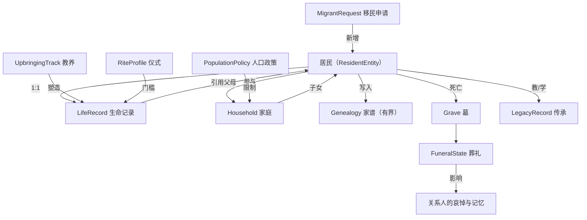
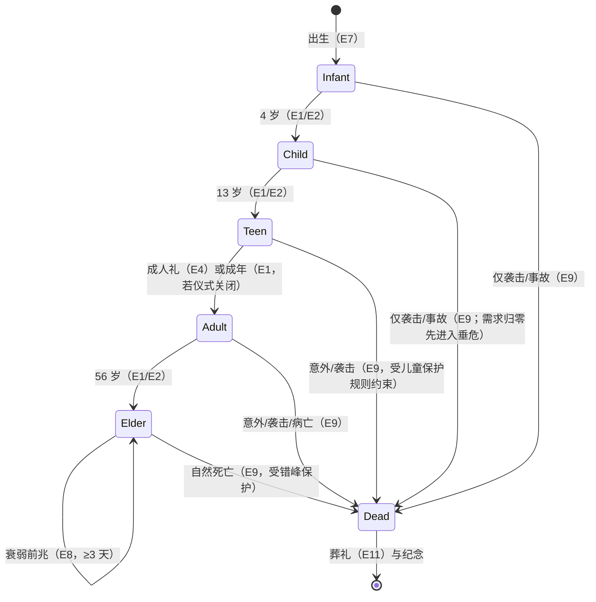
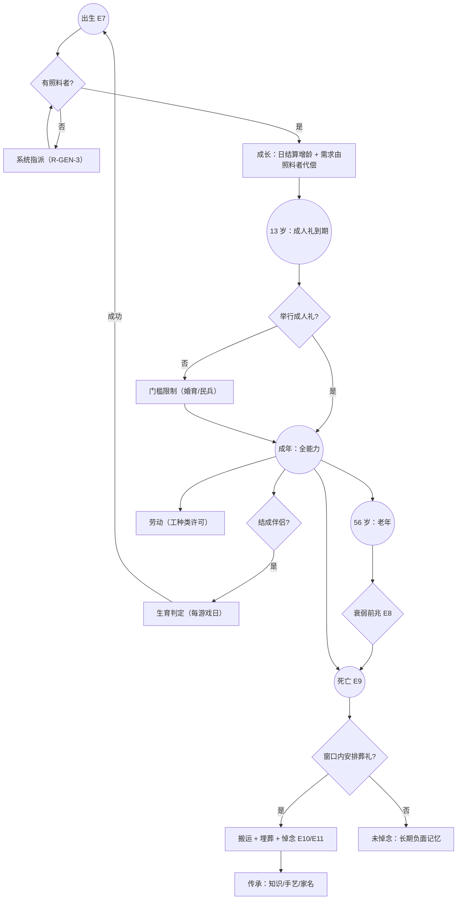

# PRD-009 · 世代与传承

```
状态：草稿PRD
负责人：设计（人类定稿）
最后更新：2026-10-18
优先级：P0          里程碑：M2（M1 只做「生命周期 + 照料保护 + 老死与葬礼 + 人口下限与涌现压力」，见 §2.3）
上游依据：docs/design/05-settlement-and-residents.md（§2 生命周期、§5 世代与成长、§6 死亡与葬礼、§7 人口流动）、docs/design/01-vision-and-pillars.md（P2 人味、P5 失败即内容）
关联文档：PRD-001（需求/情绪/记忆/死亡接口）、PRD-002（事件/讣告/编年史/传说页）、PRD-003（营养与健康）、PRD-004（袭击伤亡上限）、PRD-005（A-max 接管）、**PRD-008（关系与社交，撰写中——亲属/伴侣接口待对齐）**、PRD-010（商队带来的人）、PRD-011（知识与传授）、PRD-012（权限）
基底依赖：`ResidentEntity`（`GivenName`/`Surname`/`Look` NBT，见 r08 §4.1）、`ResidentKind`、`Vocation`/`Perk`/`Keenness`/`Licence`、`ResidentObituary`、
         `ColonyContext`（`urges`/`tick`/`closed`/`share`，r08 §4.3）、`Declaring`（`colony`/`urges`/`vocation`/`residentKind`）、`Relating`、
         `Colony.keep`、`colony.submit(Grown)`、`Cadence`、`Shelves`（`resident_look`/`resident_look_set`/`resident_name`）、`RegisteringUi.page` + `Board/Row/Act`
```

---

## 0. 一句话

> 他们会出生、长大、变老、死去；而他们学会的东西、做过的手艺和留下的名字，会继续活在殖民地身上。

---

## 1. 概述

**情境**：第三年，你的第一批居民开始驼背。铁匠的儿子在院子里跑来跑去，而铁匠本人已经教不动了。有人提议让那个少年顶上——但他还没行成人礼。同一天，两个陌生人敲响了大门。

基底中**没有年龄、没有儿童、没有家庭、没有继承**：所有居民都是等效的成年人（`ResidentEntity` 只存 `Look`/`GivenName`/`Surname`，见 [r08 §4.1](../research/08-temperature-thirst-integration.md)）。本 PRD 把 d05 §5/§6/§7 的纲要变成规格。

**它解决什么体验问题**：
- 支柱 **P2「每个人都是一个故事」**：没有世代，居民就只是一批可替换的劳动力。
- 支柱 **P5「失败长出故事」**：老死是**唯一一种玩家无法避免的失败**，因此必须被认真对待（[d05 R-DEATH-2](../design/05-settlement-and-residents.md)）。
- 支柱 **P4「从石头到星辰」**：知识会随人死去，所以「传承」是时代推进的隐形基础设施（[PRD-011 §9.2](PRD-011-progression-knowledge-and-space.md) 的「传授」需要有人可教、有人可学）。

**它产生的新的决策**：
- 让少年去学徒（少一个劳力、快一个未来）还是直接下地（现在多一双手）？
- 人口到顶时：拒绝移民（保住秩序）还是扩建（冒险超预算）？
- 老人还有 30% 效率：让他继续干，还是让他去教年轻人（教得好，但产出更少）？
- 有人死了：花一天办葬礼（停一部分工），还是赶紧埋了继续干？

**它在多大程度上是玩家的选择**：生育、教育、移民、葬礼都是**玩家可决定的政策**；但**谁爱上谁、谁怜悯谁**由 [PRD-008](PRD-008-relationships-and-social.md) 决定，玩家不点鸳鸯谱。

---

## 2. 设计目标与非目标

### 2.1 目标

| 编号 | 目标 | 可判定信号 |
| --- | --- | --- |
| G1 | **30 小时内可见第二代成长** | 一次 30 小时存档中，至少 3 名居民完成「出生 → 成年」（[d05 R-GEN-2](../design/05-settlement-and-residents.md)） |
| G2 | 死亡有重量 | 每次死亡都有讣告 + 葬礼或明确未安葬状态 + 关系人记忆变化 |
| G3 | 儿童不会「无理由死亡」 | 每个儿童死亡都有可追溯链条（[d05 R-GEN-1](../design/05-settlement-and-residents.md)） |
| G4 | 人口曲线可控 | 不指数爆炸、不必然灭绝；下限保护与涌现压力都可实测（§16.5） |
| G5 | 传承可测量 | 三条路径各自有可读证据（知识 / 手艺 / 家名与记忆） |
| G6 | 无界数据 | 家庭树与名册有明确上限，且每居民状态 ≤512 B |

### 2.2 非目标

| 编号 | 不做的事 | 理由 | 何时可能做 |
| --- | --- | --- | --- |
| N1 | 任何露骨内容、生育动画、妊娠画面 | 完全无必要；出生是一个**事件**（[PRD-002](PRD-002-incidents-and-narrator.md)） | 永不做 |
| N2 | 遗传学模拟（建模基因、外貌/天赋的复杂遗传） | 复杂度与收益不成比例 | 不计划 |
| N3 | 青春期心理剧 / 独立的儿童 AI 行为树 | 儿童是**成人行为的受限子集** + 照料需求 | 不计划 |
| N4 | 图形化家族树（可拖拽、连线） | UI 硬预算（32 行/页、4 动作/行、8 行/卡、无图表组件） | 见 OQ-10 |
| N5 | 买卖人口 / 奴隶 / 契约劳工经济 | 已在[章程](../00-charter.md) §5.2 拒绝 | 永不做 |
| N6 | 多代同堂的独立建筑系统（宅邸/氏族大院） | 住房复用基底床与住所 | M3 评估「家庭」空间加成 |
| N7 | 婴儿期（<1 岁）的细粒度需求与行为 | 婴儿 = 计量 + 照料，不产生自主 urge | 不计划 |
| N8 | 玩家点选婚配（指定谁娶谁） | 反支柱：关系由 [PRD-008](PRD-008-relationships-and-social.md) 自主形成 | 永不做 |

### 2.3 M1 最小子集

M1 做：**生命阶段数据 + 年龄推进 + 儿童需照料（含自动指派保护）+ 成人礼门槛 + 老死与讣告 + 最小葬礼 + 人口下限与涌现式压力（无硬上限）**。

| 项 | M1 | M2 | M3 |
| --- | --- | --- | --- |
| 生命周期与年龄 | ✅ | — | — |
| 儿童照料（含保护规则） | ✅ | — | — |
| 成人礼 | ✅（单一通用仪式） | 多种仪式（货架） | 文化差异 |
| 老死/讣告/葬礼 | ✅（埋葬 + 悼念） | 火化/不同文化 | 纪念日/祭典 |
| 生育 | ✅（`births_enabled` 默认开） | — | — |
| 教育与学堂 | ❌（只做「教养」数据占位） | ✅（与 [PRD-011](PRD-011-progression-knowledge-and-space.md) 同批） | 专精方向 |
| 移民/难民接纳 | ✅（基础筛选） | 声望与外交耦合（[PRD-010](PRD-010-diplomacy-and-trade.md)） | 招募/俘虏转化 |
| 家名与名册 | ✅（基底 `Surname` 继承） | 氏族（d05 §8） | 阶层/信仰 |
| 传承三路径 | 手艺（`Perk`）+ 家名 | 知识（[PRD-011](PRD-011-progression-knowledge-and-space.md)） | 完整传说页（PRD-002 `lore`） |

---

## 3. 术语

### 3.1 本系统局部术语

| 术语（英文） | 中文 | 说明 | 与全局术语的关系 |
| --- | --- | --- | --- |
| `life_stage` | 生命阶段 | 婴儿 / 儿童 / 少年 / 成年 / 老年 | 新增（全局） |
| `age` | 年龄 | 以「岁」计的整数（刻度见 §9.5） | 新增 |
| `upbringing` | 教养 | 儿童/少年阶段获得特质与倾向的路径（货架） | 新增 |
| `rite` | 成人礼 | 进入成年劳动力的门槛仪式（货架 `ritual` 的一种） | 新增 |
| `household` | 家庭 | 同居的伴侣 + 子女（d05 §8） | 新增 |
| `kin` | 亲属 | 血缘/婚姻关系（接口来自 PRD-008） | 新增 |
| `genealogy` | 家谱 | 有界的亲属记录集合（**不是**图形树） | 新增 |
| `legacy` | 传承 | 死亡后仍然影响殖民地的三条路径之一 | 新增 |
| `grave` | 墓 | 埋葬点 + 墓碑（我们的新方块） | 新增 |
| `funeral` | 葬礼 | 埋葬 + 悼念活动的组合 | 新增 |
| `mourning` | 哀悼 | 关系人在葬礼前后的情绪状态 | 新增 |
| `fecundity` | 生育力 | 每日受孕概率的基准；最终概率受**受孕窗口**调制 | 新增 |
| `menstrual_cycle` / `fertile_window` | 生理期 / 受孕窗口 | 按既有历法**按月**发生的周期；影响情绪小波动与受孕概率（§9.5③，OQ-14） | 新增 |
| `aging_speed` / `lifespan_bonus` / `constitution` | 衰老速度 / 时代寿命加成 / 体质 | **衰老三层可配**：全局 × 时代 × 个体（§9.5①，OQ-1/OQ-9 已裁决） | 新增 |
| `population_floor` | 人口下限 | 保护下限（低于则禁致命袭击 + 生育/移民加成 + 老年死亡错峰，§9.5④） | 新增 |
| `population_pressure` | 人口压力 | **涌现式**：由住房、食物、需求满足度、专注度共同决定（§9.5④，OQ-4 已裁决） | 新增 |
| `birth_complication` | 难产 | 分娩时的致死/致伤判定（含前兆与医疗介入窗口，§9.5⑤） | 新增 |
| `caregiver` | 照料者 | 被指派照料婴儿/儿童的居民（**不是工种**） | 新增 |

### 3.2 与既有术语的冲突检查

| 冲突项 | Folkways 既有含义 | 本系统含义 | 解决方式 |
| --- | --- | --- | --- |
| `ResidentKind` | 居民**种类**（人形 / 傀儡 / 牲畜等，决定 `Locomotion`） | ❌ 儿童**不是**新 kind | **R-GEN-16**：儿童 = 同一 kind + `life_stage` |
| `Vocation` | 工种（铁匠、农夫…） | `teacher`/学徒**不是**新体系 | 师傅 = [PRD-011](PRD-011-progression-knowledge-and-space.md) 的 `scholar`/工种授权；照料**不是工种** |
| `Perk` / `Keenness` | 基底个体熟练度与专长 | 我们的「手艺传承」= 转移它们 | **复用，不新造第二套熟练度** |
| `Surname` | 基底 `ResidentEntity` 已存 `GivenName`/`Surname`（r08 §4.1） | 「家名继承」= 继承 `Surname` | 复用既有字段，不新增家名系统 |
| `ResidentObituary` | 基底讣告 | 我们**扩展**为「生平 + 关系人 + 关键记忆」 | 扩展，不替换 |
| `Admit` | 基底 `Board.Act` 的「接纳」动词 | 移民接纳**直接用 `Admit`** | 复用（A-max 也因此不需要新动作分类） |
| `Household`（d05 §8 里是后期群体结构） | 农耕时代的家庭 | 本 PRD 提前到必需（生育与照料的前提） | 与 d05 对齐：把「家庭」从后期提前到 M1 最小形态 |

> 新增的全局术语（`life_stage`/`upbringing`/`rite`/`genealogy`/`legacy`/`population_floor`）需同步登记进 [全局术语表](../design/03-glossary.md)。

---

## 4. 概念模型

### 4.1 实体

| 实体 | 中文 | 说明 | 生命周期 | 玩家可见 |
| --- | --- | --- | --- | --- |
| `LifeStageProfile` | 阶段档案 | 每阶段的可用工作、需求差异、效率、许可（货架 `life_stage`） | 随数据包 | 居民页 |
| `LifeRecord` | 生命记录 | 出生日、年龄、阶段、成人礼状态、**父母引用**、**`maker` 可选引用**（经人造子宫孕育或组装时的"制造者"，可为空）（每居民） | 随居民 | 居民页/家谱 |
| `UpbringingTrack` | 教养路线 | 儿童→少年的成长路径与产出（货架 `upbringing`） | 数据包 | 教养指派 UI |
| `RiteProfile` | 仪式档案 | 成人礼/葬礼的场地、主持者、物品、时长（货架 `ritual`） | 数据包 | 仪式安排 UI |
| `Household` | 家庭 | 伴侣 + 未成年子女 + 共同住所 | 成家→解散 | 世代页 |
| `Genealogy` | 家谱 | 有界亲属记录（殖民地级名册） | 永久（有裁剪） | 家谱列表 |
| `LegacyRecord` | 传承记录 | 知识/手艺/家名三类传承的凭据 | 永久 | 传说页/居民页 |
| `Grave` | 墓 | 埋葬点 + 墓碑方块 + 逝者引用 | 永久 | 世界内 |
| `FuneralState` | 葬礼状态 | 未安葬→已安排→已举行→已纪念 | 数日 | 世代页 |
| `MigrantRequest` | 移民申请 | 外来者请求加入（含筛选结果） | 请求→接纳/拒绝 | 世代页（`Admit`） |
| `PopulationPolicy` | 人口政策 | 生育开关、人口策略（下限与压力权重）、移民政策 | 殖民地级 | 世代页 |

### 4.2 实体之间的关系



**级联规则**：
- 居民死亡 → 家谱标记（不移除）→ 亲属关系人获得负向记忆（[PRD-001](PRD-001-needs-mood-memory.md)）→ 触发葬礼流程 → 未安葬则持续惩罚。
- 父母死亡 → 未成年子女进入「需照料队列」→ 系统必须指派新照料者（**R-GEN-3**）。
- 家庭解散（伴侣死亡/分手）→ 家庭记录保留，但照料责任重算。

---

## 5. 状态机

### 5.1 状态定义

**A. 生命阶段（主状态机）**

| 状态 | 中文 | 年龄（默认，岁） | 说明 |
| --- | --- | --- | --- |
| `Infant` | 婴儿 | 0–3 | 不自主行动；需求由照料者满足 |
| `Child` | 儿童 | 4–12 | 可做轻活；受教养影响 |
| `Teen` | 少年 | 13–17 | 可学徒、可做大部分工作；成人礼到期 |
| `Adult` | 成年 | 18–55 | 全能力；可婚育 |
| `Elder` | 老年 | 56– | 效率下降、教学加成；进入自然死亡风险区 |
| `Dead` | 死亡 | — | 进入葬礼流程（§5.1.C） |

> **阶段边界与年龄刻度都可配置**（§9.6）。年龄是**叙事单位**，与历法解耦（§9.5 与 OQ-9）。

**B. 婚育状态（与 PRD-008 的关系状态联动）**

| 状态 | 中文 | 说明 |
| --- | --- | --- |
| `Unattached` | 无伴侣 | — |
| `Attached` | 有伴侣 | 来自 [PRD-008](PRD-008-relationships-and-social.md)（待对齐） |
| `Expecting` | 妊娠中 | 由 `births_enabled` + 条件 + 概率触发 |
| `Postpartum` | 产后 | 母亲效率下降，需照料 |

**C. 葬礼状态**

| 状态 | 中文 | 说明 |
| --- | --- | --- |
| `Unburied` | 未安葬 | 遗体留在原地/停灵处；持续情绪与卫生压力 |
| `Planned` | 已安排 | 已选墓位与主持者 |
| `Held` | 已举行 | 悼念活动完成，效果已结算 |
| `Commemorated` | 已纪念 | 写入家谱与编年史；墓碑可交互查看 |
| `Unmourned` | 未悼念（终态） | 超过窗口仍未举行 → 长期负面记忆（R-GEN-10） |

**D. 成人礼状态**

| 状态 | 中文 | 说明 |
| --- | --- | --- |
| `NotDue` | 未到期 | 未成年且未到 13 岁 |
| `Due` | 已到期 | 可选择是否举行；未举行则 18 岁后仍停留 `Teen` 语义 |
| `Held` | 已举行 | 获得成年劳动力资格（§9.3） |

### 5.2 事件定义

| 事件 | 中文 | 说明 | 触发方 |
| --- | --- | --- | --- |
| E1 | 增龄（生日） | 累计 tick 达到一岁 | 系统（日结算） |
| E2 | 阶段跃迁 | 跨过阶段边界 | 系统 |
| E3 | 成人礼到期 | 进入 `Teen` 且 `rite_required` | 系统 |
| E4 | 成人礼举行 | 满足场地/主持者/物品 | 玩家/居民 |
| E5 | 结成伴侣 | 来自 [PRD-008](PRD-008-relationships-and-social.md) | 居民 |
| E6 | 受孕 | 生育判定成功 | 系统 |
| E7 | 分娩 | 妊娠倒计时结束 | 系统 |
| E8 | 老死前兆 | 进入衰弱期（≥3 天） | 系统 |
| E9 | 死亡 | 老死 / 意外 / 袭击 / 病亡（其他 PRD） | 世界 |
| E10 | 葬礼安排 | 选定墓位/主持者 | 玩家 |
| E11 | 葬礼举行 | 悼念活动结算 | 系统 |
| E12 | 移民到访 | 外来者请求加入 | 世界（[PRD-002](PRD-002-incidents-and-narrator.md)/[PRD-010](PRD-010-diplomacy-and-trade.md)） |
| E13 | 接纳/拒绝移民 | 玩家决定 | 玩家 |
| E14 | 继承（家名/手艺） | 死亡或成人礼时转移 | 系统 |
| E15 | 教养指派 | 指定教养路线/师傅 | 玩家 |
| E16 | 居民离去/被驱逐 | d05 §7 | 玩家/居民 |

### 5.3 扩展变量（系统状态）

| 变量 | 类型 | 默认值 | 范围 | 说明 |
| --- | --- | --- | --- | --- |
| `aging_enabled` | 布尔 | **true** | — | 衰老总开关（**默认开**，但**可关**：关闭后居民不增龄，沙盒模式；OQ-1 已裁决=可以关） |
| `aging_speed` | 定点 | 1.0 | 0.2–5.0 | **衰老第一层（全局）**：世界级衰老速度，乘在年龄推进上 |
| `ticks_per_age_year` | 整数 | 24000 | 24000–480000 | **1 游戏日 = 1 岁**（§9.5①，OQ-9 已裁决=接受该刻度） |
| `stage_boundaries` | 表 | 3/12/17/55 | 单调递增 | 婴儿/儿童/少年/成年边界 |
| `lifespan_expect` | 整数 | 70 | 40–120 | **基准**期望寿命（岁）；实际寿命 = 基准 × 时代加成 × 个体体质 |
| `lifespan_bonus_per_age` | 定点 | **+0.15** | 0–0.5 | **衰老第二层（时代）**：每进入一个新时代，期望寿命 **+15%**（可调）。科技越强人越长寿，避免高熟练度居民"死得太亏"（OQ-9） |
| `constitution_span` | 定点 | ±0.20 | 0–0.5 | **衰老第三层（个体）**：体质/长寿特质的浮动范围（−20%~+20%） |
| `lifespan_soft` | 整数 | 60 | — | 开始进入死亡风险区 |
| `elder_efficiency` | 定点 | 0.85 → 0.60 | 0.3–1.0 | 老年效率曲线（随年龄线性下降到下限） |
| `elder_teaching_bonus` | 定点 | +0.25 | 0–0.5 | 老年教学加成 |
| `births_enabled` | 布尔 | true | — | 生育总开关 |
| `pregnancy_days` | 小数 | 1.0 | 0.5–3 | 妊娠时长（游戏日）；**可见**（头顶图标 + 状态行，OQ-2 已裁决=可见） |
| `postpartum_days` | 小数 | 3.0 | 0–10 | 产后恢复与照料期 |
| `fecundity_base` | 定点 | 0.06 | 0–0.5 | 有伴侣+条件满足时的**每游戏日**受孕概率基准 |
| `max_children_per_couple` | 整数 | 6 | 0–12 | 每对伴侣的子女上限（OQ-4） |
| `population_floor` | 整数 | 8 | 2–20 | 下限保护（对齐 [PRD-004 R2](PRD-004-threats-and-defence.md)） |
| `population_soft_cap` | 整数 | 40 | 8–120 | 压力**开始明显上升**的参考点（不再是唯一旋钮，见 §9.5④） |
| `population_hard_cap` | — | **取消** | — | **已裁决：取消硬上限**（OQ-4），改为涌现式软压力；极端规模只**降频不禁止**且必须告知（§13） |
| `menstrual_cycle_days` | 整数 | 4 | 0–8 | 生理期长度（游戏日）；周期**按既有历法按月**发生 |
| `fertile_window_days` | 整数 | 2 | 1–6 | 受孕窗口长度（游戏日）；窗口内受孕概率 ×2.5 |
| `cycle_mood_wave` | 定点 | 3 | 0–10 | 生理期带来的情绪小波动幅度（PRD-001 接口） |
| `birth_complication_rate` | 定点 | 0.02 | 0–0.2 | 分娩并发症（难产）基础概率；有前兆与医疗介入窗口 |
| `child_render_scale` | 定点 | 0.75 | 0.5–1.0 | 儿童小体型渲染缩放（**未验证**是否能由 `resident_look` 实现，OQ-11） |
| `child_work_capability` | 表 | 见 §9.6 | — | 各阶段可用工作 |
| `rite_required` | 布尔 | true | — | 成人礼是否为成年门槛 |
| `rite_grace_days` | 整数 | 5 | 0–30 | 到期后仍可行礼的宽限期（之后有情绪惩罚） |
| `funeral_window_days` | 整数 | 3 | 1–10 | 超过则进入 `Unmourned` |
| `infant_mortality` | 定点 | **0.07** | 0–0.2 | 婴儿死亡率（**默认非 0，7%**，建议区间 5–10%，OQ-3 已裁决）；含难产致死，**必须有前兆与医疗介入空间** |
| `care_assign_timeout_hours` | 整数 | 1 | 1–24 | 无照料者时自动指派的超时 |
| `migration_enabled` | 布尔 | true | — | 移民/难民接纳 |
| `migration_max_per_days` | 整数 | 6 | 1–60 | 每 N 日最多一次移民到访 |
| `kin_record_cap` | 整数 | 12 | 4–32 | 每居民亲属记录上限 |
| `genealogy_cap` | 整数 | 500 | 100–2000 | 殖民地名册条目上限 |
| `elder_death_stagger_days` | 整数 | 1 | 0–7 | 下限保护下，老年死亡错峰的最小间隔 |

### 5.4 守卫条件依赖

| 变量 | 类型 | 来源 |
| --- | --- | --- |
| 伴侣关系 | 布尔 | [PRD-008](PRD-008-relationships-and-social.md)（待对齐） |
| 情绪值 / 安全需求 | 定点 | [PRD-001](PRD-001-needs-mood-memory.md) |
| 食物盈余与营养 | 定点 | [PRD-003](PRD-003-season-temperature-thirst-nutrition.md) + [PRD-006](PRD-006-stock-rules-and-diagnosis.md) 的存量预测 |
| 住房床位 | 整数 | 基底床/住所 + [PRD-006](PRD-006-stock-rules-and-diagnosis.md) |
| 威胁状态 | 枚举 | [PRD-004](PRD-004-threats-and-defence.md)（前兆中不鼓励生育/移民） |
| 知识/学者可用性 | 布尔 | [PRD-011](PRD-011-progression-knowledge-and-space.md) |
| 权限等级 | 枚举 | [PRD-012](PRD-012-multiplayer-and-permissions.md) |

### 5.5 状态转移表

| 源状态 | 事件 | 守卫条件 | 动作 | 任务/副作用 | 目标状态 |
| --- | --- | --- | --- | --- | --- |
| `Infant` | E1 增龄 | 年龄 ≥ 4 | 阶段跃迁；解除婴儿专属照料 | 教养起点可选 | `Child` |
| `Child` | E1 增龄 | 年龄 ≥ 13 | 阶段跃迁；轻活解禁 | 成人礼变 `Due` | `Teen` |
| `Teen` | E3 到期 | `rite_required` | 通知 + 世代页标记 | 未举行则不能婚育/入民兵 | 保持 `Teen`（`Due`） |
| `Teen` | E4 行礼 | 场地/主持者/物品齐备 | 结算仪式 | 获得成年资格；教养产出定型；写编年史 | `Adult` |
| `Teen` | E1 增龄 | 年龄 ≥ 18 且 `rite_required=false` | 直接成年 | — | `Adult` |
| `Adult` | E5 结伴侣 | [PRD-008](PRD-008-relationships-and-social.md) 判定 | 建立 `Household` | 同居/情绪加成 | 保持 |
| `Adult` | E6 受孕 | `births_enabled` && `fertility_cycle_enabled` 下处于**受孕窗口** && 有伴侣 && 双方 `Adult` && 情绪≥阈值 && 食物盈余 && 床位数足够 && **`pop_pressure` < 1**（涌现式压力，见 §9.5④）&& 子女数 < 上限 && 母亲健康 | 母亲转 `Expecting` | 通知 + 前兆式准备（婴儿床/衣物） | `Expecting` |
| `Expecting` | E7 分娩 | 倒计时结束（先掷 `birth_complication_rate`：难产则有前兆 + 医疗介入窗口） | 生成婴儿（基底居民生成 + `life_stage=Infant`）；掷 `infant_mortality` | 父母获得记忆；[PRD-002](PRD-002-incidents-and-narrator.md) 写编年史；家谱新增 | 母亲 `Postpartum` |
| `Postpartum` | E1 增龄 | 产后日数达标 | 恢复 | 母亲效率恢复 | `Adult` |
| `Adult` | E1 增龄 | 年龄 ≥ 56 | 阶段跃迁 | 效率曲线生效；教学加成生效 | `Elder` |
| `Elder` | E8 前兆 | 年龄 ≥ `lifespan_soft` | 标记衰弱（记忆/情绪/健康前兆） | 通知「%s 已年迈」；≥3 天 | 保持 |
| `Elder` | E9 死亡 | 死亡判定成功 且 **不违反错峰保护** | 死亡结算 | 家谱标记；关系人记忆；遗体 → `Unburied` | `Dead` |
| 任意 | E9 死亡（意外/袭击/病亡） | 世界事件 | 同上（无前兆） | 伤亡上限仍受 [PRD-004 R3](PRD-004-threats-and-defence.md) 约束 | `Dead` |
| `Dead` | E10 安排 | 有墓位（或选中墓地） && 有主持者（可为任意成年/老年） && 窗口内 | 遗体搬运（`submit(Grown)`） | 占用工时 | `Planned` |
| `Planned` | E11 举行 | 参与者到达 | 结算悼念 | 参会者情绪恢复；同参关系强化；记忆权重加速衰减 | `Held` |
| `Planned`/`Unburied` | — | 超过 `funeral_window_days` | 标记未悼念 | 长期负面记忆（R-GEN-10） | `Unmourned` |
| `Held` | — | — | 写家谱 + 编年史；墓碑可交互 | — | `Commemorated` |
| 外部 | E12 到访 | `migration_enabled` && `pop_pressure` < 1 && 每 N 日限一次 && 有床位/食物 | 生成 `MigrantRequest` | 通知（`Admit`） | 请求待决 |
| 请求 | E13 接纳 | `pop_pressure` < 1 && 筛选通过 | 生成居民（基底 admission） | 声望 +；家谱登记 | 居民加入 |
| 请求 | E13 拒绝 | — | 记录 | 声望 −（若为难民则更大） | 请求关闭 |
| 任意 | E14 继承 | 死亡或成人礼 | 转移家名 / 手艺上限 | 见 §9.4 | — |

### 5.6 状态图（生命阶段）



### 5.7 超时与中断

| 情形 | 处理 | 恢复后行为 |
| --- | --- | --- |
| 玩家离开/断线（单人） | 年龄推进与照料**继续**（服务端）；无照料者的婴儿由系统指派（R-GEN-3） | 回来时看到成长与（可能的）死亡记录，全部有讣告 |
| 照料者死亡/失能 | 立即重新指派（含成人礼参与者） | 婴儿进入 `care_assign_timeout_hours` 计时，超时则取最近的成人 |
| 母亲在分娩中死亡 | 婴儿**仍产出**；立刻进入照料队列（不允许"难产导致婴儿静默消失"） | 讣告记录母亲；婴儿由系统指派照料者 |
| 目标消失（墓位被拆/遗体所在区块卸载） | 遗体随区块保存；墓位失效则回到 `Unburied` 并提示 | 重新选择墓位 |
| 区块卸载（儿童在未加载区块） | 年龄按**日结算补算**（时间戳差），不逐 tick 补 | 与 [PRD-001](PRD-001-needs-mood-memory.md) 一致 |
| 存档时正在妊娠 | 保存倒计时；加载后继续 | — |
| 存档时正在举行葬礼 | 加载后回到 `Planned`（不重复结算效果） | 需要玩家重新触发（R-DATA-x） |
| 人口降到下限以下 | 触发保护（R-GEN-7）：提高生育与移民、错峰老死、禁止致命袭击 | — |
| 成年人口 = 0 且儿童 > 0 | 触发**援救路径**（R-GEN-8）：最近的外部群体/难民反向加入（[PRD-002](PRD-002-incidents-and-narrator.md) 事件） | 若无人可救 → 殖民地放弃流程（d05 §2 的「死亡/离去」） |

---

## 6. 交互

### 6.1 入口与快捷键

| 操作 | 按键/手势 | 前置条件 | 结果 |
| --- | --- | --- | --- |
| 查看生命阶段与年龄 | 居民页 | 持殖民书 | 阶段、年龄、教养、成人礼状态 |
| 打开「家谱」 | 居民页「家谱」（`Open`） | 同上 | **列表 + 缩进**（不做图形树） |
| 打开「世代」页 | 面板页签 | 同上 | 人口构成、政策、葬礼队列、移民请求、最近 12 条出生/死亡记录 |
| 指派教养 | 世代页/居民页「教养…」（`Edit`） | 未成年 | 选路线/师傅（M2 起用 [PRD-011](PRD-011-progression-knowledge-and-space.md) 传授） |
| 安排成人礼 | 居民页/世代页「安排成人礼」（`Do`） | 该少年 `Due` | 选场地 + 主持者 |
| 安排葬礼 | 世代页「安排葬礼」（`Do`） | 有 `Unburied` | 选墓位 + 主持者 |
| 接纳/拒绝移民 | 世代页请求行「接纳/拒绝」（`Admit`/`Do`） | 有请求 | 居民加入或被拒 |
| 设生育政策 | 世代页「政策…」（`Edit`） | 权限达标 | 开关生育、设下限与压力权重 |
| 圈定墓地 | 世界内（区域工具） | 同上 | 一块专用区域 |

> **R-UI-1（沿用基底）**：不新增自有按键；一切入口复用殖民书与面板（[r03 §1.4](../research/03-front-and-interaction.md)）。
> **R-UI-2**：**没有图表** → 「人口趋势」以**最近 12 日的数字表**（每行：日期 / 人口 / 出生 / 死亡 / 迁入迁出）呈现，遵守 32 行/页、8 行/卡。

### 6.2 操作模式状态机

| 状态 | 中文 | 说明 |
| --- | --- | --- |
| `Normal` | 无 | — |
| `ChoosingGrave` | 选墓位 | 世界内选择埋葬点（有效/无效高亮） |
| `ChoosingRitePlace` | 选仪式场地 | 世界内选择成人礼/葬礼场地 |
| `ReviewingMigrant` | 审阅移民 | 面板内查看筛选卡（特质/健康/技能/来历） |

| 事件 | 中文 | 说明 | 触发方 |
| --- | --- | --- | --- |
| T1 | 打开选择 | 点击对应按钮 | 玩家 |
| T2 | 确认位置 | 右键有效点 | 玩家 |
| T3 | 取消/丢弃 | 丢弃键 | 玩家 |

| 源状态 | 事件 | 守卫条件 | 目标状态 | 动作 |
| --- | --- | --- | --- | --- |
| `Normal` | T1 | 有权限且存在可选项 | `ChoosingGrave`/`ChoosingRitePlace`/`ReviewingMigrant` | 高亮有效点/打开审阅 |
| 选择态 | T2 | 位置有效 | `Normal` | 写入安排 |
| 选择态 | T3 | — | `Normal` | 放弃 |

### 6.3 右键菜单 / 面板动作

| 上下文 | 按钮 | 操作（`Board.Act` 五类内） | 触发事件 | 是否可撤销 |
| --- | --- | --- | --- | --- |
| 居民行（未成年） | 「教养…」 | `Edit` | E15 | ✅ |
| 居民行（`Due`） | 「安排成人礼」 | `Do` | E3/E4 | ✅（举行前） |
| 世代页/逝者行 | 「安排葬礼」 | `Do` | E10 | ✅（举行前） |
| 世代页/墓碑 | 「查看墓碑」 | `Open` | — | — |
| 移民请求行 | 「接纳」 | `Admit` | E13 | ⛔（需重新驱逐） |
| 移民请求行 | 「拒绝」 | `Do` | E13 | ⛔ |
| 世代页 | 「政策…」 | `Edit` | E15 | ✅ |
| 家谱行 | 「定位」 | `Ping` | — | — |

### 6.4 命令

| 命令 | 权限 | 说明 | 输出 |
| --- | --- | --- | --- |
| `/<ns> pop` | L2 | 人口构成（各阶段/年龄中位数/最近事件计数） | 文本 |
| `/<ns> family <resident>` | L2 | 该居民家谱（列表） | 文本 |
| `/<ns> age <resident> <岁>` | L5 | 强制设置年龄（**测试用**） | 文本 |
| `/<ns> birth force [<伴侣A> <伴侣B>]` | L5 | 强制受孕（测试用） | 文本 |
| `/<ns> funeral <resident>` | L3 | 立即举行葬礼 | 文本 |
| `/<ns> migrant spawn <n>` | L5 | 生成 n 个移民请求（测试用） | 文本 |
| `/<ns> pop policy <key> <value>` | L3 | 改人口政策 | 文本 |
| `/<ns> lineage report` | L2 | 家谱容量/裁剪/传承统计（自检） | 文本 |

---

## 7. 反馈

### 7.1 操作模式反馈（玩家交互时）

| 检查条件 | 音效 | Toast/文案键 | 视觉反馈 | 系统行为 |
| --- | --- | --- | --- | --- |
| 进入 `ChoosingGrave` | 轻微 | 「选择埋葬点」 | 有效点高亮 | 等待 |
| 位置无效 | 低沉 | 「这里不能埋葬（%s）」 | 红色 | 拒绝 |
| 安排成功 | 确认 | 「将为 %s 举行葬礼」 | 世代页出现条目 | 写入 `Planned` |
| 成人礼无法安排 | 低沉 | 拒绝原因（无主持者/无场地/物品不足） | 按钮灰显 | 复用 `RefusalKind.Named` |
| 接纳移民成功 | 确认 | 「%s 加入了殖民地」 | 新居民出现 | 生成居民 |
| 人口增长停滞 | 低沉 | 「人口增长停滞（无硬上限；先改善住房与需求）」 | 世代页标出四项压力 | 概率趋 0（不硬拒） |

### 7.2 实体状态反馈（持续显示）

| 检查条件 | 图标/颜色 | 悬停信息 | 系统行为 |
| --- | --- | --- | --- |
| 婴儿/儿童无照料者 | 黄色感叹 | 「需要照料（无人负责）」 | 计时并自动指派 |
| 儿童有照料者 | 淡色小图标 | 「由 %s 照料」 | — |
| 妊娠中 | 小图标 | 「妊娠中（还有 %s）」 | — |
| 生理期 | 淡色小图标（**非病态**，不报警） | 「生理期（%s 天）」 | 情绪小波动 + 受孕窗口提示 |
| 难产告警（分娩前） | 橙色告警 | 「分娩有风险：%s 天内需要助产/医疗」 | 医疗介入窗口（接 PRD-013） |
| 产后 | 淡色图标 | 「产后恢复（%s 天）」 | — |
| 老年 | 淡色图标 | 「%s 岁（效率 %s%%）」 | 效率曲线 |
| 衰弱期（老死前兆） | 灰色图标 | 「身体衰弱」 | 死亡风险 |
| 成人礼 `Due` | 图标 | 「未行成人礼」 | 门槛限制 |
| 未安葬 | 醒目标记（**唯一允许用强红色的人命状态**） | 「尚未安葬（%s 天）」 | 情绪/卫生压力 |
| 哀悼中 | 泪滴 | 「正在哀悼 %s」 | 情绪修正 |

### 7.3 系统事件反馈（非玩家触发）

| 事件 | 音效 | 通知文案键 | 视觉 | 系统行为 |
| --- | --- | --- | --- | --- |
| 出生 | 正向（柔和） | 「%s 与 %s 的%s %s 出生了」 | 婴儿出现 | 父母记忆 + 编年史 |
| 阶段跃迁（儿童→少年） | 轻微 | 「%s 长大了」 | — | 解锁轻活 |
| 成人礼到期 | 提示 | 「%s 已可举行成人礼」 | 世代页标记 | — |
| 成人礼举行 | 正向 | 「%s 成为成年人」 | 仪式现场 | 资格 + 教养定型 |
| 老死前兆 | 低沉提示 | 「%s 已年迈，请安排后事」 | 灰色图标 | ≥3 天前兆 |
| 死亡（老死） | 钟声 | 「%s 安详离世，享年 %s」 | 墓碑位置提示 | 讣告 + 记忆 + 葬礼流程 |
| 死亡（意外/袭击） | 钟声（强） | 「%s 死于%s」 | — | 同上（复用 [PRD-001](PRD-001-needs-mood-memory.md) 死因） |
| 葬礼举行 | 正向（庄重） | 「%s 已入土，%s 人前来送别」 | 墓碑 | 情绪恢复 + 关系强化 |
| 未悼念超时 | 低沉 | 「%s 未被安葬」 | 持续标记 | 长期负面记忆 |
| 移民到访 | 提示 | 「%s 请求加入（%s）」 | 世代页请求 | `Admit` |
| 接纳/拒绝 | 正向/中性 | 「%s 加入了」/「你们拒绝了 %s」 | — | 声望变化 |
| 人口低于下限 | 警报 | 「人口危急（%s）：威胁已暂缓，会有人来投奔」 | 世代页标红 | 触发保护（R-GEN-7） |
| 成年人口归零但有儿童 | 强烈警告 | 「殖民地只剩孩子」 | 全屏提示 | 触发援救路径（R-GEN-8） |

### 7.4 可诊断性（管理者的要求）

| 玩家可能的疑问 | 系统必须能回答 | 呈现位置 |
| --- | --- | --- |
| 「为什么没有新生儿？」 | 逐项否决链：生育开关/无伴侣/情绪/食物/床位/软上限/子女数上限/健康 | 世代页「生育诊断」 |
| 「为什么这个孩子没人管？」 | 照料者被更高优先占用/无成人可达/禁限区阻挡/照料者死亡 | 复用 [PRD-006](PRD-006-stock-rules-and-diagnosis.md) 诊断卡 |
| 「为什么老人还在干活？」 | 成年礼/退休设置/许可状态（我们**不**新增退休工种，用 licence 缩减） | 居民页 + 诊断 |
| 「为什么人口不涨？」 | 曲线分解：出生率 / 老死率 / 意外死 / 迁入迁出 / 上限压力 | 世代页「人口分解」数字表 |
| 「为什么他还没下葬？」 | 无墓位/无主持者/无人搬运/窗口剩余 | 葬礼条目悬停 |
| 「为什么这次袭击没死人？」 | 下限保护生效（[PRD-004 R2](PRD-004-threats-and-defence.md)） | 通知 + 防御页 |
| 「这个人的祖上是谁？」 | 家谱列表（最多 4 代祖先、3 代后代、12 条亲属记录） | 家谱页 |

---

## 8. 规则

| 编号 | 类型 | 规则 | 违反时的行为 |
| --- | --- | --- | --- |
| R-GEN-1 | 必须 | 婴儿/儿童**不得**因需求归零直接死亡：先进入垂危，由照料者干预可救回（照 [PRD-001](PRD-001-needs-mood-memory.md) 的垂危状态） | 视为缺陷（评审不通过） |
| R-GEN-2 | 必须 | 每个儿童死亡都必须有**可追溯链条**（谁本该照料、为何没照料、或哪次袭击/事故） | 视为缺陷 |
| R-GEN-3 | 必须 | 每个婴儿/儿童**必须**至少有一名被指派的照料者；父母优先，无父母则由系统在 `care_assign_timeout_hours` 内自动指派（不允许静默状态） | 自动指派 + 通知 |
| R-GEN-4 | 禁止 | 婴儿不得工作；儿童仅轻活；少年可学徒但不得进入战斗/高危岗位（OQ-8） | 拒绝 + 原因（`RefusalKind`） |
| R-GEN-5 | 必须 | 生育必须可关闭（`births_enabled`，默认 true），且受软上限压力 | 配置生效 |
| R-GEN-6 | 必须 | **不设人口硬上限**（已裁决取消，OQ-4）：人口增长由**涌现式软压力**（住房/食物/需求满足度/专注度）自然收敛；极端规模**只降频不禁止**，且降频必须告知玩家（§13） | 压力生效并告知 |
| R-GEN-7 | 必须 | **下限保护**（默认 8）：低于下限时 ① 禁止致命袭击（[PRD-004 R2](PRD-004-threats-and-defence.md)）② 生育与移民意愿提高 ③ 老年死亡错峰（不同日带走仅剩的成年人） | 保护生效并告知 |
| R-GEN-8 | 必须 | **不允许必然灭绝**：成年人口 = 0 且儿童 > 0 时，必须触发援救路径（外部加入/事件救援），或进入明确的殖民地放弃流程 | 视为缺陷 |
| R-GEN-9 | 必须 | 老死必须有**≥3 游戏日的前兆**，并写入讣告（享年、死因 = 衰老） | 视为缺陷 |
| R-GEN-10 | 必须 | 每个死亡必须有处理结局（安葬/纪念）；超过 `funeral_window_days` 仍未处理 → **双后果**：① 疾病风险（[PRD-003](PRD-003-season-temperature-thirst-nutrition.md) 的污染/疾病接口）② 生者心情与长期记忆。本 PRD **不**自造第三套独立惩罚 | 双后果生效 |
| R-GEN-11 | 必须 | 葬礼必须**真正影响生者**：参会者情绪恢复、同参者关系强化、哀悼记忆权重加速衰减；**不得**只做装饰 | 视为缺陷（AC 可测） |
| R-GEN-12 | 必须 | 成人礼是进入成年劳动力的门槛（可配置关闭）；未行礼的少年不得婚育、不得编入民兵 | 拒绝 + 原因 |
| R-GEN-13 | 必须 | 传承三条路径必须**可测量**：知识 → [PRD-011](PRD-011-progression-knowledge-and-space.md) 洞见；手艺 → 基底 `Perk`/熟练度转移；家名/记忆 → `Surname` 继承 + [PRD-002](PRD-002-incidents-and-narrator.md) 编年史 | 缺一不可 |
| R-GEN-14 | 必须 | 个体熟练度随死亡**消失**（不无损继承）：传承只能通过「教学转移」并把转移量封顶（默认 ≤40%） | 封顶生效 |
| R-GEN-15 | 必须 | 家谱必须**有界**：每居民 ≤`kin_record_cap`(12) 条亲属记录、≤4 代祖先、≤3 代后代；殖民地总谱 ≤`genealogy_cap`(500)，超出按「非直系 + 最旧」裁剪 | 裁剪 + 自检命令报告 |
| R-GEN-16 | 禁止 | **不得**新建 `ResidentKind` 表示儿童/老人（同一 kind + `life_stage`） | 评审不通过 |
| R-GEN-17 | 禁止 | 儿童**不得**被玩家接管（[PRD-005](PRD-005-intent-and-micro-control.md) A-max L3）或编入民兵（[PRD-004](PRD-004-threats-and-defence.md)） | 拒绝 + 提示 |
| R-GEN-18 | 必须 | 数据用**定点整数**（照 [PRD-001 R-DATA-1](PRD-001-needs-mood-memory.md)）；每居民生命/家谱状态 ≤512 B | 超预算即缺陷 |
| R-GEN-19 | 必须 | 迁入必须**有筛选与代价**（床位/食物/声望），不允许无限白拿人口 | 拒绝或排队 |
| R-GEN-20 | 必须 | 一切年龄相关数值可配置（`aging_enabled`/`ticks_per_age_year`/阶段边界/寿命） | 配置生效 |
| R-GEN-21 | 级联 | 死亡 → 家谱标记 + 关系人记忆（[PRD-001](PRD-001-needs-mood-memory.md)/[PRD-008](PRD-008-relationships-and-social.md)）+ 编年史（[PRD-002](PRD-002-incidents-and-narrator.md)） | 缺一即缺陷 |
| R-GEN-22 | 优先级 | 下限保护 > 涌现压力（软上限/需求/专注度） > 玩家政策（保护永远优先于玩家想多要人）；**不存在硬上限**（R-GEN-6） | 保护优先 |
| R-GEN-23 | 必须 | 儿童的教育/照料**不得**因玩家离线而中断（自动指派仍在运行） | 视为缺陷 |
| R-GEN-24 | 必须 | 所有年龄/人口结算与 [PRD-001](PRD-001-needs-mood-memory.md) 的日结算**同批或错相位**，不得新增独立逐 tick 循环 | 性能门禁 |
| R-GEN-25 | 必须 | **衰老三层必须全部可配且可关**：①全局 `aging_enabled`（默认开）+ `aging_speed` ②时代 `lifespan_bonus_per_age`（默认 +15%/时代）③个体 `constitution` 体质浮动（±20%）。三者相乘决定实际寿命；**不得写死** | 配置生效（AC-55） |
| R-GEN-26 | 必须 | 生育相关状态必须**可见且可关**：妊娠有头顶图标/状态行；`births_enabled`（默认 true）与"生育与生理期"开关 `fertility_cycle_enabled` 分开，关掉生理期即回到"任意时刻可受孕"的简化模型 | 可见 + 开关生效（AC-56） |
| R-GEN-27 | 必须 | `infant_mortality` **默认非 0**（默认 0.07，建议 5–10%），且婴儿死亡**必须有前兆与医疗介入空间**（难产有告警窗口；接 `docs/prd/PRD-013-medical-and-surgery.md` 的接生/手术路径，该文档由并行任务撰写） | 前兆缺失即缺陷（AC-57） |
| R-GEN-28 | 必须 | 人口**不得**有硬上限；压力是**涌现式**函数（住房、食物、需求满足度、专注度），且必须能被 UI 逐项解释（接 [PRD-006](PRD-006-stock-rules-and-diagnosis.md) 诊断） | 可解释（AC-58） |
| R-GEN-29 | 必须 | 儿童**应尽量**有小体型：优先尝试 `resident_look` 缩放（`child_render_scale`）；**不支持时降级**为专用"婴儿/儿童皮肤"条目 + 头顶阶段标识，降级判定与表现必须写清 | 必须可辨识（AC-59） |
| R-GEN-30 | 禁止 | 未安葬的后果**只能**通过 PRD-003 的疾病/污染与 PRD-001 的心情/记忆表达，**不得**在 PRD-009 内新增独立惩罚体系（R-GEN-10） | 评审不通过 |
| R-GEN-31 | 级联 | 与 [PRD-008](PRD-008-relationships-and-social.md) 的边界：**权威存储在 PRD-008**（含亲属/伴侣边）；PRD-009 **只读**判定用于生命周期与遗传；**级联方向** = PRD-008 写关系 → PRD-009 消费；出生/死亡时由 **PRD-009 通知 PRD-008** 增删亲缘边（单向上报，不反向写） | 双向写即缺陷（AC-60） |

---

## 9. 流程（与基底引擎对齐）

### 9.1 工作类型与任务

| 项 | 内容 |
| --- | --- |
| 工作类型（Vocation） | **不新增**。`teacher` 属 [PRD-011](PRD-011-progression-knowledge-and-space.md)；照料**不是工种**，而是由需求驱动的 `Urge` |
| 任务（Task/Doing） | 照料婴儿（喂食/安抚/带离危险）、陪玩（社交）、教导（[PRD-011](PRD-011-progression-knowledge-and-space.md)）、搬运遗体、挖掘墓穴、参加仪式、悼念 |
| 参与的居民种类 | 成人/老年（照料、主持、仪式）；少年（学徒、轻活）；儿童（轻活：跑腿/采集/照看更小的孩子）；婴儿（不参与） |
| 需要的工具/许可（Tool/Licence） | 照料需 `childcare` 许可（可配置为默认授予全部成年居民）；成人礼/葬礼需主持者许可（默认：任意成年/老年）；墓穴需铲类工具（基底 `Tool`） |

> **R-FLOW-0**：照料走 [PRD-001](PRD-001-needs-mood-memory.md) 的 `UrgeSource` 纯函数范式（**R-FLOW-3**），不得在 weave 线程访问实体。

### 9.2 执行流程



### 9.3 Action 说明

| Action | 说明 | 失败/拒绝理由（Refusal） |
| --- | --- | --- |
| `TEND_INFANT` | 照料婴儿（喂食/安抚） | 无照料许可 / 婴儿不在附近 / 被更高优先占用 / 路径不可达 |
| `ESCORT_CHILD` | 把儿童带离危险（袭击/火灾） | 危险已解除 / 儿童已被带走 / 无可达路径 |
| `TEACH_CHILD` | 教导（M2，[PRD-011](PRD-011-progression-knowledge-and-space.md) 传授） | 师傅无相关知识 / 学徒已满 / 时间不足 |
| `ATTEND_RITE` | 参加成人礼/葬礼 | 场地缺失 / 主持者不在 / 正在更紧急的事 |
| `CARRY_BODY` | 搬运遗体 | 无墓位 / 无许可 / 路径不可达 |
| `DIG_GRAVE` | 挖墓穴（可复用 [PRD-006](PRD-006-stock-rules-and-diagnosis.md) 的建造/工作节点） | 无工具 / 地形不允许 |
| `MOURN` | 悼念（葬礼中的活动） | 未安排葬礼 / 情绪已恢复 |

> 所有拒绝必须落到基底 `RefusalKind.Named`（自动拼 `folkways.refusal.<Area>.<CONST>`，照 [PRD-001 R-FLOW-2](PRD-001-needs-mood-memory.md)），并出现在 [PRD-006](PRD-006-stock-rules-and-diagnosis.md) 的诊断里。

### 9.4 生成与分配条件

| 侧 | 条件 | 说明 |
| --- | --- | --- |
| 任务侧（照料） | 存在 `Infant`/`Child` 且其照料缺口 > 阈值 | 由需求侧生成 `Urge`，不是常驻任务 |
| 任务侧（葬礼） | 存在 `Unburied` 且已选墓位 | 搬运与挖掘是显式工作（`submit(Grown)`） |
| 居民侧 | 有 `childcare` 许可、非接管态、需求未危急 | 危急自身需求优先（R-GEN-1） |
| 资源侧 | 埋葬需空间 + 工具；成人礼需场地与（可选）物品 | 缺则诊断给出原因 |
| **生育侧** | 双方 `Adult` + 伴侣 + 健康 + 情绪 ≥ −10 + 食物盈余 ≥ 阈值 + 空床 + 人口 < 软上限 + 子女 < 上限 | 全部条件可在 UI 逐项查看（§7.4） |

### 9.5 计算逻辑

**① 年龄推进（整数累加）与衰老三层**

```
每游戏日（日结算，与 PRD-001 同批）：
  age_years = total_ticks_alive / ticks_per_age_year     // 整除，定点累加余数
  实际推进量再乘 aging_speed（第一层：全局衰老速度）
```

**衰老三层（2026-10-18 裁决，R-GEN-25）——寿命不是一个常数：**

| 层 | 参数 | 默认 | 作用 | 为什么需要它 |
| --- | --- | --- | --- | --- |
| ① 全局 | `aging_enabled` / `aging_speed` | 开 / 1.0 | 整局的衰老速度；可整体关闭（沙盒） | 让"不想面对老死"的玩家能关（OQ-1 已裁决=可以关） |
| ② 时代 | `lifespan_bonus_per_age` | **+15% / 时代** | 每进入一个新时代，期望寿命乘 (1+0.15) | 科技越强人越长寿；**避免高熟练度居民"死得太亏"**——[PRD-011](PRD-011-progression-knowledge-and-space.md) 的洞见与熟练度是长期投资 |
| ③ 个体 | `constitution_span` + 体质/长寿特质 | ±20% | 个体寿命浮动 | 让"这个人天生壮实/体弱"可被叙事与家谱记录 |

```
lifespan_actual = lifespan_expect(70)
                × (1 + lifespan_bonus_per_age)^(age_index)      // ② 时代
                × constitution_factor(1 ± constitution_span)     // ③ 个体
                × (aging_speed 影响的是推进速率，不是寿命上限)
```

**默认刻度：`ticks_per_age_year = 24000`（1 游戏日 = 1 岁）**，即（**未计时代加成的基准值**）：

| 现实时间（20 分钟/游戏日） | 年龄 |
| --- | --- |
| 1 小时 | 3 岁 |
| 6 小时 | 18 岁（成年） |
| 18.7 小时 | 56 岁（老年） |
| ≈23 小时 | 70 岁（基准期望寿命；进入星辰时代后约 120 岁） |

**为什么这样定**：世界历法一年 = 32 游戏日（[d04 §1](../design/04-world-and-simulation.md)：1 季 = 8 日），若以「历法年 = 年龄岁」计，18 年 ≈ 192 现实小时——**30 小时的里程碑里永远看不到第二代**，直接违反 [d05 R-GEN-2](../design/05-settlement-and-residents.md)。因此**年龄与历法解耦**：岁是人物的刻度，日/季是世界的刻度（OQ-9 已裁决=接受）。**注意**：时代寿命加成会让人越活越久，"老年期长度"随时代增长是设计意图（殖民地的记忆变得更长），但必须在平衡中验证人口结构不会僵化（AC-55/AC-58）。

**② 阶段判定**：`stage = f(age_years, stage_boundaries)`，单调、无回退（除死亡）。

**③ 生育概率**（每游戏日一次判定）

```
p_birth = fecundity_base
        × health_factor        // 0.5–1.0（健康/营养，PRD-003 接口）
        × mood_factor          // 0.5–1.2（PRD-001）
        × food_factor          // 0.0–1.0（存量预测 ≥ 安全线 才为 1）
        × housing_factor       // 0.0–1.0（有空床）
        × (1 − pop_pressure)   // 涌现式压力，见 ④
        × (1 − child_ratio)    // 已有子女越多越低
        × (伴侣双方均为 Adult 且非 Postpartum ? 1 : 0)
        × rite_factor          // 双方均已行成人礼 ? 1 : 0.5（若 rite_required）
        × fertile_factor       // 见下；关闭生理期时恒为 1
```

**生理期与受孕窗口（2026-10-18 新增，R-GEN-26）**

```
周期：按既有历法「按月」发生（1 月 = 4 季 × 8 日 / 12 ≈ 2.67 游戏日；实际以 d04 的日历为准）
  menstrual_cycle_days = 4：期间 fertile_factor = 0，且情绪出现小波动（cycle_mood_wave，默认 ±3）
  fertile_window_days  = 2（紧随生理期）：fertile_factor = 2.5
  其余日子：fertile_factor = 1.0
开关：`fertility_cycle_enabled`（默认 true）
  关掉 = 回到"任意时刻等概率受孕"的简化模型（不想管理周期的玩家）
可见性：生理期与妊娠状态都**可见**（居民卡状态行；妊娠另有头顶图标）——不做任何露骨表现
```

**难产（`birth_complication_rate`，默认 0.02）**：分娩前 **≥1 游戏日**给出告警（"分娩有风险"），给玩家安排医疗/助产的时间窗；未处置则母亲受伤或死亡，婴儿仍产出（§5.7）。医疗与手术路径见 `docs/prd/PRD-013-medical-and-surgery.md`（并行撰写中，尚未落地）。

**④ 人口压力（涌现式，2026-10-18 取代原「三段硬上限」模型）**

**已裁决：取消硬上限**（OQ-4）。人口不靠一个数字封顶，而由**生活质量**自然收敛——房子够不够、吃得饱不饱、需求满不满足、人有没有精力：

```
pop_pressure = clamp01( w_housing × housing_pressure      // 床位/居住面积不足
                      + w_food    × food_pressure         // 存量预测低于安全线（PRD-006）
                      + w_needs   × needs_pressure        // 需求未满足比例（PRD-001，取近 7 日均值）
                      + w_focus   × focus_pressure )      // 专注度/情绪崩溃比例（PRD-001 崩溃状态）
默认权重：w_housing 0.35 / w_food 0.30 / w_needs 0.25 / w_focus 0.10
  pop_pressure → 1 时：生育与接纳概率线性趋 0（不是被拒绝，而是"没人想生"）
  pop_pressure > 0.8 ：UI 必须能逐项解释"为什么大家不想生孩子"（接 PRD-006 诊断）
  参考点 population_soft_cap(40)：仅用于给玩家一个"该扩建了"的提示刻度，不参与硬判定
pop ≤ population_floor(8) → 生育与移民加成 ×1.5，且禁止致命袭击（PRD-004 R2）、老年死亡错峰
极端规模（例如 > 200 居民）→ **只降频不禁止**：低频结算 + 必须告知（§13），绝不静默砍人口
```

**⑤ 自然死亡风险**（每游戏日一次判定）

```
p_death(age) =
  0                                  若 age < lifespan_soft
  min( cap, (age − lifespan_soft) / (lifespan_actual − lifespan_soft) × daily_hazard )
                                     否则（daily_hazard 默认 0.05，cap 默认 0.5）
                                     注意分母用 lifespan_actual（含时代加成与个体体质）
错峰保护：若「成年人口 ≤ 2」且本日内已有一名成年老死 → 本次判定跳过（R-GEN-7③）
婴儿期：另行掷 infant_mortality（默认 0.07，R-GEN-27），且必须有前兆与医疗介入窗口
分娩期：另行掷 birth_complication_rate（默认 0.02），母亲与婴儿分别判定
```

**⑥ 效率曲线**

```
efficiency(stage, age) =
  Infant: 0（不可工作）
  Child:  0.4（仅轻活）
  Teen:   0.7（学徒期）
  Adult:  1.0
  Elder:  lerp(elder_efficiency_max=0.85 → min=0.60，按 (age − 56)/(lifespan_expect − 56))
教学加成：Elder 在教导/主持类工作时 +elder_teaching_bonus(0.25)
```

**⑦ 葬礼效果（必须真的有用，R-GEN-11）**

```
参会者（含主持者）：
  mood        += grief_relief（默认 +8，随关系深度最多 ×2）
  哀悼记忆权重 ×0.5 衰减（相当于把 -40 的记忆加速淡化）
  同参者之间关系 +friend_gain（默认 +3）
未参会的关系人：
  记忆权重 ×1.0（保持），且每未悼念日额外 −mood_penalty（默认 −1/日，上限 −15）
超出窗口（Unmourned）——**双后果**（R-GEN-10/R-GEN-30）：
  ① 疾病：遗体成为污染源（气体/蝇虫/水源），风险随天数上升 → 交 PRD-003 的污染与疾病接口
  ② 心情：写入「未安葬」长期记忆（默认 −20，几乎不衰减）+ 持续心情惩罚
  （本 PRD **不**新增第三套独立惩罚体系）
```

**⑧ 传承转移（R-GEN-14）**

```
教学转移上限：min(师傅熟练度 × 0.4, 徒弟可容纳上限)
家名继承：子女 `Surname` ← 父母之一（默认父姓；OQ-6 可配置为双姓/母姓）
知识：走 PRD-011 的洞见与传授；个体死亡后其洞见若未传授 → 随人消失（写讣告「带走了哪些知识」）
```

**⑨ 人口曲线（供预测与 AC 断言）**

```
pop_next = pop
         + births
         + immigrants
         − deaths_natural − deaths_incident − deaths_illness
         − emigrants（出走/被驱逐/被掳）
```

### 9.6 数值配置

| 参数 | 默认值 | 范围 | 可被数据包/配置覆盖？ | 备注（谁需要它，R-F8） |
| --- | --- | --- | --- | --- |
| `aging_enabled` | true | — | 配置 | 沙盒玩家（**可关**，OQ-1 已裁决） |
| `aging_speed` | 1.0 | 0.2–5.0 | 配置 | **衰老第一层**：全局速度 |
| `ticks_per_age_year` | 24000 | 24000–480000 | 配置 | 节奏控（更长世代 = 更长依恋 = 更慢解锁） |
| `stage_boundaries` | 3/12/17/55 | 单调 | 货架 `life_stage` | 内容作者 |
| `lifespan_expect` | 70 | 40–120 | 货架/配置 | 难度与叙事节奏（**基准**值） |
| `lifespan_bonus_per_age` | **+0.15** | 0–0.5 | 配置 | **衰老第二层**：时代寿命加成（0 = 关闭"越活越久"） |
| `constitution_span` | ±0.20 | 0–0.5 | 货架/配置 | **衰老第三层**：个体体质浮动 |
| `daily_hazard` | 0.05 | 0–0.5 | 配置 | 硬核玩家（更高老死率） |
| `elder_efficiency` | 0.85→0.60 | 0.3–1.0 | 配置 | 平衡 |
| `elder_teaching_bonus` | 0.25 | 0–0.5 | 配置 | 想让老人有用的玩家 |
| `births_enabled` | true | — | 配置/剧本 | 不想处理生育的玩家（也可整局关闭） |
| `fecundity_base` | 0.06 | 0–0.5 | 配置 | 人口节奏 |
| `pregnancy_days` | 1.0 | 0.5–3 | 货架/配置 | 内容作者与节奏控 |
| `max_children_per_couple` | 6 | 0–12 | 配置 | 防人口爆炸（OQ-4） |
| `population_floor` | 8 | 2–20 | 配置 | 与 [PRD-004 R2](PRD-004-threats-and-defence.md) 必须一致 |
| `population_soft_cap` | 40 | 8–120 | 配置 | 仅作提示刻度（**不再**参与硬判定） |
| ~~`population_hard_cap`~~ | **取消** | — | — | 已裁决取消（OQ-4）：改涌现式压力 |
| `pressure_weights` | 0.35/0.30/0.25/0.10 | — | 配置 | 住房/食物/需求/专注度四项权重（§9.5④） |
| `fertility_cycle_enabled` | true | — | 配置/剧本 | 不想管生理期与受孕窗口的玩家 |
| `menstrual_cycle_days` / `fertile_window_days` | 4 / 2 | 0–8 / 1–6 | 配置 | 人口节奏细调 |
| `birth_complication_rate` | 0.02 | 0–0.2 | 配置 | 硬核玩家（更高难产率） |
| `child_work_capability` | 见 §9.5⑥ | — | 货架 `upbringing` | 内容作者 |
| `rite_required` | true | — | 配置/剧本 | 想要「成人礼无用」的轻松玩法 |
| `funeral_window_days` | 3 | 1–10 | 配置 | 节奏 |
| `infant_mortality` | **0.07** | 0–0.2 | 配置 | 默认非 0（5–10% 建议区间，OQ-3 已裁决）；硬核玩家可调高，想轻松可调 0 |
| `child_render_scale` | 0.75 | 0.5–1.0 | 配置 | 儿童小体型（**未验证**可否由 `resident_look` 实现，OQ-11） |
| `migration_max_per_days` | 6 | 1–60 | 配置 | 人口增长节奏 |
| `kin_record_cap` / `genealogy_cap` | 12 / 500 | 4–32 / 100–2000 | 配置 | 存档大小 |
| `grief_relief` / `friend_gain` | +8 / +3 | 0–20 | 配置 | 想强化/弱化仪式作用的玩家 |

---

## 10. 数据与存档

| 项 | 内容 |
| --- | --- |
| 新增持久化字段（每居民） | `birth_day`、`age_ticks`、`life_stage`、`rite_state`、`upbringing_id`、`caregiver_uuid`、`household_id`、`kin[]`（≤12）、`legacy[]`、`grave_id`（死后）、`cycle_phase` + `cycle_day`（生理期，2 字节）、`constitution`（体质，1 字节）、`complication_state`（难产/垂危，1 字节） |
| 新增持久化字段（殖民地级） | `PopulationPolicy`、`Genealogy`（≤500）、`Grave` 列表、`FuneralState` 队列、`MigrantRequest` 队列、`LegacyRecord` 索引 |
| 存储位置 | 居民字段：**扩展 `BodyState` 或注册新附件**（`folkways:body_life`，照 [r08 §7.2](../research/08-temperature-thirst-integration.md) 的做法，随实体 NBT 保存）；殖民地级：`Colony.keep(owner, CompoundTag)` |
| 存档版本影响 | **需要**（自管版本号；基底 `SaveVersion.CURRENT=1` 与静默只读问题见 [r06 §3 #7](../research/06-gap-analysis.md)） |
| 迁移策略 | 旧存档无字段 → **全部现有居民视为 `Adult`**（默认年龄 = `lifespan_expect / 2`，或按剧本指定），无家谱、无成人礼记录；`PopulationPolicy` 取默认；墓/葬礼队列为空 |
| 旧存档降级行为 | 可加载；不崩；不追溯生成家庭关系（**不做"凭空造祖先"**，避免虚构历史违反 [PRD-002 R7](PRD-002-incidents-and-narrator.md)） |
| 回滚（卸载本 mod） | 可加载：年龄/家谱/政策数据丢弃，**儿童实体仍存在并按普通居民处理**（同一 `ResidentKind`，R-GEN-16 的收益）；墓碑方块变成普通方块（backing block） |
| 容量保护 | 每居民 ≤512 B（R-GEN-18）；总谱 ≤500 条（超出裁剪）；墓碑不随区块加载而失去数据（`Grave` 用殖民地级记录 + 世界方块双写） |
| 存档中途状态 | 妊娠倒计时与葬礼 `Planned` 状态必须可往返（§5.7） |

---

## 11. 网络与多人

| 项 | 内容 |
| --- | --- |
| 权威端 | 服务端（年龄、生育、死亡、家谱全部服务端权威） |
| 需同步的状态 | 生命阶段/年龄（变化时）、出生/成人礼/死亡/葬礼（事件广播）、人口政策（变更时）、移民请求（待决时）、家谱（按需拉取） |
| 同步频率与方式 | **事件驱动**，绝不逐 tick；家谱按需分页拉取（照 [PRD-002](PRD-002-incidents-and-narrator.md) 的编年史分页模式） |
| 权限（谁能操作） | 见下表；**已回填到 [PRD-012 §3.4](PRD-012-multiplayer-and-permissions.md) 的收口表**（照护/仪式/接纳=L2 🔶(开)、人口政策=L3 🔶(关)、强制命令=L5） |
| 多人并发冲突处理 | 同一移民请求的接纳/拒绝 → **先到先得**并广播决策者；同一居民被两人指派不同教养 → 后到者覆盖并提示；两人同时安排同一逝者的葬礼 → 合并为一次（幂等） |
| 断线/重连行为 | 年龄与照料继续（服务端）；重连后拉取当前状态与未决请求 |
| 单人离线 | **照常推进**（与 [PRD-004](PRD-004-threats-and-defence.md) 一致）；儿童照料由自动指派兜底（R-GEN-23） |
| 降级阶梯 | 性能不足时依次降级：① 家谱细节（只保留直系）② 教养历史（只保留当前路线）③ 照料判定间隔（小时 → 数小时）；**不得**降级保护规则（R-GEN-1/3/7/8 永远生效） |

**权限点（已由 [PRD-012](PRD-012-multiplayer-and-permissions.md) §3.4 收口）**

| 动作 | 建议等级 | 说明 |
| --- | --- | --- |
| 查看世代页/家谱/人口 | L2 成员 | 只读 |
| 指派教养 / 安排成人礼 / 安排葬礼 | L2 成员 | 可配置收紧为 L3 |
| 接纳/拒绝移民与难民 | L2 成员 🔶（可收紧 L3） | 与 [PRD-004](PRD-004-threats-and-defence.md) 的交贡/疏散同级 |
| 改生育政策与人口策略 | L3 管理者 🔶（默认关）/ L5 | 全局规则 |
| 驱逐居民 | L4 主机 | 与 [PRD-012](PRD-012-multiplayer-and-permissions.md) 的「驱逐成员」区分（那是玩家，这是居民） |
| 强制出生/改年龄命令 | L5 | 测试用 |

**R-MP-1**：儿童**不得**被接管（R-GEN-17）；权限系统必须在判定入口拒绝，而不是靠 UI 灰显。
**R-MP-2**：死亡与出生必须**广播**给全部在线玩家（这是叙事事件，不是私人信息）。

---

## 12. i18n（双语：`zh_cn` + `en_us`）

> **口径（[ADR-017](../00-charter.md)）**：我们新增的键只做 `zh_cn` + `en_us` 两份；基底既有四语言文件保留不动，缺键回退 `en_us`。

| 键 | en_us | zh_cn |
| --- | --- | --- |
| `<ns>.stage.infant` | Infant | 婴儿 |
| `<ns>.stage.child` | Child | 儿童 |
| `<ns>.stage.teen` | Teen | 少年 |
| `<ns>.stage.adult` | Adult | 成年 |
| `<ns>.stage.elder` | Elder | 老年 |
| `<ns>.event.birth` | %4$s, child of %1$s and %2$s, was born | %1$s 与 %2$s 的%3$s %4$s 出生了 |
| `<ns>.event.grew_up` | %s has grown up | %s 长大了 |
| `<ns>.event.rite_due` | %s may now come of age | %s 已可举行成人礼 |
| `<ns>.event.rite_held` | %s has come of age | %s 成为成年人 |
| `<ns>.event.elder_frail` | %s is getting frail | %s 已年迈，请安排后事 |
| `<ns>.event.death_natural` | %s passed away peacefully at %s | %s 安详离世，享年 %s |
| `<ns>.event.funeral_held` | %s was laid to rest (%s mourners) | %s 已入土，%s 人前来送别 |
| `<ns>.state.unburied` | Not yet buried (%s days) | 尚未安葬（%s 天） |
| `<ns>.state.needs_care` | Needs care (unassigned) | 需要照料（无人负责） |
| `<ns>.state.cared_by` | Cared for by %s | 由 %s 照料 |
| `<ns>.state.pregnant` | Expecting (%s left) | 妊娠中（还有 %s） |
| `<ns>.state.cycle` | Menstrual cycle (%s days) | 生理期（%s 天） |
| `<ns>.state.fertile` | Fertile window | 受孕窗口 |
| `<ns>.state.complication` | Birth risk: help needed within %s days | 分娩有风险：%s 天内需要助产 |
| `<ns>.state.lifespan_bonus` | Lifespan +%s%% (%s era) | 寿命 +%s%%（%s 时代） |
| `<ns>.state.rite_missing` | Has not come of age | 未行成人礼 |
| `<ns>.act.assign_upbringing` | Upbringing… | 教养… |
| `<ns>.act.hold_rite` | Hold coming-of-age | 安排成人礼 |
| `<ns>.act.arrange_funeral` | Arrange funeral | 安排葬礼 |
| `<ns>.pop.floor_warning` | Population critical (%s) | 人口危急（%s） |
| `<ns>.pop.pressure` | Why growth stalled: %s | 为什么大家不想生孩子：%s |
| `<ns>.pop.at_cap` | Population growth stalled | 人口增长停滞（无硬上限；先改善住房与需求） |
| `<ns>.migrant.request` | %s asks to join (%s) | %s 请求加入（%s） |
| `<ns>.legacy.knowledge` / `.craft` / `.name` | Knowledge / Craft / Name | 知识 / 手艺 / 家名 |

> **R-I18N-1**：出生/死亡/葬礼三类文案**必须**支持人名与年龄变量（用于编年史与讣告，照 [PRD-002 R-I18N-1](PRD-002-incidents-and-narrator.md)）。
> **R-I18N-2**：`en_us` 使用**带序号的占位符**（`%1$s`）以处理语序；其余语言可重排。

---

## 13. 性能预算

| 项 | 估算 | 依据 | 上限 |
| --- | --- | --- | --- |
| 每 tick 额外耗时（常态） | ≈0（无逐 tick 工作） | 年龄/生育/死亡全在**日结算**；照料由 `Urge` 驱动 | <0.1% |
| 每 tick 额外耗时（峰值） | 葬礼/成人礼集中结算（一次性） | 参与者 ≤ 人口数 | ≤0.3% |
| 日结算耗时 | O(居民数) 一次（增龄 + 生育判定 + 死亡判定 + 照料缺口扫描） | 60 居民 ≈ 数百次整数运算 | ≤0.2% |
| 出行预算占用 | 照料者往返（**唯一新增高频移动**） | 共享 `travelCeilingMicros=8000`（r01 §4.6） | 必须 bench 断言（AC-33） |
| 每 tick 分配对象数 | 结算时少量 | — | 不产生持续分配 |
| 内存增量（每居民） | ≤512 B（生命 + 家谱引用 + 传承） | R-GEN-18 | [PRD-001 R-DATA-2](PRD-001-needs-mood-memory.md) 的 2 KB 预算内 |
| 内存增量（殖民地） | 名册 ≤500×~120 B ≈60 KB + 墓葬记录 | `genealogy_cap` | ≤128 KB |
| 网络包增量 | 事件广播（出生/死亡/仪式）<1 KB/次 | 事件驱动 | 无逐 tick 包 |

**R-PERF-1**：本系统与 [PRD-001](PRD-001-needs-mood-memory.md) 共用日结算批次（R-GEN-24）；不得新增独立 tick 循环。
**R-PERF-2**：必须提交探针（日结算耗时、照料 urge 数、出行预算占用、家谱条目数、葬礼结算耗时）。
**R-PERF-3**：儿童的存在**不得**让需求结算成本超线性：照料缺口扫描必须是 O(儿童数) 且每游戏小时一次（不是每 tick）。
**R-PERF-4**：**人口无硬上限 → 必须有性能降级阶梯**（R-GEN-28）：人口 ≥150/300/600 时依次启用「老死与生育判定降到每 2/4/8 游戏日一次」「非在场居民的需求结算降到每 30/60 游戏秒一次」「家谱与关系增量写入积压到低峰」；**每一档降级都必须告知玩家**（[k03](../pack/03-performance-budget.md) R-PB-5/R-PB-6），**绝不静默砍人口或删居民**。

---

## 14. 与基底 API 的关系

| 需求 | 用到的扩展点 | 是否已有 | fork 层级 | 备注 |
| --- | --- | --- | --- | --- |
| 殖民地级世代模块 | `Declaring.colony(owner, scope)` + `ColonyContext{ urges/tick/closed/share }` | ✅ | **L1**（照 `LivingContent.java:66-73`，见 [r08 §4.3](../research/08-temperature-thirst-integration.md)） | 新插件 `folkways:lineage` |
| 每居民生命/家谱状态 | 扩展 `BodyState` 或注册新附件 `folkways:body_life` | ⚠️ 部分（`BodyState` 当前包私有） | **L2**（照 [r08 §7.2](../research/08-temperature-thirst-integration.md) 的两种做法） | 若必须改 `BodyRunner` 语义则升 **L3**（本 PRD **不需要**） |
| 照料/仪式冲动 | `Declaring.urges(owner, UrgeSource)` | ✅ | L1 | 纯函数（R-FLOW-0） |
| 成人礼/葬礼的显式工作 | `colony.submit(Grown)` + `NodeSpec`（搬运/挖掘） | ✅ | L1 | 改世界唯一合法路径 |
| 新工种 `teacher` | `Declaring.vocation` | ✅ | L1 | 属 [PRD-011](PRD-011-progression-knowledge-and-space.md) |
| 家属/伴侣关系 | `Relating` | ✅（接口）+ ✅（[PRD-008](PRD-008-relationships-and-social.md) 已定稿） | L1 | **边界已定（R-GEN-31）**：权威存储在 PRD-008；本 PRD **只读**亲属/伴侣判定；出生/死亡时由本 PRD **单向通知** PRD-008 增删亲缘边 |
| 新生居民生成 | 基底居民生成 + `admission`/`enrollment` | ✅ | L1 | 复用（照 [PRD-010](PRD-010-diplomacy-and-trade.md) 的接纳范式） |
| 姓名/家名 | `ResidentEntity` 的 `GivenName`/`Surname` | ✅（[r08 §4.1](../research/08-temperature-thirst-integration.md)：`ResidentEntity.java:330-356`） | — | **直接复用**，不新增家名字段 |
| 儿童外观 | `resident_look` / `resident_look_set` 货架 | ⚠️ **未验证是否有渲染缩放/小体型** | L2（必要时） | 见 OQ-11；降级方案：用不同 `resident_look` 条目 + 头顶标识 |
| 讣告 | `ResidentObituary` | ✅ | L1 | 扩展为「生平 + 关系人 + 关键记忆」 |
| 墓碑方块 | 基底**不注册任何新方块**（[r02](../research/02-plugin-inventory.md)） | ❌ | **L1（新增方块）** | 本 PRD 是 fork 后**第一次新增方块**；需 `Pattern`/`piece` 支持与**双语名（`zh_cn` + `en_us`）** |
| 编年史写入 | [PRD-002](PRD-002-incidents-and-narrator.md) 的 `ChronicleEntry` | ✅（同批） | L1 | 出生/成人礼/死亡/葬礼各写一条 |
| 面板页（世代/家谱/政策） | `RegisteringUi.page` + `Board/Row/Act`（`Admit` 已存在） | ✅ | L1 | **不需要新动作分类 → 无需 L3** |
| 教学（Ponder） | `Scenes.folder` | ✅ | L1 | 必配一课「人会长大、会死」 |

**R-API-1**：本 PRD **不要求 L3/L4 改动**（`Admit` 动词已存在，照料走 `Urge`，仪式走 `submit(Grown)`）。若儿童外观需要渲染层缩放，则退化为 **L2**（渲染/模型选择），并登记进 [改动登记表](../design/12-fork-strategy.md) §5.1。
**R-API-2**：与 [PRD-008](PRD-008-relationships-and-social.md) 的边界**已定稿**（R-GEN-31），三个问题各有唯一答案：

| 问题 | 答案 |
| --- | --- |
| **谁存** | **PRD-008**：关系（含亲属/伴侣边、`bond`/`grudge`）的权威存储、上限与淘汰策略全在 PRD-008 |
| **谁判** | 判定「这两个人是不是伴侣/亲属」走 PRD-008 的只读查询；PRD-009 **不**自己维护关系表 |
| **谁级联** | 方向单一：**PRD-008 写关系 → PRD-009 消费**；出生/死亡时由 **PRD-009 单向通知** PRD-008 增删亲缘边（不反向写、不双写） |

理由：两处都写必然导致分叉（一处的死亡通知漏了，另一处的家谱就永远缺一条边）。**反向写即缺陷**（AC-60）。

---

## 15. 可改写性（数据包 / 脚本 / 配置）

| 内容 | 是否可被数据包覆盖 | 货架/路径 | 玩家可否热重载 |
| --- | --- | --- | --- |
| 生命阶段（边界、效率、可用工作、需求差异） | ✅ | `life_stage`（**L2**） | ✅ `/reload` |
| 教养路线与产出（特质/熟练度倾向） | ✅ | `upbringing`（**L2**） | ✅ |
| 仪式（成人礼/葬礼的场地、主持者、物品、时长、文化变体） | ✅ | `ritual`（**L2**） | ✅ |
| 婴儿/儿童外观 | ✅ | `resident_look` / `resident_look_set`（基底货架） | ✅ |
| 姓名池（含家名） | ✅ | `resident_name`（基底货架） | ✅ |
| 人口政策与全部数值（§9.6） | 部分（结构在货架，数值在配置） | 我们的 serverconfig | ❌（需重启） |
| 文案 | ✅ | `assets/<ns>/lang/`（新增键双语 `zh_cn`+`en_us`） | ✅ |
| 保护规则（R-GEN-1/3/7/8/17）与"无硬上限"（R-GEN-28）、衰老三层可配（R-GEN-25 的**可关**方向除外）、关系单向级联（R-GEN-31） | ⛔ **不可覆盖** | — | — |

**R-MOD-1**：`life_stage`/`upbringing`/`ritual` 三个新货架按 [fork 策略](../design/12-fork-strategy.md) 的 **L2** 实现（扩展 `Shelves` 注册表），复用 `/reload` 与 `/folkways library` 自检（照 [PRD-001 R-MOD-1](PRD-001-needs-mood-memory.md)）。
**R-MOD-2**：数据包**可以**加阶段（例如「幼童」细分）与仪式，但**不可以**关掉保护规则（上表最后一行）。

---

## 16. 验收检查（Acceptance Criteria）

### 16.1 交互

- [ ] AC-1 「世代」页可见人口构成（各阶段人数/年龄中位数）与政策（可自动化）
- [ ] AC-2 居民页可见生命阶段、年龄、成人礼状态、照料者（可自动化）
- [ ] AC-3 「家谱」以**列表 + 缩进**呈现（不含图形树；可自动化：DOM/组件类型断言）
- [ ] AC-4 可指派教养路线；未成年居民行有「教养…」（可自动化）
- [ ] AC-5 少年 `Due` 时出现「安排成人礼」，可完成安排（可自动化）
- [ ] AC-6 有 `Unburied` 时出现「安排葬礼」，可选墓位与主持者（可自动化）
- [ ] AC-7 移民请求可用 `Admit` 接纳、`Do` 拒绝（可自动化）
- [ ] AC-8 生育政策（开关/人口策略）可在世代页修改并即时生效（可自动化）

### 16.2 反馈

- [ ] AC-9 无照料者的婴儿/儿童头顶显示「需要照料」（gametest）
- [ ] AC-10 出生通知含双亲名与婴儿名（含性别/阶段词）四个变量（可自动化）
- [ ] AC-11 老死前兆通知在死亡前 ≥3 游戏日出现（gametest 时间跳跃）
- [ ] AC-12 死亡通知含姓名、死因、享年（可自动化）
- [ ] AC-13 葬礼通知含赴会人数（可自动化）
- [ ] AC-14 §7.4 的六个疑问各有一条可读诊断路径（人工 + 单元）
- [ ] AC-15 人口趋势以**数字表**呈现，且不引入任何图表组件（评审项）

### 16.3 规则

- [ ] AC-16 婴儿/儿童需求归零 → 进入垂危而**非**立即死亡；有照料者时可救回（单元 + gametest）
- [ ] AC-17 儿童死亡时讣告含可追溯链条（谁负责照料/何因）（单元）
- [ ] AC-18 无父母照料者死亡的婴儿，在 `care_assign_timeout_hours` 内被自动指派（gametest）
- [ ] AC-19 婴儿不能工作；儿童仅轻活；少年不能编入民兵、不能进入战斗岗位（单元 + gametest）
- [ ] AC-20 关闭 `births_enabled` 后 30 游戏日内无出生（长模拟）
- [ ] AC-21 人口压力饱和（四项之一拉满）时生育与接纳概率趋 0，且**不是**硬拒绝；UI 能指出是哪一项（单元）
- [ ] AC-22 人口 < `floor` 时：致命袭击被禁止（与 [PRD-004 R2](PRD-004-threats-and-defence.md) 一致）、生育与移民加成生效（单元 + gametest）
- [ ] AC-23 成年人口 = 2 且均老年时，不会在同一天两人都老死（单元：10 万次随机模拟断言）
- [ ] AC-24 成年人口 = 0 且儿童 > 0 → 援救路径被触发（事件或外部加入）（gametest）
- [ ] AC-25 未安排葬礼超过 `funeral_window_days` → 关系人获得「未安葬」长期记忆（单元）
- [ ] AC-26 葬礼举行后：参会者情绪上升、同参关系提升、哀悼记忆权重减半（单元 + 数值快照）
- [ ] AC-27 `rite_required` 且未行礼的少年不能婚育、不能被编入民兵（单元）
- [ ] AC-28 传承三路径各有可读证据：知识（[PRD-011](PRD-011-progression-knowledge-and-space.md) 洞见含人名）、手艺（`Perk` 转移且 ≤40% 封顶）、家名（`Surname` 继承）（单元）
- [ ] AC-29 死亡后个体熟练度**不再可用**（映射断言），且带走的未传授知识写入讣告（单元）
- [ ] AC-30 儿童不能被 [PRD-005](PRD-005-intent-and-micro-control.md) 的接管命令选中，也不能被编入民兵（单元）

### 16.4 流程与数值

- [ ] AC-31 年龄推进：`ticks_per_age_year=24000` 下，1 游戏日后年龄 +1（单元）
- [ ] AC-32 生育概率对每个因子**单调**（食物/床位/情绪/上限压力各单变量测试）（单元）
- [ ] AC-33 效率曲线在阶段边界处单调且老年递减（单元）
- [ ] AC-34 成人礼/葬礼的全部拒绝都落到 `RefusalKind.Named` 并进入 [PRD-006](PRD-006-stock-rules-and-diagnosis.md) 诊断（单元）
- [ ] AC-35 日结算与 [PRD-001](PRD-001-needs-mood-memory.md) 同批或错相位，不新增独立 tick 循环（评审 + 探针）

### 16.5 人口曲线（长模拟专测）

- [ ] AC-36 **不爆炸**：条件充足（食物/床位/情绪满、无外部死亡）连续模拟 100 游戏日 → 人口收敛到稳态（不再指数增长），且没有任何"到 N 人就拒绝"的硬判定（长模拟）
- [ ] AC-37 **不必然灭绝**：关闭生育、禁用移民、无外部死亡 → 人口单调下降；降到 < `floor` 时触发保护与援救，最终不为 0（长模拟）
- [ ] AC-38 **灾后可恢复**：一次性移除 50% 人口（成年）后 30 游戏日内人口回到 ≥ `floor` 且殖民地未进入放弃流程（长模拟）
- [ ] AC-39 **成长可见**：30 小时等价时长（≈90 游戏日）模拟中，至少 3 名居民完成「出生 → 成年」且至少 1 名进入老年（长模拟；对齐 G1 与 [d05 R-GEN-2](../design/05-settlement-and-residents.md)）

### 16.6 状态、数据与边界

- [ ] AC-40 存档往返（含妊娠中/葬礼 `Planned`/衰弱期）后状态、倒计时、队列一致（gametest）
- [ ] AC-41 旧存档迁移：现有居民全部为 `Adult`，不崩、不凭空生成家谱（单元 + gametest）
- [ ] AC-42 卸载本 mod 后存档可加载，儿童实体按普通居民处理（gametest）
- [ ] AC-43 家谱有界：每居民 ≤12 亲属记录、≤4 代祖先、≤3 代后代；总谱 >500 时按「非直系 + 最旧」裁剪，`/<ns> lineage report` 可查（单元）
- [ ] AC-44 极端：父母双双在分娩前后死亡 → 婴儿仍出生且被指派照料者，不静默消失（gametest）
- [ ] AC-45 并发：两名玩家同时接纳同一移民请求时只产生一名居民，并广播决策者（e2e 双客户端）
- [ ] AC-46 区块卸载期间儿童不增龄丢失：重新加载后年龄按时间戳正确补算（gametest）

### 16.7 性能与多人

- [ ] AC-47 60 居民 + 15 名儿童场景：TPS ≥20，本系统日结算探针 ≤0.2%、峰值 ≤0.3%（bench）
- [ ] AC-48 照料出行不导致 `budget=` 持续贴近上限；bench 报告含出行预算占用（bench）
- [ ] AC-49 每居民生命/家谱状态 ≤512 B；殖民地名册 ≤128 KB（bench/单元）
- [ ] AC-50 权限：L2 在 `population policy` 收紧为 L3 时被拒并给出可找谁授权（e2e）
- [ ] AC-51 单人离线（无玩家在线）时照料自动指派仍然生效，儿童不会因离线死亡（gametest）

### 16.8 i18n 与可改写性

- [ ] AC-52 新增键**双语（`zh_cn` + `en_us`）**齐全、占位符一致（`en_us` 用序号占位符）（可自动化）
- [ ] AC-53 不改 Java 即可通过数据包：新增一个生命阶段、一条教养路线、一种仪式并生效（gametest）
- [ ] AC-54 保护规则不可被数据包关闭（评审 + 单元：尝试覆盖应被拒绝）
- [ ] AC-55 **衰老三层**：调整 `aging_speed` / `lifespan_bonus_per_age` / `constitution` 后人均寿命与老年期长度变化可测得；`aging_enabled=false` 时年龄完全不增长（单元）
- [ ] AC-56 **生育可见与开关**：妊娠有头顶图标与状态行；`fertility_cycle_enabled=false` 时受孕不再受窗口限制；`births_enabled=false` 时完全不生育（单元 + e2e）
- [ ] AC-57 **婴儿死亡有前兆**：婴儿死亡（含难产）前存在可见前兆与医疗介入窗口，且讣告含可追溯链条（单元 + gametest）
- [ ] AC-58 **涌现式人口压力**：住房/食物/需求/专注度四项各自变化都能在 UI 里逐项解释；代码与行为中**不存在**"到 N 人就拒绝"的硬判定（单元 + e2e）
- [ ] AC-59 **儿童体型**：支持缩放时儿童明显更小；不支持时降级为专用皮肤条目 + 头顶标识，仍可辨识（e2e 视觉门禁 + 人工）
- [ ] AC-60 **关系边界**：审查确认 PRD-009 不持有关系表；出生/死亡只**单向通知** [PRD-008](PRD-008-relationships-and-social.md)（评审 + 单元断言：无双写路径）
- [ ] AC-61 **未安葬双后果**：超窗后疾病风险上升（PRD-003 接口）与心情/记忆惩罚同时生效，且不存在第三套独立惩罚（单元）
- [ ] AC-62 **极端规模降级**：人口 ≥600 时启用降级档并**有告知**，人口不因降级被删除；保护规则仍全部生效（bench + 单元）

---

## 17. 测试计划（TDD）

| 测试 | 类型 | 覆盖的 AC | 备注 |
| --- | --- | --- | --- |
| 年龄推进与阶段判定（含边界值 3/4/12/13/17/18/55/56） | 单元 | AC-31、AC-33 | 纯函数 |
| 生育概率单因子单调性矩阵 | 单元 | AC-32 | 逐个因子 |
| 人口涌现压力（四项加权）与下限保护 | 单元 | AC-21、AC-22、AC-58 | 边界 `floor` 与各权重 |
| 老死风险与错峰保护 | 单元（10 万次随机） | AC-23 | 统计断言 |
| 儿童保护（需求归零 → 垂危） | 单元 + gametest | AC-16、AC-17 | 交界 PRD-001 |
| 照料指派（父母死亡/超时/区块卸载） | gametest | AC-18、AC-44、AC-46、AC-51 | 交界规划器 |
| 成人礼门槛 | 单元 + gametest | AC-27、AC-30 | 交界 PRD-005/004 |
| 葬礼效果数值快照 | 单元 | AC-25、AC-26 | 情绪/关系/记忆 |
| 传承三路径（含 40% 封顶与死亡消失） | 单元 | AC-28、AC-29 | 交界 PRD-001/011 |
| 家谱有界与裁剪 | 单元 | AC-43 | — |
| 存档往返（妊娠/葬礼/衰弱） | gametest | AC-40、AC-41、AC-42 | 存档是最大的风险点 |
| **人口曲线长模拟**（100 日 / 无生育 / 灾后） | 长模拟（无头 + gametest 时间跳跃） | AC-36、AC-37、AC-38、AC-39 | **本 PRD 的核心验收** |
| 世代页/家谱列表渲染与无图表断言 | e2e（Linux） | AC-1、AC-3、AC-15 | 视觉门禁 |
| 权限越权（政策 L3 / 儿童接管） | e2e（双客户端） | AC-45、AC-50 | 交界 PRD-012 |
| 性能探针（60 居民 + 15 儿童） | bench（Linux） | AC-47、AC-48、AC-49 | 含出行预算 |
| 数据包可改写（新阶段/教养/仪式） | gametest | AC-53、AC-54 | 交界 fork L2 |
| 衰老三层与寿命曲线 | 单元 + 长模拟 | AC-55、AC-58、AC-62 | 交界 PRD-011 时代 |
| 生理期/受孕窗口/难产前兆 | 单元 + gametest | AC-56、AC-57 | 交界 PRD-013（纯文本提及） |
| 儿童体型与降级 | e2e（Linux） | AC-59 | 视觉门禁 |
| 关系边界单向性（无双写） | 单元断言 + 评审 | AC-60 | 交界 PRD-008 |
| 未安葬双后果 | 单元 | AC-61 | 交界 PRD-003 |

> 关注交界点：**存档、[PRD-001](PRD-001-needs-mood-memory.md) 需求结算、[PRD-008](PRD-008-relationships-and-social.md) 关系、[PRD-011](PRD-011-progression-knowledge-and-space.md) 传授、[PRD-004](PRD-004-threats-and-defence.md) 伤亡上限、[PRD-012](PRD-012-multiplayer-and-permissions.md) 权限**。不为内部实现细节写测试。

---

## 18. 待细化 / 开放问题

| 编号 | 问题 | 影响 | 何时必须定 | 谁定 |
| --- | --- | --- | --- | --- |
| OQ-1 | ~~年龄能否**关闭**？默认开是否让轻度玩家不适？~~ | **已裁决：可以关**（`aging_enabled` 默认开、可关；衰老三层可配：全局速度 / 时代寿命加成 / 个体体质） | ✅ 已定（2026-10-18） | 人类 |
| OQ-2 | ~~妊娠时长与**是否可见**？~~ | **已裁决：可见**（头顶图标 + 状态行；不做露骨表现）；另加"生育与生理期"开关与生理期/受孕窗口（R-GEN-26） | ✅ 已定（2026-10-18） | 人类 |
| OQ-3 | ~~婴儿死亡率默认为 **0** 是否正确？~~ | **已裁决：默认非 0**，取 **0.07**（建议区间 5–10%，含难产致死），必须有前兆与医疗介入空间（接 `docs/prd/PRD-013-medical-and-surgery.md`） | ✅ 已定（2026-10-18） | 人类 |
| OQ-4 | ~~每对伴侣子女上限 6？还是应由食物/住房**动态**决定？~~ | **已裁决：取消人口硬上限**，改**涌现式压力**（住房/食物/需求满足度/专注度四项加权，§9.5④）；子女上限保留为软性内容参数 | ✅ 已定（2026-10-18） | 人类 |
| OQ-5 | 移民的来源与频率（声望/时代驱动？每 6 日一次是否太密？） | 人口增长节奏 | M2 前 | 人类 |
| OQ-6 | 家名继承规则（父姓/母姓/双姓/无姓）？ | 文化表达 | M2 前 | 人类 |
| OQ-7 | 老年是否触发「退休」**工种**？（本 PRD 用 licence 缩减，不新增工种） | 与基底 `Vocation` 的一致性 | M2 前 | 人类 + 实现 |
| OQ-8 | 儿童能否参与危险工作（矿井/战斗支援）？ | 玩法与伦理表达 | M2 前 | 人类 |
| OQ-9 | ~~**年龄刻度 1 游戏日 = 1 岁**是否接受？~~ | **已裁决：接受**（与历法解耦），并升级为**衰老三层可配**（R-GEN-25） | ✅ 已定（2026-10-18） | 人类 |
| OQ-10 | 家谱将来是否升级为图形树（传说页 `lore`）？ | UI 预算与工作量 | M3 后 | 设计 |
| OQ-11 | 基底是否支持儿童**小体型渲染**（`resident_look` 缩放）？ | 儿童的可辨识度 | **仍未验证**（需读代码/试渲染）；**降级方案已定**：专用"婴儿/儿童皮肤"条目 + 头顶阶段标识（R-GEN-29） | 实现 agent |
| OQ-12 | ~~未安葬的**卫生**后果由谁负责？~~ | **已裁决：双后果** —— 疾病（[PRD-003](PRD-003-season-temperature-thirst-nutrition.md) 污染/疾病接口）+ 心情/记忆；本 PRD 不自造第三套惩罚（R-GEN-30） | ✅ 已定（2026-10-18） | 设计 |
| OQ-13 | ~~与 [PRD-008](PRD-008-relationships-and-social.md) 的**亲属/伴侣接口**（谁存、谁判、谁级联）？~~ | **已裁决**：权威存储在 PRD-008；PRD-009 只读判定；级联单向（008 写 → 009 消费；009 单向通知 008 增删亲缘边）（R-GEN-31 + §14 R-API-2） | ✅ 已定（2026-10-18） | 设计 |
| OQ-14 | 生理期默认周期（按月）与受孕窗口长度是否合适？周期是否应受时代/营养影响？ | 生育节奏与人味 | M2 前 | 人类 |
| OQ-15 | 难产基础概率 0.02 与医疗介入窗口（≥1 游戏日）是否合适？ | 生育的风险体感（P5） | 与 PRD-013 一同定 | 人类 |
| OQ-16 | 时代寿命加成 +15%/时代 是否过强？星辰时代约 120 岁会不会让人口结构僵化？ | 人口曲线与叙事节奏 | M3 前（需长模拟） | 人类 |

---

## 19. 变更记录

| 日期 | 状态 | 变更 | 操作者 |
| --- | --- | --- | --- |
| 2026-10-18 | 草稿PRD | 首次起草：五阶段生命周期（默认 1 游戏日 = 1 岁，与历法解耦）、照料保护三规则、成人礼门槛、老死前兆与葬礼实效、传承三路径、人口上下限三重保护、家谱有界（12/4/3/500）、54 条 AC（含 4 条人口曲线长模拟）。依据：d05 §2/§5/§6/§7、[PRD-001](PRD-001-needs-mood-memory.md)、[PRD-002](PRD-002-incidents-and-narrator.md)（编年史/传说页边界）、[PRD-004](PRD-004-threats-and-defence.md)（伤亡上限与下限 8）、[PRD-011](PRD-011-progression-knowledge-and-space.md)（传授载体）、[PRD-012](PRD-012-multiplayer-and-permissions.md)（权限待收口）、[r08](../research/08-temperature-thirst-integration.md)（基底接入面） | 设计 agent |
| 2026-10-18 | 草稿PRD | **用户裁决落地（R-GEN-25..31 + AC-55..62）**：① 衰老改为**三层可配**（全局衰老速度 / 时代寿命加成 +15%/时代 / 个体体质 ±20%），`aging_enabled` 默认开但**可关**；② 妊娠**可见** + 独立"生育与生理期"开关 + **生理期/受孕窗口**（按既有历法按月）；③ `infant_mortality` **默认 0.07**（5–10%）含难产、必须有前兆与医疗介入（纯文本提及 PRD-013）；④ **取消人口硬上限**，改**涌现式压力**（住房/食物/需求/专注度加权），极端规模只降频不禁止且必须告知（R-PERF-4）；⑤ 儿童体型：优先 `resident_look` 缩放、降级为专用皮肤 + 头顶标识；⑥ 未安葬改为**疾病（PRD-003）+ 心情**双后果，本 PRD 不新增第三套惩罚；⑦ 与 PRD-008 边界定稿：**008 权威存储、009 只读判定、级联单向**（R-GEN-31）。OQ-1/2/3/4/9/12/13 标记已裁决，新增 OQ-14/15/16 | 设计 agent |
