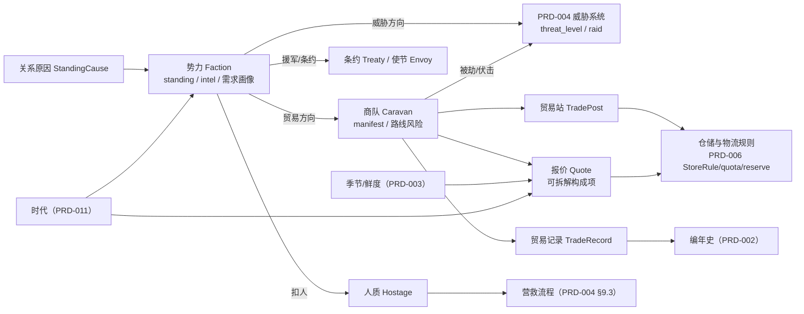
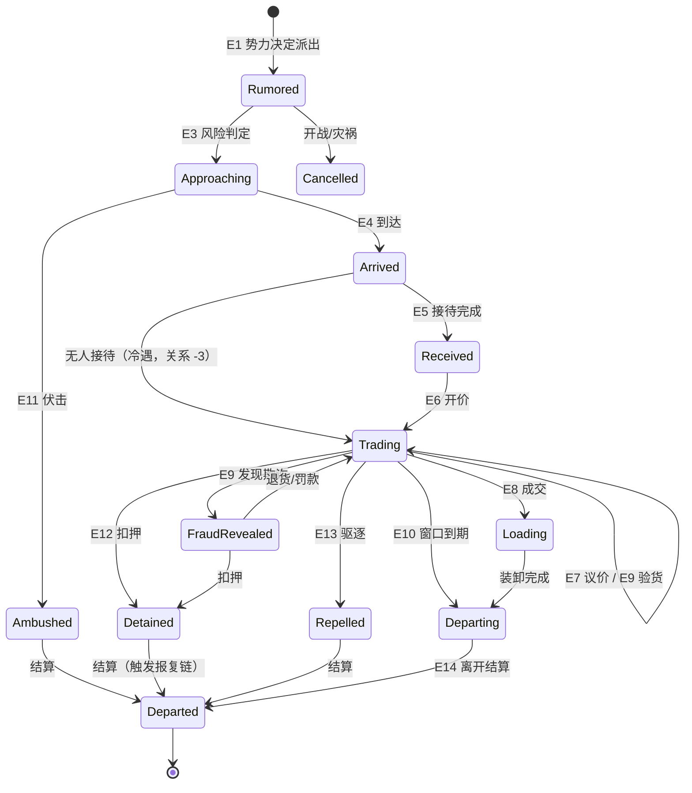
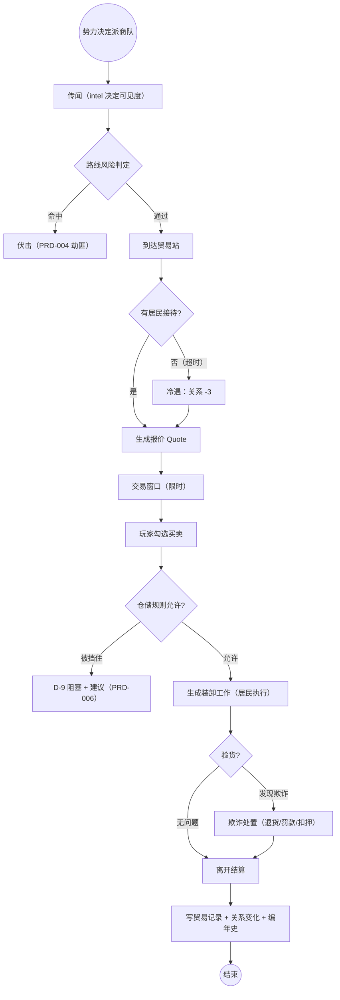

# PRD-010 · 外交与贸易

```
状态：草稿PRD
负责人：设计（人类定稿）
最后更新：2026-10-18
优先级：P0          里程碑：M2（M2.0 只做「抽象势力 + 以物易物商队 + 关系因果」；M3 做条约/货币/护卫战）
上游依据：docs/design/06-economy-and-logistics.md §7、docs/design/07-threats-and-narrative.md §6/§6.1（R-TH-11/12/16/17）、
         docs/design/01-vision-and-pillars.md（P3 世界回应、P4 进程、P5 失败长出故事）
关联文档：PRD-004（威胁与防卫：**共用同一份势力模型**）、PRD-006（仓储规则与因果诊断：交易吃规则、价格可诊断）、
         PRD-003（季节/温度/口渴/营养：鲜度与存量预测）、PRD-002（事件与叙述者：商队前兆、势力行为）、
         PRD-011（时代进程：贸易形态随时代解锁）、PRD-012（多人权限：**未写，本 PRD 的相关条目待其对齐**）
基底依赖：Colony（stores/withhold/rule/submit/keep）、StoreRule/Order、Carry/Delivery/Haul、Node/NodeSpec/RefusalKind/Shortfall、
         Vocation/PerkPool/Licence、Locomotion（**非人形驮兽必须自带**）、Cadence.Cron、Declaring（colony/vocation/urges/residentKind）、
         front/api Board/Row/Act/Rows/Sentence/Notice/ItemPicker/Layer、Scenes.folder
外部调研：docs/research/07-mc-landscape.md（商队类 mod 与「数据驱动写法」）、docs/pack/01-modlist.md §4.6
fork 层：**L1 新文件为主 + L2**（扩 `Shelves` 支持 `faction`/`trade_goods`/`caravan` 货架）。**无 L3/L4**（见 §14）
```

---

## 0. 一句话

> 外面有人：他们想买你的粮、卖给你盐和铁、也会因为你抢过他们的商队而记住你——而且这一切都由你的居民去接待、装卸、护送和讨价还价。

---

## 1. 概述

**玩家在什么情境下遇到它**：殖民地活过最初几天之后，地图边缘出现烟尘与驼铃——一支商队来了。玩家第一次面对"我缺的东西在别人手里"：是卖掉过冬的粮换一把铁镐，还是拒绝他们、招来怨恨？

**它解决什么体验问题**：
- 对应支柱 **P3（世界会回应）**：外部世界此前只是威胁（[PRD-004](PRD-004-threats-and-defence.md) 的袭击方向），缺了**另一面**——愿意交易的邻居、有缺口的商邦、会记仇的掠夺者团。
- 对应支柱 **P4（从石头到星辰）**：贸易是**跳出自给自足**的唯一途径，也是时代推进的物质来源之一（[d06 §7.1](../design/06-economy-and-logistics.md)：石器自给自足 → 铜石定期商队 → 铁器常设商路 → 工业货币 → 蒸汽条约与垄断）。
- 对应支柱 **P5（失败长出故事）**：商队不只是提款机——它会**被劫、会骗人、会扣人**，每次失败都留下可讲的事。

**它产生什么新的决策**（没有新决策的系统不允许立项）：
| 决策 | 代价 |
| --- | --- |
| 卖粮过冬 vs 买铁扩产 | [d06 R-ECO-11](../design/06-economy-and-logistics.md)：贸易必须给真实取舍，不能"总是赚" |
| 派居民护送商队（吃人力与出行预算） vs 让他们自己走（被劫风险） | 护卫是**真实劳力的机会成本** |
| 用物资交贡/赠礼修关系（立刻损失） vs 硬扛袭击（损失更不可控） | 与 PRD-004 的 `ransom` 是**同一个决策面** |
| 扣押欺诈的商队（得货、关系崩） vs 忍气吞声（保商路） | 外交信誉是长期资产 |
| 把贸易站建在仓房旁（物流近、被劫损失大） vs 建在围墙外（安全、搬运远） | 与 [PRD-006](PRD-006-stock-rules-and-diagnosis.md) 的仓储/物流规则耦合 |
| 长期单一供货（便宜、被断供就崩） vs 多势力分散采购（贵、稳） | 断供是我们的**失败模式**之一 |

**它在多大程度上是玩家的选择**：**关系与贸易节奏由玩家行为推动**（打谁、卖谁、护谁、骗谁），但**商队何时来、带什么、要不要来**由势力自身的需求与时代决定（[d07 R-TH-12](../design/07-threats-and-narrative.md)：势力的行为必须可理解，不能是随机数）。

---

## 2. 设计目标与非目标

### 2.1 目标（Goals）

| 编号 | 目标 | 可判定信号 |
| --- | --- | --- |
| G1 | **一份势力模型，三种表现** | 袭击/贸易/援军读同一个 `standing`；代码里只有一处写入点（R-DIP-1，静态检查） |
| G2 | 关系变化可解释 | 每次 `standing` 变化都有**具名原因条目**，UI 可展开（照 PRD-006「为什么」） |
| G3 | 交易是真选择 | 卖/买都有机会成本；价格随大批交易移动（R-TRD-5，防套利） |
| G4 | 居民执行全部环节 | 接待/装卸/护卫/议价都是居民的工作（`Colony.submit`），玩家点按钮只表达意图（ADR-013） |
| G5 | 货物真实存在 | 没有 UI 隔空转账；商队携带、装载、劫走、扣押的都是**世界里的物品**（d06 §1 实物物流原则） |
| G6 | 失败有前兆有应对 | 欺诈/伏击/扣人/断供 4 类失败，每类至少 2 种应对（R-TRD-11） |
| G7 | 不与 PRD-004 打两套仗 | 劫匪就是 PRD-004 的威胁实体/事件，不新增第二套敌人（R-DIP-6） |
| G8 | 无外部 mod 也完整 | 不装 `better-caravans` 等时，抽象商队与交易**功能完整**（R-TRD-13） |
| G9 | 可被数据包改写 | `faction`/`trade_goods`/`caravan` 三货架 + 价格曲线可覆盖，无需改 Java（§15） |

### 2.2 非目标（Non-Goals，本次不做）

| 编号 | 不做的事 | 理由 | 何时可能做 |
| --- | --- | --- | --- |
| N1 | **第二套居民模拟**（Millénaire / MCA Reborn 作为主通路） | [d07 §6.1](../design/07-threats-and-narrative.md) 路径 A 为主线；两套居民实体语义冲突（R-TH-16） | 永不做主线；B/C 仅作可选外观/访客（R-TRD-13） |
| N2 | 世界中的**实体势力殖民地**（真实外邦村庄、可攻占的城） | 成本与性能不可控；与本 PRD 的抽象层冲突 | M4 之后单独评估 |
| N3 | 玩家**自己派商队远行**（主动远征贸易） | 需要远征/车队/载具系统，属 PRD-011 与太空阶段 | M3 评估（OQ-1） |
| N4 | 货币经济与银行/税率/贷款 | 先以物易物 + 记账；货币是实物且属后期 | 铁器/工业后（OQ-2） |
| N5 | 跨殖民地贸易与内部市场 | 需要多殖民地经济模型 | M4（OQ-5） |
| N6 | 商队内的**独立 AI 商人**（会自己逛、自己定价博弈） | 复杂度爆炸；价格由公式给出 | 不做 |
| N7 | 联姻/王朝/宗教外交 | 超出本阶段 | 未来池 |
| N8 | 用贸易**替代生产**（一键买齐一切） | 违反 P4：时代推进必须靠自己产 | 不做 |

> **非目标清单不得为空**——以上 8 条即收敛结果。

### 2.3 M1 / M2 / M3 子集

| 里程碑 | 范围 |
| --- | --- |
| **M2.0（最小可玩）** | 抽象势力（2–3 个，数据包定义）+ 关系值 + **以物易物商队**（前兆 → 到达 → 限时交易 → 离开）+ 居民接待/装卸 + 价格公式 + 「为什么这么贵」诊断 + 关系原因日志 |
| **M2.1** | 护卫与伏击（与 PRD-004 共用敌人）、扣押、欺诈与验货 |
| **M3.0** | 使节与条约（停战/通商/互不侵犯/共同防御）、援军（接 PRD-004 `relief_available`）、断供与替代货源 |
| **M3.1** | 货币（实物硬币）、订单式采购、跨区域商路、垄断（时代耦合，[d06 §7.1](../design/06-economy-and-logistics.md)） |
| **M4** | 跨殖民地贸易、太空贸易（[PRD-011](PRD-011-progression-knowledge-and-space.md)）、可选整合 mod 的商队外观 |

**门槛（诚实标注）**：M2.0 的**存量预测**（"本地存量 vs 消耗"是价格项之一）依赖 [PRD-006 R-FLOW-8](PRD-006-stock-rules-and-diagnosis.md)；若未就绪，本地供需项降级为"当前库存 vs 阈值"，价格仍可算但解释性变弱。

---

## 3. 术语

### 3.1 本系统局部术语

| 术语（英文） | 中文 | 说明 | 与全局术语的关系 |
| --- | --- | --- | --- |
| `faction` | 势力 | 外部组织（商邦/邻邦/掠夺者团/王国/教团） | **已登记**（[术语表](../design/03-glossary.md)，plugin `realms`） |
| `standing` | 关系值 | 与某势力的外交关系（-100 ~ +100） | **已登记**（同上）；本 PRD 是它的**唯一权威定义** |
| `stance` | 态度视图 | `standing` 的**只读投影**（PRD-004 的 `FactionStance` 即此物） | 新增（明确它不是第二个数值） |
| `intel` | 情报等级 | 我们对某势力的了解（未接触/传闻/已知/熟悉） | 新增 |
| `envoy` | 使节 | 势力的代表（抽象对象，随条约/谈判出现） | 新增 |
| `treaty` | 条约 | 停战/通商/互不侵犯/共同防御 | 新增（[d07 §6](../design/07-threats-and-narrative.md) 已有概念） |
| `caravan` | 商队 | 来访或外出的贸易队伍 | **已登记**（plugin `trade`） |
| `trade_post` | 贸易站 | 商队停靠与交易的场所（区域用途） | 新增 |
| `manifest` | 货单 | 商队携带与求购的货物清单 | 新增 |
| `trade_goods` | 贸易品 | 可被外部世界买卖的物品类别（货架条目：基础价、时代、稀缺画像） | 新增货架名 |
| `quote` | 报价 | 某一物品此刻的买卖价（含全部系数） | 新增 |
| `spread` | 买卖价差 | 买价与卖价之差（防无限套利） | 新增 |
| `escort` | 护卫 | 为商队提供保护的工作（居民执行） | 新增 |
| `fraud` | 欺诈 | 假货/缺斤少两/以次充好 | 新增 |
| `detain` | 扣押 | 我们扣下商队（人或货） | 新增 |
| `hostage` | 人质 | 被势力扣下的我方居民 | 新增（与 PRD-004 的 `captive` 共用营救流程） |
| `resupply_cut` | 断供 | 长期无商队/被封锁 | 新增 |

### 3.2 与既有术语的冲突检查

| 冲突项 | Folkways 既有含义 | 本系统含义 | 解决方式 |
| --- | --- | --- | --- |
| `FactionStance`（[PRD-004](PRD-004-threats-and-defence.md) §4.1 已定义） | 威胁系统读到的"势力态度" | 就是本 PRD 的 `standing` | **合并**：`FactionStance` 降级为**只读投影**（R-DIP-1）；PRD-004 §4.1 的字段改指向本 PRD 的实体 |
| `raid_strength`（PRD-004） | 袭击强度 | 由 `standing` 与 `threat_level` 推导 | 保留在 PRD-004；本 PRD 只提供 `relation_term` 输入 |
| `ransom`（PRD-004 §3.1） | 交贡换撤军 | 同属"用物资换关系/安全" | **复用同一动作与公式族**，不新造"赠礼"（赠礼 = 主动版 ransom） |
| `standing`（[PRD-006](PRD-006-stock-rules-and-diagnosis.md) 的 `Order(into, what, low, high, standing)`） | **订单里的"常备量"字段** | 外交关系值 | **同名冲突！** → 本 PRD 代码与文案中，外交关系一律写 `faction.standing` 或中文"关系值"；**禁止**在贸易代码里裸用 `standing` 指关系（评审项 R-DIP-2） |
| `Order` | 保持容器内某物品数量的订单 | 外部采购订单 | 外部采购用 `procurement`（中文"采购单"），与 `Order` 区分（R-DIP-3） |
| `trade` | — | 既是插件名/系统名 | 插件目录 `plugins/trade`；玩家的"贸易"概念统一 |
| 「村民」 | Minecraft 原生 | **禁用**称我们的居民 | 外邦/商队成员一律称"外来者/商人/护卫" |

> 全局术语以 [术语表](../design/03-glossary.md) 为准。本 PRD 新增的 `faction`/`standing`/`caravan` 已在表内，**`stance`/`intel`/`treaty`/`envoy`/`quote`/`escort` 需补登记**（见 §18 OQ-8 的登记清单）。

---

## 4. 概念模型

### 4.1 实体

| 实体 | 中文 | 说明 | 生命周期 | 玩家可见 |
| --- | --- | --- | --- | --- |
| `Faction` | 势力 | 抽象政治实体：类型、需求画像、方位、`standing`、`intel`、条约、记忆 | 世界创建时生成 → 随时代解锁新的 → 可被灭亡（M4） | 外交页 |
| `StandingCause` | 关系原因 | 一次 `standing` 变化的具名记录（事件/动作/后果） | 追加 → 随保留期裁剪 | 外交页（可展开） |
| `Treaty` | 条约 | 双方约定的行为约束（停战/通商/互不侵犯/共同防御） | 提议 → 生效 → 到期/撕毁 | 外交页 |
| `Caravan` | 商队 | 一次来访/外出的队伍：货物、护卫、路线风险、状态 | `Rumored` → … → `Departed`（§5） | 世界内 + 贸易页 |
| `Manifest` | 货单 | 携带（`cargo`）与求购（`demand`）的条目 | 随商队 | 贸易页 |
| `Quote` | 报价 | 某物品此刻的买卖价与其构成项 | 每交易日重算 | 贸易页（可展开） |
| `TradePost` | 贸易站 | 商队停靠点（区域用途 + 可选建筑图案） | 玩家划设 → 拆除 | 世界内 |
| `TradeRecord` | 贸易记录 | 历史交易（物品/数量/价格/对象/时间） | 追加 → 裁剪 | 外交页/编年史 |
| `Hostage` | 人质 | 被势力扣下的我方居民 | 被扣 → 营救/赎回/超时 | 世界内 + 防御页（复用 PRD-004） |

### 4.2 实体之间的关系



**级联规则（R-DIP-4）**：改 `standing` 只允许通过 `Factions.adjust(faction, delta, cause)` 一个入口；该入口必须：① 写 `StandingCause`；② 触发 PRD-004 的 `threat_level` 重算；③ 触发 PRD-002 的事件检查（可能生成袭击/援军/使节）；④ 使相关报价缓存失效。

---

## 5. 状态机

### 5.1 状态定义（商队生命周期）

| 状态 | 中文 | 说明 |
| --- | --- | --- |
| `Rumored` | 传闻 | 势力已决定派商队；玩家可能从传闻/侦察得知（`intel` 影响是否可见） |
| `Approaching` | 在途 | 前兆阶段：世界内出现痕迹（烟尘/驼铃/探路者），路线风险判定发生 |
| `Arrived` | 已到达 | 抵达贸易站或默认集结点，等待接待 |
| `Received` | 已接待 | 居民完成接待（引路/开门/卸货准备） |
| `Trading` | 交易中 | **限时交易窗口**，玩家与居民进行买卖 |
| `Loading` | 装卸中 | 居民执行装货/卸货（真实物品移动，吃仓储规则） |
| `Departing` | 离开中 | 商队带走来买到的货、留下买到的货 |
| `Departed` | 已离开 | 结算完成，写入贸易记录与关系变化 |
| `Ambushed` | 遭伏击 | 被劫（劫匪 = PRD-004 威胁实体） |
| `Detained` | 被扣押 | 我们扣下商队（人或货） |
| `FraudRevealed` | 欺诈败露 | 验货发现假货/缺斤少两 |
| `Repelled` | 被驱逐 | 我们主动赶走（关系惩罚） |
| `Cancelled` | 已取消 | 前兆期取消（战争/关系骤降/灾祸/道路不通） |

### 5.2 事件定义

| 事件 | 中文 | 说明 | 触发方 |
| --- | --- | --- | --- |
| E1 | 势力决定派出 | 由势力需求画像 + 时代 + 冷却决定 | 系统（日节拍） |
| E2 | 玩家得知 | `intel` 决定呈现方式是"传闻"还是"明确前兆" | 系统 |
| E3 | 路线风险判定 | 与 PRD-004 的威胁状态、季节、距离有关 | 世界 |
| E4 | 到达 | 生成商队实体/抽象主体 + 货单 | 系统 |
| E5 | 接待完成 | 居民工作完成 | 居民 |
| E6 | 开价 | 生成 `Quote`（每交易日刷新） | 系统 |
| E7 | 玩家/居民议价 | 需 `trade` 许可 + 熟练度 | 玩家/居民 |
| E8 | 成交 | 扣/加物品，更新记录 | 玩家 + 居民执行 |
| E9 | 验货 | 可发现欺诈 | 居民（`Inspect` 工作） |
| E10 | 交易窗口到期 | 商队准备离开 | 系统 |
| E11 | 伏击发生 | 劫匪出现（PRD-004） | 世界 |
| E12 | 扣押 | 我们扣人/扣货 | 玩家（需权限） |
| E13 | 驱逐 | 赶走商队 | 玩家（需权限） |
| E14 | 离开结算 | 应用全部后果（关系、记录、后续事件） | 系统 |
| E15 | 人质被扣 | 势力报复性扣人 | 势力 |

### 5.3 扩展变量（系统状态）

| 变量 | 中文 | 类型 | 默认值 | 取值范围/单位 | 说明 |
| --- | --- | --- | --- | --- | --- |
| `faction.standing` | 关系值 | 定点 | 0 | -100 ~ +100 | **唯一权威数值**（R-DIP-1） |
| `faction.intel` | 情报等级 | 枚举 | 传闻 | 未接触/传闻/已知/熟悉 | 影响 UI 信息量与报价可见项 |
| `faction.demand` | 需求画像 | 列表 | 数据包 | — | 该势力缺什么/富什么（价格的外部供需项来源） |
| `faction.cooldown_days` | 商队冷却 | 整数 | 6 | 2–30 游戏日 | 势力再次派商队的间隔 |
| `faction.memory[]` | 势力记忆 | 列表 | 空 | — | 记恩记仇（与 PRD-002 事件关联） |
| `caravan.size` | 商队规模 | 整数 | 6 | 1–16 | 实体数或抽象规模 |
| `caravan.escort` | 商队护卫 | 整数 | 1 | 0–6 | 影响伏击难度 |
| `caravan.risk` | 路线风险 | 定点 | 依世界 | 0–1 | 由 PRD-004 威胁状态/季节/距离合成 |
| `caravan.cargo[]` | 携带货 | 列表 | 数据包 | — | 真实物品 + 数量（+ 鲜度，若 PRD-003 就绪） |
| `caravan.demand[]` | 求购货 | 列表 | 数据包 | — | 他们想买的（价格加成来源） |
| `caravan.window` | 交易窗口 | 整数 | 2 | 1–5 游戏日 | 超时即离开 |
| `caravan.fraud` | 欺诈标记 | 布尔 | 依势力 | — | 见 §9.5 失败模式 |
| `trade.spread` | 买卖价差 | 百分比 | 20% | 5–50% | 防无限套利（[d06 R-ECO-10](../design/06-economy-and-logistics.md)） |
| `trade.elasticity` | 价格弹性 | 定点 | 0.4 | 0–1 | 大批交易推动价格 |
| `trade.max_ratio` | 价格上限倍率 | 定点 | 3.0 | 1.5–10 | 防离谱价格（可解释范围内） |
| `hostage.window_days` | 人质窗口 | 整数 | 3 | 1–10 | 复用 PRD-004 `rescue_window_days` 语义 |
| `caravan.enabled` | 商队开关 | 布尔 | true | — | 纯净/隔离玩法玩家 |

### 5.4 守卫条件依赖

| 变量 | 中文 | 类型 | 来源 |
| --- | --- | --- | --- |
| `era` | 当前时代 | 枚举 | [PRD-011](PRD-011-progression-knowledge-and-space.md) / 知识进度 |
| `threat_level` | 威胁等级 | 整数 0–5 | [PRD-004 §9.1](PRD-004-threats-and-defence.md) |
| `stock_days` | 存量天数 | 定点 | [PRD-006 R-FLOW-8](PRD-006-stock-rules-and-diagnosis.md)（存量预测） |
| `store_rules` | 仓储规则 | 集合 | PRD-006（`reserve_rule`/`quota`/`quality_gate`） |
| `season` | 季节 | 枚举 | [PRD-003](PRD-003-season-temperature-thirst-nutrition.md) |
| `has_trade_post` | 是否有贸易站 | 布尔 | 本 PRD（区域用途） |
| `licences` | 工种许可 | 集合 | 基底 `Licence` |
| `permissions` | 玩家权限 | 集合 | **PRD-012（未写）**，本 PRD 暂用基底权限层级 |

### 5.5 状态转移表

| 源状态 | 事件 | 守卫条件 | 动作 | 任务/副作用 | 目标状态 |
| --- | --- | --- | --- | --- | --- |
| — | E1 势力决定派出 | 时代符合 且 冷却已过 且 `caravan.enabled` 且 有可用贸易站或默认集结点 | 生成 `Caravan`（货单/规模/护卫） | 排定抵达时间 | `Rumored` |
| `Rumored` | E2 玩家得知 | `intel` ≥ 传闻 | 公告/前兆 | 写 PRD-002 事件（前兆） | `Rumored`（可见） |
| `Rumored` | E3 风险判定 | — | 计算 `risk` | 决定伏击概率 | `Approaching` |
| `Rumored` | 取消条件 | 与该势力开战 或 `standing` ≤ -60 或 灾祸 | 取消 | 不写贸易记录；写关系原因 | `Cancelled` |
| `Approaching` | E4 到达 | 贸易站存在且可达（否则默认集结点） | 生成实体/抽象主体 | 世界内出现 | `Arrived` |
| `Approaching` | E11 伏击 | `risk` 判定命中 | 生成劫匪（PRD-004） | 货物损失/被劫 | `Ambushed` |
| `Arrived` | E5 接待完成 | 有居民接了接待工作且完成 | 引路/开门 | 关系微增（`+1`，礼貌） | `Received` |
| `Arrived` | 超时（无人接待） | 到达后 >0.5 日无接待 | 视为冷遇 | 关系 `-3`，仍可交易 | `Trading` |
| `Received` | E6 开价 | — | 生成 `Quote`（§9.4） | 报价缓存 | `Trading` |
| `Trading` | E7 议价 | 有 `trade` 许可的居民可用 且 熟练度 ≥ 阈值 | 修正价格（±`bargain`） | 消耗居民时间 | `Trading` |
| `Trading` | E8 成交 | 物品与仓储规则允许（否则 D-3/D-6/D-9 阻塞） | 记 `TradeRecord`，调整 `standing`（微小） | 生成装卸工作 | `Loading` |
| `Trading` | E9 验货 | 有 `Inspect` 工作完成 | 揭示/未揭示 `fraud` | 见 §9.5 | `FraudRevealed` 或 `Trading` |
| `Trading` | E10 窗口到期 | — | 商队准备离开 | 未成交的求购项记入"失望"（关系 `-1`） | `Departing` |
| `Loading` | 装卸完成 | 物品全部到位（或超时） | 记录差异 | 未到位则关系 `-2` | `Departing` |
| `Trading` | E12 扣押 | 玩家有权限 且 确认 | 扣人或扣货 | 关系骤降（`-25 ~ -40`）；可能招致报复（PRD-004） | `Detained` |
| `Trading` | E13 驱逐 | 玩家有权限 且 确认 | 赶走 | 关系 `-15`；该势力冷却延长 | `Repelled` |
| `Trading`/`Loading` | E11 伏击 | 同 `Approaching` | 劫匪出现 | 货物被劫、可能有伤亡 | `Ambushed` |
| `Ambushed` | 结算 | 我方护卫/民兵介入（PRD-004） | 结果：击退/被劫/双方损失 | 关系变化（我们是否保护了他们） | `Departed`（见下） |
| `Detained` | 结算 | — | 人质/货物入账 | 触发报复事件链（PRD-002） | `Departed` |
| `Repelled` | 结算 | — | — | 冷却延长 | `Departed` |
| `FraudRevealed` | 玩家选择 | 三种应对（§9.5） | 罚款/退货/扣押 | 关系变化 | `Trading` 或 `Detained` |
| `Departing` | E14 离开结算 | 商队离图 | 应用全部后果 | 写编年史 | `Departed` |
| `Departed` | E15 人质被扣（若关系极差） | `standing` ≤ -40 且 有人质机制 | 扣下我方居民 | 走 PRD-004 营救流程 | 终态 |

### 5.6 状态图



### 5.7 超时与中断

| 情形 | 处理 | 恢复后行为 |
| --- | --- | --- |
| 玩家离开/断线 | 交易窗口**继续计时**（世界不因玩家离线暂停）；已成交的进入装卸 | 重连后可见当前状态与剩余窗口 |
| 全部玩家离线 | 可配置：交易窗口暂停（默认，至多 1 游戏日）或照常（[PRD-004 §5.6](PRD-004-threats-and-defence.md) 同款策略） | 按配置继续 |
| 目标消失（贸易站被拆/仓房被搬空） | 商队转向默认集结点；若无可达点 → `Cancelled`（关系 `-2`，记原因） | — |
| 居民死亡/失去能力（接待/装卸/议价/护卫） | 工作重新派给其他居民（走基底 `Urgent` 重排）；若无人可派 → 超时路径 | — |
| 区块卸载（商队在世界内） | 商队状态持久化；卸载期间按**抽象**推进（不 tick 实体） | 加载后实体重新生成于当前位置 |
| 服务器重启（交易中） | 从存档恢复商队与窗口剩余；**报价重算**（不恢复旧价，避免利用旧价套利） | 状态一致 |
| 势力被灭亡（M4） | 未结算的商队变为 `Cancelled`；关系记录保留 | — |
| 时代倒退（剧本/回滚） | 不符合时代的商队 `Cancelled`；不删历史记录 | — |

---

## 6. 交互

### 6.1 入口与快捷键

| 操作 | 按键/手势 | 前置条件 | 结果 |
| --- | --- | --- | --- |
| 打开「外交」页 | 面板页签 | 手持殖民书 | 势力列表（关系/情报/条约/最近商队） |
| 打开「贸易」页 | 面板页签 / 商队到达通知 | 手持殖民书 且 有进行中的商队 | 货单 + 报价 + 交易动作 |
| 划设贸易站 | 基底区域用途（`ZoneSettings`） | 手持殖民书 | 商队停靠点 |
| 世界内查看商队 | 对商队用殖民书 | — | 商队卡（规模/护卫/货物/风险） |
| 议价 | 贸易页动作 / 世界内对话 | 有 `trade` 许可的居民在附近 | 修正报价 |
| 验货 | 贸易页动作 | 同上（可派居民） | 揭示欺诈 |
| 签订条约（M3） | 外交页动作 | 权限 + 使节在场 | 生效 |
| 交贡/赠礼 | 外交页/前兆通知（**复用 PRD-004 动作**） | 物资足够 | 关系提升 |
| 扣押 / 驱逐 | 商队卡动作（需权限 + 确认） | 商队在交易/装卸态 | 见 §5.5 |
| 「为什么这么贵」 | 报价行上的诊断动作 | — | 打开报价构成（§7.4） |

**R-UI-1**：**「为什么」入口必须与 [PRD-006](PRD-006-stock-rules-and-diagnosis.md) 统一**（同一种诊断卡结构）：报价、关系变化、商队未到、货物没卸完，全部走同一种卡，不允许各做一套。
**R-UI-2**：玩家点"成交"只**表达意图**：真正的搬运由居民执行（ADR-013）；若无人可派，必须给出**阻塞与建议**（PRD-006 D-3/D-6/D-7/D-8）。

### 6.2 操作模式状态机

| 状态 | 中文 | 说明 |
| --- | --- | --- |
| `Normal` | 常态 | 无 |
| `SelectingTradePost` | 划设贸易站 | 选一个区域用途为"贸易站"，世界内高亮可达性与商路方向 |
| `ChoosingOffer` | 挑选交易 | 在货单上勾选本次想买/想卖的量（受仓储规则约束） |

| 事件 | 中文 | 说明 | 触发方 |
| --- | --- | --- | --- |
| S1 | 选择"贸易站"用途 | 进入划设 | 玩家 |
| S2 | 确认区域 | 完成划设 | 玩家 |
| S3 | 取消 | 退出 | 玩家 |
| S4 | 勾选货单 | 进入/更新挑选 | 玩家 |
| S5 | 提交成交 | 生成装卸工作 | 玩家 |

| 源状态 | 事件 | 守卫条件 | 目标状态 | 动作 |
| --- | --- | --- | --- | --- |
| `Normal` | S1 | 手持殖民书 | `SelectingTradePost` | 高亮 |
| `SelectingTradePost` | S2 | 区域合法（≥1 格、可达） | `Normal` | 注册贸易站 |
| `SelectingTradePost` | S3 | — | `Normal` | — |
| `Normal` | S4 | 有进行中商队 | `ChoosingOffer` | 显示约束（预留/配额/空间） |
| `ChoosingOffer` | S5 | 报价仍有效 且 规则允许 | `Normal` | 生成装卸工作 |
| `ChoosingOffer` | S3 | — | `Normal` | — |

### 6.3 右键菜单 / 面板动作

| 上下文 | 按钮 | 操作 | 触发事件 | 是否可撤销 |
| --- | --- | --- | --- | --- |
| 贸易页 / 货物行 | 「成交」（`Do`） | 提交买卖 | E8 | 是（装卸完成前） |
| 贸易页 / 货物行 | 「议价」（`Do`） | 派居民议价 | E7 | — |
| 贸易页 / 货物行 | 「验货」（`Do`） | 派居民验货 | E9 | — |
| 贸易页 / 货物行 | 「为什么」（`Do`） | 打开报价诊断卡 | — | — |
| 商队卡 | 「查看势力」（`Open`） | 跳外交页 | — | — |
| 商队卡 | 「扣押」（`Do`） | 扣人/扣货 | E12 | **否**（需确认） |
| 商队卡 | 「驱逐」（`Do`） | 赶走 | E13 | **否**（需确认） |
| 外交页 / 势力行 | 「交贡/赠礼」（`Do`） | 复用 PRD-004 动作 | — | 否 |
| 外交页 / 势力行 | 「提议条约」（`Do`） | 生成使节与提议 | — | 是（生效前） |
| 外交页 / 势力行 | 「定位」（`Ping`） | 世界内标记商队/使节 | — | — |

**R-UI-3（`Board.Act` 五动词边界）**：上表全部动作可落在基底 5 个动词（`Do`/`Edit`/`Open`/`Ping`/`Admit`）之内 —— **因此本 PRD 不需要新的动作分类（无 L3）**。若 Plan 阶段发现"扣押/驱逐"需要独立的语义槽（例如需要专属图标与二次确认类型），**那才**升级为 [d12](../design/12-fork-strategy.md) 的 L3 改动，并在 §14 与本表显式登记理由。
**R-UI-4**：货单可能超过 32 行 → 必须**分页 + 筛选**（类别/可负担/本地短缺/仅求购），遵守 32 行/页、4 动作/行、8 行/卡上限。
**R-UI-5**：`Notice` 最多 4 个参数 → 商队通知只允许「势力名 + 物品 + 数量 + 剩余天数」这一级信息，细节进页面。

### 6.4 命令

| 命令 | 权限 | 说明 | 输出 |
| --- | --- | --- | --- |
| `/<ns> faction list` | gamemaster | 列出势力与 `standing`/`intel` | 文本表 |
| `/<ns> faction set <id> <standing>` | gamemaster | 设置关系值 | 确认 + 写 `StandingCause`（原因标注"调试"） |
| `/<ns> faction cause <id>` | gamemaster | 打印关系变化原因日志 | 文本表 |
| `/<ns> caravan spawn <faction>` | gamemaster | 立即派一支商队（测试） | 商队 id |
| `/<ns> caravan state` | gamemaster | 当前商队状态机状态与剩余窗口 | 文本 |
| `/<ns> trade quote <item>` | gamemaster | 打印报价与构成项（调参用） | 文本表 |
| `/<ns> trade report` | gamemaster | 打印贸易记录摘要（用于平衡） | 文本表 |
| `/<ns> trade shelf` | gamemaster | 列出 `faction`/`trade_goods`/`caravan` 货架条目与被拒原因（**与 `/folkways library` 同级可诊断**） | 文本表 |

---

## 7. 反馈

### 7.1 操作模式反馈（玩家交互时）

| 检查条件 | 音效 | Toast/文案键 | 视觉反馈 | 系统行为 |
| --- | --- | --- | --- | --- |
| 进入划设贸易站 | 轻微 | 「选择商队停靠的区域」 | 可达区域高亮；不可达变暗 | 等待 |
| 区域非法（太小/不可达/无入口） | 低沉 | 具体原因（`<ns>.trade.post.reject.*`） | 红色描边 | 拒绝 |
| 勾选超出规则允许的量 | 低沉 | 「%s 被规则保护（%s）」 | 该行标红 + 悬浮显示规则 | 拒绝（对应 PRD-006 D-9） |
| 成交提交成功 | 确认 | 「已下达：%s ×%s」 | 生成装卸工作标记 | 派工 |
| 无人可派 | 低沉 | 「没有可用的人手（%s）」 | 诊断入口 | 生成阻塞与建议 |
| 议价成功/失败 | 中性/低沉 | 「议价：%s → %s」/「对方不接受」 | 报价行更新 | 更新报价 |
| 验货发现欺诈 | 提示 | 「货物有问题：%s」 | 欺诈标记 | 打开处置选择 |

### 7.2 实体状态反馈（持续显示）

| 检查条件 | 图标/颜色 | 悬停信息 | 系统行为 |
| --- | --- | --- | --- |
| 商队在途 | 世界标记（烟尘/驼铃） | 「%s 的商队正在接近（约 %s 天后到达）」 | 前兆倒计时 |
| 商队已到达（等待接待） | 世界标记 + 图标 | 「等待接待（剩余 %s）」 | 计时 |
| 交易中 | 图标（钱袋/秤） | 「交易窗口剩余 %s」 | 计时 |
| 装卸中 | 图标（箱） | 「装卸中：%s / %s」 | 显示进度 |
| 商队护卫数量高 | 图标（剑） | 「护卫 %s 名」 | 影响伏击难度 |
| 路线风险高 | 颜色（黄→红） | 「路线风险 %s%%」 | 已在档 |
| 势力关系为负 | 颜色（红） | 「关系 %s（%s）」 | 外交页 |
| 势力记忆中的仇 | 图标（疤） | 「记得：%s」 | 影响报价与商队频率 |
| 人质在押 | 图标（锁） | 「%s 被扣押（剩余 %s 天）」 | 营救窗口 |
| 有人质被扣 | 世界标记 | 「%s 被带走了」 | 营救入口 |

### 7.3 系统事件反馈（非玩家触发）

| 事件 | 音效 | 通知文案键 | 视觉 | 系统行为 |
| --- | --- | --- | --- | --- |
| 传闻出现 | 轻微 | 「听说 %s 的商队正在准备出发」 | 外交页角标 | 不暴露细节（`intel` 低） |
| 前兆明确 | 提示 | 「%s 的商队预计 %s 天后到达」 | 世界标记 | 倒计时 |
| 商队到达 | 正向 | 「%s 的商队到了（求购 %s）」 | 世界内 | 打开交易入口 |
| 交易窗口剩余 1 天 | 轻微 | 「商队将在 %s 后离开」 | 计时变色 | — |
| 商队离开 | 中性 | 「%s 的商队离开了（成交 %s）」 | — | 结算 |
| 商队被劫 | 警报 | 「%s 的商队在 %s 被劫了」 | 世界内 | 关系变化（我们是否护卫） |
| 我们的商队护卫胜利 | 正向 | 「护卫击退了劫匪」 | — | 关系提升 |
| 欺诈败露 | 提示 | 「%s 的商队被发现以次充好」 | 欺诈标记 | 处置选择 |
| 有人质被扣 | 警报 | 「%s 被 %s 扣下了」 | 标记 | 营救/赎回 |
| 断供（连续 %s 天无商队） | 提示 | 「%s 已经 %s 天没有商队」 | 外交页 | 建议替代货源 |
| 条约签订/撕毁 | 正向/警报 | 「与 %s 签订%s」/「%s 撕毁了条约」 | — | 关系变化 + PRD-002 事件 |
| 援军到达 | 正向 | 「%s 的援军到达」（**与 PRD-004 同一条**） | 世界内 | 联合作战 |

**R-F-1（反馈纪律）**：任何关系变化都**必须**在通知里给出**方向与原因**（「因为你的护卫救下了他们的商队，关系 +8」），禁止只显示数字跳动。
**R-F-2**：负向事件必须**带建议**（照 [PRD-006 R-F-3](PRD-006-stock-rules-and-diagnosis.md)）：断供 → 「打开外交页修复关系 / 查看替代货源」。

### 7.4 可诊断性（管理者的要求）

| 玩家可能的疑问 | 系统必须能回答 | 呈现位置 |
| --- | --- | --- |
| 「为什么没人去接待/装卸？」 | 复用 PRD-006 阻塞分类（D-3 无许可 / D-4 无工具 / D-6 无空间 / D-7 到不了 / D-8 被更高优先占用 / D-9 被规则挡住） | 贸易页诊断卡 |
| 「东西为什么没送到（贸易站）？」 | PRD-006 四段诊断链（意图 → 计划 → 资源 → 执行）+ 商队状态 | 诊断卡 |
| 「为什么这么贵？」 | **报价构成逐项**：基础价 × 外部供需 × 本地供需 × 关系 × 时代 × 距离 × 波动（§9.4），每项可单独查看 | 报价诊断卡 |
| 「为什么他们不来了？」 | 势力侧原因：关系太低 / 冷却中 / 时代不符 / 路线风险过高 / 我们扣押过他们 | 外交页「为什么」 |
| 「为什么关系掉了？」 | `StandingCause` 列表（事件、动作、后果、时间） | 外交页可展开 |
| 「为什么我不能扣押？」 | 权限不足 / 状态不符（不在交易或装卸态）/ 已有扣押 | 按钮悬浮 |
| 「他为什么不高兴（被派去接待外来者）？」 | 接 PRD-001 情绪原因（可能含"社交过载"或"对外来者的恐惧"） | 居民卡 |
| 「为什么商队带的东西没用？」 | 势力需求画像 + 该势力的产出/缺口 | 外交页势力详情 |

**R-F-3**：报价的**每一个系数**都必须能被单独查询（命令 `trade quote` 与 UI 同一实现）——这是 [PRD-006](PRD-006-stock-rules-and-diagnosis.md)「因果诊断」精神在外部经济上的延伸。

---

## 8. 规则

> 规则分两族：**R-DIP**（势力与外交）与 **R-TRD**（贸易与商队）。全部可判定。

| 编号 | 类型 | 规则 | 违反时的行为 |
| --- | --- | --- | --- |
| R-DIP-1 | 必须 | `standing` **只有一个权威存储与一个写入入口**（`Factions.adjust`）；PRD-004 的 `FactionStance` 是只读投影 | 出现第二处写入即缺陷（静态检查 AC-6） |
| R-DIP-2 | 禁止 | 在贸易/外交代码里裸用 `standing` 指代"订单常备量"（基底 `Order` 字段同名） | 命名冲突即评审拒绝；必须写 `faction.standing` |
| R-DIP-3 | 必须 | 外部采购一律叫 `procurement`（采购单），与基底 `Order`（容器存量订单）区分 | 混淆即拒绝 |
| R-DIP-4 | 级联 | `standing` 变化 → 写 `StandingCause` → 重算 `threat_level`（PRD-004）→ 触发 PRD-002 事件检查 → 报价缓存失效 | 缺任一级联即缺陷 |
| R-DIP-5 | 必须 | 势力行为**可理解**：商队的来/不来/带什么，必须能归因到需求画像、关系、时代、风险（[d07 R-TH-12](../design/07-threats-and-narrative.md)） | 无归因的事件视为缺陷 |
| R-DIP-6 | 禁止 | 新增第二套敌人：伏击/劫匪必须复用 PRD-004 的威胁实体与事件 | 重复实现即缺陷 |
| R-DIP-7 | 必须 | 存在**非战斗解法**：修关系可用物资/服务/履约（[d07 R-TH-11](../design/07-threats-and-narrative.md)） | 无解法即偏离 P3 |
| R-DIP-8 | 必须 | 每个势力的**记忆**只记录具名事件（可显示、可解释），不做隐藏随机惩罚 | 隐藏惩罚即缺陷 |
| R-DIP-9 | 必须 | 外邦/商队成员**不得**进入我们的居民名册（[d07 R-TH-16](../design/07-threats-and-narrative.md)） | 混入即缺陷（AC-22） |
| R-DIP-10 | 优先级 | 条约 > 常态行为：有"互不侵犯"则不出袭击；有"通商"则商队频率提升 | 违反即缺陷 |
| R-DIP-11 | 必须 | 势力类型与数量随**时代**解锁（石器不得出现星际商队） | 越级即缺陷（AC-20） |
| R-DIP-12 | 禁止 | 用隐藏数值模拟外交（玩家看不到的"真实好感度"） | 双账本即缺陷 |
| R-TRD-1 | 必须 | 一切交易都是**真实物品移动**（商队携带 ↔ 仓储点 ↔ 使用点）；禁止 UI 隔空增减库存 | 违反即缺陷（AC-10） |
| R-TRD-2 | 必须 | 交易必须**吃仓储与物流规则**（PRD-006 的 `reserve_rule`/`quota`/`quality_gate`）；被规则挡住的交易给出 D-9 阻塞 | 绕过规则即缺陷 |
| R-TRD-3 | 必须 | 全部交易环节由**居民执行**（接待/装卸/议价/验货/护卫），玩家只表达意图（ADR-013） | 只有玩家点击即缺陷（AC-9） |
| R-TRD-4 | 必须 | 报价可拆解为构成项，且**命令与 UI 同一实现**（[PRD-006 R-F-3 精神](PRD-006-stock-rules-and-diagnosis.md)） | 两套实现即缺陷 |
| R-TRD-5 | 必须 | 价格随交易量移动（弹性），且买卖有 `spread`；**禁止无限套利**（[d06 R-ECO-10](../design/06-economy-and-logistics.md)） | 可套利即缺陷（AC-13） |
| R-TRD-6 | 必须 | 报价受 `max_ratio` 约束，绝不出现离谱价格（可解释范围内的极端值允许） | 超限即 clamp |
| R-TRD-7 | 禁止 | 交易窗口无限延长（必须有时限与离开路径） | 无超时即缺陷 |
| R-TRD-8 | 必须 | 商队实体必须自带 `Locomotion`（驮兽/外来者非人形时）；不得被当人形处理 | 违反即缺陷（[r06 §3 #6](../research/06-gap-analysis.md)） |
| R-TRD-9 | 必须 | 商队规模受 `caravan.size` 上限约束；超限部分转为**抽象结算**（性能门禁） | 超限即降级（AC-31） |
| R-TRD-10 | 必须 | 交易记录与关系变化写入**编年史**（PRD-002）与势力记忆 | 缺失即缺陷 |
| R-TRD-11 | 必须 | 四类失败（欺诈/伏击/扣人/断供）各有**前兆**与**≥2 种应对** | 无前兆的惩罚即缺陷（AC-18） |
| R-TRD-12 | 必须 | 被扣人员复用 PRD-004 的营救窗口与流程（**不得**新造第二套俘虏机制） | 重复实现即缺陷 |
| R-TRD-13 | 必须 | **外部商队 mod 可整体缺失**：不装 `better-caravans`/`pillager-caravans` 时功能完整（G8） | 缺失导致功能不全即缺陷（AC-33） |
| R-TRD-14 | 必须 | 引入货币时，货币是**实物物品**，走仓储与物流；余额只是账本视图（R-TRD-1 的推论） | UI 余额直改即缺陷 |
| R-TRD-15 | 必须 | 交易不得**替代生产**：外部世界不供应时代跃迁的关键唯一品（关键知识/唯一工具必须自产，N8） | 可用钱跳过时代即缺陷 |
| R-TRD-16 | 必须 | 贸易品随时代解锁（[d06 §7.1](../design/06-economy-and-logistics.md)）；越级物品不出现在货单 | 越级即缺陷（AC-20） |
| R-TRD-17 | 必须 | 鲜度/腐坏（若 PRD-003 就绪）必须作用于商队货物：他们的粮也会坏，我们的卖品也要新鲜 | 忽略即偏离 PRD-003 |
| R-TRD-18 | 禁止 | 在抽象结算里直接改世界（必须走 `submit(Grown)` + `Node.commit`） | 违反线程与改世界契约即缺陷 |
| R-TRD-19 | 必须 | 商队与势力的持久化自管版本号 + 迁移；卸载后存档可加载（丢失商队不崩） | 崩溃即缺陷（AC-25/26） |
| R-TRD-20 | 必须 | 玩家可见文本**双语齐全（`zh_cn` + `en_us`）**；参数化文案支持重排 | i18n 检查失败即 CI 失败 |
| R-TRD-21 | 必须 | 探针可观测（商队事件耗时、报价计算耗时、装卸出行量、抽象结算次数）；**无探针不许合并** | 缺探针即拒绝合并 |
| R-TRD-22 | 优先级 | 生存优先于贸易：`reserve_rule` 保护的过冬粮**永远**优先于商队求购（可被玩家显式放宽） | 违反即缺陷（AC-12） |
| R-TRD-23 | 必须 | **知识的外部来源**必须经本系统的商队/使节通道（[PRD-011](PRD-011-progression-knowledge-and-space.md) G4/R-AG-6）：`faction`/`caravan` 货架可声明 `grants_knowledge[]`，且必须由居民在接待/议价/学习中**实际参与**才生效；知识的存储与解锁归 PRD-011，本 PRD **不得**自建知识表 | 自建第二套知识表即缺陷（AC-47） |

---

## 9. 流程（与基底引擎对齐）

### 9.1 工作类型与任务

| 项 | 内容 |
| --- | --- |
| 工作类型（Vocation/Trade） | 复用基底**搬运/制造/巡逻/驾驶**；新增授权 **`trade`**（经商/议价/验货）与 **`escort`**（护卫，语义接 [PRD-004 §9.4](PRD-004-threats-and-defence.md) 的民兵附加授权） |
| 任务（Task/Doing） | 接待（`ReceiveCaravan`）、装卸（**复用基底 `Carry`/`Delivery`**）、议价（`Negotiate`）、验货（`Inspect`）、护卫（`Escort`，复用巡逻/战斗语义）、扣押（`Detain`）、看守人质（`GuardHostage`）、前往势力（M3，`Travel`) |
| 参与的居民种类 | 人类居民（默认）；驮兽/载具（**必须自带 `Locomotion`**） |
| 需要的工具/许可（Tool/Licence） | `trade` 授权（议价/验货）；武器/护具（护卫，走基底 `Kit`）；无许可 → 走基底 `Unassigned.structural()` 的 `NO_LICENCE` 并在 UI 提示"给许可"（[r06 §3 #3](../research/06-gap-analysis.md)：**不允许**把结构性无解当常态） |

### 9.2 执行流程



### 9.3 Action 说明

| Action | 说明 | 失败/拒绝理由（Refusal） |
| --- | --- | --- |
| `ReceiveCaravan` | 前往商队、引路至贸易站、开门 | `Unreachable`（D-7）、`Preempted`（D-8）、`NoLicence`（若接待需要许可，默认不需要） |
| `UnloadCargo` / `LoadCargo` | **复用基底 `Carry`/`Delivery`**（不新造搬运） | `Shortfall.NO_ROOM`（D-6）、`BlockedByRule`（D-9，预留/配额）、`PackFull`（基底结构性，需更多趟） |
| `Negotiate` | 与商队议价，修正价格 | `NoLicence`（D-3）、`NoTool`（D-4，若某些势力要求信物）、`Unreachable` |
| `Inspect` | 验货，揭示欺诈 | `NoLicence`、`Unreachable` |
| `Escort` | 随商队同行提供保护（复用 PRD-004 民兵/巡逻） | `NoLicence`（未编入民兵/护卫授权）、`Preempted` |
| `Detain` | 扣押人/货（需玩家权限 + 确认） | 权限不足、状态不符、已在扣押 |
| `GuardHostage` | 看守被我们扣押的人（关系惩罚的代价） | `NoLicence`、`Preempted` |
| `Procure`（M3） | 按采购单长期求购（不是一次性交易） | `BlockedByRule`、`Unreachable` |

**R-FLOW-1**：拒绝**必须**落在 PRD-006 的既有类别上（D-3/D-4/D-6/D-7/D-8/D-9），**不得**新增"贸易专用拒绝"（保证诊断覆盖率 ≥95% 的门禁不被稀释）。
**R-FLOW-2**：`Unassigned.structural()` 的既有语义**保持不变**（[r06 §3 #3](../research/06-gap-analysis.md)：它是引擎自检）→ 无许可时 UI 要给"给许可"的建议，而不是把它当世界状态。

### 9.4 计算逻辑（价格模型 —— 可解释是硬要求）

```
unit_price(item) =
    base_price(item)                         // 货架 trade_goods 定义
  × external_supply(faction, item)           // 势力需求画像：缺则 >1，富则 <1
  × local_supply(item)                       // 本地存量 vs 消耗（PRD-006 存量预测）
  × relation_factor(faction.standing)        // 关系好 → 买便宜、卖贵
  × era_factor(era, item)                    // 技术普及度（时代）
  × distance_factor(faction, trade_post)     // 抽象距离/商路长度
  × variance(seed)                           // 随机 ±N%（种子可复现）

buy_price  = unit_price × (1 + spread)
sell_price = unit_price × (1 - spread)
final      = clamp(final, base_price / max_ratio, base_price × max_ratio)

// 交易量反噬（防套利，R-TRD-5）
local_supply_next = local_supply + volume × elasticity × direction
```

| 计算项 | 公式 | 变量说明 | 取值范围 |
| --- | --- | --- | --- |
| 外部供需 | `external_supply = 1 + demand_weight × 0.5` | 势力求购该物品 → ↑；势力盛产 → ↓ | 0.5 ~ 2.0 |
| 本地供需 | `local_supply = clamp(target_days / stock_days, 0.5, 2.0)` | 我们越缺越贵（买）越贱（卖） | 0.5 ~ 2.0 |
| 关系系数 | `relation_factor = 1 - standing/250`（买）/ `1 + standing/250`（卖） | 关系值 -100~+100 | 0.6 ~ 1.4 |
| 时代系数 | `era_factor = 1 + (era_index - item_era) × 0.15` | 越先进的物品相对越贵 | 0.7 ~ 2.5 |
| 距离系数 | `distance_factor = 1 + hops × 0.08` | 抽象商路跳数 | 1.0 ~ 2.0 |
| 波动 | `variance = 1 ± rand(±variance_pct)` | 每交易日重算；种子可复现 | ±15%（默认） |
| 议价 | `bargain = clamp(skill/100, 0, 0.15)` | 居民 `trade` 熟练度降低买价/提高卖价 | 0 ~ 15% |
| 交贡/赠礼（复用 PRD-004） | `ransom_cost = raid_strength × 单位价值 × relation_discount` | 见 [PRD-004 §9.3](PRD-004-threats-and-defence.md) | — |

**R-FLOW-3**：`unit_price` 的**每一项都必须有名字、单位与单独查询入口**（UI 与 `trade quote` 同源）。
**R-FLOW-4**：`local_supply` 与 [PRD-006 R-FLOW-8](PRD-006-stock-rules-and-diagnosis.md) 的存量预测**共用一份实现**；重复实现即缺陷（照 [PRD-003 R-F-3](PRD-003-season-temperature-thirst-nutrition.md) 的先例）。
**R-FLOW-5**：报价缓存按**交易日**失效（与 [d04](../design/04-world-and-simulation.md) 的日结算同节拍），不逐 tick 重算。

### 9.5 失败模式（每类必须有前兆与应对）

| 失败 | 前兆（必须） | 应对（≥2） | 后果 |
| --- | --- | --- | --- |
| **欺诈**（假货/缺斤少两/以次充好） | 报价异常优惠、势力 `intel` 低、护卫数异常、历史上骗过我们（势力记忆） | ① 验货（`Inspect`）→ 退货/罚款；② 扣押（关系骤降）；③ 拒绝所有后续交易（关系小降） | 货物损失或关系变化；写编年史 |
| **伏击**（商队被劫） | `risk` 高（威胁状态/季节/距离）、敌对势力活跃、没有贸易站（无护卫依托） | ① 派 `escort` 护卫；② 建贸易站在围墙内；③ 事后追查/追回（PRD-004 的敌方营地，M4） | 我们买不到货（若已付款则亏）；**我们是否保护了他们**决定关系 ± |
| **扣人**（人质） | 关系骤降、条约破裂、我们扣押过他们、`standing` ≤ -40 | ① 谈判（物资/条约让步）；② 赎金（复用 PRD-004 `ransom` 动作族）；③ 营救（PRD-004 §9.3 rescue） | 失去居民一段时间；超时 → 长期离开（写讣告） |
| **断供**（长期无商队） | 冷却异常长、关系低、战争状态、路线风险持续高 | ① 外交修复（赠礼/履约）；② 自产替代（生产链）；③ 寻找替代势力（多势力分散） | 物资缺口 → 影响 PRD-006 存量预测与 PRD-002 事件 |

**R-TRD-11（重述，可判定版）**：上表 4 行 × 每行 ≥2 应对 = **≥8 条可执行路径**，每条在 UI 中必须有入口（AC-18）。

### 9.6 数值配置

| 参数 | 默认值 | 范围 | 可被数据包/配置覆盖？ | 备注（谁需要它，R-F8） |
| --- | --- | --- | --- | --- |
| `caravan.enabled` | true | — | 是（serverconfig） | 想玩"完全孤立殖民地"的玩家 |
| `faction.count` | 3 | 1–8 | 是（剧本/数据包） | 想更热闹/更冷清的玩家 |
| `faction.cooldown_days` | 6 | 2–30 | 是 | 调节贸易密度（难度的旋钮） |
| `caravan.window` | 2 | 1–5 | 是 | 想更从容的玩家 |
| `caravan.size` | 6 | 1–16 | 是 | 低配机与服务器（性能） |
| `trade.spread` | 20% | 5–50% | 是 | 防套利强度 |
| `trade.elasticity` | 0.4 | 0–1 | 是 | 市场厚度 |
| `trade.max_ratio` | 3.0 | 1.5–10 | 是 | 价格极端保护 |
| `trade.variance_pct` | 15% | 0–40 | 是 | 0 = 完全可预测（策略玩家） |
| `escort.enabled` | true | — | 是 | 不想管护卫的玩家（风险自负） |
| `hostage.window_days` | 3 | 1–10 | 是 | 惩罚强度（与 PRD-004 一致） |
| `currency.enabled` | false | — | 是 | 铁器/工业后由时代开启（OQ-2） |

**R-FLOW-6（R-F8 对齐）**：每个旋钮必须写明默认值与"谁需要它"；无消费者的旋钮不得添加。

---

## 10. 数据与存档

| 项 | 内容 |
| --- | --- |
| 新增持久化字段 | `Faction`（id/类型/`standing`/`intel`/需求画像引用/条约集/记忆/冷却）、`StandingCause` 日志、进行中的 `Caravan`（状态/货单/窗口/风险/位置）、`TradeRecord`、贸易站登记、人质记录 |
| 存储位置（实体/NBT/全局数据） | 势力与外交：**世界级**（`SavedData`，多殖民地共享同一外部世界——与 [d04 R-W-API-1](../design/04-world-and-simulation.md) 的"季节/年历是世界级"同构）；商队：世界级 + 实体 NBT；贸易记录：世界级分片 |
| 存档版本影响 | 需要迁移（自管版本号，命名空间 `plaa:`） |
| 迁移策略 | 缺失字段取默认；势力货架条目消失 → 保留势力但标记"来源缺失"（不删，避免关系凭空消失）；商队引用的物品消失 → 该条货单剔除并记录 |
| 旧存档降级行为 | 无势力数据 → 按时代生成默认势力（首次加载时），不阻塞进服 |
| 回滚（卸载本 mod）行为 | 存档可加载；势力/商队/贸易记录丢弃（不崩）；进行中的商队清空；**不得**留下孤儿实体 |

**R-DATA-1**：力量型（世界级）与殖民地型（`Colony.keep`）数据必须分开：**外交是世界级的，贸易记录可世界级，殖民地的仓储规则仍在 PRD-006 的 `Colony.keep` 里**。
**R-DATA-2**：`StandingCause` 必须**裁剪**（默认保留最近 200 条/势力），避免存档膨胀；裁剪按最旧优先。
**R-DATA-3**：商队实体的**孤儿清理**：加载时校验其所属商队是否存在，不存在则安全移除（对照 [PRD-004 R-DATA-2](PRD-004-threats-and-defence.md)）。

---

## 11. 网络与多人

| 项 | 内容 |
| --- | --- |
| 权威端 | 服务端（全部外交数值、报价、商队状态、交易结算） |
| 需同步的状态 | 势力列表与 `standing`/`intel`、进行中商队与窗口剩余、报价（按需拉取，不全量推送）、交易记录（按需）、条约状态 |
| 同步频率与方式 | 势力与商队状态：变化时广播 + 玩家打开页面时全量快照；报价：**按需**（打开贸易页），不逐 tick |
| 权限（谁能操作） | 查看：所有成员；**成交/议价/验货**：成员；**扣押/驱逐/条约/交贡**：需权限（默认成员，可收紧为管理者）→ **待 [PRD-012](PRD-012-multiplayer-and-permissions.md) 对齐**（本 PRD 先按基底权限层级实现） |
| 多人并发冲突处理 | 交易会话**先到先得**：同一商队同一时刻只有一个"提交中"的成交，提交时二次校验报价与库存；并发扣押/驱逐：先到先得并广播决策者（照 [PRD-004 §11](PRD-004-threats-and-defence.md) 的既有做法） |
| 断线/重连行为 | 商队与窗口继续；重连后拉取最新快照；不恢复旧报价（R-§5.7） |
| 分头行动 | 外交是世界级的：任何玩家在其殖民地触发的交易都会影响**同一个** `standing`（并广播原因） |

**R-MP-1**：不得因等待某玩家决策而阻塞商队推进（阶段计时继续）。
**R-MP-2**：所有玩家看到的**报价与关系必须一致**（同一权威源）。
**R-MP-3（与 [PRD-012](PRD-012-multiplayer-and-permissions.md) 的握手）**：PRD-012 已把**跨殖民地关系/战争/贸易**判归本 PRD，并只定义"一个殖民地内部"的权限（其 N3/N4 与 §11 权限矩阵的"交易/赠送需双方确认"行）。因此：① 本 PRD 的**势力 `standing` 是世界级共享**（§10 R-DATA-1）；② 殖民地内的成交/议价/验货按 PRD-012 的成员层级；③ **扣押/驱逐/条约/交贡**按 PRD-012 的管理者层级；④ 玩家之间的赠送/交易走 PRD-012 的"双方确认"裁决接口，**不走**本 PRD 的价格模型。**跨殖民地战争与贸易的权限归属**仍是 PRD-012 的 OQ-11（未定）→ 与本 PRD 的 OQ-5 同步。

---

## 12. i18n（双语：`zh_cn` + `en_us`）

| 键族 | en_us | zh_cn |
| --- | --- | --- |
| `<ns>.page.diplomacy` | Diplomacy | 外交 |
| `<ns>.page.trade` | Trade | 贸易 |
| `<ns>.faction.type.trade_league` / `.neighbour` / `.raiders` / `.kingdom` / `.cult` | Trade League / Neighbour / Raiders / Kingdom / Cult | 商邦 / 邻邦 / 掠夺者团 / 王国 / 教团 |
| `<ns>.standing.value` | Standing: %s | 关系值：%s |
| `<ns>.standing.cause` | Because: %s | 原因：%s |
| `<ns>.caravan.approaching` | A caravan from %s arrives in about %s | %s 的商队约 %s 后到达 |
| `<ns>.caravan.arrived` | %s's caravan has arrived (seeking %s) | %s 的商队到了（求购 %s） |
| `<ns>.caravan.leaving_in` | Leaving in %s | %s 后离开 |
| `<ns>.caravan.departed` | The caravan departed (traded %s) | 商队离开了（成交 %s） |
| `<ns>.trade.quote.reason.*` | Base %s / External demand %s / Local stock %s / Relations %s / Era %s / Distance %s / Fluctuation %s | 基础价 %s / 外部需求 %s / 本地存量 %s / 关系 %s / 时代 %s / 距离 %s / 波动 %s |
| `<ns>.action.trade` / `.bargain` / `.inspect` / `.detain` / `.expel` / `.gift` / `.treaty` | Trade / Bargain / Inspect / Detain / Expel / Gift / Treaty | 成交 / 议价 / 验货 / 扣押 / 驱逐 / 赠礼 / 条约 |
| `<ns>.fraud.revealed` | Fraud found: %s | 货物有问题：%s |
| `<ns>.hostage.taken` | %s was taken by %s | %s 被 %s 扣下了 |
| `<ns>.resupply.cut` | No caravan from %s for %s days | %s 已经 %s 天没有商队 |
| `<ns>.blocked.by_rule` | Blocked by rule: %s | 被规则挡住：%s |

> **语言口径（[ADR-017](../00-charter.md)）**：本表只列**我们新增的键**（`zh_cn` + `en_us`）；基底既有的四语言文件保留不动，缺失时回退 `en_us`。
>
> **R-I18N-1**：关系变化、报价构成、失败原因三类文案必须**参数化**（至少 2 个变量），不允许硬编码整句。
**R-I18N-2**：同一语义在不同上下文（外交页/贸易页/通知）**复用同一键**，靠参数变化表达（照 [PRD-006 R-I18N-2](PRD-006-stock-rules-and-diagnosis.md)）。

---

## 13. 性能预算

| 项 | 估算 | 依据 | 上限 |
| --- | --- | --- | --- |
| 每 tick 额外耗时（常态） | ≈0（无商队时只有日节拍检查） | 复用 `Cadence.Cron` 日节拍（[PRD-003](PRD-003-season-temperature-thirst-nutrition.md) 同款） | <0.1% |
| 每 tick 额外耗时（峰值：商队到达 + 装卸 + 护卫） | 装卸复用基底 `Carry`/`Delivery`（**计入 8ms 共享出行预算**）+ 商队实体 AI | [r06 §3 #5](../research/06-gap-analysis.md)：`travelCeilingMicros=8000` 全局共享 | 贸易相关出行 ≤10% 该预算，且 bench `budget=` 行可见 |
| 报价计算 | O(货单条数 × 系数) | 按交易日缓存（R-FLOW-5） | 单次 ≤2 ms（货单 ≤64 条） |
| 商队实体 | ≤ `caravan.size`（默认 6，上限 16） | 非人形必须自带 `Locomotion`（[r06 §3 #6](../research/06-gap-analysis.md)） | 超限转抽象结算（R-TRD-9） |
| 抽象结算 | 每阶段一次，O(货单条数) | 不加载区块时 | <0.5% |
| 内存增量 | 势力数据 + 原因日志（≤200 条/势力）+ 贸易记录（分片裁剪） | 见 §10 | ≤64 KB/势力；记录 ≤512 KB/世界 |
| 网络包增量 | 势力/商队状态变化广播；报价按需 | 不全量推送 | ≤10 KB/s/玩家 |

**R-PERF-1**：必须提交探针（商队事件耗时、报价计算耗时、装卸出行量、抽象结算次数、原因日志条数）——**无探针不许合并**（[性能预算 R-PB-7](../pack/03-performance-budget.md)）。
**R-PERF-2**：本系统在 8ms 共享出行预算中的占用必须**显式记账**并区分"我们驱赶的商队"与"外部 mod 的商队"（后者不计我们的账，但要在 bench 说明）。
**R-PERF-3**：报价与关系**不得逐 tick 重算**（R-FLOW-5 + [PRD-006 R-PERF-1](PRD-006-stock-rules-and-diagnosis.md) 的限流精神）。

---

## 14. 与基底 API 的关系

| 需求 | 用到的扩展点 | 是否已有 | fork 层 | 备注 |
| --- | --- | --- | --- | --- |
| 势力/商队注册与 tick | `Declaring.colony(ID, scope -> {...})`（范式见 `BuildContent.java:52-58`） | 已有 | L1 | 新插件 `plugins/realms` + `plugins/trade` |
| 交易物品移动 | 基底 `Carry`/`Delivery`/`Haul`（**不新造搬运**） | 已有 | L1 | 复用即正确 |
| 仓储规则约束 | `Colony.stores/rule/withhold` + [PRD-006](PRD-006-stock-rules-and-diagnosis.md) 的 `StoreRuleExt` | 已有（PRD-006 扩展） | L1 | 交易吃规则（R-TRD-2） |
| 改世界的唯一路径 | `colony.submit(owner, dimension, Grown, ended)` + `Node.commit` | 已有 | L1 | 装卸/护卫/接待都走它 |
| 工种/许可 | `Declaring.vocation` + `Licence` + `PerkPool`（熟练度用于议价） | 已有 | L1 | `trade`/`escort` 授权 |
| 非人形驮兽/外来者 | `Declaring.locomotion` + `Declaring.residentKind` | 已有 | L1 | **必须自带 `Locomotion`**（R-TRD-8） |
| 拒绝语义与诊断 | `RefusalKind`/`Shortfall`/`Unassigned` + [PRD-006](PRD-006-stock-rules-and-diagnosis.md) 的阻塞分类 | 已有（PRD-006 会提升可读面） | L1 | **不新增贸易专用拒绝**（R-FLOW-1） |
| 日节拍 | `Cadence.Cron`（+ `Cadence.claim`） | 已有 | L1 | 与其它系统错相位 |
| 面板 | `RegisteringUi.page` + `Board`/`Row`/`Act`/`Rows`/`ItemPicker`/`Sentence` | 已有 | L1 | ⚠️ 货单 >32 行必须分页（R-UI-4） |
| 覆盖层 | `Layer` | 已有 | L1 | 商路/贸易站/风险 |
| 世界级持久化 | PRD-006/003 已建立的 `SavedData` + `Colony.keep` 双轨范式 | 已有（由我们建立） | L1 | 外交是**世界级**（R-DATA-1） |
| **新货架** | `Shelves` 可扩展（[d12 §2](../design/12-fork-strategy.md)：ADR-007 后已解锁） | **需扩展** | **L2** | `faction` / `trade_goods` / `caravan` 三货架；`/reload` + `/folkways library` 自检同级可诊断 |
| 教学 | `Scenes.folder` | 已有 | L1 | 必配一课：「第一次接待商队」 |
| 事件联动 | PRD-002 的 `incident` 货架 + 叙述者 | 已有（PRD-002） | L1 | 前兆/伏击/扣人都是 incident |
| **知识传递（[PRD-011](PRD-011-progression-knowledge-and-space.md) G4/R-AG-6）** | `faction`/`caravan` 货架声明 `grants_knowledge[]` → 交给 PRD-011 的知识系统 | 需在货架内新增字段 | L2 | 商队/使节是"知识的外部获得途径"之一；**知识的存储与解锁归 PRD-011**，本 PRD 只负责"谁带来、何时带来、谁见证了" |

**R-API-1**：本 PRD **只做 L1 + L2**（三处货架 = L2）；**不触碰**规划器逻辑、调度器、`BodyRunner`（**无 L3/L4**）。
**R-API-2**：若 Plan 阶段发现"扣押/驱逐"必须新增 `Board.Act` 语义槽，则**先降级**为 `Do` + 二次确认；只有在无法表达时才升级为 L3 并登记理由（R-UI-3）。
**R-API-3**：外部商队 mod 集成必须放在**独立包**并 `ModList.get().isLoaded(...)` 门控 + `try/catch` 降级（照 [PRD-003 R-API-2](PRD-003-season-temperature-thirst-nutrition.md) 的先例），**不得成为唯一通路**（R-TRD-13）。

---

## 15. 可改写性（数据包 / 脚本 / 配置）

| 内容 | 是否可被数据包覆盖 | 货架/路径 | 玩家可否热重载 |
| --- | --- | --- | --- |
| 势力定义（类型/需求画像/时代/方位/初始关系） | 是 | `faction` 货架（`data/<ns>/faction/*.json`） | 是（`/reload`） |
| 贸易品（基础价/时代/稀缺画像/类别） | 是 | `trade_goods` 货架 | 是 |
| 商队模板（规模/护卫/货单/窗口/风险修正） | 是 | `caravan` 货架 | 是 |
| 条约类型与效果 | 是 | `treaty`（随 `faction` 货架或独立文件，见 OQ-4） | 是 |
| 价格系数与公式旋钮 | 部分 | serverconfig（数值）+ 剧本（覆盖默认） | 重启/重载 |
| 文案 | 是 | `assets/<ns>/lang/` | 是 |
| 护卫/商队的表现（模型/外观） | 是 | 资源包；可选整合 mod | 是 |

> **格式参照**：`pillager-caravans` 把编队/货物/生成规则/冷却**全做成数据包**、`better-caravans` 的交易表是 JSON（[r07 §5 第 6 条](../research/07-mc-landscape.md)）——我们**抄写法不抄代码**（R-TRD-13、[d12 §7](../design/12-fork-strategy.md) 许可纪律）。
> **R-MOD-1**：三货架必须与 `/folkways library` **同级可诊断**（列出条目、来源 pack、被拒原因）——遵 [pack/02 R-CD-8](../pack/02-config-and-datapack.md)。
> **R-MOD-2**：势力货架条目**消失**时不得删除既存势力的 `standing`（§10 迁移策略）；必须给出"来源缺失"的可诊断提示。

---

## 16. 验收检查（Acceptance Criteria）

### 16.1 交互
- [ ] AC-1 「外交」页显示势力列表（关系/情报/条约/最近商队），且**每项可展开原因**（可自动化：快照断言）
- [ ] AC-2 「贸易」页显示货单 + 报价 + 剩余窗口，且 >32 行时**分页与筛选**可用（e2e）
- [ ] AC-3 能划设贸易站，非法区域给出具体拒绝原因（可自动化）
- [ ] AC-4 能从货单勾选买卖并提交，提交后**生成居民装卸工作**（可自动化：断言工作被提交）
- [ ] AC-5 商队卡能扣押/驱逐（需权限 + 二次确认），且动作可撤销性符合 §6.3（可自动化）
- [ ] AC-6 「为什么」入口复用 PRD-006 诊断卡结构（人工 + e2e 视觉）

### 16.2 反馈
- [ ] AC-7 商队前兆含**势力名 + 预计到达时间**（可自动化：文案参数断言）
- [ ] AC-8 关系变化通知含**方向与原因**（「因为…关系 +8」）（可自动化）
- [ ] AC-9 负向事件（断供/被劫/被扣）通知**带建议**（可自动化：建议字段非空）
- [ ] AC-10 报价诊断卡显示**全部构成项**且与 `trade quote` 命令输出一致（可自动化：比对）

### 16.3 规则
- [ ] AC-11 `standing` 只有一处写入入口（静态检查：`Factions.adjust` 是唯一 setter）→ R-DIP-1
- [ ] AC-12 过冬粮被 `reserve_rule` 保护时，商队无法买走（单元：交易被 D-9 阻塞并给出建议）→ R-TRD-2/R-TRD-22
- [ ] AC-13 大批买卖后价格移动，**无法无限套利**（单元：模拟 20 轮套利，收益收敛）→ R-TRD-5
- [ ] AC-14 价格永不超过 `max_ratio`（单元：极端输入 fuzz）→ R-TRD-6
- [ ] AC-15 交易窗口到期后商队必然离开（单元：时间推进断言）→ R-TRD-7
- [ ] AC-16 商队实体自带 `Locomotion`（静态检查 + gametest：非人形不被当人形）→ R-TRD-8
- [ ] AC-17 交易不绕过商铺规则（可自动化：规则矩阵）→ R-TRD-2
- [ ] AC-18 四类失败各有前兆与 ≥2 应对入口（人工清单 + 自动化：应对路径存在）→ R-TRD-11
- [ ] AC-19 被扣人员走 **PRD-004 的营救流程**（静态检查：无第二套俘虏实现）→ R-TRD-12
- [ ] AC-20 越级物品/势力不出现（单元：石器时代货单不含铁器/星际势力）→ R-DIP-11/R-TRD-16
- [ ] AC-21 条约优先级生效：有"互不侵犯"时不出袭击（单元）→ R-DIP-10
- [ ] AC-22 外邦/商队成员**不进入**居民名册（可自动化：名册断言）→ R-DIP-9
- [ ] AC-23 `Unassigned.structural()` 语义未被改变（静态检查）→ R-FLOW-2
- [ ] AC-24 无外部商队 mod 时功能完整（模拟测试：禁用集成跑通主流程）→ R-TRD-13
- [ ] AC-25 交易不得跳过时代（单元：关键唯一品不可通过贸易获得）→ R-TRD-15

### 16.4 流程与数值
- [ ] AC-26 报价公式只有**一份实现**（UI 与命令同源，静态检查）→ R-TRD-4
- [ ] AC-27 `local_supply` 与 PRD-006 存量预测**共用实现**（静态检查）→ R-FLOW-4
- [ ] AC-28 议价显著改变买/卖价（单元：熟练度 0 vs 100 的差值 ≥10%）
- [ ] AC-29 交贡/赠礼复用 PRD-004 的动作与公式（静态检查）→ §3.2
- [ ] AC-30 接待超时 → 冷遇关系 -3，且商队仍可交易（单元）→ §5.5
- [ ] AC-31 商队规模超上限时转抽象结算（单元 + bench）→ R-TRD-9

### 16.5 状态、数据与边界
- [ ] AC-32 存档往返后势力/商队/贸易记录一致（gametest）
- [ ] AC-33 卸载 mod 后存档可加载，无孤儿商队实体（gametest）→ R-DATA-3
- [ ] AC-34 势力货架条目被删除后 `standing` 不丢失，并给出"来源缺失"提示（单元）→ R-MOD-2
- [ ] AC-35 `StandingCause` 超 200 条按最旧裁剪（单元）→ R-DATA-2
- [ ] AC-36 服务器重启后商队状态与窗口剩余一致，且**报价重算**（gametest）
- [ ] AC-37 全部玩家离线时按配置处理（顺延/照常）（gametest）

### 16.6 性能与多人
- [ ] AC-38 报价按交易日缓存，不逐 tick 重算（探针断言）→ R-PERF-3
- [ ] AC-39 装卸/护卫在 bench 的 `budget=` 行可见，且 ≤10% 出行预算（bench）→ R-PERF-2
- [ ] AC-40 探针齐全（5 项）且合并门禁通过 → R-PERF-1
- [ ] AC-41 多人并发提交同一商队成交时，先到先得且二次校验（e2e 双客户端）→ §11
- [ ] AC-42 所有玩家看到同一报价与同一关系值（e2e 双客户端）→ R-MP-2

### 16.7 i18n 与可改写性
- [ ] AC-43 双语键齐全、占位符一致（CI）→ R-TRD-20
- [ ] AC-44 关系/报价/失败文案支持 ≥2 变量（CI 静态检查）→ R-I18N-1
- [ ] AC-45 不改 Java 能新增一个势力与一种贸易品并生效（人工 + 自动化内容校验）→ §15
- [ ] AC-46 三货架的加载失败能给出条目、来源与原因（命令输出断言）→ R-MOD-1
- [ ] AC-47 商队/使节带来的知识**走 PRD-011 的知识系统**（静态检查：本 PRD 无独立知识表；gametest：接待后知识被解锁）→ R-TRD-23
- [ ] AC-48 PRD-012 的权限矩阵与本 PRD 的默认值一致（人工核对 + 双客户端 e2e：普通成员不能单方面签约）→ R-MP-3

---

## 17. 测试计划（TDD）

| 测试 | 类型（单元/无头/e2e/人工） | 覆盖的 AC | 备注 |
| --- | --- | --- | --- |
| `standing` 唯一入口静态检查 | 单元（静态） | AC-11 | 检查唯一 setter |
| 价格模型（各系数边界 + clamp + 弹性收敛） | 单元 | AC-13、AC-14、AC-26 | 固定种子可复现 |
| 报价 UI 与命令同源比对 | 单元 | AC-10、AC-26 | 同一实现的断言 |
| 仓储规则交互矩阵（reserve/quota/quality × 买卖） | 单元 | AC-12、AC-17 | 规则矩阵 |
| 商队状态机全路径（含取消/伏击/扣押/驱逐/欺诈） | 单元 | AC-15、AC-18、AC-30 | 状态机覆盖 |
| 时代门槛校验 | 单元 | AC-20 | 越级即失败 |
| 条约优先级 | 单元 | AC-21 | 互不侵犯/通商 |
| 势力名册隔离 | 单元 + gametest | AC-22 | 断言不混入 |
| 稍带 `Locomotion` 的驮兽行为 | gametest | AC-16 | 非人形不被当人形 |
| 存档往返（含进行中商队、重启重算报价） | gametest | AC-32、AC-36 | 两次加载对比 |
| 卸载 mod 后的孤儿实体清理 | gametest | AC-33 | 加载校验 |
| 完整交易流程端到端（前兆 → 到达 → 装卸 → 离开） | gametest | AC-1~AC-4 | 真实世界 |
| 失败模式端到端（欺诈/伏击/扣人） | gametest | AC-18、AC-19 | 与 PRD-004 联动 |
| 商队与势力 UI 渲染 | e2e（Linux） | AC-1、AC-2、AC-6 | 视觉门禁 |
| 商队性能（默认规模 + 超限降级） | bench（Linux） | AC-31、AC-39、AC-40 | 含 `budget=` 行 |
| 多人并发成交 + 一致性 | e2e（双客户端） | AC-41、AC-42 | — |
| 双语（`zh_cn` + `en_us`）与占位符 | 单元（CI） | AC-43、AC-44 | 沿用基底 i18n 检查思路；上游既有键仍受四语言检查 |
| 内容货架加载/拒绝原因 | 单元 + 命令断言 | AC-45、AC-46 | 与 `/folkways library` 同级 |

---

## 18. 待细化 / 开放问题

| 编号 | 问题 | 影响 | 何时必须定 | 谁定 |
| --- | --- | --- | --- | --- |
| OQ-1 | 是否允许**玩家主动派商队**远行（而非只等商队来）？若允许，是否复用 PRD-011 的远征/载具？ | 玩法宽度 vs 远征系统耦合 | M3 前 | 人类 |
| OQ-2 | **货币 vs 以物易物**：全过程以物易物 + 记账，还是铁器/工业后引入实物硬币？（接 [d06 OQ-E-2](../design/06-economy-and-logistics.md)） | 经济复杂度与 UI | M3 前 | 人类 |
| OQ-3 | **势力数量与生成规则**：固定 N 个（默认 3）？按生物群系/距离生成？随时代新增？ | 世界感与性能 | M2.0 前 | 人类 + 设计 |
| OQ-4 | **条约**是独立货架还是 `faction` 货架的一部分？条约效果能否被数据包改写？ | 可改写性 | M3 前 | 实现 agent |
| OQ-5 | **跨殖民地贸易**（同一世界里多个我们的殖民地互通有无）是否要做？ | 需要内部市场模型 | M4 | 人类 |
| OQ-6 | 与 **FTB Quests** 的关系：贸易/外交是否作为任务目标来源（"与某势力关系达到 50"）？ | 引导与整合 | M2.1 前 | 人类 |
| OQ-7 | `better-caravans` / `pillager-caravans` 是否进**默认包**（作外观/事件源）？若进，如何避免"两套商队"？ | 内容与整合风险 | M2.1 前 | 人类 |
| OQ-8 | 术语登记：`stance`/`intel`/`treaty`/`envoy`/`quote`/`escort`/`fraud`/`detain`/`hostage`/`resupply_cut` 是否全部进 [全局术语表](../design/03-glossary.md)？ | 一致性 | M2.0 前 | 设计 |
| OQ-9 | 商队**可被玩家攻击/劫掠**吗（我们当掠夺者）？ | 玩法宽度与道德设计（P5） | M3 前 | 人类 |
| OQ-10 | 势力**灭亡**（被我们打灭/被别的势力吞并）是否要支持？ | 后期外交深度 | M4 | 人类 |
| OQ-11 | 玩家离线时的"顺延"默认值（交易窗口是否暂停）？ | 多人/单人体验 | M2.0 前 | 人类 |

---

## 19. 变更记录

| 日期 | 状态 | 变更 | 操作者 |
| --- | --- | --- | --- |
| 2026-10-18 | 草稿PRD | 首次起草：外邦路径 A（纯抽象）为主线、势力模型与 PRD-004 合并（单一 `standing`）、商队生命周期状态机、可拆解价格模型、居民执行全部环节、四类失败模式、三货架（L2）、46 条 AC、11 条 OQ | 设计 agent（子代理） |
