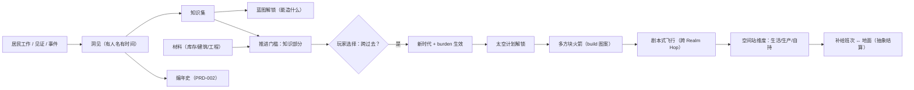
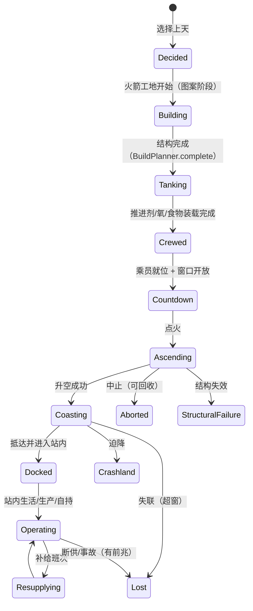

# PRD-011 · 时代进程、知识与太空计划

```
状态：草稿PRD
负责人：设计（人类定稿）
最后更新：2026-10-18
优先级：P0          里程碑：M3（知识与时代门槛）+ M4（终局：多方块火箭与空间站）
上游依据：docs/design/08-progression-and-ages.md（7 时代、三部分推进门槛、知识/学者/蓝图、世界耦合、OQ-AG-1..5）
关联文档：PRD-001（记忆/情绪）、PRD-002（事件与叙述者）、PRD-003（季节/温度/氧气 vitals）、PRD-005（指令：扩张/备冬策略）、
         PRD-006（诊断与存量预测）、PRD-010（外交与贸易：时代解锁势力与贸易品）
基底依赖：plugins/build（Starlark `pattern` 多阶段/多轮生长、`BuildSite`、`BuildPlanner.complete`、`Blueprint`）、
         Colony.submit(Grown)+NodeSpec、Declaring.passage/Conveyance（Hop/Fare/Going）、Roaming 的跨 Realm Crossing、
         WorldSpaces.Source+Realm.Frame、Contributions.urges（氧气/温度 vitals 同构于 Hunger）、Declaring.residentKind/locomotion、
         Cadence、Colony.views/stores/rule、Shelves（新货架）、front/api Board/Row/Act
决策依据：ADR-007（已 fork，可直接改造）、ADR-011（终局=多方块火箭+可居住空间站，主线自研）、ADR-013（一切必须驱动居民）、
         ADR-009（**vitals 不进需求栏**——氧气/口渴/体温是计量，需求集是数据驱动的默认核心集 + 变体/成瘾/专属需求，见 [PRD-001](PRD-001-needs-mood-memory.md) 注册表）
外部调研：docs/research/09-space-endgame.md（A 级证据：现成 mod 核实、三处扩展点、候选架构 C 推荐、20 条联动接口、11 条未验证项）
          docs/pack/01-modlist.md（太空类 mod 已重新定级）
```

---

## 0. 一句话

> 时代不是攒数字升上去的，而是**你的居民真的做出了那件事**——然后由你决定，要不要跨出那一步。

---

## 1. 概述

**玩家在什么时候遇到它**：每一次"我们好像缺了点什么"的时刻；第一次有人想造铁器而不会；第一次有人从远处带回一种没见过的材料；以及最后——第一次有人抬头看天，问"上面有什么"。

**它解决什么体验问题**：Minecraft 的进度是**玩家**的（背包里有什么、合成了什么），而我们要的是**殖民地**的进度。基底的居民只会做它们已知的工作——没有"学会"这件事。于是 [d08](../design/08-progression-and-ages.md) 的 7 个时代如果没有落地机制，就只是设定文档。对应支柱 **P4（从石头到星辰）**，并服务 **P2（每个人都是一个故事）**：发现知识的人是具体的、有名字的居民。

**它产生的新决策**：
- **要不要跨这一步**：门槛满足后由你按下"进入铁器时代"——进去了，压力也上一个台阶（[d08](../design/08-progression-and-ages.md) 的 burden）。
- **知识谁去挣**：让最有经验的人去当学者（少一个劳力），还是继续全员生产（进步更慢）？
- **先走哪条线**：冶铁、畜牧、还是远程航行？（同一时代的多个知识分支）
- **太空值不值得**：把整个殖民地的产出押在一枚火箭上，还是继续在地面扩张？
- **空间站怎么活**：自持（水/氧/食物循环，重投入）还是靠地面补给（便宜、但一次失联就断粮）？

**它在多大程度上是玩家的选择**：**门槛条件由玩法与世界决定，是否跨过、按什么顺序跨、要不要押注太空——全部由玩家决定**。我们不自动推进时代（与 PRD-006 N1 一致：不做自动修复、不替玩家玩游戏）。

---

## 2. 设计目标与非目标

### 2.1 目标

| 编号 | 目标 | 可判定信号 |
| --- | --- | --- |
| G1 | 每个时代解锁**新动词**，不是新数值 | 逐时代列出"上一时代做不到、这一时代能做到"的动作清单，且每条能在游戏里演示 |
| G2 | 推进由**居民的行为**驱动 | 任一门槛的达成条件都必须能追溯到具体居民做过的具体工作/见证（ADR-013） |
| G3 | 推进是一个**决定**，不是自动跳级 | 门槛满足后必须由玩家确认；确认前后世界状态有可见差异（burden 生效） |
| G4 | 知识可被发现，也可被**别人**带来 | 至少两种获得途径：自己研究、从外部（商队/遗迹/事件）获得 |
| G5 | 终局是**居民建得起、住得下**的太空 | 火箭由居民按图案逐步建成；空间站内居民能吃饭/睡觉/上工；全程无"只有玩家能做的步骤" |
| G6 | 太空不是"看一眼"的风景 | 空间站有自持生产链与失败模式（补给中断/失联/迫降） |
| G7 | 太空不拖垮服务器 | 独立预算立账；远离时不加载区块、按批次抽象结算；TPS 目标见 §13 |

### 2.2 非目标

| 编号 | 不做 | 理由 |
| --- | --- | --- |
| N1 | 「科技点」式的统一货币与研究树 | [术语表](../design/03-glossary.md) 禁用「科技点」；点数化会把"人做的事"退化成进度条 |
| N2 | 真飞行动力学 / 轨道力学 / 对接物理 | [r09 §7.3](../research/09-space-endgame.md) 明确不做；第一版飞行 = 剧本式状态机 |
| N3 | 星际（多星系）尺度 | 章程非目标；止步于"轨道 + 少量目的地" |
| N4 | 让玩家替居民建造火箭 | 违反 ADR-013/R-AGE-9 |
| N5 | 为多方块火箭新写一套 Node 类型 | `build` 的 `pattern`/`Growing`/`BuildPlanner.complete` 已覆盖（r09 §3.1） |
| N6 | 强行线性的唯一路径 | 同一时代允许多条知识分支与顺序自由（除硬前置） |
| N7 | 把 18 格 `Pack` 硬改成大容量来运推进剂 | 走多格容器/载具负载路线（[r06 §3 #2](../research/06-gap-analysis.md) 的中长期方案） |
| N8 | 时代可回退/降级 | 单向推进；但要给"这个时代更难在哪"的明确告知（P3 的承受面） |

### 2.3 M1 / M3 / M4 子集

| 里程碑 | 内容 |
| --- | --- |
| M1 | **不做时代系统**。只保留一个「落脚时代」的骨架常量与时代指示（面板一行文字），用于验证 UI 位置 |
| M3 | 完整时代门槛 + 知识/学者 + 蓝图解锁 + burden 告知（**不含太空**） |
| M4 | 太空计划：多方块火箭（居民建造）→ 剧本式飞行 → 空间站维度 → 站内生活与自持 |
| M4.0 | **三个前置 spike**（见 §9.7），先证明接口通再立项 |

---

## 3. 术语

| 术语 | 中文 | 说明 | 全局表 |
| --- | --- | --- | --- |
| `age` | 时代 | 7 个纵向阶段（[d08](../design/08-progression-and-ages.md)） | 已登记 |
| `insight` | 洞见 | 一条**被具体居民获得**的知识（有来源、有时间、有人名） | 新增 |
| `knowledge` | 知识 | 洞见的集合（殖民地级），决定"能做什么" | 已登记 |
| `advancement` | 推进 | 进入下一个时代的门槛满足 + 玩家确认 | 新增 |
| `gate` | 门槛 | 推进的三部分条件（材料/知识/选择） | 新增 |
| `burden` | 时代压力 | 进入新时代后新增的压力（d08） | 新增 |
| `blueprint` | 蓝图 | 可建造物/配方/图案的知识化表达（复用基底 `blueprint` 概念但加"是否已解锁"） | 已登记 |
| `scholar` | 学者 | 以"研究"为工作内容的居民（一个工种，不是新职业体系） | 新增 |
| `space_program` | 太空计划 | 从"决定上天"到"空间站自持"的整体（跨时代的状态机） | 新增 |
| `rocket` | 火箭 | **多方块**产物（由图案逐阶段建成），不是实体载具 | 新增 |
| `station` | 空间站 | 可居住的**独立维度**（[r09 §3.3](../research/09-space-endgame.md)） | 新增 |
| `launch_window` | 发射窗口 | 允许发射的时机（天气/季节/准备度） | 新增 |
| `supply_run` | 补给班次 | 地面 ↔ 站之间的定期货运 | 新增 |
| `vitals` | 维生计量 | 饥饿/口渴/氧气；**不是需求**（[PRD-001 §2.4](PRD-001-needs-mood-memory.md) R-NM-8） | 已登记 |

### 3.1 冲突检查

| 冲突项 | 基底含义 | 本系统含义 | 解决 |
| --- | --- | --- | --- |
| `blueprint` | 基底的建造蓝图（`Blueprint`/`BlueprintBook`/Create 交接） | 我们**复用**它做"图纸"，另加"是否已解锁"由知识层判定 | 不新建概念；知识层是**过滤**，不是替换 |
| `Perk` / `Keenness` | 个体熟练度 | 学者/工匠的能力仍走 `Perk`，不新造第二套熟练度 | 复用 |
| `Pattern` | Starlark 图案（可多阶段、多轮生长） | 火箭**就是**一个多阶段图案 | 不新增 Node 类型（N5） |
| `Realm` | 维度或 Frame | 空间站是维度（`Realm.Dimension`），后期"轨道造船"才考虑 `Frame` | 见 §9.5 |
| 「解锁」 | — | 我们区分**洞见（人获得）**与**解锁（殖民地可用）**，禁止混用 | 术语表新增 |

---

## 4. 概念模型

| 实体 | 中文 | 说明 | 玩家可见 |
| --- | --- | --- | --- |
| `AgeState` | 时代状态 | 当前时代 + 门槛进度 + burden 列表 | 时代页 |
| `AdvancementGate` | 推进门槛 | 三部分：材料 / 知识 / 选择 | 时代页（3 行） |
| `InsightRecord` | 洞见记录 | 谁在何时何地因何事获得了哪条知识 | 居民页 + 编年史 + 传说页 |
| `KnowledgeSet` | 知识集 | 殖民地已获得的知识（可被数据包扩展） | 知识页（列表） |
| `ScholarDuty` | 学者任务 | 指派某居民去研究某个对象/主题 | 居民页/时代页 |
| `BlueprintUnlock` | 蓝图解锁 | 哪些图案/配方因知识而可用 | 建造页（未解锁显示为锁 + 原因） |
| `SpaceProgram` | 太空计划 | 火箭/空间站/补给的整体状态 | 太空页 |
| `RocketSite` | 火箭工地 | 一枚火箭的建造进度（阶段 + 卡点） | 世界内 + 太空页 |
| `StationState` | 空间站状态 | 站内人口、库存、氧气、自持度 | 太空页 |
| `SupplyRun` | 补给班次 | 地面↔站的运输计划与历史 | 太空页 |

### 4.1 关系



---

## 5. 状态机

### 5.1 时代状态

| 状态 | 中文 | 说明 |
| --- | --- | --- |
| `Settling` | 立足中 | 当前时代的门槛尚未开始成形 |
| `Preparing` | 接近门槛 | 至少一部分门槛条件已满足（材料或知识） |
| `Ready` | 可推进 | 三部分条件都满足，等待玩家决定 |
| `Advancing` | 推进中 | 玩家已确认，正在应用时代切换（内容解锁、burden、UI 刷新） |
| `Established` | 已立足 | 新时代的常态（下一时代回到 `Settling`） |

### 5.2 事件

| 事件 | 说明 | 触发方 |
| --- | --- | --- |
| E1 | 获得洞见 | 居民工作/见证/外部来源 |
| E2 | 材料条件满足 | 世界状态（库存/建筑/工程） |
| E3 | 门槛全部满足 | 系统（进入 `Ready`） |
| E4 | 玩家确认推进 | 玩家（需权限） |
| E5 | 时代切换完成 | 系统 |
| E6 | 星辰时代解锁 → 建立太空计划 | 系统/玩家（选择） |
| E7 | 火箭阶段完成 | `build` 的 `Growing`/`BuildPlanner.complete` |
| E8 | 发射 | 玩家确认 + 窗口条件 |
| E9 | 抵达/失联/迫降 | 结算 |
| E10 | 补给班次出发/抵达/延误 | 计划 + 结算 |
| E11 | 站内事故（缺氧/失压/火灾） | 站内状态 |

### 5.3 变量

| 变量 | 类型 | 默认 | 范围 | 说明 |
| --- | --- | --- | --- | --- |
| `age_index` | 整数 | 0（落脚） | 0–6 | 当前时代 |
| `gate_material[]` | 条件列表 | 按时代 | — | d08 的材料条件 |
| `gate_knowledge[]` | 洞见 id 列表 | 按时代 | — | 必须已获得的洞见 |
| `gate_choice` | 布尔 | false | — | 玩家是否已确认 |
| `burden[]` | 效果列表 | 按时代 | — | 时代压力 |
| `scholar_slots` | 整数 | 2 | 0–8 | 同时可有的学者数（可配置） |
| `insight_rate` | 定点 | 1.0 | 0.1–5.0 | 研究速度乘数（难度旋钮） |
| `rocket_phases` | 整数 | 6 | 3–12 | 火箭图案阶段数（内容定义） |
| `launch_window_days` | 定点 | 1.0 | 0–5 | 发射窗口开放时长 |
| `station_self_sufficiency` | 百分比 | — | 0–100 | 自持度（水/氧/食物） |
| `supply_run_days` | 整数 | 7 | 1–30 | 补给周期 |
| `abstraction_batch` | 时长 | 1 游戏日 | — | 站内离屏结算的批次粒度 |

### 5.4 状态转移表（时代）

| 源 | 事件 | 守卫 | 动作 | 目标 |
| --- | --- | --- | --- | --- |
| `Settling` | E1/E2 | 任一条件部分满足 | 刷新门槛进度 | `Preparing` |
| `Preparing` | E3 | 三部分齐全 | 通知「可进入 X 时代」 | `Ready` |
| `Ready` | E4 | 有权限 | 应用解锁 + burden + 写编年史 | `Advancing` |
| `Ready` | — | 玩家暂不推进 | 保持（可长期停留） | `Ready` |
| `Advancing` | E5 | 内容应用完毕 | 显示 burden 与新时代目标 | `Established` |
| `Established` | — | 有下一时代 | 载入下一时代门槛 | `Settling` |
| `Established` | E6 | 已到星辰 | 建立/继续太空计划 | 保持 |

### 5.5 状态机（太空计划）



### 5.6 超时与中断

| 情形 | 处理 |
| --- | --- |
| 建造卡住（`Growing.stuck`） | 进 PRD-006 诊断（D-11），给建议动作；**不静默** |
| 玩家不在线且门槛满足 | **不自动推进**（推进是玩家的决定）；挂起直到有人确认 |
| 发射后服务器重启 | 从存档恢复：要么回到 `Crewed`（未点火），要么按已结算的结果加载（**不允许半状态**，同 PRD-004 R-DATA-1） |
| 站内玩家全部离开 | 按 `abstraction_batch` 批次结算（§9.6） |
| 太空计划长期停滞 | 允许放弃/封存工地（材料可回收一部分），写编年史 |
| 火箭目标站不存在（被摧毁/从未建成） | 发射前拦截并给诊断；不产生"发射后无处可去" |

---

## 6. 交互

### 6.1 入口与快捷键

| 操作 | 按键/手势 | 前置条件 | 结果 |
| --- | --- | --- | --- |
| 打开「时代」页 | 面板页签 | 手持殖民书 | 当前时代、门槛 3 行、burden、洞见进度 |
| 查看「知识」 | 时代页 → 知识 | 同上 | 已获得/未获得的知识列表（含"如何获得"提示） |
| 指派学者 | 时代页/居民页 → 研究 | 有闲置居民 | 某居民开始研究某主题 |
| 确认推进 | 时代页 → 进入 X 时代 | 门槛满足 + 权限 | 二次确认后推进 |
| 打开「太空」页 | 面板页签（星辰时代出现） | 同上 | 火箭/站点/补给状态 |
| 启建火箭 | 太空页 → 选择火箭图案 → 工地 | 知识/材料/选址 | 生成 `RocketSite`，居民开始建造 |
| 装载 | 太空页 → 装载清单 | 工地完成 | 生成搬运工作（走 PRD-006 规则） |
| 发射 | 太空页 → 发射 | 窗口 + 乘员 + 装载 | 二次确认后进入状态机 |
| 派遣补给 | 太空页 → 补给班次 | 有站 + 有货 | 生成运输计划 |

**R-AG-UI-1**：时代页**必须**用三行表达门槛（材料/知识/选择），而不是一个百分比进度条——我们要的是"缺什么"，不是"差多少"。

### 6.2 面板动作（`Board.Act` 五类内）

| 上下文 | 按钮 | 操作 | 可撤销 |
| --- | --- | --- | --- |
| 时代页 | 「进入 X 时代」（`Do`） | 二次确认后推进 | ❌（不可逆，N8） |
| 时代页 | 「查看为什么」（`Open`） | 跳到 PRD-006 诊断卡 | — |
| 知识行 | 「怎么获得」（`Open`） | 显示获得途径 + 建议 | — |
| 学者行 | 「换主题」（`Edit`） | 改研究主题 | ✅ |
| 太空页 | 「定位工地」（`Ping`） | 世界内高亮 | — |
| 太空页 | 「发射」（`Do`） | 二次确认 | ❌（点火后不可撤销，只能中止） |

**R-AG-UI-2**：涉及不可逆的动作（推进时代、点火）**必须二次确认**，并在确认框里列出**将要发生什么**（burden 摘要/燃料消耗/乘员名单）。

### 6.3 命令（便于调参，均需 gamemaster）

| 命令 | 说明 |
| --- | --- |
| `/<ns> age status` | 当前时代、门槛明细、burden 列表 |
| `/<ns> age set <0-6>` | 强制设时代（测试用；写警告日志） |
| `/<ns> knowledge grant <id>` | 授予洞见（测试用） |
| `/<ns> knowledge list` | 全部知识与其获得途径 |
| `/<ns> space status` | 太空计划状态机 + 站点自持度 |
| `/<ns> space launch` | 跳过准备直接发射（测试用） |
| `/<ns> space abort` | 触发中止流程 |

---

## 7. 反馈

### 7.1 操作模式反馈

| 检查条件 | 音效 | 文案 | 视觉 | 系统行为 |
| --- | --- | --- | --- | --- |
| 指派学者成功 | 确认 | 「%s 开始研究 %s」 | 居民头顶标识 | 生成研究 urge（低权重） |
| 指派学者失败 | 低沉 | 拒绝原因（无许可/已被占用/不需要） | 高亮 | 复用 `RefusalKind` + PRD-006 |
| 选择不存在的火箭图案 | 低沉 | 「尚未掌握：%s」 | — | 指向知识页 |

### 7.2 实体/区域状态反馈

| 检查条件 | 图标/颜色 | 悬停信息 | 系统行为 |
| --- | --- | --- | --- |
| 火箭工地 | 阶段标记 | 「%s（第 %s/%s 阶段）」 | 建造中 |
| 工地卡住 | ⚠️（不只用红色，PRD-006 R-F-2） | 「缺少 %s」+ 建议 | 诊断 |
| 发射窗口 | 窗口指示 | 「窗口开放：%s」 | 允许发射 |
| 站内缺氧 | 站内标记 | 「氧气 %s%%」 | vitals 生效 |
| 补给延误 | 提示 | 「补给未按时抵达（已 %s）」 | 前兆 |

### 7.3 系统事件反馈

| 事件 | 音效 | 通知文案 | 视觉 | 系统行为 |
| --- | --- | --- | --- | --- |
| 获得洞见 | 正向（轻） | 「%s 发现了 %s」 | 居民高亮 + 编年史 | 知识集更新 |
| 门槛满足 | 正向 | 「可以进入 %s 时代了」 | 时代页角标 | `Ready` |
| 时代推进 | 号角 | 「殖民地进入了 %s 时代」 | 全屏短提示 | burden 生效 |
| 新 burden 生效 | 中性 | 「%s 时代的新压力：%s」 | 时代页 | 压力启用 |
| 火箭阶段完成 | 正向 | 「火箭：%s 完成」 | 工地变化 | 下一阶段 |
| 发射 | 强烈 | 「点火」 | 世界内 | `Ascending` |
| 失联 | 警报 | 「%s 失去联络」 | 太空页 | 转入调查 |
| 站内事故 | 警报 | 「%s：%s」 | 站内标记 | 处理窗口 |

**R-AG-F-1**：时代推进的提示必须包含**代价**（burden 摘要），不允许只报喜（P3 的一致性）。
**R-AG-F-2**：太空的每一次失败都**必须有前兆**（补给预报、结构告警、气象），对应 P3 的预防/缓解/承受三路。

### 7.4 可诊断性

| 玩家可能的疑问 | 系统必须能回答 | 呈现位置 |
| --- | --- | --- |
| 为什么我还不能进铁器时代？ | 三部分门槛逐项状态 + 缺什么 + 怎么补 | 时代页 + PRD-006 诊断卡 |
| 为什么这项知识还没到手？ | 获得途径（研究/外部/事件）+ 当前进度 + 建议 | 知识页「怎么获得」 |
| 为什么学者不干活？ | 复用 PRD-006 阻塞（无许可/被更高优先占用/无研究点） | 诊断卡 |
| 为什么火箭建不动？ | `Growing.stuck` + 缺料/无空间/无路（PRD-006 D-1..D-12） | 诊断卡 |
| 为什么发射窗口没开？ | 窗口条件逐项（气象/季节/准备度） | 太空页 |
| 为什么空间站断粮了？ | 自持度分解 + 补给历史 + 存量预测（PRD-006） | 太空页 |

**R-AG-F-3**：太空页的"为什么"必须复用 PRD-006 的**同一套诊断组件**（禁止另做一套）。

---

## 8. 规则

| 编号 | 规则 | 说明 |
| --- | --- | --- |
| R-AG-1 | 每个时代必须带来**至少一个新动词**（可被演示的动作） | d08 G1；评审时逐条核对 |
| R-AG-2 | **洞见必须有人名、有时间、有来源** | 禁止"殖民地凭空学会了 X"（ADR-013） |
| R-AG-3 | 推进门槛 = 材料 + 知识 + **玩家选择**，三者缺一不可 | 不自动跳级（G3） |
| R-AG-4 | 门槛状态**必须逐项可解释**（缺什么、怎么补） | 复用 PRD-006 |
| R-AG-5 | 推进**不可逆**，且确认框必须列出代价 | N8 + R-AG-F-1 |
| R-AG-6 | 知识的获得途径 ≥2（自研 / 外部） | G4；外部来源与 PRD-010 商队、PRD-002 事件联动 |
| R-AG-7 | 学者是**工种/授权**，不是新职业体系 | 与基底 `Vocation`/`Perk` 一致 |
| R-AG-8 | 研究必须**消耗真实资源与时间**（工位/材料/照明/书籍…按内容定义） | 研究不能是凭空计时 |
| R-AG-9 | 未解锁的内容在 UI 中**显示为锁 + 原因**，而不是消失 | "看不见"会让玩家困惑 |
| R-AG-10 | burden 必须在推进**时**告知，并在时代页常驻可查 | P3 |
| R-AG-11 | 火箭**必须**是多方块、由居民按图案逐阶段建造 | ADR-011 + N5 |
| R-AG-12 | 火箭/空间站的**每一步都可由居民执行**；任何只有玩家能做的步骤视为缺陷 | ADR-013 + R-AGE-9 |
| R-AG-13 | 飞行第一版**不做动力学**：一次跨 Realm `Hop` + 剧本式状态机 | r09 §3.2 |
| R-AG-14 | 空间站是**独立维度**；远离时不加载区块、按 `abstraction_batch` 批次结算 | r09 §3.3 |
| R-AG-15 | 抽象结算**只能改 `Colony` 账本**（stores/rule/withhold），改世界仍须 `submit(Grown)` + `Node.commit` | r09 §3.3 红线 |
| R-AG-16 | 氧气/温度在太空是 **vitals**，**不进需求栏**（与需求集条数无关：需求集是数据驱动的，见 [PRD-001](PRD-001-needs-mood-memory.md) 注册表） | [PRD-001 R-NM-8/R-NM-16](PRD-001-needs-mood-memory.md) + [PRD-003 R-CL-4](PRD-003-season-temperature-thirst-nutrition.md) |
| R-AG-17 | 太空单位（舱外机器人/载具）必须是**注册的 `ResidentKind` + 自带 `Locomotion`** | r09 §3.4；否则被当人形 |
| R-AG-18 | 太空插件必须**独立立账**预算（与出行预算分开）并提交探针 | R-AGE-11 + k03 R-PB-7 |
| R-AG-19 | 太空的失败模式必须有**前兆 + 应对窗口**（不搞突然团灭） | P3/P5 + PRD-004 R1 的同族规则 |
| R-AG-20 | 时代内容（门槛/知识/火箭图案/burden）**必须可由数据包改写** | 支柱 P6；见 §15 |
| R-AG-21 | 不得为太空引入第二套居民/第二套 AI 实体 | ADR-011/ADR-013；外邦与敌人在 PRD-004/010 已定 |
| R-AG-22 | 太空阶段的库存与物流必须走**既有仓储/物流规则**（PRD-006） | 禁止太空专用"魔法背包" |
| R-AG-23 | 载人飞行前必须完成**乘员名单与家属告知**（死亡/失联要能写讣告与记忆） | PRD-001/002 接口 |
| R-AG-24 | 空间站**必须有自持路径**（水/氧/食物至少各一条可建成的循环） | G6；不然终局变成单纯的补给恐惧 |

---

## 9. 流程

### 9.1 时代的推进门槛（三部分）

```
gate = material ∧ knowledge ∧ choice

material   // 世界状态：库存/建筑/工程（可被 PRD-006 的存量预测与诊断读取）
knowledge  // 洞见集合：必须由具体居民获得过（R-AG-2）
choice     // 玩家确认（R-AG-3）；确认前一切已就绪但世界不变

advance() {
  unlockContent(age)        // 蓝图/配方/图案/工作
  applyBurden(age)          // 压力生效（PRD-002 事件权重、PRD-004 威胁等级、PRD-003 气候压力…）
  chronicle.record(...)     // 编年史：「殖民地进入了铁器时代」
  notifyAll(...)            // 含代价摘要
}
```

**R-FLOW-1**：`material` 条件必须能被 PRD-006 的"为什么还不能推进"逐项解释（哪些材料、差多少、去哪补）。

### 9.2 知识的获得

| 途径 | 机制 | 依据/联动 |
| --- | --- | --- |
| 自行研究 | 学者在"研究点"（工位/藏书/实验场）工作 → 逐次产出洞见 | 复用 `Hunger` 式计量 + `Urge`（r08 §4.3）；研究点由玩家建造 |
| 实践发现 | 某居民第一次完成某类工作/见到某物时触发（例：第一次冶炼成功） | 与 PRD-001 记忆、PRD-002 事件联动 |
| 外部获得 | 商队/使节带来、遗迹/事件发现、从外邦学到 | PRD-010（势力与贸易）、PRD-002（事件） |
| 传授 | 有知识的居民教其他人（延时、耗费两人时间） | PRD-008 关系（未写，标注待对齐） |

**R-FLOW-2**：每条知识的获得途径必须在 UI 里写清（R-AG-9 的另一面：**可追求**）。
**R-FLOW-3**：洞见的获得频率必须与 `insight_rate` 挂钩，且**受难度旋钮控制**（不想被内容卡住的玩家可调快）。

### 9.3 学者与研究

| 项 | 设计 |
| --- | --- |
| 工种 | `scholar`：以研究为主要工作（**可由玩家把某居民临时指派**，A-max 的 L2） |
| 研究点 | 由玩家建造的工位（书桌/藏书架/实验场/观星台），提供研究容量与主题 |
| 主题 | 由知识表定义（可能有前置）；同一主题可有多个学者并行（按内容定义） |
| 中断 | 危急需求（PRD-001 R-FLOW-5）可中断研究 |
| 产出 | 洞见（有人名）→ 知识集；失败也可产出"线索"（防止纯随机感） |
| 诊断 | 不工作时走 PRD-006 阻塞；主题不可研究时给出原因（缺前置/缺研究点） |

**R-FLOW-4**：研究**不得**成为唯一的进度瓶颈——至少一条知识可由"实践发现"获得（G4/R-AG-6），保证不建研究点也能推进（但更慢）。

### 9.4 蓝图的解锁与建造

| 项 | 设计 |
| --- | --- |
| 解锁单位 | 蓝图（图案/配方/工作/建筑） |
| 与基底关系 | 复用基底 `Blueprint`/`BlueprintBook`（含 Create 蓝图交接）；知识层只**过滤可用性**（3.1） |
| UI | 未解锁显示为锁 + "需要 %s 知识"；已解锁可正常建造 |
| 数据包 | 蓝图与知识的映射在数据包（§15），便于内容扩展与剧本改写 |

### 9.5 空间站：为什么是维度

| 方案 | 选择 | 理由 |
| --- | --- | --- |
| **独立维度**（采用） | `Realm.Dimension`；`Colony.views(server)` 已按 `ServerLevel` 分组、出行图按 `(colony, dimension)` 各一份 | 零新机制；未加载即"什么都没跑"，抽象结算好写（r09 §3.3） |
| 子层 `Realm.Frame`（后期） | 留给"轨道造船"与"看得见的飞行" | 需自研物理/序列化/装载票（r09 未验证项） |

### 9.6 站内生活与离屏结算

| 项 | 设计 |
| --- | --- |
| 生活 | 站内居民走**同一套**需求（PRD-001）与 vitals（氧气/温度，PRD-003）；warmth/食物/休息同样生效 |
| 自持 | 水循环（冷凝/回收）、氧（电解/藻类/罐装）、食物（种植/藻/补给）至少各一条可建成路径（R-AG-24） |
| 离屏结算 | 按 `abstraction_batch`（默认 1 游戏日）批次结算生产/消耗，写 `Colony` 账本；**不加载区块** |
| 补给班次 | 地面 ↔ 站：真实货物、真实运力（受 `Pack`/载具负载限制，N7）；有延误/损失概率与预报 |
| 事故 | 缺氧/失压/火灾：有前兆（告警→窗口→处置），处置需要居民动作 |
| 上限 | 站内人口/建筑/机械数量按配置上限（保护性能） |

**R-FLOW-5**：抽象结算的输入与输出必须**在太空页可见**（本批次：产出了什么、消耗了什么、谁在站里），不允许黑箱。

### 9.7 M4.0 三个前置 spike（先证明接口通）

| # | spike | 验证什么 | 依据 |
| --- | --- | --- | --- |
| 1 | 注册一个测试 `Passage`：主世界登船 → 自制空维度下船 | `Roaming` 的**跨 Realm `Crossing`** 可用 | `Roaming.java:789-803`（r09 §5 #7） |
| 2 | 一条三阶段最小 Starlark `pattern` 当作"火箭" | 居民能建完并被 `BuildPlanner.complete` 判定 | `BuildPlanner.java:73-89`、`BuildPresence.java:100-110` |
| 3 | 一个新 urge（`OXYGEN`）挂到 `Contributions.urges` | vitals 与规划器的耦合可行 | `Hunger.java:29-101`、`Contributions.java:19-23` |

**R-FLOW-6**：M4 正式立项**必须**以三个 spike 全部通过为前置；任一不通过则回到 [r09](../research/09-space-endgame.md) 的备选（候选 B）。

### 9.8 数值配置（每个值都要写明默认与"谁需要它"，R-F8）

| 参数 | 默认 | 范围 | 谁需要它 |
| --- | --- | --- | --- |
| `insight_rate` | 1.0 | 0.1–5.0 | 想快/想慢推进的玩家 |
| `scholar_slots` | 2 | 0–8 | 难度与性能 |
| `rocket_phases` | 6 | 3–12 | 内容设计 |
| `launch_window_days` | 1.0 | 0–5 | 节奏 |
| `supply_run_days` | 7 | 1–30 | 太空难度 |
| `station_population_cap` | 12 | 1–48 | 性能 |
| `abstraction_batch` | 1 天 | 6 小时–7 天 | 性能 vs 精度 |
| `space_enabled` | true | — | 不想玩太空的玩家（必须能关且不崩） |
| `auto_advance` | **false** | — | 明确保持 false（R-AG-3 不自动推进） |

---

## 10. 数据与存档

| 项 | 内容 |
| --- | --- |
| 新增持久化字段 | `AgeState`（时代/门槛进度/burden）、`KnowledgeSet`（洞见 id + 获得者 + 时间 + 来源）、`SpaceProgram`（火箭工地阶段、站点状态、补给历史、乘员名单） |
| 存储位置 | `Colony.keep(owner, CompoundTag)`；站点/工地坐标涉及 `Keeps` 迁移（r01 §5.7） |
| 存档版本影响 | 需要（自管版本号）；时代/知识/太空各一个版本号，便于独立迁移 |
| 迁移 | 缺失字段取默认；**旧档 = 落脚时代 + 空知识集**（进度归零但世界不损坏） |
| 未知内容 | 知识/蓝图 id 不存在（数据包被移除）→ 标记"来源缺失"，不崩、不静默丢进度 |
| 回滚 | 可加载；太空被禁用时工地与站点按"未启用"处理（材料可回收或原地保留） |
| 卸载 | 移除我们的 mod 后存档必须可加载（丢失时代/太空内容，世界与居民仍在） |

**R-DATA-1**：时代推进是**单向且不可逆**的，迁移时**不得**因版本降级而回退时代（降级明确拒绝并提示）。
**R-DATA-2**：洞见记录属于"历史"，**不因内容包变化而删除**（保留人名与时间，仅标记来源缺失）。

---

## 11. 网络与多人

| 项 | 内容 |
| --- | --- |
| 权威端 | 服务端（时代、知识、太空状态机、批次结算） |
| 同步 | 时代/知识变更广播；太空页按需拉取；站点内部只在有玩家在场时同步细节 |
| 权限 | 推进时代、确认发射、派遣补给、放弃工地需权限（**默认管理者/主机，具体矩阵待 [PRD-012](PRD-012-multiplayer-and-permissions.md) 对齐**） |
| 并发 | 两人同时确认推进 → 先到先得并广播决策者；发射同理 |
| 离线 | 关键不可逆动作（推进/发射）**不接受离线代理**；无人时挂起（§5.6） |
| 分头行动 | 太空计划是**殖民地级**的，不属于某个玩家个人 |
| 专用服务器 | `space_enabled=false` 时必须完全禁用且不影响其它系统 |

**R-MP-1**：太空批次结算必须**只算一次**（殖民地级），不得按玩家重复计算。
**R-MP-2**：站内细节同步受距离/在场限制，但**关键状态（氧气/人口/故障）必须对所有成员可见**。

---

## 12. i18n（双语：`zh_cn` + `en_us`）

| 键族 | 例（zh_cn） |
| --- | --- |
| `<ns>.page.age` / `.page.knowledge` / `.page.space` | 时代 / 知识 / 太空 |
| `<ns>.age.<id>` | 落脚 / 定居 / 分工 / 工程 / 规模 / 远征 / 星辰 |
| `<ns>.gate.material` / `.knowledge` / `.choice` | 材料 / 知识 / 抉择 |
| `<ns>.gate.ready` | 可以进入 %s 时代了 |
| `<ns>.gate.advance_confirm` | 进入 %s 时代后：%s（代价摘要） |
| `<ns>.insight.gained` | %s 发现了 %s |
| `<ns>.insight.source.study` / `.practice` / `.trade` / `.event` / `.taught` | 研究所得 / 亲手做出 / 商队带来 / 事件中得知 / 由 %s 传授 |
| `<ns>.knowledge.locked_hint` | 需要 %s 知识 |
| `<ns>.space.phase.<id>` | 装填 / 就位 / 倒计时 / 升空 / 巡航 / 对接 / 已着陆 |
| `<ns>.space.failure.<id>` | 中止 / 结构失效 / 失联 / 迫降 |
| `<ns>.space.self_sufficiency` | 自持度 %s%%（水 %s / 氧 %s / 食 %s） |
| `<ns>.space.supply_missed` | 补给未按时抵达（已 %s） |
| `<ns>.burden.<id>` | 新时代的压力：%s |

**R-I18N-1**：洞见文案必须带**人名 + 知识名**两个参数（用于编年史与传说页）。
**R-I18N-2**：太空状态机的每个状态都要有可读文案（不允许只显示内部 id）。

---

## 13. 性能预算

| 项 | 估算 | 依据 | 上限 |
| --- | --- | --- | --- |
| 时代/知识常态 | ≈0（事件驱动 + 日结算） | — | <0.1% |
| 研究结算 | 每学者每日一次 | 与 PRD-001 日结算同批 | <0.5% |
| 火箭建造 | 复用 `build` 现有成本（本 PRD 不新增 tick 循环） | r09 §3.1 | — |
| 发射/着陆（剧本式） | 一次性结算 + 短表现 | 无动力学（N2） | 峰值 <2% |
| 站内（有玩家在场） | 与同规模地面殖民地同量级 | 同引擎 | 见 k03 常规预算 |
| 站内（离屏批次结算） | 每 `abstraction_batch` 一次，O(站点子系统数) | R-AG-14 | <0.5% 均值 |
| **太空总账（独立）** | **常态 ≤2%，峰值（发射/事故）≤5%** | R-AG-18 + k03 R-PB-7 | — |

**R-PERF-1**：必须提交探针：时代门槛计算耗时、研究结算耗时、建造阶段耗时、发射结算耗时、批次结算耗时与站点规模。
**R-PERF-2**：出行预算（`travelCeilingMicros=8000`）**不计入**本账，但太空若产生搬运（补给/卸货）必须**遵守**该预算并计入探针。
**R-PERF-3**：任何降级（例如站内细节降频）必须告知玩家（k03 R-PB-5/R-PB-6）。

---

## 14. 与基底 API 的关系（fork 后）

| 需求 | 机制 | 层级 | 依据 |
| --- | --- | --- | --- |
| 新货架（`age`/`knowledge`/`burden`…） | 扩 `Shelves` 注册 | **L2** | pack/02 §4.2；d12 §5 |
| 火箭建造 | Starlark `pattern` 多阶段 + `BuildSite` + `BuildPlanner.complete` | **L1**（纯内容 + 复用） | r09 §3.1：`Pattern.java:227,243`、`BuildPlanner.java:73-89`、`BuildPresence.java:100-110` |
| 提交工作 | `colony.submit(owner, dimension, Grown, ended)` | **L1** | `Colony.java:43` |
| 跨维度通道 | `Declaring.passage` + `Hop`/`Fare`/`Conveyance` | **L1** | `Declaring.java:50-52`、`Passage.java:8-27`、`Fare.java:33-42` |
| 跨 Realm | `Roaming` 的 `Crossing`（两端可不同 Realm） | **复用（无改动）** | `Roaming.java:789-803` |
| 站点坐标空间 | 独立维度（`Realm.Dimension`） | **L1** | `Realm.java:14-28`、`Colony.java:89`、`ColonyWays.java:105-109` |
| 后期子层 | `WorldSpaces.Source` + `WorldSpaces.install` | L1（后期） | `WorldSpaces.java:16-53`、`FolkwaysMod.java:87` |
| 氧气/温度 vitals | `Declaring.urges` → `Contributions.urges`（照 `Hunger` 范式） | **L1** | `Declaring.java:30-32`、`Hunger.java:29-101` |
| 太空单位 | `Declaring.residentKind` + `Declaring.locomotion` | **L1** | `Declaring.java:42-48`、`Locomotion.java:10-21` |
| 结算节奏 | `Cadence.claim/Cron` | **L1** | `BuildPresence.java:95,99` |
| 面板 | `RegisteringUi.page` + `Board/Row/Act` | L1（若需新动作 → **L3**，需评审） | r03 §6.1；PRD-005 §14 |
| 蓝图 | `Blueprint`/`BlueprintBook`/`CreateBlueprintHandoff` | **复用** | r09 §3.1 |

**R-API-1**：本 PRD **不得**使用 L4（结构性重构）；L3 若出现（新动作分类），必须逐条评审并登记（[d12 §5.1](../design/12-fork-strategy.md)）。
**R-API-2**：`LocalGround`/`Ground` 若需要承载温度/氧气快照，属 L2（契约扩展）——必须先确认不破坏既有实现（[PRD-003 §14](PRD-003-season-temperature-thirst-nutrition.md) 的未决项）。

---

## 15. 可改写性

| 内容 | 数据包（D1/D2/D3） | 配置 |
| --- | --- | --- |
| 时代门槛（材料/知识条件） | 是（`age` 货架） | 默认值 |
| 知识表与获得途径 | 是（`knowledge` 货架） | 速率 |
| burden（时代压力） | 是（`burden` 货架，引用 PRD-002 事件/PRD-004 威胁参数） | 开关 |
| 火箭图案（阶段/材料/尺寸） | 是（基底 `pattern`！**最理想的可改写面**） | — |
| 空间站产线（自持配方） | 是（基底 `wares` 配方 + 蓝图） | — |
| 数值（速率/上限/窗口） | 部分 | 是（serverconfig） |
| 文案 | 是（双语目录：`zh_cn` + `en_us`） | — |

**R-MOD-1**：**火箭外观与结构必须只靠数据包图案定义**（玩家能做出自己的火箭）——这是 P6「一切可被改写」在终局的直接体现。
**R-MOD-2**：时代推进的 burden 必须引用既有系统的参数（事件权重/威胁等级/气候压力），不得引入新的、不可数据包化的私有压力。

---

## 16. 验收检查

### 16.1 交互
- [ ] AC-1 时代页显示当前时代、门槛三行（材料/知识/选择）、burden 列表
- [ ] AC-2 知识页显示已获得/未获得，且未获得项有获得途径提示
- [ ] AC-3 可指派/更换居民的研究主题，并显示拒绝原因
- [ ] AC-4 推进时代需二次确认，确认框列出代价（burden 摘要）
- [ ] AC-5 太空页显示火箭工地阶段、站点自持度、补给历史
- [ ] AC-6 可启建火箭、装载、发射（带确认）、派遣补给
- [ ] AC-7 未解锁内容显示为锁 + 原因（不消失）

### 16.2 反馈与诊断
- [ ] AC-8 获得洞见通知含**人名 + 知识名**，并写入编年史
- [ ] AC-9 门槛满足时明确提示"可以进入 X 时代了"
- [ ] AC-10 时代推进提示包含代价
- [ ] AC-11 「为什么还不能推进」逐项解释材料/知识缺口
- [ ] AC-12 「为什么火箭建不动」走 PRD-006 统一诊断（D-1..D-12）
- [ ] AC-13 发射窗口未开放时逐项说明原因
- [ ] AC-14 每次太空失败（失联/迫降/事故）都有**前兆记录**
- [ ] AC-15 批次结算内容在太空页可见（产出/消耗/在场居民）

### 16.3 规则
- [ ] AC-16 每个时代至少一个新动词可在游戏内演示（逐时代清单）
- [ ] AC-17 任一洞见都能追溯到具体居民、时间、来源（不为空）
- [ ] AC-18 门槛满足但玩家不确认时，世界**不发生变化**（自动推进被禁止）
- [ ] AC-19 推进后 burden 生效且可在时代页常驻查看
- [ ] AC-20 至少一条知识可通过"实践发现"获得（不建研究点也能推进）
- [ ] AC-21 研究消耗真实资源与时间（对照实验可测）
- [ ] AC-22 火箭是多方块且**只能**由居民按图案建成（玩家无法直接放置完成）
- [ ] AC-23 空间站在离屏时按批次结算，且**不加载区块**
- [ ] AC-24 抽象结算不直接改世界（代码审查 + 断言）
- [ ] AC-25 氧气/温度在太空生效，且它们是 **vitals**（**不进需求栏、不参与专注度**）
- [ ] AC-26 空间站至少有一条水/氧/食物的自持路径可建成
- [ ] AC-27 补给班次遵循真实运力（受 `Pack`/载具负载约束）
- [ ] AC-28 失联/迫降的乘员进入讣告或"失踪待寻"状态（可追）

### 16.4 流程与数值
- [ ] AC-29 `insight_rate` 与 `scholar_slots` 可配置且影响可测量
- [ ] AC-30 `space_enabled=false` 时太空完全禁用且不影响其它系统
- [ ] AC-31 三个 M4.0 spike 各自有可自动化的通过判定
- [ ] AC-32 发射/着陆的状态机全路径可测（含中止/失效/失联/迫降）

### 16.5 状态、数据与边界
- [ ] AC-33 存档往返后时代/知识/太空状态一致
- [ ] AC-34 战斗中/发射中存档 → 加载后不出现半状态
- [ ] AC-35 时代不可回退（降级版本被明确拒绝并提示）
- [ ] AC-36 移除数据包后引用缺失的知识不崩、进度不静默丢失
- [ ] AC-37 卸载我们的 mod 后存档可加载

### 16.6 性能与多人
- [ ] AC-38 太空常态 ≤2%、峰值 ≤5%（探针实测）
- [ ] AC-39 站内批次结算只算一次（多人下不重复）
- [ ] AC-40 关键太空状态（氧气/人口/故障）对所有成员可见
- [ ] AC-41 两人同时确认推进/发射时先到先得并广播决策者

### 16.7 可改写性
- [ ] AC-42 不改 Java 就能新增一个时代门槛与一条知识
- [ ] AC-43 不改 Java 就能用数据包图案换一枚火箭的外观与阶段

---

## 17. 测试计划（TDD）

| 测试 | 类型 | 覆盖 AC | 备注 |
| --- | --- | --- | --- |
| 门槛判定（材料/知识/选择的组合） | 单元 | AC-11、AC-18 | 三部分全组合 |
| 洞见记录完整性（人/时间/来源非空） | 单元 | AC-17 | 含"来源缺失"容错 |
| burden 应用与告知 | 单元 | AC-19 | 逐时代 |
| 知识 → 蓝图过滤 | 单元 | AC-7 | 未解锁显示为锁 |
| 火箭阶段推进与卡住诊断 | 单元 + gametest | AC-12、AC-22 | 造一个缺料工地 |
| 跨 Realm `Passage`（spike 1） | gametest | AC-31 | 自制空维度 |
| 三阶段 pattern 完成判定（spike 2） | gametest | AC-31 | `BuildPlanner.complete` |
| `OXYGEN` urge（spike 3） | gametest | AC-25、AC-31 | 与 `Hunger` 同构 |
| 发射状态机全路径 | 单元 | AC-32 | 含失败态 |
| 站点批次结算（离屏） | 单元 + gametest | AC-23、AC-24、AC-39 | 断言只改账本 |
| 自持链可建成 | gametest | AC-26 | 水/氧/食物 |
| 存档往返（含飞行中） | gametest | AC-33、AC-34 | 半状态禁止 |
| 时代/知识页与太空页渲染 | e2e（Linux） | AC-1~AC-7 | 视觉门禁 |
| 太空性能与探针 | bench（Linux） | AC-38 | 站点规模梯度 |
| 多人确认与可见性 | e2e（双客户端，Linux） | AC-40、AC-41 | — |

---

## 18. 待细化 / 开放问题

| 编号 | 问题 | 影响 | 何时定 | 谁定 |
| --- | --- | --- | --- | --- |
| OQ-1 | 时代数量与顺序（[d08](../design/08-progression-and-ages.md) 的 7 个）是否最终定案？（OQ-AG-1） | 全篇内容量 | M3 前 | 人类 |
| OQ-2 | 是否引入"知识传授"（居民教居民）？需要 PRD-008 关系系统 | 进度节奏与人味 | M3 前 | 人类 |
| OQ-3 | 研究是否需要"书籍/文献"这类实体物品？ | 内容量与仪式感 | M3 前 | 设计 |
| OQ-4 | 是否允许同时推进多条知识线但只选一条时代？ | 分支自由度 | M3 前 | 人类 |
| OQ-5 | 空间站用**独立维度**还是**子层**（后期"轨道造船"）？ | 表现与工作量 | M4 前（r09 建议主线用维度） | 人类 + 实现 agent |
| OQ-6 | 是否采纳 Ad Astra 的行星维度作为额外目的地（只借维度/环境，不用其火箭）？ | 内容量与依赖 | M4 前 | 人类 |
| OQ-7 | 补给班次是"真实运输实体"还是"抽象批次发货"？ | 表现 vs 性能 | M4 前 | 人类 |
| OQ-8 | 乘员死亡/失联是否允许"永久失踪"（无尸体）？ | P5 的情感强度 | M4 前 | 人类 |
| OQ-9 | 火箭失败是否会造成地面破坏（爆炸伤及殖民地）？ | 失败代价与挫败感 | M4.1 前 | 人类 |
| OQ-10 | `Ground`/`LocalGround` 能否承载氧气/温度快照（L2 契约扩展） | 实现路径 | M4.0 | 实现 agent（与 PRD-003 共用） |
| OQ-11 | 太空是否有独立的"文明级"结局（通关画面/传说页终章）？ | 终局体验 | M4 前 | 人类 |

---

## 19. 变更记录

| 日期 | 状态 | 变更 | 操作者 |
| --- | --- | --- | --- |
| 2026-10-18 | 草稿PRD | 首次起草：时代三部分门槛（材料/知识/选择）、洞见必须有人名、学者与蓝图、太空计划全状态机；架构按 ADR-011 与 [r09](../research/09-space-endgame.md) 定为"自研主线（复用 build + 独立维度 + 剧本式飞行）"；M4.0 三个 spike 作为立项前置 | 设计 agent |