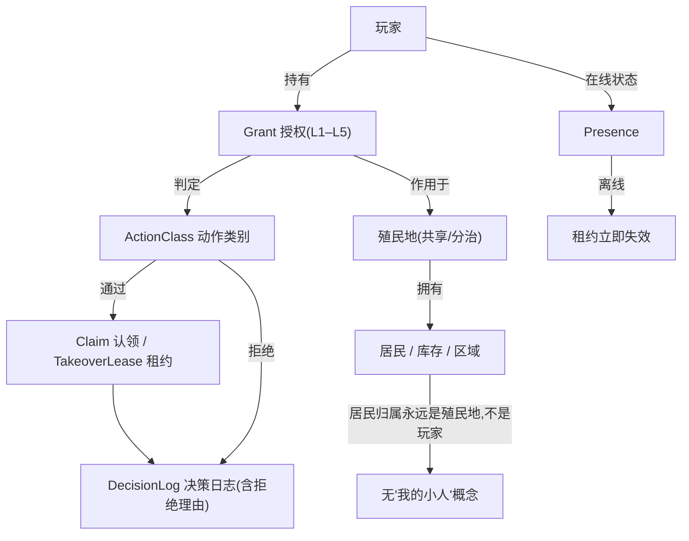
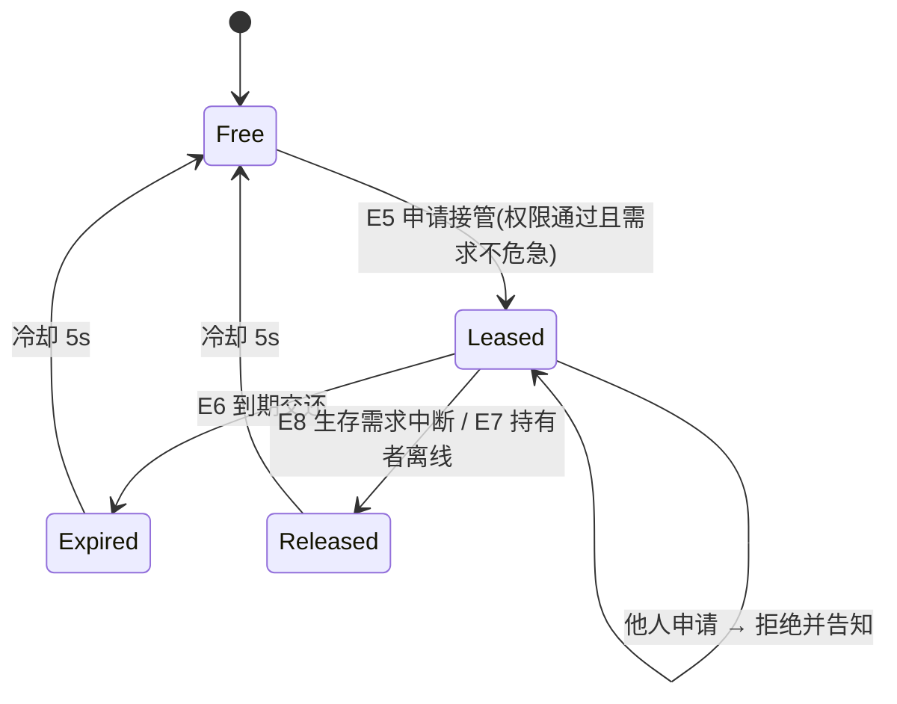
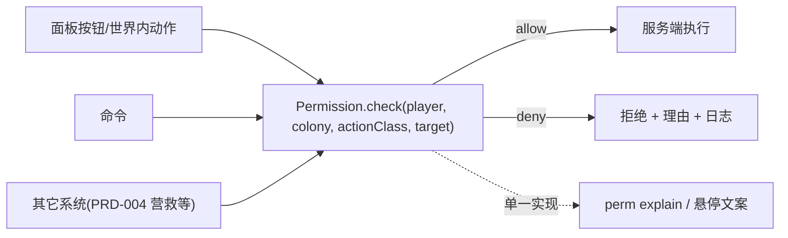
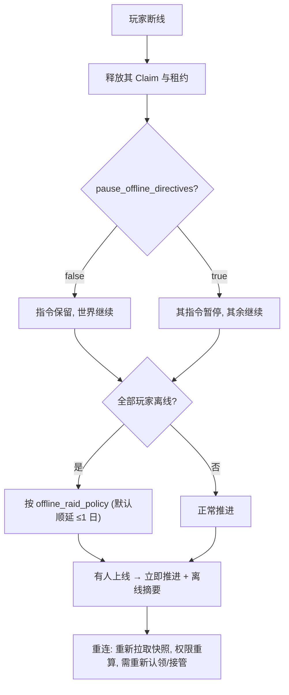

# PRD-012 · 多人协作与权限

```
状态：草稿PRD
负责人：设计（人类定稿）
最后更新：2026-10-18
优先级：P0          里程碑：M1（权限骨架 + 越权拒绝）→ M2（离线/同步）→ M3（接管租约 + 决策日志）
上游依据：docs/design/10-multiplayer-and-server.md（本 PRD 是它的落地规格）、docs/00-charter.md（C7 单人优先、C5 性能）、docs/design/01-vision-and-pillars.md（P3/P5）
关联文档：PRD-001 §11、PRD-002 §11、PRD-003 §11、PRD-004 §11、PRD-005 §11+§2.4、PRD-006 §11；docs/pack/03-performance-budget.md；docs/design/12-fork-strategy.md
基底依赖：殖民地所有权与成员邀请（Members 页/邀请/多殖民地/FTB Teams 转交）、`Colony.submit`、`Colony.keep`、
         `Colony.rule/stores`、packet 体系（如 `RosterSyncPacket`）、`/folkways ...` 命令、
         `RegisteringUi.page` + `Board/Row/Act`、`FolkwaysConfig`（serverconfig）
事实依据：docs/research/03-front-and-interaction.md（§6.9 基底权限模型很薄）、docs/research/01-core-engine.md（服务端线程契约）、
         docs/research/05-engineering-and-tooling.md（Blockwright 双端 e2e；CI 现状）
```

---

## 0. 一句话

> 两个人一起建一座城，不会互相拆台——因为每个人能做什么、做过什么、为什么被拦下来，都看得见。

---

## 1. 概述

**情境**：2–4 个朋友开一局，一个人负责种田、一个人负责盖房、一个人老想指挥所有人的小人。半小时后，甲发现自己的作物订单被改了，乙发现自己的区域设置被覆盖，丙发现自己指挥的居民突然跑去睡觉了。

**要解决的体验问题**（对应支柱 P3「世界会回应」与 P5「失败长出故事」）：**协作的摩擦必须来自世界，而不是来自"谁手快"**。多人协作最容易毁掉 colony sim 的不是性能，而是**权限含糊 + 冲突静默 + 无法追溯**。

**基底现状**：Folkways 已经有殖民地所有权、成员邀请、多殖民地、FTB Teams 转交，以及 packet 体系——但权限模型**很薄**（r03 §6.9）：基本是"殖民地成员 = 什么都能做"。前六个 PRD 各自在 §11 里留了权限点（"默认成员、可配置"），**这些点必须在这里收口**（§3.4）。

**它产生的新决策**：
- 要不要把建造权下放给新来的朋友（省事，但他能拆你的墙）？
- 冲突时是"后提交者生效"（灵活，但会被覆盖）还是"先到先得 + 需要撤销"（安全，但更啰嗦）？
- 要不要允许成员临时接管居民（有人能救急，也有人能把你的小人指挥进岩浆）？
- 离线时殖民地是否继续运转（公平 vs 安心）？

**它在多大程度上是玩家的选择**：**权限分配、冲突策略、离线策略全部是服务器/主机的选择**；系统只保证这些选择**被一致地执行且可解释**。

---

## 2. 设计目标与非目标

### 2.1 目标

| 编号 | 目标 | 可判定信号 |
| --- | --- | --- |
| G1 | 5 级权限覆盖**全部已有 PRD（001–011）**的**每一个**动作 | §3.4 收口表**无遗漏**（逐条对应；PRD-008 待其落地后回填一行） |
| G2 | 越权必须被拒绝**并给出理由** | 越权提示 100% 带原因对象与所需权限（AC 专测 ≥6 条） |
| G3 | 冲突有确定性裁决 | 同一输入 → 同一结果；并发测试可复现（§9.1 算法） |
| G4 | 一切变更可追溯 | 决策日志记录"谁、何时、改了什么、依据哪条规则" |
| G5 | 离线不破坏世界也不破坏信任 | 离线策略可配置；离线不导致"静默灭村"（PRD-004 人口下限 + 死亡上限） |
| G6 | 权限收紧时信息**降级而非空白** | 与 PRD-006 R-MP-2 一致（只读降级版） |
| G7 | 多人开销可控 | 权限+日志+同步常态 ≤2%（从 UI/网络 ≤5% 里扣） |
| G8 | 客户端 mod 可选 | 缺失我们的客户端组件时不崩、不误判权限（与 ADR-010 桥接原则一致） |

### 2.2 非目标

| 编号 | 不做的事 | 理由 |
| --- | --- | --- |
| N1 | 账号系统 / 云存档 / 内购 / 排行榜 | 章程明确非目标；权限只基于服务器侧白名单/OP/队伍 |
| N2 | 反作弊系统 | 服务端权威 + 服务端校验即可（d10 §7） |
| N3 | 领地保护/外交战争的全套规则 | 跨殖民地关系归 PRD-010（外交与贸易）；本 PRD 只管**一个殖民地内部**的权限 |
| N4 | 玩家之间的市场经济（拍卖/货币） | 归 PRD-010；本 PRD 只定义"赠送/交易需双方确认"的裁决接口 |
| N5 | 逐动作的细粒度 ACL 编辑器（几十个复选框） | 复杂度爆炸；用"5 级 + 少量可配置开关"（d10 R-MP-2 要求开箱即用） |
| N6 | 实时语音/聊天系统 | 用原版聊天；我们只做"决策广播" |
| N7 | 投票制的民主治理 | M3 之后评估（OQ-9） |

### 2.3 M1 最小子集

M1 做：**5 级权限骨架 + 权限矩阵 + 越权拒绝（带理由）+ 决策日志（最近 200 条）+ 离线基础行为**。
不做：接管租约（L3 相关，M3）、权限的数据包化（M2）、多人诊断降级版（M2，先跟 PRD-006 一起上）、交易确认流（PRD-010）。

---

## 3. 术语与权限模型

### 3.1 局部术语

| 术语 | 中文 | 说明 | 与全局术语的关系 |
| --- | --- | --- | --- |
| `role` | 角色等级 | L1–L5（见 §3.2） | 新增（全局登记） |
| `grant` | 授权 | 某玩家在某殖民地被授予的等级 | 新增 |
| `action_class` | 动作类别 | 权限判定的单位（不是每个按钮一个开关） | 新增 |
| `decision_log` | 决策日志 | 谁在何时改了什么、依据哪条规则 | 新增（PRD-005 R-MP-1 的"最近 20 条指令记录"在此统一为 200 条日志） |
| `claim` | 认领/租约 | 对**互斥资源**的临时占用（如接管某居民） | 新增 |
| `takeover_lease` | 接管租约 | A-max L3 接管层的排他权（PRD-005 §2.4） | 新增 |
| `presence` | 在线状态 | 玩家是否在线（影响租约与离线策略） | 新增 |
| `shared_colony` | 共享殖民地 | 默认模式：所有人共用一个殖民地 | 新增 |
| `split_colony` | 分治殖民地 | 可选模式：每人/每队独立殖民地 | 新增 |
| `downgraded_view` | 只读降级版 | 权限不足时看到的**有内容的**只读视图（不是空白） | 与 PRD-006 R-MP-2 一致 |

### 3.2 五级权限（权威定义）

| 级 | 名称 | 中文 | 谁 | 一句话 |
| --- | --- | --- | --- | --- |
| **L1** | Watcher | 旁观 | 未加入殖民地的玩家、被降级的访客 | **只能看（且看的是降级版），不能碰** |
| **L2** | Member | 成员 | 被邀请并接受的玩家 | **能干活、能表达意图，不能改全局规则** |
| **L3** | Steward | 管理者 | 由主机授权的成员 | **能改全局规则、能指挥、能调解冲突** |
| **L4** | Host | 主机 | 殖民地所有者（创建者或 FTB Teams 转交对象） | **能管人（邀请/授权/转交/解散）** |
| **L5** | Server Admin | 服务器管理员 | OP / 专用服务器管理员 | **能管世界与配置**（含强制结束袭击、回档提示、改 serverconfig） |

**与 d10 旧命名的映射（消歧，避免双套术语）**：

| d10 旧名 | 本 PRD 归入 | 说明 |
| --- | --- | --- |
| L0 所有者 Owner | **L4 主机** | 同义，改名以强调"是殖民地的主人，不是服务器的神" |
| L1 管理者 Steward | **L3 管理者** | 同级 |
| L2 工匠 Artisan | **L2 成员 + 建造授权** | "工匠"不再是一级，而是成员上的**子授权**（`build` 类动作） |
| L3 成员 Member | **L2 成员** | 同级 |
| L4 访客 Visitor | **L1 旁观** | 同级 |

**R-MP-1**：权限必须**按动作类别**授权，不是"管理员/普通"两档（沿用 d10 R-MP-1）。
**R-MP-2**：默认配置必须让 2 人合作**开箱即用**：邀请即 L2，L2 默认能做全部生产类动作（d10 R-MP-2）。
**R-MP-3**：**所有权限变更与所有被拒绝的操作**都必须写决策日志（d10 R-MP-3 + 本 PRD 的越权可解释要求）。

### 3.3 权限矩阵（动作类别 × 等级）

符号：✅ 允许 ｜ ⛔ 不允许 ｜ 👁 只读**降级版**（有内容，非空白）｜ 🔶 可配置（括号内为默认值）

| 动作类别 | L1 旁观 | L2 成员 | L3 管理者 | L4 主机 | L5 服务器管理员 |
| --- | --- | --- | --- | --- | --- |
| 查看面板/居民/区域/库存 | 👁 | ✅ | ✅ | ✅ | ✅ |
| 查看诊断（普通阻塞） | 🔶(开) | ✅ | ✅ | ✅ | ✅ |
| 查看诊断（私密：情绪/记忆详情/崩溃原因） | ⛔ | 👁 | ✅ | ✅ | ✅ |
| 查看编年史/传说页 | ✅ | ✅ | ✅ | ✅ | ✅ |
| 订单、库存操作、生产 | ⛔ | ✅ | ✅ | ✅ | ✅ |
| 划区/区域用途/区域设置 | ⛔ | ✅ | ✅ | ✅ | ✅ |
| 工种优先级（个人排序） | ⛔ | ✅ | ✅ | ✅ | ✅ |
| 建造/蓝图/脚手架/工地 | ⛔ | 🔶(开) | ✅ | ✅ | ✅ |
| 仓储规则（预留/配额/就近/品质门槛，PRD-006） | ⛔ | 🔶(开) | ✅ | ✅ | ✅ |
| 作息表（个人） | ⛔ | ✅ | ✅ | ✅ | ✅ |
| **全局**作息表/全局策略（备冬/警戒/集结/疏散/扩张，PRD-005） | ⛔ | 🔶(关) | ✅ | ✅ | ✅ |
| 手动指派 / 个人指定 / 优先级覆盖（PRD-005 L2） | ⛔ | ✅ | ✅ | ✅ | ✅ |
| **接管居民**（PRD-005 §2.4 L3 临时接管） | ⛔ | 🔶(关) | ✅ | ✅ | ✅ |
| 战斗指挥（编队/警戒等级/撤退线，PRD-004+PRD-005 L3） | ⛔ | 🔶(关) | ✅ | ✅ | ✅ |
| 编民兵 / 装备分配（PRD-004） | ⛔ | ✅ | ✅ | ✅ | ✅ |
| 交贡 / 疏散 / 营救（PRD-004） | ⛔ | ✅ | ✅ | ✅ | ✅ |
| 调整叙述者（PRD-002） | ⛔ | 🔶(开) | ✅ | ✅ | ✅ |
| 放假 / 安抚居民（PRD-001） | ⛔ | 🔶(开) | ✅ | ✅ | ✅ |
| 改季节长度 / 气候档案（PRD-003） | ⛔ | ⛔ | 🔶(关) | 🔶(关) | ✅ |
| 改剧本 / 世界级规则（PRD-007） | ⛔ | ⛔ | ⛔ | 🔶(关) | ✅ |
| 交易/赠送（PRD-010 接口） | ⛔ | ✅（需双方确认） | ✅ | ✅ | ✅ |
| 邀请成员 | ⛔ | ⛔ | 🔶(开) | ✅ | ✅ |
| 授予/降级角色 | ⛔ | ⛔ | ⛔ | ✅ | ✅ |
| 驱逐成员 | ⛔ | ⛔ | ⛔ | ✅ | ✅ |
| 转交殖民地 / 解散 | ⛔ | ⛔ | ⛔ | ✅ | ✅ |
| 强制结束袭击 / 调试命令 | ⛔ | ⛔ | ⛔ | ⛔ | ✅ |
| 改 serverconfig（含本 PRD 的开关） | ⛔ | ⛔ | ⛔ | ⛔ | ✅ |

**R-MP-4**：🔶 项必须能在**面板内**开关（不要求手改配置文件），且开关本身走 L4 权限。
**R-MP-5**：矩阵是**唯一来源**；任何 PRD 新增动作时必须在 §3.4 收口表登记，否则评审不通过。

### 3.4 已有 PRD 的权限点收口表（必须逐条对上）

| 来源 | 原文权限口径 | 本 PRD 收口 |
| --- | --- | --- |
| PRD-001 §11 | 查看：所有成员；`放假/安抚`：成员（可配置为需更高权限） | 查看=L2；放假/安抚=L2 🔶(开) |
| PRD-002 §11 | 做选择：任何成员（可配置为仅管理者）；改叙述者：管理者 | 做选择=L2；改叙述者=L2 🔶(开)，可收紧为 L3 |
| PRD-003 §11 | 查看：所有成员；改季节/改配置/`climate set`：gamemaster | 查看=L2；改季节=L3 🔶(关)/L5；配置=L5 |
| PRD-004 §11 | 编民兵/交贡/疏散/营救：需权限（默认成员，可收紧）；查看：所有成员 | 全部=L2（可收紧为 L3）；查看=L2 |
| PRD-005 §11 | 个人指派：所有成员；个人作息/优先级：成员；全局策略与作息：`directive_permission`（默认成员，可收紧为 op）；撤销他人指令：需权限 | 个人=L2；**全局=L2 🔶(关)→L3**（本 PRD 把默认收紧为"关"，与"开箱即用"取平衡：生产类开、策略类关）；撤销他人=L3 |
| PRD-005 §2.4 + §11 | A-max L3 接管层（临时接管、战斗指挥） | L2 🔶(关)、L3 ✅（§9.3 租约规则） |
| PRD-006 §11 | 查看诊断：**默认所有成员只读可见**（普通诊断完整只读、私密信息 👁 只读降级，**不要求 L3**；服务器可设 `diagnosis_visibility=manager` 收紧）；执行建议动作：需对应权限 | 查看=**L2 即可、无需额外授权**；私密=👁L2（只读降级）；建议动作**继承其目标动作的权限**（不额外授权） |
| PRD-007 §11 | 查看：所有玩家；选择/应用/重开剧本：管理员；教程跳过：玩家自己 | 查看=L1；选择/应用=L3；**重开协议=L3 ✅（不可逆，需二次确认 + 广播）**；教程跳过=L0（个人） |
| PRD-010 §11 / R-MP-3 | 成交/议价/验货：成员；扣押/驱逐/条约/交贡：可收紧为管理者 | 成交/验货=L2；**条约/宣战/跨殖民地关系=L3**（PRD-010 判归本 PRD 收口）；赠送/玩家间交易=双方确认（§9.5） |
| PRD-009 §11（**回填**） | 照护/仪式/接纳移民：成员；人口政策（生育鼓励/上限/移民筛选）：管理者；强制命令（终止妊娠/驱离）：服务器管理员 | 照护/仪式/接纳=L2 🔶(开)；**人口政策=L3 🔶(关)**；**强制命令=L5**（涉及生命与家庭，最高级） |
| PRD-011 §11 | 推进时代、确认发射、派遣补给、放弃工地：默认管理者/主机 | 推进时代=L3 ✅（不可逆）；确认发射=L3 ✅；派遣补给=L2；放弃工地=L3；查看=L1 |
| PRD-008 §11（**回填**） | 查看关系/社交活动：所有成员；私密情绪与记忆：按 PRD-006 私密档 | 查看=L1；**私密关系/记忆=👁L2/L3✅（只读降级，不得空白）**；调停/安排集会=L2；强制拆散关系=⛔（不存在此动作） |

**R-MP-6**：上表中"可配置"与"需权限"的每一处，都必须在 §9.6 数值配置里有**具名开关**，不允许模糊表述（R-F8：每个可调项必须说明默认值与谁需要它）。

**待回填**：无（PRD-001~011 的权限点已全部收口）。后续任何 PRD 新增动作时按 R-MP-5 在本表登记。

---

## 4. 概念模型

### 4.1 实体

| 实体 | 中文 | 说明 | 生命周期 | 玩家可见 |
| --- | --- | --- | --- | --- |
| `Role` | 角色等级 | L1–L5 | 常量 | 面板 |
| `Grant` | 授权 | (玩家, 殖民地) → 等级 | 邀请/授权/驱逐 | 成员页 |
| `ActionClass` | 动作类别 | 权限判定的单位（§3.3 的行） | 常量 | 矩阵页 |
| `DecisionLog` | 决策日志 | 环形缓冲（默认 200 条）：谁、何时、做了什么、依据哪条规则、结果 | 持续（可清空，需 L4） | 日志页 |
| `Claim` | 认领 | 对互斥资源的占用（营救队/交贡/接管） | 到结束或超时 | 提示 |
| `TakeoverLease` | 接管租约 | (居民, 持有者, 到期时间, 原因) | 最长 `lease_max` 秒 | 居民头顶标识 |
| `Presence` | 在线状态 | 玩家在线/离线 + 最后活动时间 | 会话级 | 成员页 |
| `ColonyMode` | 殖民地模式 | `shared` / `split` | 世界级 | 设置页 |

### 4.2 关系



**R-MP-7**：**居民、库存、区域的归属永远是殖民地**，不是玩家个体。玩家只是**被授权的操作者**。这条规则消灭了多人协作里最毒的争议（"我的小人你凭什么指挥"）。

---

## 5. 状态机

### 5.1 授权状态

| 状态 | 说明 |
| --- | --- |
| `Invited` | 已邀请未接受 |
| `Active` | 有效授权 |
| `Suspended` | 临时冻结（主机操作，保留数据） |
| `Revoked` | 已撤销（可重新邀请） |

### 5.2 认领/租约状态

| 状态 | 说明 |
| --- | --- |
| `Free` | 无人认领 |
| `Claimed` | 已被认领（互斥动作执行中） |
| `Leased` | 接管租约生效中 |
| `Expired` | 超时释放 |
| `Released` | 主动释放/完成 |

### 5.3 事件

| 事件 | 说明 | 触发方 |
| --- | --- | --- |
| E1 | 邀请/接受 | 玩家（L4 / 被邀请者） |
| E2 | 授予/降级/驱逐 | 玩家（L4） |
| E3 | 执行动作 | 玩家 |
| E4 | 认领互斥资源 | 玩家 |
| E5 | 申请接管 | 玩家（L2🔶/L3+） |
| E6 | 租约到期/释放 | 系统/玩家 |
| E7 | 离线/重连 | 玩家 |
| E8 | 生存需求中断接管 | 居民/系统（PRD-005 §2.4 边界 2） |
| E9 | 权限变更广播 | 系统 |
| E10 | 降级触发/恢复 | 系统（k03 降级阶梯） |

### 5.4 变量

| 变量 | 中文 | 类型 | 默认 | 范围 | 说明 |
| --- | --- | --- | --- | --- | --- |
| `colony_mode` | 殖民地模式 | 枚举 | `shared` | shared/split | §4.1 |
| `member_takeover_enabled` | 成员可接管 | 布尔 | false | — | L2 的 L3 权限总开关 |
| `member_global_strategy_enabled` | 成员可改全局策略 | 布尔 | false | — | PRD-005 收口 |
| `diagnosis_visibility` | 诊断可见性 | 枚举 | `member` | member/manager | PRD-006 |
| `private_info_visibility` | 私密信息可见性 | 枚举 | `manager` | manager/self | 情绪/记忆详情 |
| `lease_seconds` | 租约时长 | 整数 | 30 | 10–300 | 单人接管 |
| `lease_max_seconds` | 租约上限（含续租） | 整数 | 120 | 30–600 | 防霸占 |
| `decision_log_max` | 日志条数上限 | 整数 | 200 | 50–2000 | 环形 |
| `pause_offline_directives` | 离线时暂停其指令 | 布尔 | false | — | d10 §4 可选项 |
| `offline_raid_policy` | 全员离线时的袭击 | 枚举 | `postpone` | continue/postpone | PRD-004 §5.6 一致（顺延至多 1 游戏日） |
| `conflict_policy` | 冲突策略 | 枚举 | `specific_then_time` | specific_then_time/first_wins | §9.1 |
| `sync_min_interval_ms` | 同步最小间隔 | 整数 | 250 | 100–2000 | 限流 |
| `permission_datapack` | 权限矩阵数据包化 | 布尔 | true | — | §15 |

### 5.5 状态转移表（授权）

| 源 | 事件 | 守卫 | 动作 | 目标 |
| --- | --- | --- | --- | --- |
| — | E1 邀请 | 发起者 ≥L3 或 L4 | 创建 `Grant(Invited)` + 日志 | `Invited` |
| `Invited` | E1 接受 | 被邀请者在线 | 置 `Active` + 广播 | `Active` |
| `Active` | E2 暂停 | 发起者 L4 | 置 `Suspended` + 日志 | `Suspended` |
| `Active`/`Suspended` | E2 驱逐 | 发起者 L4 | 置 `Revoked` + 释放其全部租约 | `Revoked` |
| `Revoked` | E1 重新邀请 | 发起者 L4 | 新 `Grant(Invited)` | `Invited` |

### 5.6 状态转移表（接管租约）

| 源 | 事件 | 守卫 | 动作 | 目标 |
| --- | --- | --- | --- | --- |
| `Free` | E5 申请接管 | 权限通过（§3.3）**且** 居民生存需求不危急 | 建租约 + 日志 + 广播 | `Leased` |
| `Leased` | E5 申请接管（他人） | 租约未到期 | **拒绝** + 理由「%s 正在指挥 %s（剩余 %s 秒）」 | `Leased` |
| `Leased` | E6 到期 | 到 `lease_seconds` | 交还规划器 + 日志 | `Expired` |
| `Leased` | E8 生存中断 | 需求危急（PRD-005 边界 2） | 立即交还 + 日志「接管被生存需求中断」 | `Released` |
| `Leased` | E7 持有者离线 | 事件 | 立即释放 + 日志 | `Released` |
| `Expired`/`Released` | — | 冷却 `lease_cooldown`（默认 5 秒） | — | `Free` |

### 5.7 状态图（接管）



### 5.8 超时与中断

| 情形 | 处理 | 恢复后行为 |
| --- | --- | --- |
| 玩家断线 | 释放其全部 `Claim`/`Lease`；指令保留（除非 `pause_offline_directives`） | 重连后需重新认领/接管 |
| 区块卸载 | 认领与租约**保留**（它们是殖民地级数据，不是区块级） | 加载后原样恢复 |
| 居民死亡/失去能力 | 释放该居民上的租约与认领 | 日志记录原因 |
| 全部玩家离线 | 按 `offline_raid_policy`（默认顺延至多 1 游戏日，PRD-004 §5.6） | 有人上线后立即推进 |
| 权限被降级时持有租约 | 立即释放（不允许带着越权状态继续） | 面板提示"你的权限已变更" |

---

## 6. 交互

### 6.1 入口

| 操作 | 按键/手势 | 前置条件 | 结果 |
| --- | --- | --- | --- |
| 打开「成员与权限」页 | 面板页签 | 持殖民书 | 成员列表 + 角色 + 在线状态 |
| 打开「权限矩阵」页 | 成员页内 | 持殖民书 | §3.3 矩阵 + 🔶 开关（L4 可改） |
| 打开「决策日志」页 | 成员页内 | 持殖民书 | 最近 200 条（含拒绝记录） |
| 申请接管居民 | 居民页「接管」按钮 / 世界内动作 | §3.3 权限 + 需求不危急 | 获得租约（头顶标识 + 倒计时） |
| 释放接管 | 同一按钮（变「释放」）/ 潜行右键 | 持有租约 | 立即交还 |
| 认领互斥动作 | 动作按钮（营救/交贡/疏散） | 未被他人认领 | 执行并广播决策者 |
| 查看"为什么不行" | 禁用按钮的悬停/「为什么」动作 | — | 所需权限 + 当前等级 + 找谁要（PRD-006 诊断） |

**R-UI-1**：**权限不足的按钮必须显示且禁用**（而不是隐藏）——隐藏会让玩家"不知道有这个功能"，禁用+理由才是可学习的（与 PRD-006 的"不能空白"同一原则）。

### 6.2 面板动作（`Board.Act` 五类内）

| 上下文 | 按钮 | 操作 | 可撤销 |
| --- | --- | --- | --- |
| 成员行 | 「授权…」（`Edit`） | 打开等级选择 | 是 |
| 成员行 | 「暂停/驱逐」（`Do`） | 变更授权 | 是（重新邀请） |
| 授权行 | 「定位」（`Ping`） | 世界内定位其居民/指令 | — |
| 日志行 | 「查看相关」（`Open`） | 跳到被修改的对象 | — |
| 矩阵行 | 「开关」（`Edit`） | 切换 🔶 项 | 是 |

### 6.3 命令

| 命令 | 权限 | 说明 | 输出 |
| --- | --- | --- | --- |
| `/folkways members` | L2 | 列出成员与等级 | 文本 |
| `/<ns> perm show <player>` | L2 | 该玩家的有效动作类别 | 文本（含来源） |
| `/<ns> perm set <player> <level>` | L4 | 设置等级 | 确认 + 日志 |
| `/<ns> perm explain <player> <action>` | L2 | **为什么允许/拒绝**（判定链） | 文本（§9.2） |
| `/<ns> log [n]` | L3 | 最近 n 条决策日志 | 文本 |
| `/<ns> claim list` | L3 | 当前认领与租约 | 文本 |
| `/<ns> claim release <id>` | L3 | 强制释放（调解用） | 确认 + 日志 |
| `/<ns> mp status` | L5 | 多人子系统的探针（权限判定次数、日志占用、同步字节/秒） | 文本 |

**R-CMD-1**：`perm explain` 必须与面板诊断使用**同一份判定逻辑与同一套文案**（避免"命令说可以、按钮说不行"）。

### 6.4 权限判定的调用点（唯一入口）



**R-MP-8**：**只允许存在一个权限判定入口**。任何系统自己写 `if (player.isOp())` 都视为缺陷（评审项）。

---

## 7. 反馈

### 7.1 操作模式反馈

| 检查条件 | 音效 | 文案 | 视觉 | 系统行为 |
| --- | --- | --- | --- | --- |
| 权限足够 | 确认 | 「已提交」 | 乐观更新 | 服务端校验 |
| 权限不足 | 低沉 | 「需要 %s 权限（你现在是 %s）」 | 按钮禁用 + 悬停原因 | 拒绝 + 日志 |
| 资源已被他人认领 | 低沉 | 「%s 正在处理这件事（%s 秒前）」 | 按钮显示占用者 | 拒绝 + 日志 |
| 接管被抢 | 低沉 | 「%s 正在指挥 %s（剩余 %s 秒）」 | 目标头顶显示持有者 | 拒绝 + 日志 |
| 权限变更影响你 | 提示 | 「你的权限已变为 %s」 | 面板提示 | 释放越权租约 |
| 服务端回执否决了乐观更新 | 低沉 | 「服务端未接受：%s」 | 回滚 UI | 以服务端为准 |

### 7.2 实体/持续状态反馈

| 检查条件 | 图标/颜色 | 悬停 | 系统行为 |
| --- | --- | --- | --- |
| 居民被接管 | 头顶持有者色标 + 倒计时 | 「由 %s 指挥（剩余 %s 秒）」 | 到期自动交还 |
| 居民被**生存需求**中断接管 | 图标闪烁一次 | 「接管被中断：%s」 | 日志 |
| 玩家离线 | 成员页灰显 | 「离线（最后活动 %s）」 | 释放租约 |
| 离线指令仍在跑 | 时钟角标（灰） | 「由 %s 下达（其已离线）」 | 按配置暂停/继续 |
| 处于降级状态 | 状态角标 | 「已降级：%s」（k03） | 见 §9.5 |

### 7.3 系统事件反馈

| 事件 | 音效 | 文案 | 视觉 | 系统行为 |
| --- | --- | --- | --- | --- |
| 新成员加入 | 正向 | 「%s 加入了殖民地」 | 面板通知 | 广播 |
| 成员被驱逐 | 中性 | 「%s 已被移出」 | — | 释放其租约 |
| 权限变更 | 提示 | 「%s 的权限：%s → %s」 | — | 广播 + 日志 |
| 越权被拒 | — | 仅日志（不广播，避免刷屏） | — | 日志 |
| 降级触发 | 提示 | 「为保持流畅，已%s」（k03 R-PB-5） | 角标 | §9.5 |
| 全员离线 | 提示（上线时） | 「你离线期间发生了：%s」 | 摘要页 | 离线摘要 |

**R-FB-1**：**离线摘要**（P5「失败长出故事」）：玩家上线时要知道离线期间发生了什么，而不是面对一个陌生的世界。

### 7.4 可诊断性

| 玩家可能的疑问 | 系统必须能回答 | 呈现位置 |
| --- | --- | --- |
| 「为什么我不能做这个？」 | 所需动作类别 + 你的等级 + 谁能给你 | 按钮悬停 / `perm explain` / PRD-006 诊断卡 |
| 「这块地/这个订单是谁改的？」 | 决策日志（谁、何时、依据哪条规则） | 日志页 / 对象上的「历史」动作 |
| 「为什么我的指令没生效？」 | 冲突裁决链（权限 → 具体度 → 时间戳 → 裁决结果） | 诊断卡（复用 PRD-006 四段链） |
| 「为什么我的小人被抢走了？」 | 租约持有者 + 到期时间 + 谁给的权限 | 居民页 / 世界内提示 |
| 「为什么世界变慢了？」 | 降级阶梯的当前档位与原因（k03） | 状态角标 / `mp status` |
| 「他离线了，他的东西怎么办？」 | 离线策略配置 + 保留/暂停状态 | 成员页 + 设置页 |

---

## 8. 规则

| 编号 | 类型 | 规则 | 违反时的行为 |
| --- | --- | --- | --- |
| R-MP-1 | 必须 | 权限按**动作类别**授权（5 级 + 🔶 开关） | 评审不通过 |
| R-MP-2 | 必须 | 默认 2 人合作**开箱即用**（邀请即 L2，生产类全开） | 评审不通过 |
| R-MP-3 | 必须 | 权限变更与**被拒绝的操作**都写决策日志 | 视为缺陷 |
| R-MP-4 | 必须 | 全部 🔶 项可在面板内开关（L4） | 视为缺陷 |
| R-MP-5 | 必须 | 新动作必须在 §3.4 收口表登记 | 评审不通过 |
| R-MP-6 | 必须 | 每个"可配置/需权限"都有具名开关（§5.4） | 评审不通过 |
| R-MP-7 | 必须 | 居民/库存/区域**归属殖民地**，不归属玩家 | 视为设计错误 |
| R-MP-8 | 必须 | 权限判定**只有一个入口**，禁止各系统自写 | 评审不通过 |
| R-MP-9 | 必须 | 所有改变世界的玩家操作走**服务端校验 + 事务化**（d10 R-MP-4） | 视为严重缺陷 |
| R-MP-10 | 禁止 | 客户端直接改世界状态或本地判定权限后执行 | 视为严重缺陷 |
| R-MP-11 | 必须 | 冲突**可见且可解释**，禁止静默失败（d10 R-MP-5） | 视为缺陷 |
| R-MP-12 | 优先级 | 冲突裁决顺序：权限 → 具体度（区域>全局，个人>群体）→ 时间戳（`conflict_policy=specific_then_time`） | 按裁决结果 |
| R-MP-13 | 优先级 | 互斥动作（营救/交贡/疏散/接管）用**先到先得 + 结果广播**（消费型动作不可重放） | 后者被拒 + 理由 |
| R-MP-14 | 必须 | 平局（同 tick 同具体度）按角色等级，再按玩家 UUID 字典序（**确定性**） | 视为缺陷 |
| R-MP-15 | 必须 | 接管是**临时租约**：有到期、有上限、有冷却；不可永久持有 | 视为缺陷 |
| R-MP-16 | 必须 | 接管被**生存需求**中断时立即交还（PRD-005 §2.4 边界 2） | 视为严重缺陷 |
| R-MP-17 | 禁止 | 接管期间指派对动白名单之外的**自伤/破坏性**动作 | 拒绝 + 日志 |
| R-MP-18 | 级联 | 玩家离线/被降级/被驱逐 → 其 **Claim 与租约立即释放** | 自动 |
| R-MP-19 | 必须 | 离线玩家的**指令保留**（除非配置暂停），世界继续运转（d10 §4） | 视为缺陷 |
| R-MP-20 | 必须 | 全员离线时按 `offline_raid_policy`（默认顺延 ≤1 游戏日），且不得造成"静默灭村" | 视为严重缺陷 |
| R-MP-21 | 必须 | 权限不足时呈现**只读降级版**（有内容），禁止空白（PRD-006 R-MP-2） | 视为缺陷 |
| R-MP-22 | 必须 | 多人共享**同一份聚合**（诊断/瓶颈/统计），禁止为每玩家全量重算（PRD-006 R-MP-1） | 视为缺陷 |
| R-MP-23 | 必须 | 新增网络包必须声明大小/频率/触发/可合并（d10 R-MP-6） | 评审不通过 |
| R-MP-24 | 必须 | 影响玩法的降级必须**告知玩家**（k03 R-PB-5/6），禁止静默降低保真度 | 视为严重缺陷 |
| R-MP-25 | 必须 | 客户端组件缺失时**不崩、不误判权限**（与服务端不一致时以服务端为准） | 视为严重缺陷 |
| R-MP-26 | 禁止 | 引入账号/云服务/内购/排行榜 | 违反章程 |
| R-MP-27 | 必须 | 决策日志是**环形缓冲**（`decision_log_max`），不得无限增长 | 视为缺陷 |
| R-MP-28 | 必须 | 分治模式（`split_colony`）下，跨殖民地动作需**双方**授权（PRD-010 接口） | 拒绝 + 理由 |

---

## 9. 流程

### 9.1 冲突裁决算法（确定性）

```
decide(actor, action, target, t):
  1) 权限过滤       if not check(actor, action): deny(需要权限 + 当前等级)
  2) 互斥检查       if action 是互斥类 且 target 已被 Claim: deny(占用者 + 时间)
                    else 先到先得: claim(actor, target) → allow
  3) 具体度裁决     对规则类冲突: 更具体者胜（区域>全局；个人>群体；物品>类别）
                    平局 → 4)
  4) 时间戳裁决     conflict_policy=specific_then_time → 后者生效并告知前者
                    conflict_policy=first_wins        → 前者保留，后者收到"已被 %s 设置"
  5) 平局兜底       同 tick 同具体度 → 角色等级高者胜 → 再按 UUID 字典序
  6) 记录          append(DecisionLog{actor, action, target, rule_used, result, t})
  7) 广播          告知受影响玩家（合并去重，避免刷屏）
```

**R-FLOW-1**：算法必须是**纯函数**（同输入同输出），且可被单元测试穷举（AC-14/AC-15）。
**R-FLOW-2**：`rule_used` 必须落库进日志 —— 这是"为什么被覆盖"的唯一答案来源。

### 9.2 「为什么允许/拒绝」的判定链

```
check(player, colony, action, target) →
  grant      = grants(player, colony)            // L1..L5
  base       = matrix[action][grant]             // §3.3
  switches   = configOverrides[action]           // §5.4 🔶
  ownership  = colonyMode(shared|split)          // §4.2
  targetGate = perTargetRules(action, target)     // 例：居民需求危急 → 拒绝接管
  verdict    = base ∧ switches ∧ ownership ∧ targetGate
  return { verdict, 步骤明细, 需要的等级, 可找谁授权 }
```

**R-FLOW-3**：判定链的四项必须**逐项可见**（`perm explain` 与悬停一致），否则玩家会认为权限是随机的。

### 9.3 接管（A-max L3）规则

| 项 | 规则 |
| --- | --- |
| 谁能接管 | L3/L4/L5 默认可；L2 仅在 `member_takeover_enabled=true`（默认关） |
| 租约时长 | `lease_seconds`（默认 30 秒），可续租但总长 ≤ `lease_max_seconds`（默认 120 秒） |
| 排他 | 同一居民同时**只有一个**接管者；他人申请 → 拒绝并给出持有者与剩余时间 |
| 交还时机 | 到期 / 主动释放 / 持有者离线 / 被降级或驱逐 / **生存需求危急** |
| 冷却 | 释放后 `lease_cooldown`（默认 5 秒）才能再次被接管 |
| 可指派范围 | 仅**对动白名单**内的动作（PRD-005 §9.4）；白名单外一律拒绝（R-MP-17） |
| 记录 | 每次获得/续租/释放/被中断都写日志 |
| 所有权 | 被接管居民的归属始终是**殖民地**（R-MP-7），租约只是操作权 |

**R-FLOW-4**：多人"抢同一个居民"的体验目标不是"谁手快"，而是**明确、可预期、可解释**：抢不到的人必须立刻知道是谁、还有多久、以及自己可以做什么（申请下一个/提升权限/换一个居民）。

### 9.4 离线与重连流程



**R-FLOW-5**：重连后**不恢复**已释放的租约（避免"幽灵指挥"），但必须在离线摘要里说明"你离线期间释放了 N 个接管"。

### 9.5 同步与降级

| 类别 | 内容 | 策略 |
| --- | --- | --- |
| 服务端权威 | 权限判定、结算、事件、战斗、接管、贸易确认、世界改动 | 一律服务端；客户端只发"意图请求" |
| 客户端预测 | 按钮乐观更新、倒计时显示 | 以服务端回执为准，被否决则回滚并提示 |
| 同步包 | 授权同步、决策日志增量、认领/租约状态、在线状态、离线摘要 | 事件驱动 + 按需拉取；最小间隔 `sync_min_interval_ms` |
| 限流 | 每类包有最小间隔与合并；每玩家 ≤20 KB/s（k03） | 超限丢最旧的非关键更新 |
| 共享聚合 | 诊断/瓶颈/统计只算一份，按权限投影给各玩家 | 禁止每玩家全量重算（R-MP-22） |
| 降级阶梯 | 沿用 k03 §6：LOD → 结算间隔 → 覆盖层降采样 → 视觉 → 拒绝新移民 | 每次降级/恢复都告知（R-MP-24） |

**网络包清单（R-MP-23 要求逐项声明）**：

| 包 | 方向 | 大小量级 | 频率 | 触发 | 可合并 |
| --- | --- | --- | --- | --- | --- |
| `PermissionSyncPacket` | S→C | <1 KB | 变更时 | 邀请/授权/驱逐 | 是 |
| `DecisionLogDeltaPacket` | S→C | <4 KB | ≥`sync_min_interval_ms` | 新日志 | 是（增量+去重） |
| `ClaimStatePacket` | S→C | <1 KB | 变更时 | 认领/租约变化 | 是 |
| `PresencePacket` | S→C | <512 B | 登录/登出/节流心跳 | 在线状态变化 | 是 |
| `OfflineSummaryPacket` | S→C | ≤8 KB | 上线时一次 | 登录 | 否 |
| `ActionRequestPacket` | C→S | <512 B | 玩家操作 | 任何动作 | 否（顺序相关） |
| `ActionVerdictPacket` | S→C | <1 KB | 每次请求 | 允许/拒绝+理由 | 否 |

**R-FLOW-6**：`ActionRequestPacket` 必须携带**动作类别与目标 id**（而不是"执行某个按钮逻辑"），否则服务端无法独立校验（R-MP-9）。

### 9.6 数值配置

| 参数 | 默认 | 范围 | 谁需要它（R-F8） |
| --- | --- | --- | --- |
| `colony_mode` | `shared` | shared/split | 想各建各的服务器 |
| `member_takeover_enabled` | false | — | 信任度高的好友局 |
| `member_global_strategy_enabled` | false | — | 平权小队 |
| `diagnosis_visibility` | `member` | member/manager | 防剧透/防窥私 |
| `private_info_visibility` | `manager` | manager/self | 隐私敏感服务器 |
| `lease_seconds` / `lease_max_seconds` | 30 / 120 | 10–300 / 30–600 | 微操强度 |
| `lease_cooldown` | 5 s | 0–60 | 防刷 |
| `decision_log_max` | 200 | 50–2000 | 服务器排障 |
| `pause_offline_directives` | false | — | 怕离线被乱改 |
| `offline_raid_policy` | `postpone` | continue/postpone | 多人作息不同步的服务器 |
| `conflict_policy` | `specific_then_time` | specific_then_time/first_wins | 协作风格 |
| `sync_min_interval_ms` | 250 | 100–2000 | 低带宽 |
| `permission_datapack` | true | — | 整合包作者 |

---

## 10. 数据与存档

| 项 | 内容 |
| --- | --- |
| 新增持久化字段 | `Grant`（玩家 UUID → 等级）、🔶 开关值、`DecisionLog`（环形 200）、`Claim`/`TakeoverLease`（含到期时间）、`ColonyMode` |
| 存储位置 | 殖民地级：`Colony.keep(owner, CompoundTag)`；世界级：`ColonyMode`/开关走世界存档数据；**不引入外部数据库**（d10 §7） |
| 存档版本影响 | 需要（自管版本号，与 PRD-001/004/005/006 同一机制） |
| 迁移 | 无数据 → 按"殖民地现有成员 = L2，所有者 = L4"推导（**升级不能把所有人变成旁观**）；缺失开关取默认 |
| 旧存档降级 | 可加载；权限缺失时按推导规则补齐 |
| 回滚（卸载 mod） | 可加载；权限数据丢失（回到基底"成员皆可"行为）；日志丢弃；**不得崩溃** |
| 日志安全 | 日志含玩家 UUID 与对象 id，**不含**任何私密文本内容（情绪/记忆只记引用与类型） |
| 上限 | 日志 ≤`decision_log_max` × 约 200 字节；租约数量 ≤ 在线玩家数 × 居民数（实际受租约时长短，天然有界） |

**R-DATA-1**：租约是**运行期状态**，存档时按"安全策略"处理：加载后**全部释放**（与 PRD-004 R-DATA-1 的"战斗不半状态"同一原则），并在离线摘要中告知。
**R-DATA-2**：决策日志可以清空（L4），但清空动作本身**写日志**（"谁清空了日志"）。

---

## 11. 网络与多人

| 项 | 内容 |
| --- | --- |
| 权威端 | **服务端**（全部权限判定、结算、世界改动） |
| 需同步的状态 | 授权、🔶 开关、决策日志增量、认领/租约、在线状态、离线摘要、降级状态 |
| 同步频率与方式 | 事件驱动推送 + 打开面板时拉取；最小间隔 `sync_min_interval_ms`；合并去重 |
| 权限（谁能操作） | §3.3 矩阵；判定唯一入口 §6.4 |
| 多人并发冲突处理 | §9.1 确定性裁决；互斥动作用先到先得 §9.3 |
| 断线/重连行为 | §9.4；重连不恢复租约，权限重算，给离线摘要 |
| 专用服务器 | 服务端必需、客户端组件可选（R-MP-25）；`serverconfig` 提供全部开关（§5.4） |
| 共享聚合 | 诊断/统计一份（R-MP-22） |
| 降级 | §9.5 阶梯 + 必须告知（R-MP-24） |
| 客户端 mod 缺失 | 不崩；UI 功能降级为命令可用；权限判定仍在服务端 |

**R-MP-29**：本 PRD 是多人行为的**唯一权威**；其他 PRD 的 §11 只允许引用它，不允许各自定义权限语义（冲突时以本 PRD 为准）。

---

## 12. i18n（双语：`zh_cn` + `en_us`）

> **口径（[ADR-017](../00-charter.md)）**：**我们新增的键只做两份：`zh_cn` + `en_us`**；基底既有的 `en_us`/`zh_cn`/`zh_hk`/`zh_tw` 文件**保留不动**；新增键在其它语言缺失时**回退 `en_us`**。

| 键 | en_us | zh_cn |
| --- | --- | --- |
| `<ns>.perm.denied.action` | You need %s permission (you are %s) | 需要 %s 权限（你现在是 %s） |
| `<ns>.perm.role.watcher` | Watcher | 旁观 |
| `<ns>.perm.role.member` | Member | 成员 |
| `<ns>.perm.role.steward` | Steward | 管理者 |
| `<ns>.perm.role.host` | Host | 主机 |
| `<ns>.perm.role.admin` | Server Admin | 服务器管理员 |
| `<ns>.claim.taken` | %s is already handling this (%s ago) | %s 正在处理这件事（%s 前） |
| `<ns>.lease.held` | %s is commanding %s (%s left) | %s 正在指挥 %s（剩余 %s 秒） |
| `<ns>.lease.expired` | Takeover ended | 接管已结束 |
| `<ns>.lease.interrupted.need` | Takeover interrupted: %s | 接管被中断：%s |
| `<ns>.perm.changed` | Your permission is now %s | 你的权限已变为 %s |
| `<ns>.log.entry` | %s %s (%s) | %s %s（%s） |
| `<ns>.mp.downgraded` | To stay smooth, %s | 为保持流畅，已%s |
| `<ns>.mp.offline_summary` | While you were away: %s | 你离线期间发生了：%s |
| `<ns>.mp.no_permission.view` | You can view this (read-only) | 你可以查看（只读） |

**R-I18N-1**：`perm.denied.*` 必须支持**两个以上变量**（需要的权限 + 当前等级 + 可找谁），不允许硬编码整句。
**R-I18N-2**：等级名必须**双语（`zh_cn` + `en_us`）一致**（面板/日志/命令共用同一键），避免 `perm explain` 与日志用词不同。

---

## 13. 性能预算

以「60 居民 + 2 玩家」基线为 100%（k03）：

| 项 | 估算 | 依据 | 上限 |
| --- | --- | --- | --- |
| 每 tick 额外耗时（常态） | ≈0（权限判定按需；日志按事件） | — | <0.2% |
| 每 tick 额外耗时（峰值） | 战斗中多人同时指挥 + 权限判定 | 与 PRD-004 峰值共用 | ≤ UI/网络项的 5% 内 |
| 每 tick 分配对象数 | 事件驱动，无常态分配 | — | ≈0 |
| 内存增量 | 日志 ≤200×(~200 B) ≈40 KB；授权 <1 KB/玩家 | — | <64 KB/殖民地 |
| 网络包增量 | ≤20 KB/s/玩家（k03 §5）；典型 <2 KB/s | 事件驱动 + 限流 | ≤20 KB/s/玩家 |
| 权限判定单次 | O(动作类别) 查表 + 少量守卫 | — | <10 µs |
| 共享聚合 | 一份（R-MP-22） | — | 不随玩家数增长 |

**R-PERF-1**：本 PRD 的成本从 k03 的「UI/网络 ≤5%」额度中扣；不得新增独立 tick 循环（k03 R-PB-4）。
**R-PERF-2**：必须提交探针（权限判定次数、拒绝率、日志占用、同步字节/秒、租约数），并在 `/<ns> mp status` 暴露（k03 R-PB-7）。

---

## 14. 与基底 API 的关系（含 fork 层级）

| 需求 | 扩展点 | 是否已有 | fork 层 | 备注 |
| --- | --- | --- | --- | --- |
| 殖民地所有权/成员/邀请/多殖民地/FTB Teams 转交 | 基底现有（Members 页） | ✅ | — | 沿用，不重做 |
| 面板页（成员/矩阵/日志） | `RegisteringUi.page` + `Board/Row/Act` | ✅ | L1 | 新页面 |
| 权限判定入口 | 我们的 `Permission` 服务（新文件） | — | L1 | 唯一入口（R-MP-8） |
| serverconfig 开关（§5.4） | `FolkwaysConfig` | ⚠️ 现有配置只有速率/上限，无玩法开关（r06 §1） | **L2** | 加一组 `multiplayer` 配置；`// PLA:` 标记 |
| 运行时权限广播 | 基底 packet 体系（如 `RosterSyncPacket`） | ✅ | L1 | 新包（§9.5） |
| 决策日志的持久化 | `Colony.keep(owner, CompoundTag)` | ✅ | L1 | 环形缓冲 |
| 动作分类（接管/战斗指挥需要的**新动作语义**） | `Board.Act` 目前只有 5 类（r03 §6.1） | ⚠️ | **L3（需评审）** | 与 [PRD-005](../prd/PRD-005-intent-and-micro-control.md) §14 的 `Schema.Setting` 扩展同一批改造；**不允许** L4 |
| 接管层的调度挂起 | 引擎层（`ColonyLabor`/`BodyRunner` 状态机） | ⚠️ 包私有 | **L3（最高风险）** | 与 PRD-005 §2.4 同一处改动，必须一起设计与测试 |
| 命令 | `/folkways ...` | ✅ | L1 | 新增子命令（§6.3） |
| 权威性 | 服务端线程契约（r01 §3.2） | ✅ | — | 权限判定只在服务端 |
| 双端 e2e | Blockwright（**仅 Linux x64**，r05） | ✅ | — | 多人验收依赖它 |

**R-API-1**：本 PRD **以 L1/L2 为主**；仅"新动作语义"与"调度挂起"两处是 **L3**（需评审 + `// PLA:` 标记 + 登记改动表，见 [fork 策略](../design/12-fork-strategy.md) §5）。
**R-API-2**：**不得**为权限系统单独引入 mixin 或替换基底的成员机制；基底的邀请/成员数据结构只**读**不写（我们只加等级维度）。

---

## 15. 可改写性

| 内容 | 是否可被数据包覆盖 | 货架/路径 | 玩家可否热重载 |
| --- | --- | --- | --- |
| 权限矩阵（动作类别 × 等级） | ✅（`permission_datapack`，默认开） | `data/<ns>/permission_matrix/*.json` | 是（`/reload`） |
| 角色名称/文案 | ✅ | 语言目录（新增键双语 `zh_cn`+`en_us`；基底既有四语言文件保留） | 是 |
| 🔶 开关默认值 | ✅（默认值可被整合包改） | serverconfig 默认 + 世界级覆盖 | 否（需重启/管理员） |
| 接管对动白名单 | ✅ | 与 PRD-005 共用白名单货架 | 是 |
| 冲突策略 | 部分（默认值） | serverconfig | 否 |
| 日志上限 | ❌ | serverconfig | 否 |
| 脚本（Starlark）可否读权限 | ❌（M3 评估，OQ-10） | — | — |

**R-MOD-1**：权限矩阵数据包化后，**玩家可见文案必须仍走语言目录**（新增键 `zh_cn` + `en_us` 双语；基底既有四语言文件保留），**不允许把中文写进数据包**，避免 i18n 检查失效。

---

## 16. 验收检查（Acceptance Criteria）

### 16.1 权限（含 6 条越权专测）

- [ ] AC-1 存在 5 级权限（旁观/成员/管理者/主机/服务器管理员），面板可见（可自动化）
- [ ] AC-2 权限矩阵覆盖 §3.3 全部动作类别，且 §3.4 收口表**每条都能对上矩阵的某一行**（需人工评审）
- [ ] AC-3 邀请即得 L2，且默认能做全部生产类动作（开箱即用，可自动化）
- [ ] AC-4 **越权-1**：L2 改全局策略 → 被拒 + 文案含"需要 %s 权限（你现在是 %s）"（可自动化）
- [ ] AC-5 **越权-2**：L2 在 `member_takeover_enabled=false` 时接管居民 → 被拒 + 提示找谁授权（可自动化）
- [ ] AC-6 **越权-3**：L3 改季节/剧本 → 被拒（需 L4/L5）（可自动化）
- [ ] AC-7 **越权-4**：L1 旁观执行任何写操作 → 被拒且显示为**只读降级版而非空白**（可自动化）
- [ ] AC-8 **越权-5**：L4 执行 `/<ns> raid end` 等管理命令 → 被拒（需 L5）（可自动化）
- [ ] AC-9 **越权-6**：客户端伪造 `ActionRequestPacket`（声称有权限）→ 服务端拒绝并记录日志（可自动化）
- [ ] AC-10 全部 🔶 开关可在面板内切换（需 L4）（需人工）
- [ ] AC-11 权限不足的按钮**显示但禁用**，悬停给出理由（需人工）
- [ ] AC-12 `perm explain` 与按钮悬停文案**完全一致**（可自动化）

### 16.2 冲突与裁决

- [ ] AC-13 两人同时改同一区域设置：按 `conflict_policy` 得到确定结果，落败方收到"已被 %s 修改"（可自动化）
- [ ] AC-14 相同输入重复运行裁决算法 100 次 → 结果完全一致（确定性，可自动化）
- [ ] AC-15 互斥动作（营救/交贡）并发 → 先到先得，后者被拒并提示占用者与时间（可自动化）
- [ ] AC-16 具体度优先：区域规则覆盖全局规则，并在 UI 显示裁决依据（可自动化）
- [ ] AC-17 决策日志记录 `rule_used`（可自动化）

### 16.3 接管（A-max L3）

- [ ] AC-18 同一居民同时只有一个接管者；第二人收到持有者与剩余秒数（可自动化）
- [ ] AC-19 租约到期自动交还规划器，居民恢复自主（可在 gametest 中验证）
- [ ] AC-20 生存需求危急时接管被立即中断并写日志（可自动化）
- [ ] AC-21 持有者离线/被降级/被驱逐 → 租约立即释放（可自动化）
- [ ] AC-22 接管白名单外的动作被拒绝（可自动化）
- [ ] AC-23 租约总长 ≤ `lease_max_seconds`，且释放后有冷却（可自动化）

### 16.4 离线、重连与存档

- [ ] AC-24 玩家断线 → 其认领与租约释放，指令按配置保留或暂停（可自动化）
- [ ] AC-25 全员离线时袭击按 `offline_raid_policy` 处理，且不出现"静默灭村"（gametest）
- [ ] AC-26 上线时收到**离线摘要**（含被释放的接管数）（可自动化）
- [ ] AC-27 存档往返后授权/开关一致；租约按 R-DATA-1 全部释放（gametest）
- [ ] AC-28 从旧存档升级：既有成员成为 L2、所有者成为 L4，**没有人变成旁观**（可自动化）
- [ ] AC-29 卸载 mod 后存档可加载、不崩（可自动化）

### 16.5 同步与信息可见性

- [ ] AC-30 权限收紧时普通成员**仍可看到只读诊断**（普通=完整只读、私密=👁 降级版、内容不空白），只是**动作不可用**（可自动化）
- [ ] AC-31 私密信息（情绪/记忆详情）默认仅 L3+ 可见，L2 看到只读提示（可自动化）
- [ ] AC-32 多人同时打开诊断/瓶颈 → 聚合只算一份（探针计数验证，可自动化）
- [ ] AC-33 客户端组件缺失时服务端与其它客户端正常运行（需人工 + e2e）
- [ ] AC-34 每个新包在 §9.5 声明大小/频率/触发/可合并（需人工评审）

### 16.6 性能与降级

- [ ] AC-35 权限+日志+同步常态开销 <0.2%（bench 探针，Linux）
- [ ] AC-36 每玩家网络增量 ≤20 KB/s（bench 探针）
- [ ] AC-37 降级触发时必须告知玩家（文案 + 角标）（可自动化）

### 16.7 可改写性

- [ ] AC-38 不改 Java，能用数据包把某动作类别从 L2 改为 L3（`/reload` 后生效）（可自动化）

---

## 17. 测试计划（TDD）

| 测试 | 类型 | 覆盖的 AC | 备注 |
| --- | --- | --- | --- |
| 权限矩阵穷举（动作类别 × 5 级 × 🔶 开关组合） | 单元 | AC-2、AC-4~AC-9 | 表的唯一来源，穷举成本低、收益高 |
| 裁决算法确定性（同输入 100 次 + 随机化输入） | 单元 | AC-13~AC-17 | 纯函数（R-FLOW-1） |
| 越权拒绝文案与判定链一致性 | 单元 | AC-4~AC-9、AC-12 | `perm explain` 与悬停同源 |
| 租约生命周期（获得/续租/到期/中断/释放/冷却） | 单元 | AC-18~AC-23 | — |
| 升级迁移（旧存档 → 推导 L2/L4） | 单元 + gametest | AC-28 | 关键回归点 |
| 存档往返与卸载 | gametest | AC-27、AC-29 | — |
| 离线推进与袭击策略 | gametest | AC-24~AC-26 | 结合 PRD-004 的袭击状态机 |
| 客户端伪造请求被拒 | gametest/e2e | AC-9 | 安全性用例 |
| 双端并发（同时点营救/改同一区域） | e2e（Blockwright，Linux x64，r05） | AC-13~AC-16 | 基底已有双端 e2e 框架 |
| 只读降级版与私密信息可见性 | e2e | AC-7、AC-30、AC-31 | 视觉/行为 |
| 权限与同步开销探针 | bench（Linux） | AC-35、AC-36 | 60 居民 + 2 玩家 |
| 客户端缺失部组件 | e2e（Linux） | AC-33 | — |

---

## 18. 待细化 / 开放问题

| 编号 | 问题 | 影响 | 何时必须定 | 谁定 |
| --- | --- | --- | --- | --- |
| OQ-1 | 是否支持「分封模式」（每人一块地，第 N 块由谁拥有）？`colony_mode=split` 的粒度未定 | 战略层与 PRD-010 | M3 前 | 人类 |
| OQ-2 | 是否允许玩家之间**交易/赠送**（含库存与居民）？赠送居民是否等于"分家"？ | 经济与情感 | M3 前 | 人类 |
| OQ-3 | ~~旁观者能否看诊断？（当前默认开，但私密信息默认仅 L3+）~~ | **已裁决（2026-10-18）**：**默认所有成员可看全部诊断（只读）**——诊断是防挫败工具，看不到只会被当成 bug；**私密信息走 👁 只读降级而非隐藏**，**不再要求 L3**；旁观者（L1）默认可见普通诊断（🔶 开）；服务器可用 `diagnosis_visibility=manager` 收紧；**动作**仍按权限 | ✅ 已定 |
| OQ-4 | 接管权是否需要**投票**（被接管居民的"意愿"是否要玩家表决）？ | 治理复杂度 | M3 后 | 人类 |
| OQ-5 | 专用服务器是否应禁用某些 A-max 功能（如接管）以减少争议？ | 部署策略 | M2 前 | 人类 |
| OQ-6 | 权限矩阵数据包化后，服务器能否**拒绝**客户端提交的矩阵（防作弊）？ | 安全性 | M2 前 | 实现 agent |
| OQ-7 | 决策日志保留期（按条数已定，是否还要按时间/世界日裁剪）？ | 存档大小 | M1 前 | 人类 |
| OQ-8 | 是否允许"殖民地共享但库存分账"（我的仓房你只能取不能放）？ | 共享模式的颗粒度 | M3 前 | 人类 |
| OQ-9 | 是否需要投票制治理（晋升/驱逐/宣战）？ | 玩法分支 | M4 | 人类 |
| OQ-10 | Starlark 图案/脚本是否需要读权限（做"仅管理者可用的机关"）？ | 内容表达力 | M3 前 | 人类 + 实现 agent |
| OQ-11 | 多殖民地（PRD-010）之间的**战争/贸易**权限归谁（双方主机？服务器？） | 跨殖民地规则 | M3 前 | 人类 |

---

## 19. 变更记录

| 日期 | 状态 | 变更 | 操作者 |
| --- | --- | --- | --- |
| 2026-10-18 | 草稿PRD | 首次起草：5 级权限（含与 d10 旧命名的消歧映射）、前六个 PRD 权限点收口表、确定性冲突裁决、A-max 接管租约、离线策略、共享聚合与降级、38 条 AC | 设计 agent（子代理） |