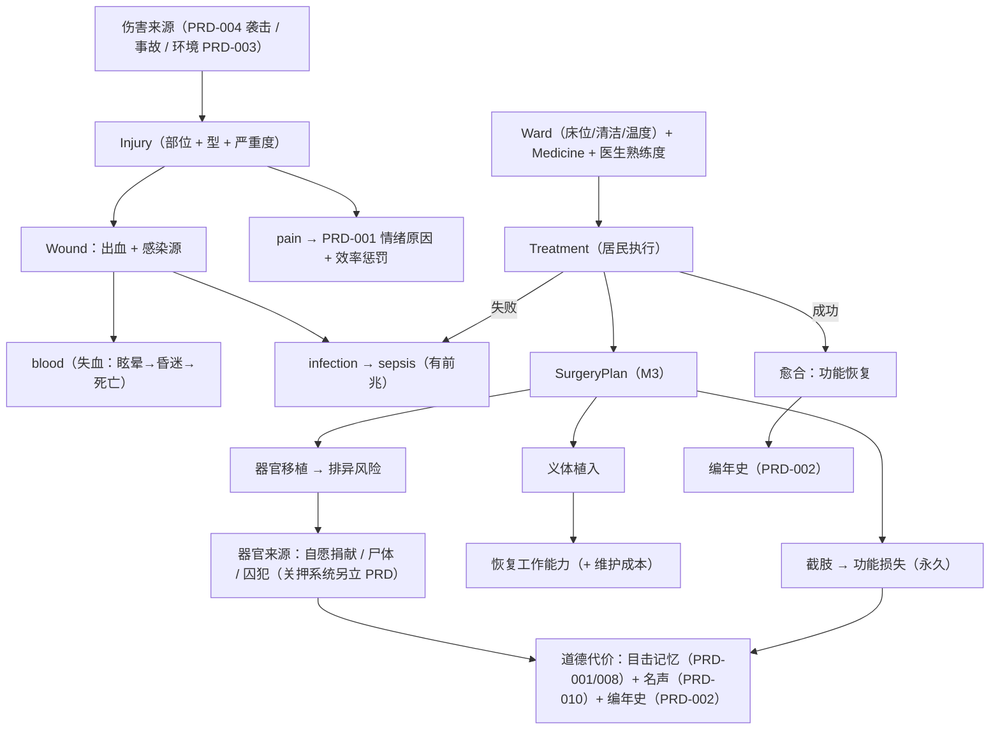
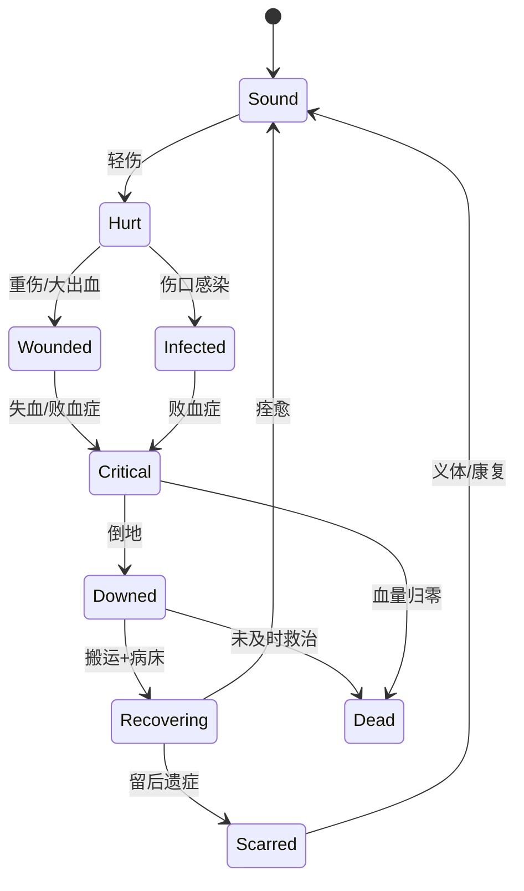
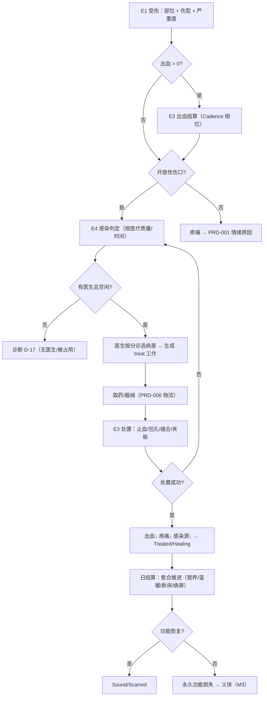

# PRD-013 · 医疗、伤病与手术

```
状态：草稿PRD
负责人：设计（人类定稿）
最后更新：2026-10-18
优先级：P0          里程碑：M2（分部位伤病 + 感染 + 基础治疗）→ M3（手术台与手术 + 义体分级）→ M4（太空医学）
上游依据：docs/design/05-settlement-and-residents.md（§3.1 属性模型：健康 = 伤口/感染/疾病/后遗症/营养状态）、
         docs/design/08-progression-and-ages.md（时代决定医学水平）、docs/design/02-benchmark.md（对标 RimWorld 的医疗与手术）
关联文档：PRD-001（需求/情绪/记忆：疼痛是**情绪原因**；该系统正被并行改造为「数据驱动需求注册表 + 专注度」，本文按「需求与专注度系统」表述）、
         PRD-002（事件/讣告/编年史）、PRD-003（季节/温度/口渴/营养：温度与营养作为愈合与感染的输入）、
         PRD-004（受伤来源、民兵、`CasualtyRecord`）、PRD-006（诊断链 D-1..D-16 与建议动作：本文提议 D-17..D-19）、
         PRD-008（关系/`grudge`/目击记忆）、PRD-009（生命周期/老死/讣告/墓碑/尸体）、
         PRD-010（药品与义体作为贸易品）、PRD-011（知识解锁义体等级与太空计划）、PRD-012（权限与并发裁决）
基底依赖：plugins/person（`ResidentEntity`、`Hunger` 的 vitals 范式、`LivingContent.declare`）、core/api/resident/body（`BodyState`/`Perk`/`Perks`）、
         core/api/work（`Urge`/`UrgeSource`/`WorkProgress`/`Xp`）、core/api/persist（`Reader`/`Writer`）、
         `Cadence`（分相位结算）、`Colony.submit(Grown)` + `Node`、`Declaring.colony/urges`、`Beds`（床位）、`Shelves`（新货架）
集成依赖（**可选但一等支持**）：**Chest Cavity Beyond（CCB，代码 MIT + 美术 Apache-2.0，可打包/可 vendor）** → 器官腔与器官槽层（§14.1）；缺失时降级为本文自有的**抽象内脏槽**（§14.1.3）
决策依据：ADR-007（已 fork，可直接改造）、ADR-013（一切必须由居民执行）、ADR-009（**vitals 不进需求栏**：疼痛只作情绪原因；成瘾的**生理计量**归本 PRD、其**需求栏条目**归 [PRD-001](PRD-001-needs-mood-memory.md) 的数据驱动需求注册表，见 §14.2）、
         ADR-010（外部 mod 一般只作**可整体删除**的可选依赖；CCB 是唯一的"一等可选依赖"例外，因为它只提供"腔与器官"一层且 MIT）、ADR-014（年龄刻度）
外部调研：§1.1 的平台/仓库核实（6 个候选 mod，含 CCB）；docs/research/01-core-engine.md（基底**没有**健康/分部位系统，只有原版 `LivingEntity` 生命值）
```

---

## 0. 一句话

> 被砍伤的人会流血、会感染、会痛得干不了活——而你的医生要决定先救谁，以及，为了救他值不值得砍下别人的一条腿。

---

## 1. 概述

**玩家在什么时候遇到它**：第一次袭击结束后有人躺在地上流血不止；冬天有人在雪地里冻伤；矿洞塌方压断了腿；饥荒之后有人病倒；以及在星辰时代，有人在真空里把面罩扯裂。

**它解决什么体验问题**：基底**根本没有医疗系统**——`ResidentEntity` 只有原版 `LivingEntity` 的生命值（`ResidentEntity.java:49` 继承 `PathfinderMob`，`:359` 只有受伤音效），全仓库没有任何"部位/伤口/感染/治疗"概念（[research/01](../research/01-core-engine.md) 全文无 Health/Damage 命中）。于是 [d05 §3.1](../design/05-settlement-and-residents.md) 写下的「健康 = 伤口、感染、疾病、后遗症」完全落空：受伤只会掉血然后自动回满，**不产生任何决策**。对应支柱 **P2（每个人都是一个故事）** 与 **P5（失败长出故事）**。

**它产生的新决策**：
- **先救谁**（分诊）：只有一名医生、两张病床，三个人都在流血。
- **值得吗**：把有限的药品给重伤的顶梁柱，还是给能救活的轻伤员？
- **截肢还是拖**：保一条感染坏死的腿（长期卧床、可能败血症），还是锯掉并装木腿（永久残废、但能干活）？
- **义体投给谁**：谁来承担那副机械臂——最强的工匠，还是受伤后一直没恢复的矿工？
- **要不要做那件事**：为了一个能救命的器官，去解剖尸体，或者从囚犯身上取（**关押系统另立 PRD**）——目击者会记住，外邦会知道。
- **医生本人也会垮**：连续做手术的医生会崩溃、会拒绝、会犯错。

**它在多大程度上是玩家的选择**：**伤病是系统的（谁受伤、感染与否由世界决定），救治是玩家的**——你决定优先级、药品分配、手术取舍与义体归属；医生怎么执行、能不能成功，由系统与熟练度决定。玩家的手**不直接**完成任何医疗动作（ADR-013）。

### 1.1 为什么自研，以及唯一允许的"外来层"（CCB）

| mod | 状态核实 | 许可 | 能给我们什么 | 结论 |
| --- | --- | --- | --- | --- |
| **`chest-cavity-beyond`（CCB）** | 1.21.1 / NF 21.1.216，mod 1.10.5，2026-10-15 仍在更新；仓库 `zhaijineet/Chest-Cavity-Beyond` | **代码 MIT + 美术资源 Apache-2.0**（美术来自上游 `Tigereye504/chestcavity`） | **器官腔 + 器官槽**这一层：按 `EntityType` 注册（**非玩家专属**）、每个生物 3×9 = 54 个器官槽、器官提供属性加成、器官↔物品转换、完整注册/事件 API | **采用：可选但一等支持的依赖**（可打包、可 vendor）；**只借"腔与器官"层，不借规则层**（§14.1） |
| `who-am-i-core` | 1.21.1 / NF 21.1.230；**是 CCB 的附属**、关注度极低（约 2 star） | **仓库无 LICENSE 文件 = 保留所有权利（ARR）** | 部位渲染的思路 | **不用**（改用 CCB 本体；ARR 不打包、不 fork） |
| `sons-of-sins` | 1.21.1 | **ARR** | 器官摘取与"黑暗手段"的交互范式 | **不可打包**；我们自研且**必须带道德代价**（§8 R-MED-20..24） |
| `med-system` | 1.21.1 | **ARR** | 分部位血条的表现方式 | **不可打包**；仅参照 UI 信息密度 |
| `cripple-player` | 1.21.1 | **MIT** | 肢体损伤 + 义肢的机制骨架 | **许可允许**，但它是**玩家侧**系统，与 ADR-013 冲突 → 仍自研，只借概念 |
| `hospitals` | 1.21.1 | **MIT** | 病房/病床的布局与占用模型 | **许可允许**；可选"外观/建筑素材"式整合，必须**可整体删除** |

**R-MED-1（决策）**：**伤病、感染、治疗、手术、义体、道德代价全部自研**（L1 为主 + L2 货架）；外部 mod 只允许以"可整体删除的可选依赖"形式接入（与 ADR-010 同一纪律）——**唯一例外是 CCB**：它是**一等可选依赖**（提供器官腔/器官槽这一层，MIT 可 vendor），但**规则、后果、代价一律由本文的 R-MED 规则定义**（R-MED-40）。

| 桥接 | 作用 | 缺失时的行为 |
| --- | --- | --- |
| **`CavityBackend`（CCB）** | 器官腔与器官槽的**实体层**（§14.1） | **降级为本文自有抽象内脏槽**（§14.1.3 的降级清单），游戏完整可玩 |
| `CrippleBridge`（MIT） | 读取其肢体损伤概念用于**外观表现** | 用我们自己的部位图标 |
| `HospitalsBridge`（MIT） | 借用其病床/病房**方块外观** | 用我们的简易病床 |
| ARR 类（`who-am-i-core`/`sons-of-sins`/`med-system`） | **不写桥接、不引用、不打包** | —— |

**R-MED-2**：许可状态是**调研时点的快照**，打包前必须由人工复核（与 [k01 §4.4](../pack/01-modlist.md) 同一纪律）。

---

## 2. 设计目标与非目标

### 2.1 目标（Goals）

| 编号 | 目标 | 可判定信号 |
| --- | --- | --- |
| G1 | 受伤**有部位、有后果** | 同一份伤害打在腿/臂/头/内脏上产生**可测量且不同**的行为后果（速度/工作/意识/代谢） |
| G2 | 医疗是**居民的工作** | 从发现伤者到包扎完成，全程由居民执行；玩家只做优先级与资源分配（ADR-013） |
| G3 | 治疗有**质量差异** | 医生熟练度/药品等级/病房条件三者各自都能显著改变感染率与愈合速度（对照实验） |
| G4 | 感染会**真的变糟** | 未处理的伤口按概率感染；感染不处理会走向败血症与死亡（有前兆） |
| G5 | 手术是**有风险的取舍** | 每台手术有明确的成功/失败/并发症概率，且可在术前看到；失败有前兆、可挽回或不可挽回 |
| G6 | 残废**不是终点** | 至少三级义体让失去肢体的人重新工作；义体有代价（维护/电力/时代门槛） |
| G7 | 黑暗手段**有代价** | 摘取器官必定产生目击记忆、关系恶化、外部名声下降与编年史记录；**不存在无代价摘取** |
| G8 | 医疗不拖垮服务器 | 分部位状态按相位结算（非逐 tick）；人均内存与 PRD-001/009 的预算相容（§13） |
| G9 | 一切可被数据包改写 | `body_part`/`injury_kind`/`surgery`/`prosthetic`/`medicine` 五货架可覆盖（§15） |

### 2.2 非目标（Non-Goals，本次不做）

| 编号 | 不做的事 | 理由 | 何时可能做 |
| --- | --- | --- | --- |
| N1 | **关押、劳役、人质、赎金、释放** | 属**独立的关系/关押系统**（另立 PRD，本文只把它当作"器官来源之一"的供给方） | 该 PRD 立项后 |
| N2 | 精神疾病/心理治疗 | 情绪与崩溃归 PRD-001；本文只做**疼痛与成瘾**这两条肉体通道 | 不做 |
| N3 | 逐肌肉/逐神经的解剖学模拟 | 成本与收益不成比例；部位粒度到"肢体 + 内脏槽位"即止 | 不做 |
| N4 | 玩家手动完成手术/包扎 | 违反 ADR-013（R-MED-3） | 不做 |
| N5 | 瘟疫/传染病的大规模传播模型 | 本文只做**伤口感染**与**术后感染**；人群级疫病属疾病系统的另一层（[PRD-003 §2.2 N3](PRD-003-season-temperature-thirst-nutrition.md)，见 OQ-4） | M3 后另议 |
| N6 | 怀孕/分娩的医学分支 | 归 [PRD-009](PRD-009-generations-and-legacy.md)（它已定义"母亲分娩中死亡"） | 已归属 |
| N7 | 复制基底 `Hunger` 的类做第二套生命值 | 会与基底原版生命值打架（R-MED-4） | 不做 |
| N8 | 宠物/牲畜的完整医疗 | 只做"能治/不能治"的最小分支，复用同一套 `injury_kind` | M3 后 |

### 2.3 里程碑子集（人类已裁定）

| 里程碑 | 内容 | 明确不做 |
| --- | --- | --- |
| **M1** | **医疗系统本体不交付**。只落两件事：① 疼痛作为**情绪原因**接入既有的需求与专注度系统（袭击/事故在 M1 已经会伤人，不能出现"受了伤毫无反馈"）；② `ResidentHealth` 的**数据骨架 + 存档位**（便于 M2 无迁移负担地扩展） | 治疗、感染、手术、义体 |
| **M2** | **分部位伤病 + 感染 + 基础治疗**：部位损伤/出血/疼痛、感染与败血症、绷带/缝合/夹板/止血带/消毒/药品分级、病床与药柜、**医生工种**、分诊与优先级、诊断 D-17..D-19 | 手术、义体、太空 |
| **M3** | **手术台与手术**（取异物/截肢/缝合内脏/器官移植与排异）+ **义体分级**（木腿/钩手 → 简易假肢 → 机械义体），由 [PRD-011](PRD-011-progression-knowledge-and-space.md) 的知识解锁 | 太空医学、高级义体 |
| **M4** | **太空医学**：失重/辐射/减压伤/低温烧伤、站内医疗舱、高级义体（含电力与维护）；与 [PRD-011 §9.6](PRD-011-progression-knowledge-and-space.md) 的站内自持接口 | —— |

**R-MED-5**：M2 的交付必须包含**至少一条完整的"受伤 → 感染 → 治疗 → 康复或死亡"链路**（不能只做加法不做后果）。

---

## 3. 术语

### 3.1 本系统局部术语

| 术语（英文） | 中文 | 说明 | 与全局术语的关系 |
| --- | --- | --- | --- |
| `body_part` | 部位 | 外部部位（头/躯干/双臂/双手/双腿/双足）+ 内脏槽位（脑/心/肺/肝/肾/胃/肠） | 新增（需登记全局表） |
| `injury` | 伤情 | 一个部位上的一次损伤记录（类型 + 严重度 + 时间 + 来源） | 新增 |
| `injury_kind` | 伤型 | 切割/钝击/烧伤/骨折/撕咬/穿刺/内出血 | 新增货架 |
| `wound` | 伤口 | 未愈合的开放性伤情（会感染、会出血） | 新增 |
| `bleeding` | 出血 | 每部位的失血速率 | 新增 |
| `blood` | 血量 | 全身血量百分比（0–100），低于阈值 → 眩晕 → 昏迷 → 死亡 | 新增（vitals） |
| `pain` | 疼痛 | 0–100；**只作 [PRD-001](PRD-001-needs-mood-memory.md) 的情绪原因与效率惩罚**，不是需求 | 新增（vitals） |
| `infection` | 感染 | 部位的局部感染度 0–100 | 新增 |
| `sepsis` | 败血症 | 感染扩散为全身状态，持续掉血 + 高烧 | 新增 |
| `treatment` | 处置 | 一次治疗动作（包扎/缝合/夹板/止血/消毒/用药） | 新增 |
| `surgery` | 手术 | 在手术台上进行的高风险处置（取异物/截肢/缝合内脏/移植/义体植入） | 新增 |
| `prosthetic` | 义体 | 替代或增强部位的装置（三级） | 新增 |
| `medicine` | 药品 | 消耗品（止血/消毒/镇痛/抗感染/免疫抑制），有等级 | 新增（走基底 `wares` 的物品族） |
| `triage` | 分诊 | 医生按伤情危急度排序救治的机制 | 新增 |
| `medic` | 医生 | 一个**工种/授权**，不是新职业体系 | 与基底 `Vocation`/`Licence` 一致 |
| `ward` | 病房 | 有床位、清洁、可取暖的收治区域 | 新增 |
| `corpse` | 尸体 | 可埋葬/解剖的遗体（与 [PRD-009](PRD-009-generations-and-legacy.md) 的墓/墓碑衔接） | 新增 |
| `addiction` | 成瘾 | 药品依赖的**生理计量**（本 PRD 拥有：耐受、戒断、医学后果含致命、治疗）；**需求栏条目由 [PRD-001](PRD-001-needs-mood-memory.md) 的数据驱动需求注册表承载**（已按 PRD-001 OQ-13 对齐，见 §14.2） | 新增（本 PRD 拥有**计量**；需求条目归 PRD-001） |
| `organ_cavity` | 器官腔 | 生物体内的器官容器（**CCB 提供实体层**；CCB 缺失时为本文的抽象槽） | 新增（§14.1） |
| `organ_slot` | 器官槽 | 单个器官位（CCB 为 3×9 = 54 个；降级时按部位映射，见 §14.1.3） | 新增（§14.1） |

### 3.2 与既有术语的冲突检查

| 冲突项 | Folkways 既有含义 | 本系统含义 | 解决方式 |
| --- | --- | --- | --- |
| **生命值（Health/HP）** | 原版 `LivingEntity` 的血量（掉光即死） | 我们的「健康」= **分部位身体状态**（伤/感染/功能损失） | **明确区分**：文案一律写「生命值」对原版、「伤情/身体状态」对我们；代码里我们的类叫 `ResidentHealth`，**不**叫 `Health` |
| `body_state` | 基底附件 `folkways:body_state`（体力/睡眠等，`FolkwaysAttachments.java:29-30`） | 我们的医疗状态 | **扩展**该附件或新增 `resident_health` 附件；**不替换** `BodyState` |
| `Body` / `ResidentEntity` | 居民的具身化实现 | —— | 复用；**不得**改其速度契约（R-MED-9） |
| 「村民」 | 与 Minecraft 原生 Villager 混淆 | —— | **禁用**（[术语表 §3](../design/03-glossary.md)）；一律写「居民」 |
| 「医生」 | 基底无此工种 | 我们的 `medic` 工种 | 新增工种，**不**新建职业体系（照 [PRD-004](PRD-004-threats-and-defence.md) 的 `militia` 先例） |
| 「病床」 | 基底已有床位概念（`Beds.java:21` 的 `final class Beds`、`:23-24` 的双向映射、`:46` 的 `colony.blocks(LivingContent.BED)`） | 收治病患的床位 | **复用** `Beds`，加"是否为病床"标记；不新造床 |
| 「药品」 | 基底有物品/`wares` 体系 | 医疗消耗品 | 走 `wares` 物品族 + 我们的 `medicine` 货架；**不**另造物品系统 |
| 「囚犯」 | 不存在（关押系统**另立 PRD**） | 器官来源之一（**由该 PRD 提供**） | 本文**只声明接口**：`organ_source = voluntary / corpse / detainee`；**不定义**关押、劳役、赎金、释放 |
| **胸腔 / 器官腔** | 基底无任何器官概念；`Chest Cavity Beyond`（MIT）按 `EntityType` 提供器官腔与 54 个器官槽 | 我们的器官腔层**优先复用 CCB**（一等可选依赖），缺失时降级为抽象内脏槽 | **CCB 提供实体层、我们提供规则层**；全项目只在 `CavityBackend` 一处引用（§14.1） |
| **成瘾（需求）** | [PRD-001](PRD-001-needs-mood-memory.md) 已改为**数据驱动需求注册表**并声明「**成瘾即需求**」（未满足 → 戒断可致命；戒断成功后该需求消失） | 本 PRD 拥有 `addiction_level` 的计量与医学后果 | **单一数据源**：`addiction_level` 只有一份，PRD-001 只读并由需求栏渲染（§14.2，已按 PRD-001 OQ-13 对齐） |

> **ADR-009 措辞更新（2026-10-18，结论不变）**：原文「固定 7 条需求」改为「**vitals 不进需求栏**」。
> 理由：需求集现在是**数据驱动的默认核心集 + 变体/成瘾/专属需求**；不变的结论是——**疼痛、口渴、血量、氧气这类 vitals 不占需求栏**，它们的情绪影响经情绪原因表达。
> （注：`ADR-009` 正文在 [章程](../00-charter.md) 中，本 PRD 只按新措辞引用；章程侧的回改需由持有整套文档的负责人执行。）

---

## 4. 概念模型

### 4.1 实体

| 实体 | 中文 | 说明 | 生命周期 | 玩家可见 |
| --- | --- | --- | --- | --- |
| `ResidentHealth` | 居民身体状态 | 全部部位 + 血量 + 疼痛 + 成瘾 + 手术史 | 随居民（持久） | 居民卡「身体」页 |
| `BodyPart` | 部位 | 损伤/感染/功能损失三态 + 义体槽 + 是否缺失 | 持久 | 部位列表 |
| `Injury` | 伤情 | 类型/严重度/发生时间/来源/是否开放 | 单次事件（持久） | 伤情行（含「怎么伤的」） |
| `TreatmentPlan` | 处置计划 | 医生对某伤者的一次处置意图（目标部位 + 手段 + 优先级） | 工作级 | 医疗页 |
| `SurgeryPlan` | 手术计划 | 台次、术式、主刀、助手、麻醉、风险预览 | 台次级 | 手术页（含风险） |
| `Ward` | 病房 | 收治区域（床位 + 清洁 + 温度 + 药柜） | 玩家划定 | 世界内 + 医疗页 |
| `Medicine` | 药品 | 消耗品（类别 + 等级 + 效果 + 成瘾性） | 消耗 | 库存与药柜 |
| `Prosthetic` | 义体 | 部位替代物（级别 + 加成 + 维护需求） | 持久（可更换） | 居民卡 + 义体行 |
| `Corpse` | 尸体 | 遗体（可埋葬/解剖/取器官） | 到埋葬/分解 | 世界内 |
| `OrganRecord` | 器官记录 | 来源、保存时长、匹配度、去向 | 持久 | 手术页 + 编年史 |
| `Addiction` | 成瘾 | **本 PRD 拥有的生理计量**（耐受/戒断/医学后果），需求栏条目由 [PRD-001](PRD-001-needs-mood-memory.md) 渲染 | 持久 | 居民卡状态图标 + PRD-001 需求栏 |
| `OrganCavity` | 器官腔 | 器官容器（CCB 实体层 / 我们的抽象降级） | 持久 | 身体页「器官腔」 |
| `OrganSlot` | 器官槽 | 单个器官位（CCB 54 槽 / 降级按部位映射） | 随器官更换 | 身体页槽位列表 |

### 4.2 实体之间的关系



**关键级联**：① 伤情 → 疼痛 → 情绪 → 崩溃（PRD-001）；② 医生崩溃 → 拒诊 → 病人恶化（D-17）；③ 摘取器官 → 目击者 `grudge`（PRD-008）→ 派系关系（PRD-010）；④ 死亡 → 讣告 + 尸体 + 亲属哀悼（PRD-009/008）；⑤ 义体等级 ← 知识解锁（PRD-011）。

---

## 5. 状态机

### 5.1 状态定义

**伤情（`Injury`）**

| 状态 | 中文 | 说明 |
| --- | --- | --- |
| `Fresh` | 新伤 | 刚发生，出血最快、最痛 |
| `Treated` | 已处置 | 已被包扎/缝合/夹板固定 |
| `Infected` | 已感染 | 感染度 ≥ 阈值 |
| `Healing` | 愈合中 | 感染被控制，功能逐日恢复 |
| `Scarred` | 已愈合留痕 | 留下疤痕/后遗症（可能永久功能损失） |
| `Necrotic` | 坏死 | 只能截肢或走向败血症 |

**居民整体（`ResidentHealth`）**

| 状态 | 中文 | 说明 |
| --- | --- | --- |
| `Sound` | 无恙 | 无伤情 |
| `Hurt` | 轻伤 | 可工作，有效率惩罚 |
| `Wounded` | 重伤 | 需卧床或仅轻活 |
| `Critical` | 危重 | 出血/败血症，随时可能死亡 |
| `Downed` | 倒地 | 不能自主移动，需搬运（复用 `Carrying`） |
| `Recovering` | 康复中 | 稳定但需休养 |
| `Dead` | 死亡 | 写讣告、留尸体（PRD-009） |

**手术（`SurgeryPlan`）**

| 状态 | 中文 | 说明 |
| --- | --- | --- |
| `Proposed` | 已提出 | 有术式与风险预览，等资源/医生 |
| `Prepping` | 准备中 | 手术台/灯/消毒/麻醉/助手就位 |
| `Operating` | 进行中 | 医生在台上工作（工时消耗） |
| `Closing` | 收尾 | 缝合/包扎/送病房 |
| `Succeeded` | 成功 | 目标达成（异物取出/截肢完成/器官植入） |
| `Complicated` | 并发症 | 成功但留有并发症（感染/排异/出血） |
| `Failed` | 失败 | 未达成目标，伤情恶化 |
| `Aborted` | 中止 | 主动/被迫中止（可部分挽回） |

### 5.2 事件定义

| 事件 | 中文 | 说明 | 触发方 |
| --- | --- | --- | --- |
| E1 | 受伤 | 伤害结算到部位（含型与严重度） | 世界（PRD-004/环境） |
| E2 | 出血结算 | 按相位累计失血 | 系统（`Cadence`） |
| E3 | 被处置 | 医生完成一次 treatment | 居民 |
| E4 | 感染判定 | 未处理伤口按概率感染 | 系统 |
| E5 | 败血症 | 感染扩散为全身 | 系统 |
| E6 | 倒地 | 血量或意识低于阈值 | 系统 |
| E7 | 被搬运 | 居民把倒地者搬到病床（复用搬运） | 居民 |
| E8 | 提出手术 | 医生/玩家提出术式 | 居民/玩家 |
| E9 | 手术开始/结束 | 台次状态迁移 | 居民 |
| E10 | 并发症 | 术后感染/排异/出血 | 系统 |
| E11 | 死亡 | 生命值或血量归零 | 世界 |
| E12 | 尸检/取器官 | 解剖获得知识或器官 | 居民 |
| E13 | 义体植入/损坏 | 植入、维护、失效 | 居民/系统 |
| E14 | 成瘾发作/戒断 | 依赖计量越过阈值 | 系统 |

### 5.3 扩展变量（系统状态）

| 变量 | 中文 | 类型 | 默认值 | 取值范围/单位 | 说明 |
| --- | --- | --- | --- | --- | --- |
| `blood` | 血量 | 定点 | 100 | 0–100 % | <60 眩晕 / <35 昏迷 / <15 死亡 |
| `pain` | 疼痛 | 定点 | 0 | 0–100 | → 情绪原因与效率 |
| `consciousness` | 意识 | 定点 | 100 | 0–100 % | 脑伤/失血/麻醉降低 |
| `part.damage` | 部位损伤 | 定点 | 0 | 0–100 | 达到 100 且不可修复 → 缺失 |
| `part.infection` | 部位感染 | 定点 | 0 | 0–100 | ≥60 恶化为 `Necrotic` |
| `part.function` | 功能损失 | 定点 | 0 | 0–100 % | 永久性（义体可部分恢复） |
| `bleed_rate` | 出血速率 | 定点 | 0 | 0–5 /分钟 | 由伤型与严重度决定 |
| `triage_mode` | 分诊模式 | 枚举 | `severity` | severity/skill/cost/first | 医生排序依据 |
| `medicine_tier` | 药品等级 | 整数 | 1 | 1–4 | 受时代限制 |
| `ward_quality` | 病房条件 | 定点 | 0.5 | 0–1 | 清洁/温度/照明/消毒 |
| `surgery_risk_shown` | 风险预览 | 布尔 | true | —— | 术前必须可见（R-MED-14） |
| `addiction_level` | 成瘾度 | 定点 | 0 | 0–100 | **单一数据源**：本 PRD 负责写入（耐受/戒断/医学后果）；[PRD-001](PRD-001-needs-mood-memory.md) **只读**并渲染需求栏（§14.2） |
| `cavity_backend` | 器官腔后端 | 枚举 | `auto` | auto/ccb/abstract | `auto` = 有 CCB 用 CCB，否则用抽象槽（§14.1.3） |
| `organ_source` | 器官来源 | 枚举 | `voluntary` | voluntary/corpse/detainee | `detainee` **由关押系统提供** |

### 5.4 守卫条件依赖

| 变量 | 中文 | 类型 | 来源 |
| --- | --- | --- | --- |
| `medic_licence` | 医生授权 | 布尔 | 基底 `Licences`（`FolkwaysAttachments.java:24-26`） |
| `medic_skill` | 医生熟练度 | 整数 | 基底 `Perk`/`BodyPerks`（`Perk.java:3`、`BodyPerks.java:19,39`） |
| `ward_beds_free` | 空闲病床 | 整数 | `Beds`（`Beds.java:26,40`）+ 我们的病床标记 |
| `medicine_stock` | 药品库存 | 映射 | 基底物品 + [PRD-006](PRD-006-stock-rules-and-diagnosis.md) 仓储规则 |
| `table_free` | 手术台空闲 | 布尔 | 我们的方块 |
| `patient_consent` | 患者同意 | 布尔 | 成年 + 非强制（儿童与昏迷者需代理，见 R-MED-17） |

### 5.5 状态转移表

| 源状态 | 事件 | 守卫条件 | 动作 | 任务/副作用 | 目标状态 |
| --- | --- | --- | --- | --- | --- |
| `Fresh` | E3 | 有医生 + 药品/绷带 | 止血/包扎/缝合 | 出血↓、疼痛↓、感染源↓ | `Treated` |
| `Fresh` | E4 | 未处置且过 `infect_hours` | 掷感染判定 | 疼痛↑、发热 | `Infected` |
| `Treated` | E4 | 医疗质量低 | 掷感染判定（概率显著更低） | —— | `Infected` |
| `Infected` | E3 | 有抗感染药品 | 用药 | 感染↓ | `Healing` |
| `Infected` | —— | 感染 ≥60 且无药 | 恶化 | 功能损失↑ | `Necrotic` |
| `Necrotic` | E8/E9 | 有手术台 | 截肢 | 部位缺失、功能永久损失 | `Scarred`（+ 义体槽） |
| `Healing` | 日结算 | 感染受控 + 营养/温暖达标 | 愈合推进 | 功能逐日恢复 | `Scarred` 或 `Sound` |
| 任何 | E5 | 感染扩散 | 败血症 | 持续掉血 + 高烧（PRD-003 温度输入） | `Critical` |
| `Critical` | E6 | `blood <35` 或 `consciousness <30` | 倒地 | 需搬运 | `Downed` |
| `Downed` | E7 | 有病床 + 有搬运者 | 搬到病房 | 占用床位 | `Recovering` |
| `Critical` | E11 | `blood ≤15` 或生命值归零 | 死亡 | 讣告 + 尸体 + 关系人记忆 | `Dead` |
| `Recovering` | 日结算 | 稳定 | 康复推进 | 恢复工作能力 | `Sound`/`Scarred` |

### 5.6 状态图（居民整体）



### 5.7 超时与中断

| 情形 | 处理 | 恢复后行为 |
| --- | --- | --- |
| 玩家离开/断线（单人） | 出血、感染、愈合**继续结算**（服务端），医生按分诊自主工作 | 回来看到结果与完整记录（含"谁救了谁"） |
| 医生死亡/失能（崩溃） | 该医生全部处置与手术**立即中止**（手术进入 `Aborted`，病人回到可救治状态） | 由其他医生接续；诊断给 D-17 |
| 医生被玩家**临时接管**（[PRD-005](PRD-005-intent-and-micro-control.md) A-max 的 L3 接管层） | 处置立即挂起；**手术中的**接管视为中止（进入 `Aborted` + 并发症判定），或按 PRD-005 的「不得在不可逆动作中接管」处理 | 接管结束/租约到期后由医生自主继续；**不允许**手术在被接管期间静默完成 |
| 病床被拆/病房被毁 | 病人被移出，重新寻找床位 | 目标消失 → 不静默失败，写诊断 |
| 手术台被拆（进行中） | 手术强制 `Aborted` + 并发症判定 | 可挽回或有代价（不静默成功） |
| 区块卸载 | 居民与伤情随时间推进（照基底既有卸载规则）；手术**不允许**在卸载中"自动完成" | 回到加载态后按已结算结果继续 |
| 药品被搬空 | 处置中止，病人保持当前状态 | 诊断 D-18 |
| 病人死亡（进行中） | 手术/处置立即结束，写讣告与死因 | 医生获得记忆（做过的失败手术） |

---

## 6. 交互

### 6.1 入口与快捷键

| 操作 | 按键/手势 | 前置条件 | 结果 |
| --- | --- | --- | --- |
| 打开「身体」页 | 面板页签 | 手持殖民书 | 选中居民的部位列表、伤情、疼痛、血量 |
| 打开「医疗」页 | 面板页签 | 同上 | 病患清单（按危急度排序）、医生、床位、药品、手术队列 |
| 指定医生 | 医疗页/居民页 | 权限：成员 | 给居民开放 `medic` 工种 |
| 设定分诊模式 | 医疗页 | 权限：成员 | 切换 severity/skill/cost/first |
| 划定病房 | 世界内划区 | 权限：成员 | 标记床位/药柜/清洁范围 |
| 提出手术 | 医疗页 → 伤者 → 术式 | 权限：成员（**摘取类需管理者**） | 生成 `SurgeryPlan`，展示风险预览 |
| 指定器官来源 | 手术页 | 权限：**管理者** | 自愿捐献/尸体/囚犯（后者由关押系统提供） |
| 查看「怎么伤的」 | 伤情行 → 展开 | —— | 时间、来源、见证者 |

**R-MED-UI-1**：**任何手术前必须显示风险预览**（成功率、并发症、可能不可逆的后果），否则视为缺陷。

### 6.2 操作模式状态机

| 状态 | 中文 | 说明 |
| --- | --- | --- |
| `Idle` | 空闲 | 未进入医疗操作 |
| `PickPatient` | 选病患 | 从列表或世界内选中 |
| `PlanSurgery` | 排手术 | 选术式与来源，查看风险 |
| `Confirm` | 确认 | 二次确认（不可逆术式与摘取类必过） |

| 事件 | 中文 | 说明 | 触发方 |
| --- | --- | --- | --- |
| 选中病患 | —— | 点击列表/世界内居民 | 玩家 |
| 选定术式 | —— | 从可用术式列表中选 | 玩家 |
| 取消 | —— | 退出当前模式 | 玩家 |
| 确认执行 | —— | 生成台次计划 | 玩家 |

| 源状态 | 事件 | 守卫条件 | 目标状态 | 动作 |
| --- | --- | --- | --- | --- |
| `Idle` | 选中病患 | 有伤情 | `PickPatient` | 高亮部位 |
| `PickPatient` | 选定术式 | 术式可用（知识/器械/药品） | `PlanSurgery` | 显示风险 |
| `PlanSurgery` | 确认执行 | 权限 + 资源 | `Confirm` | 二次确认 |
| `Confirm` | 确认执行 | 通过 | `Idle` | 生成 `SurgeryPlan` |
| 任何 | 取消 | —— | `Idle` | 丢弃草稿 |

### 6.3 右键菜单 / 面板动作（基底 `Board.Act` 五动词内）

| 上下文 | 按钮 | 操作 | 触发事件 | 是否可撤销 |
| --- | --- | --- | --- | --- |
| 医疗页 / 病患行 | 「优先救治」（`Edit`） | 提高该病患优先级 | 改 `triage` 排序 | 是 |
| 医疗页 / 病患行 | 「查看为什么」（`Open`） | 跳 [PRD-006](PRD-006-stock-rules-and-diagnosis.md) 诊断卡 | —— | —— |
| 医疗页 / 伤者 | 「安排手术」（`Do`） | 进入排手术模式 | 生成计划 | 计划可撤销；**执行后不可** |
| 医疗页 / 医生行 | 「换分诊模式」（`Edit`） | 切排序 | —— | 是 |
| 医疗页 / 药品行 | 「查看来源」（`Open`） | 打开库存/订单来源 | —— | —— |
| 世界内 / 倒地者 | 「定位」（`Ping`） | 高亮 | —— | —— |
| 世界内 / 尸体 | 「安排埋葬/解剖」（`Do`） | 生成对应工作 | 见 [PRD-009](PRD-009-generations-and-legacy.md) | 解剖**不可撤销** |

**R-MED-UI-2**：本 PRD **不新增 `Board.Act` 动词**；若评审认为"强制手术/强制喂药"必须独立语义 → 记为 **L3** 并单独评审（§14）。

### 6.4 命令

| 命令 | 权限 | 说明 | 输出 |
| --- | --- | --- | --- |
| `/<ns> medical list` | 成员 | 列出病患、危急度、处置中/等待中 | 文本表 |
| `/<ns> medical why <居民>` | 成员 | 该居民当前伤情与**为什么没被治**（D-17..D-19） | 文本表 |
| `/<ns> medical diagnose <居民>` | gamemaster | 打印部位明细（损伤/感染/功能/义体） | 文本表 |
| `/<ns> medical injure <居民> <部位> <伤型> <严重度>` | gamemaster | 造伤（测试用，写警告日志） | 确认 |
| `/<ns> medical cure <居民>` | gamemaster | 清除伤情（测试用） | 确认 |
| `/<ns> medical surgery <居民> <术式>` | gamemaster | 直接排一台手术（测试用） | 计划 id |
| `/<ns> medical ward` | 成员 | 病房/床位/药柜现状与条件评分 | 文本表 |
| `/<ns> medical probe` | gamemaster | 医疗结算耗时与人均内存 | 数值 |

---

## 7. 反馈

### 7.1 操作模式反馈（玩家交互时）

| 检查条件 | 音效 | Toast/文案键 | 视觉反馈 | 系统行为 |
| --- | --- | --- | --- | --- |
| 指定医生成功 | 确认 | `<ns>.medic.assigned`「%s 开始负责医疗」 | 居民头顶标识 | 开放 `medic` 工种 |
| 指定医生失败 | 低沉 | 拒绝原因（无许可/已被占用/不需要） | 高亮 | 复用 `RefusalKind` + PRD-006 |
| 术式不可用 | 低沉 | `<ns>.surgery.locked`「尚未掌握：%s」（指向知识页） | 灰色 | [PRD-011](PRD-011-progression-knowledge-and-space.md) 知识门 |
| 确认不可逆手术 | 警告 | `<ns>.surgery.confirm`「%s 将不可逆：%s」 | 红色边框（**不只用颜色**） | 需二次确认 |
| 缺少器官来源 | 低沉 | `<ns>.organ.no_source`「没有可用来源」 | —— | 阻止并给 D-18 |

### 7.2 实体状态反馈（持续显示）

| 检查条件 | 图标/颜色 | 悬停信息 | 系统行为 |
| --- | --- | --- | --- |
| 出血中 | 血滴图标（非纯红） | 「出血：%s/分（%s）」 | 血量下降 |
| 感染上升 | 警示图标 | 「感染：%s%%」 | 走向败血症 |
| 疼痛高 | 皱眉图标 | 「疼痛：%s（效率 −%s%%）」 | 情绪与效率惩罚 |
| 部位缺失 | 空槽图标 | 「%s 已缺失（义体：%s）」 | 功能损失 |
| 义体需维护 | 扳手图标 | 「义体维护 %s%%」 | 维护工作生成 |
| 倒地 | 卧姿标记 | 「需搬运至病床」 | 生成搬运工作 |
| 病房条件差 | 灰色图标 | 「病房条件：%s（清洁 %s / 温度 %s）」 | 影响医疗质量 |
| 尸体 | 尸体标记 | 「%s 的遗体（%s 前）」 | 可埋葬/解剖 |

### 7.3 系统事件反馈（非玩家触发）

| 事件 | 音效 | 通知文案键 | 视觉 | 系统行为 |
| --- | --- | --- | --- | --- |
| 受伤 | 受伤音（基底 `getHurtSound`，`ResidentEntity.java:359`） | `<ns>.injured`「%s 的%s受伤了（%s）」 | 部位高亮 | 生成处置需求 |
| 感染 | 低沉 | `<ns>.infected`「%s 的伤口感染了」 | 警示图标 | 推进感染 |
| 败血症 | 警报 | `<ns>.sepsis`「%s 出现败血症」 | 危急标记 | 持续掉血 |
| 处置完成 | 正向（轻） | `<ns>.treated`「%s 为 %s 处理了%s」 | —— | 出血↓ 感染源↓ |
| 手术开始/结束 | 紧张/结果音 | `<ns>.surgery.start` / `.result.<outcome>` | 手术台 | 状态迁移 |
| 并发症 | 警报 | `<ns>.complication`「手术并发症：%s」 | 警示 | 追加处置 |
| 截肢完成 | 庄重 | `<ns>.amputated`「%s 的%s已被截去」 | 空槽 | 永久功能损失 |
| 义体植入 | 正向 | `<ns>.prosthetic.fitted`「%s 装上了%s」 | 义体图标 | 恢复部分功能 |
| 器官摘取 | **低沉（不安）** | `<ns>.organ.harvested`「%s 从%s取出了%s」 | 目击者标记 | 记忆/grudge/名声/编年史 |
| 死亡 | 钟声 | `<ns>.death`「%s 死于%s」 | 尸体 | 讣告（PRD-002/009） |
| 成瘾发作 | 低沉 | `<ns>.addiction.withdrawal`「%s 正在戒断」 | 状态图标 | 情绪惩罚 + 效率下降 |

### 7.4 可诊断性（管理者的要求）

| 玩家可能的疑问 | 系统必须能回答 | 呈现位置 |
| --- | --- | --- |
| 「为什么没人给他治？」 | D-17（无医生/医生被占用）+ 具体到哪个医生在忙什么 | 医疗页 + PRD-006 诊断卡 |
| 「为什么止不住血？」 | 出血速率分解：伤型/严重度/处置状态/是否内出血（内出血**必须**手术） | 伤情行展开 |
| 「他为什么还不好？」 | 愈合速度分解：感染是否受控、营养（PRD-003）、温暖（PRD-003）、是否卧床、病房条件 | 病患行「为什么」 |
| 「为什么不能做这台手术？」 | 缺什么：术式知识（PRD-011）/手术台/麻醉/药品/助手/床位 | 手术页 |
| 「这台手术有多大风险？」 | 成功率与并发症概率的**逐项**分解（熟练度/药品/病房/助手/严重度） | 手术风险预览（R-MED-14） |
| 「他怎么残了？」 | 部位功能损失来源与时间线（哪次伤/哪次手术/哪次感染） | 身体页时间线 |
| 「为什么大家都在崩溃？」 | 疼痛与目击记忆（含器官摘取）的情绪原因清单 | PRD-001 情绪页 |

**R-MED-F-3**：上表每一行都必须复用 [PRD-006](PRD-006-stock-rules-and-diagnosis.md) 的**同一套诊断组件**，禁止另做一套。

---

## 8. 规则

| 编号 | 类型 | 规则 | 违反时的行为 |
| --- | --- | --- | --- |
| R-MED-3 | 禁止 | 玩家**直接**完成任何医疗/手术动作（包扎、截肢、取器官）；玩家只能决定优先级、资源与授权 | 视为违反 ADR-013，评审不通过 |
| R-MED-4 | 禁止 | 用我们的血量替代或架空原版生命值；两者必须**同向**（生命值归零 = 死亡，我们的 `blood` 归零 = 死亡） | 出现"血量满但生命值掉光"即缺陷 |
| R-MED-6 | 必须 | 每个伤情必须记录**部位、伤型、严重度、时间、来源**；来源缺失时写「不明」 | 空记录即缺陷（AC-11） |
| R-MED-7 | 必须 | 功能损失必须**可测量地影响行为**（速度/工作/意识/代谢四选一以上） | 无行为后果的部位损伤即缺陷 |
| R-MED-8 | 必须 | 治疗必须有**质量差异**：医生熟练度、药品等级、病房条件三者各自可测量地影响结果 | 三项任一无效即缺陷 |
| R-MED-9 | 禁止 | 改 `BodyRunner` 的速度契约（`BodyRunner.java:520`）；功能损失只走 `MOVEMENT_SPEED` 属性 modifier（照 `ResidentEntity.java:288-296`） | 静态检查不通过 |
| R-MED-10 | 必须 | 出血必须能致死，且路径为**眩晕 → 昏迷 → 死亡**（有前兆，不瞬死） | 瞬死即缺陷 |
| R-MED-11 | 必须 | 未处置伤口按概率感染；**医疗质量越高概率越低**；感染必须可观察、可治疗、可恶化 | 无感染或感染不可见即缺陷 |
| R-MED-12 | 必须 | 感染恶化到败血症必须有**前兆**（发热/伤口外观/情绪变化）与**应对窗口** | 直接败血症即缺陷 |
| R-MED-13 | 必须 | 内出血**只能**由手术处理（敷药无效）；必须在本 PRD 的伤型表中明确标注 | 可被绷带治好即缺陷 |
| R-MED-14 | 必须 | 手术前必须展示**风险预览**（成功率、并发症、不可逆后果），且数值与结算同源 | 无预览即缺陷（AC-22） |
| R-MED-15 | 必须 | 手术失败/并发症必须**可追溯**（临床记录 + 编年史 + 医生记忆） | 静默失败即缺陷 |
| R-MED-16 | 必须 | 截肢与摘取器官等**不可逆**动作必须二次确认并列出后果 | 缺确认即缺陷 |
| R-MED-17 | 必须 | **儿童**：不得被摘取器官、不得被强制手术（除救命且无替代）；**成人昏迷者**需其预设代理或关系最近者代理，且代理必须留痕 | 违反即视为严重缺陷 |
| R-MED-18 | 必须 | **自愿捐献**必须有明确的同意标记（成年 + 玩家为其设定意愿），无同意不得取 | 违反即视为严重缺陷 |
| R-MED-19 | 必须 | 尸体的解剖/取器官必须由**居民**执行，且必须经过玩家确认（不可自动发生） | 自动发生即缺陷 |
| R-MED-20 | 必须 | 任何器官摘取/截肢必须产生**目击者记忆**（[PRD-001](PRD-001-needs-mood-memory.md)/[PRD-008](PRD-008-relationships-and-social.md)） | 无记忆即缺陷（AC-31） |
| R-MED-21 | 级联 | 摘取事件必须联动：目击者 `grudge`↑ → 派系关系↓（[PRD-010](PRD-010-diplomacy-and-trade.md)）→ 编年史记录（[PRD-002](PRD-002-incidents-and-narrator.md)） | 任一缺失即缺陷 |
| R-MED-22 | 必须 | 参与摘取的医生必须承受**情绪冲击**（可崩溃、可拒诊），不得是"无感情的按钮" | 无冲击即缺陷 |
| R-MED-23 | 禁止 | 提供"无代价的黑暗工具"（无目击者、无记忆、无名声后果的设置项）；**可以**关闭整个医疗系统，但不能只关闭代价 | 违反即缺陷 |
| R-MED-24 | 必须 | 「囚犯」作为来源**只能**由未来的关押系统提供实体；本 PRD 不得自行生成囚犯 | 自行生成即越界 |
| R-MED-25 | 必须 | 医生是**工种/授权**（照 [PRD-004](PRD-004-threats-and-defence.md) 的 `militia` 先例），不是新职业体系 | 违反即评审不通过 |
| R-MED-26 | 必须 | 搬运伤者**复用**基底搬运（`Carrying` 接口，`Carrying.java:11`），不新造搬运 | 新造即缺陷 |
| R-MED-27 | 禁止 | 新增逐 tick 遍历全体居民的医疗结算；必须按相位分摊（`Cadence.claim`，`Cadence.java:54,59`） | 超预算即不通过 |
| R-MED-28 | 必须 | 疼痛只作**情绪原因 + 效率惩罚**，**不得进入需求栏**（ADR-009 新措辞：vitals 不进需求栏；[PRD-001 R-NM-8](PRD-001-needs-mood-memory.md)） | 违反即缺陷 |
| R-MED-29 | 必须 | **成瘾的分工（已按 [PRD-001](PRD-001-needs-mood-memory.md) OQ-13 对齐）**：`addiction_level` 的**生理计量、耐受、戒断医学后果（含致命）与治疗（脱瘾/替代/药物）归本 PRD**；**需求栏条目、情绪影响、专注度与优先级归 PRD-001**（其数据驱动注册表把成瘾在形成后作为独立需求列出、戒断成功后移除）；**触发源是同一份 `addiction_level`，禁止两套计量** | 出现第二份成瘾计量即缺陷 |
| R-MED-30 | 必须 | 义体必须分**三级**，且上级由 [PRD-011](PRD-011-progression-knowledge-and-space.md) 的知识解锁；义体必须有**代价**（维护/电力/时代） | 无代价的纯增强即缺陷 |
| R-MED-31 | 必须 | 排异反应必须存在且可被药品（免疫抑制）缓解；来源与匹配度影响概率 | 无排异即缺陷（AC-35） |
| R-MED-32 | 必须 | 死亡原因必须写入讣告（[PRD-002](PRD-002-incidents-and-narrator.md)/[PRD-009](PRD-009-generations-and-legacy.md)），且分部位可查 | 死因"不明"即缺陷 |
| R-MED-33 | 必须 | 医疗设施（病床/手术台/药柜）与药品走 [PRD-006](PRD-006-stock-rules-and-diagnosis.md) 的仓储与物流规则，不绕过 | 绕过即缺陷 |
| R-MED-34 | 优先级 | 分诊默认按「危急度 → 可救性 → 成本 → 先到先得」；玩家可改模式但顺序必须确定可复现 | 不确定的顺序即缺陷 |
| R-MED-35 | 必须 | 全部玩家可见文本走双语（en_us + zh_cn，§12） | 缺语言即缺陷 |
| R-MED-40 | 必须 | 器官腔层：**有 CCB 时用 CCB**（按 `EntityType` 注册、每生物 54 槽、器官属性加成），**CCB 缺失时降级为抽象内脏槽**；两条路径都必须完整可玩（§14.1.3） | 缺 CCB 即崩、或降级后关键功能不可用即缺陷 |
| R-MED-41 | 禁止 | 把 **CCB 的规则/后果**当成我们的：CCB 只提供"腔与器官"**实体层**；伤病/感染/手术/摘取/义体与四项代价**一律走本文 R-MED 规则** | 出现"由 CCB 决定伤病后果"即缺陷 |
| R-MED-42 | 必须 | 摘取器官**必须**经过本 PRD 的手术流程与**四项级联代价**，即使器官来自 CCB 的槽位 | 绕过代价即缺陷 |
| R-MED-43 | 必须 | 器官槽的**属性加成**必须走基底 `AttributeInstance` modifier 且**幂等**（摘除/更换时先 remove 再 add，照 `ResidentEntity.java:288-296`） | modifier 泄漏即缺陷 |
| R-MED-44 | 必须 | **机械族/机器人没有器官腔**（CCB 按 `EntityType` 注册，机械实体不注册）；其损伤走"部件维修"而非医疗 | 给机械单位做手术即缺陷 |
| R-MED-45 | 必须 | CCB 为**可选依赖**：加载/卸载 CCB 时存档必须可用；后端切换（ccb ↔ abstract）必须给**迁移告知**，并明确槽位映射或丢弃 | 静默丢器官即缺陷 |

---

## 9. 流程（与基底引擎对齐）

### 9.1 工作类型与任务

| 项 | 内容 |
| --- | --- |
| 工作类型（Vocation/Trade） | 新增 `medic`（医疗）；民兵式的"附加授权"模型：平日可做工，被指派时执行医疗 |
| 任务（Task/Doing） | `treat`（处置）、`haul_patient`（搬运伤者）、`surgery`（手术）、`bury`（埋葬，归 PRD-009）、`autopsy`（尸检） |
| 参与的居民种类 | 人类居民（M2）；太空单位（M4）复用同一套 |
| 需要的工具/许可（Tool/Licence） | 绷带/缝合针/夹板/止血带/手术包/麻醉/手术台/灯（工具门槛照基底 `Licences`+`tools`） |

### 9.2 执行流程（M2 处置）



### 9.3 Action 说明

| Action | 说明 | 失败/拒绝理由（Refusal） |
| --- | --- | --- |
| `Treat` | 对某部位执行一次处置（含取药） | 无许可/无器械/无药/病人已死/被别人接管/危险（战斗中） |
| `HaulPatient` | 把倒地者搬到病床（复用 `Carrying`） | 无床位/无路/病人被他人搬运（并发） |
| `Surgery` | 在手术台执行术式 | 无术式知识/无台/无麻醉/无助手/病人不稳定/医生已崩溃 |
| `Autopsy` | 解剖尸体获得洞见或器官 | 无许可/尸体已分解/家属关系人在场且未同意（情绪后果） |
| `FitProsthetic` | 植入/更换义体 | 无义体/不匹配/无手术条件 |

**R-MED-36**：我们的拒绝理由走基底 `RefusalKind` **接口**（`RefusalKind.java:5`，公开）新增枚举，**不**改上游类（L1）。

### 9.4 生成与分配条件

| 侧 | 条件 | 说明 |
| --- | --- | --- |
| 任务侧 | 存在伤情且（出血 > 0 或感染 ≥ 阈值 或 疼痛 ≥ 阈值 或 功能损失 ≥ 阈值） | 伤情本身就是需求来源（照 `Urge` 范式） |
| 居民侧 | 有 `medic` 许可 + 未被更高优先占用 + 不处于崩溃 | 走基底规划器 |
| 资源侧 | 器械/药品可用 + 床位可用（重伤必须床位） | 走 PRD-006 仓储规则；缺料进 D-18 |
| 空间侧 | 处置可在原地（轻伤）；重伤与手术必须在病房/手术台 | 到不了 → D-7 |

### 9.5 计算逻辑

| 计算项 | 公式 | 变量说明 | 取值范围 |
| --- | --- | --- | --- |
| 出血速率 | `bleed = Σ_parts bleed_kind(kind) × sev_mul × (1 − treated_factor)` | `treated_factor`：包扎 0.7 / 止血带 0.95（但有缺血代价）/ 缝合 0.85 | 0–5 /分钟 |
| 失血推进 | `blood ← max(0, blood − bleed × dt)` | `dt` 以分钟计，按相位结算 | 0–100 |
| 失血后果 | `<60 眩晕`、`<35 昏迷`、`<15 濒死`（继续掉则死） | 阈值可在配置改 | —— |
| 疼痛 | `pain = clamp(Σ(part.damage × w_kind) + surgery_pain − analgesic, 0, 100)` | `w_kind` 由货架给 | 0–100 |
| 效率惩罚 | `mul = 1 − 0.5 × pain/100 − function_penalty` | `function_penalty` 由部位功能损失给 | 0.3–1.0 |
| 感染概率 | `p_infect = base(kind) × (1 − quality) × (1 + dirt) × time_factor` | `dirt` 来自卫生/污染；`time_factor` 随未处置时长上升 | 0–1 |
| 医疗质量 | `quality = clamp(0.30×skill + 0.20×medicine_tier + 0.20×ward + 0.15×disinfect + 0.10×light + 0.05×assist, 0, 1)` | 各项归一化 | 0–1 |
| 愈合速度 | `heal = base × quality × rest_bonus × nutrition_bonus × warmth_bonus` | 后三项来自 PRD-003 | 0–2 × base |
| 手术成功率 | `p_ok = clamp(base(type) + 0.30×skill + 0.20×medicine + 0.15×ward + 0.10×assist − 0.25×severity, 0.05, 0.98)` | 术前预览用同一函数 | 0.05–0.98 |
| 排异概率 | `p_reject = base(source) × (1 − match) × (1 − immunosuppress)` | `source`：voluntary 0.10 / corpse 0.18 / detainee 0.18（**医学上同源**，差别在道德代价不在概率） | 0–1 |
| 义体加成 | `bonus(level) = {1: 0.0, 2: +0.05, 3: +0.12}`（对工作/速度属性） | 三级义体；需电力/维护（M4） | 0–0.12 |
| 成瘾推进 | `addiction ← addiction + dose × addictive(kind) − decay × dt` | 本 PRD 是**唯一写入者**；越阈值 → 戒断（医学后果含致命）；[PRD-001](PRD-001-needs-mood-memory.md) **只读**并渲染需求栏（§14.2） | 0–100 |

### 9.6 数值配置

| 参数 | 默认值 | 范围 | 可被数据包/配置覆盖？ | 备注 |
| --- | --- | --- | --- | --- |
| `bleed_scale` | 1.0 | 0–3 | 是 | 出血整体倍率（难度旋钮） |
| `infect_chance_scale` | 1.0 | 0–3 | 是 | 感染倍率 |
| `heal_scale` | 1.0 | 0.2–3 | 是 | 愈合倍率 |
| `pain_effect_on_mood` | 0.5 | 0–1 | 是 | 疼痛对情绪的权重 |
| `medic_slots` | 2 | 0–8 | 是 | 同时可指派的医生数 |
| `ward_required_for_critical` | true | —— | 是 | 重伤是否必须卧床 |
| `surgery_enabled` | true | —— | 是 | 关闭后 M3 内容不出现（M2 仍完整） |
| `organ_harvest_enabled` | true | —— | 是 | **关闭整个系统**（R-MED-23：不能只关代价） |
| `prosthetic_enabled` | true | —— | 是 | M3 内容开关 |
| `addiction_enabled` | true | —— | 是 | 成瘾开关 |
| `triage_mode` | `severity` | 4 模式 | 是 | 排序 |
| `corpse_decay_days` | 3 | 1–10 | 是 | 尸体分解（与 PRD-009 的"未安葬"衔接） |
| `blood_thresholds` | 60/35/15 | —— | 是 | 眩晕/昏迷/濒死 |

---

## 10. 数据与存档

| 项 | 内容 |
| --- | --- |
| 新增持久化字段 | `ResidentHealth`：部位数组（部位 id、damage、infection、function、prosthetic）、`blood`、`pain`、`consciousness`、`addiction`、伤情历史（有上限）、手术史（有上限） |
| 存储位置（实体/NBT/全局数据） | 居民级附件（新增 `resident_health`）或 `Colony.keep(owner, CompoundTag)`；**不使用**包私有的 `BODY_STATE`（`FolkwaysAttachments.java:29-30`）除非做 L2 提升（§14） |
| 存档版本影响 | 需要迁移？**是**（自管 `medical_version`） |
| 迁移策略 | 缺失字段取默认（`blood=100`、`function=0`、无伤情）；**M1 的骨架必须与 M2 兼容**（R-MED-5 的前置） |
| 旧存档降级行为 | 旧档 = 全体无恙；伤情历史空缺不视为错误 |
| 回滚（卸载本 mod）行为 | 存档可加载；医疗状态丢失、居民返回"只有原版生命值"的状态（世界与居民仍在） |
| 伤情历史上限 | 每人 ≤20 条（照 [PRD-001](PRD-001-needs-mood-memory.md) 记忆上限 20 的同一纪律），超出按"最旧 + 最轻"淘汰并记入编年史 |
| 手术史上限 | 每人 ≤10 条 |
| 器官腔与器官槽 | **有 CCB** 时由 CCB 自身的附件/能力持久化（我们只存"后端 = ccb"与我们的伤情/手术状态）；**抽象后端**时全部存在我们的 `ResidentHealth` 内，并用 `cavity_backend` 标记 |
| 成瘾 | `addiction_level` **只有一份**（本 PRD 拥有）；随 `ResidentHealth` 持久化。[PRD-001](PRD-001-needs-mood-memory.md) **不重复存值**，其需求栏条目按自己的注册表在载入后重建 |
| 后端切换迁移 | `ccb ↔ abstract` 切换按 §14.1.3 的映射表迁移；**无法映射的器官必须明确告知并保留为物品**（不静默丢弃） |

**R-MED-37**：`blood` 与原版生命值的关系必须**单调同向**：`blood` 下降必须伴随生命值不可自然回满（除非脱离濒死），防止"血量为 0 但活得好好的"。

---

## 11. 网络与多人

| 项 | 内容 |
| --- | --- |
| 权威端 | 服务端（伤情、出血、感染、手术、死亡全部服务端结算） |
| 需同步的状态 | 部位的损伤/感染/功能（**只同步玩家能看到的目标**）、病患清单、手术台次状态、死亡与尸体 |
| 同步频率与方式 | 按需 + 变化增量；不做逐 tick 广播；居民卡的部位明细在打开时拉取 |
| 权限（谁能操作） | 见下 |
| 多人并发冲突处理 | 同一病人被两人指派 → 确定性裁决（照 [PRD-012 §9.1](PRD-012-multiplayer-and-permissions.md)：权限 → 具体度 → 时间戳 → 角色 → UUID）；同一手术台 → 先到先得 |
| 断线/重连行为 | 病情继续；手术**不允许**离线代理执行（不可逆） |

| 动作 | 建议权限档 | 依据 |
| --- | --- | --- |
| 查看身体/医疗页 | 所有成员（私密细节按 [PRD-012](PRD-012-multiplayer-and-permissions.md) 的 👁 只读降级） | PRD-012 §3.4 |
| 指定医生 / 改分诊 / 划病房 | 成员（默认开） | 生产类 |
| 提出手术（非摘取） | 成员（默认开） | 生产类 |
| **器官摘取 / 强制手术 / 关闭医疗系统** | **管理者**，且摘取需二次确认 | 不可逆 + 道德后果 |
| 代理昏迷者做不可逆决定 | 管理者 + 留痕 | R-MED-17 |

**R-MP-1**：权限收口表待 [PRD-012](PRD-012-multiplayer-and-permissions.md) 回填一行（PRD-013）；本表与其保持一致。
**R-MP-2**：医疗结算只算一次（殖民地级），不得按玩家重复计算。

---

## 12. i18n（**双语**：en_us + zh_cn）

> **语言范围（2026-10-18 定）**：本项目首发**只做 zh_cn + en_us 双语**，不出 ja_jp / ru_ru / zh_hk / zh_tw。
> 早期 PRD 的"四语言"表**后续统一收敛**（本 PRD 按双语写，作为新基线）。

| 键 | en_us | zh_cn |
| --- | --- | --- |
| `<ns>.part.head` / `.torso` / `.arm_l` / `.arm_r` / `.leg_l` / `.leg_r` | Head / Torso / Left Arm / Right Arm / Left Leg / Right Leg | 头 / 躯干 / 左臂 / 右臂 / 左腿 / 右腿 |
| `<ns>.part.heart` / `.lung` / `.liver` / `.kidney` / `.stomach` / `.brain` | Heart / Lung / Liver / Kidney / Stomach / Brain | 心 / 肺 / 肝 / 肾 / 胃 / 脑 |
| `<ns>.injury.cut` / `.blunt` / `.burn` / `.fracture` / `.bite` / `.pierce` / `.hemorrhage` | Cut / Blunt / Burn / Fracture / Bite / Puncture / Internal Bleeding | 切割 / 钝击 / 烧伤 / 骨折 / 撕咬 / 穿刺 / 内出血 |
| `<ns>.sev.light` / `.serious` / `.severe` / `.critical` | Light / Serious / Severe / Critical | 轻伤 / 重伤 / 危重 / 濒死 |
| `<ns>.health.blood` | Blood %s%% | 血量 %s%% |
| `<ns>.health.pain` | Pain %s (efficiency −%s%%) | 疼痛 %s（效率 −%s%%） |
| `<ns>.health.infection` | Infection %s%% | 感染 %s%% |
| `<ns>.health.function_lost` | %s function lost: %s%% | %s 功能损失：%s%% |
| `<ns>.injured` | %s took a %s wound to the %s | %s 的%s受伤了（%s） |
| `<ns>.infected` | %s's wound got infected | %s 的伤口感染了 |
| `<ns>.sepsis` | %s is going septic | %s 出现败血症 |
| `<ns>.treated` | %s treated %s's %s | %s 为 %s 处理了%s |
| `<ns>.surgery.start` | %s begins surgery: %s | %s 开始手术：%s |
| `<ns>.surgery.result.ok` / `.complication` / `.failed` / `.aborted` | Succeeded / Complicated: %s / Failed / Aborted | 成功 / 并发症：%s / 失败 / 中止 |
| `<ns>.surgery.risk` | Success %s%%, complication %s%%, irreversible: %s | 成功率 %s%%，并发症 %s%%，不可逆：%s |
| `<ns>.amputated` | %s's %s was amputated | %s 的%s已被截去 |
| `<ns>.prosthetic.fitted` | %s fitted %s with %s | %s 装上了%s |
| `<ns>.organ.harvested` | %s harvested %s from %s | %s 从%s取出了%s |
| `<ns>.organ.source.voluntary` / `.corpse` / `.detainee` | Donated / From remains / From a detainee | 自愿捐献 / 取自遗体 / 取自被关押者 |
| `<ns>.death.cause` | %s died of %s | %s 死于%s |
| `<ns>.addiction.withdrawal` | %s is in withdrawal | %s 正在戒断 |
| `<ns>.why.no_medic` | No medic is free: %s is busy with %s | 没有空闲医生：%s 正在处理 %s |
| `<ns>.why.no_bed` | No free bed in a ward | 病房里没有空床 |
| `<ns>.why.no_medicine` | Missing medicine: %s | 缺少药品：%s |
| `<ns>.perm.harvest_denied` | Harvesting organs needs %s permission | 摘取器官需要 %s 权限 |

**R-I18N-1**：事件文案必须带**人名 + 部位 + 伤型**参数（编年史与传说页要用）。
**R-I18N-2**：不可逆与道德相关的文案**不得**用委婉语掩盖事实（要写清"取出了什么、从谁身上"）。

---

## 13. 性能预算

| 项 | 估算 | 依据 | 上限 |
| --- | --- | --- | --- |
| 每 tick 额外耗时（常态） | **≈0**（不做逐 tick 医疗） | 全部走 `Cadence` 相位 | <0.05% |
| 每 tick 额外耗时（峰值） | 出血/败血症结算按相位（例如每 5 秒一批，把 N 个病患拆到 M 个相位） | [k03 R-PB-4](../pack/03-performance-budget.md) 的时间切片纪律 | <0.5%，峰值袭击+多人受伤时 <1% |
| 每 tick 分配对象数 | ≈0（不建临时集合；复用基底的列表） | —— | —— |
| 内存增量（每居民） | **≤0.6 KB**：部位表（约 16 部位 × 约 12 B）+ 伤情历史（≤20 × 约 16 B）+ 手术史（≤10 × 约 8 B） | 与 [PRD-001](PRD-001-needs-mood-memory.md)（≤2 KB/居民总额，[k03](../pack/03-performance-budget.md) §7）相容：需求+情绪+记忆+关系 + 医疗 ≤ 2 KB | ≤0.6 KB |
| 网络包增量 | 变化增量（受伤/处置/手术/死亡各 1 包） | 打开面板时拉取明细 | 每人每分钟 ≤2 包 |
| 器官腔结算（**启用 CCB 时**） | CCB 自身的器官效果节拍（**我们不自建第二套循环**） | CCB 内部实现 | 必须实测并计入 `medical-probe`；若 CCB 成为瓶颈 → 切 `cavity_backend=abstract`（降级**必须告知**，R-PERF-3） |
| 探针 | `medical-probe`：相位耗时、病患数、部位结算数、人均字节 | 照 k03 探针纪律 | 超标即里程碑不通过 |

**R-PERF-1**：**禁止**逐 tick 遍历全体居民结算医疗（R-MED-27）。
**R-PERF-2**：功能损失造成的属性 modifier 变更必须**幂等**（先 remove 再 add、固定 `ResourceLocation`，照 `ResidentEntity.java:288-296`），避免每次重算都泄漏 modifier。
**R-PERF-3**：降级（例如把相位拉长）必须**告知**（[k03 R-PB-5/R-PB-6](../pack/03-performance-budget.md)）。

---

## 14. 与基底 API 的关系

| 需求 | 用到的 Folkways 扩展点 | 是否已有 | 层级 | 备注 |
| --- | --- | --- | --- | --- |
| 居民具身化 | `ResidentEntity extends PathfinderMob implements Body`（`ResidentEntity.java:49`） | 已有 | 复用 | **不改**其运动/决策契约 |
| 功能损失 → 速度 | `MOVEMENT_SPEED` transient modifier（`ResidentEntity.java:288`；默认 0.28 在 `:92`） | 已有 | **L1** | 严禁改 `BodyRunner.java:520`（R-MED-9） |
| 受伤音效 | `getHurtSound`（`ResidentEntity.java:359`） | 已有 | 复用 | —— |
| vitals 范式（血量/疼痛/成瘾） | `Hunger.java:9-127`（`foodLevel/saturation/exhaustion` + `stepVitals` + save/load；**包私有 `final class`**） | 已有范式 | **L1** | 我们的 `ResidentHealth` 为**新文件**；若复用其工具方法 → **L2**（提升为公开只读） |
| 声明入口（状态/urge/tick/存档） | `LivingContent.declare` → `scope.share/urges/tick/closed`（`LivingContent.java:57-63`） | 已有 | **L1** | 照抄范式，不另造注册表 |
| 医疗冲动 | `Urge(ResourceLocation, double weight, boolean preempts, Supplier<Node>)`（`Urge.java:6`）；`UrgeSource`（`UrgeSource.java:8`） | 已有（公开） | **L1** | "有伤要治""有人倒地要救"都是 urge |
| 殖民地级注册 | `Declaring.colony/urges`（`Declaring.java:30-34`） | 已有 | **L1** | —— |
| 生成工作 | `Colony.submit(owner, dimension, Grown, ended)`（`ColonyWorks.java:151`） | 已有 | **L1** | 处置/搬运/手术都是工作 |
| 搬运伤者 | `Carrying`（公开接口，`Carrying.java:11`）；实现 `Carry`（**包私有**，`Carry.java:34`） | 已有 | **L1 / L2** | 接口公开可直接用；若需在自有包构造实现 → **L2**（公开只读工厂） |
| 相位结算 | `Cadence.claim(Colony, int period[, int count])`（`Cadence.java:54,59`） | 已有 | **L1** | 出血/感染/愈合都按相位 |
| 医生熟练度 | `Perk(String id, int maxRank)`（`Perk.java:3`）；`BodyPerks implements Perks`、`XP_STEP = 32`、等级曲线（`BodyPerks.java:17,19,39`） | 已有 | **L1** | 不新造成熟练度体系 |
| 床位/病床 | `Beds`（**包私有** `final class`，`Beds.java:21`；`claim/bedFor` 在 `:26,40`；床位方块在 `:46`） | 已有 | **L1 / L2** | 概念与方块标记复用；若需在自有包外调用 `claim` → **L2**（公开只读访问器），按 d12 加 `// PLA:` 标记 |
| 拒绝理由 | `RefusalKind`（公开接口，`RefusalKind.java:5`） | 已有 | **L1** | 新增枚举，不改上游类 |
| 失败退避/冷却 | `Cooldowns`（`Cooldowns.java:9`） | 已有 | **L1** | —— |
| 许可/工种 | `LICENCES` 附件（`resident_capabilities`，`FolkwaysAttachments.java:24-26`） | 已有 | **L1** | `medic` 作为新工种照 `militia` 先例 |
| 身体状态附件 | `BODY_STATE`（**包私有** `static final`，`FolkwaysAttachments.java:29-30`） | 已有 | **L2（若复用）** | 优先**新增**我们的 `resident_health` 附件（L1），避免动上游 |
| 存档 | `Colony.keep(owner, CompoundTag)`；`SaveVersion.CURRENT = 1`（`ColonyRegistry.java:42`） | 已有 | **L1** | 自管 `medical_version` |
| 新货架 | `Shelves`（d12 §5：L2） | 需扩展 | **L2** | `body_part`/`injury_kind`/`surgery`/`prosthetic`/`medicine` |
| 面板 | `Board/Row/Act`（五动词） | 已有 | **L1** | 本文不新增动词；若要"强制手术"独立语义 → **L3（逐次评审）** |
| 背包容量受臂部影响 | `Crew.Hand(..., packCells, packCapacity, ...)`（`Crew.java:19`；[research/01:32](../research/01-core-engine.md)） | 已有 | **L3** | **M2 不做**：先只做速度与工作速度；容量影响留 M3 前评审 |
| 原版生命值 | `LivingEntity`（Minecraft 原生） | 已有 | 复用 | 与 `blood` **同向**（R-MED-4/R-MED-37） |
| 临时接管（A-max 接管层） | [PRD-005 §2.4](PRD-005-intent-and-micro-control.md) 的接管租约与"生存需求可中断"边界 | 该 PRD 定义 | 复用（**无新增**） | 手术进行中禁止接管（§5.7）；需要时由 PRD-005 侧限定，本文不新增动作 |

**R-API-1**：本文以 **L1 为主 + 5 处 L2 货架**；**唯一 L3** 是"背包容量受臂部影响"（已推迟）与"强制手术新动作语义"（仅在评审要求时）。**无 L4**。
**R-API-2**：所有 L2/L3 必须按 [d12 R-FK-4](../design/12-fork-strategy.md) 加 `// PLA: <原因> PRD-013` 标记注释并登记改动登记表。

---

## 15. 可改写性（数据包 / 脚本 / 配置）

| 内容 | 是否可被数据包覆盖 | 货架/路径 | 玩家可否热重载 |
| --- | --- | --- | --- |
| 部位表（含内脏槽位） | 是 | `body_part`（**L2 新货架**） | 是（`/reload`） |
| 伤型（出血/疼痛/感染权重） | 是 | `injury_kind` | 是 |
| 术式（成功率基数/所需器械/并发症） | 是 | `surgery` | 是 |
| 义体（级别/加成/维护/解锁知识） | 是 | `prosthetic` | 是 |
| 药品（类别/等级/效果/成瘾性） | 是 | `medicine` | 是 |
| 器官（器官 id ↔ 效果 ↔ 属性加成 ↔ 物品转换） | 部分 | `organ_type`（**L2 新货架**；有 CCB 时同时注册为 CCB 器官条目） | 是 |
| 数值旋钮（§9.6） | 部分 | serverconfig | 需重启/重载（按基底规则） |
| 文案 | 是 | 双语语言文件 | 是 |
| 疾病框架（伤口感染/败血症） | **部分**：参数可改，**框架唯一**（R-MED-38） | 与 [PRD-003](PRD-003-season-temperature-thirst-nutrition.md) 共用 | 是 |

**R-MED-38**：**疾病框架只有一份**。伤口感染/败血症/未来的疫病都走同一套（温度、营养、卫生作为输入）；[PRD-003 §2.2 N3](PRD-003-season-temperature-thirst-nutrition.md) 曾把"疾病/瘟疫"列为非目标并把决定权留到 M3——**本 PRD 即该系统的落点**，PRD-003 只提供环境输入。
**R-MED-39**：污染/卫生的气体与循环细节依赖**并行新建的设计文档**（气体污染与循环，d13）；该文档未落地前，卫生只取"清洁度"这一化简输入，**不写链接、不假设其接口细节**。

---

## 16. 验收检查（Acceptance Criteria）

### 16.1 交互

- [ ] AC-1 身体页显示部位列表、每部位损伤/感染/功能损失、血量与疼痛（**M2**）
- [ ] AC-2 医疗页按危急度排序列出病患，并显示每位病患正在被谁处置（**M2**）
- [ ] AC-3 可指定/解除医生授权，并显示拒绝原因（**M2**）
- [ ] AC-4 可切换分诊模式，排序结果确定可复现（**M2**）
- [ ] AC-5 可划定病房并显示条件评分（清洁/温度/床位）（**M2**）
- [ ] AC-6 可提出手术并**在看到风险预览后**二次确认（**M3**）
- [ ] AC-7 不可逆术式（截肢/摘取）需管理者权限，无权限时拒绝且给出理由（**M3**）
- [ ] AC-8 伤情行可展开「怎么伤的」（时间/来源/见证者）（**M2**）

### 16.2 反馈

- [ ] AC-9 受伤、感染、败血症、处置完成、手术结果、死亡各有独立文案与视觉（**M2/M3**）
- [ ] AC-10 部位缺失与义体状态在居民卡常驻可见（**M3**）
- [ ] AC-11 每条伤情记录含部位/伤型/严重度/时间/来源，缺来源写「不明」（**M2**，自动化）
- [ ] AC-12 出血/疼痛/感染在悬停信息里显示数值与趋势（**M2**）
- [ ] AC-13 手术失败与并发症有可追溯记录（临床记录 + 编年史 + 医生记忆）（**M3**）
- [ ] AC-14 摘取器官的通知文案**不得**委婉掩盖（要写清取出物与被取者）（**M3**）

### 16.3 规则

- [ ] AC-15 功能损失在腿/臂/头/内脏四类上各自产生**可测量**的行为差异（对照实验）（**M2**）
- [ ] AC-16 `BodyRunner` 未被修改（静态检查：不在改动登记表的 L3 项内）→ R-MED-9（**M2**）
- [ ] AC-17 出血致死路径为眩晕→昏迷→死亡，且每一段有前兆（**M2**）
- [ ] AC-18 未处置伤口按概率感染；提高医疗质量可显著降低概率（对照实验）（**M2**）
- [ ] AC-19 感染→败血症有前兆与应对窗口，不瞬死（**M2**）
- [ ] AC-20 内出血**无法**被敷药治愈，只能手术（**M3**）
- [ ] AC-21 处置与手术**全部**由居民执行；玩家无法直接完成（代码审查 + 断言）（**M2**）
- [ ] AC-22 手术风险预览的数值与结算同源（同一函数；对照实验）（**M3**）
- [ ] AC-23 疼痛只出现在情绪原因清单里，**未进入需求栏**（断言：需求栏不含"疼痛"条目）（**M2**）
- [ ] AC-24 成瘾走 vitals 计量，戒断影响只经情绪原因（**M3**）
- [ ] AC-25 儿童不可被摘取器官、不可被强制非救命手术（**M3**）
- [ ] AC-26 无"自愿捐献"同意标记时无法取器官（**M3**）
- [ ] AC-27 「囚犯」来源只能由外部系统提供实体；本系统无法自行生成（**M3**）
- [ ] AC-28 关闭整个医疗系统后，游戏可完整运行且不出现半状态（**M2**）

### 16.4 流程与数值

- [ ] AC-29 分诊在 3 名伤者 + 1 名医生时产生确定顺序（单元）（**M2**）
- [ ] AC-30 药品等级、病房条件、医生熟练度三者各自可测量地改变感染率与愈合速度（**M2**）
- [ ] AC-31 摘取/截肢必产生目击者记忆 + `grudge` + 名声下降 + 编年史（四项断言）（**M3**）
- [ ] AC-32 参与摘取的医生有情绪冲击，可能崩溃/拒诊（**M3**）
- [ ] AC-33 义体三级各有解锁知识与代价（维护/电力/时代）（**M3/M4**）
- [ ] AC-34 义体加成通过既有属性 modifier 生效且**幂等**（重复植入不叠加泄漏）（**M3**）
- [ ] AC-35 移植存在排异概率，且免疫抑制药品可降低（**M3**）
- [ ] AC-36 尸体可埋葬（接 PRD-009）或解剖；解剖必须玩家确认且由居民执行（**M2/M3**）
- [ ] AC-37 死亡原因写入讣告且分部位可查（**M2**）

### 16.5 状态、数据与边界

- [ ] AC-38 存档往返后部位/伤情/血量/疼痛/义体/成瘾一致（gametest: save/load）（**M2**）
- [ ] AC-39 M1 骨架存档可被 M2 读取（无迁移失败、无数据静默丢失）（**M2**）
- [ ] AC-40 手术进行中存档 → 加载后不出现"自动成功"或半状态（**M3**）
- [ ] AC-41 卸载本 mod 后存档可加载（**M2**）
- [ ] AC-42 病人/病床/手术台在目标消失（被拆/被占）时给出诊断而非静默失败（**M2**）
- [ ] AC-43 伤情历史超上限时按"最旧 + 最轻"淘汰并留编年史痕迹（**M2**）
- [ ] AC-44 `blood` 与原版生命值单调同向（无"血量 0 却安然无恙"）（**M2**）

### 16.6 性能与多人

- [ ] AC-45 60 居民 + 20 名伤者时医疗常态 <0.05%、峰值 <1%（探针实测）（**M2**）
- [ ] AC-46 人均医疗内存 ≤0.6 KB，且与 PRD-001/009 合计 ≤2 KB/居民（**M2**）
- [ ] AC-47 医疗结算只算一次（多人下不重复）（**M2**）
- [ ] AC-48 两人同时指派同一病人 → 确定性裁决并广播结果（**M2**）
- [ ] AC-49 无权限者（含客户端伪造请求）无法发起摘取/强制手术（**M3**）
- [ ] AC-50 降级（相位拉长）必须告知玩家（**M2**）

### 16.7 可改写性

- [ ] AC-51 不改 Java 就能新增一个部位、一种伤型、一个术式、一种药、一级义体（**M2/M3**）
- [ ] AC-52 新增内容后 `/folkways library` 与 `/reload` 能自检并报出错误（**M2**）
- [ ] AC-53 医生被临时接管（[PRD-005](PRD-005-intent-and-micro-control.md) A-max）时处置挂起、手术中止，且**不会**在接管期间静默完成（**M3**）
- [ ] AC-54 器官摘取权限与 [PRD-012 §3.4](PRD-012-multiplayer-and-permissions.md) 收口表一致（无权限者被拒且给理由）（**M3**）
- [ ] AC-55 成瘾形成后由 [PRD-001](PRD-001-needs-mood-memory.md) 的**需求栏**承载（数据驱动注册），本 PRD **不定义**需求条目；且 `addiction_level` **只有一份**（断言不存在第二份成瘾计量）（**M3**）
- [ ] AC-56 有 CCB 时：居民**通过 `EntityType` 注册**获得器官腔与 54 个槽位；器官属性加成生效且**幂等**（摘除/更换各 100 次无 modifier 泄漏）（**M3**）
- [ ] AC-57 无 CCB 时：`cavity_backend=abstract` 下 §14.1.3 降级清单**逐行**可用（7 个抽象槽 + 七项效果 + 物品转换 + 手术 + 四项代价全部仍可用）（**M3**）
- [ ] AC-58 机械族/机器人**没有器官腔**，且不会被安排手术（走"部件维修"分支）（**M3**）
- [ ] AC-59 卸载 CCB 后存档可加载：槽位按映射迁移，**无法映射的器官保留为物品并明确告知**（不静默丢弃）（**M3**）

---

## 17. 测试计划（TDD）

| 测试 | 类型（单元/无头/e2e/人工） | 覆盖的 AC | 备注 |
| --- | --- | --- | --- |
| 部位状态与伤情记录完整性 | 单元 | AC-11、AC-38 | 含"来源不明"容错 |
| 出血推进与阈值（眩晕/昏迷/死亡） | 单元 | AC-17、AC-44 | 时间跳跃 |
| 感染概率与医疗质量相关性 | 单元 | AC-18、AC-30 | 三因子对照 |
| 内出血只能手术 | 单元 | AC-20 | 负例：敷药无效 |
| 分诊顺序确定性 | 单元 | AC-29、AC-4 | 同输入 100 次同结果 |
| 手术成功率与预览同源 | 单元 | AC-22 | 同一函数断言 |
| 手术全路径（成功/并发症/失败/中止） | 单元 | AC-13、AC-40 | 含存档往返 |
| 义体加成幂等 | 单元 | AC-34 | 重复植入 100 次 |
| 排异与免疫抑制 | 单元 | AC-35 | —— |
| 目击者与道德代价四项级联 | 单元 + 无头 | AC-31、AC-32 | 与 PRD-008/010/002 的交界 |
| 儿童与同意保护 | 单元 | AC-25、AC-26 | 负例为主 |
| 拒绝理由（无医生/无药/无床） | 单元 + e2e | AC-3、AC-42 | 走 PRD-006 组件 |
| 搬运伤者复用基底搬运 | 无头 | AC-21 | 断言未新增搬运实现 |
| 医疗相位结算与探针 | bench（Linux） | AC-45、AC-46 | 60 居民 + 20 伤者 |
| 多人并发与越权 | e2e（Linux，双客户端） | AC-47、AC-48、AC-49 | 含伪造请求 |
| 医疗页/身体页渲染 | e2e（Linux） | AC-1~AC-10 | 视觉门禁 |
| 数据包改写（新增部位/伤型/术式/药/义体） | 无头 | AC-51、AC-52 | 热重载 |
| 器官腔（**有 CCB**）：按 `EntityType` 注册、54 槽、加成幂等 | 无头 | AC-56 | 需 CCB 测试环境 |
| 器官腔（**无 CCB**）：降级清单逐行 + 卸载迁移 | 无头 | AC-57、AC-59 | **必须与有 CCB 的用例成对**，两条路径都进 CI |
| 机械族/机器人例外（无腔、不开刀） | 单元 | AC-58 | —— |
| 成瘾分工：单一数据源 + 需求栏由 PRD-001 渲染 | 单元 | AC-55 | 断言不存在第二份计量 |

---

## 18. 待细化 / 开放问题

| 编号 | 问题 | 影响 | 何时必须定 | 谁定 |
| --- | --- | --- | --- | --- |
| OQ-1 | 部位粒度最终取多少？**有 CCB 时**为 54 个器官槽（§14.1.1），**降级时**为 7 个抽象内脏槽（§14.1.3）——外部肢体的部位数是否也随后端变化？ | 内容量、UI 行数、性能 | M2 前 | 人类 |
| OQ-2 | 「工作速度惩罚」是否允许触及背包容量（`Crew.Hand` 入参 = **L3**）？还是 M2 只做移动与工作速度？ | 是否引入首个医疗相关 L3 | M2 前 | 人类 + 实现 agent |
| OQ-3 | 疼痛是否需要在居民卡上独立成条（当前只作情绪原因）？ | UI 与 PRD-001 的耦合深度 | M2 前 | 人类 |
| OQ-4 | 人群级疫病（传染）是否在本 PRD 立项，还是只做伤口/术后感染？ | 与 [PRD-003 N3](PRD-003-season-temperature-thirst-nutrition.md) 的边界 | M2 后 | 人类 |
| OQ-5 | 义体是否需要**电力/维护**（M3 就加，还是留 M4 与太空一起）？ | 经济与物流深度 | M3 前 | 人类 |
| OQ-6 | 尸体是否腐烂并占用空间？腐烂是否产生卫生/污染问题（与 d13 气体污染与循环的接口）？ | 与 d13/PRD-009 的边界 | M2 后 | 人类 |
| OQ-7 | 是否允许玩家为**每个居民**预设"是否同意捐献/是否接受义体"？（涉及代理与同意） | 道德系统的深度 | M3 前 | 人类 |
| OQ-8 | 药品成瘾是否只对镇痛类生效，还是抗感染类也可成瘾？ | 平衡与叙事 | M3 前 | 人类 |
| OQ-9 | 是否允许"安乐死/放弃治疗"？谁有权决定？ | 伦理边界与叙事强度 | M3 前 | 人类 |
| OQ-10 | 医生的**专精**（外科/内科/草药）是否需要，还是单一 `medic` 熟练度？ | 内容量与分工深度 | M3 前 | 人类 |
| OQ-11 | 手术时是否需要**助手**（第二居民）作为硬条件，还是仅作加成？ | 劳动力与多人协作体验 | M3 前 | 人类 |
| OQ-12 | 器官保存是否需要**时限/容器**（否则"随时可移植"削弱取舍）？ | 与 PRD-006 仓储规则的耦合 | M3 前 | 人类 |
| OQ-13 | 「囚犯」来源的道德代价是否**更高**（相比尸体/自愿）？还是代价只由"是否同意"决定？ | 与未来关押 PRD 的口径一致性 | 关押 PRD 立项时 | 人类 |
| OQ-14 | 义体的外观是否需要与基底 `resident_skin`/`resident_model` 联动（GeckoLib 可选依赖）？ | 表现与依赖面 | M3 后 | 人类 |
| OQ-15 | 是否把 CCB **vendor 进 fork**（MIT + 美术 Apache-2.0 允许），还是长期保持外部依赖？ | 可维护性 vs 同步成本；也是"上游停更"的唯一保险 | M3 前 | 人类 |
| OQ-16 | CCB 是否**默认进包**（一等可选依赖），还是留给玩家自选？ | 整合包默认体验、署名与许可文本 | M2 前 | 人类 |
| OQ-17 | CCB 的 `needBreath`/`needHealth` 与我们的**氧气/血量**如何唯一化（谁为准、谁只读）？ | 避免出现两套生命/呼吸语义（R-MED-41 的延伸） | M3 前 | 人类 + 实现 agent |

---

## 19. 变更记录

| 日期 | 状态 | 变更 | 操作者 |
| --- | --- | --- | --- |
| 2026-10-18 | 草稿PRD | 首次起草：分部位伤病 → 感染 → 手术 → 义体；疼痛/血量/成瘾为 vitals 而非需求；器官摘取必带道德代价；囚犯来源留给独立关押 PRD（纯文本提及）；5 个外部 mod 核为 ARR/MIT 并一律自研；§12 按**双语**新基线 | 设计 agent |
| 2026-10-18 | 草稿PRD | 按人类追加裁决调整：里程碑改为 **M2 伤病+感染+基础治疗 / M3 手术+义体 / M4 太空医学**（M1 只留疼痛接入与数据骨架）；器官来源三分类（自愿/尸体/囚犯）；i18n 明确只做 en_us + zh_cn | 设计 agent |
| 2026-10-18 | 草稿PRD | **回改三处**：① 与 [PRD-001](PRD-001-needs-mood-memory.md) 的成瘾冲突消解——`addiction_level` 单一数据源、本 PRD 拥有生理计量与医学后果、需求栏归 PRD-001（新 R-MED-29、新 AC-55，§14.2）；ADR-009 引用改为「vitals 不进需求栏」。② 新增 **CCB 器官腔层**为"一等可选依赖"（§14.1：注册方式、边界、降级清单、风险；新 R-MED-40..46、AC-56..59、OQ-15..17）。③ §12 保持双语 | 设计 agent |