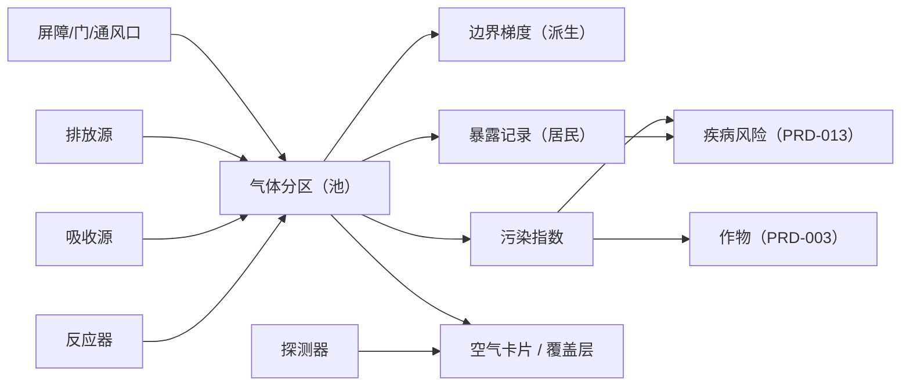
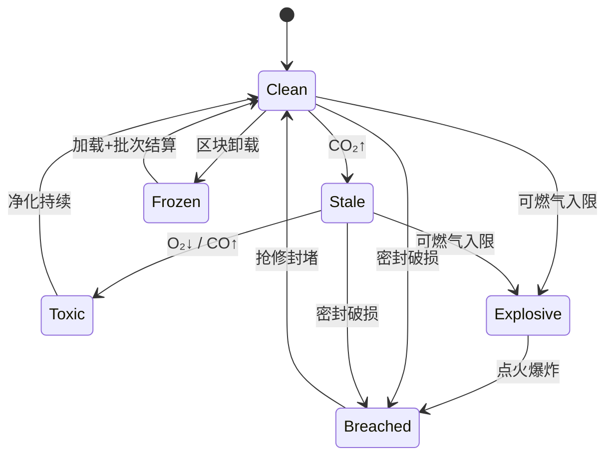
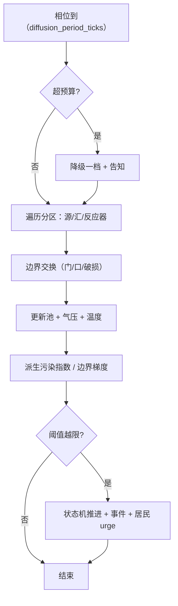

# PRD-014 · 气体、污染与资源循环

```
状态：草稿PRD
负责人：设计 agent
最后更新：2026-10-18
优先级：P1        里程碑：M3（只预埋接口） | M4（完整实现）
上游依据：[d13 气体、污染与资源循环](../design/13-gases-pollution-and-cycles.md)（唯一设计来源，ADR-016）
关联文档：[PRD-003](PRD-003-season-temperature-thirst-nutrition.md)（温度场消费方）、[PRD-006](PRD-006-stock-rules-and-diagnosis.md)（诊断 D-20..D-23）、
         [PRD-011](PRD-011-progression-knowledge-and-space.md) §9.6（空间站离屏批次）、[PRD-001](PRD-001-needs-mood-memory.md)（如厕=废物输入源）、
         [PRD-013](PRD-013-medical-and-surgery.md)（中毒/烫伤的病理消费方）、[PRD-015](PRD-015-captivity-and-prisoners.md)（牢房密闭空间）、
         [PRD-012](PRD-012-multiplayer-and-permissions.md)（权限与防作弊）、[d15](../design/15-power-and-mechanical-residents.md)（燃烧发电的排放接口）、
         [pack/02](../pack/02-config-and-datapack.md)（7 个气体货架）、[d14](../design/14-saves-backups-and-migration.md)（不可逆动作落盘纪律）
基底依赖：`Cadence`（结算相位）、`Colony.submit`（居民工作）、`Urge`（通风/戴面具冲动）、`RefusalKind.Named`（拒绝理由）、
         `Line`/`Sentence`/`Notice`（诊断文案）、`Shelves`（L2 扩展 7 个货架）、覆盖层渲染接口、`SavedData`（分区池持久化）
```

> [d13](../design/13-gases-pollution-and-cycles.md) 是**设计纲要**（模型、闭环、连锁链、预算都已定）；本文是**可验收的落地规格**。
> 凡与 d13 冲突，以 d13 为准并回改本文；凡 d13 未定的，本文给定并标注"规格级裁决"。

---

## 0. 一句话

> 你建的每一个炉子、每一间密闭厂房、每一条烟囱，都会**改变它们呼吸的那口空气**——而清理它的是你的居民，不是你。

---

## 1. 概述

玩家在**工业时代**第一次把炉子搬进室内时遇到这个系统：烟开始堆积，居民开始咳嗽，作物在烟囱下风向减产。它解决的是 d04 与 d08 都点出的那个体验缺口——**工业化的代价不能只写在数值里，必须写在空气里**。

对应支柱：**P3（世界会反抗）**——污染不是"减益光环"，而是有来源、有流向、有前兆、有延迟的世界状态；以及 **P4（进程）**——治理空气需要知识（洗涤/电解/藻池）与设施。

它产生的新决策（没有新决策就不该立项）：

| 决策 | 为什么是新决策 |
| --- | --- |
| **厂房建在哪、烟囱朝哪、高几格** | 排放按方向落到下风向分区，菜地/畜栏/居住区的相对方位从此有代价（R-GAS-13） |
| **密闭还是通风** | 密闭省热、省燃料，但 CO₂/CO 会攒；通风安全，但冬天掉温（§6.2 与 [PRD-003](PRD-003-season-temperature-thirst-nutrition.md) 的耦合） |
| **治理投在哪一环** | 源头（换燃料/加过滤）、路径（烟囱/风机）、末端（洗涤/填埋）三条路成本与产出不同（§9.7） |
| **要不要为空气付人力** | 换滤芯、清灰、抢修、戴面具都是**居民的工时**，与生产抢同一份出行预算（R-GAS-19） |
| **出事时先救谁** | 撤离半径、停机顺序、放弃哪个分区——这是 A-max 的核心体验（[PRD-005](PRD-005-intent-and-micro-control.md)） |

**玩家能做的**：规划与建造（烟囱/风机/气闸/藻池/洗涤器）、下达**让居民去执行**的指令（抢修/撤离/受控排放）、读仪器与诊断。
**玩家不能做的**：手动吹散气体、直接改分区成分（R-GAS-18）。

---

## 2. 设计目标与非目标

### 2.1 目标（Goals）

| 编号 | 目标 | 可判定信号 |
| --- | --- | --- |
| G1 | 空气是**有质量的资源** | 密封房间在不维护的情况下会在可测时长内劣化；恢复可呼吸需要建造或人力 |
| G2 | 污染**从真实设施冒出来** | 至少 4 类挂点（排放源/吸收源/反应器/屏障）可由数据包声明；炉/烟囱/发电机的排放改变所在与下风向分区（§9.5） |
| G3 | **连锁故障可复现** | d13 §6 的 C1–C8 每条都有触发夹具，且在无玩家干预下能走完全链（§17） |
| G4 | **闭环可建成** | 4 条闭环（水电解/藻池/废物/烟洗涤）各有"可建成/可稳态/可被破坏/可被诊断"四条验收（§9.7） |
| G5 | 一切由**居民执行** | 通风、堵漏、灭火、戴面具、换滤芯、撤离全部是工作或 `Urge`；无任何"玩家点一下气体消失"的路径（§6.3） |
| G6 | 性能与存档可控 | 常态 ≤2% / 峰值 ≤5%；存档体积随**分区数**增长，不随方块数增长（§13） |
| G7 | **温度场只有一套** | [PRD-003](PRD-003-season-temperature-thirst-nutrition.md) 的温度查询改为消费本层门面；本层不新建第二套温度语义（§14.2） |

### 2.2 非目标（Non-Goals，本次不做）

| 编号 | 不做的事 | 理由 | 何时可能做 |
| --- | --- | --- | --- |
| N1 | 逐格气体仿真 | 性能/同步/存档三项不可接受（d13 §2.1） | 不做（架构级否决） |
| N2 | 第二个温度系统 | ADR-016 | 不做 |
| N3 | 采用 `Pollution of the Realms` | CC-BY-ND + 实测性能差（用户裁决） | 不做 |
| N4 | 打包外部污染 mod 作为必需依赖 | ADR-010（桥接必须可整套删除） | 桥接在 M4 后按需 |
| N5 | 把"空气差/缺氧"做成**需求** | ADR-009：需求是数据驱动核心集 + 变体；气体只经既有接口施加影响（d13 §3.7） | 不做 |
| N6 | "进屋即死"的魔法死亡 | 必须有前兆与可读死因（P3） | 不做 |
| N7 | 跨维度的全球大气 | 分区只存在于已加载/被追踪空间 | 不做（远方走离屏批次账本） |
| N8 | 氮/惰性气体、放射性气体等**新物理机制** | 增加复杂度却不产生新决策 | 数据包扩展点保留（§15） |
| N9 | M3 阶段实现任何气体结算 | 里程碑裁决（§2.3） | M4 |

> 非目标清单不为空；N1/N2/N5 是**架构级**否决，评审时不得"顺手实现"。

### 2.3 里程碑切分（继承 d13 §1.3，原样落地）

| 里程碑 | 交付 | 明确不做 |
| --- | --- | --- |
| **M3（接口预埋）** | ① **7 个货架**注册与 `/reload` 自检（解析失败要能被诊断列出）；② **只读污染指数查询** `PollutionIndex.at(pos)`（M3 允许返回常量或区域属性值）；③ **温度门面** `TemperatureFacade`（PRD-003 通过它取温度，M3 仍可用其过渡实现）；④ **三个 spike 在 M3 末尾执行**（§17.3） | 池结算、梯度、反应器、爆炸、中毒、闭环产线、覆盖层 |
| **M4（完整实现）** | 分区池 + 边界梯度、7 种气体、4 类挂点运行时、4 条闭环、8 条连锁链、居民行为、覆盖层与仪器、空间站复用、探针与降级阶梯 | —— |

**R-ATM-1（继承 [R-GAS-29](../design/13-gases-pollution-and-cycles.md)）**：M3 期间**不得**出现"半套气体层"；预埋接口在 `gas_layer_enabled=false` 下必须**返回中性值且不崩**。
**R-ATM-2（继承 [R-GAS-30](../design/13-gases-pollution-and-cycles.md)）**：M4 实施时**不得**要求 M3 内容返工；若必须返工，先改 [d13](../design/13-gases-pollution-and-cycles.md) 与 [ADR-016](../00-charter.md)，再动代码。

---

## 3. 术语

### 3.1 本系统局部术语

| 术语（英文） | 中文 | 说明 | 与全局术语的关系 |
| --- | --- | --- | --- |
| `GasRegion` | 气体分区 | 一个空气连通域；池的载体 | 全局 `gas_region`（[d03](../design/03-glossary.md)）的实例 |
| `pool[gas]` | 池量 | 分区内某气体的抽象物质量 | 全局 `gas` |
| `gradient` | 边界梯度 | 分区边界上的格级派生浓度（不存档） | 全局 `gas_gradient` |
| `seal` | 密封度 | 0–1，屏障维持分区的能力 | 新增（全局 `gas_barrier`） |
| `airlock` | 气闸 | 两级缓冲，逐级放气 | 新增 |
| `vent` | 通风口 | 定向交换构件（被动/动力） | 全局 `gas_vent` |
| `source / sink / reactor` | 排放源 / 吸收源 / 反应器 | 三类挂点契约 | 全局 `gas_source`/`gas_sink`/`gas_reactor` |
| `pressure` | **气压**（不叫"压力"） | `Σ pool / volume`，仅用于过压与交换判定 | 见 §3.2 冲突 3 |
| `dose` | 暴露剂量 | 居民在某气体下的累积暴露量（ppm·h 抽象） | [PRD-013](PRD-013-medical-and-surgery.md) 的病理输入 |
| `pollution index` | 污染指数 | 0–1 的分区/坐标派生指标，作物与疾病读它 | 全局 `pollution` |
| `purge` | 受控排放 | 把某分区气体排到指定去向的**居民指令** | 新增 |
| `batch` | 离屏批次 | 未加载分区的聚合结算粒度 | [PRD-011](PRD-011-progression-knowledge-and-space.md) `abstraction_batch` |

### 3.2 与既有术语的冲突检查

| 冲突项 | Folkways / 既有文档含义 | 本系统含义 | 解决方式 |
| --- | --- | --- | --- |
| 「污染」 | [d04](../design/04-world-and-simulation.md) §5 的生态层把污染列为**环境指标**，[d09](../design/09-interaction-and-ui.md) 生态覆盖层也画它 | 本文的污染是**气体层产出的派生指标**（`pollution index`），生态层只**读**它 | 单一来源：生态层不再自算污染，改为读本层（§15） |
| 「压力」 | 支柱 P3 与 d07 用「压力」表示**威胁/生存压迫** | 气体物理量 | 本系统一律用 **「气压」**，禁用裸「压力」表示气体 |
| 「剂量」 | [PRD-013](PRD-013-medical-and-surgery.md) 用「剂量」表示**药品用量** | 暴露累积量 | 本系统一律写 **「暴露剂量」** |
| 「通风」 | 基底只有方块开关，无通风概念 | 新增 `gas_vent` 与风机 | 新增术语，须登记 [d03](../design/03-glossary.md)（已登记） |

---

## 4. 概念模型

### 4.1 实体

| 实体 | 中文 | 说明 | 生命周期 | 玩家可见 |
| --- | --- | --- | --- | --- |
| `GasRegion` | 气体分区 | 连通域 + 池 + 体积 + 密封状态 | 方块变化事件驱动重建 | 覆盖层色块 + 点选卡片 |
| `GasBoundary` | 分区边界 | 两分区之间的可交换面（门/口/破损） | 随分区重建 | 覆盖层渐变 |
| `GasSource` | 排放源 | 按速率注入（含**方向与高度**） | 随建筑存在 | 建筑提示 + 探测器读数 |
| `GasSink` | 吸收源 | 按速率抽取（含耗材与副产物） | 随建筑存在 | 面板显示效率与剩余耗材 |
| `GasReactor` | 反应器 | 气体间转化（可放热/吸热） | 随建筑存在 | 面板 + 排放 |
| `GasBarrier` | 屏障 | 定义密封与交换 | 随方块存在 | 密封度在卡片里可见 |
| `GasVent` | 通风口 | 定向交换（可关） | 随建筑存在 | 开关状态 + 流向箭头 |
| `Detector` | 探测器 | 揭示 CO/可燃气，越限报警 | 随建筑存在，耗电 | 灯色 + 报警事件 |
| `Exposure` | 暴露记录 | 每居民每气体的暴露剂量与症状阶段 | 随居民 | 症状图标 + 居民页 |
| `AirCard` | 空气卡片 | 一个分区的只读视图（成分/来源/去向/趋势/建议） | 运行期派生 | 点选即开 |

### 4.2 实体之间的关系



**R-ATM-3**：池是**唯一权威**；梯度、卡片、污染指数、暴露记录全部由池派生，删除派生数据不得丢失世界状态。

---

## 5. 状态机

本系统有**三个并行状态机**：分区空气（5.1–5.5 主表）、事故（火灾/爆炸/泄漏）、居民暴露。三者通过事件耦合，但状态互不覆盖。

### 5.1 状态定义

| 状态 | 中文 | 说明 |
| --- | --- | --- |
| `Clean` | 洁净 | 全部气体在安全阈值内 |
| `Stale` | 浑浊 | CO₂ 越过第一折点（默认 1.5%）或污染指数 >0.3 |
| `Toxic` | 有毒 | CO 暴露剂量开始累积，或 O₂ <17%，或烟浓度越限 |
| `Explosive` | 可爆 | 可燃气在爆炸极限内（默认 5%–15%）且存在点火源可达性 |
| `Breached` | 失压 | 密封度 <0.6 且气压差显著（快速泄漏中） |
| `Frozen` | 冻结 | 分区所在区块未加载，进入离屏批次（不再逐次结算） |

### 5.2 事件定义

| 事件 | 中文 | 说明 | 触发方 |
| --- | --- | --- | --- |
| E1: `blockChanged` | 方块变化 | 墙/门/窗/管道增删 → 分区脏 | 世界 |
| E2: `doorToggled` | 门开合 | 改变边界交换率 | 居民/玩家 |
| E3: `ventToggled` | 通风口开合 | 改变定向交换 | 玩家（L3）/规则 |
| E4: `sourceActive` | 排放源工作 | 炉/发电机运行时注入 | 世界 |
| E5: `sinkStarved` | 吸收源失效 | 滤芯耗尽/断电/无水 | 系统 |
| E6: `reactorTick` | 反应器结算 | 按 `reaction_period_ticks` | 系统 |
| E7: `ignition` | 点火 | 火源进入可爆分区 | 世界/居民/玩家（服务端复核） |
| E8: `explosion` | 爆炸 | 判定通过后触发破坏 | 系统 |
| E9: `doseThreshold` | 暴露越限 | 居民暴露剂量达到症状阈值 | 系统 |
| E10: `purgeOrdered` | 受控排放 | 玩家下指令，居民执行 | 玩家 → 居民 |
| E11: `regionFrozen` | 分区冻结 | 区块卸载 | 世界 |
| E12: `regionThawed` | 分区解冻 | 区块加载，按批次结算后回归 | 世界 |

### 5.3 扩展变量（系统状态）

| 变量 | 中文 | 类型 | 默认值 | 取值范围/单位 | 说明 |
| --- | --- | --- | --- | --- | --- |
| `pool[gas]` | 池量 | double[7] | 0 | ≥0（抽象单位） | 权威数据 |
| `volume` | 分区体积 | int | — | ≥1 格 | 由连通域计算 |
| `pressure` | 气压 | double | — | 0–10×额定 | 派生 |
| `seal` | 密封度 | double | 1.0 | 0–1 | 屏障加权 |
| `pollution` | 污染指数 | double | 0 | 0–1 | 派生（含沉降） |
| `temperature` | 分区温度 | double | 由 PRD-003 季节曲线定 | −40–120 ℃ | **本层权威**，PRD-003 消费 |
| `openings` | 开口集合 | set | 空 | — | 门/口/破损 |
| `reactors` | 反应器状态 | list | 空 | — | 输入/输出/条件 |
| `maskState` | 面具状态 | enum | `None` | None/Worn/Spent | 每居民 |

### 5.4 守卫条件依赖

| 变量 | 中文 | 类型 | 来源 |
| --- | --- | --- | --- |
| `gas_layer_enabled` | 气体层总开关 | bool | serverconfig |
| `region_budget_micros` | 单次结算预算 | int | serverconfig |
| `diffusion_period_ticks` | 扩散相位 | int | serverconfig |
| `o2_hypoxia_mild/severe` | 缺氧阈值 | double | serverconfig |
| `lel_lower/upper` | 爆炸极限 | double | serverconfig |
| `mask_filter_capacity` | 面具容量 | int | `gas_kind`/物品数据 |

### 5.5 状态转移表

| 源状态 | 事件 | 守卫条件 | 动作 | 任务/副作用 | 目标状态 |
| --- | --- | --- | --- | --- | --- |
| `Clean` | 结算后 CO₂ ≥1.5% | — | 触发"头晕"记忆候选 | [PRD-001](PRD-001-needs-mood-memory.md) 情绪输入 | `Stale` |
| `Stale` | 结算后 CO₂ ≥3% | — | 效率惩罚生效（`MOVEMENT_SPEED`/工作速率） | 见 §9.5 折线 | `Stale`（加重） |
| `Stale` | O₂ <17% 或 CO 剂量累加 | — | 生成 `OXYGEN`/`MASK` urge | §7 居民行为 | `Toxic` |
| `Toxic` | 剂量达症状阈值 | — | 症状出现、就医意愿 | [PRD-013](PRD-013-medical-and-surgery.md) 病理 | `Toxic`（加重） |
| `Toxic` | 净化后全部回到阈值内 | 连续 ≥`recover_ticks` | 症状消退 | — | `Clean` |
| `Clean`/`Stale`/`Toxic` | 可燃气进入 LEL..UEL 且有点火源 | 探测器/仪器揭示 | 报警事件 | [PRD-002](PRD-002-incidents-and-narrator.md) | `Explosive` |
| `Explosive` | E7 点火 | — | 判定爆炸强度 → `explosion` | 破坏方块、可能伤亡 | `Breached` |
| `Explosive` | 通风后离开 LEL..UEL | — | 解除报警 | — | 原状态 |
| 任意 | `seal` <0.6 且气压差 >0.5 | — | 按 `leak_rate` 泄漏 | 分区合并或失压 | `Breached` |
| `Breached` | 修复/封堵 | `seal` ≥0.6 | 停止泄漏 | 居民抢修工作 | `Clean`/`Stale` |
| 任意 | 区块卸载 | — | 冻结并写快照 | 离屏批次 | `Frozen` |
| `Frozen` | 区块加载 | 批次结算完成 | 应用批次结果 | — | 按结算结果 |

### 5.6 状态图



### 5.7 超时与中断

| 情形 | 处理 | 恢复后行为 |
| --- | --- | --- |
| 玩家离开/断线 | 分区继续按服务端结算；其个人下达的 `purge` 保持有效（需权限复核） | 重连后收到当前快照 |
| 目标消失（建筑被拆/源被毁） | 该挂点从注册表移除；池量**保留**（气体不会凭空消失） | 下一相位自然扩散 |
| 居民死亡/失能 | 暴露记录随实体移除，写入编年史（死因=中毒/窒息/烧伤） | — |
| 区块卸载 | `Frozen` + 快照 + 离屏批次（与 [PRD-011 §9.6](PRD-011-progression-knowledge-and-space.md) 同一机制） | 加载后先结算批次再回归状态机 |
| 崩溃/回档 | 不可逆动作（点火/purge/爆炸）必须**先落盘再结算**（[R-GAS-26](../design/13-gases-pollution-and-cycles.md)） | 不出现"爆炸回滚"或"爆炸双发" |
| 降级触发 | 按 §13.4 阶梯降级并**告知** | 降级不改已发生状态（R-GAS-24） |

---

## 6. 交互

### 6.1 入口与快捷键

| 操作 | 按键/手势 | 前置条件 | 结果 |
| --- | --- | --- | --- |
| 打开/关闭气体覆盖层 | 覆盖层热键（沿用 [d09](../design/09-interaction-and-ui.md) §5 的覆盖层轮换） | 无 | 显示分区色块 + 边界渐变 |
| 点选分区 | 左键点方块 | 覆盖层开启 | 打开 `AirCard`（成分/来源/去向/24h 趋势/建议动作） |
| 查看探测器读数 | 右键探测器 | 无 | 面板：读数、越限历史、电池/电耗 |
| 开合通风口 | 右键通风口（沿用基底开关语义） | L3 权限 | 切换，进事件日志 |
| 下发受控排放 `purge` | 空气卡片上的动作按钮 | L3 权限 + 指定去向 | 生成居民任务，**不即时生效** |
| 划定撤离区 | 沿用 [PRD-005](PRD-005-intent-and-micro-control.md) 的禁限区 | L2 权限 | 居民在触发时按此撤离 |
| 查看空气账 | 殖民书 → 环境页 | 无 | 每条闭环的净收支（§9.7） |

> 沿用基底持握/潜行/滚轮语义时**不重新发明**：覆盖层轮换、右键开关、卡片动作都走既有 UI 框架（`Board.Act` 五种动词）。

### 6.2 操作模式状态机

本系统**没有专属操作模式**（不新增"气体编辑模式"）：所有交互都在既有的覆盖层与建筑面板里完成。下表只记权限门与不可逆确认（模板要求的其余子表在本系统**不适用**）。

| 状态 | 事件 | 守卫条件 | 目标状态 | 动作 |
| --- | --- | --- | --- | --- |
| `Viewing`（覆盖层只读） | 点选分区 | 无 | `Inspecting` | 打开空气卡片 |
| `Inspecting`（卡片/探测器面板） | 点 `purge` | 权限 ≥L3 且去向已选 | `Ordering` | 显示代价预览（工时/去向风险） |
| `Ordering`（配置指令） | 确认 | 服务端复核权限 | `Inspecting` | 生成居民任务（**不即时生效**） |
| `Ordering` | 取消 | — | `Inspecting` | 无副作用 |

### 6.3 右键菜单 / 面板动作

| 上下文 | 按钮 | 操作 | 触发事件 | 是否可撤销 |
| --- | --- | --- | --- | --- |
| 空气卡片 | 「为什么浑浊」 | 打开诊断（D-20..D-23） | `BlockerView` | 是（只读） |
| 空气卡片 | 「谁在这里」 | 列出所在居民与暴露剂量 | 只读 | 是 |
| 空气卡片 | 「受控排放…」 | 选去向（野外/水中/指定分区） | E10 | **否**（不可逆，需二次确认） |
| 空气卡片 | 「隔离此分区」 | 关闭所有通风口并把门设为常闭 | 批量开关 | 是（可再开） |
| 通风口 | 「开/关」 | 切换 | E3 | 是 |
| 通风口 | 「反向」 | 反向送风（若为动力型） | E3 | 是 |
| 洗涤器/藻池 | 「加耗材」 | 生成补充任务 | 工作 | 是（可取消） |
| 探测器 | 「测试报警」 | 播放报警自检（不写状态） | — | 是 |
| 烟囱 | 「朝向/高度」 | 设置排放方向与高度 | 建筑配置 | 是 |

> **R-ATM-4**：**没有任何按钮能让气体直接消失**。`purge` 是"让居民去排"，需要走到、需要时间、需要去向（R-GAS-18）。

### 6.4 命令

| 命令 | 权限 | 说明 | 输出 |
| --- | --- | --- | --- |
| `/plaa air status` | L2 | 打印本维度分区数、异常分区 | 文本列表（含分区 id/状态/主成分） |
| `/plaa air card <x> <y> <z>` | L2 | 打印该坐标所在分区的空气卡片 | 与 UI 同源文本 |
| `/plaa air leaks` | L3 | 列出 `seal`<0.6 的分区 | 列表 + 坐标 |
| `/plaa air probe` | L4 | 打印探针（分区数/单次耗时/重建次数/存档字节） | 文本 |
| `/plaa air purge <x> <y> <z> <sink>` | L3 | 等价于卡片上的受控排放 | 任务 id |
| `/plaa air set <x> <y> <z> <gas> <amount>` | **L5** | 调试用，直接改池量 | 改动前后值（写入 `rule_used`） |
| `/plaa air disable` | L4 | 关闭气体层（等价 `gas_layer_enabled=false`），**必须广播** | 全服提示 |

---

## 7. 反馈

### 7.1 操作模式反馈（玩家交互时）

| 检查条件 | 音效 | Toast/文案键 | 视觉反馈 | 系统行为 |
| --- | --- | --- | --- | --- |
| 覆盖层开启 | 轻"呼"声 | `plaa.air.overlay.on` | 分区色块 + 边界渐变 | 只读 |
| 点选分区 | 点击 | — | 卡片滑入 | 只读 |
| 下发 `purge` | 确认音 | `plaa.air.purge.ordered` | 卡片显示"待执行：居民 X" | 生成任务 |
| `purge` 无可执行居民 | 低鸣 | `plaa.air.purge.no_worker`（带原因：无空闲/无权限/去路被封） | 卡片拒绝条 | 不生成任务 |
| 通风口切换 | 机械"咔" | `plaa.air.vent.open/close` | 流向箭头翻转 | 改交换率 |
| 权限不足 | 拒绝音 | `plaa.air.denied`（指名所需级别） | 按钮置灰 + 原因 | 拒绝 |

### 7.2 实体状态反馈（持续显示）

| 检查条件 | 图标/颜色 | 悬停信息 | 系统行为 |
| --- | --- | --- | --- |
| 分区 `Stale` | 灰 | "CO₂ 1.8%，主要来源：炉 ×2" | 效率轻微下降 |
| 分区 `Toxic` | 暗红/黄 | 具体气体、浓度、来源、暴露人数 | 生成 urge |
| 分区 `Explosive` | 黄闪 | "可燃气 7%，点火源：窑" | 报警事件 |
| 分区 `Breached` | 白闪 | "密封 0.4，泄漏中" | 泄漏结算 |
| 居民暴露中 | 头顶咳嗽/眩晕图标 | "CO 剂量 62/100（2 小时前开始）" | 病理推进 |
| 居民戴面具 | 面具图标 + 剩余时长 | "滤芯 3.2/8 小时" | 耗材衰减 |
| 探测器 | 绿灯/黄灯/红灯 | 读数 + 越限时间 | 报警 |
| 仪器未装 | 覆盖层**不显示** CO/可燃气 | "需要探测器" | 信息缺失（R-GAS-7） |

### 7.3 系统事件反馈（非玩家触发）

| 事件 | 音效 | 通知文案键 | 视觉 | 系统行为 |
| --- | --- | --- | --- | --- |
| CO₂ 越过折点 | 低鸣 | `plaa.air.event.co2_stale` | 分区变灰、居民"头晕" | 效率下降 |
| 缺氧 | 警报 | `plaa.air.event.hypoxia` | 分区变蓝灰、居民喘息 | urge 撤离/戴面具 |
| CO 中毒 | 警报 | `plaa.air.event.co_poison` | 症状图标 | 病理推进 |
| 可燃气报警 | 间歇警报 | `plaa.air.event.flammable` | 黄闪 + 探测器红 | 撤离预案 |
| 爆炸 | 爆响 | `plaa.air.event.explosion` | 屏幕震动 + 破坏 | 破坏/伤亡/档案 |
| 密封破损 | 嘶声 | `plaa.air.event.breach` | 白闪 + 泄漏粒子 | 快速泄漏 |
| 滤芯耗尽 | 轻"嗒" | `plaa.air.event.filter_spent` | 设备面板告警 | 效率归零 |
| 降级发生 | — | `plaa.air.event.degraded`（含档位） | 全服提示（R-PB-5 纪律） | 降频 |

### 7.4 可诊断性（管理者的要求）

| 玩家可能的疑问 | 系统必须能回答 | 呈现位置 |
| --- | --- | --- |
| 「为什么这里空气差？」 | 分区状态 + 三种主成分 + **前 3 个来源（带坐标）** + 最近 24 小时趋势 | 空气卡片 + 诊断卡 |
| 「为什么通风没开？」 | **D-20 通风不足**：缺通风口/通风口被关/风机断电/分区过大 | 诊断卡「为什么」+ 建议动作 |
| 「他为什么死了？」 | 暴露剂量曲线 + 症状阶段 + 当时所在分区 + 最近一次告警 | 居民页死因 + 编年史 |
| 「为什么作物减产？」 | 污染指数 + 上风向来源 + 沉降量 | 农田卡片 + 诊断 |
| 「为什么滤芯没换？」 | **D-23 滤芯耗尽**：缺耗材/无搬运/无人有该工种 | 诊断卡 |
| 「为什么烟回到屋里了？」 | 风向 + 烟囱朝向/高度 + 逆温事件 | 空气卡片 + 事件页 |
| 「为什么机器不转？」 | **D-28 无电可用**（接 [d15](../design/15-power-and-mechanical-residents.md)/[PRD-006](PRD-006-stock-rules-and-diagnosis.md)） | 诊断卡 |

**R-ATM-5**：空气卡片与诊断卡**必须同源**（同一份查询结果渲染），禁止"卡片说 A、诊断说 B"。
**R-ATM-6**：所有阻塞必须落到 [PRD-006](PRD-006-stock-rules-and-diagnosis.md) 的 **D-20 通风不足 / D-21 缺氧 / D-22 中毒被困 / D-23 滤芯耗尽**四个具名类别，不得自造第五个类别。

---

## 8. 规则

> 设计级约束见 [d13 R-GAS-1..30](../design/13-gases-pollution-and-cycles.md)（本文不重复）。下表是**落地规格级**规则，编号 `R-ATM-*`，与 `R-GAS-*` 并存且不得冲突。

| 编号 | 类型 | 规则 | 违反时的行为 |
| --- | --- | --- | --- |
| R-ATM-1 | 必须 | M3 只做接口预埋，接口必须可缺失并返回中性值 | CI 检查 `gas_layer_enabled=false` 不崩 |
| R-ATM-2 | 必须 | M4 不得要求 M3 返工；必须返工则先改 d13/ADR | 评审驳回 |
| R-ATM-3 | 必须 | 池是唯一权威，派生数据可丢可重建 | 单测：删缓存后状态一致 |
| R-ATM-4 | 禁止 | 任何让气体直接消失的玩家按钮 | UI 评审阻断 |
| R-ATM-5 | 必须 | 空气卡片与诊断卡同源渲染 | 视觉/文案一致性测试 |
| R-ATM-6 | 必须 | 阻塞只用 D-20..D-23 四个类别 | 覆盖率门禁 |
| R-ATM-7 | 必须 | 结算只遍历分区与边界层，禁止遍历方块/格 | 探针断言 |
| R-ATM-8 | 必须 | 单次结算 ≤ `region_budget_micros`，超限降级并告知 | 探针 + 告知断言 |
| R-ATM-9 | 必须 | 温度只有一个数据源（本层）；PRD-003 只读门面 | 双写检测（两处温度差 >ε 即报错） |
| R-ATM-10 | 禁止 | 气体不得成为第 8 条需求 | 需求注册表断言 |
| R-ATM-11 | 必须 | CO/可燃气默认不可见，需探测器或症状 | 覆盖层断言（未装仪器时不渲染色块） |
| R-ATM-12 | 必须 | 爆炸/点火/purge 不可逆动作先落盘再结算 | 崩溃注入测试 |
| R-ATM-13 | 必须 | 降级只降频，不改已发生状态 | 降级前后世界状态对比 |
| R-ATM-14 | 级联 | 爆炸 → 破坏方块 → 分区重建 → 泄漏 → 状态机推进 | 集成测试 |
| R-ATM-15 | 级联 | 吸收源失效 → 效率归零 → 分区劣化 → 居民 urge | 集成测试 |
| R-ATM-16 | 优先级 | 生命维持 > 医疗 > 工业 > 舒适（供氧/通风优先保人） | 调度测试 |
| R-ATM-17 | 必须 | 居民行为共享出行预算（`travelCeilingMicros`） | 打包测试（不发散） |
| R-ATM-18 | 必须 | 服务端权威；客户端只做预测与显示 | 多人测试（伪造快照被拒） |
| R-ATM-19 | 禁止 | 外部 mod 的"空气效果"不得与本层双写；冲突时禁用其效果 | 兼容测试 |
| R-ATM-20 | 必须 | 新增气体种类只靠数据包；新物理机制须登记 L2 | 货架自检 |
| R-ATM-21 | 必须 | 未加载分区按批次结算，且账本对玩家可见 | 太空页/环境页断言 |
| R-ATM-22 | 必须 | 污染指数单一来源；生态层只读 | 覆盖层一致性 |
| R-ATM-23 | 必须 | 所有玩家可见文案双语 | i18n 检查 |
| R-ATM-24 | 必须 | 仪器读数与模拟值同源（不许"仪器显示安全、实为致死"） | 一致性测试 |

> 规则族共 **35 条**：上表为 R-ATM-1..24 的总表；**R-ATM-25..35 就近定义**在各自语义所属的章节——§9.5（公式同源）、§9.6（默认温和）、§9.7（闭环净收支可查）、§10（卸载不清理存档）、§11（不可逆动作写 `rule_used`）、§13.3（预算可答）、§14.1（不引入 L3/L4）、§14.2（回改未完成前不得双写温度）、§15（新气体只靠数据包）、§17.2（每条链要有无干预夹具）、§17.3（spike 未过不实现）。

---

## 9. 流程（与基底引擎对齐）

### 9.1 工作类型与任务

| 项 | 内容 |
| --- | --- |
| 工作类型（Vocation/Trade） | 复用既有工种：**维护**（堵漏/换滤芯/清灰）、**搬运**（耗材/副产物）、**消防**（与 [PRD-004](PRD-004-threats-and-defence.md) 民兵/警戒共用调度）；**不新增工种** |
| 任务（Task/Doing） | `GasSeal`（封堵）、`GasVentOrder`（开关通风口）、`GasPurge`（受控排放）、`GasFilterSwap`（换滤芯）、`GasHaul`（清运副产物）、`FireFight`（灭火） |
| 参与的居民种类 | 生物居民与机械族（机械族不需要面具但需要防爆/耐热，见 [d15](../design/15-power-and-mechanical-residents.md)） |
| 需要的工具/许可（Tool/Licence） | 面具（消耗品）、滤芯（耗材）、封堵材料、灭火工具；`purge` 需 L3 权限下达 |

### 9.2 执行流程



### 9.3 Action 说明

| Action | 说明 | 失败/拒绝理由（Refusal） |
| --- | --- | --- |
| `seal_breach` | 到破损处用材料封堵 | `NoMaterial` / `NoPath` / `RegionUnsafe`（有毒且无面具） |
| `toggle_vent` | 走到通风口并切换 | `NoPath` / `Forbidden`（禁限区） / `Occupied` |
| `purge` | 走到排放口，开启受控排放 | `NoPermission`（L3）/ `NoSink`（去向无效）/ `Unsafe`（途中危险）/ `NoWorker` |
| `swap_filter` | 换滤芯 | `NoFilter`（缺耗材）/ `NoPath` |
| `fight_fire` | 灭火 | `NoTool` / `TooHot` / `RegionUnsafe` |
| `wear_mask` | 戴面具 | `NoMask` / `MaskSpent` |
| `evacuate` | 按撤离区撤离 | `NoRoute` / `Blocked` |

> 全部拒绝理由实现 `RefusalKind.Named`（`RefusalKind.java:5,20` 是接口 + `Named`，新增种类**无需改上游**）。

### 9.4 生成与分配条件

| 侧 | 条件 | 说明 |
| --- | --- | --- |
| 任务侧 | 分区状态越限 / 设备耗材耗尽 / 玩家下指令 | 只在**相位结算**后生成，不逐 tick |
| 居民侧 | 有能力（会维护/消防）、有工具、未被更高优先级占用 | 与 [PRD-001](PRD-001-needs-mood-memory.md) 专注度/优先级联动 |
| 资源侧 | 材料/耗材/去向可用 | 缺料走 [PRD-006](PRD-006-stock-rules-and-diagnosis.md) 的 Shortfall |

### 9.5 计算逻辑

| 计算项 | 公式 | 变量说明 | 取值范围 |
| --- | --- | --- | --- |
| 气压 | `P = Σ pool[gas] / volume` | 池量/体积 | 0–10×额定 |
| 边界交换 | `Δ = k_exchange × boundaryArea × (P_a − P_b) × Δt` | `k_exchange` 由门/口/密封决定 | Δ 可正可负 |
| 泄漏 | `leak = leak_rate × (1 − seal) × breachArea × ΔP` | `seal` 0–1 | ≥0 |
| 缺氧强度 | `deficit = clamp((o2_mild − o2)/ (o2_mild − o2_severe), 0, 1)` | 默认 17%/12% | 0–1 |
| CO₂ 效率折线 | `eff = 1 − [0.05·f(1.5%) + 0.15·f(3%) + 0.25·f(5%)]`，`f` 为分段 ramp | `co2_efficiency_knee` | eff ≥0.55 |
| CO 暴露 | `dose += ppm × Δt_hours / co_poison_dose_per_hour` | 默认 100 ppm·h | 0–∞ |
| 爆炸判定 | `LEL ≤ frac ≤ UEL && ignitionReachable` → `damage = f(pool, volume, 距离)` | `lel_lower/upper` 5–15% | 半径上限 `explosion_radius_cap` |
| 污染指数 | `pollution ← clamp(pollution + emitted·k − decay·Δt, 0, 1)` | `pollution_decay_per_day` | 0–1 |
| 作物减产 | `yield × (1 + pollution_crop_penalty × pollution)` | 默认 −15%/满污染 | ≥0.4× |
| 吸附效率 | `eff = clamp(filterRemaining / capacity, 0, 1)` | 面具/滤芯共用 | 0–1 |
| 离屏批次 | `pool(±)= batch_days × (sourceRate − sinkRate)` | 与 [PRD-011 `abstraction_batch`](PRD-011-progression-knowledge-and-space.md) 同一参数 | 6 小时–7 天 |

**R-ATM-25**：所有公式必须**同一份实现**被 UI/诊断/spike 复用（同源），禁止 UI 端另算一遍近似值。

### 9.6 数值配置

| 参数 | 默认值 | 范围 | 谁需要它 | 改了会怎样 | 数据包可改写 |
| --- | --- | --- | --- | --- | --- |
| `gas_layer_enabled` | true | — | 不想玩气体的存档 | 关掉后功能整体缺失且必须告知 | 否（serverconfig） |
| `region_cell_cap` | 512 | 64–4096 | 性能（大厂房 vs 细房间） | 越大越少分区、越不敏感 | 否 |
| `region_count_cap` | 2048 | 256–8192 | 性能上限 | 超限合并 + 降级告知 | 否 |
| `gradient_width` | 3 | 1–8 | 表现 vs 性能 | 边界渐变粗细、成本线性 | 否 |
| `diffusion_period_ticks` | 20 | 5–100 | 精度 vs 性能 | 越小气体变化越细腻、越贵 | 否 |
| `reaction_period_ticks` | 100 | 20–400 | 产线响应速度 | 越大越迟滞 | 否 |
| `diffusion_rate` | 0.05 | 0.01–0.5 | 气体"黏不黏" | 越大扩散越快、越难维持密闭 | 否 |
| `exchange_door_open` | 0.30 | 0.05–1.0 | 门开时的污染速度 | 越大门开即混匀 | 否 |
| `seal_breach_threshold` | 0.6 | 0.2–0.9 | 破损多严重开始漏 | 越高越容易漏 | 否 |
| `burst_pressure` | 3.0× | 1.5–8× | 过压破损宽容度 | 越低越易炸 | 否 |
| `o2_hypoxia_mild/severe` | 17%/12% | 10–20% | 缺氧体感 | 越宽松越不容易憋死 | 是（`gas_kind`） |
| `co2_efficiency_knee` | 1.5%/3%/5% | 0.5–10% | 效率惩罚折点 | 折点低 = 工业更早付出代价 | 是 |
| `co_poison_dose_per_hour` | 100 ppm·h | 20–1000 | 中毒节奏 | 越低越硬 | 是 |
| `lel_lower/upper` | 5%/15% | 3–20% | 爆炸窗口 | 窗口越窄越安全 | 是 |
| `pollution_crop_penalty` | −15% | 0–60% | 农业压力 | 越大越依赖上风向规划 | 是 |
| `pollution_disease_dose` | 剂量表 | — | 疾病风险 | 由 [PRD-013](PRD-013-medical-and-surgery.md) 消费 | 是 |
| `pollution_decay_per_day` | 0.05 | 0–0.3 | 治理成本 | 越大自愈越快、治理越不值 | 是 |
| `mask_filter_capacity` | 8 游戏小时 | 1–72 | 耗材压力 | 越久越省耗材 | 是（物品数据） |
| `region_budget_micros` | 800/tick | 200–4000 | 性能硬上限 | 越低成本越低但降级更频繁 | 否 |
| `explosion_radius_cap` | 6 格 | 0–12 | 破坏面 | 0 = 不破坏地形（若 OQ-4 定为否） | 否 |
| `station_batch_days` | 1 游戏日 | 6 小时–7 天 | 太空离屏精度 | 越大越省、越粗 | 否 |
| 微调项（`detector_power` / `purge_rate` / `recover_ticks` / `region_rebuild_hysteresis` / `breach_damage_per_second`） | 8 E/t / 4× / 2400 / 20 tick / 0.5 | 见 [d13 §8](../design/13-gases-pollution-and-cycles.md) | 手感与成本 | 分别影响仪器电耗、排放速度、症状恢复、重建频率、失压伤害 | 否（serverconfig） |

**R-ATM-26**：上表每一项必须有**具名开关**，默认值必须温和（缺省体验不是"第一晚被熏死"），与 [d13 R-GAS-20](../design/13-gases-pollution-and-cycles.md) 一致。

### 9.7 四条闭环的验收判据

| 闭环 | 可建成 | 可稳态运行 | 可被破坏 | 可被诊断 |
| --- | --- | --- | --- | --- |
| **水电解 → O₂+H₂ → 燃烧/发电 → 水** | 电解槽+储气+管道+冷凝器可全部用数据包图案建成 | 连续 3 游戏日 O₂ 稳定在阈值上、水净消耗 ≤ 补给 | 断电/缺水/冷凝器冻结 → O₂ 断供（C8） | 卡片/环境页显示"净亏什么"；D-21 缺氧、D-28 无电 |
| **CO₂ + 藻池 → O₂ + 生物质** | 藻池+灯+供热可建 | 冬天 3 日 CO₂ 不超阈值、生物质 ≥ 灯热消耗 | 温度过低 → 光合停止（C1） | 卡片显示光照/温度/CO₂ 收支 |
| **废物 → 堆肥/沼气 → 肥料+燃料** | 厕所/化粪池+堆肥池+沼气池+储气 | 7 日废物零堆积、肥料 ≥ 农田需求 | 沼气超压 → 爆炸（C4）；过湿 → 恶臭（C3） | D-20/D-23 + 填埋/堆积告警 |
| **烟 → 洗涤/过滤 → 洁净气 + 副产物** | 洗涤器+滤芯+填埋/建材链可建 | 3 日室内烟在阈值下、副产物无堆积 | 滤芯不换 → 效率归零（C2）；污水 → 污浊 | D-23 滤芯耗尽 + 副产物堆积诊断 |

**R-ATM-27**：每条闭环的"净收支"必须在**游戏内可查**（环境页一行），复用 [PRD-006](PRD-006-stock-rules-and-diagnosis.md) 的存量预测，禁止另做一套账。

---

## 10. 数据与存档

| 项 | 内容 |
| --- | --- |
| 新增持久化字段 | 每分区：`pool[7]`、`volume`、`seal`、`temperature`、`openings`、`reactors`、`pollution`；每居民：`exposure[gas]`、`maskState`、症状阶段 |
| 存储位置（实体/NBT/全局数据） | 维度级 `SavedData`（分区池与反应器）+ 居民附件（暴露记录） |
| 存档版本影响 | 需要迁移？**是**（`plaa_air_version`，首版为 1） |
| 迁移策略 | 缺字段取**中性默认**（池=0、seal=1、pollution=0）；**不得**用"补默认值"掩盖数据丢失（与 [d14](../design/14-saves-backups-and-migration.md) 同纪律），异常要写日志并告知 |
| 旧存档降级行为 | 无气体层等价于 `gas_layer_enabled=false`：居民与世界不损坏，空气视为洁净 |
| 回滚（卸载本 mod）行为 | 存档可加载；气体数据被忽略（**不从存档里删除**，重装后可恢复）；居民身上的暴露记录降级为无 |
| 不可逆动作 | 点火/爆炸/purge **先落盘再结算**（[R-GAS-26](../design/13-gases-pollution-and-cycles.md)） |
| 存档体积 | O(分区数 × 7 double + 少量状态)；估算需由 S1 实测，**不存**边界梯度 |

**R-ATM-28**：卸载后重装必须能恢复气体状态；因此**不得**在卸载时清理 `SavedData` 中的气体节点。

---

## 11. 网络与多人

| 项 | 内容 |
| --- | --- |
| 权威端 | **服务端**（池、气压、反应、爆炸、暴露全部服务端权威） |
| 需同步的状态 | 玩家所在分区 + 相邻分区的池量/状态/温度；探测器读数；报警事件；卡片查询结果 |
| 同步频率与方式 | 每 `diffusion_period_ticks` 一次增量；卡片为按需请求-响应；**不**逐格广播 |
| 权限（谁能操作） | 查看卡片/覆盖层 = **L1 旁观起**；开关通风口/加耗材 = **L2**；`purge`/隔离/测试报警 = **L3**；`/plaa air probe`、`disable` = **L4**；`/plaa air set` = **L5**（[PRD-012](PRD-012-multiplayer-and-permissions.md)） |
| 多人并发冲突处理 | 同一分区的 `purge` 只允许一个活跃任务；第二个被拒并说明"已有待执行任务（居民 X）"；开关类动作按服务端到达顺序串行 |
| 断线/重连行为 | 客户端丢预测、拉全量（限所在分区 + 邻区）；**服务端状态不变** |
| 防作弊 | 客户端不得上报池量/暴击/点火结果；点火与 `purge` 服务端复核权限与位置；伪造快照直接丢弃并记 `rule_used` |
| 降级可见性 | 任何影响玩法的降级**对所有玩家广播**（R-PB-5） |

**R-ATM-29**：所有不可逆动作必须写 `rule_used`（谁、何时、对哪个分区、权限级别），供 [PRD-012](PRD-012-multiplayer-and-permissions.md) 审计与 [PRD-002](PRD-002-incidents-and-narrator.md) 叙事使用。

---

## 12. i18n（双语：`zh_cn` + `en_us`）

| 键 | en_us | zh_cn |
| --- | --- | --- |
| `plaa.air.state.clean` | Air: clear | 空气：洁净 |
| `plaa.air.state.stale` | Air: stale (CO₂) | 空气：浑浊（CO₂） |
| `plaa.air.state.toxic` | Air: toxic | 空气：有毒 |
| `plaa.air.state.explosive` | Air: explosive risk | 空气：可爆 |
| `plaa.air.state.breached` | Air: leaking | 空气：泄漏中 |
| `plaa.air.gas.o2` | Oxygen | 氧 |
| `plaa.air.gas.co2` | Carbon dioxide | 二氧化碳 |
| `plaa.air.gas.co` | Carbon monoxide | 一氧化碳 |
| `plaa.air.gas.smoke` | Smoke | 烟 |
| `plaa.air.gas.flammable` | Flammable gas | 可燃气 |
| `plaa.air.gas.miasma` | Miasma | 污浊 |
| `plaa.air.card.sources` | Top sources: %s | 主要来源：%s |
| `plaa.air.symptom.cough` | Coughing | 咳嗽 |
| `plaa.air.symptom.dizzy` | Dizzy | 头晕 |
| `plaa.air.event.hypoxia` | Hypoxia in %s | %s 缺氧 |
| `plaa.air.event.flammable` | Flammable gas in %s | %s 可燃气超标 |
| `plaa.air.event.explosion` | Explosion in %s | %s 发生爆炸 |
| `plaa.air.event.breach` | Seal breach in %s | %s 密封破损 |
| `plaa.air.event.filter_spent` | Filter spent: %s | 滤芯耗尽：%s |
| `plaa.air.purge.ordered` | Purge ordered (%s) | 已下令受控排放（%s） |
| `plaa.air.purge.no_worker` | No resident can do it: %s | 没有居民能做：%s |
| `plaa.air.denied` | Requires permission: %s | 需要权限：%s |
| `plaa.air.need_detector` | Requires a detector | 需要探测器 |
| `plaa.air.event.degraded` | Air simulation degraded: %s | 空气模拟已降级：%s |

> **语言口径（[ADR-017](../00-charter.md)）**：我们新增的键只做 `zh_cn` + `en_us`；基底既有四语言文件保留不动，缺键回退 `en_us`。
> 参数用 `%s`（重排时 `%1$s`），字面百分号 `%%`；所有文本到客户端前保持 `Component`。

---

## 13. 性能预算

### 13.1 预算（独立立账，与 [PRD-011](PRD-011-progression-knowledge-and-space.md) 的太空账分开）

| 项 | 常态 | 峰值 | 依据 | 上限 |
| --- | --- | --- | --- | --- |
| 分区扩散（每 20 tick） | ≤1.0% | ≤1.5% | 与分区数 + 边界面积线性 | 超则降级 |
| 气相反应（每 100 tick） | ≤0.3% | ≤0.5% | 反应器数受控 | 超则降级 |
| 分区重建（事件驱动） | ≈0 | ≤1.0% | 仅方块变化/爆炸 | 重建防抖 |
| 温度查询（供 PRD-003） | ≤0.5% | ≤0.5% | 缓存命中即查表 | — |
| 火灾/爆炸/大范围泄漏 | ≈0 | ≤2.0% | 峰值事件 | 半径上限 |
| **合计** | **≤2%** | **≤5%** | [pack/03](../pack/03-performance-budget.md) 要求 | — |

| 项 | 估算 | 上限 |
| --- | --- | --- |
| 每 tick 额外耗时 | 常态 ≤800 µs（`region_budget_micros`） | 单次超限即降级 |
| 每 tick 分配对象数 | 目标 0（复用数组/池化） | 不得每相位新建集合 |
| 内存与存档增量 | 每分区约 7 double + 少量状态（<200 B，待 S1 实测） | 随分区数线性 |
| 网络包增量 | 每相位每玩家 1 包（所在区 + 邻区） | 不随分区数线性增长 |

### 13.2 结算节拍（继承 d13 §9.2）

| 系统 | 节拍 | 复杂度 |
| --- | --- | --- |
| 扩散/交换 | `diffusion_period_ticks`（20） | O(分区数 + 边界层) |
| 反应 | `reaction_period_ticks`（100） | O(反应器数) |
| 分区重建 | 事件驱动 + `region_rebuild_hysteresis` | O(脏区块) |
| 池→需求/情绪输入 | 每游戏小时 | O(居民 × 所在分区) |
| 汇总/统计/预测 | 每游戏日 | O(分区数) |
| 离屏批次 | `station_batch_days` | O(分区数) |

### 13.3 探针（没有探针不许合并）

| 探针 | 度量 | 断言 |
| --- | --- | --- |
| `air-regions` | 分区数、平均/最大体积、边界面积 | 不超过 `region_count_cap` |
| `air-update-micros` | 单次扩散耗时（平均/95 分位） | 95 分位 ≤ 预算 60% |
| `air-rebuilds` | 重建次数与原因分布 | 无"每 tick 重建" |
| `air-reactions` | 各反应器吞吐、副产物堆积 | 无无限堆积 |
| `air-events` | 火灾/爆炸/泄漏/中毒次数与时长 | 可归因 |
| `air-save-bytes` | 存档中气体数据字节数 | 随分区数线性 |
| `air-double-temp` | 两处温度差 | 差 >ε 即报错（R-ATM-9） |

**R-ATM-30**：必须能回答"这个档的空气系统花了多少 tick、多少字节"（[pack/03](../pack/03-performance-budget.md) R-PB-7）。

### 13.4 降级阶梯（单调、可预测、必须告知；继承 d13 §9.4）

| 顺序 | 措施 | 影响 | 告知 |
| --- | --- | --- | --- |
| 1 | 梯度层数 3 → 1 | 边界表现变粗 | 是 |
| 2 | 扩散周期 20 → 40 tick | 气体变化变慢 | 是 |
| 3 | 反应周期 100 → 200 tick | 产线响应变慢 | 是 |
| 4 | 远处分区冻结（并入批次） | 远方变化变慢 | 是 |
| 5 | 细节降频（诊断/趋势精度下降） | 读数变粗 | 是 |
| 6 | 关闭气体层 | 玩法整体缺失 | **必须明确告知** |

---

## 14. 与基底 API 的关系

### 14.1 扩展点与层级

| 需求 | 用到的 Folkways 扩展点 | 层级 | 备注 |
| --- | --- | --- | --- |
| 新系统本体（分区池/结算/反应） | 新增代码，挂 `FolkwaysMod` 初始化 + `Cadence.Cron` 相位 | **L1** | 不改上游逻辑 |
| 居民工作（封堵/换滤芯/排放） | `Colony.submit(owner, dim, Grown, ...)`（`Colony.java:43`）、`Node.commit` | L1 | 复用既有工作流 |
| 通风/戴面具/撤离冲动 | `Contributions.urges` + `Hunger.java` 范式（每居民 Map + 水位线） | L1 | 与既有 urge 同构 |
| 拒绝理由 | `RefusalKind.Named`（`RefusalKind.java:5,20`） | L1 | 新种类无需上游改动 |
| 诊断文案/卡片 | `Line`/`Sentence`/`Notice`（`Notice` ≤4 参数）、`Board.Act` 五动词 | L1 | **不加新动作分类**（否则 L3） |
| 覆盖层 | 既有覆盖层轮换接口（[d09](../design/09-interaction-and-ui.md) §5） | L1 | 新增图层需注册 |
| 温度门面 | `Ground`/温度查询契约（若需扩展） | **L2**（条件性） | 若需扩展 `Ground` 契约才升 L2，须先确认不破坏既有实现（[PRD-003](PRD-003-season-temperature-thirst-nutrition.md) §14） |
| 7 个货架 | 扩 `Shelves` 注册表 | **L2** | `gas_kind`/`gas_source`/`gas_sink`/`gas_reactor`/`gas_barrier`/`gas_vent`/`pollution_rule` |
| 持久化 | 维度级 `SavedData` + 居民附件 | L1 | 居民附件新增字段需登记存档版本 |
| UI 图表 | **禁止**（基底无图表组件）；只允许既有的动态条/迷你趋势 | — | 见 [PRD-006](PRD-006-stock-rules-and-diagnosis.md) 可视化原则 |

**R-ATM-31**：本系统**不引入 L3/L4**；若实现中发现必须改 `BodyRunner`/规划器/`Terrarium` 语义，**停下来**，回到 d13 与本文讨论，不得"顺手改"。

### 14.2 温度场回改（ADR-016 的落地清单）

| 目标 | 改动 | 责任 |
| --- | --- | --- |
| [PRD-003](PRD-003-season-temperature-thirst-nutrition.md) §4/§5 | `TemperatureField` 改为**消费本层门面**；`field_sample_radius`/`field_cache_ttl` 归属本层 | 本 PRD 实施时执行（跨文档回改） |
| [PRD-003](PRD-003-season-temperature-thirst-nutrition.md) §13 | 温度预算与本层**合并立账** | 同上 |
| [PRD-006](PRD-006-stock-rules-and-diagnosis.md) | 复用 D-20..D-23（已定义，不改） | 无需改 |
| [d09](../design/09-interaction-and-ui.md) §5 | 已有"气体与污染层"（已登记） | 无需改 |

**R-ATM-32**：回改未完成前，**不得**同时存在两套温度写入；M3 的温度门面必须能"转发到 PRD-003 的过渡实现"，M4 切到本层。

---

## 15. 可改写性（数据包 / 脚本 / 配置）

| 内容 | 是否可被数据包覆盖 | 货架/路径 | 玩家可否热重载 |
| --- | --- | --- | --- |
| 气体种类（名称/密度/危害/可见性） | 是 | `gas_kind` | 是（新分区生效） |
| 排放源/吸收源/反应器/屏障/通风口 | 是 | `gas_source`/`gas_sink`/`gas_reactor`/`gas_barrier`/`gas_vent` | 是 |
| 污染后果（作物/疾病剂量/衰减） | 是 | `pollution_rule` | 是 |
| 数值（§9.6 全部） | 部分（标注"是"的项），其余 serverconfig | serverconfig | 否（需重启） |
| 文案 | 是 | `assets/plaa/lang/` | 是 |
| 建筑图案（烟囱/气闸/藻池/洗涤器） | 是 | 基底 `pattern` | 是 |
| 新的连锁链 | **否**（链是系统行为） | — | — |
| KubeJS | **只允许配方/物品↔物质映射**；规则不得写进脚本（[pack/02](../pack/02-config-and-datapack.md) R-CD-12/R-CD-13） | `kubejs/` | 是 |

**R-ATM-33**：新增气体种类必须**只靠数据包**完成；新增物理机制（如放射性）需新代码，属 L2 并登记 [d12](../design/12-fork-strategy.md) §5。

---

## 16. 验收检查（Acceptance Criteria）

### 16.1 交互

- [ ] AC-1 覆盖层可开关，默认关闭；开启后显示分区色块与边界渐变（可自动化：截图对比/状态断言）
- [ ] AC-2 点选分区打开空气卡片，含成分/来源/去向/24h 趋势/建议动作五项（可自动化：卡片字段断言）
- [ ] AC-3 未装探测器时，CO 与可燃气**不渲染**色块，卡片显示「需要探测器」（可自动化）
- [ ] AC-4 `purge` 需 L3 权限；L2 点击后按钮置灰并给出所需级别（可自动化）
- [ ] AC-5 `purge` 下发后**不即时生效**，必须出现"待执行：居民 X"状态（可自动化：池量在任务完成前不变）
- [ ] AC-6 通风口开关、烟囱朝向/高度可在面板设置并立即影响后续相位（可自动化）
- [ ] AC-7 卡片动作全部落在 `Board.Act` 既有动词内，未新增动作分类（代码审查 + 自动化）

### 16.2 反馈

- [ ] AC-8 分区状态 6 种（Clean/Stale/Toxic/Explosive/Breached/Frozen）各有独立色与悬停文案（可自动化）
- [ ] AC-9 居民中毒/缺氧/戴面具各有头顶图标与剩余时长/剂量悬停（可自动化）
- [ ] AC-10 探测器三色灯与读数同源；越限时间可见（可自动化）
- [ ] AC-11 每次降级触发全服提示，含档位与影响（可自动化）
- [ ] AC-12 空气卡片与诊断卡同源：同一分区两处数字一致（可自动化，R-ATM-5）

### 16.3 规则

- [ ] AC-13 无任何 UI/命令能让气体直接消失；`purge` 只能由居民执行（可自动化：枚举动作）
- [ ] AC-14 阻塞只使用 D-20..D-23 四类，覆盖率 ≥95%（可自动化：诊断枚举）
- [ ] AC-15 气体不注册为需求；需求注册表条数不受影响（可自动化）
- [ ] AC-16 结算只遍历分区与边界层；代码审查 + 探针断言（可自动化）
- [ ] AC-17 单次结算超 `region_budget_micros` 时降级并告知，且已发生状态不变（可自动化）
- [ ] AC-18 温度只有一个数据源：两处温度差 >ε 即报错（可自动化，R-ATM-9）
- [ ] AC-19 点火/爆炸/purge 先落盘再结算；崩溃注入后不出现"爆炸回滚/双发"（可自动化，需夹具）
- [ ] AC-20 降级只降频：降级前后世界状态（池量）一致（可自动化）

### 16.4 流程与数值

- [ ] AC-21 四条闭环各有"可建成/可稳态/可被破坏/可被诊断"四条判据通过（可自动化 + 人工）
- [ ] AC-22 电解闭环连续 3 游戏日 O₂ 稳定且水净消耗 ≤ 补给（可自动化：数值断言）
- [ ] AC-23 藻池闭环冬天 3 日 CO₂ 不超阈值且生物质 ≥ 灯热消耗（可自动化）
- [ ] AC-24 废物闭环 7 日零堆积、肥料 ≥ 农田需求（可自动化）
- [ ] AC-25 烟洗涤闭环 3 日室内烟达标、副产物无堆积（可自动化）
- [ ] AC-26 每条闭环的净收支在环境页可读（可自动化：字段存在 + 非空）
- [ ] AC-27 CO₂ 折点、CO 剂量、爆炸极限、污染减产四条公式与 §9.5 一致（单元测试）
- [ ] AC-28 离屏批次结算结果与在线结算在同等输入下差异 <5%（可自动化）
- [ ] AC-29 居民行为共享出行预算：气体任务不会导致超出 `travelCeilingMicros` 的拥堵（可自动化/打包测试）

### 16.5 状态、数据与边界

- [ ] AC-30 存档往返后分区池、反应器、暴露记录一致（可自动化）
- [ ] AC-31 卸载 mod 后存档可加载、居民与世界完好；重装后气体状态恢复（可自动化）
- [ ] AC-32 `gas_layer_enabled=false` 时全功能降级为洁净空气且不崩（可自动化）
- [ ] AC-33 数据包移除某气体种类后，既有池量按惰性处理、不崩且告知（可自动化）
- [ ] AC-34 区块卸载→加载后池量漂移 <±5%（S2 判据，可自动化）
- [ ] AC-35 爆炸破坏地形后存档往返无重复破坏、无残留爆炸（S3 判据，可自动化）

### 16.6 性能与多人

- [ ] AC-36 1000 分区、20 TPS 下单次扩散 95 分位 < 预算 60%（S1 判据，可自动化）
- [ ] AC-37 常态 ≤2%、峰值 ≤5%，探针可读（可自动化）
- [ ] AC-38 存档中气体字节数随分区数线性，不随方块数（可自动化：两种世界对比）
- [ ] AC-39 服务端权威：客户端伪造池量/点火被丢弃并记 `rule_used`（可自动化）
- [ ] AC-40 同一分区并发 `purge` 被串行化，第二个请求被拒并说明原因；断线重连后状态一致（可自动化）
- [ ] AC-41 所有玩家可见文案双语齐全（i18n 检查，可自动化）
- [ ] AC-42 外部 mod 的"空气效果"与本层冲突时，禁用其效果而非禁用 mod，且不双写（人工 + 兼容测试）
- [ ] AC-43 M3 接口在 `gas_layer_enabled=false` 下返回中性值（`PollutionIndex`=0、温度门面可用），且 M3 阶段不出现任何气体结算（池量不推进）（可自动化）
- [ ] AC-44 三个 spike（S1/S2/S3）结果记录在案并据此决策（人工评审）

---

## 17. 测试计划（TDD）

### 17.1 单元与集成

| 测试 | 类型 | 覆盖的 AC | 备注 |
| --- | --- | --- | --- |
| 公式单测（气压/交换/泄漏/剂量/爆炸/污染） | 单元 | AC-27 | 与 §9.5 同源函数 |
| 状态机转移（6 状态 + 事件） | 单元 | AC-8、AC-20 | 表驱动 |
| 存档往返 | 无头 | AC-30~AC-32 | 含卸载/重装 |
| 分区重建增量与防抖 | 无头 | AC-16、AC-20 | 统计重建次数 |
| 冷却/恢复/降级 | 无头 | AC-17、AC-20 | 注入超预算 |
| 批次 vs 在线一致性 | 无头 | AC-28 | 同输入两路 |
| 权限矩阵（L1..L5） | 无头 | AC-4、AC-39、AC-40 | 逐级断言 |

### 17.2 八条连锁链的复现夹具（gametest）

| 链 | 触发条件 | 前兆（可观察） | 可恢复路径 | 测试类型 |
| --- | --- | --- | --- | --- |
| C1 通风失效→CO₂→意识下降→火灾 | 关闭全部通风 + 点火源 + 3 居民 | 灰覆盖层、头晕记忆、风机不转 | 开气闸/风机、撤人 | 自动化（脚本布置 + 断言状态序列） |
| C2 逆温回烟→呼吸病→缺药→死亡 | 烟囱低于厂房 + 逆温事件 | 风向预报、室内烟上升、咳嗽 | 停产、净化器、隔离 | 半自动（逆温需事件注入） |
| C3 污染沉降→减产→饥饿→疫病 | 上风向排放 + 农田下风向 + 1 季 | 长势异常、土壤覆盖层 | 换田、买粮 | 自动化（快进时间） |
| C4 可燃气→爆炸→密封失效→缺氧 | 沼气池 + 点火花源 | 探测器红、黄覆盖层、气味 | 断电断火、强制排放 | 自动化（S3 夹具复用） |
| C5 破损→分区失衡→全区污染 | 拆墙/爆炸 + 相邻分区 | 破损提示、气压告警 | 抢修、关闸 | 自动化 |
| C6 冷却水耗尽→炉温→蒸汽→烫伤 | 断水 + 炉运行 | 水位、蒸汽覆盖层、炉告警 | 停炉、泄压 | 自动化 |
| C7 污水回用→取水/如厕拥堵→疫病 | 污水直连饮水 + 如厕需求高 | 水质检测、恶心记忆 | 换水源、煮沸 | 半自动（需求侧需居民） |
| C8 太空站电解停摆→失氧→失联 | 断能/断水 + 离屏 | 自持度下降、告警 | 紧急补给、降级运行 | 自动化（离屏批次） |

**R-ATM-34**：每条链必须有**无玩家干预**也能走完的自动化夹具，且断言"存在前兆"（禁止无前兆灭村，[R-GAS-16](../design/13-gases-pollution-and-cycles.md)）。

### 17.3 三个先行 spike（M3 末尾）

| # | spike | 通过判据 | 不通过时 |
| --- | --- | --- | --- |
| S1 | 合成 1000 分区 + 边界层，20 TPS | 单次扩散 95 分位 < 预算 60%，整层常态 ≤2%；存档字节可测 | 回退"纯分区池"并改 d13/ADR-016 |
| S2 | 跨区块卸载边界的泄漏守恒 | 往返漂移 <±5%，无"爆炸复现" | 同上 |
| S3 | 爆炸破坏地形 + 存档往返 + 重连 | 无重复破坏、无二次起爆 | 若成本过高 → OQ-4 定为"不破坏地形" |

**R-ATM-35**：S1/S2/S3 全部通过前，PRD-014 **不进入实现**（继承 [R-GAS-25](../design/13-gases-pollution-and-cycles.md)）。

---

## 18. 待细化 / 开放问题

> d13 的 14 条 OQ 在此收编：已裁决的写结论，未定的保留并给出"何时必须定"。

| 编号 | 问题 | 影响 | 何时必须定 | 谁定 |
| --- | --- | --- | --- | --- |
| OQ-1 | ~~是否允许玩家手动排风按钮~~ | — | **已裁决：不允许直接吹散**；只允许 `purge` 指令由居民执行（R-ATM-4 / [ADR-013](../00-charter.md)） | ✅ 已定 |
| OQ-2 | 污染是否可逆、治理成本多高 | 失败代价 | **规格级裁决：可逆但昂贵**（通风/净化/填埋/换田四路；`pollution_decay_per_day` 默认缓慢，治理靠设施与人力） | ✅ 已定（本 PRD） |
| OQ-3 | 气体是否直接影响作物产量 | 与农业耦合 | **已裁决：是**（`pollution_crop_penalty` 默认 −15%/满污染；C3 依赖它） | ✅ 已定 |
| OQ-4 | 爆炸是否**破坏地形** | 工作量与挫败感 | **S3 之后** | 人类 |
| OQ-5 | 是否与 Create 管网互操作 | 兼容与内容量 | **已裁决：预留 `gas_source`/`gas_sink` 注册接口；桥接可选、可整套删除**；`create-smog` 仅参照不打包 | ✅ 已定 |
| OQ-6 | 太空站用密封检测还是抽象"有氧/无氧" | M4 工作量 | **规格级裁决：同一套密封检测**（与 [PRD-011](PRD-011-progression-knowledge-and-space.md) 的独立维度一致）；M4 前与 PRD-011 复核 | 待 PRD-011 复核 |
| OQ-7 | 分区粒度默认（房间级/8³/手绘） | 体感与性能 | **已裁决：房间级连通域**；`Section` 只作索引，不做玩家手绘分区 | ✅ 已定 |
| OQ-8 | 垂直密度分层是否实现 | 复杂度 vs 表现 | 原型期（M4 spike 附带评估） | 实现 agent |
| OQ-9 | 是否引入氮/惰性气体 | 复杂度 | **已裁决：不做**（N8）；保留数据包扩展点 | ✅ 已定 |
| OQ-10 | 面具/滤芯是否耗材 | 日常压力 | **已裁决：是耗材**（`mask_filter_capacity` 默认 8 游戏小时） | ✅ 已定 |
| OQ-11 | 污染是否跨维度/跨殖民地 | 抽象层设计 | **已裁决：不跨维度**；远方殖民地走离屏批次只写 `Colony` 账本 | ✅ 已定 |
| OQ-12 | 是否需要压力表/气体计量方块 | UI 与可读性 | **已裁决：要**（探测器 + 计量表；仪器本身是"工业代价"） | ✅ 已定 |
| OQ-13 | 火灾/爆炸是否伤害动物与作物 | 破坏面 | M4 前（与 [PRD-004](PRD-004-threats-and-defence.md)/[PRD-003](PRD-003-season-temperature-thirst-nutrition.md) 一起） | 人类 |
| OQ-14 | 多人下客户端可容忍的可视化延迟 | 手感与带宽 | 与 [PRD-012](PRD-012-multiplayer-and-permissions.md) 一起定（M3 后） | 人类 + 实现 |
| OQ-15 | 爆炸半径上限 `explosion_radius_cap` 默认 6 是否太大 | 挫败感/性能 | M4 试玩后 | 人类 |
| OQ-16 | 是否需要"气体作弊台/沙盒模式"（L5 之外） | 测试与创作者体验 | M4 前 | 人类 |

---

## 19. 变更记录

| 日期 | 状态 | 变更 | 操作者 |
| --- | --- | --- | --- |
| 2026-10-18 | 草稿PRD | 首次起草：把 [d13](../design/13-gases-pollution-and-cycles.md) 落成 19 节规格——六状态分区机 + 事故/暴露两套并行状态、`purge` 受控排放（无"吹散"）、4 条闭环各 4 条验收、C1–C8 夹具、26 项数值、31 条 `R-ATM`、46 条 AC、16 条 OQ（其中 10 条收编 d13 的已裁决项） | 设计 agent |
