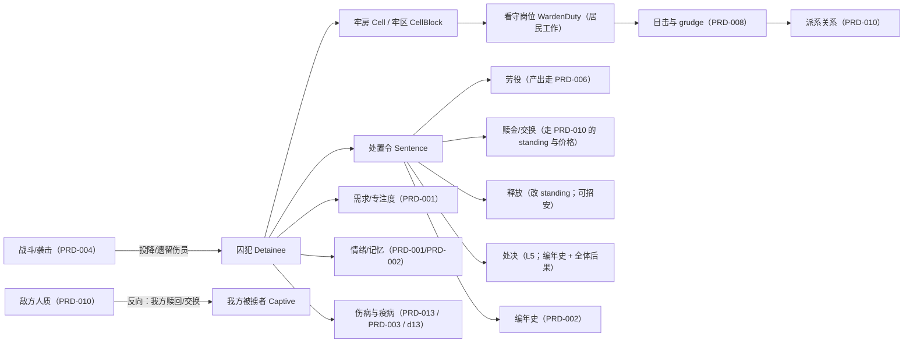
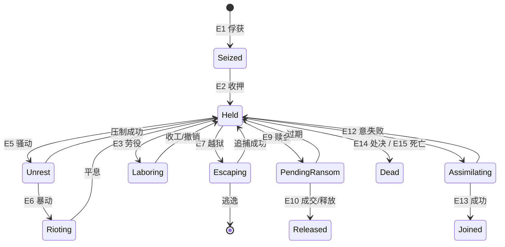
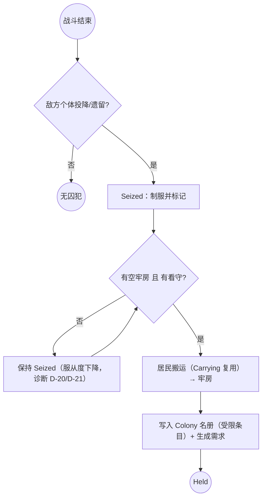

# PRD-015 · 关押、人质、劳役与处置

```
状态：草稿PRD
负责人：设计（人类定稿）
最后更新：2026-10-18
优先级：P1          里程碑：M3（M2 只预埋 PRD-004 已有的「被掳/营救」链路）
上游依据：docs/design/07-threats-and-narrative.md（外邦、势力与叙事）、docs/design/11-freedom-design.md（自由与代价）、
         docs/design/05-settlement-and-residents.md（居民属性、生命周期、死亡与记忆）
关联文档：PRD-004（战斗状态、被掳与营救、交贡、`FactionStance`）、PRD-010（`standing` 唯一写入点、赎回/交换/条约、四类失败）、
         PRD-013（医疗与手术：`R-MED-24` 声明囚犯**只能**由本 PRD 提供）、PRD-001（需求注册表、专注度、如厕）、
         PRD-008（`bond`/`grudge`、目击与关系）、PRD-009（儿童保护、讣告、人口涌现）、PRD-006（仓储规则与诊断 D-20..D-23）、
         PRD-012（权限 L1–L5）、PRD-002（编年史与前兆）、docs/design/13-gases-pollution-and-cycles.md（密闭空间、拥挤与疫病）
基底依赖：Declaring.residentKind / Declaring.locomotion / Declaring.urges（`Declaring.java:30-32,42-48`）、
         Urge（`Urge.java:6-14`）、Node 与 Colony.submit(Grown)（`Colony.java:43`）、搬运 Carry（`Carrying.java:11`）、
         床位 Beds（**包私有 → L2**，`Beds.java:125,136`）、Cadence 分相位（`Cadence.java:54,59`）、
         RefusalKind 接口（`RefusalKind.java:5,20`）、Colony 名册/视图、Shelves（新货架）、front/api Board/Row/Act
决策依据：ADR-012（术语：殖民地/殖民书）、ADR-013（一切必须驱动居民本身）、ADR-015（器官摘取必须带代价）、
         ADR-017（项目基线：M3 里程碑、MIT、双语、货架与权限纪律）
外部调研：docs/research/07-mc-landscape.md（商队/袭击/守卫类 mod 的整合面）、docs/research/01-core-engine.md（引擎硬上限与完成路径）
```

---

## 0. 一句话

> 打赢了不一定就完了——你可以把敌人关起来、逼他们干活、拿他们换东西，也可以放他们回去；但他们会记住你做了什么，而你的居民也会。

---

## 1. 概述

**玩家在什么时候遇到它**：第一次打退袭击、地上躺着几个还没死的敌人时；自己的居民被掳走、对面开出条件时；长期围城、粮食见底而牢里还养着几个人时；以及最后——有人问"这些人留着到底干什么"。

**它解决什么体验问题**：基底与 [PRD-004](PRD-004-threats-and-defence.md) 已经给了"伤害与死亡"，但**没有中间态**：要么活着当自己人，要么死掉。现实中（以及矮人要塞/环世界那种故事引擎里）最有戏剧张力的恰恰是中间态——俘虏、人质、赎金、劳役、背叛、招安、处决。缺了这一段，[PRD-013](PRD-013-medical-and-surgery.md) 的"器官摘取必须带道德代价"也**没有可摘取的对象**（`R-MED-24` 已把这个实体来源判给本文）。对应支柱 **P5（失败会长出故事）** 与 **P4（从石头到星辰）的道德重量**。

**它产生的新决策**：
- 打赢之后：**放/关/换/杀**？每一条都会回头影响下一次袭击（[PRD-010](PRD-010-diplomacy-and-trade.md) 的 `standing`）。
- 牢里养人是要吃饭的：**口粮给谁**（囚犯 / 居民 / 牲畜）？这直接吃 [PRD-006](PRD-006-stock-rules-and-diagnosis.md) 的存量。
- 让他们干活能补劳力，但**看守要占人**：多一个看守就少一个生产者。
- 审讯能换来情报（外邦的 `intel`），但手段越狠，**自己的居民越可能看不下去**。
- 长期关押的人可能愿意留下——**什么时候可以信任他**？

**它在多大程度上是玩家的选择**：**关押与处置全部由玩家决定**（受权限约束）；囚犯的行为（服从、怠工、绝食、越狱、暴动、被同化）**由系统与囚犯自己的需求决定**，玩家只能通过环境（牢房、口粮、看守、威慑、待遇）去影响——这正是本 PRD 的玩法。

### 1.1 诚实说明：这条路与"不做奴隶经济"的关系

[PRD-004 §2.2](PRD-004-threats-and-defence.md) 曾写下 **N7：不做奴隶/永久俘虏经济**，理由是"与 P5 冲突（可以被掳走并救回，但不做经济系统）"。本次立项**部分推翻**它：

| 旧口径（PRD-004 N7） | 新口径（本文，ADR-017 授权） |
| --- | --- |
| 不做奴隶/永久俘虏经济 | **做关押与劳役**，但**不做奴隶市场**（没有"人口买卖"作为商品化经济；交换走 PRD-010 的条约/赎金，且必须有政治后果） |
| 只做可营救的被掳者 | **双向**：我方被掳（沿用 PRD-004 的营救/PRD-010 的赎回）+ **敌方个体被我方关押**（本文新增） |

> **动作项（给上级）**：PRD-004 的 N7 需要按本文修订（本文限于"只新建一个文件"，未改动它）。

---

## 2. 设计目标与非目标

### 2.1 目标（Goals）

| 编号 | 目标 | 可判定信号 |
| --- | --- | --- |
| G1 | 战斗有"中间态" | 击退袭击后，敌方个体存在**可被俘获**的路径（不是必死或消失） |
| G2 | 囚犯是**完整的人** | 囚犯有需求、情绪、记忆、人格，并且**未满足需求会自己行动**（越狱/暴动/绝食） |
| G3 | 关押有**真实成本** | 牢房、床位、口粮、看守工时全部真实占用（走 PRD-006 与基底床位） |
| G4 | 四种处置都有**代价与后续** | 劳役/赎金/释放/处决各自改变 `standing`、居民情绪或关系，且可在界面查到"为什么变了" |
| G5 | 虐待不是免费按钮 | 任何残忍处置都产生目击记忆、`grudge`、派系名声与居民情绪后果（不得可关） |
| G6 | 有**招安**的长线回报 | 长期善待的囚犯可被招募为居民（带条件与风险），不是随机事件 |
| G7 | 儿童**绝不**进入本系统 | 儿童既不能是囚犯，也不能被劳役或处置（走营救与遣返） |
| G8 | 可解释 | 每个"囚犯为什么不干活/为什么暴动/为什么值这个价"都能在诊断里回答（D-20..D-23） |

### 2.2 非目标（Non-Goals，本次不做）

| 编号 | 不做的事 | 理由 | 何时可能做 |
| --- | --- | --- | --- |
| N1 | 奴隶**市场**与人口买卖作为常规贸易品 | 与 P5、与 [PRD-010](PRD-010-diplomacy-and-trade.md) 的"货物必须真实、且贸易是政治行为"冲突 | 不计划 |
| N2 | 露骨的暴力/折磨表现（动画、音效、血污特写） | 分级与观感；**所有处置以文案与后果表达** | 不计划 |
| N3 | 独立的囚犯 AI 行为树 | 违反 [ADR-013](../00-charter.md)：囚犯与居民走**同一套** `Urge`/`Node`/规划器 | 不计划 |
| N4 | 囚犯作为殖民地**公民**参与选举/策略/民兵 | 权限与语义污染（[PRD-012](PRD-012-multiplayer-and-permissions.md) 的名册与等级会乱） | 仅"招安后"成为居民 |
| N5 | 改造/洗脑式的"无条件忠诚" | 无代价的工具化，违反 G5 | 不计划 |
| N6 | 囚犯参与太空/远征等高价值任务 | 信任与情节成本，且会把 M4 的复杂度翻倍 | 不计划 |

### 2.3 里程碑子集

| 里程碑 | 内容 |
| --- | --- |
| M2 | **不新增**：只保留 [PRD-004](PRD-004-threats-and-defence.md) 的"居民被掳 → 营救/交贡"既有链路（本文只预留实体与字段命名，不出现在玩法里） |
| M3 | **完整落地**：俘获、牢房与看守、囚犯需求与秩序、四种处置、招安、赎金与交换、诊断 D-20..D-23、权限矩阵 |
| M4 | 只做两处延伸：① 囚犯的**太空相关**（不参与，只存在"遗留在站上的人"这类剧情）；② 大势力的**俘虏政治**（多势力交换） |

---

## 3. 术语

### 3.1 本系统局部术语

| 术语（英文） | 中文 | 说明 | 与全局术语的关系 |
| --- | --- | --- | --- |
| `detainee` | 囚犯 | **被我方关押的敌方个体**（本文主体） | 新增（全局登记） |
| `captive` | 被掳者 | **被敌方带走的我方居民**（[PRD-004](PRD-004-threats-and-defence.md) 已有） | 沿用，不重定义 |
| `hostage` | 人质 | 被势力扣下、用于谈判的我方居民（[PRD-010](PRD-010-diplomacy-and-trade.md) 已有） | 沿用，不重定义 |
| `warden` | 看守 | 被指派看管囚犯的居民（**工种/授权**，照 `militia` 先例） | 新增 |
| `cell` | 牢房 | 被判定为**关押空间**的区域（门锁 + 床 + 围墙/栅栏） | 新增 |
| `compliance` | 服从度 | 0–100，囚犯愿意配合的程度（由待遇、威慑、需求满足、时间决定） | 新增 |
| `escape_pressure` | 越狱压力 | 0–100，囚犯尝试逃跑的内在压力（**有前兆**） | 新增 |
| `unrest` | 骚动 | 牢区级状态：正常/鼓噪/暴动（**是可观察状态，不是隐藏值**） | 新增 |
| `sentence` | 处置令 | 对一名囚犯的当前处置（劳役/待赎/待放/待处决） | 新增 |
| `ransom_terms` | 赎金条件 | 对方开出的交换条件（物资/人质/和平），由 PRD-010 生成 | 新增（与 `quote` 同源） |
| `assimilation` | 招安 | 长期善待后囚犯**自愿**加入殖民地（有前置与风险） | 新增 |
| `brutality` | 残忍手段 | 酷刑/虐待/处决等；**开关只影响表现，不影响数值与后果** | 新增 |

### 3.2 与既有术语的冲突检查

| 冲突项 | Folkways 既有含义 | 本系统含义 | 解决方式 |
| --- | --- | --- | --- |
| `captive`（PRD-004） | 被敌方带走的**我方居民** | 方向相反 | **并存但严格区分**：本文一律用 `detainee` 指我方关押的对象；UI 也必须用不同词（"囚犯" vs "被掳者"） |
| `hostage`（PRD-010） | 被势力扣下的我方居民 | 同上 | 沿用；囚犯**不是**人质（人质是被动方，囚犯是主动关押） |
| `ransom`（PRD-004） | 用物资换取**撤军**（交贡） | 用物资/人换取**释放某人** | 复用同一价格与 `standing` 通道（R-PRI-14），UI 上分两处入口，措辞不同 |
| `standing`（PRD-006 订单字段） | 订单的"常备量" | 外交关系值（PRD-010） | 沿用 PRD-010 的决定：外交场合强制写 `faction.standing`（[PRD-010 R-DIP-2](PRD-010-diplomacy-and-trade.md)） |
| `militia`（PRD-004） | 战时能打的居民工种 | 看守是另一工种（`warden`） | 不合并：一个居民可以同时被编入两者，但**工作内容不同** |
| 「居民」 | 殖民地成员 | 囚犯**不是**居民（N4） | 术语上写"囚犯 / 在押人员"，不得写"新居民"直到招安完成 |
| 「劳役」 | 基底无此概念 | 囚犯被指派的劳动 | 新增；**不得**与居民的正常工作共用"自愿"语义（产出与代价不同） |

> 全局术语以 [术语表](../design/03-glossary.md) 为准。本文新增的 `detainee`/`warden`/`cell`/`compliance`/`unrest`/`assimilation` 需补登记（§18 OQ-1）。

---

## 4. 概念模型

### 4.1 实体

| 实体 | 中文 | 说明 | 生命周期 | 玩家可见 |
| --- | --- | --- | --- | --- |
| `Detainee` | 囚犯 | 被关押的敌方个体（一个受限的殖民地名册条目） | 俘获 → 关押 → 处置 → 释放/招安/死亡 | 牢区覆盖层 + 关押页 |
| `Cell` | 牢房 | 关押空间判定（门 + 床 + 封闭）与容量 | 建造 → 分配 → 拆除 | 世界内 + 关押页 |
| `CellBlock` | 牢区 | 一组牢房（骚动与疫病按**牢区**结算） | 同上 | 关押页 |
| `WardenDuty` | 看守岗位 | 需要看守的牢区与人数 | 指派 → 生效 | 居民页/关押页 |
| `Sentence` | 处置令 | 当前处置与理由 | 玩家/系统设定 → 执行 | 关押页 |
| `RansomOffer` | 赎金条件 | 对方开出的条件（来自 PRD-010） | 提出 → 接受/拒绝/过期 | 关押页 + 外交页 |
| `ComplianceState` | 服从度状态 | 一人一份：服从度、越狱压力、健康、需求满足 | 实时 → 存档 | 关押页 |
| `CaptivityCause` | 处置原因 | 一次处置/待遇变化的具名原因（照 `StandingCause`） | 追加 → 裁剪 | 关押页（可展开） |
| `AbuseRecord` | 虐待记录 | 谁对谁做了什么、谁看见了 | 追加 → 永久（历史） | 居民页 + 编年史 |

### 4.2 实体之间的关系



---

## 5. 状态机

### 5.1 状态定义（囚犯生命周期）

| 状态 | 中文 | 说明 |
| --- | --- | --- |
| `Seized` | 已控制 | 战斗结束后被制服（**尚未关押**，需要囚室与看守） |
| `Held` | 在押 | 已分配牢房，正常关押 |
| `Unrest` | 骚动 | 牢区进入鼓噪状态（有窗口可压制） |
| `Rioting` | 暴动 | 牢区失控：囚犯试图夺取控制权 |
| `Escaping` | 越狱中 | 个别人已逃出牢房（追捕窗口） |
| `Laboring` | 劳役中 | 被指派劳动（正常状态的一种子状态） |
| `PendingRansom` | 待赎 | 对方已开价，等待谈判结果 |
| `Released` | 已释放 | 离开殖民地（可能带走情报/关系变化） |
| `Assimilating` | 招安中 | 自愿留下的过渡期（观察期 + 审查） |
| `Joined` | 已加入 | 成为居民（交接给 PRD-001/008/012 的既有系统） |
| `Dead` | 已死亡 | 病死/伤死/处决/暴动中死亡 |
| `Transferred` | 已移交 | 交给第三方势力（多势力交换，M4） |

### 5.2 事件定义

| 事件 | 中文 | 说明 | 触发方 |
| --- | --- | --- | --- |
| E1 | 俘获 | 战斗中敌方个体投降/被制服 | 居民（PRD-004 战斗结算） |
| E2 | 收押 | 分配牢房与看守，进入 `Held` | 系统/玩家（授权） |
| E3 | 指派劳役 | 设置 `Sentence = Labor` | 玩家（权限） |
| E4 | 待遇变化 | 口粮/自由时间/医疗/虐待 | 玩家/看守 |
| E5 | 骚动升级 | 牢区 `unrest` 越过阈值 | 系统（前兆已可见） |
| E6 | 暴动 | 牢区失控 | 系统 |
| E7 | 越狱 | 个体突破牢房 | 系统/囚犯 |
| E8 | 追捕成功/失败 | 看守或民兵追击结果 | 系统 |
| E9 | 赎金提出 | 对方开出条件 | 世界（PRD-010） |
| E10 | 赎金成交/破裂 | 谈判结果 | 玩家 + 世界 |
| E11 | 释放 | 无条件或有条件释放 | 玩家（权限） |
| E12 | 招安意愿 | 囚犯表达留下的意愿 | 囚犯（系统判定） |
| E13 | 招安完成/失败 | 观察期结束 | 系统 |
| E14 | 处决 | 不可逆处置 | 玩家（**L5**） |
| E15 | 死亡 | 病死/伤死/暴动 | 系统 |
| E16 | 虐待发生 | 看守或玩家指令造成的残忍行为 | 玩家/居民 |
| E17 | 目击 | 其他居民/囚犯看见 E16 | 系统 |
| E18 | 疫病爆发 | 牢区拥挤导致的疾病传播 | 系统（PRD-003/d13） |

### 5.3 扩展变量（系统状态）

| 变量 | 中文 | 类型 | 默认值 | 取值范围/单位 | 说明 |
| --- | --- | --- | --- | --- | --- |
| `detainee_cap_pressure` | 关押压力 | 定点 | 0 | 0–100 | 牢房容量、口粮、看守三者的综合压力（**软压力，无硬上限**） |
| `compliance` | 服从度 | 整数 | 30 | 0–100 | 待遇/威慑/需求满足/时间 |
| `escape_pressure` | 越狱压力 | 整数 | 10 | 0–100 | 越过阈值 → 尝试越狱（有前兆） |
| `unrest` | 牢区骚动 | 枚举 | `Calm` | Calm/Agitated/Rioting | 牢区级 |
| `ration_tier` | 口粮等级 | 枚举 | `Standard` | None/Half/Standard/Full | 直接吃 PRD-006 的存量 |
| `warden_ratio` | 看守比 | 定点 | 1:4 | 1:1–1:12 | 每名看守能有效看管的囚犯数 |
| `abuse_level` | 虐待程度 | 整数 | 0 | 0–3 | 0 无 / 1 严苛 / 2 酷刑 / 3 极端（**只影响数值与后果，不影响表现开关**） |
| `assimilation_window` | 招安观察期 | 时长 | 3 游戏日 | 1–10 日 | 期间有审查事件与风险 |
| `ransom_price_mult` | 赎金倍率 | 定点 | 1.0 | 0.5–3.0 | 与 PRD-010 的价格模型相乘 |
| `execution_requires_vote` | 处决需投票 | 布尔 | false | — | 多人服务器可开（PRD-012） |
| `captivity_brutality_enabled` | 残忍表现开关 | 布尔 | true | — | **只影响表现**（文案/音效），不影响数值与后果（R-PRI-20） |

### 5.4 守卫条件依赖

| 变量 | 中文 | 类型 | 来源 |
| --- | --- | --- | --- |
| `cell_available` | 有空牢房 | 布尔 | 床位与牢房判定（`Beds` → L2） |
| `warden_present` | 有看守在岗 | 布尔 | 居民工作（`Urge`/`Node`） |
| `food_available` | 有口粮 | 布尔 | [PRD-006](PRD-006-stock-rules-and-diagnosis.md) 存量 |
| `standing` | 势力关系 | 整数 | [PRD-010](PRD-010-diplomacy-and-trade.md)（**唯一写入点 `Factions.adjust`**） |
| `player_permission` | 操作权限 | 枚举 | [PRD-012](PRD-012-multiplayer-and-permissions.md) L1–L5 |
| `prisoner_health` | 囚犯健康 | 定点 | [PRD-013](PRD-013-medical-and-surgery.md) |
| `zone_disease` | 牢区疫病 | 枚举 | [PRD-003](PRD-003-season-temperature-thirst-nutrition.md) + [d13](../design/13-gases-pollution-and-cycles.md) |

### 5.5 状态转移表（节选，完整表在实现时补全）

| 源状态 | 事件 | 守卫条件 | 动作 | 任务/副作用 | 目标状态 |
| --- | --- | --- | --- | --- | --- |
| `Seized` | E2 | `cell_available ∧ warden_present` | 分配牢房、写入名册 | 生成搬运 `Node`（复用 `Carrying`） | `Held` |
| `Seized` | — | 无牢房/无看守 | 保持；**有超时**（§5.7） | 诊断 D-21 | `Seized` |
| `Held` | E5 | `unrest ≥ Agitated` | 告警（前兆） | 通知 + 覆盖层 | `Unrest` |
| `Unrest` | 压制成功 | 看守足够 ∧ 待遇改善 | 服从度回升 | 记 `CaptivityCause` | `Held` |
| `Unrest` | E6 | `unrest` 满且看守不足 | 暴动开始 | 牢区失控、可能伤亡 | `Rioting` |
| `Rioting` | 平息 | 民兵介入（PRD-004） | 伤亡、服从度重算 | 编年史 | `Held` |
| `Held`/`Laboring` | E7 | `escape_pressure` 越阈值 ∧ 门未锁好 | 个体逃出 | 追捕窗口 | `Escaping` |
| `Escaping` | 捕获 | 追捕成功 | 服从度↓、看守损失 | 关系/情绪（目击） | `Held` |
| `Escaping` | 逃逸 | 追捕失败 | 带走情报 | `standing` 微降 | 离开本系统 |
| `Held` | E9 | 对方主动开价 | 生成 `RansomOffer` | 外交页联动 | `PendingRansom` |
| `PendingRansom` | E10 成交 | 条件满足 | 移交/释放 | `standing`↑、`Factions.adjust` | `Released` |
| `PendingRansom` | 过期 | — | 收回报价、服从度↓ | 通知 | `Held` |
| `Held` | E11 | 权限 ≥ L3 | 释放 | `standing`↑（幅度按待遇与时长） | `Released` |
| `Held` | E12 | 服从度高 ∧ 无虐待史 ∧ 观察期可用 | 进入观察期 | 审查事件（PRD-002） | `Assimilating` |
| `Assimilating` | E13 成功 | 观察期无事故 | 转为居民 | 交接 PRD-001/008/012 | `Joined` |
| `Assimilating` | 失败 | 观察期出事 | 回到 `Held` | 服从度↓ | `Held` |
| 任意 | E14 | 权限 = **L5** ∧ 二次确认 | 处决 | 编年史 + 全体居民情绪 + `standing`↓ | `Dead` |
| 任意 | E15 | 健康归零 | 死亡 | 讣告（若无亲属则简记） | `Dead` |

### 5.6 状态图



### 5.7 超时与中断

| 情形 | 处理 | 恢复后行为 |
| --- | --- | --- |
| 玩家离开/断线 | 状态保持；**不可逆动作（处决/释放/成交）不接受离线代理** | 挂起直到有权限者在场（[PRD-012](PRD-012-multiplayer-and-permissions.md)） |
| `Seized` 长时间无牢房（>1 游戏日） | 按配置：① 就地释放 ② 继续羁押但**服从度持续下降** ③ 允许处决（L5） | 诊断 D-21 常驻；**不得静默消失** |
| 牢房被拆/门被拆 | 该囚犯转入"无牢房"状态（同上一行），并记原因 | 诊断 D-21 |
| 看守死亡/崩溃 | 看守岗位失效 → 服从度下降加速 + 骚动概率上升 | 自动尝试重新指派（有延迟） |
| 囚犯健康归零 | 死亡；若死者有亲属（PRD-008）→ 关系级联与派系反应 | 讣告 + 编年史 |
| 区块卸载 | **抽象结算**：按批次推进服从度/口粮/疫病，**只改 `Colony` 账本**（R-PRI-27） | 加载后按账本继续 |
| 我方被掳者返回 | 走 PRD-004 的营救/PRD-010 的赎回；回来后写创伤记忆与伤情（PRD-013） | 交回 PRD-001/013 |

---

## 6. 交互

### 6.1 入口与快捷键

| 操作 | 按键/手势 | 前置条件 | 结果 |
| --- | --- | --- | --- |
| 打开「关押」页 | 面板页签（殖民书） | 持有殖民书 | 囚犯列表、牢区、服从度、处置令 |
| 划定牢房 | 区域工具（照基底划区语义） | 权限 ≥ L3 | 生成 `Cell`（门+床+封闭判定） |
| 设置看守岗位 | 关押页 → 岗位 | 有人可用 | 生成 `WardenDuty`（居民工作） |
| 指派处置 | 囚犯行 → 处置 | 权限（见 §6.3） | 设置 `Sentence` |
| 设定口粮等级 | 牢区 → 口粮 | 权限 ≥ L3 | 改 `ration_tier`（吃 PRD-006 存量） |
| 审讯 | 囚犯行 → 审讯 | 权限 ≥ L3 | 产出 `intel`（[PRD-010](PRD-010-diplomacy-and-trade.md)）；**虐待等级上升则有代价** |
| 谈判 | 关押页 → 赎金条件 | 有报价 | 接受/还价/拒绝（走 PRD-010 的价格与 `standing`） |

> 沿用基底持握/潜行/滚轮/左右键语义时，必须引用其既有行为，不重新发明（照 [d09](../design/09-interaction-and-ui.md)）。

### 6.2 操作模式状态机（本系统专属）

| 状态 | 中文 | 说明 |
| --- | --- | --- |
| `Browsing` | 浏览 | 默认：看列表与牢区 |
| `PlacingCell` | 划牢房 | 区域工具激活，实时显示容量与合法性 |
| `Inspecting` | 查看囚犯 | 选中一名囚犯，显示需求/情绪/服从度/命令 |
| `Deciding` | 处置确认 | 不可逆动作的二次确认（含后果清单） |

| 事件 | 中文 | 说明 | 触发方 |
| --- | --- | --- | --- |
| 选择区域工具 | — | 进入 `PlacingCell` | 玩家 |
| 完成划定 | — | 校验封闭与床位 | 玩家 |
| 选中囚犯 | — | 进入 `Inspecting` | 玩家 |
| 选择不可逆处置 | — | 进入 `Deciding` | 玩家 |

| 源状态 | 事件 | 守卫条件 | 目标状态 | 动作 |
| --- | --- | --- | --- | --- |
| `Browsing` | 划牢房 | 权限 ≥ L3 | `PlacingCell` | 显示容量预览 |
| `PlacingCell` | 完成 | 合法 | `Browsing` | 提交区域 |
| `Browsing` | 处置 | 权限足够 | `Deciding` | 展示后果 |
| `Deciding` | 确认 | 二次确认通过 | `Browsing` | 执行 |

### 6.3 右键菜单 / 面板动作

| 上下文 | 按钮 | 操作 | 触发事件 | 是否可撤销 |
| --- | --- | --- | --- | --- |
| 囚犯行 | 「转为劳役」（`Do`） | 设 `Sentence=Labor` | E3 | ✅ |
| 囚犯行 | 「停止劳役」（`Do`） | 回到 `Held` | — | ✅ |
| 囚犯行 | 「谈判」（`Open`） | 打开赎金条件（PRD-010） | E9/E10 | ✅（未成交前） |
| 囚犯行 | 「释放」（`Do`） | 权限 ≥ L3 + 确认 | E11 | ❌ |
| 囚犯行 | 「招安」（`Do`） | 前置满足时可用 | E12 | ✅（观察期内可撤回） |
| 囚犯行 | 「处决」（`Do`） | **L5** + 二次确认（列出后果） | E14 | ❌ |
| 囚犯行 | 「为什么？」（`Open`） | 打开诊断卡（D-20..D-23） | — | — |
| 牢区 | 「口粮等级」（`Edit`） | 改 `ration_tier` | E4 | ✅ |
| 牢区 | 「加强看守」（`Do`） | 提高岗位人数 | — | ✅ |

> 全部动作必须落在基底 `Board.Act` 的五个动词内（`Do`/`Open`/`Edit`/`Ping`/…）。**处置类动作不需要新动作分类**；若实现时发现必须新增 → 标 **L3** 并走评审（R-PRI-32）。

### 6.4 命令

| 命令 | 权限 | 说明 | 输出 |
| --- | --- | --- | --- |
| `/<ns> captivity list` | L2 | 囚犯列表、状态、服从度、越狱压力 | 文本表 |
| `/<ns> captivity why <囚犯>` | L2 | 为什么他不干活/为什么快暴动（D-20..D-23） | 文本表 |
| `/<ns> captivity compliance <囚犯>` | L3 | 服从度分解（待遇/威慑/需求/时间） | 文本表 |
| `/<ns> captivity ransom <囚犯>` | L3 | 当前赎金条件的逐项分解（与 PRD-010 同源） | 文本表 |
| `/<ns> captivity release <囚犯>` | L3 | 释放（留痕） | 结果 |
| `/<ns> captivity execute <囚犯>` | **L5** | 处决（不可逆，写编年史） | 结果 |
| `/<ns> captivity abuse <囚犯> <0-3>` | L5 | 设置虐待等级（测试/剧情用；**仍产生全部后果**） | 结果 |

---

## 7. 反馈

### 7.1 操作模式反馈（玩家交互时）

| 检查条件 | 音效 | Toast/文案键 | 视觉反馈 | 系统行为 |
| --- | --- | --- | --- | --- |
| 划牢房成功 | 确认 | 「牢房已划定（容量 %s）」 | 区域高亮 | 生成 `Cell` |
| 划牢房失败 | 低沉 | 拒绝原因（缺门/缺床/不封闭/权限） | 问题点高亮 | 复用 `RefusalKind`（R-PRI-22） |
| 指派劳役成功 | 确认 | 「%s 开始劳役」 | 囚犯标识 | 生成工作 `Node` |
| 指派劳役失败 | 低沉 | 拒绝原因（健康不足/无工具/骚动中） | 高亮 | 诊断 D-22 |
| 处决确认框 | — | 「处决 %s：将发生 %s」 | 红色 + 后果清单 | **必须二次确认** |

### 7.2 实体状态反馈（持续显示）

| 检查条件 | 图标/颜色 | 悬停信息 | 系统行为 |
| --- | --- | --- | --- |
| 囚犯（正常） | 中性标记 | 「囚犯 · 服从 %s%% · %s」 | — |
| 越狱压力高 | ⚠️（**不只用红色**） | 「可能逃跑：%s」 | 前兆已可见（R-PRI-13） |
| 牢区骚动 | 牢区角标 | 「骚动：%s」 | 告警 |
| 暴动中 | 牢区警报 | 「暴动中」 | 失控标记 |
| 口粮不足 | 图标 | 「口粮：%s（库存 %s）」 | 诊断 D-21 |
| 牢区疫病 | 图标 | 「疫病：%s」 | PRD-003 疾病链 |
| 被掳者（我方） | 世界内标记 | 「被 %s 关押：%s」 | [PRD-004](PRD-004-threats-and-defence.md)/[PRD-010](PRD-010-diplomacy-and-trade.md) |

### 7.3 系统事件反馈（非玩家触发）

| 事件 | 音效 | 通知文案键 | 视觉 | 系统行为 |
| --- | --- | --- | --- | --- |
| 俘获 | 中性 | 「俘获了 %s（%s）」 | 世界内 | 进入 `Seized` |
| 骚动升级 | 警报（轻） | 「牢区骚动：%s」 | 覆盖层 | 进入 `Unrest` |
| 暴动 | 警报（重） | 「牢区暴动！」 | 牢区 | 进入 `Rioting` |
| 越狱 | 警报 | 「%s 越狱了」 | 追捕标记 | 追捕窗口 |
| 赎金提出 | 中性 | 「%s 提出：%s」 | 关押页 + 外交页 | `RansomOffer` |
| 囚犯死亡 | 中性（低） | 「%s 在关押中死亡（%s）」 | 讣告条目 | 关系/派系级联 |
| 虐待发生 | 低沉 | 「%s 被 %s 施以 %s」 | 无特写（N2） | `AbuseRecord` + 目击 |
| 招安意愿 | 正向（轻） | 「%s 表示愿意留下」 | 囚犯标记 | 进入观察期 |
| 处决 | 强烈 + 全屏短提示 | 「%s 被处决」 | 编年史 | 全体情绪 + `standing`↓ |

### 7.4 可诊断性

| 玩家可能的疑问 | 系统必须能回答 | 呈现位置 |
| --- | --- | --- |
| 「他为什么不去干活？」 | 拒绝原因（健康/工具/骚动/处置令/权限） | 关押页 + 诊断卡（**D-22**） |
| 「他为什么想跑？」 | 越狱压力分项（自由/待遇/恐惧/机会） | 关押页 + **D-23** |
| 「为什么牢区要暴动了？」 | 牢区聚合原因（口粮/拥挤/虐待/疫病/看守不足） | 牢区卡 + **D-23** |
| 「为什么没人看管？」 | 看守岗位缺口与竞争工作（走 PRD-006 阻塞） | 诊断卡（**D-20**） |
| 「这些人为啥值这个价？」 | 赎金逐项分解（与 PRD-010 报价同源） | 关押页 |
| 「他为什么恨我们？」 | 虐待记录 + 目击 + 关系变化（PRD-008） | 囚犯卡 |

**R-PRI-1**：本文所有"为什么"必须复用 [PRD-006](PRD-006-stock-rules-and-diagnosis.md) 的**同一套诊断组件**，禁止另做一套（照 [PRD-011 R-AG-F-3](PRD-011-progression-knowledge-and-space.md)）。
**R-PRI-2**：错误/拒绝一律走基底 `RefusalKind`（`RefusalKind.java:5,20` 是接口 + `Named`），不得自造错误码。

---

## 8. 规则

| 编号 | 类型 | 规则 | 违反时的行为 |
| --- | --- | --- | --- |
| R-PRI-3 | 必须 | 囚犯**只能**由战斗结果（投降/遗留伤员）或敌方主动移交产生；**不得**凭空生成 | 凭空生成即越界（[PRD-013](PRD-013-medical-and-surgery.md) R-MED-24 的对偶） |
| R-PRI-4 | 必须 | 囚犯是**完整的人**：有需求（走 [PRD-001](PRD-001-needs-mood-memory.md) 的需求注册表，含如厕）、情绪、记忆、人格 | 缺任一项即缺陷 |
| R-PRI-5 | 禁止 | 为囚犯新造第二套 AI/行为树；一切行为走 `Urge`/`Node`/`Colony.submit` | 违反 ADR-013，评审不通过 |
| R-PRI-6 | 禁止 | 玩家**直接**完成关押/劳役/释放等动作（玩家只能授权与设置条件） | 同上 |
| R-PRI-7 | 必须 | 收押必须有**真实牢房**（门 + 床 + 封闭判定）与**看守岗位**；两者缺一不可 | 缺一即缺陷（诊断 D-20/D-21） |
| R-PRI-8 | 必须 | 囚犯的口粮与床位是**真实占用**，走 [PRD-006](PRD-006-stock-rules-and-diagnosis.md) 的仓储与规则 | "囚犯不吃饭"即缺陷 |
| R-PRI-9 | 必须 | 未满足的需求必须**产生行为**（要求/怠工/绝食/越狱/暴动），并**先有前兆** | 只有数值没有行为即缺陷 |
| R-PRI-10 | 必须 | 越狱与暴动必须有**可观察的前兆**（越狱压力、骚动等级）与**应对窗口** | 无前兆即缺陷（对应 P3） |
| R-PRI-11 | 禁止 | 儿童作为囚犯/劳役/处置对象；儿童走营救与遣返 | 违反即严重缺陷（[PRD-009](PRD-009-generations-and-legacy.md) 儿童保护同族） |
| R-PRI-12 | 必须 | 虐待/酷刑必须有**代价**：目击者记忆 + `grudge`↑ + 派系 `standing`↓ + 居民情绪/可能的哗变 | 无代价即缺陷 |
| R-PRI-13 | 禁止 | 提供"关闭代价但保留行为"的设置（照 [PRD-013 R-MED-23](PRD-013-medical-and-surgery.md)） | 违反即缺陷 |
| R-PRI-14 | 级联 | 释放/赎金/处决**必须**通过 PRD-010 的**唯一写入点**改 `standing`（`Factions.adjust`），并留 `StandingCause` | 直写 `standing` 即缺陷 |
| R-PRI-15 | 必须 | 赎金价格必须复用 PRD-010 的价格模型（可乘 `ransom_price_mult`），**逐项可查** | 另有公式即缺陷 |
| R-PRI-16 | 必须 | 劳役产出走**真实工作**（`Node` + 工具 + 技能），并计入 PRD-006 的存量与预测 | 魔法产出即缺陷 |
| R-PRI-17 | 必须 | 劳役过度（虐待等级↑ / 口粮↓ / 无休息）必须导致**可测量的后果**：健康↓、服从度↓、骚动↑、死亡 | 无后果即缺陷 |
| R-PRI-18 | 必须 | 招安必须是**自愿 + 有条件**（服从度高、无虐待史、观察期、审查事件）；不得"一键洗脑" | 无条件加入即缺陷 |
| R-PRI-19 | 必须 | 处决**只有 L5** 可执行，必须二次确认并列出后果（居民情绪、亲属、派系、编年史） | 更低权限可执行即严重缺陷 |
| R-PRI-20 | 必须 | `captivity_brutality_enabled=false` **只允许**改变表现（文案/音效/特效），**不得**改变数值、概率与后果 | 改成"无代价模式"即缺陷 |
| R-PRI-21 | 必须 | 囚犯与居民必须能被 UI 与日志**明确区分**（不得都叫"居民"） | 混淆即缺陷 |
| R-PRI-22 | 必须 | 拒绝理由必须走 `RefusalKind` 具名实现 + 双语文案 + 原因对象 | 缺一即缺陷 |
| R-PRI-23 | 必须 | 全部玩家可见文本走**双语**（zh_cn + en_us，ADR-017） | 缺语言即缺陷 |
| R-PRI-24 | 必须 | 牢区疫病必须走 [PRD-003](PRD-003-season-temperature-thirst-nutrition.md) 的疾病框架与 [d13](../design/13-gases-pollution-and-cycles.md) 的密闭空间（拥挤 → 传播） | 另造疾病即缺陷 |
| R-PRI-25 | 必须 | 囚犯的伤病与死亡走 [PRD-013](PRD-013-medical-and-surgery.md)（可治、有前兆、可追责） | 绕过医疗即缺陷 |
| R-PRI-26 | 必须 | 释放/处决/成交等不可逆动作必须写**编年史**（[PRD-002](PRD-002-incidents-and-narrator.md)） | 无记录即缺陷 |
| R-PRI-27 | 必须 | 离屏时按批次**抽象结算**（服从度/口粮/疫病），**只改 `Colony` 账本**；不得加载区块、不得直改世界 | 直改世界即缺陷 |
| R-PRI-28 | 禁止 | 新增逐 tick 遍历囚犯/牢房的结算；必须按 `Cadence` 相位分摊（`Cadence.java:54,59`） | 超预算即缺陷 |
| R-PRI-29 | 必须 | 关押是**软压力**（无硬上限）：牢房/口粮/看守紧张时通过服从度与骚动自然惩罚，**不得**静默拒绝或删除囚犯 | 静默处理即缺陷 |
| R-PRI-30 | 必须 | 招安后的个体必须**完整交接**给 PRD-001/008/012（需求、关系、权限），不得留下两套状态 | 半交接即缺陷 |
| R-PRI-31 | 优先级 | 处置冲突（同时被指派劳役与释放）按「不可逆最优先 → 玩家显式设置的 `Sentence` → 系统建议」裁决；顺序必须确定可复现 | 不确定即缺陷 |
| R-PRI-32 | 必须 | 全部动作落在基底 `Board.Act` 五动词内；若必须新增动作分类 → 标 **L3** 并逐条评审（[d12 §5](../design/12-fork-strategy.md)） | 未登记即评审不通过 |
| R-PRI-33 | 必须 | 不得改 `BodyRunner` 的速度契约（`BodyRunner.java:520`）；囚犯的行为限制只走授权/许可与 `MOVEMENT_SPEED` modifier | 改契约即缺陷 |
| R-PRI-34 | 必须 | 囚犯不得出现在民兵、策略、选举等公民系统里（N4）；尝试即为缺陷 | 越界即缺陷 |

---

## 9. 流程（与基底引擎对齐）

### 9.1 工作类型与任务

| 项 | 内容 |
| --- | --- |
| 工作类型（Vocation/Trade） | **看守 `warden`**（照 `militia` 先例，是工种/授权，不是新职业体系）；**劳役**是囚犯的受限工作授权（不是居民工种） |
| 任务（Task/Doing） | 收押搬运、喂食、看守巡逻、追捕、审讯、押送、行刑（全部走 `Colony.submit(Grown)` + `Node`） |
| 参与的居民种类 | 居民（看守/民兵/医生）；**囚犯**以受限授权参与劳役 |
| 需要的工具/许可（Tool/Licence） | 牢房（门/锁/床）、口粮、镣铐类工具（内容物）、医疗用品（PRD-013）、许可：`warden` 授权、处置权限（§11） |

### 9.2 执行流程（收押）



### 9.3 Action 说明

| Action | 说明 | 失败/拒绝理由（Refusal） |
| --- | --- | --- |
| `Seize` | 战斗结算后制服并标记 | 无人手 / 目标已死 / 目标为儿童（**永不允许**） |
| `Escort` | 押送到牢房 | 无牢房 / 无路 / 看守不足 |
| `Feed` | 按 `ration_tier` 投喂 | 无口粮（PRD-006）/ 无许可 |
| `Guard` | 看守巡逻 | 无 `warden` 授权 / 被更高优先工作占用 |
| `Labor` | 指派并执行劳役 | 健康不足 / 骚动中 / 无工具 / 处置令冲突 |
| `Interrogate` | 审讯换情报 | 无情报可换 / 权限不足 / 目标健康不足 |
| `Negotiate` | 赎金谈判（与 PRD-010 同一动作族） | 无报价 / 报价过期 / 权限不足 |
| `Release` | 释放 | 权限 < L3 / 需确认 |
| `Execute` | 处决 | 权限 < L5 / 未二次确认 / 投票未通过（若开启） |

### 9.4 生成与分配条件

| 侧 | 条件 | 说明 |
| --- | --- | --- |
| 任务侧 | 存在 `Seized`/`Held` 的囚犯且有待办事项（喂食/看守/劳役/押送） | 任务由殖民地提交，不由囚犯自己提交（囚犯只提交"自身需求"类 urge） |
| 居民侧 | 具备 `warden` 授权、体力与情绪可用 | 走基底 `Urge` 权重与 PRD-001 的专注度修正 |
| 资源侧 | 牢房容量、口粮、工具、药品齐备 | 缺料走 PRD-006 的诊断与建议动作 |

### 9.5 计算逻辑

| 计算项 | 公式 | 变量说明 | 取值范围 |
| --- | --- | --- | --- |
| 服从度 | `compliance = clamp(基础 30 + 待遇分(口粮/医疗/自由时间) + 威慑分(看守比/惩罚史) − 虐待惩罚 − 需求缺失惩罚 + 时间沉淀, 0, 100)` | 各分项独立可查 | 0–100 |
| 越狱压力 | `escape_pressure = clamp(自由缺失 + 恐惧 − 希望(招安可能) − 看守威慑 + 机会(门未锁/无人), 0, 100)` | 越阈值触发 E7 | 0–100 |
| 牢区骚动 | `unrest = f(平均服从度, 平均健康, 拥挤度, 虐待水平, 疫病, 看守比)` → `Calm / Agitated / Rioting` | 牢区级聚合 | 枚举 |
| 劳役产出 | `产出 = 基准 × 技能系数 × 健康系数 × 服从系数 × 工具系数`（照 PRD-001 的乘数夹取纪律） | 与居民相比**默认更低**（受限授权） | 0–1.2× |
| 赎金价格 | `price = PRD-010 价格模型(货物/时代/距离/standing) × ransom_price_mult × 个体价值(技能/身份/健康)` | 逐项可查 | — |
| 释放的 `standing` 增益 | `Δstanding = 基础 × 待遇系数 × 时长系数`（处决为**负向**且幅度更大） | 走 `Factions.adjust` | −40–+25 |
| 招安概率 | `P = f(服从度, 无虐待史, 观察期表现, 原势力关系, 个体人格)` | 玩家不可直接看到精确值，只看档位 | 0–1 |

### 9.6 数值配置

| 参数 | 默认值 | 范围 | 可被数据包/配置覆盖？ | 备注 |
| --- | --- | --- | --- | --- |
| `detainee_soft_cap` | 12 | 1–64 | 是 | **软压力**（R-PRI-29），不硬拒 |
| `warden_ratio` | 1:4 | 1:1–1:12 | 是 | 每看守有效看管人数 |
| `escape_threshold` | 70 | 30–95 | 是 | 越狱压力阈值 |
| `unrest_threshold` | 55 | 20–90 | 是 | 骚动阈值 |
| `riot_threshold` | 85 | 50–99 | 是 | 暴动阈值 |
| `ration_default` | `Standard` | None–Full | 是 | 吃 PRD-006 存量 |
| `assimilation_window` | 3 游戏日 | 1–10 日 | 是 | 观察期 |
| `abuse_decay_days` | 30 游戏日 | 5–120 | 是 | `grudge` 的衰减参照（最终归 PRD-008） |
| `execution_requires_vote` | false | — | 是 | 多人服务器可开 |
| `captivity_brutality_enabled` | true | — | 是（客户端表现） | **只影响表现**（R-PRI-20） |
| `captivity_enabled` | true | — | 是 | 关闭时：不产生囚犯，被掳/营救链路仍工作 |

---

## 10. 数据与存档

| 项 | 内容 |
| --- | --- |
| 新增持久化字段 | `Detainee`（身份、来源势力、状态、健康引用）、`ComplianceState`（服从度/越狱压力/待遇/虐待史）、`Sentence`、`Cell`/`CellBlock` 判定缓存、`RansomOffer`（可过期）、`AbuseRecord`、`CaptivityCause` 列表（有保留期） |
| 存储位置（实体/NBT/全局数据） | 殖民地级 `Colony.keep(owner, CompoundTag)`（照 [PRD-008](PRD-008-relationships-and-social.md) 的结论：**不塞 `BodyState`**——其包私有，`BodyState.java:14`）；牢房判定**不存档**（由世界重建，避免与方块状态不一致） |
| 存档版本影响 | 需要迁移（自管版本号） |
| 迁移策略 | 缺失字段取默认；`RansomOffer` 过期即丢弃；`AbuseRecord` 视为历史**不得删除**（与 [PRD-011 R-DATA-2](PRD-011-progression-knowledge-and-space.md) 同纪律） |
| 旧存档降级行为 | 无囚犯数据 → 系统视为"从未有囚犯"，不报错 |
| 回滚（卸载本 mod）行为 | 存档可加载；囚犯条目被忽略（**不得**把囚犯变成居民或凭空消失于世界中——卸载时把在押者按"释放"处理并记录原因） |

**R-PRI-35**：卸载/禁用本系统时，在押囚犯必须走**确定的退出路径**（默认释放到世界边缘），不得静默删除。

---

## 11. 网络与多人

| 项 | 内容 |
| --- | --- |
| 权威端 | 服务端（状态机、结算、服从度、处决） |
| 需同步的状态 | 囚犯列表与状态、牢区骚动、牢房容量、赎金条件、处置变更 |
| 同步频率与方式 | 状态变更事件驱动；服从度/越狱压力按低频（`Cadence` 相位）聚合下发 |
| 权限（谁能操作） | 查看 = **L2**（全员只读，照 [PRD-012 §3.4](PRD-012-multiplayer-and-permissions.md) 的诊断可见性纪律）；划牢房/口粮/劳役/审讯/释放/招安 = **L3**；赎金谈判 = **L3**（与 PRD-010 一致）；**处决与虐待等级 = L5**；`captivity_enabled` 等配置 = **L5** |
| 多人并发冲突处理 | 处置冲突走 R-PRI-31 的确定性顺序 + 先到先得 + 广播决策者与原因（照 PRD-012 的裁决算法）；不可逆动作**不可重放** |
| 断线/重连行为 | 不可逆动作不接受离线代理；重连后收到离线摘要（暴动/死亡/谈判结果） |

**R-PRI-36**：处决在开启 `execution_requires_vote` 时必须走投票，且投票结果与投票人写日志（PRD-012 的 `rule_used` 同族）。

---

## 12. i18n（双语：zh_cn + en_us）

> 本项目首发语言为 **zh_cn + en_us**（[ADR-017](../00-charter.md)）。基底既有语言文件保留不动；**新增键只需这两份**，缺失时回退 `en_us`。

| 键 | zh_cn | en_us |
| --- | --- | --- |
| `plaa.captivity.page.title` | 关押 | Captivity |
| `plaa.captivity.state.seized` | 已控制（未收押） | Seized |
| `plaa.captivity.state.held` | 在押 | Detained |
| `plaa.captivity.state.unrest` | 骚动 | Unrest |
| `plaa.captivity.state.rioting` | 暴动 | Rioting |
| `plaa.captivity.state.escaping` | 越狱中 | Escaping |
| `plaa.captivity.state.laboring` | 劳役中 | Laboring |
| `plaa.captivity.state.pending_ransom` | 待赎 | Ransom pending |
| `plaa.captivity.state.released` | 已释放 | Released |
| `plaa.captivity.state.assimilating` | 招安观察期 | Assimilation trial |
| `plaa.captivity.state.joined` | 已加入 | Joined |
| `plaa.captivity.compliance` | 服从 %s%% | Compliance %s%% |
| `plaa.captivity.escape_pressure` | 越狱压力 %s%% | Escape pressure %s%% |
| `plaa.captivity.refusal.no_cell` | 没有可用的牢房 | No cell available |
| `plaa.captivity.refusal.no_warden` | 没有看守在岗 | No warden on duty |
| `plaa.captivity.refusal.child` | 儿童不能被关押 | Children cannot be detained |
| `plaa.captivity.refusal.permission` | 你没有这个权限（需要 %s） | You lack permission (requires %s) |
| `plaa.captivity.execute.confirm` | 处决 %s：将发生 %s | Execute %s: %s will happen |
| `plaa.captivity.notify.riot` | 牢区暴动！ | Cell block riot! |
| `plaa.captivity.notify.escape` | %s 越狱了 | %s has escaped |
| `plaa.captivity.abuse.recorded` | %s 被 %s 施以 %s | %s was subjected to %s by %s |
| `plaa.captivity.assimilation.willing` | %s 表示愿意留下 | %s is willing to stay |

**R-PRI-37**：所有处置通知必须带**具体对象名**（人名/势力名/物品名），不得只报状态码（照 [d09 R-UI-5](../design/09-interaction-and-ui.md)）。

---

## 13. 性能预算

| 项 | 估算 | 依据 | 上限 |
| --- | --- | --- | --- |
| 每 tick 额外耗时（常态） | ≈0（事件驱动 + 相位结算） | 复用 `Cadence` | <0.2% |
| 每 tick 额外耗时（峰值：暴动/越狱追捕） | 与同规模居民任务同量级 | 复用规划器与 `BodyRunner` | <1% |
| 每 tick 分配对象数 | 常态 0；相位结算时 O(囚犯数) | R-PRI-28 | 无逐 tick 分配 |
| 内存增量（每囚犯） | ≤1.5 KB（服从度/虐待史/原因列表上限 20 条） | 与 [PRD-008](PRD-008-relationships-and-social.md) 的 ≤0.8 KB/人 同级 | 1.5 KB |
| 网络包增量 | 状态变更事件；聚合值 1 包/相位/牢区 | — | <4 KB/s（12 囚犯规模） |

**R-PRI-38**：必须提交探针：囚犯数、牢区数、相位结算耗时、追捕任务耗时；规模梯度（1/12/48 囚犯）实测后回填本表。
**R-PRI-39**：`detainee_soft_cap` 超限时**只允许**加剧软压力（服从度/骚动）与提示，**不允许**静默拒绝收押或删除囚犯（R-PRI-29）。

---

## 14. 与基底 API 的关系

| 需求 | 用到的 Folkways 扩展点 | 是否已有 | 层级 | 备注 |
| --- | --- | --- | --- | --- |
| 囚犯是不走第二套 AI 的实体 | `Declaring.residentKind` + `Declaring.locomotion`（`Declaring.java:42-48`） | 已有 | **L1** | 注册受限"在押"种类；⚠️ **未验证**：基底是否允许"非成员"进入规划器名册 |
| 囚犯的需求与情绪 | `Declaring.urges` → `Contributions.urges`（`Declaring.java:30-32`）；需求框架照 `Hunger.java:29-101` | 已有 | **L1** | 需求注册表由 [PRD-001](PRD-001-needs-mood-memory.md) 提供 |
| 收押/喂食/押送是工作 | `Colony.submit(Grown)` + `Node`（`Colony.java:43`） | 已有 | **L1** | 不新造任务框架 |
| 搬运囚犯 | 基底搬运 `Carrying`（`Carrying.java:11`） | 已有 | **L1** | 复用，不新造（同 [PRD-013 R-MED-26](PRD-013-medical-and-surgery.md)） |
| 牢房床位 | 基底床位 `Beds`（`Beds.java:125,136`） | 已有但**包私有** | **L2** | 提升为公开只读（或提供查询接口） |
| 结算节奏 | `Cadence.claim/Cron`（`Cadence.java:54,59`） | 已有 | **L1** | 禁止逐 tick |
| 拒绝理由 | `RefusalKind` 接口 + `Named`（`RefusalKind.java:5,20`） | 已有 | **L1** | 自定义枚举即可，**无需改上游** |
| 面板/动作 | `Board`/`Row`/`Act`（五个动词） | 已有 | L1（若需新动作 → **L3**） | 见 R-PRI-32 |
| 新货架 | `Shelves` 扩展（[d12 §5](../design/12-fork-strategy.md)） | 需改造 | **L2** | `prisoner_state`/`captivity_action`/`sentence` |
| 权限 | [PRD-012](PRD-012-multiplayer-and-permissions.md) 的判定唯一入口 | 由 PRD-012 提供 | **L1** | 禁止自写 `isOp()` |
| 速度/行为限制 | `MOVEMENT_SPEED` transient modifier（`ResidentEntity.java:288-296`） | 已有 | **L1** | **禁改 `BodyRunner` 契约**（R-PRI-33） |

**R-PRI-40**：本文**不得**出现 L4（结构性重构）；L3 若出现（新动作分类）必须逐条评审并登记（[d12 §5](../design/12-fork-strategy.md)）。

---

## 15. 可改写性（数据包 / 脚本 / 配置）

| 内容 | 是否可被数据包覆盖 | 货架/路径 | 玩家可否热重载 |
| --- | --- | --- | --- |
| 囚犯状态机参数（阈值/倍率） | 是 | `data/plaa/folkways/prisoner_state/*.json` | 是（`/reload` + `/folkways library`） |
| 处置类型与前置/后果 | 是 | `captivity_action` 货架 | 是 |
| 处置令语义（劳役/待赎/待放/待处决）与文案键 | 是 | `sentence` 货架 | 是 |
| 虐待等级的影响曲线 | 是 | `captivity_action`（同级） | 是 |
| 赎金价格挂钩 | 只可调倍率（公式归 [PRD-010](PRD-010-diplomacy-and-trade.md)） | 配置 `ransom_price_mult` | 是（serverconfig） |
| 牢房判定规则（门/床/封闭） | 部分（阈值与必需物可配） | `prisoner_state` | 是 |
| 表现层（残忍开关） | 客户端配置 | — | 是 |

**R-PRI-41**：新增一个处置类型**不得**要求改 Java（数据包即可）；若做不到，说明为何并登记为缺陷（照 [PRD-011 R-MOD-1](PRD-011-progression-knowledge-and-space.md) 的可改写性纪律）。

---

## 16. 验收检查（Acceptance Criteria）

### 16.1 交互

- [ ] AC-1 打赢袭击后，敌方遗留个体存在"可俘获"的路径（可被制服并标记）〔需人工 + 单元〕
- [ ] AC-2 可以划定牢房；不合法（缺门/缺床/不封闭）时给出具体拒绝理由
- [ ] AC-3 可以设置看守岗位，并看到岗位缺口与竞争工作
- [ ] AC-4 可以对囚犯设定四种处置，且界面区分"可撤销/不可撤销"
- [ ] AC-5 处决需要 L5 权限并二次确认，确认框列出后果（居民情绪/亲属/派系/编年史）
- [ ] AC-6 低权限玩家尝试处置时被拒绝，且**给出缺少的权限名**
- [ ] AC-7 关押页显示服从度、越狱压力、口粮等级、健康、处置令
- [ ] AC-8 可以查看"为什么他不干活/为什么快暴动"，并跳转到原因对象

### 16.2 反馈

- [ ] AC-9 骚动升级与越狱尝试在发生前**已可见**（前兆标记/告警）
- [ ] AC-10 暴动、越狱、死亡、赎金、招安意愿各有独立通知文案（含对象名）
- [ ] AC-11 虐待发生时有记录，并可在囚犯卡与编年史里查到"谁看见了"
- [ ] AC-12 处决写编年史，且全体居民情绪与关系后果可测量
- [ ] AC-13 `captivity_brutality_enabled=false` 时，文案/音效变化但**数值与后果不变**（对照实验）

### 16.3 规则

- [ ] AC-14 囚犯不会被凭空生成（只能来自战斗结果或敌方移交）
- [ ] AC-15 囚犯有需求与情绪，并且**未满足需求会产生行为**（要求/怠工/绝食/越狱任一项）
- [ ] AC-16 无牢房或无看守时，收押失败并给 D-20/D-21；**不允许**囚犯静默消失
- [ ] AC-17 囚犯的口粮与床位真实消耗 PRD-006 存量（对照实验：库存差值可测）
- [ ] AC-18 **儿童永远不会进入关押系统**（构造儿童目标时被拒绝）
- [ ] AC-19 释放/赎金/处决都通过 `Factions.adjust` 改变 `standing`，并留下 `StandingCause`
- [ ] AC-20 劳役产出走真实工作（有工具/技能/时间消耗），并计入存量预测
- [ ] AC-21 长期虐待导致可测量后果（健康↓、服从度↓、骚动↑、居民情绪↓、`grudge`↑）
- [ ] AC-22 招安只在满足条件时可用，观察期内出事会失败并回退
- [ ] AC-23 有不雅/露骨表现被禁用（N2）：任何处置都不产生特写表现
- [ ] AC-24 囚犯不出现在民兵/策略/选举等公民系统里

### 16.4 流程与数值

- [ ] AC-25 服从度、越狱压力、骚动、劳役产出、赎金价格的每一项都可在游戏内逐项查看
- [ ] AC-26 全部数值参数在数据包/配置中可改，且默认值与本 PRD §9.6 一致
- [ ] AC-27 `captivity_enabled=false` 时不产生囚犯，但"被掳/营救"链路仍正常
- [ ] AC-28 `detainee_soft_cap` 超限时只加剧软压力与提示，不拒绝也不删除
- [ ] AC-29 处置冲突按 R-PRI-31 的确定性顺序裁决（同输入 100 次结果一致）

### 16.5 状态、数据与边界

- [ ] AC-30 存档往返后囚犯状态/服从度/虐待史/赎金条件一致
- [ ] AC-31 战斗中或暴动中存档 → 加载后不出现半状态（禁止"暴动中被清空"）
- [ ] AC-32 卸载/禁用本系统时在押囚犯走确定的退出路径（默认释放并记录原因），不静默删除
- [ ] AC-33 数据包被移除后引用了缺失处置类型的存档不崩、不静默丢失状态
- [ ] AC-34 区块卸载时只改 `Colony` 账本，不加载区块、不直改世界（代码审查 + 断言）

### 16.6 性能与多人

- [ ] AC-35 探针显示常态耗时 <0.2%、峰值 <1%（1/12/48 囚犯梯度实测）
- [ ] AC-36 无逐 tick 遍历囚犯/牢房的结算（静态检查 + 探针）
- [ ] AC-37 多人下处置冲突先到先得并广播决策者与原因；不可逆动作不可重放
- [ ] AC-38 开启 `execution_requires_vote` 时，处决需投票且投票记录可查

### 16.7 i18n 与可改写性

- [ ] AC-39 新增键在 zh_cn + en_us 两份齐全、占位符一致（`en_us` 用序号占位符）
- [ ] AC-40 不改 Java 就能新增一个处置类型并生效（含文案与前置/后果）

---

## 17. 测试计划（TDD）

| 测试 | 类型（单元/无头/e2e/人工） | 覆盖的 AC | 备注 |
| --- | --- | --- | --- |
| 收押前置（牢房/看守组合） | 单元 | AC-16、AC-28 | 全组合 |
| 服从度/越狱压力公式与夹取 | 单元 | AC-25、AC-29 | 含极端输入 |
| 需求未满足 → 行为（越狱/暴动） | 无头 | AC-15、AC-9 | 构造饥饿/拥挤场景 |
| 儿童拒绝路径 | 单元 | AC-18 | 儿童目标必须被拒 |
| 口粮/床位真实消耗 | 无头 | AC-17 | 与 PRD-006 联测 |
| `standing` 级联（释放/赎金/处决） | 单元 | AC-19 | 断言唯一写入点 |
| 虐待后果链（目击 → grudge → standing） | 无头 | AC-11、AC-21 | 与 PRD-008/010 联测 |
| 表现开关不影响数值 | 单元 + 人工 | AC-13 | 对照实验 |
| 状态机全路径（含暴动/越狱/招安失败） | 单元 | AC-5、AC-22 | 含超时 |
| 存档往返（含暴动中） | 无头 | AC-30、AC-31 | 半状态禁止 |
| 卸载/禁用退出路径 | 无头 | AC-32 | 断言不静默删除 |
| 离屏抽象结算只改账本 | 单元 + 无头 | AC-34 | 断言无世界写入 |
| 权限矩阵（含处决 L5、投票） | e2e（双客户端，Linux） | AC-5、AC-6、AC-37、AC-38 | 越权必拒 |
| 数据包新增处置类型 | 单元（层 0） | AC-40 | 不改 Java |
| 性能探针（1/12/48 囚犯） | bench（Linux） | AC-35、AC-36 | 回填 §13 |

---

## 18. 待细化 / 开放问题

| 编号 | 问题 | 影响 | 何时必须定 | 谁定 |
| --- | --- | --- | --- | --- |
| OQ-1 | 新增全局术语（`detainee`/`warden`/`cell`/`compliance`/`unrest`/`assimilation`）是否照此定名？ | 术语表与所有 id | M3 前 | 人类 |
| OQ-2 | 囚犯是否计入**人口上限/软压力**的统计口径？（与 [PRD-009](PRD-009-generations-and-legacy.md) 涌现式人口的关系） | 平衡与 UI | M3 前 | 人类 |
| OQ-3 | 囚犯能否被原势力**救走**（反向袭击牢区）？ | 战斗复杂度 | M3 前 | 人类 |
| OQ-4 | 劳役是否算"工作"从而吃到 [PRD-001](PRD-001-needs-mood-memory.md) 的专注度/技能增长？（默认：**不涨居民技能**，但囚犯自身技能可涨） | 平衡与语义 | M3 前 | 人类 |
| OQ-5 | 处决是否需投票（`execution_requires_vote` 默认 true 还是 false）？ | 多人治理 | M3 前 | 人类 |
| OQ-6 | 人质谈判是否**完全**走 PRD-010 的商队/使节流程（不另立入口）？ | UI 与流程 | M3 前 | 人类 |
| OQ-7 | 极端玩法（食人、畜养）是否允许？若允许，代价如何写？ | 分级与观感 | 不计划（默认禁止） | 人类 |
| OQ-8 | 囚犯的亲属（PRD-008 关系网）在我方关押期间是否产生**外部关系级联**（亲属在敌营）？ | 叙事与关系 | M3 前 | 人类 |
| OQ-9 | 招安后的居民是否保留"原势力"标记（用于后续背叛/剧情）？ | 叙事深度 | M3 前 | 人类 |
| OQ-10 | 牢房是否允许"营地式"（无墙、仅镣铐与看守）关押？若允许，规则与风险如何？ | 玩法自由度 | M3 前 | 人类 |
| OQ-11 | `Beds` 提升为公开只读（L2）还是新增独立查询接口（避免动上游）？ | fork 改动面 | M3 前（实现时定） | 实现 agent |

---

## 19. 变更记录

| 日期 | 状态 | 变更 | 操作者 |
| --- | --- | --- | --- |
| 2026-10-18 | 草稿PRD | 首次起草：关押/人质/劳役/处置四类；囚犯为完整的人（需求/情绪/记忆/人格，走 `Urge`/`Node`/`submit`）；四种处置各有代价与后续；虐待必须带代价且表现开关不得改变数值；儿童红线；与 PRD-004/010/013 的接口对齐（`R-MED-24` 的供给方）；提议诊断 D-20..D-23；权限：查看 L2、处置 L3、处决/虐待 L5；M3 落地 | 设计 agent |