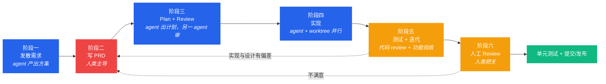

# 文档驱动的 AI 工作流（本项目定制版）

```
状态：已定稿
负责人：项目发起人 + 全部 agent
最后更新：2026-10-17
上游依据：https://tyksworks.com/posts/ai-coding-workflow-zh/ （tyk《独立开发者的文档驱动 AI 编程实践》，CC BY 4.0）
          参考 PRD 样例：https://tyksworks.com/posts/construction-prd-zh/ （本地副本 reference/tyk-construction-prd-zh.txt）
下游影响：docs/workflow/01~04、所有 PRD 的写作方式、所有实现任务
```

---

## 0. 这份文档为什么存在

tyk 的核心论点：**在 AI 编程时代，文档是新的源代码**。人从「写代码」上移到「定义行为 + 维护文档 + 把握方向」，agent 负责从文档翻译成实现。

我们直接采用它的两套工作流，并按本项目的约束做定制：

| 工作流 | 适用 | 本项目中的典型任务 |
| --- | --- | --- |
| **文档主导**（六阶段） | 体量大、方向相对明确 | 需求与情绪系统、事件叙述者、威胁与防卫、时代进程、整合包规格 |
| **原型主导**（对话式） | 体量小、方向模糊 | UI 布局手感、数值调优、某个 mod 的兼容性试验、Starlark 图案试作 |

**判断规则**：
- 预期改动 > 3 个文件 / 涉及新数据模型 / 涉及存档格式 / 涉及玩家可见规则 → **文档主导**。
- 预期是一个下午能做完、且做完就知道对不对 → **原型主导**（做完后若变复杂，回到文档主导重做，见 §7）。

---

## 1. 六阶段流水线



**铁律 R-WF-1**：任何时候发现「实现和文档不一致」，**先改文档**（阶段二），再决定重走哪几阶段。禁止直接改代码来「顺手对齐」。

---

## 2. 阶段一 · 发散需求（agent 主导）

**目标**：把模糊的想法扩成 2–3 个**纯游戏逻辑**方案（不含技术内容）。

**做法**（照抄 tyk 的 prompt 模板并定制）：

```
我在设计【系统名】，背景是【一句话：这块玩法要解决什么体验问题】。
现有事实：基底 mod Folkways 已提供【列出相关已有能力，引用 docs/research/*】
请你：
1. 调研同类游戏（Dwarf Fortress / Songs of Syx / RimWorld / Stonehearth / 以及 MC 生态 mod）里类似系统怎么做
2. 扩充并细化功能，指出玩家视角下的具体表现
3. 给我 3 个**纯游戏逻辑**设计方案（不要技术内容、不要代码），写进 markdown
4. 明确列出方案之间的取舍差异，以及你不确定的地方
有不懂的可以问我。
```

**硬要求**：
- 产出放在 `docs/research/drafts/` 下，命名 `draft-<系统>-<日期>.md`。
- 必须显式调研竞品（引用 `docs/design/02-benchmark.md` 的机制表）。
- **禁止**在这个阶段写技术实现、文件路径、类名、代码片段。
- 允许 agent 用多个子代理并行调研，但每个子代理必须把结果写成独立 md。

**出口条件（DoD）**：人类读完 3 个方案，能明确说「我要哪个、砍掉哪些」。

---

## 3. 阶段二 · 写 PRD（人类主导，最关键）

> tyk：这一步占开发时间的 50% 甚至更多；这篇文档是项目的核心资产。

**我们的 PRD 模板**见 [PRD 模板](../prd/00-prd-template.md)，它照搬了参考样例的结构并做了扩展：

| 章节 | 为什么必须有 |
| --- | --- |
| 概述 | 一段话讲清它给玩家什么体验 |
| 概念/术语 | 术语不清 → agent 按自己的理解写几百行错代码 |
| 状态定义 / 事件定义 / 扩展变量 | 把系统写成可判定的状态机 |
| 状态转移表 + 状态图 | 冲突与边界在这里暴露 |
| 交互 | 玩家怎么操作、快捷键、操作模式状态机、右键菜单 |
| 反馈 | 按触发源组织的音效/Toast/视觉/系统行为表 |
| 规则（R 编号） | 强制/禁止条款，可转成测试 |
| 流程（Task/Action） | 与基底引擎的任务/动作框架对齐 |
| 计算逻辑与数值配置 | 公式与默认值，改数值只改这里 |
| **验收检查** | 边界定义，且**逐条可转成测试** |
| 待细化 | 明确知道没定的部分（禁止装作已定） |

**人类在此阶段必须亲自做的事**（不可外包）：
1. 读上一阶段的方案，砍到「本轮只做这个」。
2. 定义术语，消除歧义（尤其与 Folkways 已有术语的冲突，如 Zone / Order / Vocation / Doing）。
3. 写死验收标准（AC），每条能判定真假。
4. 决定**不做什么**（明确写进「本次不做」）。

**出口条件（DoD）**：
- [ ] 术语表无自相矛盾，且与 `docs/design/03-glossary.md` 一致。
- [ ] 每条 AC 都可以翻译成一条测试或一条人工检查步骤。
- [ ] 「本次不做」清单非空（防止范围蔓延）。
- [ ] 与基底 API 的能力边界一致（引用 `docs/research/04-content-and-modding.md`）。

---

## 4. 阶段三 · Plan + Review（agent 主导，人把关）

**流程**（照 tyk 的做法：不同模型各擅其场）：


**计划必须包含**：
1. 涉及哪些模块/插件/数据包货架（引用具体路径）。
2. 数据模型与存档影响（**是否有新字段、是否要版本迁移**）。
3. 与 Folkways 公共 API 的交互点（引用 `core/api` / `front/api` 具体类）。
4. 网络同步与客户端预测（若涉及 UI）。
5. i18n 影响（**新增键为双语 `zh_cn` + `en_us`**；上游既有键仍是四语言）。
6. 性能成本估算（tick 预算，见 [测试与验收策略](03-test-and-acceptance.md)）。
7. **测试计划（TDD）：先写哪些测试，再写实现。**

**硬要求 R-WF-2**：计划里必须显式写「TDD」并列出测试清单；没有测试清单的计划不予通过。

**出口条件（DoD）**：
- [ ] 两轮 review 完成，无致命问题。
- [ ] 人类确认（可只扫一眼主干与交互点）。
- [ ] 计划中每条改动都能追溯到 PRD 的某个章节。

---

## 5. 阶段四 · 实现（agent 主导，worktree 并行）

- **分支**：`feat/<prd编号>-<短名>`；每个 PRD 一个 feature 分支。
- **并行策略**（照 tyk）：主 feature 由 agent 实现时，人类/另一个 agent 在 2 个左右的 worktree 做正交小任务，降低空转。
  - 注意事项：Folkways 仓库的 `.claude/settings.json` 用 `symlinkDirectories` 共享 `node_modules` 与 `.blockwright-store` —— 我们的工程沿用同样的做法。
- **提交规范**：`type(scope): summary`，例如 `feat(needs): add warmth need`、`fix(mood): keep grief from stacking`。
- **编码约定**（继承基底）：无 tab、无行尾空白；玩家可见字符串必须进**双语目录（`zh_cn` + `en_us`）**（上游既有四语言文件保留不动）；翻译文本在到达客户端前保持为 `Component`。
- **禁止**：在实现阶段「顺手」改 PRD 未覆盖的行为；发现需要改，回到阶段二。

**出口条件（DoD）**：代码可编译；TDD 测试全绿；自测通过；未引入新的警告。

---

## 6. 阶段五 · 测试 + 迭代

分两层（对应 tyk 的「代码侧 review」与「功能侧 review」）：

### 6.1 代码侧（agent 自行修正）
- 让 agent 对本次 diff 做 2 轮 review（不同模型/不同视角），重点找**破坏性 bug**：存档越界、null、并发/线程、性能退化（每 tick 分配）。
- 不过度关注风格细节。

### 6.2 功能侧（人工为主，工具化辅助）
- 按 PRD 的「验收检查」逐条走。
- 能自动化的（无头测试、gametest、i18n、类型检查）必须自动化；不能自动化的写成**人工检查清单**（见 [测试与验收策略](03-test-and-acceptance.md)）。
- **偏差处理**：发现与设计不符 → 改文档 → 重走相关阶段（可能只重走阶段二+三）。

---

## 7. 阶段六 · 人工 Review

- 生成 review 清单的 prompt（见 [提示词模板库](04-prompts.md) P6）。
- 人类重点看：**主干与架构、系统之间的交互点、存档兼容、玩家可见规则**，而不是每一行。
- 人类可要求 agent 改代码，但改完仍需重跑阶段五的检查。

---

## 8. 收尾 · 单元测试批次

在提交/发布前，额外让 agent 补一批测试，要求：
1. 简洁可维护；
2. 只覆盖关键逻辑；
3. 关注**系统交界点**（API 边界、存档读写、状态迁移），而不是内部实现细节。

> tyk 的经验：近乎零成本的单元测试会让开发体验舒适很多；测试写得不好也可以随时删掉重写。

---

## 9. 原型主导工作流（小任务）

```
模糊想法 → 对话式原型 → 复杂性膨胀？──否──> 继续迭代
                              │
                              是
                              ↓
                    让 agent 读代码生成功能文档 → 切回文档主导重做
```

**本项目中的适用范围**：
- 单个 Starlark 图案试作（满意后再补 `docs/pack/02-config-and-datapack.md` 登记）。
- UI 手感试验（按键/布局/反馈），满意后写 PRD。
- 与某个 mod 的兼容性验证。

**硬要求 R-WF-3**：原型阶段的产物**不得**直接进入正式发布；要么补文档，要么删除。禁止出现「没有文档但已经在整合包里」的行为。

---

## 10. 本项目的特殊约束（与参考文章不同的地方）

| # | 约束 | 对工作流的影响 |
| --- | --- | --- |
| 1 | **基座是别人的 pre-release mod，且我们已 fork（ADR-007）** | 阶段三要额外评估两件事：① 我们的改动属于哪一层（L1/L2/L3，见 [fork 策略](../design/12-fork-strategy.md)）；② 上游同步成本。维护「改动登记表」代替原来的「API 使用清单」 |
| 2 | **Windows 开发环境，Blockwright 仅 Linux x64** | 阶段五的自动化分层：Windows 跑构建/单测/i18n/类型检查；e2e/视觉/bench 交 Linux（WSL2 或 CI runner） |
| 3 | **整合包 ≠ 一个 mod** | 还存在「mod 选择与配置」这条并行工作流：候选 mod → 兼容性验证（原型主导）→ 登记进 `docs/pack/01-modlist.md` → 更新起来 |
| 4 | **玩家可见文本双语（`zh_cn` + `en_us`）** | 翻译是实现的组成部分，不是收尾工作；PRD 里必须列 i18n 影响 |
| 5 | **存档是玩家资产** | 任何数据模型变更都要在计划里写迁移策略；破坏性变更必须显式说明 |
| 6 | **目标是「好玩」，不是「功能全」** | 每个 PRD 必须写「它让玩家产生了什么新决策/新故事」，否则驳回 |

---

## 11. 人类必须介入的决策点（不可自动化）

| 编号 | 决策点 | 为什么必须人来 |
| --- | --- | --- |
| H1 | 本轮做什么、不做什么（范围裁剪） | 价值判断，AI 倾向于全都要 |
| H2 | 术语与叙事口吻 | 影响整个项目的语言一致性 |
| H3 | 验收标准（AC） | 定义「什么叫做对了」，AI 会自我放宽 |
| H4 | Plan 的最终确认 | 定向错误会浪费大量 token 与时间 |
| H5 | 玩家体验的主观判断（好玩/不好玩） | 唯一无法自动化的核心指标 |

---

## 12. 反模式（禁止）

| 反模式 | 症状 | 后果 |
| --- | --- | --- |
| 无 PRD 直接写代码 | 「我先做个原型」然后原型进了发布 | 无人能维护，AI 也无法接手 |
| 文档与代码双轨漂移 | 代码改了文档没改 | 后续 agent 按错误文档写新功能 |
| 一次 PRD 覆盖三个系统 | PRD 标题里带「和」 | review 无法收敛，验收无法判定 |
| 把技术方案写进阶段一 | 方案里出现类名/文件路径 | 过早收敛，扼杀更好的设计 |
| 跳过 Review 直接实现 | 「这次很简单」 | 计划缺陷被放大到代码里 |
| 用「更丰富」当需求 | AC 写成「体验更好」 | 无法验收，注定返工 |
| 无视性能成本 | 新增每 tick 遍历全部居民 | TPS 崩，回滚重做 |

---

## 13. 每个 PRD 的流转状态（放在 PRD 头部）

```
状态：发散 → 草稿PRD → PRD定稿 → 计划中 → 实现中 → 测试中 → 人工评审 → 已发布 → 已废弃
```

每次状态变更，在 PRD 的「变更记录」小节追加一行（日期 / 状态 / 一句话 / 操作者）。

---

## 14. 一句话总结

> **对大规模、定义明确的功能：以文档为核心，走六阶段流水线；对重要且易描述的系统：持续维护文档；对其它：见机行事。**
> 所有人类介入都集中在「定义行为」与「判断好玩」两件事上；其余交给 agent，并用测试与 review 兜住风险。