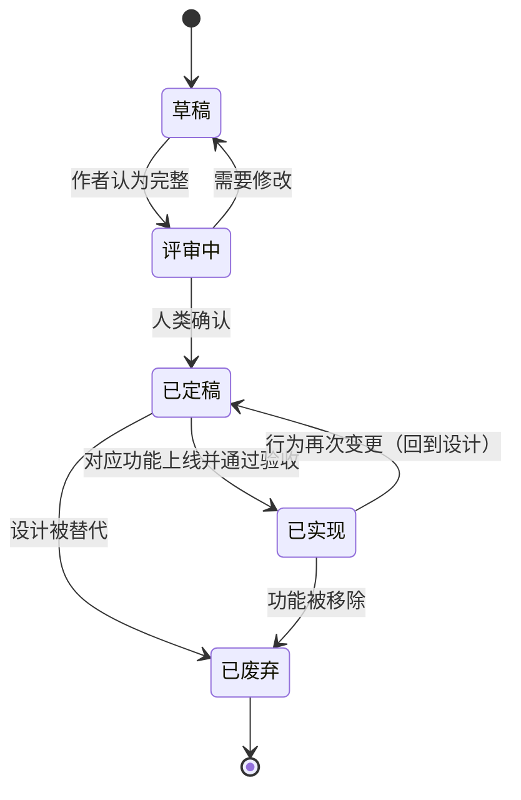

# 文档生命周期

```
状态：草稿
负责人：项目发起人
最后更新：2026-10-17
上游依据：docs/workflow/00-ai-workflow.md、参考文章《文档的生命周期》一节
```

> 参考文章的核心判断：文档不是一律要维护，也不是一律用完即弃。用两个维度分类：
> **X 轴 = 是否容易被自然语言描述**（形式化工具也算），**Y 轴 = 是否核心系统**。
> 位于「核心 + 易描述」象限的系统，持续维护文档的 ROI 最高。

---

## 1. 四象限判定

```
                     核心系统
                        ▲
        Q2 视情况而定    │    Q1 持续维护
   （难以描述 + 核心）   │  （易描述 + 核心）
                        │
  难以描述 ◄────────────┼────────────► 容易描述
                        │
        Q4 跳过文档      │    Q3 用完即弃
   （难以描述 + 非核心） │  （易描述 + 非核心）
                        ▼
                     非核心系统
```

| 象限 | 策略 | 判定问题 |
| --- | --- | --- |
| **Q1 持续维护** | 文档即代码：改行为先改文档；定期核对文档与实现 | 它是核心玩法吗？能用状态机/表格/公式写清楚吗？ |
| **Q2 视情况而定** | 写「架构说明 + 决策记录」，不写逐行行为；重点记录不变量与性能约束 | 它难以描述是因为本质复杂，还是因为我们没想清楚？ |
| **Q3 用完即弃** | 写完、实现完、验证完即可归档 | 半年后还会有人读它吗？ |
| **Q4 跳过文档** | 不写文档，靠代码与注释 | 它对玩家行为有影响吗？ |

---

## 2. 本项目文档分档

| 文档/系统 | 象限 | 策略 | 复核周期 |
| --- | --- | --- | --- |
| 项目章程 | Q1 | 持续维护 | 每里程碑 |
| 愿景与设计支柱 | Q1 | 持续维护 | 每里程碑 |
| 全局术语表 | Q1 | 持续维护（新增术语必须当日登记） | 每个 PRD |
| 对标分析 | Q1→Q3 | 立项期持续，进入实现后基本冻结 | 每里程碑 |
| 设计纲要（d04~d11） | Q1 | 持续维护 | 每个相关 PRD |
| 核心系统 PRD（需求/情绪、事件、威胁、进程、意图层、经济、剧本） | Q1 | 持续维护 | 每次行为变更 |
| 次要系统 PRD（单个装饰建筑、单个图案、单个模型） | Q3 | 用完即弃 | 不复核 |
| 整合包规格 / mod 清单 | Q1 | 持续维护 | 每月 + 每次 mod 更新 |
| 性能预算 | Q1 | 持续维护 | 每次新增系统 |
| 工作流文档 | Q1 | 持续维护 | 每季度 |
| 基底调研报告（research 01–05） | Q3 | 上游更新时重跑，结论沉淀进设计文档 | 上游版本变更时 |
| 差距分析 | Q1 | 持续维护（它驱动 PRD 优先级） | 每里程碑 |
| 阶段一调研草稿（drafts） | Q3 | 用完即弃，归档到 `docs/research/drafts/archive/` | 不复核 |
| 实现计划（plans） | Q3 | 实现完成 + 验证通过后归档 | 不复核 |
| 验证报告（reports） | Q3 | 归档（用于回溯「当时验收了什么」） | 不复核 |
| 寻路/规划器内核的细节 | Q2 | 只写不变量、复杂度与性能约束；不写逐行行为 | 改动时 |

---

## 3. 维护触发条件（什么时候必须更新文档）

| 触发 | 必须更新的文档 |
| --- | --- |
| 新增/修改一个玩家可见行为 | 对应 PRD（行为章节 + 验收检查） |
| 新增一个术语 | 全局术语表 + 对应 PRD 的术语节 |
| 数值调整 | 对应 PRD 的「数值配置」章节（**先改这里再改代码**） |
| 新增数据包货架/字段 | 对应 PRD 的「可改写性」+ `docs/pack/02-config-and-datapack.md` |
| 新增/替换 mod | `docs/pack/01-modlist.md`（含许可与版本） |
| 存档格式变化 | 对应 PRD 的「数据与存档」+ `docs/pack/00-pack-spec.md` 的兼容性说明 |
| 性能预算变化 | `docs/pack/03-performance-budget.md` + 对应 PRD |
| 上游 Folkways 变更 | `docs/research/*` 重跑 + 差距分析更新 |
| 发现文档与代码不一致 | **先改文档**，再决定是否改代码 |

---

## 4. 文档腐烂检测（Drift Detection）

**频率**：每个里程碑结束、以及每次大功能合并后。

**做法**（可交给 agent，见 [提示词模板库](04-prompts.md) P8）：

1. 选定范围（例如「需求与情绪系统」）。
2. 让 agent 阅读对应 PRD 与实现代码，逐条列出：
   - 文档写了但代码没做（缺口）；
   - 代码做了但文档没写（野生行为）；
   - 描述不一致（例如默认值不同）。
3. 人类裁决：补文档 / 补代码 / 明确废弃。
4. 在 PRD 的变更记录里留一行。

**R-DOC-1**：任何「代码做了但文档没写」的玩家可见行为，视为**缺陷**（不是 feature），必须在下一个里程碑前处理。

---

## 5. 归档规则

| 类型 | 归档位置 | 保留期限 |
| --- | --- | --- |
| 调研草稿 | `docs/research/drafts/archive/` | 永久（体积小，可追溯设计来源） |
| 实现计划 | `docs/plans/archive/` | 永久 |
| 验证报告 | `docs/reports/` | 永久 |
| 废弃 PRD | 保留原文件，头部标注 `已废弃` + 废弃原因与替代者 | 永久 |
| 过期 mod 清单 | `docs/pack/archive/modlist-YYYY-MM.md` | 至少 2 个版本，便于回滚 |

**R-DOC-2**：归档 ≠ 删除。编号永不复用，链接永不改成指向不存在的目标。

---

## 6. 状态机（文档本身）



> 「已定稿」只表示**设计被确认**，不表示功能存在；「已实现」表示代码与文档一致且验收通过。

---

## 7. 开放问题

| 编号 | 问题 | 计划 |
| --- | --- | --- |
| OQ-D1 | 是否需要自动化脚本检查「PRD 里引用的文件路径是否存在」？ | M1 后评估（低优先） |
| OQ-D2 | 术语表是否需要英文对照的唯一性校验（防止同义异名）？ | M1 前人工检查一次，之后每次新增术语时人工确认 |